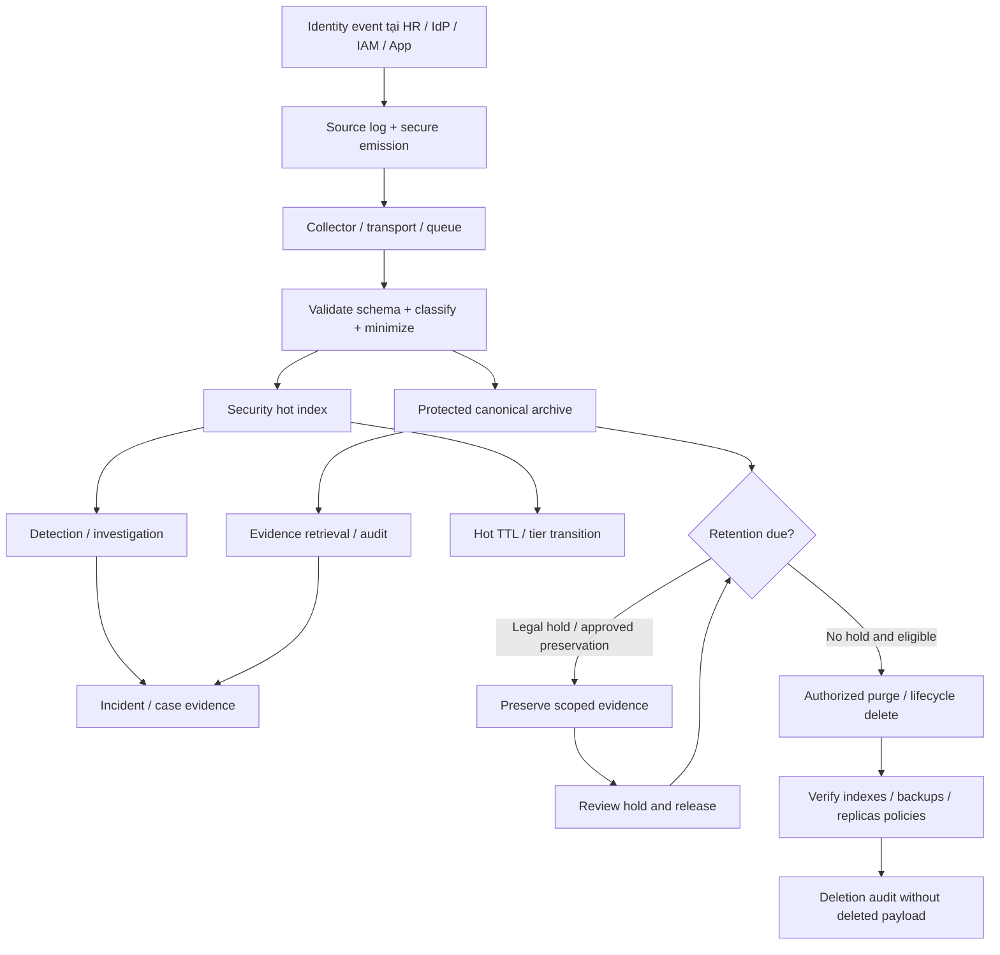

# Log retention trong Identity logging: Chính sách lưu giữ, bảo vệ và hủy nhật ký IAM

**Log retention** là tập hợp chính sách và cơ chế xác định **những bản ghi nhật ký nào cần giữ, giữ trong bao lâu, tại vị trí và tầng lưu trữ nào, ai được truy cập, khi nào chuyển sang lưu trữ dài hạn, và khi nào phải xóa hoặc giữ lại theo ngoại lệ hợp lệ**. Trong quản lý danh tính và truy cập (**IAM**), log retention quyết định tổ chức có thể **điều tra một lần đăng nhập đáng ngờ, chứng minh một quyền đã được phê duyệt, tái dựng một sự kiện Joiner–Mover–Leaver, hoặc xác minh việc thu hồi quyền** sau nhiều tuần, tháng hay năm hay không.

Ví dụ: một nhân viên chuyển từ bộ phận Kế toán sang Kiểm toán ngày 01/11. Ngày 15/12, đội Security phát hiện tài khoản vẫn từng thực hiện một API call với role kế toán cũ. Để phân tích, đội điều tra cần biết **HR event nào gây Mover, IAM đã gửi yêu cầu thu hồi lúc nào, ứng dụng đích có xác nhận hay không, token/session nào còn sống và request đã bị Permit hay Deny**. Nếu nhật ký IdP chỉ được lưu 7 ngày nhưng log ứng dụng còn 90 ngày và audit approval đã bị xóa không có kế hoạch, chuỗi bằng chứng có thể không còn đủ để kết luận. Ngược lại, giữ vô hạn mọi token, địa chỉ IP và dữ liệu người dùng trong log cũng tạo **rủi ro lộ lọt, chi phí và xâm phạm quyền riêng tư**.

Bài thuộc chương **Identity logging** trong module `SECURITY_IDENTITY_ACCESS_MANAGEMENT_IDENTITY_LIFECYCLE`. Module này nghiên cứu **vòng đời danh tính Joiner–Mover–Leaver (JML)**, từ xác minh, tạo account và cấp quyền tới rà soát, đổi vai trò và thu hồi; nội dung liên kết **IdP, SSO, SCIM, RBAC/ABAC, tài khoản dịch vụ, kiểm toán và giảm quyền truy cập tồn dư**. Ở đây, **Log retention** là một lớp quản trị bằng chứng xuyên suốt mọi giai đoạn, không chỉ là cấu hình một tham số thời gian trên SIEM.

Sau khi học, bạn có thể:
- Phân biệt **retention, availability, indexing, archival, backup, immutability, legal hold và deletion**.
- Phân loại dữ liệu audit IAM để chọn **mục đích, thời hạn, nơi lưu, mức bảo vệ và thời điểm xóa**.
- Thiết kế retention theo **threat model, nhu cầu điều tra, nghĩa vụ áp dụng và tối thiểu hóa dữ liệu**, không sao chép thời hạn “chuẩn” thiếu căn cứ.
- Xây dựng pipeline có độ phủ, integrity, audit trail, tiering, legal hold và deletion có kiểm chứng.
- Liên kết log identity với IdP/SSO, MFA, SCIM provisioning, PAM, authorization, access review, API key và non-human identity.
- Định nghĩa KPI, tình huống thực tế, kiểm thử, quy trình review và vận hành vòng đời lưu giữ.

> **Nguyên tắc:** Log retention tốt không có nghĩa “giữ càng lâu càng an toàn”. Nó có nghĩa **giữ đủ bằng chứng cần thiết trong thời gian có căn cứ, không giữ dữ liệu bí mật không cần thiết, bảo vệ khỏi sửa/xóa trái phép, và chứng minh được việc xóa đúng hạn khi không còn nghĩa vụ lưu giữ**.

## 1. Vì sao log retention quan trọng với IAM?

IAM là một chuỗi hệ thống phân tán: HRIS, danh bạ, IdP, SSO, IGA, PAM, ứng dụng SaaS, cloud IAM, database, API gateway và SIEM. Một thay đổi danh tính có thể sinh sự kiện ở nhiều nơi; các hệ thống đó không tự có cùng thời hạn giữ log.

Một cuộc điều tra cần tái dựng:
1. **Ai hoặc workload nào** là subject thực sự?
2. **Quan hệ và trạng thái JML** tại thời điểm sự kiện là gì?
3. **Ai đề nghị và ai duyệt** thay đổi quyền?
4. **Entitlement nào** được cấp hoặc thu hồi, do nguồn nào?
5. **Đích đã thực thi** thay đổi hay chỉ nhận request?
6. **Chính sách và phiên bản** nào dẫn tới Permit/Deny?
7. **Phiên, token hoặc credential nào** đã được dùng?
8. **Request và tác động nghiệp vụ** nào đã xảy ra?
9. **Log có đầy đủ, chính xác và còn nguyên vẹn** không?
10. **Giới hạn điều tra** là do không có sự kiện hay do thiếu log?

Nếu chỉ lưu một dòng “user removed” ở IAM, đội điều tra không biết ứng dụng đích đã **thực sự mất quyền** hay chưa. Nếu giữ log cấp quyền nhưng xóa log thu hồi quá sớm, báo cáo recertification có thể kết luận nhầm rằng quyền còn tồn tại hoặc đã được gỡ.

### 1.1. Hai rủi ro đối nghịch

| Thiếu retention | Retention quá mức hoặc kém bảo vệ |
| --- | --- |
| Không điều tra được hành vi xảy ra trước thời điểm xóa | Tích lũy PII, metadata hành vi và thông tin nhạy cảm |
| Không chứng minh được approval/revoke | Tăng hậu quả nếu SIEM/archive bị xâm nhập |
| Khó phân biệt provisioning fail và API misuse | Chi phí lưu, truy vấn và vận hành tăng |
| Mất bằng chứng khi sự cố phát hiện muộn | Giữ dữ liệu không còn mục đích hợp lệ |
| Không đáp ứng thời gian lưu bắt buộc nếu có | Có thể xung đột nguyên tắc bảo vệ dữ liệu áp dụng |
| Không có dữ liệu phân tích xu hướng | Bản sao log ngoài quản trị có thể tồn tại vô hạn |

Mục tiêu là **cân bằng có thể giải trình**: dữ liệu đúng, đủ, cần thiết, bảo vệ đúng và xóa đúng.

## 2. Khái niệm cần phân biệt

| Khái niệm | Ý nghĩa | Không đồng nghĩa |
| --- | --- | --- |
| **Log collection** | Thu nhận event từ nguồn | Đã lưu đủ lâu |
| **Retention period** | Khoảng thời gian bản ghi phải/có thể được giữ theo policy | Log luôn được tìm kiếm nhanh trong khoảng đó |
| **Searchable retention** | Khoảng thời gian log còn trong chỉ mục tìm kiếm | Toàn bộ thời gian retention |
| **Archive** | Lưu trữ ít truy vấn, phục hồi chậm hơn | Backup của hệ thống |
| **Backup** | Bản sao để khôi phục sau lỗi/mất dữ liệu | Kho audit chính luôn tìm được từng event |
| **Immutability/WORM** | Kiểm soát chống sửa/xóa trong thời gian/điều kiện quy định | Chống được mọi kiểu mất mát hay mọi cấp admin |
| **Legal hold/preservation hold** | Tạm ngăn xóa bằng chứng trong phạm vi có căn cứ | Gia hạn retention của mọi dữ liệu |
| **Deletion/purge** | Xóa dữ liệu khỏi phạm vi quản lý được xác định | Chỉ xóa index hoặc ẩn kết quả tìm kiếm |
| **Crypto-erasure** | Làm dữ liệu mã hóa không thể giải mã bằng cách hủy khóa phù hợp | Đảm bảo mọi bản sao/khóa dự phòng đều đã xử lý |
| **Data minimization** | Chỉ thu và giữ dữ liệu cần cho mục đích hợp lệ | Xóa hết bằng chứng an ninh |
| **Retention schedule** | Bảng phân loại dữ liệu–thời hạn–phương pháp xử lý cuối | Một TTL duy nhất của SIEM |

### 2.1. Retention không phải TTL của phiên truy cập

Đừng nhầm:
- **Session TTL**: thời gian phiên đăng nhập được phép tồn tại.
- **Token lifetime**: hiệu lực của access token.
- **Credential expiry**: khi API key/certificate không còn hợp lệ.
- **Log retention**: lưu lại **sự kiện** liên quan trong bao lâu.

Ví dụ access token hết hạn sau một giờ nhưng event “token issued”, “privileged API Permit” hoặc “revoke attempted” có thể cần được giữ nhiều tháng tùy policy. Không dùng lifetime của token làm TTL mặc định cho audit.

### 2.2. Retention không phải thời gian phát hiện

**Detection window** của SIEM có thể là 30 ngày, còn audit log liên quan có thể được giữ 365 ngày trong archive, với cơ chế truy xuất theo yêu cầu. Ngược lại, có hệ thống lưu log 2 năm nhưng chỉ giám sát realtime trong vài giờ. Hai khái niệm phải được thiết kế riêng.

### 2.3. Retention không đồng nghĩa tính đầy đủ

Một hệ thống giữ “mãi mãi” vẫn không giúp điều tra nếu:
- Không thu sự kiện từ API phụ.
- Bị mất event do queue đầy.
- Event thiếu subject/correlation ID.
- Timestamp sai lệch.
- Source chỉ ghi successful login mà bỏ denied attempts.
- Log bị làm giả hoặc sửa trước khi tới archive.

**Thời hạn dài không sửa được telemetry chất lượng thấp**.

## 3. Vòng đời một bản ghi identity log

Một bản ghi có thể đi qua các bước:



Một bản ghi có thể có:
- **Bản gốc tại hệ thống nguồn**.
- **Bản đã chuẩn hóa** trong SIEM.
- **Bản archive** được bảo vệ.
- **Bản trích dẫn** trong incident case.
- **Bản sao** trong backup, export hoặc data lake.

Muốn tuyên bố “đã xóa”, phải hiểu phạm vi **mọi bản sao được quản trị** và chính sách riêng của chúng; không chỉ xoá một chỉ mục.

## 4. Phân loại log IAM trước khi ấn định thời hạn

Không nên áp một retention period duy nhất cho mọi loại event. Cần nhóm theo **mục đích sử dụng, mức độ rủi ro, yêu cầu bằng chứng, dữ liệu cá nhân và nguồn thu thập**.

| Nhóm log | Ví dụ event | Giá trị điều tra |
| --- | --- | --- |
| **Identity lifecycle/JML** | Joiner verified, Mover effective, Leaver initiated | Chứng minh vì sao danh tính được tạo/đổi/thu hồi |
| **Account provisioning** | SCIM CREATE/PATCH/DELETE, app disable, retries | Xác minh target đã thực hiện thay đổi |
| **Authentication/SSO** | Login success/failure, session start/end, SSO federation | Điều tra chiếm account, hành vi đăng nhập |
| **MFA** | Challenge success/failure, enrollment, factor reset | Điều tra bypass hoặc factor takeover |
| **Authorization** | PDP Permit/Deny, API action, scope checks | Phân tích truy cập trái policy |
| **Entitlement change** | Role granted/revoked, group membership, direct app grant | Quyền nào tồn tại tại thời điểm nào |
| **Access request/approval** | Request, approve, reject, exception | Bằng chứng thẩm quyền |
| **Access review/recertification** | KEEP, REVOKE, remediation verified | Chứng minh kiểm tra quyền |
| **SoD** | Conflict detected, transaction self-approval denied | Phát hiện xung đột nhiệm vụ |
| **PAM/emergency access** | JIT activation, break-glass, session command | Bằng chứng quyền đặc biệt |
| **Non-human/service identity** | Principal created, API key rotated, token exchanged | Truy vết workload và credentials |
| **Policy/admin changes** | IAM rule modified, audit config changed | Phát hiện tác động tới kiểm soát |
| **Pipeline/collector health** | Source lag, dropped events, checksum mismatch | Đánh giá độ tin cậy bằng chứng |
| **Deletion/hold operations** | Hold created, purge approved, object deleted | Chứng minh quản trị retention |

### 4.1. Chiều phân loại thứ hai: mức dữ liệu nhạy cảm

Cùng loại log có thể chứa:
- Identity ID, account ID, tenant ID.
- IP, device identifier, địa chỉ email.
- Business object ID.
- Role và resource names.
- Session identifier/token fingerprint.
- Thông tin đăng nhập nhạy cảm.
- Payload ứng dụng chứa dữ liệu cá nhân.

**Không lưu raw password, OTP, TOTP seed, access/refresh token, private key, API secret, session cookie hoặc mã khôi phục trong identity log**. Retention không hợp thức hóa việc ghi bí mật. Nếu hệ thống nguồn đã vô tình log secret, cần xử lý **sự cố dữ liệu/credential** chứ không chỉ đặt TTL ngắn.

## 5. Cấu trúc policy retention có thể giải trình

Một policy đầy đủ nên xác định ít nhất:

1. **Data category:** loại event và mục đích.
2. **Source systems:** IdP, IAM, PAM, SCIM, cloud, target app, SIEM.
3. **Data owner/controller:** ai quyết định thời hạn và chia sẻ.
4. **Security owner:** ai vận hành pipeline và bảo vệ log.
5. **Business/legal basis:** nhu cầu điều tra, audit, nghĩa vụ áp dụng.
6. **Retention start event:** mốc nào bắt đầu tính tuổi log.
7. **Hot/searchable period:** cần tìm nhanh trong bao lâu.
8. **Archive period:** giữ truy xuất theo yêu cầu tới khi nào.
9. **Access control:** người/đội nào đọc được.
10. **Protection:** mã hóa, tamper-evidence, backup, immutable storage.
11. **Hold exceptions:** khi nào được đóng băng deletion, ai duyệt.
12. **Deletion method:** cách xử lý khi hết hạn.
13. **Evidence of deletion:** gì chứng minh purge đã chạy.
14. **Review/version:** ai duyệt policy và ngày cập nhật.
15. **Scope/jurisdiction:** policy áp cho vùng dữ liệu nào.

### 5.1. Không gán một thời hạn “luật định” cho mọi tổ chức

Thời hạn giữ log thực tế có thể chịu ảnh hưởng của **pháp luật bảo vệ dữ liệu, an ninh mạng, nghĩa vụ giao dịch/tài chính, hợp đồng, ngành nghề, quốc gia và yêu cầu tố tụng/điều tra**. Những yêu cầu này khác nhau về dữ liệu, chủ thể và hoàn cảnh.

Không có một con số như “mọi log IAM phải giữ đúng 1 năm” áp dụng phổ quát. Khi thiết kế thật, đội **Legal/Privacy/GRC** cần đối chiếu **quy định hiện hành đúng phạm vi pháp lý**, kiểm tra ngoại lệ và xác nhận policy bằng văn bản. Tài liệu này không thay tư vấn pháp lý.

### 5.2. Bảng thời hạn *minh họa thiết kế*, không phải chuẩn

| Nhóm ví dụ | Searchable | Archive sau hot | Mục đích |
| --- | ---: | ---: | --- |
| Authentication telemetry thông thường | 30 ngày | Đến tổng 180 ngày | Điều tra đăng nhập gần đây và xu hướng |
| Privileged session metadata | 90 ngày | Đến tổng 365 ngày | Điều tra thay đổi đặc quyền |
| IAM grant/revoke + approval evidence | 90 ngày | Đến tổng 730 ngày | Tái dựng quyền và chứng nhận kiểm soát |
| Source connector health | 14 ngày | Đến tổng 90 ngày | Chất lượng pipeline và mất event |
| Deletion/hold audit metadata | 90 ngày | Đến tổng 730 ngày | Chứng minh quản trị dữ liệu |

**Các con số này hoàn toàn mang tính minh họa**, không là khuyến nghị mặc định hay cam kết tuân thủ. Mỗi tổ chức phải xây ma trận được duyệt; một số event cần giữ ngắn hơn hoặc lâu hơn, và bản trích xuất trong hồ sơ điều tra có thể có retention khác.

### 5.3. Đọc đúng “tổng retention”

Nếu một event có:
- Hot: 30 ngày.
- Warm: 60 ngày tiếp theo.
- Cold: 275 ngày tiếp theo.

thì **tổng retention là 365 ngày kể từ mốc tính tuổi đã định nghĩa**, không phải 30 + 60 + 365. Phải ghi rõ các giai đoạn là **cộng dồn hay thời hạn đến mốc**.

## 6. Chọn thời điểm bắt đầu tính retention

Một log có nhiều mốc thời gian:

| Trường | Ý nghĩa |
| --- | --- |
| `eventOccurredAt` | Khi sự kiện xảy ra tại nguồn |
| `sourceRecordedAt` | Khi nguồn ghi event vào log |
| `ingestedAt` | Khi collector nhận |
| `indexedAt` | Khi hệ thống tìm kiếm lập chỉ mục |
| `archivedAt` | Khi dữ liệu chuyển vào archive |
| `policyEffectiveAt` | Khi retention policy version có hiệu lực |
| `holdAppliedAt` | Khi lệnh giữ bằng chứng được áp |
| `deletionEligibleAt` | Khi record đủ điều kiện xóa theo chính sách |
| `deletedAt` | Khi thao tác xóa được thực hiện/xác minh |

**Không dùng tùy tiện `ingestedAt` thay cho `eventOccurredAt`**. Nếu event đến trễ 20 ngày, policy retention dựa trên event time có thể cho thời gian lưu sau ingest ngắn hơn dự kiến. Có thể quy định một **minimum ingest safety window** riêng, nhưng cần ghi minh bạch để tránh phá điều kiện pháp lý hoặc giữ quá mức.

### 6.1. Event đến muộn

Giả sử event xảy ra 01/01 nhưng do mạng lỗi đến SIEM ngày 20/02. Chính sách có thể đặt:
- Thời hạn tính từ event date, cộng điều kiện không được purge trước khi xử lý xác minh.
- Hoặc từ collection/record creation nếu nghĩa vụ cụ thể yêu cầu vậy.

**Không có một mốc duy nhất đúng cho mọi dữ liệu**. Chọn mốc dựa trên mục đích và nghĩa vụ có căn cứ; ghi mốc vào policy, không suy từ cấu hình TTL mặc định của database.

### 6.2. Timestamp phải có ngữ nghĩa và time zone rõ

- Dùng timestamp có timezone/offset, thường chuẩn hóa UTC.
- Đồng bộ đồng hồ nguồn và giám sát clock skew.
- Không tin timestamp do client không đáng tin gửi.
- Ghi phân biệt *event occurred*, *ingested*, *processed*.
- Giữ source identifier và sequence/correlation để tái dựng thứ tự khi clock lệch.

## 7. Metadata giúp retention có thể tự động hóa

Ví dụ record log có schema được chuẩn hóa:

```json
{
  "eventId": "evt-iam-90218",
  "eventType": "ENTITLEMENT_REVOKE_APPLIED",
  "eventCategory": "IAM_ACCESS_CHANGE",
  "subjectIdentityId": "iam-user-1042",
  "targetAccountRef": "finance-saas/account-418",
  "action": "entitlement.revoke",
  "resourceRef": "finance-saas/role/payment-maker",
  "requestId": "jml-mover-811",
  "actorType": "SYSTEM",
  "actorId": "scim-provisioner",
  "eventOccurredAt": "2026-11-23T02:00:11Z",
  "ingestedAt": "2026-11-23T02:00:17Z",
  "outcome": "APPLIED",
  "policyVersion": "jml-access-v6",
  "retentionClass": "IAM_ACCESS_CHANGE",
  "correlationId": "jml-811",
  "evidenceSource": "target-connector-readback"
}
```

**Dữ liệu giả lập**: không chứa password hoặc token. Các trường phải được kiểm tra nguồn và authenticity; không tự chấp nhận `retentionClass` do bất kỳ client nào gửi để buộc hệ thống xóa sự kiện sớm.

### 7.1. Retention class phải được xác định bởi hệ thống tin cậy

- Source event type và source classification được quản trị.
- Policy mapping có version.
- Tầng ingestion xác định/kiểm tra `retentionClass`.
- Không để application payload tự đặt `retentionDays: 0` hoặc `legalHold: false` rồi được chấp nhận trực tiếp.
- Có fallback an toàn khi event chưa phân loại: quarantine/classification queue có owner và thời hạn, không giữ vô hạn hoặc xóa ngay vì thiếu metadata.

## 8. Identity correlation: Cùng sự kiện ở nhiều hệ thống

Một lifecycle event thường xuất hiện dưới các tên khác:

```text
HRIS    : worker-342 changed department
IAM     : identity iam-user-1042 role transition requested
IdP     : group finance-makers removed
SCIM    : PATCH group membership sent
SaaS    : entitlement removed from account-418
API     : payment.create denied for old session
Audit   : verification succeeded
```

Để tái dựng chuỗi, cần lưu:
- **Canonical identity ID** và native account ID.
- Request/operation/correlation ID xuyên hệ thống.
- Event IDs và causation/parent ID nếu có.
- Resource/entitlement ID ổn định.
- Thời điểm hiệu lực HR và thời điểm thao tác kỹ thuật.
- Outcome: `REQUESTED`, `ACCEPTED`, `APPLIED`, `FAILED`, `VERIFIED`.
- Policy/role mapping version.

### 8.1. Retention của những log liên quan không nhất thiết bằng nhau

Ví dụ:
- Diagnostic HTTP retry log có thể giữ ngắn.
- Kết quả cuối của revoke và approval record có thể giữ lâu hơn.
- Business transaction audit có thể do policy nghiệp vụ riêng chi phối.

**Không cần giữ mọi raw request giống nhau để tái dựng JML**, nếu đã có **evidence record đáng tin, chứa đủ trường và liên kết được**. Nhưng hệ thống không nên phụ thuộc vào một summary dễ bị sửa mà không có nguồn/bảo vệ thích hợp.

### 8.2. ID mapping theo thời gian

Email/username có thể đổi; một account ID có thể được tái sử dụng ở vài hệ thống. Để điều tra log lịch sử, cần:
- Identity ID ổn định.
- Bản đồ native account–identity theo khoảng hiệu lực.
- Nguồn xác minh mapping.
- Timestamps cho đổi tên/rehire.
- Tránh suy từ display name hoặc email đã hết sử dụng.

**Thời hạn lưu mapping/lineage phải đủ để diễn giải những log liên quan mà tổ chức còn cần**, đồng thời tuân thủ tối thiểu hóa và deletion policy.

## 9. Retention cho log Joiner: Từ xác minh đến cấp quyền

Với **Joiner**, bằng chứng thường gồm:
1. HR event có hiệu lực.
2. Identity proofing/enrollment outcome và provenance.
3. Tạo account và xác thực ban đầu.
4. Group/role/entitlement requests.
5. Approval/owner decision.
6. Provisioning operation IdP/SCIM/target.
7. Readback target và quyền hiệu lực.
8. MFA enrollment/credential setup event, không chứa secret.
9. SoD/least-privilege checks.
10. Failure/retry/escalation khi cấp chậm.

### 9.1. Điều gì cần lưu, điều gì không?

| Nên lưu bằng chứng | Không nên lưu trong log thông thường |
| --- | --- |
| `identityId`, source event ID, kết quả xác minh | Ảnh giấy tờ/biometric thô nếu không thật sự có căn cứ, nơi lưu và policy riêng |
| Approver, quyết định, thời điểm | Mật khẩu khởi tạo hoặc OTP |
| Entitlement ID, scope, approval ref | Secret dùng để gọi provisioning API |
| SCIM operation ID, status, readback | Toàn bộ payload chứa trường HR nhạy cảm không cần |
| MFA factor enrolled event | TOTP seed, recovery code |
| Activation thời điểm và outcome | Session cookie/access token nguyên văn |

Log retention cần được thiết kế song song với **privacy/data minimization**: chỉ ghi bằng chứng đủ chứng minh thao tác đã diễn ra và được phép.

### 9.2. Joiner bị cấp quyền sai

Nếu một account mới được cấp admin rồi gỡ sau ba ngày, log cần giúp xác định:
- Ai yêu cầu admin.
- Rule/role mapping nào dẫn đến grant.
- Target đã thực thi lúc nào.
- Có privileged action trong khoảng đó không.
- Thu hồi đã được xác minh khi nào.

Thời hạn lưu đủ cho điều tra có thể phải bao phủ **khoảng phát hiện lỗi trễ**, nhưng không nhất thiết giữ raw HTTP payload chứa PII suốt cùng thời gian.

## 10. Retention cho Mover: Quyền chồng lấn và lịch sử thay đổi

**Mover** dễ phát sinh **privilege creep** khi quyền role cũ chưa bị gỡ nhưng role mới đã được cấp. Cần giữ chuỗi:
- HR transfer/move event và `effectiveAt`.
- Desired access được tính lại theo role mới.
- Revoke requests đối với quyền cũ.
- Provisioning grant quyền mới.
- Target readback cho từng entitlement.
- Session/token có quyền cũ và thời điểm hết hiệu lực.
- SoD assessment và exception decision có hạn.
- Verification sau Mover.

### 10.1. Ví dụ dòng thời gian

```text
09:00 HR Mover: Maker -> Checker (effectiveAt).
09:01 IAM requests Maker revoke.
09:02 IdP group removed.
09:03 SaaS connector reports PENDING.
09:05 Checker assigned.
09:07 SaaS direct Maker grant still PRESENT.
09:08 SoD conflict detected.
09:10 Target direct grant removed.
09:12 Old session denied for Maker action.
09:13 Case marked VERIFIED_RESOLVED.
```

Một điều tra sáu tuần sau cần đủ log để biết **mốc 09:05–09:12 có khả năng truy cập chồng lấn**, không chỉ lưu kết quả cuối.

### 10.2. Giữ đúng phiên bản policy

Nếu policy SoD hoặc role mapping thay đổi sau sự kiện, cần biết **rule version có hiệu lực lúc đó**. Không diễn giải mọi sự kiện lịch sử chỉ bằng policy hiện tại.

**Không giữ bản sao đầy đủ mọi file policy mãi mãi chỉ vì cần version**; có thể dùng immutable policy revision ID và storage quản trị cho chính cấu hình policy theo lịch riêng.

## 11. Retention cho Leaver: Chứng minh đã thu hồi quyền

**Leaver** đặc biệt cần bằng chứng về **thời điểm quyền phải kết thúc** và **quyền thật sự mất hiệu lực**:

| Event/evidence | Ý nghĩa |
| --- | --- |
| HR termination effective | Mốc hết căn cứ nhân sự |
| IdP account disabled | Chặn một đường đăng nhập |
| SCIM/target deprovisioning requested | Đã gửi thao tác |
| Target response APPLIED | Target báo xử lý |
| Target readback account/role absent | Đích không còn grant |
| PAM session terminated | Phiên đặc quyền đã kết thúc |
| Token/credential revoked or expired | Đường xác thực dẫn xuất đã xử lý |
| API effective authorization Deny | Hành động không còn được cho phép |
| Residual access finding | Có quyền còn tồn dư cần điều tra |
| Closed with evidence | Hoàn tất theo tiêu chí kiểm chứng |

### 11.1. “Đã gửi revoke” không phải “đã mất quyền”

Nếu hệ thống chỉ giữ audit `SCIM DELETE requested` nhưng xóa trước log target readback, không thể chứng minh deprovisioning thành công.

Nên có **lifecycle evidence record** gắn cùng correlation ID và status từng target:
- `REQUESTED`.
- `ACCEPTED/PROCESSING`.
- `APPLIED`.
- `VERIFIED_REVOKED`.
- `PARTIAL/FAILED/UNKNOWN`.

### 11.2. Log sau Leaver

Sau khi người dùng Leaver, **attempt dùng account cũ** có giá trị điều tra. Cần giữ event đủ để phát hiện truy cập tồn dư, nhưng không được để logging/account mapping biến thành lý do giữ mọi dữ liệu nhân sự mãi mãi.

## 12. Authentication, SSO và MFA log retention

Nhóm này giúp phát hiện:
- Password spraying/credential stuffing.
- Đăng nhập bất thường.
- MFA fatigue hoặc factor reset.
- Session fixation/abuse.
- Federation trust/configuration errors.
- Logout/session revocation lỗi.

| Event nên có | Ví dụ trường cần giữ |
| --- | --- |
| Login attempted | Subject/account ref, client/app, timestamp, outcome |
| Login success/failure | Auth method class, status, risk signals phù hợp |
| MFA challenged | Factor type, outcome, correlation |
| MFA enrollment/reset | Ai yêu cầu, người phê duyệt, method, thời điểm |
| SSO token issued | Issuer, audience, client, token ID/fingerprint **không chứa token raw** |
| Session revoked | Session reference/hash, cause, outcome |
| Federation policy changed | Issuer/trust configuration version, actor, approval |

### 12.1. Địa chỉ IP và thiết bị

IP, geo, device fingerprint có thể giúp điều tra nhưng cũng là dữ liệu cá nhân/metadata hành vi trong một số chế độ pháp lý. Cần:
- Chỉ thu trường phục vụ mục đích cụ thể.
- Kiểm soát truy cập theo vai trò.
- Giới hạn retention theo data classification.
- Tránh xuất dữ liệu sang công cụ không có căn cứ.
- Nếu dùng geolocation, ghi nguồn và độ tin cậy; không coi vị trí ước lượng là bằng chứng tuyệt đối.

### 12.2. Token secret không phải loggable identifier

Không log full JWT, refresh token, authorization code, session cookie hay MFA recovery code. Nếu cần liên kết request, dùng **token ID (`jti`) hoặc fingerprint một chiều có bảo vệ phù hợp** và tương quan với principal/session metadata. Tránh đưa giá trị bearer raw vào tracing baggage.

## 13. SCIM/Provisioning log retention

Một request SCIM có thể cập nhật nhiều tài khoản, group và thuộc tính. Retention phải phục vụ:
- Đối soát desired/observed state.
- Tìm lỗi cấp/thu hồi quyền.
- Điều tra retry hoặc out-of-order events.
- Phân tích mapping role/group.
- Chứng minh SLA JML.

Một event phù hợp:

```yaml
eventId: prov-evt-1182
eventCategory: IAM_PROVISIONING
operation: REMOVE_GROUP_MEMBER
sourceIdentityId: iam-user-1042
targetRef: saas-finance
targetAccountRef: account-418
entitlementRef: role-payment-maker
requestId: jml-mover-811
attempt: 2
operationStatus: APPLIED
readbackStatus: VERIFIED_ABSENT
policyVersion: provisioning-v9
eventOccurredAt: "2026-11-23T02:00:00Z"
ingestedAt: "2026-11-23T02:00:11Z"
```

**Không lưu toàn bộ SCIM request/response có dữ liệu nhân sự** khi audit chỉ cần ID, changed fields và trạng thái. Nếu cần payload đầy đủ phục vụ debug, dùng nhóm log riêng, retention ngắn hơn và quyền đọc hạn chế.

### 13.1. Retry có tạo sự kiện trùng

Giữ `operationId`, `attempt` và `sourceVersion` để phân biệt:
- Retry cùng một thao tác.
- Request cấp lại quyền do callback cũ.
- Target trả 202 chờ xử lý.
- Đối soát xác nhận đã áp.

Nếu chỉ giữ event cuối cùng, đội điều tra có thể bỏ lỡ **khoảng thời gian truy cập tồn dư** giữa các lần retry.

## 14. Authorization, RBAC/ABAC và PDP/PEP logs

Một hệ thống phân quyền có thể tạo:
- **Policy decision log** tại PDP: Permit, Deny, NotApplicable/Indeterminate tùy policy engine.
- **PEP enforcement log**: API đã chặn hay cho phép request.
- **Business action log**: giao dịch đã commit hay không.
- **Policy/admin change log**: quyền/rule bị sửa.
- **Entitlement readback**: target có role/permission nào.

### 14.1. Ba tầng bằng chứng không đồng nghĩa

| Tầng | Khẳng định được | Chưa khẳng định |
| --- | --- | --- |
| PDP Permit | Policy engine từng quyết định cho phép | Backend đã thực thi hành động thành công |
| PEP Deny | Đường API được kiểm soát đã từ chối | Không có API phụ bypass |
| Business commit event | Tác động đã hoàn tất theo nghiệp vụ | Quyền trước đó chắc chắn hợp lệ |
| IAM role assignment | Quyền mong đợi/được gán | Effective access ở mọi target |
| Target readback | Quyền nhìn thấy ở đích tại thời điểm đọc | Token/session cũ không còn hoạt động |

Retention nên giữ **correlation IDs giữa các lớp** trong thời gian đủ phục vụ điều tra. Không nhất thiết giữ toàn bộ request/response body nếu đã có evidence record phù hợp.

### 14.2. ABAC context có thể nhạy cảm

Policy decision có thể phụ thuộc tenant, resource classification, risk score, device state, thời gian hoặc vị trí. Không nên log toàn bộ attribute values không cần thiết chỉ để giải thích một Deny; có thể ghi:
- Rule/decision ID.
- Minimal context claims phục vụ điều tra.
- Policy version.
- Reason code không tiết lộ chiến lược phòng vệ cho client.
- Evidence reference đến nguồn được bảo vệ.

## 15. PAM, privileged access và emergency logging

Với **PAM/JIT/break-glass**, tổ chức thường có nhu cầu bằng chứng mạnh hơn vì tác động cao.

Các loại:
- Eligibility/activation grant.
- Who requested and who approved.
- Session start/stop.
- Target/role/command metadata.
- Session recording/video hoặc command transcript.
- Credential checkout/rotation event.
- JIT expiry/revoke/readback.
- Emergency access post-use review.

### 15.1. Không áp cùng retention cho transcript và metadata

| Loại | Đặc điểm | Cân nhắc |
| --- | --- | --- |
| JIT grant metadata | Nhỏ, có owner và thời gian | Có thể cần phục vụ audit dài hơn |
| Session command log | Có thể chứa đường dẫn và dữ liệu nhạy cảm | Redaction và phân quyền điều tra |
| Full session recording | Lớn, có nguy cơ chứa PII/secret | Retention riêng, mã hóa, access approval |
| Vault credential event | Chứng minh checkout/rotate | Không chứa secret |
| Post-use review decision | Bằng chứng kết luận và remediation | Liên kết incident/case |

**Ghi hình không tự chứng minh mọi đường API đã được bảo vệ**. Hơn nữa, một recording có thể vô tình chứa secret trên terminal; lưu lâu không kiểm soát làm tăng hậu quả lộ lọt.

### 15.2. Break-glass khi hệ thống audit trung tâm bị lỗi

Một đường truy cập khẩn có thể được dùng khi IdP/SIEM offline. Phải có phương án:
- Ghi local/buffered events trong vùng bảo vệ.
- Hạn chế người có thể sửa/xóa.
- Đồng bộ lại khi log pipeline phục hồi.
- Ghi nhận khoảng telemetry gián đoạn và việc bổ sung bằng chứng thủ công.
- Xác nhận completeness sau sự cố.
- Post-use review độc lập.

**Không tự tuyên bố log retention đạt yêu cầu nếu log không được tạo hoặc không được chuyển về kho trung tâm.**

## 16. Service identity và non-human account logs

Non-human identities thường tồn tại lâu hơn một phiên người dùng và có nhiều keys/tokens. Bằng chứng quan trọng:
- Service principal created/deleted.
- Owner/purpose registered/changed.
- API key/secret issued, rotated, revoked.
- Workload federation trust modified.
- OIDC client credentials token exchange.
- CI/CD deployment run.
- Cloud role/resource grant changed.
- Service account usage và permission scope.
- Service workload decommission verified.

### 16.1. Đừng log secret

Không lưu raw:
- API key.
- Client secret.
- OAuth access/refresh token.
- Private key.
- Database password.
- Kubernetes ServiceAccount bearer token.

Có thể lưu **key ID, credential version, issuer/audience, principal ID, method, outcome và request correlation**. Nếu log key fingerprint, phải chắc rằng cách tạo fingerprint không làm lộ secret hoặc gây khả năng đối chiếu dữ liệu ngoài mục đích.

### 16.2. Ownership sau Leaver

Khi owner người dùng Leaver, service identity có thể vẫn chạy production. Log retention nên giữ:
- Owner cũ/mới và quyết định bàn giao.
- Credential rotation/revocation evidence.
- Quyền quản trị người cũ bị thu hồi.
- Service purpose và workload status.
- Các hoạt động bất thường sau Leaver.

**Không suy rằng xóa human account xong thì service API key cũng bị revoke**. Cần log ở target và kiểm chứng.

## 17. Thiết kế tầng lưu trữ: Hot, warm, cold

Retention dài không nhất thiết đòi giữ toàn bộ log trong SIEM searchable index.

| Tầng | Đặc điểm | Mục đích |
| --- | --- | --- |
| **Hot** | Truy vấn nhanh, chi phí thường cao hơn | Phát hiện và điều tra gần thời gian thực |
| **Warm** | Tìm được nhưng độ trễ cao hơn | Điều tra gần đây, trend analysis |
| **Cold/archive** | Tối ưu chi phí, retrieval có thể chậm | Audit hoặc điều tra hồi cứu |
| **Case evidence store** | Evidence có scope, access approval và lineage riêng | Sự cố/kiểm toán cụ thể |
| **Backup/DR** | Bản sao phục hồi hệ thống log | Khôi phục sau mất dữ liệu |

### 17.1. Ví dụ chính sách theo tầng

Giả sử tổng thời gian được duyệt là 365 ngày:
- Ngày 0–30: hot index.
- Ngày 31–90: warm tier.
- Ngày 91–365: protected archive.
- Sau ngày 365: xóa nếu không có legal hold/exception và các bản sao liên quan đủ điều kiện.

Đây là **ví dụ toán học của tiering**, không phải đề xuất thời hạn cho mọi doanh nghiệp. Các bước chuyển tầng phải bảo toàn **event ID, timestamp, classification, integrity và quyền truy cập**.

### 17.2. Archive phải truy xuất được khi có sự cố

Một archive “có lưu” nhưng không biết cách restore, cần nhiều tuần mới lấy được hoặc không có quyền giải mã thì **không hỗ trợ điều tra thực tế**.

Cần:
- Index/catalog tối thiểu để tìm phân vùng theo thời gian, tenant, source.
- Runbook truy vấn/restore.
- Kiểm thử retrieval định kỳ.
- Khóa giải mã và quyền phê duyệt sẵn sàng khi cần.
- SLO retrieval phù hợp với incident/severity.
- Audit ai đã truy xuất dữ liệu lịch sử.

### 17.3. Data locality và residency

Nếu log chứa dữ liệu cá nhân hoặc dữ liệu thuộc phạm vi phải lưu ở khu vực nhất định, **vị trí archive và backup** có thể quan trọng. Phải kiểm tra nghĩa vụ áp dụng theo Legal/Privacy, hợp đồng với cloud provider và sự chuyển dữ liệu giữa khu vực.

## 18. Lưu trữ bất biến và chống sửa/xóa log

Nhật ký IAM có thể là mục tiêu của attacker sau khi chiếm admin account. Nếu attacker vừa **cấp quyền**, vừa **xóa log cấp quyền**, việc điều tra khó hơn nhiều.

Các kiểm soát:
- Gửi log ra khỏi hệ thống nguồn theo kênh đáng tin.
- Tách **application admin** khỏi **audit storage admin** khi policy yêu cầu.
- Hạn chế quyền xóa index, sửa pipeline và thay retention config.
- Object lock/WORM theo khả năng nền tảng và thời gian policy.
- Append-only/tamper-evident event store.
- Kiểm soát thay đổi policy, version và approval.
- Hash/digital signature hoặc manifest để phát hiện thay đổi khi phù hợp.
- Kiểm thử deletion/tampering attempts.

### 18.1. Immutability không phải tuyệt đối

Không nên khẳng định WORM “không thể xóa được bởi bất kỳ ai” trong mọi trường hợp. Hiệu lực còn tùy:
- Chế độ retention lock/governance của provider.
- Quyền quản trị tenant/account.
- Khả năng thay khóa mã hóa hoặc hủy account.
- Versioning và replication.
- Rủi ro source log bị sửa **trước khi ingest**.
- Sự cố mất dữ liệu, cấu hình sai và backup.

**Chống sửa log phải phối hợp integrity từ nguồn đến archive**, không chỉ đặt một cờ immutable ở đích.

### 18.2. Hash chain và manifest

Có thể dùng:
- Hash từng object log.
- Manifest gồm hash của batch/partition.
- Chữ ký số với private key được bảo vệ.
- Hash chain hoặc Merkle tree để phát hiện sửa/thiếu dữ liệu.
- Periodic integrity verification và audit kết quả.

Cơ chế cần quản trị key/version, canonical encoding, timestamp và phạm vi bằng chứng. **Hash đúng chỉ chứng minh dữ liệu không bị sửa so với bản được hash**, không tự chứng minh sự kiện nguồn là thật hoặc pipeline đã thu đủ event.

## 19. Mã hóa và phân quyền truy cập log lịch sử

Retention càng dài thì trách nhiệm bảo vệ càng cao.

### 19.1. Mã hóa

- TLS hoặc kênh bảo vệ cho source → collector → archive.
- Encryption at rest cho indices và archive.
- KMS/key rotation và backup keys theo chính sách.
- Phân tách quyền đọc log và quyền quản lý khóa.
- Không đặt decryption keys cùng phạm vi dễ bị xâm nhập với toàn bộ log.
- Kiểm tra disaster recovery: có giải mã được archive hợp lệ không?

### 19.2. RBAC/ABAC cho người đọc

| Vai trò | Quyền nên xét | Hạn chế |
| --- | --- | --- |
| SOC analyst | Tìm event phục vụ điều tra được giao | Không sửa/xóa log |
| IAM engineer | Xem provisioning/role events cần thiết | Không mặc nhiên xem mọi HR sensitive fields |
| Privacy officer | Review data classifications và deletion requests | Không cần raw credentials |
| Audit reviewer | Xem evidence theo scope audit | Không sửa nguồn bằng chứng |
| Storage operator | Quản lý hạ tầng archive | Không cần quyền tự do giải mã mọi payload |
| Incident commander | Mở case/authorize preservation | Quyền được giới hạn và audit |
| Retention administrator | Quản lý schedule theo approval | Không tự ý đặt thời hạn vô hạn hoặc xóa hold |

**Không dùng shared admin account để truy cập archive nhạy cảm**. Người đọc log cũng phải được quản lý JML, MFA, PAM/JIT khi cần và access review.

### 19.3. Log retrieval cũng phải được log

Khi truy vấn/thải xuất dữ liệu lịch sử, ghi:
- Ai yêu cầu.
- Case/approval ID.
- Dataset, time range và scope.
- Phương thức/export destination.
- Thời gian và kết quả.
- Expiry của bản export.

Không ghi lại toàn bộ payload nhạy cảm trong audit của hành động truy xuất.

## 20. Data minimization, masking và pseudonymization

Một event IAM thường không cần nhiều trường như bản ghi HR gốc.

Ví dụ:
- Cần `identityId` và `employmentStatusChanged`; không cần toàn bộ hồ sơ lương.
- Cần `MFA_RESET_APPROVED`; không cần số điện thoại đầy đủ hoặc seed.
- Cần `accessDenied` và `resourceId`; không cần raw request body nhạy cảm.
- Cần `credentialId` và `rotationOutcome`; không cần secret.
- Cần `SCIM_PATCH_APPLIED` và danh sách attribute keys; không cần giá trị mọi thuộc tính HR.

Các kỹ thuật:
- Data field allowlist.
- Redaction tại source/collector.
- Tokenization hoặc pseudonymization có key bảo vệ.
- Tách payload đặc biệt nhạy cảm vào kho có policy riêng.
- Field-level access control.
- Retention class theo data type.
- Giới hạn xuất dữ liệu tới bên thứ ba.

### 20.1. Pseudonymization không phải anonymization tuyệt đối

Nếu hệ thống còn bảng ánh xạ identity ID về người thật, log vẫn có thể là dữ liệu có thể liên kết lại. Vì vậy **pseudonymized logs vẫn phải được quản trị quyền truy cập và retention** theo yêu cầu áp dụng.

### 20.2. Không “mask cho có”

Che vài ký tự email nhưng vẫn giữ raw token, số định danh hoặc payload bí mật không phải bảo vệ đầy đủ. Cần đánh giá toàn bộ field, nested JSON và attachment/stack traces.

## 21. Legal hold, incident preservation và ngoại lệ retention

Khi có điều tra, tranh chấp hoặc yêu cầu bảo toàn hợp lệ, một tập log nhất định có thể phải được giữ **vượt thời hạn xóa thông thường**. Cơ chế này thường gọi là **legal hold** hoặc **preservation hold** tùy tổ chức và bối cảnh.

Một hold tốt có:
- Hold/case ID.
- Căn cứ và thẩm quyền phê duyệt.
- Phạm vi dữ liệu cụ thể: subject, hệ thống, event class, time range.
- Người chịu trách nhiệm và người thay thế.
- Thời điểm bắt đầu và lịch review.
- Trạng thái hold và điều kiện release.
- Hành động áp hold tới archive/replica/export.
- Audit chứng minh dữ liệu được bảo toàn.

### 21.1. Hold không phải giấy phép giữ mọi thứ vô hạn

Một hold cho incident của một principal trong tháng 10 không tự làm mọi auth log của toàn doanh nghiệp phải giữ vĩnh viễn. Phạm vi phải **cân xứng, có căn cứ và được review**.

### 21.2. Xung đột giữa deletion và hold

Nếu một bản ghi tới hạn xóa nhưng thuộc hold còn hiệu lực:
1. Giữ record trong phạm vi được duyệt.
2. Gắn trạng thái `HELD` và audit.
3. Không tự gỡ hold khi TTL qua.
4. Khi hold release, **tính lại eligibility** theo retention và nghĩa vụ hiện hành.
5. Xóa nếu không còn căn cứ lưu.

Nếu yêu cầu xóa dữ liệu cá nhân xung đột với nghĩa vụ bảo toàn hợp lệ, phải **chuyển Legal/Privacy xác định phương án**; không tự tuyên bố “luật luôn bắt giữ” hay “đã yêu cầu là phải xóa ngay” cho mọi tình huống.

### 21.3. Sự cố phát hiện ngay trước hạn purge

Một quy trình quản trị có thể cho Security yêu cầu **preservation khẩn có hạn và được ghi audit**, sau đó được người có thẩm quyền xét duyệt theo policy. Không nên tạo backdoor để bất kỳ analyst nào giữ mọi log vô thời hạn.

## 22. Xóa log đúng hạn và đủ phạm vi

Khi retention hết và không có hold/ngoại lệ hợp lệ, cần **thực hiện deletion** thay vì chỉ bỏ đánh dấu searchable.

Danh sách nơi có thể tồn tại bản sao:
- Source local logs.
- SIEM index và search snapshots.
- Data lake/object archive.
- Replicas, multi-region storage.
- Backup/DR copies.
- Case attachments/export.
- Data warehouse và analytics extracts.
- Test/debug copies.
- Third-party processors/subprocessors theo phạm vi hợp đồng.

**Mỗi nơi có lifecycle và khả năng xóa riêng**. Không được khẳng định đã xóa toàn bộ nếu chỉ biết hot index hết hạn.

### 22.1. Backup không phải lý do bỏ retention

Có thể có chính sách backup với khả năng purge riêng: một bản log đã xóa khỏi archive có thể còn trong backup immutable cho đến khi backup hết hạn. Tổ chức phải:
- Tài liệu hóa ngoại lệ/độ trễ theo yêu cầu áp dụng.
- Không dùng backup để tiếp tục xử lý dữ liệu ngoài mục đích.
- Kiểm soát restore: nếu dữ liệu bị xóa được phục hồi vào production, áp lại deletion/retention rules.
- Xác minh lịch hủy backup và khóa mã hóa theo thiết kế.

Không nên cam kết “xóa ngay khỏi mọi backup” nếu nền tảng không hỗ trợ hoặc còn nghĩa vụ bảo toàn; phải **giải thích và quản trị được giới hạn kỹ thuật/pháp lý**.

### 22.2. Crypto-erasure

Hủy khóa mã hóa của tập dữ liệu riêng có thể làm dữ liệu trở nên không thể đọc nếu:
- Dữ liệu được mã hóa đúng.
- Không còn bản plaintext.
- Không có bản sao khóa hoặc khóa dự phòng khác.
- Không có phiên bản dữ liệu khác được mã hóa bằng key khác.
- Key bị hủy thật sự theo cơ chế được bảo đảm.

Đây không phải “xóa bằng chứng tuyệt đối” trong mọi hệ thống. Phải kiểm tra mô hình KMS, backup, cache, key escrow và yêu cầu retention/hold.

### 22.3. Deletion evidence không nên chứa lại payload đã xóa

Nên giữ metadata tối thiểu:
- Policy và retention class.
- Partition/object ID hoặc hash/reference.
- Deletion batch ID.
- Time window.
- Hold check outcome.
- Actor/automation ID.
- Count/size, result, verification timestamp.
- Failure/escalation.

**Không sao chép toàn bộ log bị xóa vào audit của việc xóa**, vì như vậy tạo một bản giữ vô hạn ngoài policy.

## 23. Retention engine: Tính eligibility một cách có kiểm soát

Một record chỉ được purge khi **đủ điều kiện**:
- Đúng retention class đã được tin cậy.
- Mốc tính tuổi đúng.
- Thời hạn theo version policy được áp phù hợp.
- Không có hold chưa release.
- Không nằm trong scope evidence có nghĩa vụ riêng.
- Không có lỗi dữ liệu/thời gian cần điều tra.
- Đáp ứng điều kiện bảo vệ và audit.

### 23.1. Ví dụ policy-as-configuration

```yaml
policyId: iam-log-retention-v5
ownerTeam: security-governance
approvedBy: privacy-and-security
effectiveFrom: "2026-11-01T00:00:00Z"
classes:
  AUTH_TELEMETRY:
    searchableDays: 30
    totalRetentionDays: 180
    clockStart: EVENT_OCCURRED_AT
    archiveTier: encrypted-cold-store
  IAM_ACCESS_CHANGE:
    searchableDays: 90
    totalRetentionDays: 730
    clockStart: EVENT_OCCURRED_AT
    archiveTier: protected-audit-archive
  COLLECTOR_HEALTH:
    searchableDays: 14
    totalRetentionDays: 90
    clockStart: SOURCE_RECORDED_AT
deletion:
  requireHoldCheck: true
  requireAuditEvidence: true
  retryPolicyRef: controlled-idempotent
access:
  approvalPolicyRef: audit-data-access-v4
```

**Mọi thời hạn trong ví dụ là giả định minh họa, không phải tiêu chuẩn pháp lý hay khuyến nghị mặc định.** Bản cấu hình production cần rà soát quy định, contractual requirements và cơ chế lưu trữ thực tế.

### 23.2. Giả mã lựa chọn eligibility

```text
evaluateDeletionEligibility(logObject, now):
    policy = trustedPolicyVersionFor(logObject)

    if logObject.classificationUnknown:
        return HOLD_FOR_CLASSIFICATION_WITH_OWNER

    if logObject.timestampUntrusted:
        return NEEDS_INVESTIGATION

    start = validatedRetentionClockStart(
        logObject, policy.clockStart
    )
    dueAt = start + policy.totalRetentionPeriod

    if now < dueAt:
        return NOT_DUE

    if legalHoldService.hasApplicableActiveHold(logObject):
        return HELD

    if evidenceService.hasApplicablePreservation(logObject):
        return PRESERVED_WITH_APPROVED_SCOPE

    if logObject.storageInventoryIncomplete:
        return NEEDS_SCOPE_RECONCILIATION

    return ELIGIBLE_FOR_AUTHORIZED_PURGE
```

**Giả mã minh họa**: thời gian tính theo lịch và vùng pháp lý có thể phức tạp hơn phép cộng ngày; policy version, reclassification, hold priority và nguồn thời gian cần được xác định rõ.

### 23.3. Quy trình purge kiểm chứng

```text
runRetentionPurge(batchId, partition):
    require(authorizedRetentionJob(batchId))
    acquireVersionedLease(partition)

    manifest = listObjectsWithMetadata(partition)
    for each object in manifest:
        decision = evaluateDeletionEligibility(object, trustedNow())

        if decision != ELIGIBLE_FOR_AUTHORIZED_PURGE:
            recordSkipReasonWithoutPayload(object, decision)
            continue

        require(recheckActiveHoldImmediatelyBeforeDelete(object))
        result = deleteUsingTargetLifecycleMechanism(object)

        if result.acceptedButNotFinal:
            markPendingVerification(object)
            continue

        observed = verifyDeletionAcrossRequiredStoragePaths(object)
        if observed.confirmed:
            recordDeletionEvidenceWithoutPayload(object)
        else:
            openPartialOrUnknownDeletionFinding(object)

    releaseLease()
    publishBatchSummaryWithCountsAndFailures()
```

Cần bổ sung xử lý concurrent legal hold, idempotency, provider API semantics, object versioning, replication, eventual consistency, backup policy và quyền truy cập. **Không xây một job có thể xóa bất kỳ log nào chỉ dựa vào trường TTL do client đặt**.

## 24. Race condition giữa legal hold và purge

Một tình huống nguy hiểm:
1. Deletion job kiểm tra không có hold.
2. Legal tạo hold cho incident.
3. Job tiếp tục xóa vì dùng kết quả cũ.

Cần cơ chế:
- **Hold registry đáng tin và kiểm tra gần thời điểm deletion**.
- Version/lease/transaction hoặc atomic control phù hợp nền tảng.
- Quản trị thứ tự ưu tiên hold và deletion.
- Audit hold creation/release, purge decision và outcome.
- Chặn deletion nếu registry hold không khả dụng theo risk/policy.
- Reconcile khi event hold đến muộn.

**Không tự hứa “atomic across clouds” nếu hệ thống phân tán không hỗ trợ**. Với rủi ro cao, có thể cần trạng thái quarantine/pending, bù trừ và xác minh độc lập.

## 25. Nguồn log, SIEM và lưu trữ ngoài hệ thống

Một sự kiện có thể được sao chép:
- IdP audit → SIEM.
- PAM session metadata → log lake.
- SaaS admin logs → external collector.
- Cloud trail → archive.
- Case evidence → GRC/case management.

### 25.1. Thời hạn ở nguồn và SIEM có thể khác

Nguồn có thể giữ 7/30/90 ngày theo giới hạn sản phẩm, còn doanh nghiệp muốn lưu bằng chứng lâu hơn. Khi đó cần:
- **Collector/export trước khi nguồn purge**.
- Health monitoring và cảnh báo khi không thu được.
- Chiến lược backfill có giới hạn.
- Bằng chứng về completeness theo từng kỳ.
- Quy trình khi provider thay đổi retention plan hoặc API.

**Mua SIEM retention dài không tạo ra dữ liệu mà nguồn đã xóa trước khi ingest**.

### 25.2. Thỏa thuận với bên xử lý dữ liệu

Nếu SaaS/SIEM/cloud là bên lưu log, cần hiểu:
- Data location.
- Retention defaults.
- Backup/replica handling.
- Deletion API và kết quả xác minh.
- Subprocessors và exports.
- Tính năng legal hold/immutability.
- Access logs của nhà cung cấp và khả năng cung cấp evidence.

Chính sách doanh nghiệp phải được thể hiện bằng **cấu hình và hợp đồng thích hợp**, không chỉ file tài liệu nội bộ.

## 26. Pipeline reliability: Không được mất log trước khi retention bắt đầu

Nếu log bị rơi trước khi vào kho lưu, retention policy không còn giúp ích. Các lớp bảo đảm:

| Lớp | Rủi ro | Kiểm soát |
| --- | --- | --- |
| Source emitter | Sự kiện không được ghi | Audit hook và kiểm thử coverage |
| Collector | Mất kết nối, crash | Buffer/retry, health checks |
| Queue/transport | Backpressure, duplicate, reorder | Durable queue, idempotency, sequence |
| Parser | Schema lỗi hoặc trường nhạy cảm | Validation, quarantine, redaction |
| Indexer | Chậm tạo index | Ingest lag metrics và backlog alert |
| Archive writer | Write failure hoặc thiếu partition | Manifest, checksum, retry |
| Lifecycle engine | TTL sai, purge sớm | Policy version, hold check, approval |
| Retrieval | Không lấy được archive | Restore/access test định kỳ |

### 26.1. At-least-once và duplicate events

Một pipeline đáng tin có thể gửi lại event khi không chắc đã ghi, tạo duplicate. Cần:
- Event ID ổn định.
- Source ID và occurrence time.
- Dedupe khi phù hợp.
- Bảo toàn audit record gốc/lineage.
- Không biến dedupe thành thao tác xóa nhầm hai sự kiện hợp lệ cùng nội dung.

### 26.2. Phát hiện khoảng trống dữ liệu

Cần theo dõi:
- Heartbeat mỗi nguồn.
- Expected vs observed events theo workload.
- Ingest lag và queue backlog.
- Missing sequence.
- Collector permission errors.
- Backfill success/failure.
- Coverage theo target/tenant/region.
- Số event bị drop/quarantine.

**Dashboard không có sự kiện đáng ngờ có thể vì source đã ngừng gửi log**. Phải báo `TELEMETRY_INCOMPLETE`, không tự kết luận an toàn.

## 27. Integrity và chain of custody của bằng chứng

Với sự cố hoặc audit, cần chứng minh:
- Bằng chứng có nguồn nào.
- Thu thập khi nào, bởi ai hoặc hệ thống nào.
- Có bị biến đổi/lọc/redact không.
- Hash/manifests/signatures và kết quả verify.
- Ai đã truy xuất, sao chép hay export.
- Có bản sửa/ghi chú nào được thêm sau.
- Phạm vi hold và trạng thái hiện tại.

### 27.1. Mẫu evidence manifest

```yaml
manifestId: evidence-collection-2026-011
incidentId: INC-481
sourceRefs:
  - idp-audit/tenant-17
  - iam-provisioning/prod
  - finance-api/security-events
timeWindow:
  from: "2026-11-01T00:00:00Z"
  to: "2026-11-23T23:59:59Z"
collectedAt: "2026-11-24T01:10:00Z"
collectorIdentityId: evidence-collector-prod
transformations:
  - token-redaction-v3
integrity:
  algorithm: SHA-256
  manifestHashRef: evidence-hash-011
storage:
  archiveRef: protected-evidence/INC-481
  holdId: hold-481
accessPolicyRef: incident-evidence-read-v2
```

Các ID/giá trị chỉ là ví dụ. Nếu collection có redaction, phải mô tả **bản gốc có còn tồn tại theo policy không**, và bản đã biến đổi có thể được dùng vào mục đích nào.

### 27.2. Hash không chữa được việc bỏ sót sự kiện

Một archive được hash chính xác nhưng thiếu event từ một API quan trọng vẫn có **lỗ hổng bằng chứng**. Chain of custody phải đi cùng **coverage report và nguồn dữ liệu**.

## 28. Giám sát thay đổi retention policy

Retention settings là **control plane nhạy cảm**. Kẻ tấn công có quyền sửa chính sách để:
- Giảm retention xuống vài phút.
- Tắt collector.
- Tắt export từ IdP.
- Xóa archive.
- Gỡ legal hold.
- Vô hiệu audit access.

Cần:
- RBAC/SoD cho người thay policy và người duyệt.
- Change request/approval và version.
- Audit log độc lập cho retention policy changes.
- Cảnh báo khi thời hạn đột ngột giảm.
- Review phạm vi áp dụng trước deploy.
- Rollback/recovery plan.
- Kiểm tra security incident state trước khi cho phép deletion.
- Kiểm soát quyền service account có thể thay lifecycle rules.

### 28.1. Một policy version mới có áp cho log cũ không?

Không được giả định “có” hoặc “không” cho mọi trường hợp. Cần quyết định:
- Policy được áp hồi tố hay chỉ event mới.
- Nghĩa vụ tối thiểu đối với dữ liệu lịch sử.
- Hành động khi tăng/giảm retention.
- Liên hệ hold, evidence cases và data rights.
- Kế hoạch migration storage tiers.
- Bằng chứng Legal/Privacy/Security approval.

**Giảm retention không được trở thành cách xóa log có giá trị điều tra mà không qua kiểm soát thẩm quyền**.

## 29. Retention cho security incident và case evidence

Một finding/incident có thể liên kết đến log nhiều nguồn. Có ít nhất hai loại retention:
1. **Source/security log** theo schedule dữ liệu.
2. **Case evidence** được trích xuất, có phạm vi và mục đích điều tra riêng.

Một case đã đóng có thể phải giữ evidence thêm một khoảng có căn cứ; ngược lại, không phải vì có case mà giữ toàn bộ SIEM data vô hạn.

### 29.1. Mở case không đồng nghĩa tự có legal hold

Hệ thống cần quy trình rõ:
- Event nào tự kích hoạt preservation có hạn (nếu policy cho phép).
- Ai duyệt hold.
- Phạm vi subject/resource/time.
- Truyền hold đến archive/replicas.
- Điều kiện release khi case đóng.
- Audit và review định kỳ.

### 29.2. Export trong quá trình điều tra

CSV/JSON export có thể trở thành **bản sao log ngoài phạm vi xóa tự động**. Cần:
- Mã hóa và quyền đọc hẹp.
- TTL/retention riêng.
- Case ID và owner.
- Không gửi email/chia sẻ link công khai.
- Xóa khi không còn căn cứ và verify.

## 30. Retention và quyền riêng tư của người dùng

IAM log thường có dữ liệu cho thấy **lịch sử hoạt động của người dùng**. Các nguyên tắc:
- Mục đích thu thập được định nghĩa.
- Chỉ thu/giữ trường cần thiết.
- Hạn chế mục đích sử dụng tiếp theo.
- Phân quyền theo need-to-know.
- Giới hạn thời hạn, xóa đúng hạn.
- Rà soát hợp đồng/nhà cung cấp và vị trí dữ liệu.
- Có quy trình xử lý yêu cầu dữ liệu của cá nhân theo nghĩa vụ áp dụng.
- Không dùng log bảo mật để giám sát nhân viên ngoài mục đích được phép nếu thiếu căn cứ.

### 30.1. Không đồng nhất mọi yêu cầu xóa

Một yêu cầu xóa danh tính hoặc dữ liệu cá nhân **không tự động đồng nghĩa phải xóa ngay tất cả security audit evidence** nếu còn nghĩa vụ lưu giữ hợp lệ. Nhưng ngược lại, **“vì an ninh” cũng không phải ngoại lệ vô hạn cho mọi dữ liệu**. Cần review theo phạm vi pháp lý, mục đích và chính sách được duyệt.

### 30.2. Subject access và quyền của người khác

Một log có thể liên kết nhiều chủ thể (người yêu cầu, approver, reviewer, admin). Khi cung cấp thông tin theo yêu cầu hợp lệ, phải đánh giá **quyền của các cá nhân khác, bảo mật hệ thống và nghĩa vụ pháp lý** trước khi xuất.

## 31. Kiểm toán retention: Chứng minh chứ không chỉ tuyên bố

Một chương trình log retention nên tạo evidence trả lời:

| Câu hỏi kiểm toán | Bằng chứng |
| --- | --- |
| Có policy không? | Version và approval |
| Dữ liệu được phân loại chưa? | Data catalog và retention class |
| Thời hạn nào áp dụng? | Rule mapping và effective date |
| Có thu đủ log không? | Source coverage và ingest health |
| Log có toàn vẹn không? | Hash/manifests, immutable storage settings |
| Ai được xem/xóa? | RBAC/ABAC, access review |
| Archive có truy xuất được không? | Restore/retrieval test |
| Hold có được thực thi không? | Hold registry, approval, appliedAt |
| Đến hạn có xóa không? | Purge jobs và deletion evidence |
| Có bản sao ngoài policy không? | Backup/export/subprocessor inventory |
| Policy thay đổi có kiểm soát không? | Change approval và audit trail |
| Sự cố/ngoại lệ được xử lý không? | Findings, owners, SLA, remediation |

**Không chỉ đưa screenshot của một setting “retain 365 days” rồi kết luận kiểm soát hoạt động**. Cần test **dữ liệu được giữ đủ, không bị sửa trái phép và bị xóa đúng hạn**.

## 32. KPI và đo chất lượng retention

| KPI | Ý nghĩa |
| --- | --- |
| **Coverage of critical IAM event classes** | Tỷ lệ nguồn/sự kiện thiết yếu được thu |
| **Ingestion completeness** | Số partition/event thiếu hoặc không xác minh |
| **Ingestion lag** | Trễ từ occurrence tới searchable/archive |
| **Archive integrity verification pass rate** | Tình trạng integrity checks |
| **Hot/warm/cold distribution** | Cơ cấu và chi phí retention |
| **Search/retrieval SLA** | Khả năng lấy log khi có incident |
| **Objects past retention due** | Dữ liệu quá hạn cần purge |
| **Premature deletion incidents** | Xóa trước hạn/không đúng scope |
| **Active holds without recent review** | Hold tồn đọng không được giám sát |
| **Hold propagation coverage** | Bản sao nào thực sự được giữ |
| **Deletion verification rate** | Tỷ lệ purge có evidence |
| **Unclassified events backlog** | Event chưa xác định retention class |
| **Secrets-in-logs findings** | Rủi ro dữ liệu ghi sai |
| **Sensitive log access anomalies** | Truy vấn/export bất thường |
| **Retention policy changes** | Kiểm soát thay đổi config |
| **Post-Leaver access audit availability** | Khả năng tái dựng quyền tồn dư |
| **Incident evidence retrieval success** | Tỷ lệ lấy đủ nguồn bằng chứng |
| **Backup/export deletion reconciliation** | Mức độ đồng bộ xóa ngoài archive chính |

### 32.1. Đo coverage trước khi đo “thời hạn dài”

Một SIEM giữ log 3 năm nhưng chỉ ingest 40% ứng dụng không chứng minh kiểm soát tốt hơn một hệ thống giữ thời hạn đúng đã duyệt và có 100% nguồn trọng yếu.

### 32.2. Báo cáo UNKNOWN trung thực

Khi thiếu quyền đọc, không thể kiểm tra một vùng archive hoặc backup lifecycle không rõ:
- Ghi `UNKNOWN/INCOMPLETE`.
- Có owner và deadline điều tra.
- Không ghi `PASS` chỉ vì không có event lỗi.
- Không tự xóa bản ghi đang chờ phân loại/hold check nếu chính sách yêu cầu chặn.

## 33. Tình huống 1 — Leaver vẫn có API key sau khi nghỉ

An nghỉ việc ngày 01/09. IdP disable human account, nhưng một API key do An tạo cho integration vẫn còn. Đến 20/10, đội Security thấy key gọi API production.

### 33.1. Những log cần giữ

| Nguồn | Event/evidence |
| --- | --- |
| HR/IAM | Leaver effectiveAt, account disable |
| API key registry | Key owner, principal, createdAt, status, rotation |
| Vault | Người có quyền đọc/rotate credential |
| Target API | Request action, resource, outcome, key ID |
| Provisioning | Revoke request/target readback nếu có |
| Access review | Quyết định giữ key vì workload còn cần hay không |
| Incident case | Triage, remediation và effective denial |

### 33.2. Phân tích

Không thể kết luận từ một log duy nhất rằng **An trực tiếp dùng key sau nghỉ việc**; job hợp lệ có thể vẫn dùng key do An tạo. Cần xác minh:
- Key gắn với personal account hay service principal?
- Workload nào dùng?
- Owner đã chuyển chưa?
- Credential có bị lộ?
- Scope và action đã dùng có phù hợp không?

**Retention phải giữ được liên hệ giữa Leaver, key provenance, owner transfer và actual API usage**, với dữ liệu tối thiểu, không lưu raw key.

### 33.3. Bài học

Nếu chỉ giữ 7 ngày API logs, một hành vi 45 ngày sau vẫn có thể điều tra ở thời điểm phát hiện, nhưng **không thể tái dựng những request trước đó** nếu đã bị purge. Do đó retention phải dựa trên **độ trễ phát hiện và rủi ro** chứ không dựa riêng vào dung lượng.

## 34. Tình huống 2 — Mover và quyền chồng lấn bị phát hiện muộn

Bình chuyển từ payment-maker sang payment-checker. Bốn tuần sau, đội kiểm toán phát hiện Bình đã tự phê duyệt một hóa đơn từng tạo.

Log cần gồm:
- HR transfer event và effectiveAt.
- Role assignment/revoke.
- IdP group membership history.
- SCIM target operations.
- Business transaction creator và approver IDs.
- PDP/PEP decisions.
- Session/token lifecycle.
- SoD findings và remediation.

**Nếu chỉ giữ permission snapshot hiện tại**, có thể biết Bình giờ chỉ là Checker nhưng không biết ở ngày giao dịch đã xảy ra gì. Retention các **event chuyển trạng thái** và **business commit evidence** phải đủ để tái dựng lịch sử.

### 34.1. Không phải log nào cũng cùng thời hạn

HTTP debug logs có thể lưu ngắn; các bản ghi giao dịch, approval và SoD decision có thể thuộc class khác được duyệt dài hơn. Mục tiêu là **giữ bằng chứng cần thiết**, không đồng nghĩa giữ raw payload của tất cả request.

## 35. Tình huống 3 — IdP chỉ cho xuất 30 ngày log, điều tra cần 180 ngày

Một SaaS IdP có giới hạn truy xuất audit tại nguồn theo gói dịch vụ. Security policy cần dữ liệu cho điều tra hồi cứu dài hơn.

Hướng thiết kế:
1. Xác định **retention thực tế của nguồn** và API export.
2. Thiết lập collector chạy đủ thường xuyên để lấy event trước khi nguồn purge.
3. Bảo vệ credentials của collector, tránh global admin không cần.
4. Dùng checkpoint/sequence hoặc timestamp+ID với overlap để tránh mất event.
5. Lưu bản ghi vào archive phân loại và kiểm tra checksum/completeness.
6. Cảnh báo khi exporter trễ vượt ngưỡng.
7. Kiểm thử backfill sau outage.
8. Chạy purge theo retention class đã duyệt tại archive.

**Không được tuyên bố có 180 ngày bằng chứng nếu exporter từng ngừng 50 ngày mà không có backfill**.

## 36. Tình huống 4 — Legal hold tới ngay khi purge đang chạy

Một điều tra cần giữ log PAM từ 01/10–31/10, trong khi archive purge sắp xóa partition theo lịch.

Quy trình cần:
- Đăng ký hold có case ID, owner, phạm vi chính xác.
- Ngăn/quiesce purge liên quan trong thời gian hold áp dụng.
- Xác minh partition/object được đánh dấu hold ở mọi nơi bắt buộc.
- Audit holdAppliedAt và purge decision.
- Khi case kết thúc, reviewer release hold.
- Re-evaluate eligibility; không xóa nếu còn nghĩa vụ khác.
- Ghi evidence hủy sau hold.

### 36.1. Nếu một partition đã bị xóa trước khi hold có hiệu lực?

Không tự khai rằng dữ liệu vẫn tồn tại. Cần ghi **khoảng thời gian và trạng thái thực**; xem có backup hợp lệ, nguồn khác hay evidence đã trích xuất không; thông báo đầu mối có trách nhiệm nếu việc bảo toàn bị ảnh hưởng.

## 37. Tình huống 5 — Giữ log quá lâu và lộ dữ liệu nhạy cảm

Một tổ chức giữ raw authentication request body không hạn định. Một debug logger đã vô tình ghi access tokens. Khi SIEM bị truy cập trái phép, attacker có thể đọc dữ liệu này.

Bài học:
- Secret **không được xuất hiện trong log** ngay từ đầu.
- Retention dài làm tăng lượng dữ liệu có thể bị lộ.
- Phải chặn logging credential ở source/collector và xử lý các bản sao đã ghi.
- Có quyền truy cập theo need-to-know.
- Audit data access và export.
- Rotate/revoke token/secret bị ảnh hưởng theo incident response.
- Xác định thời hạn giữ tối thiểu có căn cứ và purge đúng.

**Không chữa vấn đề bằng cách chỉ giảm retention** nếu pipeline vẫn tiếp tục log secret mới.

## 38. Tình huống 6 — Restore backup làm sống lại log đã bị xóa

Đội vận hành khôi phục data lake từ backup cũ. Một số log đã bị xóa đúng hạn xuất hiện trở lại.

Cần có:
1. Retention metadata và deletion manifests bên ngoài backup được restore.
2. Quy trình restore quarantine để không cho truy vấn dữ liệu chưa reconcile.
3. Chạy lại policy và hold check.
4. Xóa hoặc tái bảo vệ dữ liệu không đủ căn cứ.
5. Audit recovery, reconciliation và thời điểm đưa archive vào hoạt động.
6. Review backup deletion policy nếu có khoảng cách lớn.

**Khôi phục hệ thống không phải miễn trừ tự động khỏi yêu cầu retention/deletion**. Restore phải giữ được audit và tuân thủ dữ liệu theo phạm vi hợp lệ.

## 39. Ma trận kiểm thử hệ thống log retention

| Kịch bản | Kết quả mong đợi |
| --- | --- |
| Event được phân loại AUTH_TELEMETRY | Áp đúng class và policy version |
| Event thiếu classification | Quarantine/owner, không tự chọn xóa tức thì |
| Client gửi `retentionDays:0` | Không được tự quyết định retention |
| Event đến trễ 20 ngày | Dùng mốc thời gian policy quy định, không suy bừa |
| Timestamp tương lai bất thường | Cảnh báo/kiểm tra clock hoặc source trust |
| Hot period kết thúc | Chuyển tier phù hợp, không xóa nếu total retention chưa hết |
| Archive tới hạn nhưng có active legal hold | Không purge, audit reason |
| Hold chỉ áp một identity/time range | Không giữ vô hạn mọi data ngoài scope |
| Hold được release | Re-evaluate toàn bộ obligations |
| Hold tạo đồng thời với purge | Race control không cho xóa sai |
| Record đã đến hạn, không có hold | Purge theo policy và lưu deletion metadata |
| SIEM index bị xóa nhưng archive còn | Không tuyên bố toàn bộ dữ liệu đã xóa |
| Bản sao ở data lake/backup | Tuân theo lifecycle và reconcile riêng |
| Restore backup có log đã xóa | Reconcile trước khi mở truy vấn |
| Object được WORM bảo vệ | Không thể xóa trái điều kiện bảo vệ được duyệt |
| Application admin thử xóa audit | Bị chặn, audit alert |
| Retention admin tự giảm TTL không duyệt | Policy change bị chặn/escalate |
| Reader cố truy cập HR sensitive field | RBAC/ABAC deny theo need-to-know |
| SOC export dữ liệu lịch sử | Có scope, approval, access log, TTL |
| Raw access token bị ghi vào log | Redaction/incident, không chấp nhận |
| Event có nested PII | Field minimization áp đúng cấu trúc |
| Hash integrity mismatch | Tạo finding, không tự coi archive đáng tin |
| Manifest hợp lệ nhưng source thiếu event | Coverage cảnh báo, không báo hoàn chỉnh |
| Collector mất kết nối | Backlog/lag alert và durable buffering |
| Event bị gửi hai lần | Xử lý duplicate theo event ID, giữ provenance |
| SCIM retry nhiều lần | Link operation attempts và outcome chính xác |
| Mover quyền cũ còn trong target | Có log grant/revoke/readback đủ tái dựng |
| Leaver có token cũ Permit | Bằng chứng effective access được lưu theo policy |
| PAM break-glass lúc SIEM offline | Local/buffer/manual audit có kiểm tra backfill |
| Service account owner Leaver | Audit chuyển owner, key rotation và usage |
| Policy version thay đổi hồi tố | Review và migration có thẩm quyền |
| Một target có retention thấp hơn policy | Collector/export trước source purge |
| Cloud archive read request thất bại | Retrieval test FAIL, owner xử lý |
| Không có dữ liệu một vùng/tenant do thiếu quyền | UNKNOWN/INCOMPLETE, không báo sạch |
| Deletion API trả 202 | PENDING_VERIFICATION tới khi xác minh |
| Retry purge batch | Idempotent, không xóa ngoài scope |
| Clock local và UTC khác nhau | Chuẩn hóa mốc thời gian đúng |
| Case evidence có retention riêng | Scope và owner được kiểm tra |
| Delete evidence log chứa raw payload | Bị chặn vì tạo bản sao ngoài policy |

**Kiểm thử phải có cả mẫu được giữ, mẫu phải xóa, mẫu chịu hold và mẫu thiếu dữ liệu**. Một unit test tính tuổi object chưa đủ chứng minh cả pipeline tuân thủ.

## 40. Checklist thiết kế và vận hành Log retention IAM

1. Đã phân loại đầy đủ **JML, authentication/SSO/MFA, authorization, SCIM, PAM, access review, service identity và pipeline health logs** chưa?
2. Mỗi class có **mục đích và thời hạn được duyệt** chưa?
3. Có xác minh nghĩa vụ Legal/Privacy/GRC đúng phạm vi thay vì dùng một thời hạn “chuẩn” không?
4. Có phân biệt **searchable period, total retention, archive, case evidence và backup** không?
5. Có mốc bắt đầu retention và chính sách event đến muộn rõ không?
6. Event có identity ID, native ID, correlation, policy version, outcome và timestamp đáng tin không?
7. Có phân biệt request, accepted, applied và verified khi cấp/thu hồi quyền không?
8. Có tránh ghi password, token, API key, OTP, private key và PII không cần thiết không?
9. Có nguồn nào chỉ giữ log vài ngày tại SaaS và cần export trước purge không?
10. Collector có **coverage, heartbeat, lag, backlog và dropped event metrics** không?
11. Có xử lý pagination, missing scopes, event duplicate/reordering không?
12. Hot/warm/cold tiering có giữ nguyên audit semantics và integrity không?
13. Archive có mã hóa, RBAC/ABAC và logging của truy cập lịch sử không?
14. Application admin có bị giới hạn quyền sửa/xóa audit không?
15. Có WORM/tamper evidence phù hợp với threat model không?
16. Hash/manifest có kiểm tra cả tính toàn vẹn và coverage không?
17. Có thử **truy xuất log lịch sử** theo SLO và kiểm tra key giải mã không?
18. Có legal hold được phê duyệt với scope, owner, review và release không?
19. Hold check có chống race với purge không?
20. Purge có kiểm tra nguồn policy đáng tin và không tin TTL do client gửi không?
21. Có xác minh deletion trên archive, index, bản sao và backup theo cơ chế áp dụng không?
22. Có deletion audit **không chứa payload đã xóa** không?
23. Restore từ backup có chạy lại retention/deletion reconciliation không?
24. Có quản trị mọi case export, csv, screenshot và bên thứ ba nhận log không?
25. Có phân quyền đọc sensitive logs theo need-to-know và access review không?
26. JML của chính người quản trị SIEM/archive có chặn truy cập tồn dư không?
27. Retention policy changes có approval, version, audit và regression test không?
28. Có KPI coverage, purge overdue, premature delete, hold review và retrieval success không?
29. Khi source bị mất event hoặc đọc thiếu scope, dashboard có hiển thị UNKNOWN không?
30. Có thể trả lời **“vì sao giữ log này đến ngày đó, ai được xem và khi nào chắc chắn phải xóa?”** không?

## 41. Câu hỏi tự kiểm tra

**Câu 1.** SIEM giữ log searchable 30 ngày, archive 365 ngày. Tổng retention là bao lâu?

**Trả lời:** Phải đọc ngữ nghĩa cấu hình. Nếu archive “đến ngày thứ 365” thì **tổng 365 ngày**; nếu “thêm 365 ngày sau 30 ngày hot” thì tổng 395 ngày. Policy phải ghi rõ khoảng là tích lũy hay các mốc.

**Câu 2.** Token OAuth hết hạn trong một giờ. Có nên tự xóa log phát hành token sau một giờ không?

**Trả lời:** Không mặc định. Lifetime token và retention của event là hai chính sách khác nhau. Log issuance/use/revoke có thể cần cho điều tra; chỉ lưu metadata an toàn, không ghi raw token.

**Câu 3.** IdP chỉ cho đọc 30 ngày audit; doanh nghiệp cần điều tra 180 ngày. Phải làm gì?

**Trả lời:** Thiết lập collector/export trước khi IdP purge, lưu kho được bảo vệ và kiểm tra completeness, backfill, retrieval và policy deletion. Chỉ tăng SIEM retention không tự lấy lại nguồn đã bị xóa.

**Câu 4.** Nếu một file log đã được đặt immutable, có chắc mọi hoạt động trái phép đều được ghi nhận không?

**Trả lời:** Không. Immutability bảo vệ dữ liệu đã được lưu theo khả năng nền tảng; nó không chứng minh source đã phát mọi event, collector không bị lỗi hay event có đầy đủ trường.

**Câu 5.** Một log chứa password thô nhưng đã mã hóa ở archive. Có thể giữ lâu nếu storage an toàn không?

**Trả lời:** Không nên. Secret không nên nằm trong log. Cần chặn ở nguồn, xử lý bản ghi đã lộ và rotate credential theo mức rủi ro. Mã hóa không thay nguyên tắc tối thiểu hóa.

**Câu 6.** Một Mover bị phát hiện quyền chồng lấn sau sáu tuần. Snapshot entitlement hiện tại có đủ để phân tích không?

**Trả lời:** Không. Cần lịch sử HR effectiveAt, grant/revoke, IdP/SCIM target response, policy version, token/session và action/PEP logs trong khoảng liên quan.

**Câu 7.** Một bản ghi đến hạn xóa nhưng có legal hold còn hiệu lực. Có thể purge không?

**Trả lời:** Không trong phạm vi hold hợp lệ. Phải bảo toàn, audit và review hold. Sau release, tính lại mọi nghĩa vụ trước khi xóa.

**Câu 8.** Đã xóa hot index. Có thể nói đã xóa toàn bộ log chưa?

**Trả lời:** Không. Cần xét archive, replicas, backup, case exports, dữ liệu nguồn và third-party copies theo policy; xóa index không bằng xóa mọi bản sao.

**Câu 9.** Vì sao cần phân biệt `eventOccurredAt` và `ingestedAt`?

**Trả lời:** Event có thể đến muộn. Dùng sai mốc làm tính tuổi log và thời điểm purge sai; mỗi retention class phải xác định clock start rõ.

**Câu 10.** Một event không có retention class. Có thể tự đặt TTL ngắn nhất để tiết kiệm không?

**Trả lời:** Không. Cần phân loại bằng nguồn/policy đáng tin hoặc quarantine có owner và SLA; không để client tự chọn xóa sớm hay giữ vô hạn.

**Câu 11.** Tại sao phải log việc đọc hoặc export audit archive?

**Trả lời:** Vì archive chứa thông tin nhạy cảm và bằng chứng điều tra. Access logging giúp phát hiện lạm dụng, truy vết chain of custody và chứng minh quyền truy cập đúng thẩm quyền.

**Câu 12.** Log từ PAM ghi rằng phiên khẩn đã kết thúc. Có chứng minh mọi quyền đặc biệt đã mất không?

**Trả lời:** Không. Cần kết hợp JIT grant, target role, token/credential/session dẫn xuất và readback/effective authorization logs theo kiến trúc.

**Câu 13.** Nếu giữ log 10 năm, doanh nghiệp sẽ luôn điều tra được mọi sự cố phải không?

**Trả lời:** Không. Thiếu coverage, sai timestamp, log bị sửa hoặc không truy xuất được sẽ khiến retention dài vô ích; giữ quá lâu còn tăng chi phí và rủi ro riêng tư.

**Câu 14.** Legal hold có nên kéo dài mãi mà không ai review không?

**Trả lời:** Không. Hold cần căn cứ, owner, scope, review cadence và release khi không còn nghĩa vụ. Không được dùng hold làm cách giữ toàn bộ dữ liệu vô thời hạn.

**Câu 15.** Vì sao restore từ backup có thể gây vi phạm retention?

**Trả lời:** Bản backup cũ có thể chứa records đã được xóa đúng hạn. Khi restore, phải reconcile policy, holds và deletion manifests trước khi mở lại dữ liệu cho sử dụng.

**Câu 16.** KEEP trong access recertification có cho phép giữ vô hạn mọi log của quyền đó không?

**Trả lời:** Không. Quyết định KEEP là xác nhận nhu cầu entitlement; retention của **audit event** phải tuân policy dữ liệu và nghĩa vụ riêng. Không nhầm vòng đời quyền với vòng đời log.

## Kết luận

**Log retention trong Identity logging là cơ chế quản trị bằng chứng xuyên suốt vòng đời IAM, không chỉ là một cấu hình TTL ở SIEM.** Một thiết kế đúng phải bắt đầu từ **phân loại sự kiện, mục đích điều tra/kiểm toán và nghĩa vụ áp dụng**, định nghĩa mốc tính tuổi, thời hạn searchable và archive, kiểm soát lưu trữ/bảo mật, legal hold và deletion có bằng chứng. Log phải đủ **identity, correlation, policy version, source time, target outcome và tính toàn vẹn** để tái dựng hành động **Joiner–Mover–Leaver**, phiên SSO/MFA, cấp/thu hồi SCIM, quyền RBAC/ABAC, PAM/JIT và sử dụng service identity; nhưng không được biến archive thành nơi lưu token, password hoặc dữ liệu cá nhân không cần. Cần đo **coverage, ingest lag, archive retrieval, hold propagation và purge verification**, bởi log không được sinh hoặc bị mất trước khi ingest sẽ không được cứu bởi retention dài. Thành công không phải “giữ log càng lâu càng tốt” mà là **giữ đúng bằng chứng trong thời gian hợp lệ, bảo vệ khỏi sửa/xóa trái phép, truy xuất được khi cần và xóa đúng hạn, đúng phạm vi khi không còn căn cứ**.
