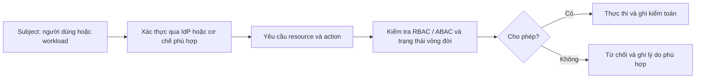

# Identity subject: chủ thể trong mô hình IAM

Trong **Identity and Access Management (IAM)**, *identity subject* (chủ thể danh tính) là thực thể có danh tính được hệ thống nhận diện và có thể yêu cầu một hành động đối với tài nguyên được bảo vệ. Chủ thể có thể là một cá nhân, một ứng dụng, một dịch vụ hoặc một workload. Khi một yêu cầu được xử lý, IAM cần xác định **ai đang thực hiện hành động**, chủ thể đã được xác thực ra sao, quyền nào đang có hiệu lực và liệu yêu cầu có phù hợp với chính sách hay không.

Đây là một khái niệm trọng tâm của chương **Chủ thể và vai trò** trong quản lý vòng đời danh tính. Với mô hình **Joiner–Mover–Leaver (JML)**, mỗi thay đổi về quan hệ, nhiệm vụ hoặc trạng thái của chủ thể có thể dẫn đến thay đổi tài khoản và quyền truy cập. Nhận diện sai chủ thể hoặc nhầm chủ thể với vai trò dễ khiến quyền cũ tiếp tục tồn tại sau khi nhân sự chuyển vị trí hoặc nghỉ việc.

## 1. Identity subject khác gì với identity, account và role?

| Khái niệm | Trả lời câu hỏi | Ví dụ |
| --- | --- | --- |
| Subject (chủ thể) | Thực thể nào yêu cầu thao tác? | Nhân viên Mai; dịch vụ đồng bộ báo cáo |
| Identity (danh tính) | Hệ thống mô tả và phân biệt thực thể đó bằng cách nào? | Hồ sơ nhân viên với mã gốc; workload identity |
| Principal | Đại diện kỹ thuật của chủ thể trong ngữ cảnh bảo mật cụ thể | Principal được xác thực trong phiên API |
| Account | Chủ thể dùng tài khoản nào tại hệ thống? | Tài khoản IdP, tài khoản ứng dụng |
| Role | Chủ thể được giao chức năng hoặc tập quyền nào? | `support-agent`, `billing-reviewer` |
| Entitlement / permission | Hành động cụ thể nào được cho phép? | Xem ticket, phê duyệt hóa đơn dưới ngưỡng |
| Resource | Đối tượng nào bị tác động? | Ticket, hóa đơn, cơ sở dữ liệu |

Một **chủ thể không đồng nghĩa với một tài khoản**, vì một con người có thể có nhiều tài khoản; một tài khoản chia sẻ (nếu tồn tại) lại không đủ để xác định cá nhân đã thực hiện thao tác. Một **vai trò không phải chủ thể**: vai trò mô tả quyền hoặc trách nhiệm được gán cho chủ thể. Đồng thời, thuật ngữ `principal` tùy nền tảng có thể chỉ đối tượng kỹ thuật đại diện cho danh tính trong một phiên xác thực; không nhất thiết có quan hệ một-một với người thật.

Ví dụ: Mai đăng nhập bằng tài khoản `mai@company.example`, được xác thực bởi Identity Provider (IdP), nhận vai trò `support-agent`, sau đó yêu cầu xem ticket `T-1024`. Mai là **human subject**, tài khoản là phương tiện đăng nhập, vai trò là một đầu vào cho phân quyền, còn ticket là tài nguyên được truy cập.

## 2. Những loại chủ thể phổ biến

### 2.1 Human subject

Gồm nhân viên, thực tập sinh, nhà thầu, đối tác và người dùng ngoài tổ chức. Vòng đời của chủ thể thường dựa trên nguồn có thẩm quyền như HR hoặc hệ thống quản lý đối tác. IAM cần liên kết người thật với danh tính gốc và các tài khoản liên quan, kể cả tài khoản đặc quyền hoặc tài khoản trên ứng dụng cũ.

Các sự kiện điển hình gồm: bắt đầu làm việc (**Joiner**), chuyển bộ phận hoặc thay nhiệm vụ (**Mover**), hết hợp đồng hoặc nghỉ việc (**Leaver**). Các sự kiện này có thể thay đổi điều kiện được truy cập mà không làm thay đổi định danh gốc.

### 2.2 Service và workload subject

Gồm ứng dụng, tác vụ tự động, dịch vụ backend, container hoặc workload cần gọi API. Chúng nên có **danh tính phi con người** riêng, chủ sở hữu chịu trách nhiệm, phạm vi quyền tối thiểu và phương thức xác thực thích hợp như workload federation hoặc chứng thư ngắn hạn khi nền tảng hỗ trợ.

Ví dụ: dịch vụ tạo báo cáo hằng đêm chỉ được đọc một tập dữ liệu xác định. Không nên dùng tài khoản cá nhân của nhân viên để chạy tác vụ lâu dài hoặc cấp quyền quản trị cho toàn bộ hệ thống. Khi workload bị ngừng, chuyển chủ sở hữu hoặc đổi chức năng, credential và quyền liên quan phải được rà soát và thu hồi.

### 2.3 Chủ thể bên ngoài và chủ thể được ủy quyền

Nhà thầu hoặc đối tác có thể được xác thực qua IdP liên kết (federation) nhưng vẫn chịu chính sách truy cập tài nguyên của tổ chức cung cấp dịch vụ. Người dùng đăng nhập qua một IdP bên ngoài **không đương nhiên được cấp quyền nội bộ**.

Trong mô hình ủy quyền, cần phân biệt **chủ thể thực hiện** với **chủ thể được đại diện**. Ví dụ một ứng dụng gọi API thay mặt người dùng: hệ thống có thể cần biết cả người dùng và ứng dụng đang gọi để kiểm tra phạm vi ủy quyền, thay vì coi mọi yêu cầu đều do cùng một chủ thể.

## 3. Một yêu cầu truy cập được đánh giá như thế nào?

Quyết định phân quyền thường dựa trên ít nhất bốn yếu tố: **subject**, **resource**, **action** và **context**. Vai trò và thuộc tính là dữ liệu hỗ trợ quyết định chứ không thay thế việc xác thực danh tính.



Một chính sách minh họa bằng giả mã:

```text
ALLOW read_ticket IF
    subject.type == "human"
    AND subject.lifecycle_status == "active"
    AND "support-agent" IN subject.roles
    AND resource.team_id IN subject.assigned_team_ids
    AND action == "read"
    AND session.assurance_level >= resource.required_assurance
ELSE DENY
```

Đây là **giả mã**, không phải cú pháp chuẩn của một sản phẩm IAM. Chính sách thực tế cần quy định rõ nguồn của mỗi thuộc tính, cách xử lý dữ liệu thiếu hoặc lỗi thời, mức độ tin cậy phiên và cơ chế thực thi tại ứng dụng.

**RBAC (Role-Based Access Control)** dùng vai trò để tổ chức các quyền thường gặp, chẳng hạn vai trò `support-agent` được phép đọc ticket. **ABAC (Attribute-Based Access Control)** bổ sung điều kiện dựa trên thuộc tính của chủ thể, tài nguyên và môi trường, chẳng hạn chỉ được xem ticket của nhóm đang phụ trách. Hai cơ chế có thể được phối hợp để hạn chế quyền theo nhu cầu thực tế.

## 4. Subject, xác thực và cấp phát tài khoản

Các thành phần IAM có trách nhiệm khác nhau:

| Thành phần | Liên quan đến subject như thế nào? | Điểm cần kiểm tra |
| --- | --- | --- |
| Nguồn có thẩm quyền | Khởi tạo và cập nhật sự thật nghiệp vụ về chủ thể | Quan hệ, ngày hiệu lực, trạng thái và người quản lý |
| IdP | Xác thực và phát hành thông tin danh tính cho phiên đăng nhập | Mã chủ thể ổn định, xác thực mạnh, trạng thái tài khoản |
| SSO | Cho phép chủ thể đăng nhập các ứng dụng được liên kết | Phiên còn hiệu lực không có nghĩa mọi quyền còn hiệu lực |
| SCIM / provisioning connector | Đồng bộ tài khoản hoặc nhóm đến ứng dụng đích | Tạo, cập nhật, vô hiệu hóa có thực sự thành công? |
| Ứng dụng / API | Thực thi quyền trên tài nguyên cụ thể | Kiểm tra vai trò, thuộc tính và ngữ cảnh hiện tại |
| Hệ thống audit | Lưu dấu vết hành động và quyết định | Chủ thể nào, tài khoản/phiên nào, thời điểm và kết quả nào? |

Ví dụ, IdP xác thực Mai qua SSO; ứng dụng CRM nhận thông tin danh tính của Mai nhưng vẫn phải kiểm tra liệu Mai được đọc hồ sơ khách hàng cụ thể hay không. SCIM có thể giúp cập nhật hoặc vô hiệu hóa tài khoản CRM, song **việc thay đổi tài khoản qua SCIM không đảm bảo mọi token, phiên hoặc quyền cục bộ đều mất hiệu lực ngay lập tức**.

Khi dùng token, cần phân biệt các định danh có ý nghĩa khác nhau như `sub` (subject trong ngữ cảnh nhà phát hành token), `iss` (issuer), `aud` (audience) và scope/role nếu có. **Không nên giả định `sub` là mã nhân viên toàn cục**: giá trị subject cần được diễn giải trong phạm vi issuer và cơ chế định danh cụ thể. Ứng dụng phải xác minh chữ ký, issuer, audience, hạn dùng và các điều kiện xác thực liên quan theo giao thức áp dụng trước khi tin cậy claims.

## 5. Vòng đời của subject theo Joiner–Mover–Leaver

### Joiner: chủ thể mới xuất hiện

1. Xác minh người hoặc workload từ nguồn có thẩm quyền và chống tạo trùng identity.
2. Gán mã định danh ổn định, xác định loại subject và chủ sở hữu/chịu trách nhiệm.
3. Tạo tài khoản cần thiết, đăng ký phương thức xác thực phù hợp.
4. Cấp quyền theo nhiệm vụ khởi đầu, tránh sao chép toàn bộ quyền của một tài khoản có sẵn.
5. Đọc lại trạng thái provisioning và ghi nhận căn cứ cấp quyền.

**Ví dụ:** một nhà thầu có hợp đồng ba tháng chỉ được cấp quyền vào dự án cụ thể, bắt đầu theo ngày hợp đồng và có ngày hết hạn rõ ràng.

### Mover: cùng chủ thể, thay trách nhiệm

Khi nhân viên chuyển từ bộ phận tài chính sang hỗ trợ khách hàng, **human identity có thể giữ nguyên**, nhưng role, thuộc tính bộ phận và quyền tại ứng dụng phải đổi. Quy trình Mover cần so sánh quyền cũ/quyền mới, thu hồi quyền không còn cần, cấp quyền mới theo phê duyệt và xử lý các quyền tạm thời hoặc phiên cũ.

Nguy cơ phổ biến là **tích lũy đặc quyền**: tài khoản vẫn giữ quyền từ nhiều vị trí từng đảm nhiệm. Điều này đặc biệt nguy hiểm với tài khoản đặc quyền, tài khoản cục bộ và hệ thống không đồng bộ trực tiếp với IdP.

### Leaver: chủ thể mất căn cứ truy cập

Khi hợp đồng hoặc quan hệ làm việc kết thúc, tổ chức cần ngăn chủ thể tiếp tục truy cập tại đúng thời điểm theo chính sách, đồng thời xử lý:

- Tài khoản IdP và tài khoản ứng dụng; nhóm, quyền cục bộ và vai trò đặc quyền.
- Phiên đăng nhập, refresh token, khóa API cá nhân và chứng thực còn tồn tại.
- Quyền đối với tài nguyên chia sẻ, quyền sở hữu dữ liệu và công việc bàn giao.
- Tài khoản mồ côi hoặc lỗi deprovisioning, bằng chứng thu hồi thành công.

Đối với token không hỗ trợ thu hồi ngay, phải tính đến thời gian sống của token và cơ chế kiểm tra quyền ở ứng dụng. Đánh dấu subject là `terminated` trong hệ thống nguồn **chưa đủ để khẳng định quyền ở mọi đích đã hết hiệu lực**.

## 6. Quản lý chủ thể trong tình huống đặc biệt

### Tài khoản đặc quyền

Một người có thể dùng tài khoản thông thường và tài khoản quản trị riêng. Hai tài khoản cần liên kết được về cùng người chịu trách nhiệm, đồng thời quản lý xác thực mạnh, phạm vi thao tác, thời gian cấp quyền và kiểm toán. Tài khoản đặc quyền tạm thời nên có thời điểm hết hạn và cơ chế thu hồi được kiểm chứng.

### Tài khoản dùng chung

Tài khoản dùng chung làm giảm khả năng quy trách nhiệm cho một cá nhân. Nếu hệ thống cũ buộc phải sử dụng, cần có biện pháp kiểm soát và truy vết bổ sung như vault, cấp phát phiên có định danh cá nhân, ghi audit và quy trình xoay vòng bí mật; ưu tiên thay bằng tài khoản riêng khi khả thi.

### Nhân sự quay lại hoặc thay đổi quan hệ

Một người nghỉ việc rồi quay lại với email khác không nên mặc nhiên bị coi là người khác. Cần xác minh danh tính, quyết định liên kết hồ sơ theo chính sách, tránh khôi phục quyền cũ ngoài ý muốn và chỉ cấp lại quyền phù hợp với vị trí mới.

### Workload chuyển chủ sở hữu

Workload có thể tiếp tục hoạt động dù người tạo ra nó đã nghỉ. Service subject phải có owner đang hoạt động và quy trình chuyển giao rõ ràng; xoay credential hoặc thay quyền khi owner, mục đích hoặc môi trường triển khai thay đổi.

## 7. Kiểm toán và chỉ số để phát hiện quyền tồn dư

Nhật ký quyết định truy cập nên hỗ trợ trả lời: **subject nào, được xác thực theo phương thức nào, dùng tài khoản hoặc phiên nào, yêu cầu hành động gì trên tài nguyên nào, vì sao được cho phép hoặc bị từ chối, và quyết định có hiệu lực lúc nào?**

Khi cần quy trách nhiệm, có thể liên kết `personId` hoặc `workloadId` với `accountId`, ID phiên và sự kiện nghiệp vụ, nhưng phải hạn chế thu thập dữ liệu cá nhân không cần thiết, không ghi token thô, mật khẩu hoặc khóa bí mật vào log.

Các chỉ số hữu ích:

- Số tài khoản không gắn được với subject hoặc chủ sở hữu hợp lệ.
- Tỷ lệ subject vừa chuyển vai trò nhưng vẫn có entitlement từ vai trò trước.
- Thời gian từ sự kiện Leaver đến khi từng ứng dụng đích thực sự chặn truy cập.
- Số quyền tạm thời quá hạn, tài khoản đặc quyền không được rà soát.
- Tỷ lệ lỗi đồng bộ SCIM/provisioning và thời gian khắc phục.

## 8. Tình huống tự kiểm tra

**Tình huống A:** Nhân viên nghỉ việc, tài khoản IdP đã khóa nhưng ứng dụng cũ vẫn còn tài khoản đăng nhập riêng. Đã hoàn tất Leaver chưa? **Chưa.** Cần kiểm chứng quyền thực tế trên ứng dụng cũ và xử lý tài khoản còn tồn dư.

**Tình huống B:** Hai người dùng cùng một vai trò `support-agent`, nhưng mỗi người thuộc nhóm khách hàng khác nhau. Có nên cho cả hai xem mọi ticket? **Không.** RBAC cung cấp vai trò cơ bản, còn ABAC hoặc các kiểm tra theo phạm vi tài nguyên giới hạn dữ liệu theo nhóm phụ trách.

**Tình huống C:** Một service gọi API thay mặt người dùng. Cần kiểm tra danh tính nào? **Tùy mô hình ủy quyền**, thường phải xác định cả ứng dụng gọi và người dùng được đại diện, rồi kiểm tra phạm vi hành động phù hợp. Không suy ra quyền của người dùng chỉ từ quyền của service.

**Tình huống D:** Nhân viên chuyển bộ phận, quyền cũ đã bị gỡ trên IdP nhưng quyền cục bộ ở hệ thống đích chưa đổi. Vì sao vẫn có rủi ro? **Bộ thực thi chính sách ở hệ thống đích có thể còn công nhận quyền cũ**; cần đối soát trạng thái và khả năng tiếp tục truy cập.

## Ghi nhớ

**Identity subject** là thực thể đang yêu cầu truy cập; **identity** là hồ sơ dùng để nhận diện thực thể; **account** là tài khoản ở hệ thống cụ thể; **role/entitlement** mô tả quyền; **resource/action/context** quyết định quyền ấy có được sử dụng trong yêu cầu thực tế hay không. Quản lý subject hiệu quả kết nối dữ liệu có thẩm quyền với **Joiner–Mover–Leaver**, **IdP/SSO**, **SCIM**, **RBAC/ABAC**, tài khoản dịch vụ và kiểm toán, nhằm cấp đúng quyền và thu hồi quyền tồn dư khi ngữ cảnh thay đổi.
