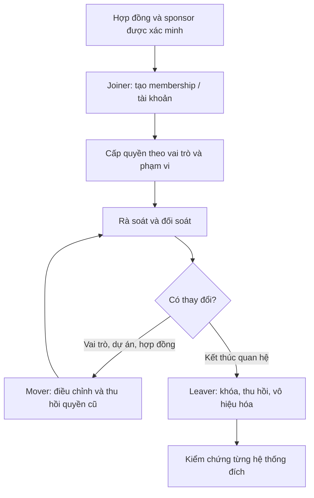

# Partner: chủ thể đối tác trong quản lý danh tính và truy cập

Trong quản lý danh tính và truy cập (**Identity and Access Management – IAM**), **partner** là cá nhân hoặc tổ chức bên ngoài có quan hệ hợp tác chính thức với đơn vị vận hành hệ thống, chẳng hạn đại lý phân phối, nhà cung cấp, đơn vị tích hợp, đối tác vận chuyển hoặc doanh nghiệp cùng thực hiện dự án. Khi đối tác cần sử dụng cổng B2B, API, dữ liệu hoặc ứng dụng nội bộ, IAM phải xác định rõ **ai thuộc đối tác nào, đang được phép làm gì, do ai bảo trợ và quyền đó còn cần thiết đến khi nào**.

Đối tác là một loại chủ thể trong chương **Chủ thể và vai trò**. Khái niệm này liên quan trực tiếp đến quản lý vòng đời danh tính (**Joiner–Mover–Leaver**): đối tác bắt đầu hợp tác, nhân sự hoặc phạm vi hợp đồng thay đổi, rồi hợp đồng hoặc quyền truy cập chấm dứt. Đăng nhập thành công qua **IdP/SSO** chỉ xác minh danh tính theo cơ chế được thiết lập; việc được phép truy cập dữ liệu của tổ chức vẫn cần **RBAC/ABAC**, kiểm soát phạm vi tài nguyên và rà soát định kỳ.

## 1. Phân biệt tổ chức đối tác, người của đối tác và tài khoản kỹ thuật

| Đối tượng | Ví dụ | Điều IAM cần quản lý |
| --- | --- | --- |
| Tổ chức đối tác | Công ty Logistics A | Mã đối tác, trạng thái hợp đồng, chủ sở hữu nội bộ, giới hạn dữ liệu |
| Người dùng đối tác | Nhân viên giao nhận thuộc Logistics A | Danh tính cá nhân, quan hệ với đối tác, vai trò, MFA, ngày kết thúc |
| Đầu mối bảo trợ nội bộ | Nhân viên quản lý hợp đồng | Phê duyệt nhu cầu, rà soát quyền và yêu cầu thu hồi |
| Ứng dụng đối tác | Hệ thống của Logistics A gọi API theo máy | Workload identity/client, credential, scope, quyền truy cập |
| Tài khoản ứng dụng | User trên portal B2B hoặc tài khoản API | Trạng thái provisioning, entitlement và audit |

**Tổ chức đối tác không đồng nghĩa với danh tính cá nhân.** Một doanh nghiệp có thể có nhiều người dùng, mỗi người có quyền riêng. Ngược lại, một người có thể cộng tác với nhiều tổ chức theo những quan hệ khác nhau; hệ thống phải quyết định cách tách bối cảnh truy cập, tránh dùng một quyền của quan hệ A để đọc dữ liệu thuộc quan hệ B.

Tương tự, một **tài khoản dịch vụ của đối tác** không nên được coi như tài khoản của nhân viên đối tác. Workload có chủ sở hữu, vòng đời, phương thức xác thực và giới hạn sử dụng khác với human identity.

## 2. Mô hình danh tính và phạm vi đối tác

Một mô hình tối thiểu nên mô tả:

- **Partner organization:** mã đối tác duy nhất, trạng thái quan hệ, ngày bắt đầu/kết thúc, đơn vị chịu trách nhiệm nội bộ.
- **Partner membership:** người dùng thuộc tổ chức nào, được bảo trợ hoặc xác nhận bởi ai, từ ngày nào đến ngày nào.
- **Partner subject:** mã danh tính ổn định, phương thức xác thực, trạng thái, liên kết tới IdP hoặc tài khoản ứng dụng.
- **Role và entitlement:** các nghiệp vụ được phép thao tác, phạm vi dự án/đơn hàng/khách hàng, quyền tạm thời.
- **Audit và review:** quyết định cấp quyền, ngày rà soát, lần truy cập và kết quả thu hồi tại ứng dụng đích.

Ví dụ cấu trúc minh họa (không phải schema chuẩn của SCIM hay một IdP):

```json
{
  "subjectId": "partner-user-317",
  "subjectType": "human",
  "partnerId": "logistics-a",
  "membershipStatus": "active",
  "sponsorId": "employee-204",
  "validUntil": "2027-03-31",
  "roles": ["shipment-viewer"],
  "allowedProjects": ["project-north"],
  "idpIssuer": "https://login.partner.example",
  "externalSubjectId": "user-9837"
}
```

Ở đây, `subjectId` của ứng dụng là mã nội bộ; `externalSubjectId` chỉ có ý nghĩa trong ngữ cảnh nguồn phát hành `idpIssuer`. Không nên chỉ dùng email để nhận diện duy nhất: email có thể đổi, được tái sử dụng hoặc trùng ở các hệ thống danh tính khác nhau.

Khi đối tác có nhiều công ty con, dự án hoặc đơn vị pháp lý, phải xác định rõ ranh giới phân quyền theo **tenant**, tổ chức, hợp đồng và tập dữ liệu. Chỉ gắn nhãn “partner” vào tài khoản là chưa đủ.

## 3. Ba cách quản lý xác thực đối tác

### 3.1 Tài khoản do tổ chức vận hành hệ thống cấp

Đối tác được tạo tài khoản trực tiếp trên IdP hoặc portal do tổ chức quản lý. Cách này giúp chủ động thiết lập chính sách xác thực, nhưng tổ chức phải tự vận hành quy trình xác minh, đặt lại xác thực, khóa tài khoản và xử lý khi nhân sự đối tác nghỉ việc.

### 3.2 Liên kết danh tính (identity federation)

Đối tác đăng nhập bằng IdP của họ, thông qua giao thức liên kết phù hợp như **OpenID Connect (OIDC)** hoặc **SAML**. Hệ thống tiếp nhận thông tin xác thực nhưng vẫn tự quyết định tài khoản nội bộ tương ứng, trạng thái hợp đồng và quyền trên tài nguyên của mình.

Ví dụ, IdP đối tác xác nhận nhân viên Bình đã đăng nhập. Portal B2B vẫn cần xác minh Bình được liên kết với Logistics A, quan hệ còn hiệu lực và quyền `shipment-viewer` chỉ bao phủ các lô hàng của Logistics A.

### 3.3 Provisioning và đồng bộ vòng đời

Khi các bên hỗ trợ, **SCIM** hoặc connector có thể tạo, cập nhật, vô hiệu hóa người dùng và nhóm giữa hệ thống. Tuy nhiên, liên kết SSO **không tự động** đồng nghĩa có SCIM; việc ngừng tài khoản ở IdP nguồn không bảo đảm ngay lập tức xóa mọi tài khoản cục bộ hoặc session ở ứng dụng đích.

| Phương án | Ưu điểm chính | Điểm cần kiểm soát |
| --- | --- | --- |
| Tài khoản cục bộ | Chủ động xác thực và quản lý user | Gánh nặng hỗ trợ, phát hiện người nghỉ việc bên đối tác |
| Federation SSO | Đối tác dùng IdP sẵn có, giảm tài khoản/mật khẩu riêng | Tin cậy issuer, mapping định danh, thu hồi phiên và quyền nội bộ |
| SCIM/connector | Tự động hóa thay đổi tài khoản/nhóm | Dữ liệu nguồn, thời gian đồng bộ, lỗi deprovision và đối soát |

Các cách này có thể phối hợp, tùy kiến trúc và hợp đồng tin cậy giữa hai tổ chức.

## 4. Joiner–Mover–Leaver đối với partner

Đối tác có **hai vòng đời gắn nhau**: vòng đời quan hệ hợp tác giữa các tổ chức và vòng đời từng người/workload có quyền truy cập. Kết thúc hợp đồng có thể yêu cầu thu hồi **toàn bộ** thành viên và ứng dụng thuộc quan hệ đó; một nhân viên đối tác nghỉ việc chỉ yêu cầu xử lý danh tính của cá nhân ấy và các quyền được liên kết.



### Joiner: thiết lập đối tác và người được phép vào hệ thống

1. Xác minh đối tác có quan hệ hợp lệ, phạm vi hợp đồng và đầu mối bảo trợ nội bộ.
2. Xác định người dùng hoặc workload thuộc đối tác, phương thức xác minh danh tính và nguồn dữ liệu có thẩm quyền.
3. Tạo membership có ngày hiệu lực, ngày hết hạn, phạm vi tổ chức/dự án và vai trò cần thiết.
4. Thiết lập xác thực phù hợp, có thể gồm SSO federation và MFA theo mức rủi ro.
5. Provision tài khoản/nhóm cho ứng dụng liên quan; kiểm chứng rằng quyền thực tế phù hợp phạm vi được duyệt.

Ví dụ: đối tác Logistics A có hợp đồng vận chuyển tại miền Bắc. Một nhân viên được cấp quyền xem trạng thái **đơn hàng thuộc miền Bắc của Logistics A**, không được xem dữ liệu của nhà vận chuyển khác hoặc sửa thông tin thanh toán.

### Mover: thay đổi người, nhiệm vụ và phạm vi hợp đồng

Một thành viên có thể chuyển từ vận hành sang quản lý đối soát, đổi dự án hoặc đổi công ty đối tác. IAM phải rà soát entitlement cũ, cập nhật thuộc tính, giới hạn tài nguyên và quyền mới. Quyền được cấp theo dự án cũ không nên tự động tiếp tục tồn tại.

Nếu Logistics A được bổ sung dự án miền Trung, việc mở rộng phạm vi phải xuất phát từ hợp đồng và phê duyệt được ghi nhận; không nên đổi vai trò mọi thành viên thành “toàn quyền” chỉ vì đối tác có thêm dự án.

### Leaver: cá nhân hoặc toàn bộ đối tác kết thúc truy cập

Khi một người của đối tác nghỉ việc, khi một workload ngừng hoạt động hoặc hợp đồng hết hạn, cần:

- Vô hiệu hóa membership và tài khoản thuộc phạm vi bị chấm dứt.
- Thu hồi vai trò, nhóm, quyền cục bộ, khóa API và credential liên quan.
- Xử lý session, refresh token và token còn hiệu lực theo khả năng của hệ thống đích.
- Đối soát tài khoản mồ côi và các ứng dụng không hỗ trợ tự động hóa thu hồi.
- Thu hồi hoặc chuyển giao quyền sở hữu tài nguyên, lưu bằng chứng theo chính sách.

Không nên coi **“đã gửi lệnh SCIM disable”** là bằng chứng quyền đã mất hiệu lực. Cần kiểm tra ứng dụng đích và thời gian còn hiệu lực của các token không thể thu hồi tức thì.

## 5. RBAC, ABAC và cách ly dữ liệu đối tác

**RBAC** hữu ích để chuẩn hóa chức năng: `shipment-viewer` được xem vận đơn, `invoice-submitter` được gửi chứng từ, `partner-admin` có thể quản trị thành viên trong phạm vi được giao. **ABAC** bổ sung ngữ cảnh như `partnerId`, `projectId`, trạng thái hợp đồng, loại dữ liệu hoặc mức đảm bảo phiên.

Một ví dụ chính sách minh họa:

```text
ALLOW read_shipment IF
    subject.type == "human"
    AND subject.partner_membership_status == "active"
    AND subject.partner_contract_status == "active"
    AND "shipment-viewer" IN subject.roles
    AND resource.partner_id == subject.partner_id
    AND resource.project_id IN subject.allowed_project_ids
    AND action == "read"
ELSE DENY
```

Đây là **giả mã**, không phải cú pháp mặc định của sản phẩm IAM. Việc kiểm tra `partner_id` phải thực thi phía máy chủ/API dựa trên dữ liệu đã được xác minh; không tin giá trị `partnerId` do trình duyệt tự gửi để tự quyết định quyền.

Đặc biệt cần ngăn **cross-tenant data exposure**: đối tác A biết ID đơn hàng của đối tác B vẫn không được xem đơn hàng ấy. Kiểm soát truy cập phải thực thi trên **từng tài nguyên**, không chỉ ẩn nút giao diện hay lọc danh sách ở frontend.

## 6. Quản lý ủy quyền và tài khoản quản trị đối tác

Một số tổ chức cho phép `partner-admin` mời người dùng hoặc điều chỉnh vai trò trong phạm vi đối tác. Quyền quản trị này phải có ranh giới rõ:

- Chỉ thao tác với tài khoản thuộc đúng tổ chức hoặc tenant được giao.
- Không tự cấp vai trò vượt phạm vi được tổ chức vận hành hệ thống cho phép.
- Có cơ chế phê duyệt bổ sung cho quyền nhạy cảm hoặc phạm vi dữ liệu cao hơn.
- Thu hồi hoặc chuyển giao quyền quản trị khi người phụ trách đổi vai trò.
- Ghi kiểm toán ai mời ai, ai phê duyệt, cấp quyền nào và đến bao giờ.

Nếu một ứng dụng đối tác gọi API thay mặt người dùng, có thể phải phân biệt **ứng dụng đang gọi** và **người dùng được đại diện**, rồi kiểm tra cả quyền của ứng dụng và phạm vi ủy quyền của người dùng. Token dành cho workload không nên mặc nhiên mang tất cả quyền của người dùng đối tác.

## 7. Kiểm toán, rà soát và giảm quyền truy cập tồn dư

Partner access thường chịu rủi ro đặc thù: tổ chức không trực tiếp quản lý thay đổi nhân sự của đối tác, dữ liệu phân tán qua nhiều ứng dụng, quyền mở rộng theo hợp đồng và credential tích hợp được dùng lâu dài.

Một chương trình kiểm soát nên bao gồm:

1. **Sponsor ownership:** mỗi quan hệ đối tác, tài khoản và workload có đầu mối chịu trách nhiệm đang hoạt động.
2. **Expiration by default:** quyền tạm thời và membership có hạn theo hợp đồng hoặc kỳ phê duyệt; gia hạn yêu cầu xác nhận nhu cầu.
3. **Access certification:** rà soát người dùng, vai trò, quyền đặc quyền và phạm vi dữ liệu theo chu kỳ, đồng thời kiểm tra theo sự kiện Mover/Leaver.
4. **Reconciliation:** so sánh dữ liệu đối tác/IdP với quyền thực tế trong portal, ứng dụng cũ và hệ thống API.
5. **Revocation verification:** đo từ lúc nhận sự kiện kết thúc đến lúc truy cập thực sự bị chặn tại ứng dụng đích.
6. **Auditability:** lưu định danh đối tác, subject, tài nguyên, hành động, kết quả cho phép/từ chối và căn cứ chính sách; không ghi mật khẩu, API key hay token nguyên văn vào log.

Chỉ số theo dõi có thể gồm số tài khoản đối tác không còn sponsor, membership quá hạn, quyền không gắn với hợp đồng, ứng dụng chưa hoàn thành deprovisioning và số lần vi phạm phạm vi tenant bị từ chối.

## 8. Các tình huống thực hành

**Tình huống A – Nhân viên đối tác nghỉ việc:** IdP của đối tác khóa tài khoản, nhưng portal B2B vẫn có session cũ. Có thể kết luận quyền đã thu hồi hết chưa? **Chưa.** Phải kiểm tra token/phiên và các quyền cục bộ tại portal, đồng thời xác nhận cơ chế deprovision.

**Tình huống B – Mở rộng hợp đồng:** Logistics A nhận thêm dự án nhưng chỉ một nhóm được phê duyệt tham gia. Có nên tự động mở quyền toàn bộ nhân viên Logistics A? **Không.** Cần cập nhật phạm vi dự án và membership hoặc thuộc tính của những người đủ điều kiện.

**Tình huống C – Đối tác A gửi ID dữ liệu của đối tác B:** Portal có nên trả dữ liệu nếu người dùng có vai trò `shipment-viewer`? **Không.** Vai trò phải kết hợp kiểm tra chủ sở hữu tài nguyên và ngữ cảnh tenant.

**Tình huống D – Kết thúc hợp đồng:** Tổ chức đã vô hiệu hóa tài khoản người dùng nhưng quên client credential của ứng dụng tích hợp. Có hoàn tất Leaver chưa? **Chưa.** Phải rà soát và thu hồi cả human identity lẫn service/workload identity liên quan đến hợp đồng.

## Ghi nhớ

**Partner** trong IAM là chủ thể bên ngoài được gắn với quan hệ kinh doanh, sponsor và phạm vi quyền xác định. Quản lý tốt phải liên kết **đối tác – cá nhân/workload – tài khoản – vai trò – tài nguyên – hợp đồng**, dùng **IdP/SSO** để xác thực, **SCIM** hoặc connector để đồng bộ vòng đời, **RBAC/ABAC** để kiểm soát tài nguyên, và **Joiner–Mover–Leaver** để cấp, rà soát, thu hồi quyền. Cốt lõi là ngăn đối tác truy cập ngoài phạm vi được giao và chứng minh được quyền đã mất hiệu lực khi hợp tác kết thúc.
