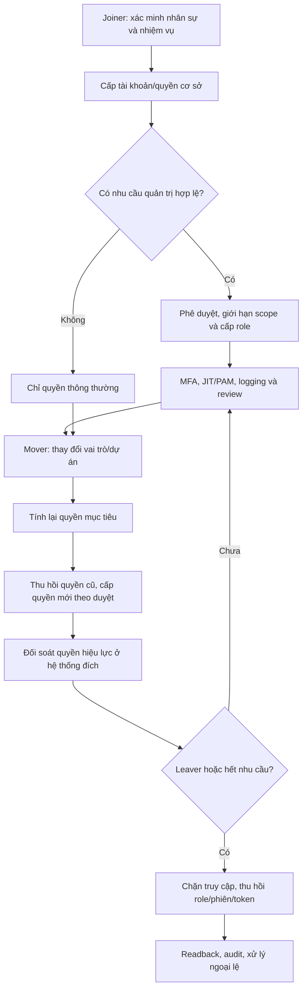
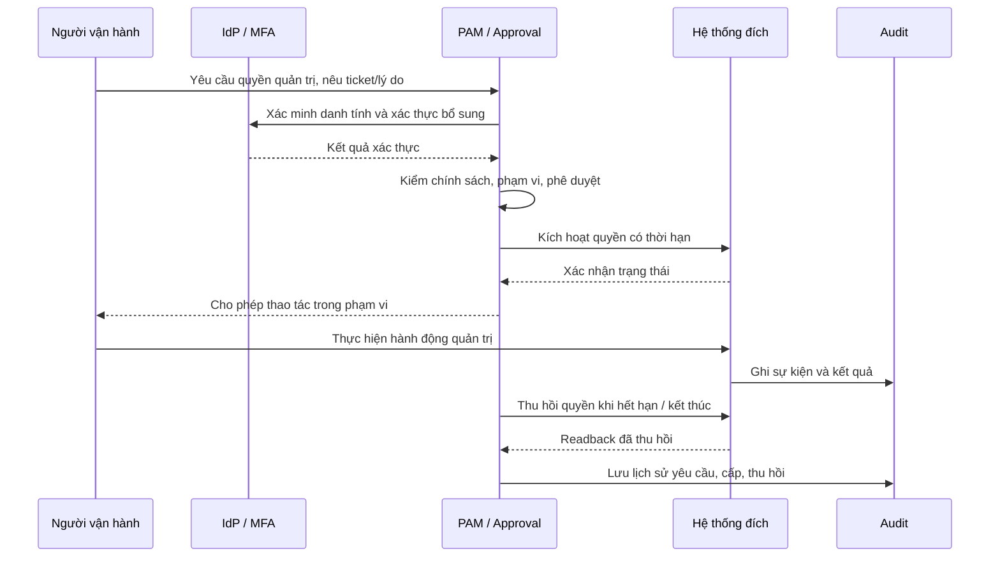
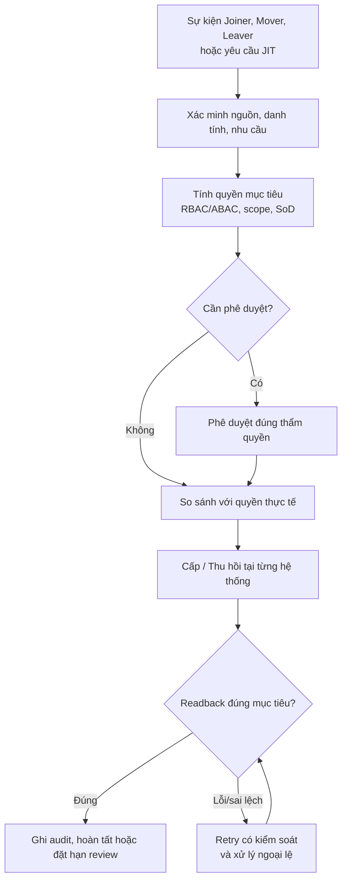

# Administrator trong IAM: Vai trò quản trị, đặc quyền và vòng đời truy cập

Một nhân viên hỗ trợ có thể xem hồ sơ người dùng để giải quyết yêu cầu. Người **Administrator** có thể tạo tài khoản mới, thay đổi nhóm, cấp quyền, cấu hình chính sách đăng nhập hoặc quản lý hệ thống. Vì các thao tác quản trị có thể ảnh hưởng đến nhiều chủ thể cùng lúc, việc cấp quyền Administrator sai hoặc không thu hồi kịp thời có thể tạo ra rủi ro lớn hơn một quyền truy cập thông thường.

Trong **Identity and Access Management (IAM)**, **Administrator** không đơn thuần là tên một tài khoản hoặc nhãn “được toàn quyền”. Đây là một **vai trò hoặc tập đặc quyền quản trị** được cấp cho chủ thể xác định, trong **phạm vi tài nguyên**, **hành động**, **thời gian** và **điều kiện** được chính sách cho phép. Một tổ chức có thể có nhiều loại Administrator: quản trị danh tính, quản trị ứng dụng, quản trị hạ tầng, quản trị bảo mật và quản trị khẩn cấp.

Quản lý vai trò này phải gắn với **vòng đời danh tính Joiner–Mover–Leaver (JML)**: xác minh ai cần quyền, cấp đúng mức, rà soát sau khi đổi nhiệm vụ và thu hồi hoàn toàn khi không còn nhu cầu. Các công nghệ như **IdP, SSO, SCIM, RBAC/ABAC, Privileged Access Management (PAM)** và nhật ký kiểm toán giúp thực thi quá trình đó.

## 1. Administrator là gì?

**Administrator** là chủ thể hoặc vai trò được trao khả năng quản lý tài nguyên, cấu hình hệ thống, danh tính, quyền truy cập hoặc cơ chế vận hành vượt quá quyền của người sử dụng thông thường.

Các thao tác điển hình gồm:

- Tạo, khóa, kích hoạt hoặc phục hồi tài khoản.
- Cấp, sửa, thu hồi vai trò hoặc tư cách thành viên nhóm.
- Thiết lập chính sách đăng nhập, MFA, phiên truy cập và điều kiện truy cập.
- Quản lý ứng dụng, tài nguyên đám mây, cấu hình mạng, kho bí mật hoặc cơ sở dữ liệu.
- Xem nhật ký vận hành, xử lý sự cố và thực hiện thay đổi có ảnh hưởng tới nhiều người dùng.

Không phải mọi Administrator đều được làm tất cả các việc trên. **Tên vai trò chỉ có ý nghĩa khi biết rõ các quyền và phạm vi mà hệ thống gán cho nó.** Chẳng hạn Administrator của một dự án có thể quản lý thành viên dự án đó nhưng không được sửa cấu hình IAM toàn tổ chức.

### 1.1. Phân biệt chủ thể, tài khoản, vai trò và đặc quyền

| Khái niệm | Định nghĩa | Ví dụ |
|---|---|---|
| **Subject (chủ thể)** | Người hoặc workload đang yêu cầu thực hiện hành động. | Nhân viên vận hành đang đăng nhập. |
| **Identity (danh tính)** | Bản ghi nhận diện chủ thể và liên kết các thuộc tính, quan hệ, lịch sử. | Hồ sơ nhân viên với mã định danh ổn định. |
| **Account (tài khoản)** | Đối tượng đăng nhập hoặc được hệ thống đích nhận biết. | Tài khoản trên IdP và tài khoản trong bảng điều khiển ứng dụng. |
| **Role (vai trò)** | Tập quyền được thiết kế để hỗ trợ một trách nhiệm. | `IAM-Helpdesk-Admin`. |
| **Privilege / entitlement** | Quyền thực hiện hành động cụ thể đối với tài nguyên. | `users.disable`, `roles.assign`. |
| **Administrator** | Vai trò hoặc chủ thể được cấp một hay nhiều đặc quyền quản trị. | Người thuộc nhóm quản trị một ứng dụng. |
| **Authorization** | Quyết định cho phép hay từ chối một hành động ở ngữ cảnh hiện tại. | Cho phép khóa người dùng trong đúng phòng ban được giao. |

Một nhân viên có thể đăng nhập bằng **tài khoản thường** để làm việc hằng ngày và chỉ dùng **phiên/quyền quản trị tạm thời** khi xử lý tác vụ có phê duyệt. Một số hệ thống dùng tài khoản quản trị riêng; hệ thống khác dùng cùng danh tính với quy trình nâng quyền có thời hạn. Cách triển khai khác nhau nhưng cần truy vết được **chủ thể thật, quyền sử dụng và lý do thực hiện**.

### 1.2. Administrator không đồng nghĩa với Super Administrator

Vai trò Administrator phải được đọc cùng với **ranh giới quản trị (administrative boundary)**:

- **Phạm vi tài nguyên:** toàn tổ chức, một tenant, đơn vị, dự án, ứng dụng, cluster hoặc một cơ sở dữ liệu.
- **Loại thao tác:** đọc cấu hình, xem nhật ký, tạo người dùng, cấp quyền, thay đổi chính sách hoặc xóa tài nguyên.
- **Môi trường:** development, staging hay production.
- **Đối tượng được quản lý:** nhóm tài khoản nội bộ, khách hàng, nhà thầu hoặc workload.
- **Thời hạn/điều kiện:** quyền thường trực, quyền được kích hoạt theo phiên, quyền chỉ có hiệu lực khi MFA và phê duyệt đạt yêu cầu.

**Super Administrator / Global Administrator / Root** trong nhiều sản phẩm là vai trò có phạm vi rất rộng, nhưng quyền cụ thể và cơ chế khôi phục phụ thuộc sản phẩm. Không nên cho rằng mọi vai trò mang tên “admin” đều tương đương nhau, hoặc tên “root” ở một hệ thống là đối tượng duy nhất quản lý toàn bộ tổ chức.

## 2. Các loại Administrator phổ biến

| Vai trò quản trị | Trách nhiệm thường gặp | Ranh giới nên xác định |
|---|---|---|
| **Identity Administrator** | Quản lý danh tính, tài khoản, nhóm và một phần quy trình cấp/thu hồi. | Loại đối tượng được phép sửa; có được gán vai trò đặc quyền không? |
| **Helpdesk Administrator** | Hỗ trợ đặt lại yếu tố xác thực, mở khóa tài khoản, xử lý yêu cầu hỗ trợ. | Chỉ người dùng trong phạm vi hỗ trợ; hạn chế thao tác đối với admin cấp cao. |
| **Application Administrator** | Cấu hình một ứng dụng, quản lý người dùng và vai trò nội bộ ứng dụng. | Chỉ ứng dụng/tenant được giao; phân biệt dữ liệu nghiệp vụ và cấu hình. |
| **Infrastructure / Cloud Administrator** | Quản lý máy chủ, mạng, workload, cluster hoặc tài nguyên cloud. | Subscription/project/account, region, môi trường và loại tài nguyên. |
| **Database Administrator (DBA)** | Quản lý cơ sở dữ liệu, sao lưu, hiệu năng và cấp quyền dữ liệu. | Phân biệt quản trị hạ tầng dữ liệu với đọc toàn bộ dữ liệu nhạy cảm. |
| **Security Administrator** | Quản trị công cụ bảo mật, chính sách, cảnh báo hoặc một phần kiểm soát truy cập. | Không đồng thời được xóa dấu vết kiểm toán của chính mình. |
| **Privileged / Emergency Administrator** | Xử lý sự cố nghiêm trọng hoặc phục hồi khi luồng truy cập bình thường không khả dụng. | Kích hoạt có điều kiện, giám sát đặc biệt và xử lý sau sự cố. |
| **Delegated Administrator** | Quản trị một tập con người dùng hoặc tài nguyên thay mặt người sở hữu cấp cao. | Chặn vượt phạm vi, ví dụ admin phòng ban không được sửa người ngoài phòng ban. |

Những tên trên là **nhóm khái niệm**, không phải danh sách vai trò chuẩn có thể cấu hình giống hệt ở mọi IdP hoặc ứng dụng. Vai trò thực tế phải được thiết kế từ yêu cầu nghiệp vụ, khả năng của hệ thống và chính sách phân tách trách nhiệm.

### 2.1. Quản trị tập trung và quản trị được ủy quyền

**Quản trị tập trung** thường dành cho cấu hình có ảnh hưởng toàn hệ thống, như thiết lập nguồn danh tính hoặc chính sách MFA cấp tổ chức. **Quản trị được ủy quyền (delegated administration)** cho phép người phụ trách một đơn vị tự thực hiện các thao tác trong phạm vi đơn vị đó.

Ví dụ, trưởng nhóm Helpdesk của khu vực A có thể khóa tài khoản nhân viên khu vực A nhưng không được cấp chính mình quyền Global Administrator. Nếu chỉ kiểm tra có vai trò `helpdesk-admin` mà bỏ qua **phạm vi người dùng mục tiêu**, chính sách đã thiếu một điều kiện quan trọng.

Ủy quyền cần đi cùng:

1. Phạm vi tài nguyên minh bạch.
2. Danh sách thao tác được phép thực hiện.
3. Giới hạn những đối tượng có thể được tạo, chỉnh sửa hoặc gán role.
4. Khả năng ghi lại chủ thể thực thi và người/cấp có thẩm quyền ủy quyền.
5. Thời điểm hết hạn hoặc sự kiện thu hồi ủy quyền.

## 3. Vì sao quyền Administrator có rủi ro cao?

Quyền quản trị tác động đến **mặt phẳng điều khiển (control plane)** của hệ thống. Một tài khoản đọc báo cáo bị xâm nhập có thể làm lộ tập dữ liệu mà tài khoản ấy được phép xem. Một tài khoản quản trị bị xâm nhập có thể thay đổi chính sách, cấp quyền cho nhiều tài khoản khác, tạo khóa truy cập mới hoặc làm gián đoạn dịch vụ.

Những rủi ro điển hình:

- **Privilege escalation:** chủ thể tìm cách được cấp quyền cao hơn thông qua lỗ hổng hoặc cấu hình phân quyền sai.
- **Privilege accumulation / privilege creep:** quyền đã cấp khi làm nhiệm vụ cũ vẫn còn sau khi thay vai trò.
- **Excessive privilege:** cấp quyền toàn tổ chức cho nhiệm vụ chỉ cần phạm vi một ứng dụng.
- **Shared administrator account:** nhiều người dùng chung tài khoản, khó truy trách nhiệm cá nhân.
- **Persistent privileged access:** quyền admin thường trực dù công việc chỉ diễn ra vài giờ mỗi tháng.
- **Orphaned privileged identity:** nhân viên nghỉ hoặc workload bị hủy nhưng tài khoản/credential đặc quyền còn hiệu lực.
- **Toxic combinations:** một người vừa có quyền tạo yêu cầu vừa phê duyệt, hoặc vừa quản trị vừa có khả năng xóa lịch sử của chính mình.
- **Indirect privilege:** tài khoản không mang tên Administrator nhưng có thể sửa group, role policy, trust relationship hoặc secret để tự có quyền admin.

Do đó, kiểm tra một tài khoản có vai trò tên `Administrator` là **chưa đủ**. Cần tính toàn bộ quyền hiệu lực từ vai trò trực tiếp, nhóm kế thừa, policy theo thuộc tính, token, ủy quyền và những khả năng gián tiếp.

## 4. Thiết kế quyền Administrator với RBAC và ABAC

### 4.1. RBAC: cấp quyền theo vai trò có mục đích rõ ràng

Trong **Role-Based Access Control (RBAC)**, các quyền được nhóm thành role. Người dùng hoặc service principal nhận role dựa trên nhu cầu đã xác minh.

Ví dụ một tổ chức có thể thiết kế:

```text
role: helpdesk-user-operator
  users.read
  users.unlock
  users.reset-mfa

role: iam-role-manager
  groups.read
  groups.manage-membership
  roles.assign-approved

role: security-auditor
  audit.read
  policies.read

role: platform-deployer
  deployments.create
  deployments.rollback
```

Đây là **mô hình quyền minh họa**, không phải tên permission hợp lệ dùng chung cho mọi sản phẩm. Quyền `roles.assign-approved` còn cần chính sách xác định **role nào được gán cho ai**, thay vì coi mọi lệnh gán role là như nhau.

Cách thiết kế tốt là tạo role theo **tập nhiệm vụ thực**, rồi kiểm tra xem mỗi permission có cần thiết hay không. Nếu một Helpdesk Administrator chỉ cần mở khóa tài khoản, việc cấp thêm quyền sửa chính sách MFA toàn tenant là vượt nhu cầu.

### 4.2. ABAC: quyết định theo thuộc tính và ngữ cảnh

Trong **Attribute-Based Access Control (ABAC)**, quyết định có thể dựa trên thuộc tính của:

- **Chủ thể:** nhóm quản trị, vị trí, đơn vị, trạng thái nhân sự, mức xác thực, thuộc tính rủi ro.
- **Tài nguyên:** tenant, owner, môi trường, độ nhạy dữ liệu, nhóm ứng dụng.
- **Hành động:** xem, cập nhật, vô hiệu hóa, cấp role, xóa, xuất dữ liệu.
- **Ngữ cảnh:** thời gian, nguồn truy cập, tình trạng thiết bị, mức đảm bảo MFA hoặc phiếu phê duyệt.

Ví dụ chính sách có thể diễn đạt bằng ngôn ngữ tự nhiên:

> Cho phép Administrator của bộ phận hỗ trợ khóa tài khoản người dùng **cùng đơn vị** khi phiên đã xác thực bằng MFA phù hợp, nhưng không cho phép khóa tài khoản quản trị đặc quyền hoặc tự cấp role quản trị cấp cao.

RBAC xác định **nhóm thao tác chung**; ABAC giới hạn **trường hợp cụ thể**. Hai mô hình có thể kết hợp để tránh tạo quá nhiều role, đồng thời vẫn kiểm soát được phạm vi.

### 4.3. Ma trận quyết định phân quyền ví dụ

| Chủ thể | Hành động | Mục tiêu | Quyết định | Lý do |
|---|---|---|---|---|
| Helpdesk Admin khu vực A | Mở khóa tài khoản | Người dùng khu vực A, không đặc quyền | Cho phép nếu thỏa chính sách | Đúng nhiệm vụ và phạm vi. |
| Helpdesk Admin khu vực A | Mở khóa tài khoản | Người dùng khu vực B | Từ chối | Vượt phạm vi ủy quyền. |
| Helpdesk Admin khu vực A | Gán Global Admin | Chính mình | Từ chối | Không có quyền nâng cấp đặc quyền. |
| Security Auditor | Đọc bản ghi truy cập | Nhật ký được phân quyền | Cho phép | Chỉ đọc, phục vụ kiểm tra. |
| Security Auditor | Xóa nhật ký kiểm toán | Nhật ký hệ thống | Từ chối | Bảo vệ tính toàn vẹn của bằng chứng. |
| Cloud Admin staging | Sửa cấu hình production | Cluster production | Từ chối | Sai môi trường. |
| Privileged Operator | Sửa cấu hình production | Tài nguyên được phê duyệt | Cho phép trong phiên JIT hợp lệ | Có phê duyệt, MFA và giới hạn thời gian. |

Quyết định thực tế còn phụ thuộc thứ tự ưu tiên của policy, quyền kế thừa, deny rule và khả năng thực thi của ứng dụng. Một chính sách “allow” ở nơi này không bảo đảm có thể vượt qua một chính sách “deny” ở lớp khác.

### 4.4. Nguyên tắc kiểm soát cấp quyền quản trị

Một mô hình tốt thường thỏa mãn các điều kiện sau:

- **Least privilege:** quyền chỉ bao phủ thao tác và tài nguyên cần thiết.
- **Need to know / need to operate:** có lý do nghiệp vụ rõ cho truy cập dữ liệu hoặc thao tác quản trị.
- **Separation of Duties (SoD):** tách người yêu cầu, người phê duyệt và người kiểm tra ở những tình huống nhạy cảm.
- **Explicit approval:** quyền cao được cấp theo người có thẩm quyền và quy trình đã định.
- **Time bound:** cấp quyền đặc biệt theo thời hạn, tự hết hiệu lực khi hết nhu cầu.
- **No self-escalation:** người được quản trị không thể tự gán thêm quyền vượt mức được giao.
- **Traceability:** biết danh tính nào đã thao tác, nhân danh ai, lý do và kết quả.

## 5. Vòng đời Administrator theo Joiner–Mover–Leaver

Đối với quyền Administrator, **Identity lifecycle** có hai tầng liên quan: vòng đời của **danh tính/tài khoản** và vòng đời của **quyền đặc quyền**. Một người vẫn đang làm việc có thể không còn cần quyền quản trị. Khi đó phải thực hiện **Mover của entitlement** dù tài khoản người dùng vẫn hoạt động.



### 5.1. Joiner: cấp quyền quản trị sau xác minh và phê duyệt

Giả sử An gia nhập nhóm vận hành với nhiệm vụ quản lý một ứng dụng nội bộ. Quy trình có thể gồm:

1. **Xác nhận danh tính** từ nguồn có thẩm quyền: hồ sơ nhân sự, hợp đồng hoặc quy trình cộng tác đã xác minh.
2. **Kiểm tra nhu cầu quản trị**: người quản lý xác định tác vụ thực tế, môi trường và hệ thống cần truy cập.
3. **Phân loại đặc quyền**: chỉ cần đọc cấu hình, cần hỗ trợ tài khoản hay cần sửa tài nguyên production?
4. **Phê duyệt theo mức rủi ro**: tài nguyên nhạy cảm cần người sở hữu ứng dụng hoặc nhóm bảo mật xem xét theo chính sách.
5. **Cấp đúng role và phạm vi**: có thể thông qua nhóm IdP, role trực tiếp ở ứng dụng, hoặc PAM/JIT.
6. **Đảm bảo xác thực mạnh**: áp dụng MFA, có thể ưu tiên phương thức chống lừa đảo khi hệ thống hỗ trợ, và yêu cầu kiểm tra bổ sung khi nâng quyền.
7. **Ghi bằng chứng**: danh tính được cấp, ai phê duyệt, lý do, thời điểm, quyền cụ thể và ngày rà soát/hết hạn.
8. **Readback** tại ứng dụng đích để xác nhận quyền được cấp đúng, không rộng hơn yêu cầu.

Không nên suy luận “nhân viên thuộc phòng IT” là đủ để tự động cấp mọi quyền quản trị. Một người phụ trách hỗ trợ tài khoản có thể không cần quyền quản lý máy chủ hay đọc dữ liệu nghiệp vụ.

**Trạng thái tài khoản không bằng trạng thái quyền:** tài khoản có thể được tạo trước ngày vào làm nhưng chưa cho phép sử dụng; quyền admin có thể được chuẩn bị trong hệ thống PAM nhưng chỉ kích hoạt sau khi thỏa các điều kiện.

### 5.2. Mover: chuyển vai trò phải thu hồi quyền cũ

Sau sáu tháng, An chuyển từ vận hành sang nhóm kiểm toán. An có thể vẫn là nhân viên hợp lệ nhưng không còn lý do sửa cấu hình production.

Luồng đúng là:

- Nguồn có thẩm quyền cập nhật bộ phận, vai trò và ngày chuyển đổi.
- IAM xác định **tập quyền mục tiêu mới**, gồm quyền đọc nhật ký và quyền kiểm tra phù hợp.
- Hệ thống **thu hồi** nhóm quản trị hạ tầng, role trực tiếp ở cloud/ứng dụng, các quyền JIT đủ điều kiện được kích hoạt và các quyền ngoại lệ không còn phù hợp.
- Cấp quyền kiểm toán chỉ đọc theo chính sách và phê duyệt.
- Xác minh rằng An không còn quyền thay đổi tài nguyên, kể cả qua nhóm kế thừa, tài khoản quản trị riêng hoặc API token cũ.

Có thể hình dung:

```text
Quyền cần cấp     = Quyền mục tiêu mới - Quyền hiện tại
Quyền cần thu hồi = Quyền hiện tại - Quyền mục tiêu mới
```

Đây là phép so sánh khái niệm. Trong hệ thống thực tế, quyền kế thừa, chính sách deny, ngoại lệ có thời hạn và khả năng của từng ứng dụng phải được tính đến.

Nếu cần giữ quyền để bàn giao, ngoại lệ phải có **người phê duyệt, lý do, phạm vi và thời điểm hết hạn**, kèm giám sát trong thời gian chuyển tiếp. Tránh giải pháp chỉ thêm quyền mới mà không gỡ quyền cũ.

### 5.3. Leaver: ngừng truy cập đặc quyền đúng thời điểm

Khi nhân viên nghỉ việc hoặc kết thúc hợp đồng, luồng Leaver cần ưu tiên những quyền có tác động lớn:

1. Nhận sự kiện kết thúc đã xác minh và thời điểm hiệu lực.
2. Chặn đăng nhập ở IdP/directory phù hợp, vô hiệu hóa tài khoản quản trị riêng nếu có.
3. Thu hồi membership của nhóm đặc quyền, role trực tiếp, ủy quyền quản trị, phân quyền production và khả năng kích hoạt PAM/JIT.
4. Chấm dứt hoặc thu hồi phiên và token có thể thu hồi ở các hệ thống hỗ trợ; xử lý các phiên mà IdP không trực tiếp quản lý.
5. Thu hồi khóa SSH, chứng chỉ, API key, refresh token hoặc credential cá nhân liên quan đến quyền quản trị theo phạm vi kiểm kê.
6. Xem xét bí mật được chia sẻ mà người rời đi từng có thể đọc; thực hiện rotation khi cần theo đánh giá rủi ro.
7. Bàn giao owner của tài nguyên, nhóm quyền, tích hợp và tài khoản dịch vụ để tránh làm gián đoạn nghiệp vụ.
8. Đọc lại trạng thái của từng ứng dụng và lưu bằng chứng thực sự đã chặn quyền.

**Vô hiệu hóa đăng nhập IdP chưa đủ để kết luận mọi phiên quản trị đã kết thúc.** Một ứng dụng có thể có tài khoản cục bộ, access token còn hạn hoặc đường truy cập độc lập với SSO. Quy trình Leaver phải theo dõi các quyền tồn dư tới khi được xử lý hoặc ghi nhận như ngoại lệ có chủ sở hữu.

### 5.4. Quyền quản trị tạm thời cũng có vòng đời riêng

Ngay cả khi An không đổi công việc, một lần nâng quyền để sửa sự cố production cũng cần vòng đời ngắn:

1. Nhận yêu cầu nâng quyền và lý do.
2. Kiểm tra quyền hạn của người yêu cầu, điều kiện thiết bị/MFA và phê duyệt.
3. Kích hoạt quyền trong giới hạn tài nguyên và thời gian.
4. Giám sát các thao tác theo mức rủi ro.
5. Thu hồi khi hết hạn hoặc hoàn thành sớm.
6. Kiểm tra không còn phiên hay đường truy cập vượt thời hạn được cho phép.

Vì vậy, vòng đời quyền quản trị không chỉ phụ thuộc **Joiner–Mover–Leaver nhân sự** mà còn phụ thuộc **sự kiện yêu cầu, kích hoạt, sử dụng, hết hạn và thu hồi từng đặc quyền**.

## 6. Xác thực và truy cập Administrator qua IdP, SSO và PAM

### 6.1. IdP và SSO

**Identity Provider (IdP)** xác minh danh tính; **Single Sign-On (SSO)** giúp đăng nhập liên kết tới nhiều ứng dụng theo cơ chế như SAML hoặc OIDC. Đối với Administrator, việc xác thực tập trung có thể giúp áp dụng MFA và điều kiện truy cập thống nhất.

Tuy nhiên cần phân biệt:

- **Authentication:** có đúng là chủ thể được nhận diện không?
- **Authorization:** chủ thể đó có được phép thực hiện hành động quản trị cụ thể không?
- **Provisioning:** account, group hoặc role ở ứng dụng đã được tạo, cập nhật, khóa hoặc xóa đúng chưa?
- **Session control:** phiên quản trị đang hoạt động có bị kết thúc khi quyền thay đổi hoặc bị thu hồi không?

SSO không tự quyết định Administrator có quyền xóa một ứng dụng hay gán role khác. Quyết định ấy phải được thực thi bởi chính sách và hệ thống đích.

### 6.2. SCIM và quản trị tài khoản

**SCIM** là chuẩn hỗ trợ quản lý đối tượng như User và Group giữa hệ thống cấp phát và ứng dụng đích khi các bên triển khai tính năng tương ứng. Một quy trình Mover có thể thay đổi thành viên nhóm qua SCIM; Leaver có thể gửi yêu cầu vô hiệu hóa tài khoản trong hệ thống hỗ trợ.

Nhưng SCIM không bảo đảm:

- Mọi role nhạy cảm đều được biểu diễn hoặc quản lý trong nhóm SCIM.
- Tất cả các ứng dụng đều hỗ trợ SCIM hoặc ngăn đăng nhập cục bộ.
- Token, khóa API, phiên đang hoạt động hay tài khoản đặc biệt được thu hồi tự động.
- Một lệnh cập nhật thành công tương đương với quyền hiệu lực đã thay đổi như mong đợi.

Vì vậy, **đối soát/readback thực tế** ở hệ thống đích vẫn là bước quan trọng.

### 6.3. PAM, PIM và nâng quyền Just-in-Time

**Privileged Access Management (PAM)** là nhóm biện pháp và công cụ bảo vệ, giám sát, cấp phát và kiểm soát truy cập đặc quyền. Một số hệ thống còn dùng **Privileged Identity Management (PIM)** để quản lý việc đủ điều kiện/kích hoạt vai trò đặc quyền và quy trình phê duyệt.

**Just-in-Time (JIT)** là cách chỉ cấp/kích hoạt quyền trong khoảng cần thiết. Thay vì để một account có quyền admin production 24/7, hệ thống có thể yêu cầu thao tác nâng quyền khi có sự cố.

Một luồng khái niệm:



Tùy sản phẩm, PAM có thể quản lý session proxy, kho credential, quyền cloud role hoặc quy trình nâng quyền ở IdP. Điều quan trọng là thiết kế phải khớp **nơi quyền thực sự được thực thi**, và phải phát hiện thất bại khi thu hồi.

### 6.4. Step-up authentication và MFA cho quyền nhạy cảm

Một phiên đăng nhập thông thường có thể chưa đủ mức bảo đảm cho thao tác rất nhạy cảm. **Step-up authentication** yêu cầu xác thực bổ sung trước khi cấp quyền quản trị hoặc thực hiện hành động đặc biệt.

Với Administrator, tổ chức có thể yêu cầu:

- MFA mạnh, ưu tiên phương thức kháng phishing khi khả thi.
- Thiết bị và điều kiện truy cập đáp ứng chính sách bảo mật.
- Thời hạn phiên quản trị phù hợp rủi ro.
- Xác minh bổ sung khi thay đổi cấu hình IAM hoặc yêu cầu tài nguyên nhạy cảm.
- Kết thúc quyền hoặc phiên quản trị khi hết thời gian được cấp.

Một lần vượt qua MFA không làm mất nhu cầu kiểm tra quyền ở API, CLI hoặc ứng dụng đích.

## 7. Phân tách trách nhiệm và ngăn tự nâng quyền

**Separation of Duties (SoD)** là nguyên tắc tránh để một chủ thể duy nhất kiểm soát các bước dễ dẫn đến gian lận hoặc lạm quyền.

Ví dụ:

| Tình huống | Rủi ro | Thiết kế kiểm soát |
|---|---|---|
| Admin tự gửi và tự duyệt quyền Global Admin cho chính mình. | Tự nâng quyền không được giám sát. | Yêu cầu người phê duyệt độc lập; ràng buộc role có thể gán. |
| Admin thay chính sách truy cập và xóa nhật ký của chính thay đổi đó. | Làm mất khả năng phát hiện/truy vết. | Tách quyền ghi chính sách khỏi quyền quản lý lưu trữ audit; bảo vệ log. |
| Người tạo tài khoản dịch vụ tự cấp quyền production không giới hạn. | Máy có quyền lớn và không có kiểm tra. | Quy trình review scope/owner, hạn chế quyền gán. |
| Người quản trị danh tính đồng thời xác nhận access review cho chính quyền mình đang sở hữu. | Chứng nhận quyền thiếu độc lập. | Reviewer độc lập với đối tượng được đánh giá. |

SoD có thể được triển khai bằng quy tắc **không được giữ đồng thời hai role**, hoặc quy tắc **không được thực hiện hai thao tác xung đột trong cùng quy trình**, tùy nhu cầu. Không phải tổ chức nào cũng có nhân lực để tách hoàn toàn mọi vai trò; nếu áp dụng ngoại lệ, cần phê duyệt, theo dõi và kiểm soát bù trừ rõ ràng.

### 7.1. Chú ý đặc quyền gián tiếp

Một Administrator được phép **sửa định nghĩa role** có thể ảnh hưởng lớn hơn người chỉ có quyền gán role đã được duyệt. Người có quyền sửa chính sách trust hoặc quản lý secret của automation có thể tạo con đường giành quyền ở hệ thống khác.

Khi rà soát quyền hiệu lực cần kiểm tra các khả năng như:

- Ai được tạo hoặc sửa nhóm đặc quyền?
- Ai được thay đổi người phê duyệt của một yêu cầu quyền?
- Ai có thể cấp credential mới cho tài khoản dịch vụ có quyền rộng?
- Ai có thể sửa policy hoặc trust để cho workload khác truy cập?
- Ai có thể thay đổi cơ chế ghi nhật ký hoặc kiểm tra an ninh?

Nếu bỏ qua quyền gián tiếp, một role có tên “Operator” vẫn có thể có khả năng tương đương Administrator.

## 8. Tài khoản quản trị, danh tính người và danh tính dịch vụ

### 8.1. Tài khoản thường và tài khoản admin riêng

Một số tổ chức tách tài khoản thường `user.anh` và tài khoản quản trị `admin.anh`. Cách này giúp giảm việc thực hiện thao tác hằng ngày dưới ngữ cảnh đặc quyền, nhưng tạo thêm yêu cầu quản lý:

- Hai account phải liên kết với **cùng danh tính nhân sự có thẩm quyền**.
- Quy trình Leaver phải khóa **cả tài khoản thường lẫn tài khoản quản trị**.
- Quyền admin không được sống mãi sau khi quyền công việc thay đổi.
- Log phải cho biết **con người nào** đã sử dụng tài khoản quản trị tại thời điểm sự kiện.

Một thiết kế khác dùng cùng một account nhưng cấp JIT privilege qua phiên riêng. Việc lựa chọn phụ thuộc khả năng của IdP, hệ thống đích, rủi ro và yêu cầu vận hành; hai cách đều cần kiểm soát quyền theo vòng đời.

### 8.2. Không dùng tài khoản quản trị con người cho automation

Cron job, pipeline, service hoặc bot có thể cần thực hiện hành động quản trị, nhưng không nên dùng mật khẩu của một Administrator cá nhân. Khi người đó nghỉ việc, công việc tự động có thể lỗi hoặc vẫn âm thầm hoạt động với credential chưa thu hồi.

Thay vào đó, nên dùng **service principal/workload identity** riêng có owner, mục đích, quyền và vòng đời rõ ràng. Đối với workload, chứng thực có thể sử dụng chứng chỉ, OAuth client, workload federation hoặc bí mật được quản lý; **MFA tương tác của con người thường không phù hợp cho mỗi lần chạy tự động**.

Ngay cả khi service principal có quyền “admin” ở một ứng dụng, vẫn phải:

1. Xác minh workload nguồn và gắn owner.
2. Giới hạn scope và môi trường.
3. Ưu tiên credential ngắn hạn hoặc cơ chế federation khi có thể.
4. Giám sát việc sử dụng credential bất thường.
5. Rà soát và thu hồi khi workload đổi nhiệm vụ hoặc ngừng hoạt động.

### 8.3. Tài khoản khẩn cấp (break-glass)

Một số hệ thống cần cơ chế truy cập khẩn cấp khi IdP, SSO, MFA thông thường hoặc quy trình PAM bị gián đoạn. Tài khoản **break-glass** có thể giúp khôi phục khả năng quản trị trong điều kiện sự cố.

Đây phải là ngoại lệ được **thiết kế và thử nghiệm trước**, với phạm vi tối thiểu cần cho phục hồi, lưu giữ credential an toàn, điều kiện sử dụng rõ ràng, giám sát và kiểm tra sau sử dụng. Các bước có thể gồm:

- Quy định rõ tình huống nào được kích hoạt.
- Bảo đảm credential/cơ chế truy cập khẩn cấp không phụ thuộc hoàn toàn vào chính thành phần đang bị sự cố.
- Hạn chế người có thể sử dụng và ghi nhận sự kiện sử dụng.
- Sau sự cố, kiểm tra thay đổi, khôi phục cấu hình bình thường và rotation credential liên quan khi cần.
- Rà soát định kỳ để chắc chắn phương án vẫn hoạt động nhưng không bị lạm dụng.

Không nên dùng break-glass để né quy trình JIT hằng ngày.

## 9. Rà soát, kiểm toán và phát hiện quyền Administrator tồn dư

**Access review / certification** là hoạt động kiểm tra quyền đã cấp có còn phù hợp với công việc, môi trường và mức rủi ro hiện tại không. Với vai trò đặc quyền, chu kỳ và tiêu chí review thường cần chặt hơn quyền phổ thông.

Một đợt rà soát hữu ích không chỉ hỏi “role này còn cần không?” mà còn xem xét:

- **Danh tính và trạng thái nguồn:** người đó còn đang làm việc/hợp tác đúng vai trò không?
- **Phạm vi:** role có đang cấp quyền trên tài nguyên hoặc môi trường quá rộng không?
- **Quyền trực tiếp/gián tiếp:** có đặc quyền kế thừa từ nhóm, tài khoản riêng, PAM hoặc service principal không?
- **Hoạt động thực tế:** gần đây có sử dụng quyền đặc biệt không, và có còn nhu cầu được chứng minh không?
- **SoD:** role này có xung đột với các role khác không?
- **Ngoại lệ:** ai phê duyệt, hết hạn lúc nào và đã được gỡ chưa?
- **Bằng chứng:** có ghi nhận người review, quyết định và kết quả thu hồi thực tế không?

Một role lâu không sử dụng là tín hiệu để rà soát, **không đủ một mình để kết luận quyền phải bị xóa trong mọi trường hợp**; có thể đó là quyền dự phòng được phê duyệt. Ngược lại, role được dùng thường xuyên cũng không chứng minh rằng phạm vi quyền hiện tại là hợp lệ.

### 9.1. Nhật ký quản trị cần ghi điều gì?

Bản ghi audit có thể gồm:

```json
{
  "eventId": "evt-admin-2048",
  "timestamp": "2026-11-23T10:15:00+07:00",
  "actor": "employee-0175",
  "account": "admin.anh",
  "action": "user.disable",
  "target": "account-0287",
  "scope": "business-unit-A",
  "authorization": {
    "role": "helpdesk-admin-A",
    "elevationRequest": "req-572",
    "decision": "ALLOW"
  },
  "result": "SUCCEEDED"
}
```

Đây là **mẫu log minh họa**, không phải cấu trúc API bắt buộc. Một quy trình kiểm toán đầy đủ còn có thể cần nguồn sự kiện, phương thức xác thực, người phê duyệt, ticket, thời điểm nâng/thu hồi quyền và **kết quả xác minh ở hệ thống đích**.

Nhật ký phải được bảo vệ khỏi sửa/xóa trái phép, đồng bộ thời gian phù hợp và giới hạn truy cập. Không ghi password, token hoặc secret có thể sử dụng vào log chỉ để phục vụ điều tra.

### 9.2. Các chỉ số nên theo dõi

| Chỉ số | Điều cần kiểm tra |
|---|---|
| **Standing privileged accounts** | Có bao nhiêu tài khoản giữ quyền quản trị thường trực, vì sao cần? |
| **Dormant admin assignments** | Có bao nhiêu quyền admin ít/không dùng cần rà soát? |
| **Privileged deprovisioning latency** | Từ thời điểm Leaver/Mover có hiệu lực đến khi quyền admin thực sự bị chặn mất bao lâu? |
| **JIT elevation compliance** | Bao nhiêu phiên nâng quyền có lý do, phê duyệt, thời hạn và kết quả thu hồi? |
| **Orphan admin accounts** | Có tài khoản quản trị nào thiếu owner hợp lệ hoặc không liên kết được với identity nguồn? |
| **Failed revocation tasks** | Có bao nhiêu ứng dụng chưa xác nhận gỡ quyền? |
| **Access review completion** | Bao nhiêu role/admin scope đã được reviewer có thẩm quyền xác nhận? |
| **SoD violations** | Có tổ hợp quyền xung đột nào đang hoạt động hoặc được ngoại lệ hóa? |

Nên tách thời điểm **quyền phải hết hiệu lực**, thời điểm hệ thống IAM gửi lệnh và thời điểm ứng dụng xác nhận không còn cho truy cập. Độ trễ giữa các mốc phản ánh nguy cơ quyền tồn dư.

## 10. Tình huống xuyên suốt: nhân viên chuyển khỏi nhóm quản trị

Giả sử một doanh nghiệp vận hành ứng dụng thanh toán và hệ thống phân tích. Bình từng là Application Administrator của ứng dụng thanh toán, có quyền sửa cấu hình, tạo tài khoản và phân vai trò cho nhóm vận hành. Sau khi chuyển sang đội phân tích, Bình chỉ cần đọc báo cáo.

### Trước khi Mover

```text
Danh tính: employee-binh
Tài khoản thường: binh
Tài khoản quản trị: admin.binh
Quyền hiện tại:
  - billing-app: configuration.write
  - billing-app: users.manage
  - billing-app: roles.assign-limited
  - report-app: reports.read
```

### Quyền mục tiêu sau Mover

```text
Danh tính: employee-binh
Nhiệm vụ mới: data-analyst
Quyền mục tiêu:
  - report-app: reports.read
  - report-app: dashboards.create
Không còn được:
  - billing-app: configuration.write
  - billing-app: users.manage
  - billing-app: roles.assign-limited
```

### Quy trình xử lý

1. Hệ thống nhân sự xác nhận ngày thay đổi vai trò.
2. IAM tính quyền theo role mới và các ngoại lệ được phê duyệt còn hiệu lực.
3. Quy trình thu hồi gỡ nhóm quản trị liên kết với IdP và role trực tiếp ở ứng dụng thanh toán.
4. Quy trình PAM vô hiệu hóa khả năng kích hoạt quyền quản trị cũ.
5. Hệ thống ứng dụng xử lý phiên hoặc token đã phát hành theo khả năng, đồng thời kiểm tra truy cập có bị từ chối sau khi thu hồi không.
6. Chủ ứng dụng hoặc người được ủy quyền xác nhận Bình không còn đặc quyền thanh toán.
7. IAM lưu bằng chứng hoàn tất và tiếp tục theo dõi các ứng dụng chưa phản hồi.

Nếu chỉ chuyển Bình sang nhóm `data-analyst` mà quên gỡ quyền `billing-admin`, tổ chức đã tạo **privilege creep**. Nếu chỉ xóa tài khoản `admin.binh` nhưng còn service credential hoặc ủy quyền riêng dùng danh tính Bình, cần tiếp tục rà soát và xử lý.

### Khi Bình nghỉ việc

Leaver phải kiểm tra thêm mọi tài khoản, quyền trực tiếp, tài khoản quản trị riêng, nhóm, phiên và token cá nhân. Các service account mà Bình từng tạo **không nhất thiết phải xóa theo**, nhưng phải có owner hiện hành và bí mật/quyền truy cập liên quan được đánh giá lại.

## 11. Thiết kế workflow quản trị có thể kiểm chứng

Một hệ thống cấp quyền Administrator tốt cần phân biệt rõ ba thứ:

1. **Desired state:** theo chính sách, ai *được phép* có quyền gì và khi nào?
2. **Requested change:** hệ thống đã yêu cầu ứng dụng cấp hay thu hồi những quyền nào?
3. **Actual state:** ứng dụng hiện đang công nhận những quyền gì, bao gồm đường truy cập gián tiếp?

Nếu chỉ lưu trạng thái “request đã đóng”, hệ thống có thể bỏ sót việc connector thất bại hoặc quyền cũ vẫn tồn tại.



Để quy trình ổn định, cần xử lý:

- **Idempotency:** chạy lại cùng một yêu cầu không tạo thêm quyền hay tài khoản trùng.
- **Độ trễ:** thay đổi từ HRIS, IdP, PAM và ứng dụng đích có thể tới khác thời điểm.
- **Lỗi từng target:** ứng dụng A thu hồi thành công nhưng ứng dụng B lỗi phải được theo dõi riêng.
- **Race condition:** sự kiện Mover cũ không được kích hoạt lại quyền sau sự kiện Leaver mới hơn.
- **Rollback an toàn:** khi cấp quyền thất bại giữa chừng, phải đánh giá trạng thái thực tế và khả năng thu hồi; tránh rollback vô thức dẫn đến mở lại quyền không hợp lệ.
- **Giám sát:** cảnh báo quyền đặc quyền quá hạn, tài khoản thiếu owner và sự kiện gán role bất thường.
- **Minh bạch trách nhiệm:** owner của quyền, người duyệt, người thực thi và reviewer được ghi rõ.

## 12. Các lỗi thiết kế Administrator thường gặp

| Sai lầm | Vì sao nguy hiểm? | Cách điều chỉnh |
|---|---|---|
| Tất cả nhân viên IT đều là Global Admin. | Một tài khoản bị lộ ảnh hưởng toàn tổ chức. | Chia role theo nhiệm vụ, tài nguyên và môi trường. |
| Helpdesk có quyền gán bất kỳ role nào. | Có thể tự nâng quyền hoặc tạo admin trái phép. | Chỉ cho phép gán tập role được duyệt, cấm tự nâng quyền. |
| Quyền admin luôn bật vì thỉnh thoảng cần xử lý sự cố. | Tăng thời gian quyền đặc biệt có thể bị lạm dụng. | JIT/PAM và giới hạn phiên. |
| Dùng chung tài khoản quản trị. | Không truy được danh tính thực sự của người thao tác. | Danh tính cá nhân riêng, ủy quyền và audit theo actor. |
| Chỉ tin vào việc khóa IdP để thu hồi. | Ứng dụng, khóa, token và phiên riêng có thể còn hiệu lực. | Thu hồi đa hệ thống và xác minh từng đường truy cập. |
| Chuyển nhóm chỉ thêm role mới. | Tích lũy quyền quản trị tồn dư. | Tính quyền mục tiêu và gỡ role cũ ngay theo hiệu lực. |
| Cho admin tự duyệt quyền của mình. | Mất tính độc lập trong kiểm soát SoD. | Reviewer/người phê duyệt khác chủ thể được cấp quyền. |
| Chỉ kiểm tra tên role “Admin”. | Bỏ sót quyền gián tiếp qua group, policy và secret. | Tính effective permissions và rà soát escalation path. |
| Không quản lý tài khoản dịch vụ có quyền admin. | Automation có thể duy trì đặc quyền sau khi workload ngừng hoạt động. | Gắn owner, inventory, federation/secret lifecycle và review. |
| Không đọc lại sau thu hồi. | Lệnh có thể thất bại nhưng báo hoàn tất. | Readback, reconciliation và theo dõi ngoại lệ. |

## 13. Bài tập áp dụng

### Tình huống A: Yêu cầu cấp quyền gấp

Một kỹ sư chỉ cần restart một workload production trong 30 phút để khắc phục sự cố. Người quản lý đề xuất cấp Global Admin trong ba tháng “để lần sau khỏi xin lại”.

**Câu hỏi:** Vai trò được đề xuất có phù hợp least privilege không? Có giải pháp nào giới hạn thao tác, tài nguyên và thời gian hơn?

**Gợi ý:** xác định permission tối thiểu để restart đúng workload, sử dụng quy trình JIT/PAM có thời hạn phù hợp, yêu cầu xác thực và phê duyệt theo chính sách, ghi audit và xác minh quyền được thu hồi sau phiên.

### Tình huống B: Nhân viên đã rời đi

Một Administrator đã nghỉ việc. Tài khoản IdP bị khóa nhưng ứng dụng SaaS vẫn lưu tài khoản quản trị cục bộ và một API token do người đó tạo. Bảng theo dõi ghi “Leaver completed”.

**Câu hỏi:** Những bằng chứng nào còn thiếu để kết luận đã thu hồi hết quyền?

**Gợi ý:** kiểm tra trạng thái tài khoản tại SaaS, phiên và token có hiệu lực, role trực tiếp/nhóm, tài khoản admin riêng, thời điểm chặn truy cập và kết quả xác minh. Cập nhật tiến độ riêng cho các đường truy cập chưa được thu hồi.

### Tình huống C: Administrator được ủy quyền

Helpdesk Administrator có thể mở khóa tài khoản thuộc phòng ban A. Khi API nhận yêu cầu mở khóa một Global Administrator của phòng ban B, hệ thống chỉ kiểm tra caller có role `helpdesk-admin` rồi chấp nhận.

**Câu hỏi:** Chính sách thiếu điều kiện nào?

**Gợi ý:** ngoài role, cần xét **department/scope**, **độ nhạy và loại tài khoản mục tiêu**, **action** và các quy tắc cấm thao tác với tài khoản đặc quyền. Việc xác thực thành công không thay thế bước kiểm tra phân quyền theo ngữ cảnh.

## 14. Danh sách tự kiểm tra trước khi cấp quyền Administrator

Có thể dùng các câu hỏi sau cho thiết kế hoặc review:

1. Chủ thể nào được cấp quyền và đã được xác minh từ nguồn đáng tin cậy chưa?
2. Quyền phục vụ nhiệm vụ cụ thể nào, có owner và người phê duyệt không?
3. Scope đã giới hạn ứng dụng, tenant, môi trường, loại thao tác và tài nguyên chưa?
4. Có khả năng tự nâng quyền, cấp role cao hơn hoặc sửa chính sách vượt thẩm quyền không?
5. Quyền là thường trực hay có thể kích hoạt JIT với thời hạn ngắn?
6. MFA, điều kiện thiết bị và chính sách phiên có phù hợp độ nhạy không?
7. Có xung đột SoD với các role khác hoặc quyền kế thừa không?
8. Có log gắn với actor, quyết định, lý do và kết quả thao tác không?
9. Hệ thống có biết cách thu hồi role, nhóm, account, session và credential liên quan khi Mover/Leaver không?
10. Có readback tại ứng dụng và quy trình xử lý phần quyền còn tồn dư không?

## Kết luận

Trong mô hình **chủ thể và vai trò** của IAM, **Administrator** là tập khả năng quản trị được cấp cho một danh tính trong phạm vi được xác định. Một Administrator hợp lệ không nhất thiết có mọi quyền; vai trò phải được giới hạn bởi **nhiệm vụ, tài nguyên, môi trường, thời gian và chính sách phê duyệt**.

Quản lý Administrator cần đồng thời bảo đảm **xác minh mạnh**, **least privilege**, **phân tách trách nhiệm**, **giám sát truy cập đặc quyền** và **vòng đời Joiner–Mover–Leaver**. **IdP/SSO** hỗ trợ xác thực, **SCIM/connector** có thể đồng bộ trạng thái tài khoản, **RBAC/ABAC** quyết định quyền còn **PAM/JIT** giảm thời gian giữ đặc quyền; cuối cùng phải **đối soát quyền thực tế và lưu bằng chứng kiểm toán**. Khi người dùng đổi nhiệm vụ hoặc rời tổ chức, quyền quản trị cũ phải được thu hồi ở tất cả đường truy cập liên quan để không tạo **quyền tồn dư**.
