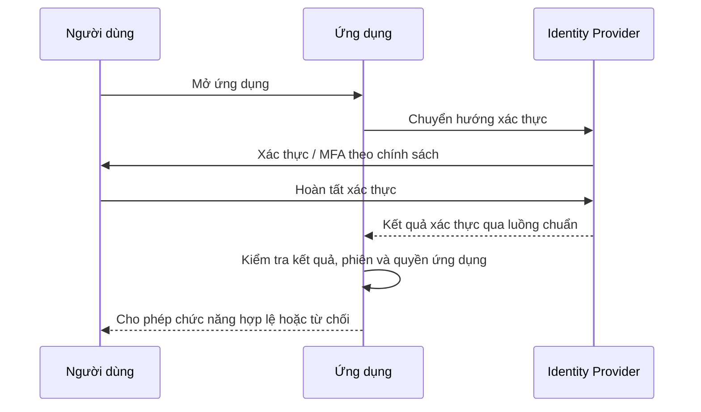
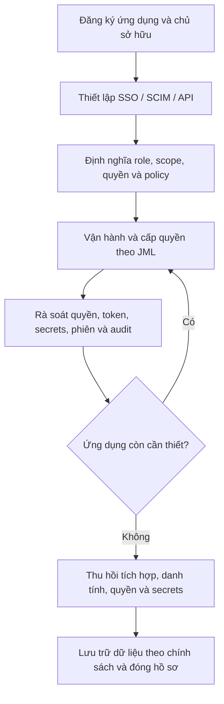
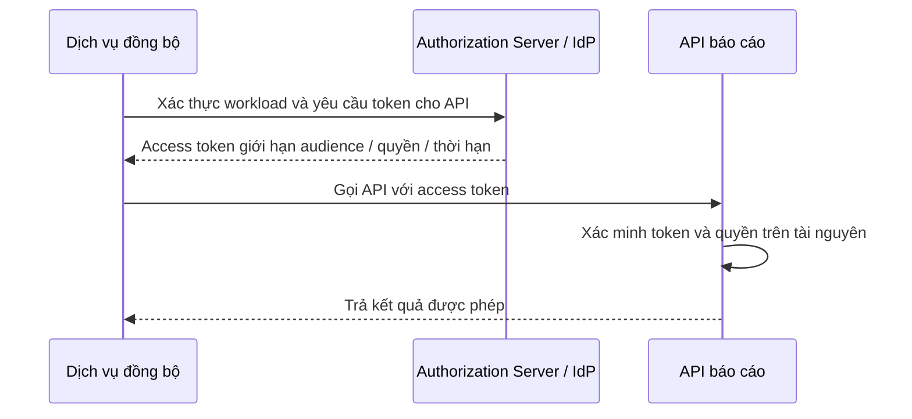

# Application trong IAM: ứng dụng là tài nguyên, khách hàng định danh và chủ thể truy cập

Trong quản lý định danh và truy cập (*Identity and Access Management*, IAM), **Application** là một khái niệm cần đọc theo ngữ cảnh. Một ứng dụng có thể là **tài nguyên mà người dùng muốn truy cập**, là **bên tích hợp đăng nhập với nhà cung cấp danh tính**, hoặc là **chủ thể phi con người tự gọi API và truy cập tài nguyên**. Ba góc nhìn có liên quan nhưng không đồng nhất; nhầm lẫn chúng sẽ dễ dẫn đến cấp quyền sai, giữ lại tài khoản mồ côi hoặc bỏ sót việc thu hồi thông tin xác thực.

Trong module `SECURITY_IDENTITY_ACCESS_MANAGEMENT_IDENTITY_LIFECYCLE`, ta xem Application trong chương **Chủ thể và vai trò** để kết nối danh tính của nhân viên, vai trò RBAC/ABAC, IdP, SSO, SCIM và danh tính dịch vụ với các sự kiện **Joiner–Mover–Leaver (JML)**. Mục tiêu của bài học là xác định ứng dụng đang đóng vai gì trong một yêu cầu truy cập, ai hoặc điều gì được phép thực hiện hành động, và cách kiểm soát quyền tương ứng trong suốt vòng đời.

Sau bài học, bạn có thể: phân biệt ứng dụng, người dùng và tài khoản dịch vụ; nhận biết ứng dụng trong các luồng SSO/OIDC/OAuth 2.0/SCIM; mô hình hóa quyền ứng dụng; thiết kế quy trình cấp, đổi, thu hồi quyền; và kiểm tra rủi ro từ ứng dụng hoặc thông tin xác thực còn tồn tại sau thay đổi nhân sự.

## 1. Ba cách hiểu Application trong một hệ thống IAM

| Góc nhìn | Application đóng vai trò gì? | Câu hỏi IAM phải trả lời | Ví dụ |
| --- | --- | --- | --- |
| **Ứng dụng đích** (*target/resource application*) | Nơi dữ liệu và chức năng được bảo vệ | Ai có thể đăng nhập? Được xem, sửa, phê duyệt gì? | CRM, hệ thống nhân sự, trang quản trị dự án |
| **Ứng dụng tích hợp định danh** (*relying party/client*) | Hệ thống chuyển người dùng đến IdP hoặc lấy token để thực hiện luồng xác thực/ủy quyền | Ứng dụng nào được đăng ký, redirect URI nào hợp lệ, được yêu cầu scope gì? | Web app dùng OpenID Connect để đăng nhập |
| **Ứng dụng như chủ thể máy** (*workload/application identity*) | Tiến trình hoặc dịch vụ tự yêu cầu truy cập tài nguyên khác | Ứng dụng được xác thực bằng gì và được gọi API nào, trong bao lâu? | Dịch vụ đồng bộ dữ liệu gọi API kho báo cáo |

Ví dụ, ứng dụng quản lý đơn hàng vừa là **đích** nhân viên đăng nhập để xử lý đơn, vừa là **client OIDC** dùng IdP xác thực nhân viên, đồng thời có thể là **chủ thể máy** khi công việc chạy nền gửi thông tin giao hàng sang một API khác. Không nên dùng một tập quyền rộng duy nhất cho cả ba nhu cầu đó.

Để phân tích một yêu cầu truy cập, xác định tối thiểu:

- **Subject (chủ thể):** người dùng, dịch vụ, workload hay ứng dụng thực hiện yêu cầu.
- **Resource (tài nguyên):** dữ liệu, API, chức năng hoặc ứng dụng đích.
- **Action (hành động):** đọc, cập nhật, xóa, phê duyệt, xuất dữ liệu, thực thi tác vụ.
- **Context (ngữ cảnh):** trạng thái danh tính, vai trò, dự án, thiết bị, thời gian hoặc mức rủi ro.
- **Decision / enforcement (quyết định và thực thi):** chính sách nào cho phép hoặc từ chối, thành phần nào thực sự chặn yêu cầu.

Một **application registration**, một **tài khoản người dùng trong ứng dụng** và một **quyền trên API** là các đối tượng khác nhau. Tạo đăng ký ứng dụng ở IdP không tự động có nghĩa là mọi nhân viên đã có tài khoản hoặc quyền nghiệp vụ trong ứng dụng đó.

## 2. Application, User, Group, Role và Service Account khác nhau thế nào?

| Đối tượng | Ý nghĩa | Vòng đời chủ yếu | Điểm cần tránh |
| --- | --- | --- | --- |
| **User** | Danh tính của con người, thường gắn với nhân viên hoặc đối tác | Gia nhập, đổi vai trò, rời tổ chức | Gán quyền vĩnh viễn ngoài nhu cầu công việc |
| **Group** | Tập hợp chủ thể để gán quyền hoặc áp chính sách | Thành viên được thêm/gỡ theo thuộc tính hay quy trình | Nhóm lồng nhau dẫn đến quyền khó nhận biết |
| **Role** | Tập quyền hoặc trách nhiệm được định nghĩa theo hệ thống | Được định nghĩa, phân công, rà soát, thu hồi | Đồng nhất mọi vai trò giữa các ứng dụng dù ý nghĩa khác nhau |
| **Application** | Phần mềm hoặc thực thể tích hợp, có thể là client, đích hoặc chủ thể | Đăng ký, cấu hình, vận hành, thay đổi, ngừng sử dụng | Coi ứng dụng luôn là người dùng, hoặc luôn là tài nguyên |
| **Service account / workload identity** | Danh tính phi con người dùng cho tiến trình tự động | Khởi tạo, cấp quyền, luân chuyển xác thực, ngừng hoạt động | Không gắn chủ sở hữu; giữ khóa và quyền lâu dài |

**Application và service account không đồng nghĩa.** Một ứng dụng có thể chạy bằng danh tính workload do nền tảng cấp, một service principal của IdP hoặc một tài khoản kỹ thuật có quản lý. Ngược lại, một ứng dụng có thể sử dụng nhiều danh tính riêng cho môi trường phát triển, kiểm thử và sản xuất. Các tên gọi như *service principal*, *managed identity* hoặc *app role* phụ thuộc sản phẩm cụ thể; cần đối chiếu với mô hình của nền tảng đang sử dụng.

Một **role** thường được định nghĩa trong phạm vi ứng dụng: `order.viewer` trên hệ thống đơn hàng không tự động có ý nghĩa trên công cụ phân tích dữ liệu. Chỉ nên ánh xạ vai trò giữa các ứng dụng qua một chính sách có chủ sở hữu, tài liệu hóa và kiểm thử rõ ràng.

## 3. Ứng dụng trong luồng xác thực và cấp quyền

### 3.1. Đăng nhập SSO: ứng dụng là bên nhận định danh

Trong mô hình **SSO**, ứng dụng thường tin cậy một **Identity Provider (IdP)** để xác thực người dùng. Một mô hình phổ biến là **OpenID Connect (OIDC)** trên OAuth 2.0; một số hệ thống sử dụng **SAML**. Ứng dụng đăng ký thông tin tích hợp như định danh client, đường dẫn chuyển hướng hợp lệ, cấu hình đăng xuất và cách kiểm tra thông tin xác thực.



Với OIDC, ứng dụng xác minh ID token và các thuộc tính liên quan theo chuẩn, hoặc hoàn tất luồng cấp mã ủy quyền trước khi thiết lập phiên. **ID token chứng minh kết quả xác thực cho client phù hợp; nó không mặc nhiên là access token để gọi API.** Một ứng dụng phải xác nhận issuer, audience, thời hạn và các thuộc tính bảo vệ tương ứng với luồng đã chọn. SSO làm thuận tiện việc đăng nhập nhưng **không thay thế phân quyền tài nguyên**.

Ví dụ, nhân viên đăng nhập SSO thành công vào CRM nhưng chưa được phân công vai trò `sales.viewer`. Ứng dụng vẫn phải từ chối màn hình xem danh sách khách hàng hoặc chỉ dẫn cách yêu cầu quyền. Cho phép truy cập chỉ vì có phiên SSO là lỗi trộn lẫn **authentication** với **authorization**.

### 3.2. Gọi API: application là OAuth client và có thể là chủ thể

Khi gọi API, phải phân biệt hai tình huống thường gặp:

1. **Delegated access (thay mặt người dùng):** ứng dụng gọi API trong ngữ cảnh người dùng đã được xác thực và được ủy quyền. Quyền hiệu lực phải xét cả scope được cấp và quyền của chính người dùng; app không thể tự tạo quyền vượt quá chính sách của API.
2. **Application-only / machine-to-machine:** ứng dụng hoặc workload gọi API không đại diện cho phiên người dùng tương tác cụ thể. Chủ thể được xét là danh tính ứng dụng; quyền của nó phải được cấp riêng và giới hạn theo nhiệm vụ.

Ví dụ, giao diện báo cáo có thể gọi API để xem các báo cáo người dùng được phép xem. Còn dịch vụ xử lý dữ liệu theo lịch có thể dùng **client credentials** hoặc danh tính workload để đọc dữ liệu đã được phê duyệt. Nếu API chỉ kiểm tra rằng “token hợp lệ” mà bỏ qua audience, scope, vai trò và chính sách tài nguyên, ứng dụng có nguy cơ bị cấp quyền vượt mức.

**Public client** như ứng dụng trình duyệt không thể giữ client secret như một bí mật dài hạn an toàn trong mã phía người dùng. Với ứng dụng dạng này, chọn luồng và biện pháp bảo vệ phù hợp (chẳng hạn Authorization Code với PKCE cho OIDC/OAuth hiện đại). **Confidential client** ở backend có thể sử dụng cơ chế xác thực client thích hợp; khóa bí mật phải được giữ ở nơi được bảo vệ, có vòng đời và quy trình xoay vòng.

### 3.3. SCIM: cấp tài khoản vào ứng dụng đích

**SCIM (System for Cross-domain Identity Management)** hỗ trợ trao đổi và quản lý đối tượng danh tính/nhóm giữa hệ thống cấp phát và ứng dụng tương thích. Ứng dụng đích có thể nhận yêu cầu tạo người dùng, cập nhật thuộc tính, gán thành viên nhóm hoặc vô hiệu hóa tài khoản tùy tính năng thực thi.

Không nên nhầm **SCIM provisioning** với **SSO login**:

| Hoạt động | Cơ chế điển hình | Điều nó chứng minh |
| --- | --- | --- |
| Người dùng xác thực để đăng nhập | OIDC/SAML qua IdP | Người dùng đã hoàn thành xác thực theo cấu hình |
| Tài khoản hoặc nhóm được đồng bộ | SCIM hoặc API nhà cung cấp | Hệ thống đích đã nhận yêu cầu thay đổi danh tính/quyền theo khả năng hỗ trợ |
| API nhận lệnh nghiệp vụ | OAuth access token và kiểm tra quyền phía API | Yêu cầu cụ thể có đủ quyền trong ngữ cảnh tài nguyên hay không |
| Đối soát trạng thái thực tế | API đọc trạng thái, kiểm thử hoặc bằng chứng kỹ thuật | Tài khoản/quyền/phiên tại đích đã đúng kỳ vọng hay chưa |

Nhận phản hồi thành công từ SCIM **không đồng nghĩa** mọi session đang mở đã hết hiệu lực. Đối với Leaver, cần xét thêm token, phiên ứng dụng và tài khoản cục bộ còn tồn tại.

## 4. Phân quyền trong Application bằng RBAC và ABAC

### 4.1. RBAC: quyền theo vai trò ứng dụng

**Role-Based Access Control (RBAC)** gán quyền thông qua vai trò. Một ứng dụng quản lý đơn hàng có thể định nghĩa:

| Vai trò | Quyền minh họa | Phạm vi |
| --- | --- | --- |
| `order.viewer` | Xem đơn hàng được phép | Dữ liệu đơn hàng |
| `order.editor` | Xem và cập nhật một số trường đơn hàng | Dữ liệu đơn hàng |
| `order.approver` | Phê duyệt điều chỉnh theo chính sách | Quy trình phê duyệt |
| `app.admin` | Quản trị cấu hình được giao | Cấu hình ứng dụng, có kiểm soát đặc quyền |

Các tên và quyền trên chỉ minh họa. Trong hệ thống thực, vai trò phải được thiết kế theo nghiệp vụ, kiểm soát việc gộp những quyền xung đột (*Separation of Duties*, SoD), hạn chế vai trò quản trị và có quy trình rà soát định kỳ.

Một người được gán `order.editor` ở IAM nhưng ứng dụng có thể vẫn cho phép sửa **mọi đơn hàng** nếu thiếu kiểm tra phạm vi đối tượng. Vì vậy, RBAC cần kết hợp kiểm tra tài nguyên cụ thể.

### 4.2. ABAC: điều kiện theo thuộc tính và ngữ cảnh

**Attribute-Based Access Control (ABAC)** xét thêm các thuộc tính của chủ thể, tài nguyên, hành động và môi trường. Ví dụ: người dùng có vai trò `order.viewer` chỉ được đọc đơn thuộc phòng ban hoặc chi nhánh được giao, với tài khoản còn hoạt động.

Quy tắc giả lập, không phải cú pháp của một nền tảng IAM cụ thể:

```text
ALLOW khi:
    subject.active == true
    AND subject.hasRole("order.viewer")
    AND action == "read"
    AND resource.type == "order"
    AND resource.branchId IN subject.allowedBranchIds

DENY trong các trường hợp còn lại
```

Với danh tính ứng dụng, thuộc tính có thể là môi trường (`production`), loại workload, chủ sở hữu, phạm vi API và thời hạn của một đợt cấp quyền. Các thuộc tính quan trọng phải đến từ nguồn đáng tin cậy và được **điểm thực thi chính sách** (*policy enforcement point*) sử dụng. Không thể coi một trường `branchId` do client tự gửi là bằng chứng đủ để cấp quyền.

### 4.3. Vai trò của ứng dụng không thay thế vai trò nhân viên

Một nhân viên thuộc nhóm “kế toán” trong HRIS chưa chắc nên được cấp mọi vai trò mang tên “accountant” ở các ứng dụng. IAM cần duy trì ánh xạ từ **vai trò nghiệp vụ** sang **vai trò cụ thể của ứng dụng** có chủ sở hữu và điều kiện áp dụng rõ ràng. Khi người dùng chuyển bộ phận, ánh xạ phải được tính lại để tránh cộng dồn đặc quyền từ nhiều vị trí công tác.

Quyền cấp trực tiếp cho user, nhóm lồng nhau và ngoại lệ tạm thời cũng phải nằm trong phạm vi đối soát. Nếu chỉ cập nhật vai trò từ một group trung tâm, quyền được cấp thủ công trong giao diện ứng dụng có thể tồn tại ngoài ý muốn.

## 5. Vòng đời Application và vòng đời quyền của người dùng

Vòng đời ứng dụng cần phối hợp với JML của con người. Một Application có thể được **đăng ký, tích hợp, cấp quyền, vận hành, thay đổi chủ sở hữu và ngừng sử dụng**. Đồng thời, mỗi user hoặc service identity liên kết với nó có vòng đời riêng.



### 5.1. Joiner: người dùng mới cần đúng ứng dụng, đúng vai trò

Khi nhân viên mới gia nhập:

1. HRIS hoặc nguồn thẩm quyền xác nhận danh tính, đơn vị, ngày bắt đầu và trạng thái hợp lệ.
2. IAM xác định danh sách ứng dụng cần dùng theo vai trò công việc; tránh mặc định cấp mọi ứng dụng cho toàn bộ nhân viên.
3. IdP chuẩn bị tài khoản và gán nhóm cơ sở; connector SCIM/API có thể tạo tài khoản tại đích.
4. Đến thời điểm đủ điều kiện, người dùng được đăng nhập và sử dụng đúng role/entitlement; hệ thống kiểm tra tình trạng MFA khi cần.
5. Đối soát cả việc **có tài khoản** và **có đúng khả năng thao tác**. Một account tồn tại nhưng thiếu role không giúp người dùng làm việc; ngược lại account có quyền cao vượt nhu cầu vẫn là lỗi.

**Ví dụ:** nhân viên chăm sóc khách hàng được cấp ứng dụng CRM với vai trò xem/sửa hồ sơ theo phạm vi được giao, nhưng chưa có quyền xuất toàn bộ dữ liệu khách hàng. Một yêu cầu cấp thêm quyền xuất dữ liệu cần căn cứ nghiệp vụ và phê duyệt riêng.

### 5.2. Mover: thay quyền ứng dụng khi vai trò thay đổi

Khi người dùng chuyển dự án hoặc phòng ban, IAM phải so sánh **quyền kỳ vọng** theo vai trò mới với **quyền thực tế** trên từng ứng dụng:

- Gỡ quyền của ứng dụng không còn phục vụ công việc, kể cả quyền cấp thủ công hoặc trực tiếp.
- Điều chỉnh nhóm, entitlement hoặc vai trò cụ thể trong ứng dụng còn được sử dụng.
- Cấp quyền cho ứng dụng mới sau khi xác minh điều kiện và phê duyệt phù hợp.
- Nếu cần quyền chuyển tiếp khi bàn giao, ghi rõ phạm vi, chủ sở hữu, người duyệt và thời điểm hết hạn.
- Kiểm tra SoD, ví dụ không để một người đồng thời tạo và phê duyệt cùng một loại giao dịch nhạy cảm nếu chính sách cấm.

Điểm khó là nhiều ứng dụng **không hỗ trợ giao dịch thay đổi quyền nguyên tử**. IAM phải đặt thứ tự áp dụng phù hợp với rủi ro, ghi nhận bước thất bại và thực hiện đối soát. Không nên kết luận Mover hoàn tất chỉ vì ứng dụng mới đã được cấp; quyền từ vai trò cũ phải được xử lý rõ ràng.

### 5.3. Leaver: thu hồi cả account, phiên và quyền ứng dụng

Một trường hợp Leaver không kết thúc ở thao tác khóa tài khoản IdP. Danh mục cần xét thường bao gồm:

1. **Ứng dụng dùng SSO:** ngừng cho đăng nhập mới; xác định khả năng hủy session và token đang hoạt động.
2. **Ứng dụng có SCIM/API:** vô hiệu hóa hoặc gỡ quyền ở tài khoản đích; xác minh trạng thái đã được áp dụng.
3. **Ứng dụng có tài khoản cục bộ:** vô hiệu hóa tài khoản và kiểm tra các kênh đăng nhập ngoài IdP.
4. **Ứng dụng quản trị:** thu hồi quyền đặc quyền, quyền phê duyệt và phiên quản trị.
5. **Tích hợp do người nghỉ việc sở hữu:** rà soát secret, API key, webhook, quyền triển khai và danh tính máy liên quan; chuyển chủ sở hữu hoặc thu hồi theo nhu cầu.
6. **Dữ liệu nghiệp vụ:** chuyển giao tài nguyên và áp dụng chính sách lưu trữ; không giữ quyền người nghỉ việc chỉ để giữ lại dữ liệu.

Ứng dụng có thể sử dụng cache phân quyền hoặc access token tự chứa còn thời hạn. Nếu đích không hỗ trợ thu hồi token tức thời, phải quản lý rủi ro còn lại bằng thời hạn token, kiểm tra trạng thái hoặc cơ chế bảo vệ bổ sung phù hợp. **Kết quả API thành công chưa thay thế được bằng chứng không còn truy cập thực tế.**

## 6. Application-to-Application: danh tính máy và quyền của ứng dụng

Khi một dịch vụ tự động gọi dịch vụ khác, câu hỏi IAM chuyển từ “nhân viên nào đang đăng nhập?” sang “**workload nào** đang yêu cầu quyền và nó được tin cậy bằng gì?”. Ví dụ, dịch vụ đồng bộ đơn hàng cần gửi dữ liệu sang hệ thống báo cáo mỗi giờ. Cấp một tài khoản quản trị dùng chung hoặc đặt API key vĩnh viễn trong mã nguồn là cách triển khai khó kiểm soát vòng đời.

Thiết kế có thể theo mô hình:



Tùy hạ tầng, có thể dùng managed identity, workload identity federation, chứng chỉ hoặc cơ chế xác thực client được hỗ trợ. Khi có thể, ưu tiên **thông tin xác thực ngắn hạn, không cần lưu bí mật tĩnh**. Dù dùng công nghệ nào, cần bảo đảm:

| Thuộc tính quản trị | Cách áp dụng |
| --- | --- |
| Định danh riêng | Mỗi workload và môi trường nhạy cảm có danh tính riêng, tránh dùng chung với con người hoặc giữa production và test. |
| Chủ sở hữu | Có nhóm chịu trách nhiệm khi dịch vụ thay đổi, sự cố hoặc ngừng sử dụng. |
| Quyền tối thiểu | Chỉ gọi API/operation cần thiết; kiểm tra audience, scope/role và tài nguyên cụ thể. |
| Hạn dùng và luân chuyển | Token/secret/certificate có thời hạn và cơ chế xoay vòng, thu hồi; không ghi bí mật vào log. |
| Giám sát | Theo dõi danh tính gọi API, dấu hiệu bất thường, lỗi cấp token và tài khoản không còn được dùng. |
| Kết thúc vòng đời | Gỡ quyền, hủy credential và tích hợp khi workload nghỉ hoạt động hoặc thay đổi chủ sở hữu. |

### Khác biệt giữa ủy quyền người dùng và quyền ứng dụng

Nếu API đang xử lý yêu cầu **thay mặt nhân viên**, ứng dụng không được chuyển sang một danh tính máy có quyền rất rộng rồi bỏ qua kiểm tra quyền của người dùng. Trường hợp này dễ hình thành lỗi *confused deputy*: một thành phần có quyền cao thực hiện thay yêu cầu mà chủ thể ban đầu không được phép.

Với luồng **application-only**, không có người dùng cuối để làm điều kiện quyền; policy phải dựa vào danh tính app, quyền được cấp và phạm vi tài nguyên. Với luồng **delegated**, policy cần giới hạn thêm theo người dùng và bối cảnh ủy quyền. Hai loại phải được biểu diễn và kiểm thử riêng.

## 7. Quản lý quyền và cấu hình Application an toàn

### 7.1. Đăng ký, tích hợp và cấp quyền có người chịu trách nhiệm

Trước khi kết nối ứng dụng với IdP, tổ chức nên ghi nhận **tên ứng dụng, môi trường, chủ sở hữu, mục đích, dữ liệu xử lý, phương thức xác thực, scope/role yêu cầu, tài khoản dịch vụ liên quan, nơi lưu credential và lịch rà soát**. Với ứng dụng bên thứ ba, cần xem xét quyền ủy quyền và các dữ liệu ứng dụng được phép tiếp cận.

Một ứng dụng yêu cầu quyền đọc dữ liệu không cần thiết cho tính năng hiện tại phải được đánh giá lại. Quyền quản trị hoặc quyền API diện rộng cần phê duyệt phù hợp; không coi việc nhân viên “nhấn đồng ý” ở màn hình consent là đủ cho mọi yêu cầu nguy cơ cao.

### 7.2. Kiểm soát quyền ở backend và tài nguyên

Ứng dụng có thể ẩn một nút “Xóa” ở giao diện khi người dùng không có role quản trị, nhưng API xóa tài nguyên vẫn phải xác minh quyền độc lập. Một giao diện chỉ đóng vai trò **hỗ trợ trải nghiệm**; kiểm soát thực tế phải nằm tại điểm xử lý yêu cầu.

Ví dụ giả mã:

```text
deleteOrder(subject, orderId):
    token = verifyAccessToken(subject.requestToken)
    require(token.audience == "orders-api")
    require(token.isActiveWithinPolicy)

    order = loadOrder(orderId)
    require(can(subject, "order.delete", order))

    delete(order)
    recordAudit(subject.id, "order.delete", order.id)
```

Đây là mô tả nguyên lý, không phải thư viện xác thực hay đoạn mã có thể đưa trực tiếp vào production. Triển khai thật cần kiểm tra issuer, chữ ký, thời hạn, cách lấy danh tính từ token và các yêu cầu riêng của IdP/API. Đặc biệt, **không được tin vào `subject.id` tự gửi từ client** nếu chưa được liên kết với token đã xác thực.

### 7.3. Rà soát và thu hồi quyền ứng dụng tồn dư

Quyền thực tế có thể khác quyền kỳ vọng do nhiều nguồn: nhóm IdP, role trong ứng dụng, entitlement được gán thủ công, cấu hình API consent, token hiện hành, quyền đặc quyền JIT hoặc khóa của service account. Vì vậy, IAM cần đối soát cả **đường cấp quyền** lẫn **đường thực thi truy cập**.

Lập danh mục tài khoản không có người sở hữu, tài khoản không sử dụng lâu ngày, secret sắp hết hạn, quyền admin cố định, role xung đột và ứng dụng đã ngừng dùng nhưng còn tích hợp. Những mục này cần quy trình xử lý có bằng chứng và thời hạn; phát hiện tự động mà không có người nhận trách nhiệm sẽ không đóng được rủi ro.

## 8. Tình huống thực hành: một ứng dụng đặt hàng qua ba giai đoạn JML

Giả sử tổ chức dùng **OrderHub**, ứng dụng web xử lý đơn hàng. Người dùng xác thực qua IdP bằng OIDC; tài khoản và nhóm trong OrderHub được đồng bộ từ IAM qua SCIM. Một dịch vụ riêng **OrderSync** dùng danh tính workload để gửi báo cáo sang API phân tích.

| Thời điểm | Sự kiện | Trạng thái đúng | Rủi ro cần kiểm tra |
| --- | --- | --- | --- |
| Thứ Hai, nhân viên bán hàng gia nhập | Joiner | Có danh tính đã xác minh; đăng nhập OrderHub và chỉ đọc/sửa đơn thuộc phạm vi được giao | Tài khoản tạo sớm nhưng có quyền trước ngày bắt đầu; gán nhầm `app.admin` |
| Thứ Tư, nhân viên sang bộ phận kiểm toán | Mover | Gỡ quyền sửa đơn; cấp quyền xem báo cáo theo chính sách mới | Quyền sửa cũ tồn dư do role cấp thủ công; SoD không được kiểm tra |
| Thứ Sáu, nhân viên nghỉ việc | Leaver | IdP chặn đăng nhập; OrderHub vô hiệu hóa tài khoản và thu hồi quyền/phiên có thể thu hồi | Token chưa hết hạn, tài khoản cục bộ hoặc session vẫn còn truy cập |
| Ngày OrderSync được thay thế | Application lifecycle | Tắt tích hợp cũ; gỡ quyền API; thu hồi danh tính/credential cũ | Secret tồn tại lâu, app-only token vẫn được cấp, không rõ người sở hữu |

Một lần SSO thành công không đủ để chứng minh user được xem mọi đơn hàng; một lần SCIM `200 OK` không đủ để chứng minh không còn phiên đang hoạt động; và vô hiệu hóa người dùng không tự động giải quyết danh tính OrderSync. Bài toán đòi hỏi **liên kết giữa chủ thể, tài nguyên, quyền và thời điểm hiệu lực**.

Các câu hỏi kiểm thử hữu ích:

1. Nhân viên không có `order.editor` có gọi trực tiếp API sửa đơn được không, dù giao diện đã ẩn nút sửa?
2. Sau Mover, role được cấp thủ công tại OrderHub có được đối soát và gỡ bỏ không?
3. Sau Leaver, token hay session cũ có thể tiếp tục hoạt động trong bao lâu và có cách chặn sớm không?
4. Khi OrderSync ngừng dùng, ai thu hồi quyền, khóa và app registration liên quan?
5. Một client app-only có thể truy cập tài nguyên ngoài phạm vi được phê duyệt không?

## 9. Checklist khi thiết kế Application trong IAM

Trước khi đưa một ứng dụng vào vận hành hoặc rà soát ứng dụng đang dùng, nên trả lời đầy đủ:

- Ứng dụng là **đích**, **client tích hợp định danh**, **chủ thể máy** hay đồng thời nhiều vai? Có phân tách các loại quyền đó không?
- Ai sở hữu ứng dụng và danh tính kỹ thuật? Danh tính được dùng cho môi trường nào, quyền nào và đến khi nào?
- Người dùng được cấp quyền qua nhóm, role, SCIM hay cấp trực tiếp? Có bản đồ các nguồn quyền và chính sách RBAC/ABAC không?
- Đăng nhập SSO có được tách khỏi quyết định ủy quyền từng chức năng và đối tượng dữ liệu không?
- Token có được kiểm tra đúng issuer, audience, thời hạn và quyền không? Có cơ chế bảo vệ phiên và endpoint API không?
- Joiner được cấp quyền cơ sở đúng lúc, Mover được gỡ quyền cũ, Leaver được chặn cả các đường đăng nhập và tài khoản còn tồn tại không?
- Các ứng dụng và service account hết nhu cầu có được thu hồi credential, API consent, role và tích hợp không?
- Có audit trail, đối soát quyền thực tế, cảnh báo lỗi đồng bộ và người chịu trách nhiệm xử lý ngoại lệ không?

**Tự kiểm tra:** Một ứng dụng có client ID ở IdP, đã dùng SSO cho nhân viên và có quyền `orders.read` khi gọi API khác. Nếu nhân viên nghỉ việc, chỉ xóa client ID của ứng dụng có phải là giải pháp đúng không? **Không.** Việc rời tổ chức yêu cầu xử lý quyền và phiên của **nhân viên** ở những hệ thống liên quan; danh tính ứng dụng tiếp tục được quản lý theo vòng đời riêng nếu dịch vụ còn hoạt động. Ngược lại, khi chính ứng dụng ngừng dùng, phải thu hồi các quyền và credential thuộc ứng dụng mà không tùy tiện vô hiệu hóa danh tính của những nhân viên vẫn làm việc.

## Kết luận

Trong IAM, **Application vừa có thể là nơi nhận yêu cầu truy cập, vừa có thể là bên tích hợp xác thực, vừa có thể là chủ thể phi con người**. Xác định đúng vai trò của ứng dụng giúp phân biệt xác thực với ủy quyền, thiết kế RBAC/ABAC và luồng OAuth/OIDC/SSO/SCIM chính xác, cũng như quản lý quyền theo Joiner–Mover–Leaver. Mỗi quyền phải có chủ sở hữu, mục đích, phạm vi, thời điểm hiệu lực và cách thu hồi/kiểm chứng; nhờ vậy hệ thống giảm quyền truy cập tồn dư mà vẫn hỗ trợ người dùng và dịch vụ thực hiện công việc hợp lệ.
