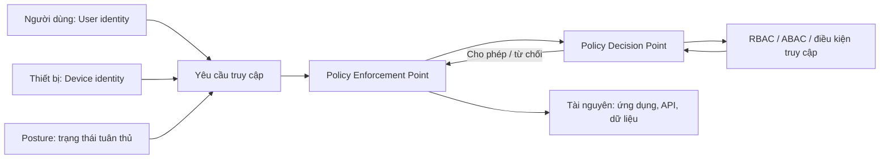
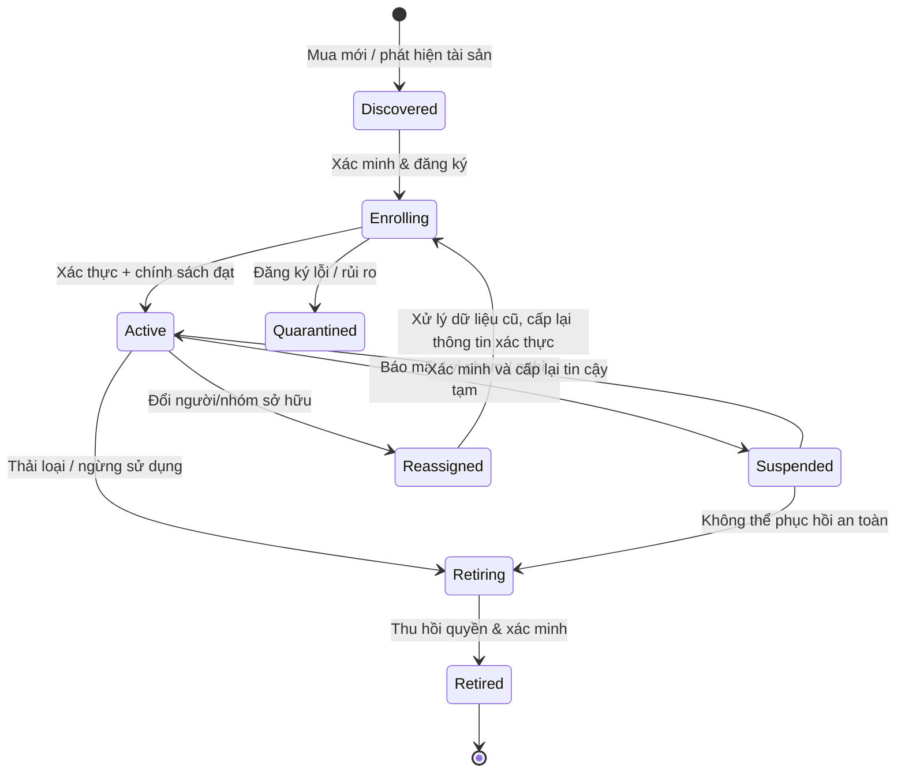
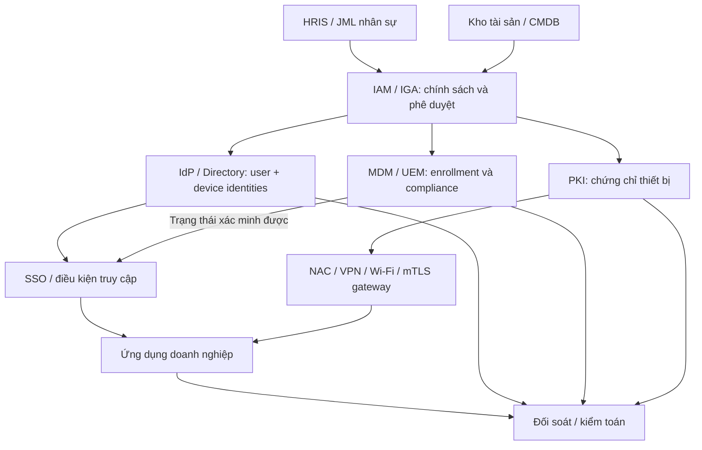

# Device account: tài khoản thiết bị trong quản lý danh tính và vai trò

## 1. Device account là gì?

Trong **Identity and Access Management (IAM)**, một thiết bị có thể được xem là một **chủ thể phi con người** (*non-human subject*) cần có danh tính riêng để được nhận diện, xác thực, quản lý và kiểm soát quyền. **Device account (tài khoản thiết bị)** là bản ghi hoặc tài khoản đại diện cho một thiết bị trong một hệ thống danh tính, thư mục, nền tảng quản trị hoặc dịch vụ đích. Tùy công nghệ, nó có thể là tài khoản máy tính trong thư mục doanh nghiệp, đối tượng thiết bị được đăng ký ở nhà cung cấp danh tính (*Identity Provider – IdP*), hay danh tính thiết bị dùng chứng chỉ để giao tiếp với dịch vụ.

Ví dụ, máy tính xách tay `LAPTOP-042`, điện thoại làm việc, máy quét mã vạch trong kho và cảm biến IoT đều có thể có định danh thiết bị. Tổ chức cần biết: thiết bị nào đang tồn tại, thuộc ai, có đáng tin cậy tại thời điểm truy cập không, dùng thông tin xác thực nào và còn được phép truy cập tài nguyên gì.

**Điểm cốt lõi:** danh tính thiết bị và danh tính người sử dụng là **hai thực thể khác nhau**. Người dùng đăng nhập bằng tài khoản nhân sự; thiết bị có thể được xác thực và đánh giá độc lập. Một yêu cầu truy cập hợp lệ thường cần **cả người dùng đúng quyền, thiết bị đáp ứng chính sách và ngữ cảnh phù hợp**.

Chủ đề này thuộc phần **Chủ thể và vai trò** của mô-đun `SECURITY_IDENTITY_ACCESS_MANAGEMENT_IDENTITY_LIFECYCLE`: quản lý vòng đời danh tính, cấp và thu hồi quyền theo Joiner–Mover–Leaver (JML), kết nối IdP/SSO, SCIM, RBAC/ABAC, kiểm toán và giảm quyền truy cập tồn dư. Với thiết bị, vòng đời danh tính phải gắn đồng thời với vòng đời tài sản, người sở hữu và các bí mật dùng để xác thực.

## 2. Phân biệt device identity, device account và những khái niệm gần nhau

| Khái niệm | Định nghĩa | Ví dụ | Lưu ý quản trị |
|---|---|---|---|
| **Device identity** | Định danh logic của thiết bị, có thể được chứng minh bằng khóa/chứng chỉ hoặc quan hệ đăng ký | `deviceId=dev-8f21` | Là câu trả lời cho “thiết bị nào?” |
| **Device account / device object** | Bản ghi đại diện thiết bị trong hệ thống danh tính | Computer account trong Active Directory (AD), device object trong IdP | Không phải mọi nền tảng đều gọi là “account” |
| **User account** | Tài khoản của người làm việc hoặc người dùng ứng dụng | `lan@example.org` | Quyền nghiệp vụ của người dùng không tự chuyển sang thiết bị |
| **Service account** | Danh tính dành cho ứng dụng, dịch vụ hoặc tác vụ tự động | `svc-deploy-prod` | Tài khoản dịch vụ có thể chạy trên nhiều máy; không đồng nhất với một thiết bị |
| **Local account** | Tài khoản được quản lý trực tiếp trên hệ điều hành thiết bị | Local administrator, local system account | Có thể tồn tại ngoài IdP và cần quản lý riêng |
| **Device registration/enrollment** | Quá trình thiết bị được ghi nhận, kết nối với IdP/MDM và áp dụng chính sách | Đăng ký laptop vào hệ thống quản lý thiết bị | Đăng ký thành công chưa chứng minh thiết bị luôn an toàn |
| **Device credential** | Bí mật hoặc vật liệu mật mã mà thiết bị sử dụng để chứng minh danh tính | Khóa riêng, chứng chỉ X.509, mật khẩu tài khoản máy tính | Phải quản lý cấp phát, bảo vệ, gia hạn và thu hồi |
| **Device posture/compliance** | Tình trạng thiết bị theo chính sách tại một thời điểm | Có mã hóa đĩa, bản vá, bảo vệ endpoint, không bị báo mất | Là tín hiệu cho chính sách truy cập, không tự nó định danh thiết bị |

Một số chi tiết công nghệ dễ nhầm lẫn:

- **AD computer account** là một đối tượng bảo mật trong Active Directory, có danh tính và thông tin xác thực dùng cho quan hệ tin cậy máy với miền Windows. Nó khác tài khoản người dùng đang đăng nhập trên máy và khác tài khoản local administrator.
- **Cloud IdP device object** có thể lưu ID, trạng thái đăng ký, kiểu tham gia tổ chức và quan hệ người dùng/thiết bị. Nó không nhất thiết có cùng cơ chế hoặc quyền như AD computer account.
- **MDM (Mobile Device Management)** quản lý cấu hình, tuân thủ và thao tác thiết bị. Bản ghi MDM, bản ghi IdP và bản ghi trong kho tài sản (*asset inventory/CMDB*) có thể là các đối tượng khác nhau nhưng cần được liên kết đúng.
- **Chứng chỉ thiết bị** chứng minh quyền sở hữu khóa riêng tương ứng; muốn tin chứng chỉ còn phải kiểm tra chuỗi tin cậy, hiệu lực, ràng buộc danh tính, chính sách và tình trạng thu hồi theo thiết kế hệ thống.

Vì thế, “xóa device account” là một thao tác cụ thể trong hệ thống lưu danh tính; **offboard thiết bị hoàn chỉnh** còn bao gồm vô hiệu hóa bí mật, chính sách, kết nối, quyền truy cập và bản ghi liên quan.

## 3. Thiết bị tham gia mô hình Subject – Role – Resource như thế nào?

Mô hình kiểm soát truy cập đặt ra các câu hỏi: **ai/cái gì yêu cầu**, **muốn làm gì**, **với tài nguyên nào**, **trong điều kiện gì**?



Ví dụ nhân viên có vai trò `Finance-Analyst` được xem báo cáo tài chính. Tổ chức có thể bổ sung điều kiện thiết bị phải do công ty quản lý và đáp ứng chính sách bảo mật. Khi đó:

- **User subject** được kiểm tra quyền nghiệp vụ `report:read`.
- **Device subject** được kiểm tra danh tính, trạng thái quản lý và tín hiệu bảo mật.
- **Environment** có thể bổ sung thời gian, vị trí mạng, mức rủi ro phiên hoặc độ nhạy dữ liệu.
- **Resource/action** xác định báo cáo nào, đọc hay xuất dữ liệu.

**RBAC** cấp quyền theo vai trò như `Finance-Analyst`; **ABAC** xét thuộc tính như `device.managed`, `device.compliant`, `user.department`, `resource.classification`. Trạng thái thiết bị đóng vai trò **điều kiện truy cập**, không nên tự động tạo quyền nghiệp vụ cho người sử dụng.

### Ví dụ chính sách ABAC (giả mã)

```text
allow(request) if
    user.status == "ACTIVE"
    and "Finance-Analyst" in user.roles
    and request.action == "report:read"
    and device.registrationStatus == "ACTIVE"
    and device.managed == true
    and device.compliant == true
    and device.riskLevel in {"LOW", "MEDIUM"}
    and resource.classification == "INTERNAL"
```

Đây là **giả mã minh họa**, không phải cú pháp cấu hình của sản phẩm cụ thể. Chính sách phải lấy thuộc tính từ nguồn tin cậy và kiểm tra được tính mới của thông tin; không tin trực tiếp trường `compliant=true` do ứng dụng phía thiết bị tự gửi lên nếu chưa được xác thực.

## 4. Các thuộc tính cần quản lý của device account

Một mô hình danh tính thiết bị thường cần những thuộc tính sau. Phạm vi dữ liệu phụ thuộc loại thiết bị và yêu cầu bảo vệ riêng tư:

| Nhóm | Thuộc tính ví dụ | Mục đích |
|---|---|---|
| Định danh | `deviceId`, ID thư mục, ID MDM, ID tài sản, serial khi phù hợp | Liên kết bản ghi giữa IdP, MDM, CMDB, dịch vụ đích |
| Phân loại | Loại thiết bị, hệ điều hành, môi trường `prod/test`, nhóm ứng dụng | Chọn chính sách phù hợp |
| Quyền sở hữu | Đơn vị sở hữu, người phụ trách, bộ phận hỗ trợ, hệ thống bảo trợ | Biết ai duyệt và xử lý khi thiết bị thay đổi |
| Trạng thái | `PENDING`, `ACTIVE`, `SUSPENDED`, `RETIRED` | Điều khiển vòng đời và quyền truy cập |
| Tin cậy | Phương thức enrollment, chứng nhận/attestation khi hỗ trợ, khóa công khai hoặc liên kết chứng chỉ | Xác thực danh tính thiết bị |
| Tuân thủ | Bản vá, mã hóa, chính sách MDM, cảnh báo endpoint, thời điểm kiểm tra | Đánh giá rủi ro tại thời điểm truy cập |
| Credential | ID chứng chỉ, hạn sử dụng, phương thức xoay vòng, trạng thái thu hồi | Quản lý bí mật và thời hạn tin cậy |
| Kiểm toán | Thời điểm tạo/kích hoạt, cập nhật, lần xác thực gần nhất, người phê duyệt, ticket | Truy vết sự kiện vòng đời |

**Không dùng tên máy, địa chỉ IP, địa chỉ MAC hoặc số serial như bằng chứng xác thực duy nhất.** Các giá trị này có thể thay đổi, có thể bị sao chép/giả mạo trong nhiều môi trường và không thay thế được cơ chế chứng minh quyền sở hữu credential. Số serial có thể hữu ích cho quản lý tài sản nhưng cần được đối chiếu với định danh do hệ thống tin cậy cấp.

### Ví dụ bản ghi danh tính thiết bị

```json
{
  "deviceId": "dev-8f21",
  "displayName": "LAPTOP-042",
  "deviceType": "CORPORATE_LAPTOP",
  "identityState": "ACTIVE",
  "ownerPersonId": "P-1042",
  "department": "Finance",
  "idpDeviceObjectId": "idp-device-421",
  "mdmEnrollmentId": "mdm-993",
  "managed": true,
  "compliance": {
    "state": "COMPLIANT",
    "checkedAt": "2026-11-23T08:30:00+07:00"
  },
  "credential": {
    "type": "X509_CLIENT_CERT",
    "certificateRef": "cert-ref-37",
    "expiresAt": "2027-02-20T00:00:00+07:00"
  }
}
```

Ví dụ này là **mô hình nội bộ giả định**, không phải đối tượng SCIM tiêu chuẩn hay API có sẵn. Trên thực tế phải bảo đảm định danh giữa các hệ thống được liên kết bằng khóa ổn định, không đồng nhất các ID chỉ vì giống tên máy. **Không đưa private key, mật khẩu, secret hoặc token thô vào bản ghi metadata hay log.**

## 5. Vòng đời device account

Vòng đời thiết bị có liên hệ với JML, nhưng **không trùng hoàn toàn** vòng đời của nhân viên: thiết bị có thể chuyển từ người này sang người khác, bị mất, đổi bo mạch, ngừng hoạt động hoặc bị thu hồi trước khi nhân viên nghỉ việc.



Đây là **sơ đồ tham khảo**. Doanh nghiệp có thể có trạng thái `LOST`, `COMPROMISED`, `REPAIR`, `INACTIVE` hoặc các trạng thái khác tùy thiết kế. Nên tách rõ **trạng thái danh tính**, **trạng thái thiết bị**, **trạng thái tuân thủ** và **trạng thái tài khoản tại ứng dụng đích**; chúng có thể thay đổi không đồng thời.

### 5.1. Enroll: đưa thiết bị vào quản lý

1. **Xác minh nguồn gốc và quyền sở hữu:** thiết bị đến từ kho tài sản, nhà cung cấp, người dùng hoặc nền tảng cấp phát đã được chấp thuận.
2. **Tạo định danh có thể kiểm chứng:** cấp ID trong IdP/directory hoặc hệ thống quản lý thiết bị, liên kết với asset inventory và người/nhóm phụ trách.
3. **Thiết lập khóa/chứng chỉ/quan hệ tin cậy:** ưu tiên khóa được tạo và bảo vệ bởi phần cứng như TPM/secure element khi phù hợp và được hệ thống hỗ trợ.
4. **Áp chính sách bảo mật:** mã hóa đĩa, bản vá, cấu hình firewall, endpoint protection, MDM và chứng nhận thiết bị nếu có.
5. **Cấp quyền tối thiểu:** chỉ cho thiết bị truy cập mạng và dịch vụ cần thiết cho loại thiết bị, vai trò hoặc tác vụ.
6. **Đối soát:** kiểm tra device object, MDM enrollment, chứng chỉ, danh mục tài sản và trạng thái trên hệ thống đích; ghi nhận kết quả.

**Cần phân biệt** việc thiết bị được quản lý, thiết bị tuân thủ và thiết bị được cho phép truy cập. Một thiết bị mới enroll có thể phải ở trạng thái kiểm dịch (*quarantine*) cho đến khi đủ bản vá và các bước xác thực.

### 5.2. Operate: vận hành và giám sát

- Cập nhật owner, hệ điều hành, chính sách, trạng thái tuân thủ và nhóm truy cập khi có thay đổi.
- Gia hạn/luân chuyển certificate, khóa hoặc mật khẩu tài khoản máy theo thiết kế; kiểm tra lỗi hết hạn trước khi gián đoạn dịch vụ.
- Phát hiện đăng nhập bất thường, sai lệch cấu hình, thiết bị không còn kiểm kê được, bản vá quá hạn hoặc danh tính thiết bị bị sao chép.
- Rà soát quyền lâu không sử dụng và sự khác biệt giữa danh mục IAM với MDM, AD, nền tảng cloud và ứng dụng.

### 5.3. Suspend/Quarantine: tạm dừng hoặc cách ly

Khi thiết bị bị mất, bị nghi xâm nhập hoặc vi phạm chính sách, hệ thống có thể **chặn điều kiện truy cập, đình chỉ đăng ký, cách ly mạng, vô hiệu hóa credential hoặc yêu cầu xác thực lại** tùy mức rủi ro. Việc `compliant=false` chỉ có tác dụng tại các điểm thực thi chính sách đang sử dụng tín hiệu compliance; các đường truy cập độc lập vẫn cần được kiểm tra.

Nếu cấp quyền phục hồi, cần xác minh nguồn gốc và tình trạng thiết bị, đánh giá lại khóa/credential, kiểm tra mã độc và tái đăng ký nếu thiết kế yêu cầu. Không tự đánh dấu an toàn chỉ vì thiết bị kết nối trở lại.

### 5.4. Reassign: chuyển thiết bị sang chủ sở hữu mới

Khi laptop từ nhân viên A được bàn giao cho nhân viên B, thiết bị có thể còn nhiều dấu vết truy cập của A: phiên trình duyệt, refresh token, VPN profile, khóa SSH, file mật, credential cache và quyền local admin. Việc thay `ownerPersonId` **không xóa những dấu vết này**.

Quy trình bàn giao nên gồm: kiểm kê và bảo quản dữ liệu cần giữ, thu hồi phiên/credential người cũ, xóa hoặc tái cài đặt thiết bị theo chính sách, bảo đảm bản ghi danh tính thiết bị hợp lệ, cập nhật owner và cấp đúng quyền cho người mới. Mức độ cần **xóa sạch, reset hoặc tái enroll** tùy loại thiết bị, độ nhạy dữ liệu và mô hình quản trị.

### 5.5. Retire/Deprovision: ngừng sử dụng

1. Chuyển thiết bị ra khỏi nhóm được phép truy cập và chặn phiên hoặc kết nối đang hoạt động nếu cần.
2. Thu hồi hoặc vô hiệu hóa chứng chỉ, khóa, đăng ký trong IdP, tài khoản máy, cấu hình VPN và quyền trên các dịch vụ đích.
3. Xử lý tài khoản local, credential cache, tài nguyên thiết bị sở hữu và các bí mật dùng trong tự động hóa.
4. Xóa dữ liệu an toàn hoặc tiêu hủy thiết bị theo chính sách; lưu giữ dữ liệu cần bảo quản đúng quy định.
5. Đối chiếu AD/IdP, MDM, asset inventory, PKI, VPN/NAC, cloud và log truy cập để phát hiện danh tính còn hiệu lực.
6. Lưu bằng chứng thời điểm vô hiệu hóa, kết quả từng hệ thống, các lỗi chưa hoàn tất và người chịu trách nhiệm.

Không đánh dấu `RETIRED` hoàn toàn khi còn chứng chỉ, tài khoản hoặc khóa có thể sử dụng trong một hệ thống khác chưa được xử lý.

## 6. Device account trong Joiner–Mover–Leaver

JML mô tả sự thay đổi quan hệ con người/tổ chức; các thay đổi này là **tín hiệu kích hoạt** quản lý thiết bị liên quan:

| Sự kiện | Thay đổi device account liên quan | Nguy cơ nếu chỉ xử lý user account |
|---|---|---|
| **Joiner**: nhân viên mới | Cấp phát thiết bị, đăng ký IdP/MDM, liên kết owner, đặt posture baseline, cấp quyền theo mục đích | Thiết bị chưa quản lý có thể được dùng hoặc nhân viên chưa có phương tiện truy cập an toàn |
| **Mover**: chuyển vai trò/đơn vị | Đánh giá lại phân loại thiết bị, owner, nhóm mạng/ứng dụng, profile, chứng chỉ và quyền local nếu có | Thiết bị giữ kênh truy cập cũ, dữ liệu/secret còn lại, quyền đặc biệt tích lũy |
| **Leaver**: kết thúc quan hệ | Thu hồi thiết bị, chặn quyền người dùng, hủy phiên và credential trên máy, bàn giao/reimage/retire tùy tình huống | Device account còn active hoặc token người cũ vẫn dùng được |

**Tình huống cụ thể:** nhân viên nghỉ việc trả laptop cho phòng IT. IdP đã khóa user của nhân viên nhưng tài khoản máy trong AD và chứng chỉ Wi-Fi thiết bị vẫn còn hợp lệ. Laptop có thể vẫn kết nối mạng nội bộ trong phạm vi được chứng chỉ cho phép. IT phải kiểm tra từng đường truy cập, thu hồi hoặc tái cấp chứng chỉ theo chính sách, xử lý tài khoản máy, xóa dữ liệu và hoàn tất hồ sơ bàn giao. Ngược lại, nếu laptop là thiết bị dùng chung phục vụ ca làm, không nhất thiết phải xóa danh tính thiết bị khi một nhân viên nghỉ; cần tách **quyền của người rời đi** khỏi **quyền hợp lệ của thiết bị còn sử dụng**.

## 7. Xác thực thiết bị và bảo vệ credential

### 7.1. Các cơ chế thường gặp

| Cơ chế | Cách hoạt động khái quát | Giới hạn cần nhớ |
|---|---|---|
| **AD computer account / Kerberos** | Máy tham gia miền duy trì thông tin xác thực máy và tương tác với hạ tầng AD | Tin cậy miền không chứng minh mọi ứng dụng và dữ liệu trên máy an toàn |
| **X.509 client certificate / mTLS** | Thiết bị chứng minh sở hữu khóa riêng tương ứng với chứng chỉ; hai bên xác thực trong TLS khi cấu hình yêu cầu | Cần xác minh danh tính trong chứng chỉ, chuỗi tin cậy, thời hạn, quyền và thu hồi |
| **Khóa trong TPM/secure element** | Bảo vệ thao tác dùng khóa riêng trong phần cứng được hỗ trợ | Hạn chế sao chép khóa, nhưng không loại trừ mọi nguy cơ từ OS hoặc ứng dụng bị chiếm quyền |
| **Device registration tại IdP** | Thiết bị đăng ký khóa/định danh và nhận trạng thái tham gia tổ chức | Cần đánh giá loại enrollment, độ tin cậy tín hiệu và chính sách ứng dụng |
| **MDM certificate/profile** | Hệ thống quản trị phân phối cấu hình/credential đến thiết bị được quản lý | MDM enrollment không thay thế việc xác minh toàn bộ yêu cầu truy cập |
| **Workload identity** | Thiết bị/agent chạy workload nhận danh tính máy hoặc danh tính workload có phạm vi | Phải xác định ranh giới giữa danh tính thiết bị vật lý và ứng dụng chạy trên nó |

### 7.2. Credential lifecycle

Credential thiết bị có vòng đời riêng: **cấp → sử dụng → gia hạn/luân chuyển → đình chỉ/thu hồi → hết hiệu lực**. Nên quản lý ít nhất: ID credential, định danh thiết bị ràng buộc, nơi phát hành, mục đích sử dụng, thời điểm hết hạn, chủ chịu trách nhiệm và bằng chứng đã hủy.

Đối với chứng chỉ, chính sách có thể dùng thời hạn ngắn, CRL/OCSP, kiểm tra trạng thái ở hệ thống đích và cơ chế thu hồi của PKI. Hiệu quả của thu hồi phụ thuộc khả năng và cấu hình của hệ thống kiểm tra; không nên giả định việc “revoke tại CA” khiến mọi phiên TLS đã thiết lập bị ngắt ngay. Khi nghi khóa bị lộ, cần xem xét **thu hồi credential và ngắt phiên/kết nối hiện có** ở điểm thực thi.

### 7.3. Device identity không thay thế user authentication

Trong ứng dụng nghiệp vụ, chứng minh “đây là laptop được quản lý” không mặc nhiên chứng minh “người đang dùng laptop là nhân viên có vai trò kế toán”. Chính sách cần xác thực **người dùng và thiết bị theo đúng yêu cầu**, đồng thời ràng buộc tín hiệu với cùng phiên truy cập một cách đáng tin cậy. Với thiết bị đầu cuối dùng chung, danh tính người dùng thay đổi giữa các phiên; vai trò không nên được cấp cố định cho cả máy chỉ vì người dùng cuối trước đó có quyền.

## 8. Liên kết với IdP, SSO, SCIM, MDM và các hệ thống đích



Các mối liên kết cần diễn giải chính xác:

- **IdP** có thể quản lý đối tượng user và device, cung cấp thông tin cần cho chính sách đăng nhập. Hệ thống nào là nguồn có thẩm quyền cho `deviceId` phụ thuộc kiến trúc.
- **SSO** (thường qua SAML/OIDC) chủ yếu xử lý đăng nhập liên kết. Device posture có thể là tín hiệu trong điều kiện truy cập của IdP; SSO một mình không tự thu hồi mọi chứng chỉ, tài khoản máy hay khóa API trên thiết bị.
- **SCIM** tiêu chuẩn hóa provisioning đối tượng như **User** và **Group**, cùng các phần mở rộng được hỗ trợ. Không nên giả định connector SCIM bất kỳ có thể quản lý *device account* hoặc chứng chỉ thiết bị theo một schema thống nhất. Vòng đời thiết bị có thể phải dùng API IdP/MDM/PKI riêng, directory protocol hoặc quy trình tích hợp khác.
- **MDM/UEM** quản lý enrollment, cấu hình, compliance và các lệnh quản trị thiết bị; **EDR** cung cấp tín hiệu phát hiện và ứng phó rủi ro ở endpoint.
- **NAC/VPN/Wi-Fi/gateway** là các điểm thực thi quyền truy cập của thiết bị, có thể kiểm tra chứng chỉ và chính sách kết nối độc lập với SSO ứng dụng.
- **IGA, IAM và kiểm toán** chịu trách nhiệm quyết định owner, duyệt ngoại lệ, rà soát quyền và theo dõi việc thu hồi thực tế xuyên hệ thống.

Một vấn đề triển khai phổ biến là **một thiết bị có nhiều ID**: asset tag, tên máy, `deviceId` tại IdP, enrollment ID tại MDM và serial certificate. Nên duy trì một bảng liên kết xác minh được, có nguồn dữ liệu và thời gian cập nhật. Không nên đối chiếu chỉ bằng tên hiển thị vì dễ đổi tên hoặc trùng.

## 9. Quyền của thiết bị: RBAC, ABAC và nguyên tắc tối thiểu

### 9.1. Device RBAC

Doanh nghiệp có thể phân nhóm thiết bị theo mục đích, ví dụ:

| Nhóm thiết bị | Nhu cầu truy cập minh họa | Không nên tự có |
|---|---|---|
| `CORP-WORKSTATION` | Dịch vụ cấu hình, cập nhật, xác thực và các ứng dụng người dùng đã được cấp quyền | Quyền quản trị hạ tầng sản xuất |
| `WAREHOUSE-SCANNER` | API kho hàng phạm vi hẹp | Toàn bộ CRM, dữ liệu kế toán, mạng quản trị |
| `KIOSK-DEVICE` | Ứng dụng kiosk và dịch vụ bảo trì đã kiểm soát | Quyền đăng nhập bằng người dùng có đặc quyền trên mọi hệ thống |
| `IOT-SENSOR` | Gửi telemetry đến endpoint/messaging topic xác định | Quyền đọc dữ liệu của các thiết bị khác hoặc quản trị cloud |

Các nhóm trên là ví dụ về **role/trust class của thiết bị**, không phải vai trò nghiệp vụ của người sử dụng. Chúng có thể được thực thi tại mạng, gateway, chính sách API hoặc cloud IAM tùy hệ thống.

### 9.2. Device ABAC và sự thay đổi theo thời gian

ABAC có thể xem xét `device.type`, `managed`, `compliant`, `ownerTeam`, `credentialExpiry`, `device.riskLevel` và `environment`. Với quyền cao, nên có xác thực bổ sung hoặc điều kiện truy cập theo ngữ cảnh. Ví dụ cảm biến chỉ được gửi dữ liệu trong topic của mình khi danh tính chứng chỉ còn hiệu lực và thuộc dự án đang hoạt động.

Chú ý **tính mới của posture**: một tín hiệu compliant ghi nhận ba tuần trước có thể không đủ cho quyết định thời điểm hiện tại. Thiết kế cần xác định thời gian chấp nhận tín hiệu, cách xử lý khi MDM mất liên lạc và chính sách khi không thể xác minh trạng thái. Với tài nguyên nhạy cảm, không nên mặc nhiên *allow* khi nguồn posture không hoạt động.

### 9.3. Cẩn thận với thiết bị nhiều người dùng

Máy dùng chung, máy kiosk và phòng thực hành có thể có nhiều người đăng nhập. Quyền máy (được phép kết nối mạng hoặc dùng ứng dụng kiosk) nên tách biệt quyền của từng người (xem báo cáo, duyệt giao dịch). Không ánh xạ `deviceId → vai trò nhân sự` cố định nếu user thay đổi thường xuyên.

## 10. Kiểm toán và đối soát để phát hiện quyền tồn dư

**Residual device access** xuất hiện khi thiết bị đã bị thu hồi, đổi chủ hoặc ngừng sử dụng nhưng vẫn còn khả năng truy cập qua một đường nào đó. Những dấu vết hay bị bỏ sót:

- Computer account trong thư mục còn enabled, nhóm mạng/VPN chưa gỡ.
- Chứng chỉ máy hoặc Wi-Fi vẫn còn hạn và tiếp tục được chấp nhận tại gateway.
- Device object cũ tồn tại ở IdP trong khi thiết bị đã được tái cấp phát cho người khác.
- Tài khoản local, profile đăng nhập, token, SSH key, khóa API hoặc bí mật ứng dụng nằm trên thiết bị chưa được xử lý.
- Bản ghi MDM đã xóa nhưng một app hoặc cloud policy vẫn tin credential cũ.
- Thiết bị không còn chủ sở hữu rõ ràng, vắng mặt khỏi kho tài sản nhưng vẫn xuất hiện trong log xác thực.

### Đối soát nhiều nguồn

```text
for device in inventory + idpDevices + mdmDevices + pkiCertificates:
    actual = collectState(device, ["IdP", "AD", "MDM", "PKI", "NAC", "VPN"])
    expected = policyFor(device.lifecycleState, device.owner, device.type)
    differences = compare(expected, actual)

    if differences:
        createFinding(device, differences, owner, dueDate, severity)
        enforceImmediateRestrictionIfRequired(device, severity)
        verifyRemediationFromTargetSystems()
```

Đây là **giả mã hướng dẫn tư duy**, không phải công cụ có thể chạy trực tiếp. Đối soát cần phân biệt thiết bị nghỉ tạm, đang sửa chữa, đang chờ tái cấp và đã thải loại. Một bản ghi stale chưa chắc có thể truy cập, nhưng là tín hiệu cần kiểm tra. Ngược lại, vắng bản ghi ở một IdP không chứng minh mọi credential đã bị vô hiệu hóa ở các hệ thống khác.

### Bằng chứng nên lưu

| Sự kiện | Bằng chứng tối thiểu |
|---|---|
| Enrollment | Nguồn xác minh, ID tài sản, ID device, owner, kiểu enrollment, người phê duyệt, thời gian |
| Cấp hoặc đổi quyền | Nhóm/permission trước và sau, policy version, yêu cầu và người duyệt nếu cần |
| Đổi owner | Ai bàn giao, ai nhận, dữ liệu/credential được xử lý thế nào, xác minh tái cấp |
| Phát hiện rủi ro | Tín hiệu MDM/EDR, thời điểm, hành động cách ly, ai quyết định phục hồi |
| Retire/Leaver | Tài khoản và credential đã thu hồi ở từng hệ thống, thời điểm, kết quả kiểm tra cuối, ngoại lệ còn mở |

Nhật ký nên có **correlation ID** giữa sự kiện nguồn, workflow IAM và lệnh tại hệ thống đích. Cần bảo vệ dữ liệu thiết bị liên quan tới con người, tránh lưu bí mật hoặc thông tin cá nhân vượt nhu cầu kiểm toán.

## 11. Tình huống thực tế từ cấp phát đến thu hồi

### Tình huống A: nhân viên gia nhập với laptop mới

Nhân sự mới bắt đầu làm việc ở bộ phận Finance. Hệ thống HRIS tạo sự kiện Joiner, còn kho IT cấp laptop có mã tài sản. Thiết bị được enroll vào IdP và MDM, thiết lập khóa/chứng chỉ, áp cấu hình bảo mật và gắn `ownerPersonId`. Người dùng có user account và vai trò `Finance-Analyst` riêng. Khi người dùng truy cập báo cáo, chính sách kiểm tra **vai trò user + thiết bị được quản lý + trạng thái compliance hiện hành**. Nếu một vế không đạt, truy cập bị từ chối hoặc yêu cầu khắc phục theo chính sách.

### Tình huống B: người dùng chuyển bộ phận nhưng giữ thiết bị

Người dùng chuyển từ Sales sang Finance. Mover cập nhật quyền người dùng, đồng thời kiểm tra laptop có VPN profile, nhóm mạng, chứng chỉ truy cập ứng dụng hoặc ứng dụng lưu secret gắn với Sales hay không. Một số cấu hình thiết bị giữ nguyên (MFA, mã hóa); một số phải xóa hoặc cấp lại. **Chỉ đổi group của user trong IdP không chắc xóa quyền trên endpoint và tài nguyên mạng**.

### Tình huống C: nhân viên nghỉ việc, laptop được tái sử dụng

Leaver vô hiệu hóa user account, thu hồi phiên và quyền nghiệp vụ. IT tiếp nhận laptop, xóa dữ liệu theo quy định, xử lý credential cache, chứng chỉ, tài khoản local và xác định nên giữ hay tái enroll device object. Người mới nhận máy được xác minh và cấp quyền riêng. Bằng chứng bàn giao phải xác nhận **không còn phiên, credential hoặc quyền cá nhân của người cũ**.

### Tình huống D: cảm biến IoT bị mất hoặc bị thay phần cứng

Cảm biến gửi telemetry qua mTLS đến gateway. Khi thiết bị bị mất, hệ thống khóa danh tính thiết bị, thu hồi chứng chỉ và từ chối kết nối theo policy gateway; đồng thời ghi nhận tình trạng tài sản. Khi thay bo mạch hoặc thay mới hoàn toàn, cần xác minh lại nguồn thiết bị và cấp danh tính/khóa mới theo chính sách. Không tự động sao chép private key cũ sang phần cứng khác chỉ để giữ nguyên ID vận hành.

## 12. Chỉ số vận hành và kiểm soát thường dùng

| Chỉ số | Ý nghĩa | Giá trị thực tiễn |
|---|---|---|
| **Orphan device identities** | Danh tính thiết bị không còn owner/tài sản hợp lệ hoặc chưa đối soát được | Phát hiện đối tượng quản trị bị bỏ quên |
| **Inactive-but-enabled devices** | Thiết bị không còn hoạt động dự kiến nhưng tài khoản/credential vẫn enabled | Ưu tiên kiểm tra residual access |
| **Credential nearing expiry** | Credential sắp hết hạn mà chưa có kế hoạch gia hạn | Giảm gián đoạn dịch vụ và thao tác cấp lại gấp |
| **Deprovisioning completion time** | Thời gian từ mốc thu hồi đến khi xác minh xong trên hệ thống đích | Đo độ trễ đóng quyền thực tế |
| **Compliance signal freshness** | Tuổi của thông tin posture tại thời điểm quyết định | Tránh tin vào dữ liệu tuân thủ đã cũ |
| **Unlinked IdP–MDM records** | Đối tượng thiết bị chưa ánh xạ đúng giữa IdP và MDM | Phát hiện lỗi đồng bộ và sai owner |

Mức SLA cần phân loại theo rủi ro; ví dụ laptop mất có credential vào hệ thống nhạy cảm cần được xử lý ưu tiên hơn thiết bị phòng thử nghiệm đã cách ly. Không nên dùng “đã gửi lệnh wipe” làm bằng chứng dữ liệu đã xóa khi máy mất kết nối; cần theo dõi kết quả thực thi và áp dụng biện pháp chặn từ phía hạ tầng.

## 13. Checklist triển khai Device Account trong IAM Lifecycle

1. **Nhận diện:** mọi thiết bị được quản lý có ID bền vững, loại thiết bị và owner rõ ràng chưa? Các ID giữa kho tài sản, IdP, directory và MDM có được liên kết chính xác không?
2. **Xác minh:** enrollment có bước xác minh nguồn gốc? Cơ chế credential có bảo vệ khóa riêng, thời hạn sử dụng và phương thức thu hồi không?
3. **Phân quyền:** quyền của thiết bị được tách khỏi quyền người dùng và service account? RBAC/ABAC có bảo đảm quyền tối thiểu và đánh giá posture đúng thời điểm không?
4. **JML:** Joiner tạo liên kết owner; Mover xét lại quyền thiết bị; Leaver xử lý device account, token, chứng chỉ, tài khoản local và bàn giao tài sản?
5. **Ứng phó:** khi thiết bị mất, nghi xâm nhập hoặc không còn compliant, có chặn đường truy cập thực tế và cơ chế khôi phục đáng tin cậy không?
6. **Đối soát:** có định kỳ so khớp trạng thái giữa asset inventory, IdP, AD, MDM, PKI, VPN/NAC và dịch vụ đích không?
7. **Kiểm toán:** có thể chứng minh ai đã cấp/đổi/thu hồi credential, khi nào, tại hệ thống nào và kết quả thực tế ra sao?

### Ghi nhớ

**Device account là danh tính kỹ thuật đại diện cho thiết bị và các quan hệ tin cậy của nó; nó không thay thế tài khoản người dùng, quyền nghiệp vụ hoặc trạng thái an toàn của thiết bị.** Trong quản lý vòng đời IAM, cần liên kết thiết bị với owner, quản lý khóa/chứng chỉ, phân quyền tối thiểu, đánh giá posture, thực hiện JML và **đối soát thu hồi trên từng hệ thống đích**. Đó là cách giới hạn tài khoản thiết bị mồ côi và giảm quyền truy cập tồn dư khi thiết bị hoặc người sở hữu thay đổi.
