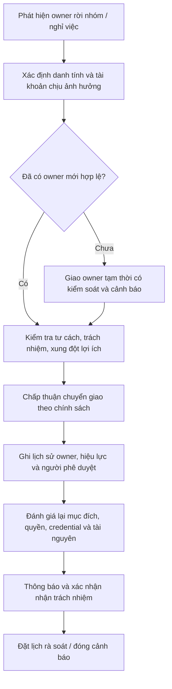

# Identity owner trong quản lý chủ thể và vai trò IAM

## 1. Identity owner là ai và vì sao cần xác định?

Trong Identity and Access Management (IAM), **identity owner** là cá nhân hoặc đơn vị được chỉ định **chịu trách nhiệm về vòng đời và tính hợp lệ của một danh tính số**, bao gồm việc xác nhận danh tính đó còn cần tồn tại, có quan hệ nghiệp vụ hợp lệ với tổ chức và được quản lý theo chính sách. Tùy mô hình quản trị, vai trò này có thể được gọi là *identity custodian*, *account sponsor* hoặc *responsible owner*, nhưng các tên gọi không luôn đồng nghĩa; tổ chức phải quy định rõ trách nhiệm tương ứng.

Ví dụ: một tài khoản tích hợp `svc-payment-export` chạy hằng đêm để gửi tệp đối soát. Tài khoản có thể vẫn đăng nhập được nhiều năm sau khi người tạo chuyển công tác. Nếu không có người chịu trách nhiệm hiện tại, không ai xác nhận có nên tiếp tục duy trì quyền, ai được phê duyệt thay đổi và khi ngừng dịch vụ phải thu hồi tài khoản ra sao. **Identity owner** giải quyết lỗ hổng trách nhiệm đó.

Trong module **SECURITY_IDENTITY_ACCESS_MANAGEMENT_IDENTITY_LIFECYCLE**, vai trò này gắn trực tiếp với quản lý vòng đời danh tính theo **Joiner–Mover–Leaver (JML)**: từ xác minh, tạo tài khoản, phân quyền đến rà soát, điều chuyển và thu hồi. Identity owner phối hợp với IdP, SSO, SCIM, IGA và các chính sách RBAC/ABAC để giảm danh tính mồ côi và quyền truy cập tồn dư; họ không nhất thiết tự vận hành những hệ thống kỹ thuật đó.

**Mục tiêu bài học:** sau khi đọc, người học có thể xác định đúng identity owner cho từng loại chủ thể; phân biệt owner với chủ thể, người quản lý và chủ tài nguyên; thiết kế việc gắn/chuyển giao owner; mô tả trách nhiệm trong JML; và kiểm tra bằng chứng quản trị cho tài khoản người dùng lẫn danh tính dịch vụ.

## 2. Phân biệt identity owner với các vai trò liên quan

Một điểm dễ nhầm là từ *owner* xuất hiện trong nhiều vị trí của IAM. Để tránh phê duyệt sai thẩm quyền, cần xác định **owner của đối tượng nào**.

| Vai trò | Đối tượng chịu trách nhiệm | Ví dụ quyết định hoặc hành động | Điều không mặc nhiên thuộc vai trò |
| --- | --- | --- | --- |
| **Identity owner** | Tính hợp lệ, người chịu trách nhiệm và vòng đời của một danh tính | Xác nhận danh tính còn cần thiết, định kỳ tái xác nhận sponsor, phối hợp khi nghỉ việc hoặc ngừng dịch vụ | Không được tự cấp mọi quyền lên mọi ứng dụng |
| **Identity subject** | Chủ thể được danh tính đại diện | Nhân viên sử dụng tài khoản, workload gọi API | Là chủ thể không tự động có thẩm quyền sửa quan hệ lao động hay duyệt quyền của mình |
| **Manager / line manager** | Quan hệ quản lý và nhu cầu công việc của nhân viên | Xác nhận vai trò công việc, phê duyệt nhu cầu theo chính sách | Không nhất thiết là chủ hệ thống hoặc chủ dữ liệu |
| **Sponsor** | Quan hệ bảo trợ của nhà thầu, khách B2B hoặc danh tính đặc thù | Xác nhận hợp đồng, dự án, thời hạn và việc tiếp tục sử dụng | Không mặc nhiên là người vận hành IdP |
| **Application owner** | Ứng dụng, chức năng và quyền trong ứng dụng | Định nghĩa vai trò ứng dụng, duyệt quyền đặc biệt | Không là nguồn sự thật về tình trạng làm việc của mọi người dùng |
| **Data / resource owner** | Tập dữ liệu, tài nguyên hoặc phân loại nhạy cảm | Quyết định điều kiện ai được đọc/sửa dữ liệu | Không mặc nhiên quản lý hồ sơ danh tính |
| **Entitlement owner** | Một vai trò, nhóm hoặc quyền cụ thể | Đánh giá rủi ro và chấp thuận cấp quyền nhạy cảm | Không nhất thiết quyết định việc tạo danh tính |
| **IAM/IGA administrator** | Nền tảng, quy trình cấp phát và chính sách vận hành | Cấu hình workflow, thực thi provisioning, theo dõi lỗi | Không nên là người duyệt toàn bộ yêu cầu chỉ vì có quyền kỹ thuật |
| **Source-of-truth owner** | Nguồn dữ liệu có thẩm quyền và chất lượng dữ liệu | Duy trì HRIS, danh mục nhà thầu hoặc service registry | Không đồng nghĩa owner của từng danh tính cụ thể |

Một nhân viên thường trực tiếp dùng tài khoản của mình, nhưng vòng đời nhân sự do HR và quản lý nghiệp vụ xác nhận. Một ứng dụng có *application owner* chịu trách nhiệm hệ thống, trong khi tài khoản dịch vụ của ứng dụng có *identity owner* là chủ dịch vụ được tổ chức chỉ định. Hai vai trò có thể do cùng người đảm nhiệm nhưng vẫn cần tách **trách nhiệm** trong thiết kế.

> Quy tắc hữu ích: **Identity owner chịu trách nhiệm danh tính có còn hợp lệ và được quản trị hay không; resource/entitlement owner quyết định danh tính được phép làm gì trên tài nguyên của họ.** Chính sách IGA có thể yêu cầu nhiều người cùng phê duyệt.

### “Owner” có nghĩa là sở hữu danh tính của người khác không?

Không nên hiểu identity owner là người sở hữu con người hoặc có toàn quyền đối với dữ liệu cá nhân của họ. Vai trò này là **trách nhiệm quản trị và đầu mối giải trình**, chịu giới hạn bởi chính sách an ninh, bảo vệ dữ liệu và quyền của chủ thể dữ liệu. Các quyền truy cập vào thông tin cá nhân, thao tác khóa tài khoản, xem log hoặc phê duyệt quyền đều phải được cấp riêng theo nguyên tắc đặc quyền tối thiểu.

## 3. Xác định owner theo loại chủ thể

Không thể áp đặt một quy tắc `owner = manager` cho tất cả danh tính. Chủ thể khác nhau đòi hỏi bằng chứng và cách xác định owner khác nhau.

| Loại danh tính | Ai thường là identity owner hoặc đầu mối chịu trách nhiệm? | Dữ liệu có thẩm quyền hỗ trợ quyết định | Kích hoạt cần chú ý |
| --- | --- | --- | --- |
| Nhân viên (*workforce*) | Người quản lý/bộ phận được giao theo chính sách; HR chịu trách nhiệm trạng thái nhân sự | HRIS, hệ thống điều chuyển nhân sự | Tuyển dụng, chuyển bộ phận, nghỉ việc, đổi quản lý |
| Thực tập sinh, cộng tác viên, nhà thầu | Sponsor hoặc quản lý hợp đồng bên trong tổ chức | Vendor management, hợp đồng, hệ thống quản lý dự án | Hết hạn hợp đồng, thay sponsor, ngừng dự án |
| Đối tác B2B/guest | Sponsor nội bộ hoặc nhóm quản lý quan hệ đối tác | Hợp đồng đối tác, yêu cầu cấp quyền đã được duyệt | Hết thời hạn truy cập, đối tác ngừng hợp tác |
| Khách hàng B2C | Quy trình quản trị CIAM/khách hàng được phân công; không gán một nhân viên làm owner từng khách nếu không có lý do nghiệp vụ | CIAM/CRM, quy trình đăng ký, yêu cầu pháp lý | Đóng tài khoản, gian lận, yêu cầu quản lý dữ liệu |
| Service account / bot | Chủ dịch vụ, nhóm vận hành ứng dụng hoặc nhóm kỹ thuật chịu trách nhiệm | Service registry, CMDB, danh mục ứng dụng | Đổi owner, ngừng dịch vụ, ngừng tích hợp |
| Workload identity trên cloud | Nhóm sở hữu workload, service owner, nhóm vận hành được chỉ định | Cloud inventory, IaC, service catalog | Xóa workload, thay môi trường, thay phương thức xác thực |
| Tài khoản khẩn cấp (*break-glass*) | Nhóm bảo mật hoặc vai trò quản lý đặc quyền được quy định | PAM, quy trình kiểm soát truy cập khẩn cấp | Đổi người giữ trách nhiệm, sự kiện sử dụng, rà soát khóa |
| Tài khoản chia sẻ còn tồn tại | Một owner chịu trách nhiệm rõ ràng, đồng thời có kế hoạch thay thế khi có thể | Danh mục tài khoản ngoại lệ và PAM | Người dùng nhóm thay đổi, cần rotate secret, dừng ngoại lệ |

**Quy tắc chọn owner nên dựa vào vị trí chịu trách nhiệm thực tế, không dựa vào người đầu tiên tạo tài khoản.** Kỹ sư tạo service account trong lúc triển khai có thể nghỉ việc; người chịu trách nhiệm lâu dài phải là chủ dịch vụ hoặc vai trò có khả năng tiếp nhận khi nhân sự thay đổi.

Một số tổ chức gán một **cá nhân chịu trách nhiệm chính** và một **nhóm nhận thông báo/dự phòng**. Với tài khoản quan trọng, chỉ gán tên một nhóm chung mà không có đầu mối vận hành có thể tạo khoảng trống xử lý; ngược lại, chỉ gán một người mà không có đường bàn giao cũng rủi ro. Hợp đồng quản trị cần quy định rõ trách nhiệm, quyền quyết định và người thay thế.

## 4. Identity owner liên quan đến nguồn sự thật như thế nào?

**Nguồn sự thật** (*source of truth*) lưu hoặc xác nhận dữ liệu có thẩm quyền; **identity owner** chịu trách nhiệm ở cấp danh tính hoặc quan hệ nghiệp vụ. Có những thuộc tính do owner đề xuất nhưng phải được một nguồn khác xác nhận.

Ví dụ, quản lý trực tiếp biết nhân viên sắp chuyển phòng ban; HRIS vẫn phải cập nhật tình trạng nhân sự theo quy trình trước khi thay đổi đó trở thành dữ liệu đáng tin cậy cho cấp quyền. Tương tự, sponsor xác nhận chuyên gia bên ngoài còn tham gia dự án nhưng hợp đồng đã hết hạn; hệ thống phải áp dụng chính sách về hạn hợp đồng thay vì tự động kéo dài quyền chỉ dựa trên lời khẳng định.

| Thuộc tính | Nguồn có thẩm quyền thường gặp | Identity owner đóng vai trò gì? |
| --- | --- | --- |
| `employeeStatus`, `department`, `managerId` | HRIS | Xác nhận nhu cầu nghiệp vụ, báo sai lệch cho HR; không tự sửa trạng thái đã chốt nếu không có quyền |
| `contractId`, `contractEndAt`, `sponsorId` | Danh mục hợp đồng/nhà thầu, quy trình bảo trợ | Xác nhận người bảo trợ hiện tại, đề nghị gia hạn có phê duyệt |
| `identityId`, liên kết IdP và tài khoản | Kho danh tính chuẩn/IAM | Cung cấp bằng chứng xác minh khi liên kết hoặc giải quyết danh tính trùng |
| `ownerId`, `ownerGroupId`, `ownershipStatus` | Identity governance/service registry theo phân công | Tiếp nhận hoặc bàn giao trách nhiệm, xác nhận định kỳ |
| `approvedEntitlements` | IGA, phê duyệt theo chính sách ứng dụng/dữ liệu | Yêu cầu và giải trình nhu cầu; không mặc nhiên tự duyệt quyền mình quản lý |
| `actualEntitlements`, `accountEnabled` ở ứng dụng | Ứng dụng đích hoặc hệ thống xác thực | Phối hợp xử lý khi trạng thái thực tế lệch quyết định đã được duyệt |

Một kiến trúc tốt tránh để owner tự thay đổi tất cả các trường ảnh hưởng đến quyền. Nếu thuộc tính `department` tạo quyền qua ABAC, quyền sửa thuộc tính ấy phải bị kiểm soát. Nếu chủ dịch vụ muốn tăng quyền cho một tài khoản có đặc quyền, chính sách có thể buộc thêm owner của tài nguyên hoặc bên quản lý an ninh duyệt.

## 5. Mô hình dữ liệu ghi nhận owner và bằng chứng

Một hệ thống IAM/IGA cần trả lời được: **ai sở hữu trách nhiệm hiện tại, vì sao, từ khi nào, đến khi nào, và ai đã chấp thuận việc thay đổi?** Chỉ có trường `ownerEmail` chưa đủ vì email có thể đổi hoặc tài khoản người đó có thể bị vô hiệu hóa.

Ví dụ bản ghi giản lược của một service account:

```json
{
  "identityId": "id-svc-271",
  "identityType": "SERVICE_ACCOUNT",
  "accountRef": "svc-payment-export",
  "lifecycleStatus": "ACTIVE",
  "serviceRef": "payment-export",
  "ownership": {
    "ownerIdentityId": "id-employee-431",
    "ownerGroupId": "team-payments-platform",
    "backupOwnerIdentityId": "id-employee-217",
    "assignedBy": "id-service-governance",
    "approvedAt": "2026-11-10T09:00:00Z",
    "effectiveFrom": "2026-11-10T09:00:00Z",
    "nextReviewAt": "2027-02-10T09:00:00Z",
    "status": "CONFIRMED"
  },
  "purpose": "Export reconciliation files",
  "environment": "production",
  "credentialManagement": "WORKLOAD_FEDERATION",
  "approvedEntitlementRefs": ["queue-read-finance", "storage-write-export"],
  "lastReconciledAt": "2026-11-22T06:00:00Z"
}
```

Đây là **schema minh họa để giải thích nguyên tắc**, không phải định dạng bắt buộc của SCIM, IdP hoặc sản phẩm IGA. Trong thực tế, có thể tách quan hệ sở hữu ra bảng riêng để lưu nhiều owner theo vai trò, thời hạn và lịch sử thay đổi.

Nên thiết kế các trường hoặc cấu trúc tương đương:

- **Định danh ổn định:** `identityId`, `serviceRef`, định danh owner bằng ID nội bộ bất biến theo chính sách; email chỉ để liên hệ.
- **Phạm vi trách nhiệm:** owner của danh tính nào, tài khoản nào, trong môi trường hay hợp đồng nào.
- **Hiệu lực:** `effectiveFrom`, ngày rà soát hoặc hạn sử dụng; nếu quyền sở hữu bị thu hồi, phải có cách gán owner tiếp theo.
- **Nguồn gốc quyết định:** ai đề xuất, ai phê duyệt, cơ sở nghiệp vụ, phiên bản/quy tắc.
- **Trạng thái xác nhận:** đã xác nhận, chờ chuyển giao, mất owner, đang rà soát.
- **Bằng chứng:** lịch sử owner trước và sau, biên bản rà soát, ticket thay đổi, kết quả provisioning và đối soát.

**Lưu lịch sử thay đổi owner** thay vì ghi đè làm mất dấu vết. Khi kiểm toán một quyền được cấp sáu tháng trước, cần biết owner **ở thời điểm phê duyệt**, không chỉ tên owner hiện tại.

## 6. Trách nhiệm theo vòng đời Joiner–Mover–Leaver

Identity owner là một mắt xích quản trị trong JML. Họ có thể đề xuất hoặc xác nhận nhu cầu, nhưng việc tạo/vô hiệu hóa tài khoản và cấp quyền được hệ thống IAM/IGA, IdP, SCIM/API hoặc quản trị ứng dụng thực thi theo chính sách.

| Giai đoạn | Điều identity owner phải xác nhận | Hệ thống/chủ thể phối hợp | Điều kiện đóng việc |
| --- | --- | --- | --- |
| **Joiner** | Danh tính hợp lệ, mục đích sử dụng, quan hệ nghiệp vụ, owner được chỉ định và hạn dùng | HRIS/vendor system, IGA, IdP, application owner | Có liên kết đúng chủ thể, quyền tối thiểu, owner chịu trách nhiệm và bằng chứng cấp quyền |
| **Mover** | Quan hệ mới, owner cũ/mới, quyền cần giữ và quyền phải thu hồi | HR/contract manager, IGA, entitlement owner | Ownership chuyển giao xong; quyền cũ không còn nếu hết lý do; quyền mới được duyệt |
| **Leaver** | Chủ thể/dịch vụ đã kết thúc hay chưa, tài nguyên cần bàn giao, danh sách truy cập phải thu hồi | HRIS, sponsor, IdP, PAM, ứng dụng | Đã chặn truy cập theo chính sách, có kết quả đối soát và xử lý ngoại lệ |
| **Rà soát định kỳ** | Danh tính còn cần thiết, owner còn đúng người, quyền thực tế hợp lệ | IGA, application/data owner, kiểm toán | Có quyết định và bằng chứng; phát hiện lệch đã được theo dõi đến khi khắc phục |

### 6.1 Joiner: owner là điều kiện quản trị khi tạo danh tính

Nhân viên mới được HRIS xác nhận và cấp `identityId`. Quy tắc quản trị có thể tự xác định người quản lý là identity owner để hỗ trợ rà soát; những quyền chuyên biệt vẫn phải qua phê duyệt tương ứng. Với nhà thầu, một sponsor được chỉ định trước khi cấp quyền, gắn ngày hết hạn hợp đồng; với tài khoản dịch vụ, cần có chủ dịch vụ và mục đích rõ ràng.

Một bước onboard nên kiểm tra:

1. Có **sự kiện/quan hệ nghiệp vụ hợp lệ** từ nguồn có thẩm quyền.
2. Có **identity owner hoặc mô hình trách nhiệm tương đương** phù hợp với loại danh tính.
3. Có **quyền tối thiểu cần thiết**, hạn sử dụng và tuyến phê duyệt theo mức nhạy cảm.
4. Có **liên kết định danh đúng** giữa hồ sơ IAM, IdP và tài khoản ứng dụng; không dựa một mình vào email.
5. Có **audit trail** để giải trình ai yêu cầu, ai duyệt, ai thực thi và kết quả thực tế.

### 6.2 Mover: chuyển vai trò phải xử lý cả ownership

Khi nhân viên chuyển từ nhóm Kinh doanh sang Tài chính, người quản lý cũ có thể không còn phù hợp làm đầu mối chịu trách nhiệm. Quy trình phải xem xét cả ba biến đổi: **thay đổi thuộc tính nhân sự**, **thay đổi quan hệ owner/manager**, và **thay đổi quyền**.

Owner mới xác nhận nhu cầu công việc; owner cũ bàn giao danh tính hoặc các tài nguyên được giao theo quy trình. IGA tính lại quyền dựa trên RBAC/ABAC và chính sách ngoại lệ, thu hồi quyền gắn với vai trò cũ nếu không còn được phê duyệt. Trường hợp một số quyền cần giữ trong thời gian bàn giao, yêu cầu phải có thời hạn, lý do và người phê duyệt riêng.

**Không biến mover thành thao tác cộng thêm nhóm mới.** Giữ nhóm cũ sau khi chuyển phòng ban là nguồn phổ biến của *permission creep* và truy cập tồn dư.

### 6.3 Leaver: thu hồi trách nhiệm và quyền truy cập đúng cách

Khi HRIS xác nhận nhân viên nghỉ việc, IAM phải chặn những con đường truy cập theo chính sách. Identity owner hoặc manager có thể hỗ trợ kiểm kê tài nguyên bàn giao, nhưng **không được dùng việc chưa bàn giao xong để giữ nguyên truy cập không còn được phép**. Trường hợp khẩn cấp cần có quyền khóa theo quy trình phản ứng sự cố, không phụ thuộc việc owner có mặt.

Đối với service account, người chịu trách nhiệm có thể nghỉ việc trong khi dịch vụ vẫn hoạt động. Đây là sự kiện **đổi owner**, chưa nhất thiết là **xóa danh tính dịch vụ**: cần tìm người/nhóm tiếp nhận và kiểm tra tiếp tục duy trì account có chính đáng không. Nếu chính dịch vụ dừng hoạt động, mới chuyển sang quy trình thu hồi danh tính và credential, xử lý quyền, bí mật và tài nguyên liên quan.

### 6.4 Rà soát: kiểm tra tính tồn tại và mức quyền riêng biệt

Một owner có thể xác nhận rằng tài khoản vẫn cần tồn tại mà **không có thẩm quyền** quyết định mọi quyền ứng dụng. Vì vậy, rà soát nên tách ít nhất hai câu hỏi:

- **Identity certification:** danh tính còn hợp lệ, owner đúng, mục đích và thời hạn sử dụng còn đúng không?
- **Access certification:** quyền được cấp và quyền thực tế còn đáp ứng nhu cầu, nguyên tắc tối thiểu và chính sách ứng dụng/dữ liệu không?

Quyết định giữ tài khoản không tự động đồng nghĩa giữ toàn bộ quyền đang có.

## 7. Chuyển giao identity owner an toàn

Việc owner đổi do chuyển nhóm, luân chuyển dự án hoặc nghỉ việc cần được thực hiện bằng một quy trình có thể truy vết. Ví dụ dịch vụ `payment-export` đổi từ chị Lan sang anh Minh:



Một quá trình bàn giao tốt cần xử lý đồng thời **trách nhiệm nghiệp vụ** và **đặc quyền kỹ thuật**. Nếu owner cũ từng có quyền quản trị ứng dụng, quyền đó được rà soát riêng. Việc cập nhật trường `ownerIdentityId` không tự động thu hồi token cá nhân, vai trò cloud hay khóa truy cập đã cấp cho người cũ.

**Khi không tìm được owner hợp lệ:** đánh dấu `ORPHANED_OWNER` hoặc trạng thái tương đương, chuyển cho nhóm chịu trách nhiệm xử lý, đánh giá rủi ro và hạn hoàn tất. Với tài khoản có rủi ro cao hoặc không có căn cứ nghiệp vụ, có thể áp dụng biện pháp hạn chế/vô hiệu hóa theo quy trình. Không được tạo cảm giác đã giải quyết vấn đề bằng cách tự gán một tên bất kỳ chỉ để hồ sơ có giá trị không rỗng.

### Quy tắc phân công owner dự phòng

Với các danh tính quan trọng, có thể định nghĩa `primaryOwner`, `backupOwner` và `owningTeam`. Cần ghi rõ ai **chịu trách nhiệm cuối cùng** và ai là người xử lý khi primary vắng mặt. Nếu tất cả chỉ là “đồng owner” không phân định, khi sự cố xảy ra mỗi người có thể cho rằng người khác sẽ thực hiện.

## 8. Ma trận RACI minh họa

RACI giúp làm rõ ai **Responsible** (thực hiện), **Accountable** (chịu trách nhiệm cuối cùng), **Consulted** (được tham vấn) và **Informed** (được thông báo). Đây là **ví dụ cho một tổ chức**; cần điều chỉnh theo quyền hạn thực tế, chính sách phân tách nhiệm vụ và sản phẩm IAM.

| Hoạt động | Identity owner / sponsor | HR hoặc quản lý hợp đồng | IAM/IGA team | Application/data owner |
| --- | --- | --- | --- | --- |
| Xác nhận trạng thái quan hệ lao động/hợp đồng | C | **A/R** | I | I |
| Xác nhận mục đích và người chịu trách nhiệm cho danh tính | **A/R** | C | C | I |
| Tạo/liên kết danh tính chuẩn và tài khoản kỹ thuật | C | C | **A/R** | I |
| Đánh giá nhu cầu truy cập nghiệp vụ | **A/R** | C | C | C |
| Phê duyệt quyền nhạy cảm trên ứng dụng/dữ liệu | C | I | C | **A/R** |
| Thực thi provisioning/deprovisioning theo workflow | C | I | **A/R** | C |
| Tái xác nhận owner và nhu cầu còn tồn tại | **A/R** | C | C | I |
| Xác nhận quyền thực tế và xử lý sai lệch trong ứng dụng | C | I | R | **A/R** |

Một quyết định có thể có nhiều bước phê duyệt. Ma trận cố gắng chỉ định **một vai trò A cho mỗi hoạt động**, nhưng trong hệ thống thật, trách nhiệm vận hành hoặc xử lý sự cố có thể được phân rã thành những hoạt động nhỏ hơn để bảo đảm điều đó. Đối với nhân viên, việc xác nhận chủ thể còn là nhân viên thuộc nguồn có thẩm quyền như HRIS; quản lý không tự quyết trạng thái `ACTIVE` nếu quy trình HR chưa chốt.

## 9. Identity owner trong IdP, SSO, SCIM và RBAC/ABAC

Vai trò owner liên quan đến các công nghệ IAM, nhưng **không thay thế** chức năng của chúng.

**IdP và SSO.** IdP quản lý phiên đăng nhập, MFA và thông tin xác thực; SSO giúp người dùng vào ứng dụng thông qua quan hệ tin cậy, thường là OIDC hoặc SAML. Identity owner giúp xác nhận danh tính được phép hoạt động theo quy trình, nhưng họ không nắm giữ mật khẩu hay token của chủ thể. Nếu owner bị đổi, không nên ngầm sửa các thông tin xác thực nếu không có sự kiện thực tế yêu cầu.

**SCIM/API provisioning.** Sau khi phê duyệt, hệ thống cấp phát có thể tạo, cập nhật, vô hiệu hóa tài khoản hoặc nhóm. Owner là đầu mối giải trình khi có sai lệch; kết quả `HTTP 200` hay `204` của một API **chưa đủ chứng minh** tất cả quyền và phiên truy cập liên quan đã hết hiệu lực. Cần đọc lại trạng thái ứng dụng khi cần và đối soát theo rủi ro.

**RBAC.** Vai trò `finance-analyst` hoặc `service-reader` ánh xạ tới quyền. Identity owner xác nhận mục đích nghiệp vụ và yêu cầu vai trò phù hợp; chủ sở hữu quyền hoặc chính sách duyệt vai trò nhạy cảm. Owner đổi không phải lý do tự động cấp quyền quản trị mới.

**ABAC.** Thuộc tính như `department`, `partnerId`, `employmentType`, `environment` hoặc `dataClassification` tham gia quyết định ủy quyền. Thuộc tính ảnh hưởng đến quyền phải có nguồn đáng tin cậy riêng. Không tin một giá trị `owner=admin` hoặc `role=privileged` tự khai từ client để cấp quyền.

Giả mã một chính sách yêu cầu cấp quyền dịch vụ:

```text
requestServiceAccess(identity, entitlement, purpose):
    require identity.type == SERVICE_ACCOUNT
    require identity.lifecycleStatus == ACTIVE
    require identity.owner.status == CONFIRMED
    require identity.owner.isCurrentlyEligible()
    require purpose is documented
    require policy.allowsRequestedScope(identity, entitlement)
    approval = entitlementOwner.review(identity, entitlement, purpose)
    if approval.denied:
        rejectRequest()
    else:
        provisionApprovedEntitlement(identity, entitlement)
        verifyTargetStateAndRecordAudit(identity, entitlement)
```

Đây là giả mã minh họa logic kiểm soát, không phải một API cụ thể. Trên thực tế cần thêm cách xử lý xung đột lợi ích, điều kiện phê duyệt nhiều cấp, mã tương quan, retry và rollback/khắc phục khi ứng dụng đích thất bại.

## 10. Service account và workload identity: trường hợp cần owner rõ nhất

Tài khoản dịch vụ dễ trở thành **danh tính mồ côi** (*orphan identity*) vì chúng không tự nghỉ việc như nhân viên. Kỹ sư tạo tài khoản có thể rời dự án, hệ thống đổi kiến trúc hoặc ứng dụng ngừng chạy; bản thân tài khoản vẫn tồn tại cho đến khi có quy trình thu hồi.

Một owner chịu trách nhiệm cho danh tính dịch vụ nên biết:

1. **Tài khoản phục vụ workload nào?** Có `serviceId`, môi trường, repo/ứng dụng hoặc workload được định danh rõ không?
2. **Quyền và tài nguyên có hợp lý không?** Chỉ được truy cập hàng đợi, bucket, API và phạm vi thực sự cần thiết?
3. **Thông tin xác thực được quản lý ra sao?** Ưu tiên workload federation, managed identity hoặc credential ngắn hạn nếu có thể; với secret dài hạn, cần kho quản lý, luân chuyển và lịch thu hồi.
4. **Ai đang vận hành và nhận cảnh báo?** Có owner chính, nhóm dự phòng và tuyến xử lý sự cố?
5. **Khi nào xét lại?** Khi ngừng dịch vụ, đổi người vận hành, đổi API, hết hợp đồng hoặc đến chu kỳ rà soát.
6. **Phạm vi kỹ thuật được kiểm tra thế nào?** Có đối soát quyền cloud, local service account, access key, token, chứng chỉ, và tích hợp thủ công?

Không nên dùng tài khoản người dùng cá nhân để chạy tác vụ hệ thống dài hạn. Nếu ứng dụng buộc sử dụng tài khoản kiểu người dùng, trường hợp đó cần được quản lý như ngoại lệ rõ owner, mục đích, phương án thay thế và hạn rà soát.

### Kịch bản: chủ dịch vụ nghỉ việc nhưng ứng dụng vẫn hoạt động

- Nhân viên Phong tạo `svc-monthly-report` khi triển khai báo cáo. Tài khoản có quyền đọc bảng dữ liệu và ghi sang hệ thống lưu trữ.
- Phong nghỉ việc. HRIS kích hoạt leaver cho **danh tính của Phong**; hệ thống inventory tìm thấy Phong đang là owner của **danh tính dịch vụ**.
- Đội sở hữu ứng dụng xác nhận dịch vụ vẫn cần chạy, chỉ định owner mới là trưởng nhóm vận hành và có người dự phòng. IGA ghi lịch sử chuyển giao.
- Nhóm IAM rà soát quyền thực tế của `svc-monthly-report`; thu hồi quyền không còn cần, kiểm tra credential, thay thế bí mật hoặc liên kết workload theo thiết kế nếu cần.
- Nếu không ai nhận trách nhiệm hoặc không còn bằng chứng dịch vụ tồn tại, account được chuyển vào luồng đánh giá/rà soát thu hồi theo mức rủi ro. Không mặc định để chạy vô thời hạn.

Điểm quan trọng: **leaver của người sở hữu và leaver của workload là hai sự kiện khác nhau**, nhưng phải được liên kết để không bỏ sót account do người cũ quản lý.

## 11. Rà soát định kỳ và kiểm toán identity owner

Quản trị owner chỉ đáng tin khi có **bằng chứng xác nhận định kỳ** và **kiểm tra sai lệch tự động**. Không nên coi việc thêm trường `ownerId` vào database là hoàn thành quản lý danh tính.

| Kiểm soát | Câu hỏi cần kiểm chứng | Bằng chứng phù hợp |
| --- | --- | --- |
| Tính đầy đủ owner | Danh tính nào chưa có owner hoặc sponsor khi chính sách yêu cầu? | Báo cáo identity không có owner, hàng đợi xử lý |
| Tính hiệu lực owner | Owner hiện còn thuộc tổ chức/đơn vị có thẩm quyền không? | Đối soát owner với HRIS và service registry |
| Mục đích tồn tại | Owner xác nhận danh tính còn mục đích, hợp đồng/dịch vụ còn hoạt động? | Quyết định tái chứng nhận, hạn và lý do |
| Tách biệt phê duyệt | Người yêu cầu có tự duyệt quyền nhạy cảm của mình hay không? | Workflow phê duyệt, chính sách SoD |
| Quyền thực tế | Tài khoản/nhóm ở ứng dụng có khớp quyền đã được duyệt? | Báo cáo reconciliation từ IdP và ứng dụng |
| Kết thúc vòng đời | Danh tính leaver có còn phiên, khóa hoặc tài khoản ngoài luồng? | Kết quả deprovisioning, rà soát token/khóa |
| Lịch sử trách nhiệm | Ai là owner khi quyết định được đưa ra và khi quyền được sử dụng? | Immutable/auditable history hoặc bản ghi thay đổi có bảo vệ |
| Rà soát quá hạn | Các yêu cầu chứng nhận owner/quyền bị treo bao lâu? | Dashboard kỳ hạn, mức độ rủi ro, escalation |

Một audit trail hữu ích cần ghi: định danh chủ thể và owner, nguồn sự kiện, quyết định và lý do, người yêu cầu/người duyệt, hiệu lực trước–sau, thay đổi tài khoản/quyền, kết quả từng đích cấp phát, thời điểm thực thi và mã tương quan. Cần bảo vệ nhật ký và dữ liệu cá nhân theo chính sách; **không ghi mật khẩu, token hay bí mật vào log**.

Chỉ số vận hành có thể dùng:

- **Tỷ lệ danh tính thiếu owner** = số danh tính bắt buộc có owner nhưng chưa có owner hợp lệ / tổng danh tính thuộc diện kiểm soát.
- **Tỷ lệ owner hết hiệu lực** = số danh tính gắn owner đã nghỉ việc hoặc không còn tư cách / số danh tính có owner.
- **Thời gian xử lý chuyển giao owner** = thời gian từ lúc phát hiện sự kiện chuyển giao đến khi owner mới được chấp thuận.
- **Tỷ lệ rà soát owner đúng hạn** = số kỳ xác nhận hoàn thành trước hạn / tổng kỳ đến hạn.
- **Tỷ lệ sai lệch quyền tồn dư** = số danh tính có quyền thực tế ngoài phê duyệt / số danh tính đã đối soát.

Giá trị mục tiêu cho các chỉ số phụ thuộc mức độ rủi ro, hệ thống và quy định của tổ chức; không thể áp một SLA chung cho mọi danh tính người dùng, đối tác và tài khoản dịch vụ.

## 12. Tình huống tổng hợp: quyền trách nhiệm và quyền truy cập phải đi cùng nhau

Một doanh nghiệp có ứng dụng quản lý đơn hàng. Đội Logistics sở hữu dịch vụ `delivery-sync` với danh tính `svc-delivery-sync`. Ban đầu, owner là trưởng nhóm Trang; tài khoản có quyền đọc đơn hàng của một đối tác và ghi trạng thái giao hàng.

**Giai đoạn Joiner.** Khi khởi tạo dịch vụ, quản trị ứng dụng đăng ký `serviceId`, mục đích tích hợp và owner. Trang xác nhận nhu cầu; entitlement owner chỉ duyệt quyền đọc/ghi cần thiết; IAM cấp workload identity, tạo liên kết đến ứng dụng và ghi bằng chứng.

**Giai đoạn Mover.** Tổ chức chuyển dịch vụ sang đội Platform. Việc chỉ đổi nhãn sở hữu của repository chưa đủ: owner của danh tính phải được chuyển cho một người có trách nhiệm ở Platform, các cảnh báo vận hành được cập nhật và quyền theo phạm vi mới được đánh giá. Một quyền truy cập staging cũ không còn dùng được thu hồi; quyền production hợp lệ được giữ theo phê duyệt.

**Giai đoạn Leaver.** Sau vài tháng, dịch vụ `delivery-sync` được thay bằng giải pháp khác. Owner thông báo ngừng workload; quản trị ứng dụng xác nhận không còn luồng nghiệp vụ phụ thuộc; IAM vô hiệu hóa danh tính dịch vụ, thu hồi các quyền, token/credential và tài khoản tích hợp liên quan, rồi đối soát trạng thái đích. Nhật ký cho biết ai phê duyệt việc kết thúc và thành phần nào xác nhận thu hồi thành công.

Giả sử giữa giai đoạn Mover, owner cũ Trang nghỉ việc trước khi Platform nhận bàn giao. Đây là **điểm cần escalation**, không phải lý do giữ trạng thái “owner = Trang” mãi mãi. Tổ chức có thể chỉ định owner tạm thời đã được ủy quyền và mở tác vụ khẩn để xác nhận chính thức. Việc đổi owner phải để lại dấu vết, đồng thời rà soát quyền của Trang đối với kho mã và hệ thống quản trị dịch vụ.

## 13. Những lỗi thiết kế phổ biến

**Lỗi 1 — Coi người tạo tài khoản là owner vĩnh viễn.** Người tạo có thể chỉ thực hiện lệnh kỹ thuật. Gán owner dựa trên service catalog, trách nhiệm nghiệp vụ và quy trình bàn giao sẽ bền vững hơn.

**Lỗi 2 — Coi owner là người có quyền phê duyệt mọi thứ.** Owner xác nhận nhu cầu danh tính; quyền đặc biệt có thể cần resource owner, chủ dữ liệu, an ninh hoặc quy trình SoD phê duyệt riêng.

**Lỗi 3 — Không phản ứng khi owner nghỉ việc.** HRIS/IdP ghi người đó leaver, nhưng các service account do họ quản lý vẫn hoạt động. Cần truy ngược quan hệ `ownedIdentities` để kích hoạt chuyển giao hoặc rà soát.

**Lỗi 4 — Owner là một hộp thư nhóm không ai nhận trách nhiệm.** Hộp thư có thể dùng để nhận thông báo nhưng cần một vai trò/cá nhân chịu trách nhiệm và cơ chế dự phòng rõ ràng.

**Lỗi 5 — Chỉ rà soát quyền mà không rà soát sự tồn tại của danh tính.** Một danh tính không còn mục đích có thể giữ một tập quyền nhỏ và vẫn gây rủi ro. Kiểm soát *identity certification* và *access certification* cần bổ trợ nhau.

**Lỗi 6 — Chỉ vô hiệu hóa SSO khi leaver.** Ứng dụng có thể còn tài khoản cục bộ, phiên cũ, API key hoặc quyền chia sẻ. Chủ thể có thể mất khả năng đăng nhập qua IdP nhưng quyền tồn dư chưa được dọn hết.

**Lỗi 7 — Tự động đổi thuộc tính owner bằng dữ liệu không có thẩm quyền.** Nếu client tự gửi `ownerId` hoặc `department`, đó là dữ liệu chưa được duyệt. Thuộc tính ảnh hưởng quyền phải kiểm tra nguồn, actor và chính sách thay đổi.

## 14. Checklist để áp dụng trong dự án IAM

Khi thiết kế quản trị identity owner cho một loại chủ thể hoặc ứng dụng mới, cần trả lời được các câu hỏi sau:

1. **Định nghĩa:** Identity owner chịu trách nhiệm những quyết định nào? Vai trò phân biệt ra sao với manager, sponsor, application owner, entitlement owner và người vận hành IAM?
2. **Phạm vi:** Các loại identity nào bắt buộc có owner? Với người dùng B2C, chủ thể phi con người và tài khoản khẩn cấp, mô hình trách nhiệm thay thế là gì?
3. **Nguồn sự thật:** Owner được xác định từ hệ thống nào, theo chính sách nào? Ai có quyền thay đổi và phê duyệt owner?
4. **Tính bền vững:** Liên kết owner bằng khóa định danh nào? Có backup owner, lịch sử thay đổi, thời hạn và khả năng phát hiện owner không còn hợp lệ không?
5. **Joiner:** Có owner/sponsor và mục đích nghiệp vụ hợp lệ trước khi cấp quyền, đồng thời bảo đảm liên kết danh tính đúng với tài khoản ứng dụng không?
6. **Mover:** Có tự đánh giá lại trách nhiệm và quyền, thu hồi quyền cũ và quản lý ngoại lệ có thời hạn không?
7. **Leaver:** Có phát hiện người owner nghỉ việc và danh tính được sở hữu bị bỏ sót không? Có kịch bản ngừng dịch vụ, kết thúc hợp đồng và khóa truy cập khẩn cấp không?
8. **Quyền:** Có tách người yêu cầu, người phê duyệt và người thực thi phù hợp với phân tách nhiệm vụ, nhất là đối với quyền cao không?
9. **Đối soát:** Có kiểm tra trạng thái thực tế ở IdP/ứng dụng/SCIM và credential ngoài SSO, xử lý tài khoản mồ côi, quyền vượt chuẩn không?
10. **Kiểm toán:** Có truy được ai chịu trách nhiệm tại thời điểm thay đổi và kết quả đã thực thi, với lịch sử và bằng chứng được bảo vệ không?

**Identity owner là điểm chịu trách nhiệm xuyên suốt vòng đời một danh tính**, giúp kết nối chủ thể, mục đích kinh doanh, nguồn sự thật và quyết định truy cập. Khi vai trò này được xác định rõ và được tích hợp với JML, RBAC/ABAC, IdP, SSO, SCIM, quản lý tài khoản dịch vụ và đối soát kiểm toán, tổ chức có thể xử lý cả hai câu hỏi cốt lõi: “**Danh tính này có còn lý do hợp lệ để tồn tại không?**” và “**Quyền thực tế của nó có còn đúng phạm vi đã được phê duyệt không?**”
