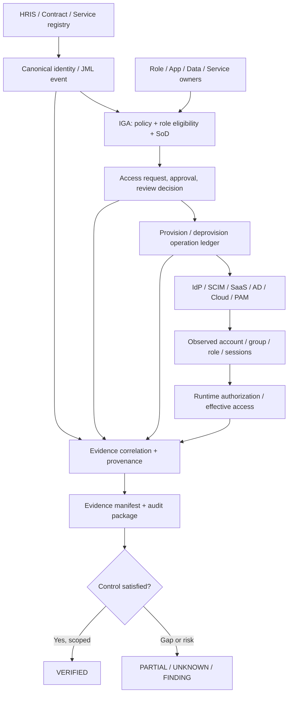
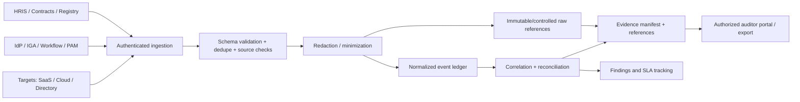

# Audit evidence trong Identity audit và vòng đời danh tính IAM

## 1. Audit evidence là gì và vì sao quan trọng?

**Audit evidence** (*bằng chứng kiểm toán*) trong **Identity audit** là tập hồ sơ, sự kiện, dữ liệu nguồn, bản ghi quyết định và kết quả kiểm chứng có thể dùng để **đánh giá liệu các kiểm soát danh tính và quyền truy cập đã được thiết kế, vận hành và thực thi như kỳ vọng hay chưa**. Không chỉ hỏi “hệ thống đã ghi log gì?”, kiểm toán còn hỏi **ai được tạo danh tính, ai được cấp quyền, theo căn cứ nào, ai phê duyệt, quyền có hiệu lực khi nào, khi nào phải thu hồi và bằng chứng nào chứng minh quyền thực tế đã bị chặn**.

Ví dụ, khi nhân viên Hà chuyển từ bộ phận Sales sang Finance, **HRIS** ghi sự kiện Mover, **IGA** tính quyền cũ cần gỡ và quyền mới cần cấp, người có thẩm quyền phê duyệt yêu cầu, connector gọi **SCIM/API**, target phản hồi và hệ thống đối soát quyền có hiệu lực. Một dòng `SCIM PATCH succeeded` chỉ chứng minh một phần rất nhỏ của chuỗi đó. Audit evidence tốt nối được **HRIS event → identity ID → approval/policy → entitlement change → target observed access → audit conclusion**.

Nội dung thuộc chương **Identity audit** của module **SECURITY_IDENTITY_ACCESS_MANAGEMENT_IDENTITY_LIFECYCLE**: quản lý vòng đời danh tính theo **Joiner–Mover–Leaver (JML)** từ xác minh, tạo tài khoản và cấp quyền đến rà soát, đổi vai trò, thu hồi. Bằng chứng cần bao phủ **IdP, SSO, SCIM, RBAC/ABAC, service/workload identities, privileged access, kiểm toán và giảm quyền truy cập tồn dư**.

Sau bài này, người học có thể:
- Xác định **control objective** và bộ bằng chứng tương ứng, tránh “thu nhiều log nhưng không trả lời được câu hỏi”.
- Thiết kế **evidence lineage** và event schema cho JML, authentication/authorization, access request, review và deprovisioning.
- Phân biệt **dấu vết yêu cầu, quyết định, hành động connector, quyền được quan sát và quyền thực sự có hiệu lực**.
- Kiểm tra **tính đầy đủ, độ tin cậy của nguồn, thời điểm, thẩm quyền reviewer/approver, SoD, tính toàn vẹn và độ mới của bằng chứng**.
- Xây dựng audit package có kiểm soát truy cập, retention, redaction, đối soát và các test tình huống thất bại.

> **Cốt lõi:** bằng chứng kiểm toán không phải số lượng ảnh chụp hay một dashboard “100% Complete”. Nó là **chuỗi dữ kiện độc lập ở mức phù hợp, có thể truy nguyên và tái kiểm tra**, đủ hỗ trợ kết luận chính xác về một kiểm soát cụ thể trong **phạm vi và thời gian được nêu rõ**.

## 2. Phân biệt audit evidence, audit log, attestation và report

| Khái niệm | Ví dụ IAM | Điều có thể chứng minh | Giới hạn |
| --- | --- | --- | --- |
| **Audit event** | `ROLE_GRANT_REQUESTED` lúc 10:02 | Một hệ thống ghi nhận sự kiện theo semantics của nó | Sự kiện tự báo không chứng minh target đã đổi quyền |
| **Audit trail** | Chuỗi request → approve → provision → verify | Diễn tiến có liên kết của quy trình | Có thể thiếu hệ thống/nhánh ngoài nguồn |
| **Source record** | HRIS employment status/version | Căn cứ vòng đời từ nguồn có thẩm quyền | Không chứng minh mọi SaaS account đã disable |
| **Attestation** | Manager xác nhận quyền vẫn cần | Có quyết định mang trách nhiệm của người được chỉ định | Không chứng minh role thực sự đã thu hồi/còn đúng scope |
| **Execution evidence** | Connector operation ID, response | Hành động đã được gửi/target báo kết quả | HTTP 2xx chưa chắc effective access đã thay đổi |
| **Observation/readback** | Target API trả membership vắng mặt | Trạng thái được target báo ở mốc quan sát | Có thể còn direct grant, token hoặc replica lag |
| **Runtime evidence** | API từ chối hành động sau revoke | Quyền thực thi bị chặn trong phạm vi test | Một endpoint không đại diện toàn bộ đường truy cập |
| **Audit report** | Tỷ lệ Leaver revoked đúng SLA | Tổng hợp kết quả cho management/auditor | Mẫu số sai hoặc loại trừ không rõ có thể gây sai lệch |
| **Evidence package** | Manifest + records + references + integrity metadata | Hỗ trợ kiểm tra lại một control, population và kết luận | Chất lượng phụ thuộc nguồn, quyền quan sát và completeness |

**Audit log không tự đồng nghĩa sự thật hoàn chỉnh.** Log ứng dụng có thể bị tắt, sửa hoặc mất; một số thay đổi xảy ra trực tiếp trên target, không qua IAM. Vì vậy hệ thống cần **source provenance, quyền kiểm soát log, reconciliation** và khi rủi ro cao có thể dùng **quan sát độc lập từ target/control plane**.

**Không tuyên bố không có hành vi trái phép chỉ vì không tìm thấy log.** Cách diễn đạt đúng thường là: “Không quan sát thấy trong các nguồn và khoảng thời gian đã kiểm tra; còn những giới hạn sau”.

## 3. Mục tiêu kiểm soát: bằng chứng phải trả lời câu hỏi nào?

Kiểm toán bắt đầu từ **control objective**, không bắt đầu từ danh sách công cụ log.

| Control objective | Câu hỏi cần trả lời | Bằng chứng tối thiểu gợi ý |
| --- | --- | --- |
| **Identity uniqueness/correlation** | Một người/workload có những account nào; có nhầm ID không? | Identity registry, account mapping, source references |
| **Joiner authorization** | Account/quyền có được tạo đúng người, đúng ngày và policy? | HRIS/contract event, proofing status, request/approval, target readback |
| **Mover least privilege** | Quyền cũ không còn phù hợp đã gỡ khi đổi vai trò? | Mover event, before/after entitlement diff, revoke evidence |
| **Leaver timeliness** | Account và quyền đã chặn đúng hạn khi nghỉ? | EffectiveAt, disable/revoke operations, sessions, runtime verification |
| **Access request approval** | Người phê duyệt có thẩm quyền và không xung đột? | Owner catalog, SoD check, policy version, decision actor/time |
| **Access review/recertification** | Quyền đang tồn tại được người phù hợp đánh giá và remediation? | Review items, reviewer authority, decisions, target reconciliation |
| **Authentication security** | Session/token có được phát cho đúng principal và mức assurance? | IdP logs, auth method/context, lifecycle gates, session metadata |
| **Authorization enforcement** | Actor bị chặn khi không có quyền action/resource? | Policy/binding versions, PEP decisions, negative tests |
| **Privileged access** | Admin/JIT/break-glass có approval, thời hạn và hậu kiểm? | PAM eligibility/activation/session, SoD, recordings metadata |
| **Service identity ownership** | Machine accounts có owner, role, trust, rotation và offboarding? | Service registry, PKI/cloud grants, credential metadata, target readback |
| **Evidence integrity** | Hồ sơ có thể bị sửa/xóa, thiếu nguồn hoặc thay đổi sau xuất? | Access controls, signatures/hashes khi phù hợp, version/chain of custody |
| **Population completeness** | Đã bao phủ tất cả account/role/tenant cần kiểm chưa? | Scope manifest, inventory từ các nguồn, reconciliation gaps |

Một control có thể áp cho **kỳ kiểm toán** hoặc **sự kiện tức thời**. Ví dụ Leaver theo event có SLA riêng; quarterly access recertification có cut-off và deadline khác. Không dùng một thời hạn mặc định cho mọi tổ chức: **policy nội bộ, mức rủi ro và yêu cầu áp dụng** phải quyết định.

## 4. Chuỗi bằng chứng IAM từ nguồn đến quyền hiệu lực



Có **ba đường liên kết** nhất thiết phải đầy đủ:

1. **Chủ thể:** nguồn HRIS/contract/service → `identityId` ổn định → `accountId`/`principalId` của từng target.
2. **Thẩm quyền:** yêu cầu → policy/role catalog → owner/approver/reviewer có authority → quyết định có thời điểm.
3. **Thực thi:** quyết định → operation/connector → trạng thái target → điều kiện Permit/Deny tại điểm thực thi.

Nếu mất một liên kết, bằng chứng có thể bị gán sai đối tượng. Ví dụ một ảnh chụp không còn member ở group A **không đủ** chứng minh một quyết định thu hồi liên quan account B đã thực hiện thành công.

### Không có “một nguồn sự thật” cho toàn bộ chuỗi

HRIS là nguồn có thẩm quyền về trạng thái người lao động, nhưng **không phải nguồn xác nhận entitlement trên cloud**. IGA chứa desired state, còn target API/control plane phản ánh observed state; PEP quyết định effective access theo policy và runtime conditions. Bằng chứng phải ghi đúng **ai có thẩm quyền cho loại sự thật nào**.

## 5. Định nghĩa phạm vi (scope) và population trước khi thu thập

Một kết luận “100% account đã được rà soát” chỉ có nghĩa khi **population** được xác định đầy đủ.

Một **scope manifest** thường ghi:

- `auditPeriodStart`, `auditPeriodEnd`, cut-off và múi giờ; đối tượng đang ACTIVE, Mover, Leaver hoặc guest hết hạn.
- Danh mục hệ thống/tenant/project/subscription/ứng dụng nằm trong scope, owner và mức rủi ro.
- Các loại danh tính: employee, contractor, guest, admin/privileged, service account, workload, machine, bot.
- Các nguồn quyền: group/nested group, RBAC role, ABAC policy, direct grant, resource policy, PAM eligible/active, SaaS local entitlement.
- Mốc và cách thu thập: snapshot, event stream, source version, API pagination và cursor/consistency limits.
- Những loại trừ: **lý do, actor phê duyệt, hạn và hệ quả**, không chỉ ghi `out-of-scope`.
- Các tài liệu giải thích policy: quyền mặc định, role catalog, SoD, exception và SLA Leaver.
- Mẫu số: tổng identity, tổng target accounts, tổng entitlement assignments, tổng event cần kiểm theo định nghĩa cụ thể.

### Completeness không phải số dòng đã tải

Giả sử IGA lấy 4.000 group memberships từ IdP và báo `4000/4000` đã review. Nhưng SaaS có 140 **direct grants** và 20 **local accounts** chưa có trong IGA. Tỷ lệ trên **không chứng minh đầy đủ quyền ứng dụng**, bởi nó chỉ đo population của **một nguồn**.

Để phát hiện thiếu dữ liệu cần so:
- HRIS identities với IdP/target accounts và guest registry.
- IGA desired entitlements với target observed permissions.
- PAM inventory với cloud standing admin/direct resource policies.
- HRIS Leaver list với accounts/sessions vẫn active.
- Service registry Retired workloads với issuer/trust/credential còn phát.

**Không sampling từ một population vốn đã thiếu rồi tuyên bố kiểm soát toàn bộ.** Trước khi chọn mẫu chi tiết, hãy xác minh **định nghĩa population và độ bao phủ của extraction**.

## 6. Identity correlation: chứng minh đúng người, đúng account

Trong IAM, cùng một người có thể có nhiều account; email, username hoặc DN có thể thay đổi, bị tái sử dụng và có thể trùng giữa các tenant. Audit evidence nên dùng **định danh ổn định do nguồn tin cậy cung cấp**.

```text
Canonical identityId: person-1042
  |-- HRIS person key: hr-884
  |-- IdP subject: (issuer=https://idp.example.test, sub=u-1042)
  |-- SaaS SCIM User.id: saas-user-781
  |-- SaaS externalId: person-1042-from-iga
  |-- AD object identity: provider-stable-object-id
  |-- PAM admin account: adm-1042
  |-- Local CRM account: crm-991
```

Các giá trị là **minh họa**. `externalId` của SCIM thường là định danh tương quan từ client; `id` của resource do service provider gán. Không giả định mọi SaaS quản lý identifier giống nhau.

Những tình huống cần ghi riêng correlation evidence:
- Mover đổi họ/email, nhưng identity logic vẫn là một chủ thể.
- Một user có account thường và privileged account.
- Guest từ IdP bên ngoài, resource thuộc tenant khác.
- Contractor chuyển employee hoặc được tuyển lại.
- Service đổi cloud principal, namespace hoặc repo nhưng giữ service ID logic.
- Hai account cùng display name ở hai tenant/chu kỳ khác nhau.

Nếu mapping **mơ hồ**, đặt `IDENTITY_CORRELATION_UNRESOLVED`. Không tự gắn permission của account gần tên nhất vào người khác; điều này có thể làm sai kết luận và gây revoke nhầm.

## 7. Chọn nguồn có thẩm quyền và ghi provenance

**Provenance** trả lời “dữ kiện này đến từ đâu, do hệ thống/actor nào cung cấp, tại thời điểm nào và theo phiên bản gì?”.

| Loại dữ liệu | Nguồn thường có thẩm quyền | Evidence cần giữ |
| --- | --- | --- |
| Quan hệ lao động, manager, effective date | HRIS / HR workflow | Event ID, lifecycle generation, effectiveAt, sourceVersion |
| Contract, sponsor, guest expiry | Contract/partner registry | Contract ref, sponsor, expiry, source state |
| Owner workload/service | Service catalog/CMDB được quản trị | Service ID, owner và backup, deployment status |
| Identity proofing/enrollment | Hệ thống proofing/IdP | Kết quả, assurance/status, method reference; không cần scan PII nếu không bắt buộc |
| Account/credential | IdP/directory/target system | Provider ID, authentication status, credential type metadata |
| Role/SoD policy | IGA policy/role catalog | Role definition version, policy ID, constraints |
| Phê duyệt | Access workflow/IGA | Request, actor, decision, scope, timestamp |
| Thực thi grant/revoke | Connector/target API | Operation ID, provider response, target ID |
| Session/token runtime | IdP/AS/RP/PAM/PEP | Session metadata, token ID/reference, grant/expiry status |
| Effective authorization | Resource server/PEP/data policy engine | Action/resource/tenant, policy result, observedAt |

Một dữ liệu có thể **hợp lệ trong hệ thống nguồn nhưng cũ tại nơi tiêu thụ**. Ví dụ HRIS manager đã đổi, nhưng reviewer routing cache vẫn lấy người quản lý cũ. Ghi **`sourceObservedAt`, `effectiveAt`, `ingestedAt` và `sourceVersion`** khi khả thi để phân biệt biến cố và độ trễ đồng bộ.

**Đừng dùng dữ liệu do client tự khai làm chứng cứ quyền sở hữu**, như `tenantId` trong body API hoặc email chưa được kiểm chứng. Các trường quan trọng phải được ràng buộc với issuer/nguồn đã xác thực.

## 8. Joiner: bằng chứng định danh, phê duyệt và cấp quyền ban đầu

Khi một người gia nhập, bằng chứng kiểm toán phải chứng minh **đúng đối tượng, đúng nguồn, đúng ngày hiệu lực và đúng quyền cần thiết**.

| Bước Joiner | Control objective | Evidence |
| --- | --- | --- |
| Xác minh quan hệ | Người mới có quan hệ hợp lệ và ngày bắt đầu đúng | HRIS/contract event và source version |
| Identity proofing | Danh tính được xác minh ở mức phù hợp | Kết quả proofing, operator/process reference, không lưu quá nhiều giấy tờ |
| Enrollment | Authenticator/MFA được đăng ký an toàn | Enrollment event, method/assurance metadata |
| Account creation | Không tạo trùng/nhầm principal | Identity↔target account mapping, provider ID |
| Birthright role | Role mặc định phù hợp job/tenant | Policy/rule version, effective date, entitlement |
| Elevated access request | Quyền bổ sung có approval đúng scope | Request ID, approver, business reason, SoD |
| Provisioning | Target đã thực sự cấp account/role | Connector operation, target readback |
| First login | Account được dùng đúng ngày/identity | IdP/SSO auth event, account status, session metadata |
| Baseline reconciliation | Không có grant thừa hoặc orphan | Desired vs observed entitlement report |

**Birthright access có thể được tự động cấp** theo policy đã duyệt mà không cần mỗi Joiner có phiếu phê duyệt thủ công; bằng chứng phải chỉ ra **rule/phiên bản và quyền phê duyệt policy**, không bịa một approver cá nhân.

### Joiner bị hủy

Nếu HRIS hủy onboarding, một invitation, password reset link, pending account grant hay service principal thử nghiệm đã phát **không được tiếp tục mở quyền**. Audit trail cần liên kết sự kiện hủy với các tác vụ cleanup, revoke và readback, đặc biệt nếu account đã được tạo trước ngày vào làm.

## 9. Mover: chứng minh gỡ quyền cũ, không chỉ cấp quyền mới

Mover làm thay đổi job, team, legal entity, project, manager hoặc tenant. Bằng chứng quan trọng là **before/after diff theo identity và entitlement provenance**.

```text
Source: HRIS MOVER event hr-mover-1042-v42
Before:
  SALES_ANALYST
  CRM_EXPORT (direct grant)
  EMPLOYEE_BASIC

Desired after Mover:
  FINANCE_REPORT_READER (tenant=VN)
  EMPLOYEE_BASIC

Diff:
  REVOKE SALES_ANALYST
  REVOKE CRM_EXPORT
  GRANT  FINANCE_REPORT_READER
  KEEP   EMPLOYEE_BASIC

Observed after remediation:
  SALES_ANALYST absent
  CRM_EXPORT absent
  FINANCE_REPORT_READER present
  EMPLOYEE_BASIC present
```

Các thao tác `toRevoke`, `toGrant` và `toKeep` cần gắn **event ID, policy version, role owner, approval, operation ID và readback time**. Một report ghi “Finance role đã cấp” **không chứng minh Sales export đã bị thu hồi**.

### Chuyển manager/reviewer giữa chiến dịch

Nếu manager A xác nhận quyền ở ngày snapshot nhưng employee chuyển sang manager B trước lúc quyết định, audit cần lưu **authority tại thời điểm reviewer quyết định** và chính sách xử lý reassignment. Không ghi đè lịch sử A để biểu diễn như B đã phê duyệt; không chấp nhận quyết định từ reviewer không còn thẩm quyền theo policy.

### Mover và SoD

Một nhân viên chuyển từ tạo thanh toán sang phê duyệt có thể đồng thời còn hai role xung đột. Chỉ kiểm role mới mà bỏ role cũ sẽ che **toxic entitlement combination**. Bằng chứng phải bao gồm phát hiện SoD, biện pháp xử lý và trạng thái quyền thực tế tại thời điểm được đánh giá.

## 10. Leaver: bằng chứng chặn account, session và quyền có hiệu lực

Khi HRIS hoặc contract registry xác nhận **Leaver**, deprovisioning phải diễn ra theo SLA của tổ chức; access review không được trở thành lý do trì hoãn.

| Lớp | Evidence cần có | Kiểm tra không được bỏ qua |
| --- | --- | --- |
| HRIS/contract | Identity, effectiveAt, event version, termination state | Event đến muộn/trùng, lịch thay đổi |
| IdP account | Disable/login-block status tại IdP | RP sessions có còn không? |
| SCIM/directory | User `active=false` hoặc trạng thái disable, group removals | Direct grants hoặc provider behavior khác |
| SaaS local accounts | Deactivate/delete theo policy và target readback | Local admin/guest account ngoài SSO |
| RBAC/ABAC | Role/group assignments, deny policies | Cached entitlement/JWT claim |
| Sessions/tokens | IdP/RP sessions, refresh tokens, access token TTL | Token tự chứa còn tới `exp` nếu không bị chặn |
| PAM | Privileged eligible/active assignment, session termination | Cloud direct grants còn không? |
| Service ownership | Owner của service identities do người đã nghỉ quản lý | Không xóa nhầm workload production còn hợp lệ |
| Runtime/target | API/PEP không còn Permit trong scope | Chỉ HTTP 2xx ở connector không đủ |
| Audit closure | Remediation verified/partial, owner và deadline | Không tuyên bố hoàn tất khi đường quyền còn tồn |

**`DISABLED_AT_IDP` khác `ALL_ACCESS_REVOKED`.** Một account bị khóa ở IdP có thể vẫn có session SaaS, PAT, SSH key, local app account hoặc token tự chứa tồn dư.

### Rehire và identity generation

Nếu người từng nghỉ quay lại với cùng email, hệ thống có thể liên kết identity lịch sử nhưng phải quản lý **lifecycle generation/quan hệ mới** và policy hiện hành. Một event Joiner cũ hoặc quyết định KEEP trước Leaver **không được tự phục hồi session/role cũ**. Evidence cần phân biệt account/credential nào thuộc chu kỳ nào.

## 11. Identity proofing, MFA và authentication evidence

**Authentication evidence** giúp xác nhận một principal đã thực hiện login/token issuance trong điều kiện nào; không nhất thiết bao gồm bí mật xác thực.

Một event hợp lý có thể chứa:
- `identityId`, provider account/subject và issuer.
- `authenticationEventId`, timestamp và nguồn.
- Kết quả `SUCCESS`/`FAILURE` cùng reason code đã phân loại.
- Authentication method metadata (passkey, password, certificate), assurance/step-up khi được chứng thực.
- MFA challenge outcome hoặc `acr/amr/auth_time` theo contract OIDC nếu có.
- Client/app/tenant/device risk context phù hợp với data minimization.
- Session record reference/IdP `sid` khi có, không lưu raw cookie.
- Policy check trước login: account active, contract/Leaver, risk/trust level.

**Không đưa mật khẩu, OTP, private key, session cookie hoặc raw token vào audit logs**. Nếu cần chứng minh enrollment, có thể lưu **kết quả và tham chiếu quy trình**, không sao chép giấy tờ định danh hoặc authenticator secrets.

### Một login SUCCESS chưa chứng minh quyền tài nguyên

User đăng nhập SSO thành công chưa tự có role `finance-admin`. Cần bằng chứng **authorization** ở API/PDP/PEP. Ngược lại, role được cấp đúng nhưng authentication có rủi ro hoặc account đã Leaver thì request phải bị chặn theo policy.

## 12. OIDC/OAuth/SAML và bằng chứng về session, token

Các giao thức liên quan nhưng **không thay thế nhau**:

| Thành phần | Evidence có thể thu | Không nên suy ra |
| --- | --- | --- |
| **OIDC authentication** | Issuer, `sub`, client ID, auth time/assurance, validated login transaction | ID token là access token dùng cho mọi API |
| **OAuth authorization** | Client, scopes, audience, grant, token IDs/reference, expiry | Scope đơn lẻ cho phép action với mọi tenant |
| **OIDC RP session** | Local session record ID, user binding, TTL, revoke status | Logout IdP luôn logout RP ngay |
| **SAML assertion** | Issuer, NameID mapping, Audience, Recipient, assertion ID, validation outcome | Assertion là session cookie của SP |
| **SAML SP session** | Session ID nội bộ, subject, created/revoked times | SAML SLO luôn được mọi SP hỗ trợ |
| **Refresh-token rotation** | Grant/session ref, token family/reuse detection metadata | Xóa cookie là đã revoke refresh token |
| **JWT access token** | `iss`, `aud`, `exp`, `jti`/safe reference | Xóa role ở IdP tự invalid token đã ký |
| **PAM session** | Activation/session ID, owner, start/end, reason | User web logout làm cloud session dừng |

### Session termination và token revocation

Nếu access review yêu cầu gỡ admin role của user, audit nên ghi **quyền đã được gỡ ở target**, **những phiên đặc quyền có thể còn** và **biện pháp giới hạn token**. Một self-contained JWT có thể được resource server chấp nhận tới `exp` nếu không introspect hoặc không kiểm quyền mới. Evidence phải nêu **ngữ nghĩa và giới hạn thực của hệ thống**, không hứa revoke tức thời không được hỗ trợ.

### Bằng chứng token không phải bản sao token

Lưu `tokenId`, `jti`/key ID hoặc correlation reference theo khả năng issuer, **không lưu bearer value**. Nếu token không có định danh truy nguyên an toàn, thiết kế phát hành/quan sát cần cải tiến; đừng đưa hash của secret entropy thấp vào report chung.

## 13. SCIM, LDAP/Directory và account provisioning evidence

**SCIM** thường giúp provisioning User/Group giữa IAM và service provider; **LDAP/AD** hỗ trợ directory identities, membership và một số thuộc tính quản trị. Chúng không tự là toàn bộ mô hình quyền SaaS.

Audit evidence cho provisioning nên gồm:

1. Identity/account mapping: `identityId` → `providerUserId` và namespace/tenant.
2. Event/approval gốc, rule/policy version, effective date.
3. Request: target ID, action `CREATE/UPDATE/DISABLE/GROUP_REMOVE`, operation ID; payload nhạy cảm được che.
4. Response: status, target response reference, retry/timeout state.
5. Readback: provider resource version/`meta.version` hoặc trạng thái đọc được; timestamp.
6. Effective access: role, local grants, nested group, app permissions khi quan sát được.
7. Error/reconciliation: partial failure, conflict, orphan accounts và SLA.
8. Audit actor: connector identity, quyền của connector và approval provenance.

### Ví dụ sự khác nhau giữa command và outcome

```text
Decision: REVOKE access to CRM_EXPORT
Connector: SCIM Group members remove -> HTTP 204
SCIM readback: user absent from Group
SaaS local direct role: CRM_EXPORT remains assigned
Effective API authorization: export still Permit

Correct result:
  Group remediation = VERIFIED
  Full effective access revocation = NOT VERIFIED / PARTIAL
```

**Không coi HTTP `200/204` là bằng chứng tuyệt đối.** Một số provider đồng bộ bất đồng bộ; một số permission được gán trực tiếp ở ứng dụng. Ngoài ra, **SCIM không định nghĩa một API chuẩn chung để revoke mọi access token, refresh token hoặc RP session**.

## 14. RBAC, ABAC, PBAC và evidence của quyết định authorization

**RBAC** quản lý quyền theo vai trò, **ABAC** theo thuộc tính và ngữ cảnh, còn **PBAC** sử dụng các policy và cơ chế thực thi quyết định. Một audit item về authorization nên xác định **subject–action–resource–context–policy–effect**.

| Trường | Ví dụ | Vì sao cần |
| --- | --- | --- |
| `actorIdentityId` | `person-1042` | Xác định chủ thể |
| `targetAccountId` | `crm-user-781` | Gắn đúng account ở target |
| `action` | `customer:export` | Quyền được thực hiện |
| `resourceId` / `tenantId` | `customer-set-vn` | Scope của quyền |
| `policyId` / `policyVersion` | `customer-access-v9` | Rule tại thời điểm quyết định |
| `roleAssignmentsVersion` | `iga-role-v42` | Phân biệt entitlement stale |
| `decision` | `PERMIT`/`DENY` | Kết quả PDP |
| `enforcementOutcome` | `EXECUTED`/`BLOCKED` | PEP có thực thi decision không |
| `environment` | Network/device/assurance nếu cần | Các điều kiện ABAC liên quan |
| `observedAt` | Timestamp UTC | Thời điểm đánh giá |

**Audit event `PERMIT` không đủ để chứng minh phép truy cập hợp lệ** nếu rule cấp quyền quá rộng hoặc resource tenant mapping sai. Cần so policy với **control objective** và nguồn quyền. Ngược lại, `DENY` cho một endpoint cũng chưa chứng minh tài nguyên không có đường truy cập khác.

### Object-level authorization

Một reviewer có quyền xem item tại tenant A không được đọc item tenant B chỉ bằng cách thay `reviewItemId` trên URL. Audit cần kiểm API/PEP xác thực **actor, object owner, tenant, action và reviewer assignment**, không chỉ ghi frontend đã ẩn nút.

## 15. Access request, approval và bằng chứng SoD

Một grant hợp lệ thường cần **yêu cầu có lý do**, approval của owner phù hợp, SoD check và provisioning. Các vai trò phải được phân biệt:

| Vai trò | Câu hỏi | Bằng chứng |
| --- | --- | --- |
| Requester | Ai đề nghị quyền và vì sao? | Request ID, business justification |
| Beneficiary | Ai nhận quyền? | Identity/account IDs ổn định |
| Manager/sponsor | Nhu cầu nghiệp vụ còn đúng? | Approval/relationship source tại thời điểm ký |
| Role owner | Role/eligibility phù hợp? | Role catalog version, owner authority |
| Data/application owner | Resource scope có phù hợp? | Resource ownership và approval |
| SoD/control owner | Có xung đột hoặc ngoại lệ? | SoD rules, findings, decision |
| Provisioning operator/connector | Quyền đã được cấp/gỡ thế nào? | Operation IDs và target result |
| Auditor | Bằng chứng có đủ/đúng? | Independent review notes, không tự cấp quyền |

**Separation of Duties (SoD)** cần kiểm cả **requester ≠ approver theo policy**, self-approval, hành vi cấp quyền cao và khả năng chính actor sửa/xóa audit. Một người có `user-1042` và `admin-1042` vẫn là **một identity logic**; so username khác nhau không đủ để cho phép tự review.

### Exception không phải approval vĩnh viễn

Một ngoại lệ SoD/risk có thể được chấp nhận theo policy, nhưng evidence phải chứa **exception ID, approver có thẩm quyền, reason, scope, compensating controls, expiry và remediation**. Nếu không có hạn/owner, access drift có thể tồn tại vô thời hạn.

## 16. Access review, recertification và reviewer evidence

Trong **access review**, người có thẩm quyền đánh giá quyền **đã tồn tại**, khác với access request trước khi grant.

Một review evidence item nên có:
- `campaignId`, `reviewItemId`, snapshot/cutoff và entitlement/resource scope.
- Beneficiary identity ID, account ID, grant source và risk tier.
- `assignedReviewerId` và `effectiveReviewerId`, role/data/app owner authority source.
- Self-review/SoD check; delegation, backup và lịch sử reassign.
- Decision `KEEP/REVOKE/MODIFY/ESCALATE/EXCEPTION`, reason code và time.
- Multi-stage/quorum conditions, xung đột giữa manager và data owner nếu có.
- Decision validity theo **authority tại thời điểm quyết định**.
- Remediation operation, target readback, residual access và trạng thái cuối.

**`REVIEW_DECIDED` khác `REMEDIATION_VERIFIED`.** Khi reviewer bấm REVOKE nhưng connector chưa gỡ direct grant hoặc API còn Permit, audit phải ghi **PARTIAL** chứ không đóng như đã khắc phục.

### Tránh rubber stamping

“1.000 item KEEP trong một phút” có thể là tín hiệu rủi ro chất lượng review; bản thân tốc độ không chứng minh sai phạm nhưng cần **risk-based sample, reason/owner checks và evidence của quyền nhạy cảm**. Dashboard “review completion 100%” không tự chứng minh quyền đúng.

## 17. PAM, privileged sessions và break-glass audit

Quyền đặc quyền có blast radius lớn, nên evidence cần phân biệt:

- **Eligible privileged assignment:** identity có thể kích hoạt role cao không?
- **Active/standing assignment:** role đang có hiệu lực lúc nào và trên scope nào?
- **PAM activation/session:** actor, approver, ticket/reason, start/end, step-up/MFA, session ID.
- **Direct cloud/SaaS grants:** quyền admin cấp ngoài PAM có được discovery không?
- **Privileged operation:** thao tác nhạy cảm đã xảy ra, tài nguyên nào chịu ảnh hưởng?
- **Session/credential termination:** sau Leaver/incident, access còn usable không?
- **Break-glass:** ai sở hữu, custody, điều kiện emergency, sử dụng và hậu kiểm.

Một admin role được gỡ khỏi **eligible assignments** nhưng **active privileged session** vẫn còn có thể tạo **residual access**. Evidence phải biết platform có thể terminate session hoặc deny action theo role change hay chỉ chờ TTL.

### Session recording không phải giấy phép xem mọi dữ liệu

Bản ghi PAM session có thể chứa dữ liệu sản xuất và thông tin nhạy cảm. Audit package nên lưu **session reference, metadata và kiểm chứng khi cần**, với quyền xem/retention riêng; không công khai recording cho mọi người có role auditor.

## 18. Service, machine và non-human identities (NHI)

**Service account, API client, bot, CI/CD workload, cloud principal, machine certificate** không có manager HRIS theo nghĩa nhân sự. Chúng cần **service registry, owner/backup owner, purpose và lifecycle độc lập**.

| Control objective | Evidence nên có |
| --- | --- |
| Danh tính có chủ quản | `serviceId`, owner, backup, environment và service catalog version |
| Principal đúng workload | Federation issuer/subject/audience, Kubernetes SA, cloud principal binding |
| Quyền tối thiểu | Role/permission/action–resource–scope, risk, approval |
| Credential lifecycle | Secret/certificate metadata, issuer, `notAfter`, rotation/revocation references |
| SoD/privilege chain | Permission to impersonate/assume/grant role, service→service trusts |
| Service Mover | Thay repo, namespace, environment, API và tính `toKeep/toGrant/toRevoke` |
| Service retirement | Gỡ principal/trust/roles/secrets/tokens, observed/runtime denial |
| Human owner Leaver | Chuyển owner, rà secret custody, không xóa nhầm workload hợp lệ |
| Detection/incident | Unowned/orphan NHI, unused key, exposed secret và remediation |

**Một API key có thể được cấp cho service nhưng mang tên một kỹ sư cũ**. Khi kỹ sư Leaver, không chỉ disable user và coi integration an toàn; cần chuyển sang principal dịch vụ riêng hoặc rotate/revoke credential cá nhân đã dùng trong automation.

### Machine certificate

Gia hạn TLS/mTLS certificate phải lưu **issuer/serial/fingerprint, SAN/URI, thời hạn, key rotation, deployment targets và handshake verification**. `Certificate issued` không tự chứng minh mọi Pod/load balancer đã phục vụ credential mới; và **renew certificate không tự thu hồi RBAC role**.

## 19. Event model: một bản ghi audit IAM có cấu trúc

Một event phục vụ kiểm toán không nên chỉ là text tự do kiểu `user changed`. Nó cần định danh, nguồn, subject, action, scope, outcome và khả năng tương quan.

Ví dụ JSON **thuần minh họa**, không phải schema bắt buộc của SCIM, OpenTelemetry hay một vendor:

```json
{
  "eventId": "evt-iga-57291",
  "eventType": "IAM_ENTITLEMENT_REVOKE_VERIFIED",
  "schemaVersion": "1.0",
  "eventTime": "2026-11-23T03:15:30Z",
  "ingestedAt": "2026-11-23T03:15:32Z",
  "source": {
    "systemId": "finance-saas",
    "eventProducer": "iga-target-observer",
    "sourceRevision": "rev-104"
  },
  "correlation": {
    "traceId": "trace-5a61",
    "lifecycleEventId": "hr-mover-1042-v42",
    "accessRequestId": "req-180",
    "operationId": "op-revoke-991",
    "auditControlId": "JML_MOVER_REMOVE_OLD_ACCESS"
  },
  "actor": {
    "type": "SERVICE",
    "principalId": "iga-connector-prod"
  },
  "subject": {
    "identityId": "person-1042",
    "accountId": "saas-user-781",
    "lifecycleGeneration": 4
  },
  "target": {
    "systemId": "finance-saas",
    "tenantId": "tenant-vn",
    "entitlementId": "CRM_EXPORT",
    "grantSource": "DIRECT"
  },
  "action": "REVOKE",
  "desiredState": "ABSENT",
  "observedState": "ABSENT",
  "verification": {
    "method": "TARGET_READBACK",
    "observedAt": "2026-11-23T03:15:29Z",
    "scope": "DIRECT_ENTITLEMENT"
  },
  "outcome": "VERIFIED",
  "policyVersion": "iam-mover-v8",
  "dataClassification": "INTERNAL",
  "rawCredentialRecorded": false
}
```

**Không đưa nguyên access token, session cookie, client secret, private key, OTP hoặc mật khẩu** vào event. Các identifier minh họa ở trên không phải secret thật; khi triển khai cần phân loại cả metadata vì tên entitlement/tenant có thể tiết lộ cấu trúc nhạy cảm.

### Tách actor, beneficiary và hệ thống tạo evidence

`actor` trong ví dụ là **connector thực thi**, không phải **nhân viên được thu hồi quyền** và cũng không phải **người phê duyệt**. Bằng chứng nên liên kết riêng các quan hệ này để không ghi sai “person-1042 tự gỡ quyền”.

## 20. Correlation IDs, causality và trạng thái đa hệ thống

Trong một workflow IAM, một tác vụ có thể chạy qua HRIS, queue, IGA, IdP, SCIM connector, SaaS API và audit archive; mỗi nơi có event ID riêng.

```text
HRIS:  lifecycleEventId = hr-mover-1042-v42
IGA:   changePlanId     = change-208
IGA:   accessRequestId  = req-180
Queue: messageId        = msg-874
SCIM:  operationId      = op-revoke-991
Target: providerEventId = saas-event-550
Audit: evidenceBundleId = evb-2026q4-person1042
```

Một hệ thống tốt lưu **correlation mapping** và **cửa sổ thời gian**; không cố dùng một timestamp hoặc request ID cho mọi dịch vụ.

### Trạng thái độc lập nên được lưu

| Lớp | Ví dụ state | Không được hiểu là |
| --- | --- | --- |
| Approval | `APPROVED` | Target đã có role |
| Provisioning request | `SUBMITTED` | Target đã xử lý |
| Connector | `HTTP_204_RECEIVED` | Role thực sự mất ở mọi đường cấp |
| Target readback | `GROUP_MEMBERSHIP_ABSENT` | Direct grant/session đã biến mất |
| Runtime policy | `DENIED_ON_CHECKED_ACTION` | Mọi endpoint đều Deny |
| Evidence package | `COMPLETE_WITH_LIMITATIONS` | Không có bất kỳ rủi ro còn lại |

**Không dùng cách “event cuối đến thì thắng”** cho quyết định bảo mật. Một message Grant cũ có thể đến sau Leaver Revoke do queue out-of-order; cần **source version/lifecycle generation, idempotency và fencing** để tránh tái cấp quyền.

## 21. Tính thời gian: event time, effective time và observed time

Audit của IAM có ít nhất bốn mốc thời gian khác nhau:

| Mốc | Giải thích |
| --- | --- |
| **`effectiveAt`** | Khi trạng thái nhân sự/policy có hiệu lực về nghiệp vụ |
| **`eventTime`** | Khi hệ thống phát sinh sự kiện |
| **`ingestedAt`** | Khi pipeline nhận và ghi nhận sự kiện |
| **`observedAt`** | Khi target thực sự được đọc/kiểm |
| **`decidedAt`** | Khi approver/reviewer ra quyết định |
| **`executedAt`** | Khi connector hoặc target thực hiện thao tác |
| **`verifiedAt`** | Khi điều kiện kiểm chứng theo policy đạt |

Ví dụ Leaver hiệu lực 17:00 nhưng source event được nhận lúc 17:02, RP session bị revoke 17:04 và API Deny được kiểm 17:06. Nếu chỉ ghi `ticket closed at 17:03`, báo cáo timeliness có thể sai.

### Clock skew và ordering

Đồng bộ thời gian là quan trọng nhưng **không bảo đảm mọi đồng hồ có thứ tự tuyệt đối**. Khi các sự kiện đến muộn hoặc hai vùng lệch clock, nên dùng **source sequence, version, lifecycle generation và các quan hệ nhân quả** để xác định thứ tự nghiệp vụ. Trong audit package, ghi múi giờ hoặc dùng UTC nhất quán và mô tả clock limitations.

## 22. Desired, declared, observed và effective access

Một nguyên nhân thường xuyên gây kết luận kiểm toán sai là xem cấu hình mong muốn hoặc lời xác nhận như quyền thực tế.

| Trạng thái | Ví dụ | Cách lấy evidence |
| --- | --- | --- |
| **Desired** | IGA nói person-1042 không còn `CRM_EXPORT` | Policy/role calculation có version |
| **Declared** | IaC/ticket gửi lệnh gỡ grant | Approved change/config record |
| **Requested** | Connector gọi target revoke | Request ID/HTTP status |
| **Observed** | SaaS API không còn direct entitlement | Target readback cùng timestamp |
| **Effective** | API export từ principal đó bị Deny | PEP/authorization query hoặc safe negative test |
| **Residual** | Một JWT cũ vẫn Permit tới TTL | Token/session window, PEP check và exception |

Một **readback** từ một group endpoint có thể PASS nhưng **effective access** còn vì resource policy cấp trực tiếp. Kiểm toán cần biết **permission graph** và khả năng quan sát của target. Nếu không thể thử runtime trên production mà không gây side effect, có thể dùng **read-only effective-access query, sandbox, policy simulation được chứng thực** hoặc ghi giới hạn kiểm soát.

**Tính đầy đủ là thuộc tính của phạm vi được chứng minh**, không phải cam kết tuyệt đối rằng ngoài phạm vi không có quyền.

## 23. Kiểm tra chất lượng evidence: đủ, chính xác, có liên quan và kịp thời

Có thể đánh giá một evidence bundle qua các tiêu chí:

| Tiêu chí | Câu hỏi kiểm tra | Kết quả khi thiếu |
| --- | --- | --- |
| **Relevance** | Record có chứng minh đúng control/action cần đánh giá? | `NOT_RELEVANT` |
| **Completeness** | Đúng population, tất cả stage/target trong scope? | `EVIDENCE_GAP` |
| **Accuracy** | Identity/account/resource mapping có đúng? | `CORRELATION_UNRESOLVED` |
| **Authenticity/provenance** | Nguồn/actor/issuer có đáng tin và có version? | `UNTRUSTED_SOURCE` |
| **Timeliness/freshness** | Bằng chứng ở đúng thời điểm hiệu lực/quyết định? | `STALE_EVIDENCE` |
| **Integrity** | Artifact còn nguyên so với bản được bảo vệ? | `INTEGRITY_FAILURE` |
| **Authorization** | Người đưa quyết định có quyền trong scope? | `INVALID_APPROVAL` |
| **Independence** | SoD/reviewer có xung đột bị bỏ qua? | `CONTROL_EXCEPTION_REQUIRED` |
| **Reproducibility** | Có thể tra lại nguồn/sampling/filter và kết quả? | `REPRODUCIBILITY_GAP` |
| **Privacy/security** | Có lộ secret/PII vượt mục tiêu? | `SECURITY_FINDING` |

Không phải mọi control đều yêu cầu runtime negative test, hash chain hoặc nhiều reviewer. Nhưng **tiêu chí phải được định nghĩa trước**, gắn risk tier và cách thực thi, để không tùy ý nâng kết luận từ `PARTIAL` lên `VERIFIED`.

### Chứng cứ âm tính (*negative evidence*)

“Không thấy tài khoản còn active” chỉ có giá trị nếu ta biết **đã hỏi đúng hệ thống, đúng account ID, đúng khoảng thời gian, đúng API và hệ thống không lỗi**. Một truy vấn trả 0 dòng vì lỗi phân quyền collector hoặc pagination không phải chứng cứ không có quyền.

## 24. Tamper evidence: hash, chữ ký và lưu trữ chống sửa

**Tính toàn vẹn** nghĩa là có thể phát hiện hoặc hạn chế sửa đổi evidence sau khi ghi. Một số biện pháp:

| Cơ chế | Có ích ở đâu | Giới hạn |
| --- | --- | --- |
| **SHA-256 digest** | So artifact bytes với digest đã được bảo vệ | Hash của file thiếu dữ liệu vẫn hợp lệ |
| **Digital signature** | Xác minh nguồn ký và bytes khi khóa/chain đáng tin | Không chứng minh người ký có authority về quyết định nghiệp vụ |
| **Append-only/WORM storage** | Hạn chế thay/xóa bản ghi theo cấu hình | Không bảo đảm nguồn gốc sự kiện không sai |
| **Hash chaining** | Phát hiện đổi/xóa giữa các event trong chain nếu anchor tin cậy | Nếu attacker sửa cả chain và anchor, không bảo đảm phát hiện |
| **Signed timestamp** | Hỗ trợ xác minh thời gian theo nguồn timestamp | Không thay business effective time |
| **Independent archive/copy** | Giảm rủi ro người vận hành target sửa đồng thời log | Cần quản lý quyền truy cập và sự nhất quán |
| **Write/read audit log** | Theo dõi ai xuất/sửa/xóa evidence | Chính log cũng cần được bảo vệ |

**Integrity ≠ completeness ≠ correctness.** Một snapshot bỏ sót 100 tài khoản nhưng được hash và ký đúng vẫn là một snapshot **không đầy đủ**.

### Canonicalization và key rollover

Nếu ký JSON, phải xác định **byte representation/canonicalization** vì thứ tự trường, encoding và newline có thể đổi digest. Lưu `hashAlgorithm`, `canonicalizationVersion`, key/certificate ID và cách verifier nhận đúng trust key. **Không đưa private signing key vào audit bundle**.

### Separation of duties cho audit infrastructure

Actor có quyền cấp admin không nên đồng thời có khả năng tùy ý sửa/xóa toàn bộ bằng chứng cấp admin đó. Dùng quyền ghi append-only, quản trị khóa tách biệt, review truy cập và backup/retention theo policy.

## 25. Pipeline thu thập và bảo vệ evidence

Một hệ thống evidence có thể gom từ nhiều nguồn mà vẫn bảo vệ bí mật:



Các nguyên tắc:

1. **Nguồn được xác thực:** collector dùng workload identity với quyền tối thiểu; kiểm issuer/system ID theo connector.
2. **Schema version:** phân biệt event versions, không parse theo text message mơ hồ.
3. **Dedupe:** event ID và operation ID chống đếm trùng khi queue at-least-once.
4. **Redaction sớm:** lọc secret trước khi tạo log/trace thứ cấp; raw artifact nhạy cảm phải có kho riêng khi cần.
5. **Least privilege:** auditor chỉ xem đúng phạm vi; producer không đọc/sửa toàn bộ archive.
6. **Retention và integrity:** theo phân loại dữ liệu, yêu cầu áp dụng và khả năng legal hold.
7. **Lineage:** preserve original event references, source version và transformation provenance.
8. **Error channel:** sự kiện lỗi/không parse được vào `EVIDENCE_GAP`, không bị lặng lẽ bỏ.
9. **Observability:** monitoring collector health, source lag và missing partitions.
10. **Reconciliation:** target inventory độc lập giúp phát hiện thay đổi ngoài IGA.

**Không đồng nghĩa “đẩy tất cả raw logs vào một SIEM” với một chương trình audit đầy đủ.** SIEM hữu ích cho security events, nhưng kiểm toán JML còn cần **policy, HR event, approvals, target state và chứng cứ thời điểm hiệu lực**.

## 26. Quyền riêng tư, tối thiểu hóa dữ liệu và bảo mật audit

Audit evidence có thể chứa dữ liệu cá nhân, cấu trúc tổ chức, quyền admin, tài liệu hợp đồng hoặc resource nhạy cảm. Phải cân bằng **khả năng kiểm chứng và data minimization**.

| Dữ liệu | Cách xử lý gợi ý |
| --- | --- |
| Password/OTP/access token/private key | **Không đưa vào evidence export**; ghi reference/sự kiện xác thực |
| Giấy tờ định danh/ảnh sinh trắc | Lưu kết quả proofing/ref khi phù hợp, không mặc nhiên sao chép hồ sơ gốc |
| Email/username | Chỉ xuất nếu cần; ưu tiên stable identity ID và pseudonymization khi phù hợp |
| IP/device/user-agent | Chỉ lấy theo mục tiêu risk/incident, bảo vệ access và retention |
| Role/entitlement admin | Phân loại nhạy cảm; reviewer/auditor xem theo scope |
| Session/PAM recordings | Metadata/reference và quy trình mở xem có kiểm soát |
| SoD/exception reasons | Có thể chứa thông tin nhân sự/tài chính; hạn chế truy cập |
| Security incident evidence | Kho điều tra riêng, chain of custody, legal hold khi phù hợp |
| Secret manager path | Metadata có thể lộ kiến trúc; hạn chế theo threat model |

**Không đặt quy tắc lưu giữ cố định như “luôn giữ 7 năm” cho mọi hệ thống** nếu chưa có cơ sở chính sách/nghĩa vụ áp dụng. Retention phụ thuộc jurisdiction, hợp đồng, loại dữ liệu, mục tiêu kiểm toán và khả năng đáp ứng yêu cầu pháp lý. Khi hết thời hạn, phải xử lý xóa/ẩn danh theo policy, trừ khi có legal hold hợp lệ.

### Auditor không đương nhiên được đọc mọi secret

Role `AUDITOR` có thể được phép xem **sự kiện, policy, metadata và bằng chứng đã che**, không mặc nhiên xem raw secrets hoặc dữ liệu sản xuất. Truy cập evidence package phải có **object-level authorization**, MFA/step-up khi phù hợp và audit của chính hoạt động đọc/export.

## 27. Evidence retention, archival và legal hold

Một audit trail có giá trị khi có thể truy xuất **trong thời hạn cần thiết**, nhưng không nên tạo một “shadow identity database” lưu vô hạn.

Quản lý retention cần trả lời:
- **Nguồn nào:** HR/IGA/IdP/SCIM/PAM logs, policy snapshots, readback, incident records.
- **Dữ liệu nào:** PII, privileged event, general operational event, secret references.
- **Vì sao giữ:** mục tiêu kiểm toán, vận hành, sự cố, nghĩa vụ hợp đồng/pháp lý.
- **Bao lâu:** thời hạn theo data classification và quy định áp dụng, có phê duyệt.
- **Ai được đọc/xuất:** auditor, security, owner với scope phân quyền.
- **Cách bảo vệ:** encryption, access logging, immutable storage/backup nếu phù hợp.
- **Legal hold:** cơ chế tạm ngừng xóa những hồ sơ liên quan một yêu cầu hợp lệ.
- **Disposal:** xóa/ẩn danh có kiểm chứng, tránh còn bản sao trong exports/backups lâu hơn policy không cần thiết.

**Retention của bản tổng hợp có thể khác retention của raw payload.** Có thể lưu **attestation result/reference lâu hơn** log chi tiết nhạy cảm nếu policy cho phép và vẫn đủ truy nguyên.

## 28. Access control cho bằng chứng: ai có quyền xem, sửa, xuất?

Một evidence platform cần phân vai trò rõ:

| Vai trò | Quyền hợp lý | Hạn chế |
| --- | --- | --- |
| **Event producer** | Ghi event được xác thực vào stream/scope | Không tùy ý sửa/xóa event đã lưu |
| **Evidence collector** | Đọc nguồn có scope, ghi raw references | Không có admin toàn bộ targets |
| **Evidence normalizer** | Tạo normalized events có lineage | Không thay đổi raw source content |
| **IGA operator** | Theo dõi remediation/provisioning | Không sửa approval history đã ký |
| **Access reviewer** | Xem/quyết định review items được giao | Không truy cập mọi nhân viên/tenant |
| **Auditor** | Đọc/export evidence theo scope | Không tự cấp entitlement hoặc truy cập raw secret |
| **Security incident handler** | Mở kho điều tra theo incident authorization | Không dùng quyền này cho truy cập thường ngày |
| **Evidence retention admin** | Vận hành archive/hold theo policy | Thao tác xóa có SoD và log độc lập |

**Object-level authorization** là yêu cầu quan trọng: người biết `evidenceBundleId` không được tải bundle của tenant khác nếu không có quyền. Đừng chỉ kiểm quyền bằng cách ẩn nút trên giao diện; phải kiểm ở backend.

### Bằng chứng về chính hoạt động kiểm toán

Audit platform cũng phải **ghi lịch sử truy cập/export/change/retention operations**, nhưng không ghi raw token dùng cho truy cập. Với actions nhạy cảm như xóa, áp **dual control hoặc approval** nếu policy yêu cầu.

## 29. Kiểm toán sampling và tính tái lập

Kiểm toán thường lấy mẫu theo **rủi ro, thời kỳ và population**, nhưng cách chọn mẫu phải đủ rõ để tái lập.

Ví dụ population:
- 800 Joiner trong quý, gồm 30 tài khoản đặc quyền.
- 110 Mover thuộc các nhóm nhạy cảm.
- 125 Leaver, trong đó 12 có local SaaS account.
- 48 service identities được đánh dấu Retired.
- 60 exception SoD còn hiệu lực hoặc mới hết hạn.

Một phương pháp sampling có thể ưu tiên **100% privileged Leavers** hoặc nhóm rủi ro cao tùy control, cộng mẫu thống kê/phi thống kê theo kế hoạch auditor. **Không có một cỡ mẫu phổ quát**; phải nêu rationale, sampling method, seed/filter nếu cần, số lượng được chọn và các loại trừ.

### Bản ghi của một sample nên gồm

1. `sampleId` và population/cut-off version.
2. Tiêu chí chọn mẫu, risk tier và record locator.
3. Control objective và expected evidence.
4. Evidence references, source/snapshot versions.
5. Test steps, observation time và kết quả.
6. Auditor/reviewer, date, exception/finding reference.
7. Kiểm tra độc lập hoặc quality review khi policy yêu cầu.
8. Limitation: nguồn nào không thể tiếp cận hoặc đo không đầy đủ.

**Mẫu chỉ lấy từ các grant do IGA biết** có thể bỏ sót direct grants ngoài IGA. Population validation phải đứng trước sample selection nếu muốn kết luận về toàn bộ môi trường.

## 30. Bằng chứng hậu kiểm và reconciliation liên tục

Audit không nên chỉ diễn ra khi có yêu cầu xuất báo cáo. **Continuous reconciliation** giúp phát hiện thay đổi quyền sau khi task đã đóng.

Ví dụ:
- Review kết luận REVOKE, target readback PASS lúc 10:00.
- Một GitOps controller cũ apply role manifest lại lúc 10:05.
- Nếu không có drift monitoring, báo cáo vẫn “VERIFIED” dù quyền quay lại.

Một cơ chế phù hợp:
1. Tính **desired entitlement** từ nguồn policy/JML hiện hành.
2. Đọc **observed entitlement** từ target/IdP/PAM/cloud.
3. Phân tích direct grants, group inheritance, trust và resource-side policies.
4. Phát hiện drift, orphan identities, stale roles và quyền không có approval.
5. Tạo finding có owner, risk, due date và operation ID.
6. Revoke/modify theo authority/SoD, readback và runtime tests khi phù hợp.
7. Theo dõi việc quyền **tái xuất hiện** sau remediation.
8. Tái sử dụng findings vào access review, role cleanup và cải tiến onboarding.

**Đừng xóa role tùy tiện chỉ vì khác desired state** nếu quyền đó có exception hợp lệ hoặc dependency sản xuất chưa được đánh giá. Reconciliation phải biết **policy exceptions và grant provenance**, không chỉ làm phép trừ chuỗi role ID.

## 31. Evidence package: tổ chức hồ sơ cho auditor

Một **evidence bundle** có cấu trúc giúp auditor hiểu **phạm vi, nguồn, mối quan hệ và những giới hạn** mà không cần tự lần từng log rời rạc.

```text
Evidence bundle
  |-- manifest (control, period, systems, population definition)
  |-- source records (HRIS/contract/service registry refs)
  |-- identity-account mappings and versions
  |-- policy and SoD versions / owners
  |-- request, approval, reviewer assignments/decisions
  |-- connector operation ledger
  |-- target observed and effective access checks
  |-- exception/finding/remediation references
  |-- quality checks and limitations
  |-- integrity/access/retention metadata
```

### Manifest JSON minh họa

```json
{
  "evidenceBundleId": "evb-jml-2026q4-1042",
  "auditControlId": "LEAVER_ACCESS_TERMINATION",
  "auditPeriod": {
    "start": "2026-10-01T00:00:00Z",
    "end": "2026-12-31T23:59:59Z"
  },
  "subject": {
    "identityId": "person-1042",
    "lifecycleGeneration": 4
  },
  "scope": {
    "targets": ["idp-prod", "finance-saas", "pam-prod"],
    "tenantId": "tenant-vn"
  },
  "sourceReferences": [
    {
      "type": "HRIS_LEAVER",
      "eventId": "hr-leaver-1042-v47",
      "effectiveAt": "2026-11-23T09:00:00Z"
    }
  ],
  "decisionReferences": ["decision-593"],
  "operationReferences": ["op-disable-901", "op-revoke-902"],
  "observationReferences": ["target-snapshot-551", "runtime-check-674"],
  "verification": {
    "decisionCompleted": true,
    "deprovisioningVerified": false,
    "status": "PARTIAL",
    "openFindingId": "finding-2026-151"
  },
  "integrity": {
    "hashAlgorithm": "SHA-256",
    "digest": "DIGEST_CALCULATED_BY_EXPORT_PIPELINE",
    "canonicalization": "documented-v1"
  },
  "containsRawSecrets": false
}
```

`digest` ở đây là **placeholder minh họa**, không phải một hash hợp lệ. Khi triển khai thật phải tính digest trên **artifact bytes/canonical representation được định nghĩa trước**, bảo vệ giá trị digest và xác minh trong quy trình export.

**Không làm mờ một trạng thái `PARTIAL`** khi xuất audit package. Ghi owner/finding và giới hạn kiểm chứng để người nhận hiểu đúng rủi ro tồn dư.

## 32. Pseudocode kiểm tra một bundle theo control objective

```text
validateIdentityAuditEvidence(bundle, control):
    require bundle.controlId == control.id
    require bundle.scopeAndPeriodAreDocumented()
    require populationManifest.isCompleteForControl(control)
    require sourcesAreTrustedAndVersioned(bundle)
    require identityAccountCorrelation.isUnambiguous(bundle.subject)

    for evidence in bundle.references:
        if not verifyAccessAndIntegrityAsRequired(evidence):
            return EVIDENCE_INTEGRITY_OR_SOURCE_GAP
        if evidence.observedAt not in acceptableControlWindow(control):
            return STALE_OR_OUT_OF_SCOPE_EVIDENCE

    if control.requiresApproval():
        if not approverAuthority.wasValidAtDecisionTime(bundle):
            return INVALID_APPROVAL
        if control.requiresSoD() and not sodEvaluation.isSatisfied(bundle):
            return UNRESOLVED_SOD_FINDING

    if control.isJoiner():
        require accountCreationMatchesApprovedStartAndRoles(bundle)
    if control.isMover():
        require oldEntitlementsReconciledToDesiredState(bundle)
    if control.isLeaver():
        require disabledAccountsAndTokensHandledPerSLA(bundle)

    if bundle.hasRevocationDecisions():
        if not operations.areCorrelatedToTargets(bundle):
            return EXECUTION_EVIDENCE_GAP
        if operations.hasUnknownOrPartialOutcomes(bundle):
            return PARTIAL
        if not targetReadbackMatchesDesiredState(bundle):
            return RESIDUAL_ACCESS
        if control.requiresRuntimeNegativeTests():
            if not authorizedTestsSupportExpectedDeny(bundle):
                return RESIDUAL_ACCESS_OR_EVIDENCE_GAP

    if bundle.openExceptionsWithoutApprovedRiskTreatment():
        return FINDING_REQUIRED

    return VERIFIED_WITH_DOCUMENTED_SCOPE_AND_LIMITATIONS
```

Đây là **pseudocode**, không phải API triển khai sẵn. Trong hệ thống thật, không phải mọi control đều cần tất cả bước kiểm tra; mô hình phải **version hóa control requirements** và xử lý nguồn không hỗ trợ readback một cách minh bạch.

### Lưu ý về thẩm quyền ở thời điểm lịch sử

Nếu approver hiện tại đã Leaver, **không tự vô hiệu một quyết định hợp lệ trước khi họ rời đi**. Hàm `wasValidAtDecisionTime` phải dựa vào lịch sử authority theo effective date/version. Ngược lại, nếu họ đã mất quyền tại lúc ký, đó là issue dù giao diện khi ấy vẫn cho bấm Approve.

## 33. SQL audit query minh họa và những giới hạn

Trong hệ thống có ledger chuẩn hóa, auditor có thể tìm các Leaver **chưa có chứng cứ vô hiệu quyền**. Ví dụ SQL dưới đây là **giả định cho schema nội bộ**, không phải DDL hay SQL chuẩn cho mọi IAM product.

```sql
SELECT
    l.identity_id,
    l.lifecycle_event_id,
    l.effective_at,
    l.source_version,
    a.target_system_id,
    a.account_id,
    a.observed_active,
    a.observed_at
FROM leaver_events AS l
JOIN target_account_observations AS a
  ON a.identity_id = l.identity_id
WHERE l.effective_at <= :audit_cutoff
  AND a.observed_at >= l.effective_at
  AND a.observed_at <= :audit_cutoff
  AND a.observed_active = TRUE;
```

**Cảnh báo về truy vấn:** một identity có thể có **nhiều observations** trước/sau thời điểm disable. SQL trên tìm *bất kỳ quan sát active trong cửa sổ*, **không tự kết luận account vẫn active ở audit cutoff**. Muốn chứng minh **trạng thái mới nhất**, phải chọn bản ghi tin cậy **mới nhất theo target/account tại hoặc trước cutoff** và kiểm dữ liệu đủ mới; đồng thời xem những role/phiên/token không nằm trong `observed_active`.

Khi nguồn chưa gửi observation sau Leaver, không trả “zero rows nghĩa PASS”. Cần một truy vấn **missing observations** riêng và đánh dấu `UNKNOWN/EVIDENCE_GAP`.

### Query để tìm target thiếu observation

```sql
SELECT l.identity_id, l.lifecycle_event_id, t.target_system_id
FROM leaver_events AS l
CROSS JOIN required_targets_for_control AS t
LEFT JOIN target_account_observations AS a
  ON a.identity_id = l.identity_id
 AND a.target_system_id = t.target_system_id
 AND a.observed_at >= l.effective_at
WHERE l.effective_at <= :audit_cutoff
  AND a.account_id IS NULL;
```

Câu truy vấn thứ hai cũng chỉ là minh họa: thực tế **required targets phải được xác định theo account inventory và scope của identity**, không nhân vô điều kiện tất cả targets cho mọi người. Điều đó giúp tránh báo thiếu giả và bỏ sót app đã bị loại khỏi manifest.

## 34. Tính kịp thời và các KPI chất lượng audit evidence

| KPI | Cần giải thích mẫu số/cách đo |
| --- | --- |
| **Identity correlation coverage** | Tỷ lệ account liên kết đúng identity/owner |
| **Population extraction coverage** | Tỷ lệ target/entitlements thuộc scope được thu thập |
| **Joiner provisioning timeliness** | Từ effective start đến quyền được cấp/kiểm |
| **Mover stale entitlement count** | Quyền cũ còn sau ngày chuyển vai trò và SLA |
| **Leaver effective revocation latency** | Từ effectiveAt đến thời điểm target/API Deny theo control |
| **Approval evidence coverage** | Tỷ lệ elevated grants có approver authority và SoD hợp lệ |
| **Access review decision completion** | Tỷ lệ review items có quyết định hợp lệ |
| **Review remediation verified** | Tỷ lệ REVOKE/MODIFY đã được readback/runtime kiểm |
| **Direct-grant drift rate** | Grant ngoài IGA/approved policy được phát hiện |
| **Privileged orphan sessions** | PAM/cloud sessions hoặc credentials còn sau revoke |
| **NHI ownerless count** | Service/machine principals thiếu owner/backup |
| **Audit evidence freshness** | Độ trễ event→ingest→observation→export |
| **Integrity validation rate** | Artifact verify source/digest/signature theo policy |
| **Open evidence gap backlog** | Item thiếu mapping, source, approval, readback |
| **Evidence export time** | Thời gian tạo gói có kiểm soát, không lộ secret |
| **Repeat finding rate** | Lỗi policy/provisioning/correlation lặp nhiều kỳ |

**Tỷ lệ 100% reviewer decision không đồng nghĩa 100% quyền thừa đã thu hồi.** Báo cáo nên tách **control design**, **operation performance**, **remediation verification** và **open risk**, phân theo privileged/high-risk nếu cần.

Một dashboard tổng thể có thể theo dõi **SLA**, nhưng việc một phần quyền còn tồn dư phải được nêu thành finding có **owner, due date, compensating controls và cách recheck**, không chỉ ẩn trong số trung bình.

## 35. Sai lầm thường gặp trong Identity audit evidence

**1. “Có log là đã có bằng chứng.”** Log thiếu control context, identity mapping hoặc quyền thực tế có thể không hỗ trợ kết luận.

**2. “IdP disable thì toàn bộ SaaS sessions đã bị revoke.”** RP, refresh tokens, JWT/PAM sessions có lifecycle riêng.

**3. “SCIM trả 204 là quyền đã bị chặn.”** Direct grants, resource policy và token có thể còn.

**4. “Snapshot có hash đúng thì population đầy đủ.”** Hash bảo vệ bytes, không chứng minh nguồn không thiếu.

**5. “Email đủ làm ID người dùng.”** Email đổi/trùng/tái sử dụng, phải correlate stable IDs.

**6. “Manager hiện tại ký thay manager cũ trong audit history.”** Authority phải gắn thời điểm quyết định, không sửa lịch sử.

**7. “Quyền đã được request thì có approval.”** Requester, approver, reviewer và connector actor có vai trò khác nhau.

**8. “SoD chỉ cần so hai username.”** Một identity có nhiều accounts, và conflict có thể phát sinh qua quyền kế thừa.

**9. “Thời gian đóng ticket là thời gian quyền mất hiệu lực.”** Phải có target observation và runtime policy evidence.

**10. “Không tìm thấy log bất thường nghĩa không có truy cập bất thường.”** Logging coverage/retention có giới hạn.

**11. “Auditor được đọc mọi secret để kiểm.”** Evidence nên dùng metadata/reference và least privilege.

**12. “Một dashboard tổng hợp thay thế kiểm tra từng target.”** Cần scope, sampling và các nguồn độc lập khi thích hợp.

**13. “Service identity không cần audit vì không phải nhân viên.”** Service keys, cloud principals và federation trust có blast radius lớn.

**14. “Owner Leaver đồng nghĩa xóa mọi workload họ từng tạo.”** Human ownership transfer khác service retirement.

**15. “Khi đã VERIFIED thì quyền không thể quay lại.”** GitOps/controller/direct grant có thể tái cấp; cần reconciliation.

**16. “Audit report không cần ghi exception/limitations.”** Kết luận quá rộng khi còn `PARTIAL/UNKNOWN` là sai bản chất kiểm toán.

**17. “Có một query trả 0 dòng nghĩa mọi account đều sạch.”** Cần chứng minh source query chạy đúng, đủ quyền và population đầy đủ.

**18. “Đưa raw token vào audit evidence để tiện truy nguyên.”** Tạo exposure mới và làm giảm an toàn của kho kiểm toán.

## 36. Ma trận kiểm thử bằng chứng Identity audit

Dùng sandbox/dữ liệu tổng hợp và các phép kiểm **read-only hoặc được ủy quyền**. Không tự vô hiệu tài khoản hoặc thử truy cập dữ liệu thật chỉ để tạo log kiểm toán.

| ID | Tình huống | Kết quả cần đạt |
| --- | --- | --- |
| IA-01 | Joiner có HRIS event và start date hợp lệ | Evidence source và hiệu lực liên kết account |
| IA-02 | Joiner chưa tới ngày bắt đầu nhưng account active | Phát hiện vi phạm theo policy |
| IA-03 | Identity proofing không có source/assurance reference | Evidence gap, không giả proofing PASS |
| IA-04 | Hai accounts trùng email khác tenant | Không gộp vào cùng identity sai |
| IA-05 | User đổi email sau Mover | Correlation vẫn theo stable IDs |
| IA-06 | Account local không có trong IdP inventory | Population reconciliation phát hiện |
| IA-07 | SaaS direct grant ngoài IGA | Được phát hiện hoặc nêu limitation |
| IA-08 | Mover được cấp quyền mới nhưng quyền cũ còn | Báo residual/privilege creep |
| IA-09 | HRIS Mover event đến muộn sau Leaver mới | Version/generation ngăn tái grant |
| IA-10 | Reviewer đổi manager giữa campaign | Authority được kiểm tại decision time |
| IA-11 | Reviewer tự xác nhận bằng admin account khác | SoD/identity correlation bắt xung đột |
| IA-12 | SoD exception hết hạn | Finding và remediation/escalation |
| IA-13 | Leaver disable IdP nhưng RP session còn | Không đánh dấu fully revoked |
| IA-14 | Leaver còn PAT/SSH key/local SaaS admin | Account/credential evidence phát hiện |
| IA-15 | JWT self-contained vẫn còn hạn | Residual window và runtime policy rõ |
| IA-16 | SCIM Group remove PASS, direct grant còn | Remediation PARTIAL |
| IA-17 | Connector timeout sau khi thực thi | Readback xác định, không suy đoán kết quả |
| IA-18 | Target replica trả role cũ sau commit | Consistency window được ghi |
| IA-19 | Rehire cùng email, generation khác | Không phục hồi role/session cũ |
| IA-20 | Guest sponsor hết hạn nhưng home IdP vẫn login | Resource organization chặn local access |
| IA-21 | Service account owner đã Leaver | Chuyển owner, không tự xóa production service |
| IA-22 | Retired workload còn federation trust | Audit finding và gỡ trust/credential |
| IA-23 | PAM eligible removed nhưng active session còn | Privileged residual risk được phát hiện |
| IA-24 | Break-glass được dùng khẩn | Có approval/justification/post-use audit theo policy |
| IA-25 | Role catalog permission tăng mà binding không đổi | Impact review phát hiện blast radius mới |
| IA-26 | Một target không có API readback | Evidence gap không bị coi PASS |
| IA-27 | Collector bỏ sót một tenant do pagination | Completeness test FAIL |
| IA-28 | Event phát trùng hai lần | Dedupe/idempotency không đếm hai grant |
| IA-29 | Event có timestamp lệch hoặc không có timezone | Time-quality check flag |
| IA-30 | Evidence bundle sửa một byte sau export | Hash/signature validation phát hiện |
| IA-31 | Hash đúng nhưng snapshot thiếu population | Completeness vẫn FAIL |
| IA-32 | Audit actor và beneficiary bị ghi cùng một ID sai | Actor/source mapping validation |
| IA-33 | User ngoài scope gọi API xem evidence tenant khác | Backend Deny, không lộ PII |
| IA-34 | Raw access token nằm trong audit logs | Redaction/data security test FAIL |
| IA-35 | Auditor chọn mẫu từ population thiếu direct grants | Population control phát hiện hạn chế |
| IA-36 | GitOps tái cấp entitlement vừa revoke | Continuous reconciliation tạo finding |
| IA-37 | SQL trả zero rows do source extraction lỗi | Không kết luận “no findings” |
| IA-38 | Reviewer bấm REVOKE nhưng connector chưa chạy | Decision complete, remediation incomplete |
| IA-39 | Không có authentication log vì retention hết hạn | Không suy “không misuse”; ghi limitation |
| IA-40 | Evidence export có `PARTIAL` nhưng dashboard nói `COMPLETE` | Mismatch được phát hiện và sửa |
| IA-41 | Client token sai audience bị dùng gọi API | PEP Deny, authz test có nguồn |
| IA-42 | Policy/owner change trong lúc audit đang chạy | Version và historical authority được giữ |

**Kết quả test nên phân biệt `PASS`, `FAIL`, `SKIPPED_UNSUPPORTED`, `EVIDENCE_GAP` hoặc `BLOCKED_ENVIRONMENT`**. Không chuyển “không thể quan sát” thành PASS. Nên có ít nhất ba lớp kiểm: **population/source**, **decision/workflow**, **target/effective-access verification**.

## 37. Tình huống end-to-end: một nhân viên chuyển vai trò rồi nghỉ việc

Một doanh nghiệp vận hành **HRIS, IdP OIDC/SSO, IGA, CRM, Finance SaaS, PAM và một số service accounts**. Nhân viên **Hà** có `identityId=person-1042`, tài khoản CRM cục bộ, phiên IdP/RP và một role `SALES_EXPORTER` được cấp trực tiếp tại CRM.

### Giai đoạn A — Joiner evidence

HRIS đã xác minh ngày bắt đầu và manager. IGA ghi grant birthright, phê duyệt role Sales theo catalog; SCIM tạo User cho ứng dụng. Audit lưu **HRIS event ID, policy version, identity mapping, target account ID, approval và target readback**. IdP authentication event sau ngày hiệu lực chứng minh Hà thực sự login hợp lệ; nó **không thay bằng chứng role đã cấp đúng**.

### Giai đoạn B — Mover vào Finance

Ngày 23/11, HRIS phát `MOVER` version 42; desired state gỡ `SALES_EXPORTER` và cấp `FINANCE_REPORT_READER` trong tenant VN. IGA tạo change plan, manager mới xác nhận nhu cầu business, Finance owner kiểm scope, SoD engine đánh giá quyền thanh toán.

Trong audit, các event liên kết bằng `lifecycleEventId` và operation IDs; snapshot đầu kỳ vẫn thấy `SALES_EXPORTER`, nhưng nó là **ảnh tại thời điểm trước thay đổi**, không phải bằng chứng rằng quyền ấy tiếp tục hợp lệ.

### Giai đoạn C — SCIM thành công nhưng direct grant còn

Connector gỡ một CRM Group qua SCIM và nhận `HTTP 204`. Target readback lại phát hiện `SALES_EXPORTER` vẫn được cấp qua **local direct grant**. API CRM export vẫn Permit. Hệ thống ghi:
- `GROUP_REMOVAL_VERIFIED`;
- `DIRECT_GRANT_REMEDIATION_REQUIRED`;
- `EFFECTIVE_ACCESS_NOT_REVOKED`.

Application owner xử lý direct grant qua API riêng. Chỉ khi CRM API/PEP Deny trong scope kiểm chứng mới đưa item sang `REMEDIATION_VERIFIED`. Audit lưu cả trạng thái lỗi trước đó để thấy quá trình khắc phục.

### Giai đoạn D — Reviewer authority và SoD

Một reviewer cũ thuộc Sales đã Mover/Leaver trước khi ký quyết định. IGA phải kiểm **thẩm quyền tại decision time** và reassign khi cần. Nếu một user admin account tự duyệt entitlement của chính mình, kiểm soát SoD phải phát hiện qua **canonical identity ID**, không chỉ username. Những quyết định không hợp lệ được ghi `INVALIDATED` có lý do, không xóa dấu vết.

### Giai đoạn E — Leaver và token tồn dư

Hà nghỉ việc. HRIS phát `LEAVER` version 47 có effectiveAt. IdP disable account, RP sessions/refresh tokens được xử lý theo integration; SCIM gỡ User/Groups, PAM gỡ role/session. Một JWT đã phát trước đó có thể vẫn được API chấp nhận nếu resource server chỉ kiểm chữ ký và `exp`. Audit mô tả **residual access window** và biện pháp chặn, không tuyên bố “ngay lập tức” khi không có bằng chứng.

### Giai đoạn F — Đối soát và audit package

Evidence bundle ghi đầy đủ: HRIS lifecycle versions, role catalog version, approvals/SoD, SCIM/CRM/PAM operation IDs, readback, runtime checks, open exceptions và integrity metadata. Một region thiếu target observation được đánh dấu `EVIDENCE_GAP` với owner/SLA, không bị ẩn khi xuất report cho auditor.

Nếu Hà được tuyển lại, identity registry có thể giữ liên kết lịch sử nhưng **lifecycle generation mới**; không tự phục hồi session/grants của quan hệ cũ. Đồng thời, service account do Hà từng quản lý cần **chuyển owner và rà credential**, không tắt production workload không còn liên quan tới quyền cá nhân của Hà.

**Kết luận tình huống:** audit evidence tốt thể hiện **nguồn → quyết định → thực thi → quan sát → kết luận**, và công khai **nơi chưa có bằng chứng để kết luận đầy đủ**.

## 38. Checklist xây dựng Audit evidence trong Identity audit

1. **Control objective:** có mô tả rõ câu hỏi kiểm toán và tiêu chí PASS/FAIL theo policy chưa?
2. **Scope:** kỳ, target systems, tenant, identity types, entitlement sources và exclusions có manifest được duyệt chưa?
3. **Population completeness:** có so HRIS/IGA/IdP/target/PAM/service registry để phát hiện local/direct grants không?
4. **Identity correlation:** canonical ID được gắn đúng provider account IDs, không dựa email đơn lẻ không?
5. **Source provenance:** mỗi record có producer, source version, effective/observed time và authority rõ không?
6. **Joiner:** có bằng chứng proofing, account creation, ngày hiệu lực, policy/approval và readback không?
7. **Mover:** đã kiểm cả `toGrant` và `toRevoke`, SoD và quyền cũ còn tồn không?
8. **Leaver:** có evidence chặn IdP, SCIM, SaaS, PAM, sessions/tokens và runtime không?
9. **Rehire:** có lifecycle generation, không tái cấp session/role cũ không?
10. **Guest:** sponsor/contract và resource owner ở tenant tiếp nhận được ghi đúng thẩm quyền không?
11. **Service/NHI:** machine identities có owner, trust, role, certificate/credential và offboarding evidence không?
12. **Authentication:** IdP/SSO/MFA logs có actor, assurance, time, không lưu secret không?
13. **OAuth/OIDC/SAML:** đã phân biệt ID token, access token, RP session và token revocation semantics chưa?
14. **RBAC/ABAC/PBAC:** policy version, action/resource/tenant và PEP effect có được kiểm đúng không?
15. **Access request:** requester/approver/beneficiary/connector actor có tách và correlation ID rõ không?
16. **SoD:** self-review, quyền impersonation và toxic role combinations có test/exception không?
17. **Review/recertification:** reviewer authority, decision, multi-stage/quorum và remediation có evidence riêng không?
18. **PAM:** eligible/active/session, break-glass và direct privileged grants được kiểm tra không?
19. **SCIM/Directory:** đã phân biệt API response, readback và effective access tại ứng dụng chưa?
20. **Desired/observed:** có reconciliation quyền thực tế với policy, kể cả nested/direct/resource policy grants không?
21. **Session residuals:** có xử lý JWT TTL, refresh tokens, RP/IdP/PAM sessions khi Mover/Leaver không?
22. **Time:** event/effective/ingest/observed/verified timestamps có timezone, source version và clock assumptions không?
23. **Integrity:** artifacts có nguồn, version, tamper-evidence khi cần, nhưng không nhầm hash với completeness không?
24. **Log security:** collector xác thực, nguồn có quyền tối thiểu, redaction trước ingestion và audit truy cập không?
25. **Privacy:** không xuất raw passwords, tokens, private keys, PII dư thừa; retention/legal hold có policy không?
26. **Object-level access:** auditor/reviewer chỉ xem bundle/tenant được cấp, backend có enforce không?
27. **Sampling:** population, cut-off, risk-based sample và excluded records có thể tái kiểm tra không?
28. **Negative evidence:** kết quả không thấy quyền có đủ bằng chứng query đã chạy đúng source/scope/timing không?
29. **Failures:** timeout, queue retry, duplicate/out-of-order events, missing API readback có trạng thái rõ không?
30. **Findings:** `PARTIAL`/`UNKNOWN` có owner, risk, due date và compensation, không đóng sai không?
31. **Continuous reconciliation:** có phát hiện manual grants hoặc GitOps tái cấp quyền sau revoke không?
32. **Audit package:** có manifest, linked source/policy/decision/operation/observation và limitations không?
33. **Metrics:** có tách review completion khỏi remediation verified và Leaver effective revocation latency không?
34. **Testing:** có cả test population, control authority, target/runtime và privacy/integrity không?
35. **Closure:** chỉ đưa kết luận `VERIFIED` cho phạm vi đã được chứng minh; không suy rộng ngoài quan sát không?

**Audit evidence là nền tảng để biến một tuyên bố IAM thành kết luận có thể kiểm tra.** Khi bằng chứng nối được **danh tính và sự kiện Joiner–Mover–Leaver**, thẩm quyền cấp/quyết định quyền, cấu hình **IdP/SSO/SCIM/RBAC/ABAC/PAM**, trạng thái của **service/workload identities**, cùng readback và authorization runtime, tổ chức có thể phân biệt **“đã yêu cầu/đã duyệt/đã gửi lệnh”** với **“quyền đã thật sự đúng hoặc bị chặn”**. Bảo vệ tính toàn vẹn, độ đầy đủ, thời điểm, quyền riêng tư và khả năng tái kiểm tra của hồ sơ giúp giảm **quyền truy cập tồn dư**, nâng hiệu quả đối soát và tạo một chương trình Identity audit đáng tin hơn.
