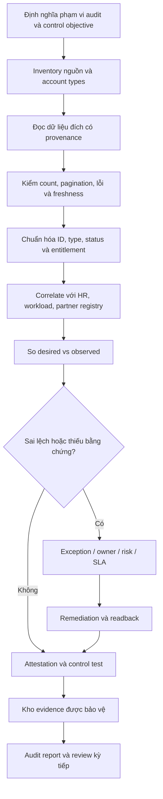

# Account inventory evidence trong Identity audit và quản lý vòng đời IAM

**Account inventory evidence** (*bằng chứng kiểm kê tài khoản*) là tập dữ liệu, dấu vết thu thập và kết quả đối chiếu được dùng để **chứng minh tổ chức biết những tài khoản nào đang tồn tại, chúng thuộc về ai hoặc workload nào, có quyền gì, do đâu được cấp, đang ở trạng thái nào và liệu quy trình quản lý vòng đời có hoạt động đúng không**. Đây không chỉ là một bảng danh sách account xuất từ hệ thống; bằng chứng phải đủ **đầy đủ, chính xác, cập nhật, có thể truy nguyên và kiểm chứng độc lập**.

Ví dụ, HRIS ghi nhân viên Lan đã nghỉ việc vào ngày T0, IdP báo account `lan@example.test` đã disabled và IAM xuất báo cáo “Leaver completed”. Tuy nhiên, ERP vẫn có account cục bộ và quyền `invoice.approve` hoạt động bằng một session cũ. **Báo cáo từ IdP đơn lẻ không đủ chứng minh mọi account và quyền liên quan đã bị thu hồi.** Account inventory evidence đáng tin phải kết hợp inventory từ ERP, danh tính HR/IAM, account correlation, provisioning record và kết quả authorization tại đích.

Trong module **Identity and Access Management (IAM)** theo mô hình **Joiner–Mover–Leaver (JML)**, chủ đề này thuộc **Identity audit**. Nó kết nối các nguồn **IdP, SSO, SCIM, directory, RBAC/ABAC, service/machine identity, access review, account reconciliation và audit log** để phát hiện tài khoản vô chủ, quyền không còn nhu cầu và quyền truy cập tồn dư. **Bằng chứng kiểm kê là nền tảng để kiểm toán đánh giá kiểm soát; bản thân inventory không thay thế biện pháp cấp hoặc thu hồi quyền.**

## 1. Phân biệt account inventory và inventory evidence

| Khái niệm | Câu hỏi trả lời | Ví dụ |
| --- | --- | --- |
| **Account inventory** | Có account nào ở các hệ thống trong phạm vi? | Danh sách user/account của ERP và IdP |
| **Identity inventory** | Có những chủ thể người hoặc phi con người nào? | Human identity, partner identity, workload identity |
| **Entitlement inventory** | Account hoặc principal sở hữu quyền nào? | Role, group, ACL, OAuth scope, cloud policy |
| **Account correlation** | Account đích thuộc identity/workload nào? | ERP account liên kết employee ID |
| **Inventory evidence** | Có thể chứng minh dữ liệu kiểm kê đầy đủ và đáng tin thế nào? | Export có timestamp, nguồn, hash, đối chiếu |
| **Reconciliation evidence** | Desired state khác observed state ra sao, xử lý chưa? | Account thừa, quyền thừa, kết quả remediation |
| **Access review evidence** | Ai xác nhận account/quyền còn cần và căn cứ gì? | Quyết định Keep/Revoke, reviewer, ngày |
| **Enforcement evidence** | Tài nguyên đã thực sự cho phép/từ chối? | Authorization log, negative API test |

**Danh sách account** chỉ là một phần của bằng chứng. Kiểm toán cần biết **phạm vi hệ thống, cách lấy danh sách, thời điểm chụp, tính toàn vẹn, chất lượng liên kết và giới hạn của dữ liệu**.

## 2. Mục tiêu kiểm soát đối với account inventory evidence

Một bộ bằng chứng tốt cần hỗ trợ ít nhất sáu mục tiêu:

1. **Completeness (đầy đủ):** tất cả hệ thống và loại account thuộc phạm vi đã được đưa vào, kể cả account cục bộ, đặc quyền và phi con người.
2. **Accuracy (chính xác):** identity, account ID, trạng thái, quyền và owner phản ánh đúng dữ liệu ở hệ thống nguồn/đích.
3. **Timeliness (kịp thời):** dữ liệu đủ mới so với thời điểm kiểm toán và SLA vòng đời.
4. **Traceability (truy vết):** có nguồn, timestamp, phương pháp thu thập, người/công cụ thực hiện và đường liên kết giữa các sự kiện.
5. **Integrity (toàn vẹn):** dữ liệu không bị sửa âm thầm sau khi trích xuất; có kiểm soát lưu trữ và thay đổi.
6. **Remediability (xử lý được):** các sai lệch có owner, trạng thái, hạn khắc phục và bằng chứng readback.

Một bảng có đủ 10.000 account nhưng không rõ **có bao nhiêu ứng dụng chưa trích xuất được** có thể kém giá trị hơn bảng ít dòng hơn nhưng bao phủ phạm vi xác định, có bằng chứng và ghi rõ phần thiếu.

## 3. Kiểm kê những loại account nào?

Không chỉ có account nhân viên tương tác:

| Nhóm account | Nguồn thường gặp | Rủi ro khi bỏ sót |
| --- | --- | --- |
| **Human employee** | HRIS, IdP, AD, SaaS, ERP | Leaver còn quyền ứng dụng |
| **Contractor/temporary** | HR/contractor register, IdP | Quyền vượt thời hạn hợp đồng |
| **Partner/B2B** | Partner register, federation, ứng dụng | Tài khoản đối tác không còn sponsor |
| **Privileged/admin** | PAM, cloud IAM, directory, local OS | Đặc quyền tồn dư hoặc không có owner |
| **Service account** | AD, database, SaaS, cloud IAM | Key/role sống lâu dù job đã ngừng |
| **Machine/workload** | CI/CD, Kubernetes, cloud, PKI | Federation trust/secret không quản trị |
| **API/OAuth client** | Authorization server, API gateway | Token có thể tiếp tục được cấp |
| **Shared/legacy** | Database, hệ thống cũ | Khó quy trách nhiệm, dùng chung credential |
| **Break-glass** | Tenant recovery, local admin, vault | Cần duy trì phục hồi nhưng bảo vệ chặt |
| **Orphan/unmatched** | Mọi ứng dụng đích | Không có identity/owner để chứng nhận |

**Account ít dùng không mặc nhiên không cần.** Break-glass, tác vụ theo quý và job phục hồi có thể ít hoạt động; evidence phải kết hợp owner, mục đích và lịch vận hành thay vì chỉ dựa `lastLogin`.

## 4. Các nguồn dữ liệu cần đối chiếu

Bằng chứng inventory thường được tạo từ nhiều hệ thống:

| Nguồn | Dữ liệu liên quan | Giới hạn cần nêu |
| --- | --- | --- |
| **HRIS** | Employee ID, trạng thái, ngày JML, manager | Không chứa mọi account kỹ thuật |
| **IdP / Directory** | User, group, disable state, đăng nhập | Không chứa mọi SaaS-local account |
| **SCIM/connector** | Provision/update/deprovision events | Thành công connector không bảo đảm quyền runtime |
| **Ứng dụng SaaS/ERP** | Account, role, status, local grant | Có thể có quyền ngoài IAM |
| **Cloud IAM/PAM** | Principal, privileged role, eligibility | Tài khoản không tương tác cần owner riêng |
| **Database/OS** | Technical users, local admin, grants | Thường không đồng bộ HR |
| **OAuth authorization server** | Client, credentials, grants | Không tự chứng minh resource server deny |
| **PKI/secrets manager** | Certificate/key metadata, custody | Không nên xuất secret thô |
| **Workload/CMDB register** | Service, owner, environment, dependencies | Có thể lỗi thời nếu không đối chiếu runtime |
| **Resource server/audit** | Permit/Deny và hoạt động thực tế | Log thiếu không có nghĩa không có account |

**Không lấy IdP làm nguồn đầy đủ duy nhất nếu ứng dụng cho phép local login hoặc role gán trực tiếp.** Tương tự, dữ liệu SCIM chỉ bao phủ những đối tượng/thuộc tính mà target và connector thật sự hỗ trợ.

## 5. Một bộ hồ sơ evidence mẫu

Một account inventory record có thể gồm:

| Trường | Ví dụ minh họa | Ý nghĩa kiểm toán |
| --- | --- | --- |
| `inventoryRecordId` | `inv-erp-0021` | Khóa chuẩn hóa nội bộ |
| `sourceSystemId` | `erp-prod-a` | Nguồn quan sát |
| `sourceAccountId` | `erp-user-993` | ID account tại đích |
| `identityId` | `human-128` | Identity được correlation |
| `accountType` | `employee` | Nhóm account |
| `ownerId` | `EMP-447` | Người/nhóm chịu trách nhiệm |
| `status` | `disabled` | Trạng thái do nguồn báo |
| `entitlementRefs` | `invoice.read` | Quyền được quan sát |
| `tenantId` | `tenant-a` | Ranh giới hệ thống |
| `environment` | `production` | Phạm vi vận hành |
| `observedAt` | `2026-11-23T02:00:00Z` | Thời điểm thu thập |
| `extractionRunId` | `extract-20261123-01` | Liên kết lần xuất |
| `correlationStatus` | `matched` | Chất lượng liên kết |
| `lifecycleStatus` | `leaver` | Trạng thái quan hệ từ HR |
| `reviewStatus` | `pending-remediation` | Trạng thái kiểm soát |
| `evidenceReference` | `evidence://run/...` | Vị trí lưu kiểm toán |

Đây là **schema minh họa**, không phải mẫu chuẩn SCIM hoặc yêu cầu của một bộ tiêu chuẩn kiểm toán cụ thể. Cần phân biệt `status` quan sát từ hệ thống đích và `lifecycleStatus` từ nguồn nhân sự.

**Không sử dụng email hoặc tên hiển thị làm khóa duy nhất**: tài khoản có thể được đổi tên hoặc tái sử dụng. Khóa ổn định và hệ thống nguồn là điều kiện cần để chứng minh correlation.

## 6. Bằng chứng về quá trình trích xuất

Ngoài nội dung danh sách, mỗi lần export cần metadata **provenance**:

- **Scope:** ứng dụng/tenant/region/environment, loại account, filter và account bị loại trừ.
- **Method:** API, SCIM, database export, connector hay report quản trị.
- **Run ID và thời gian:** bắt đầu/kết thúc, timezone, observed snapshot.
- **Source version:** phiên bản API/schema, cursor/pagination và policy áp dụng.
- **Executor:** service identity của công cụ hoặc người được phép chạy.
- **Completeness check:** tổng bản ghi, số trang, lỗi, timeout, retry, giới hạn phân trang.
- **Integrity:** checksum/hash của artifact, quyền sửa và nơi lưu.
- **Data freshness:** lần đồng bộ cuối, timestamp tại nguồn và khoảng trễ.
- **Exceptions:** nguồn inaccessible, account type chưa thu được, hạn xử lý.
- **Reconciliation link:** run ID liên kết dữ liệu nguồn và kết quả so sánh.

**HTTP 200 của trang đầu không chứng minh export đầy đủ** nếu API có pagination. Khi nguồn hỗ trợ cursor, phải đi hết trang theo cơ chế chuẩn và đối chiếu record count, lỗi và giới hạn API.

## 7. Luồng thu thập và chứng nhận evidence



**Thu thập, chuẩn hóa, đối soát và kết luận kiểm toán là các bước khác nhau.** Không ghi “Account Inventory Verified” chỉ vì đã tạo file CSV mà chưa xử lý account orphan, hệ thống trích xuất thiếu hoặc dữ liệu sai thời điểm.

## 8. Completeness: chứng minh không bỏ sót account

Kiểm toán phải biết **tập nguồn có thẩm quyền nằm trong phạm vi**. Một cách tiếp cận:

1. Lấy danh mục ứng dụng từ CMDB, SaaS register, cloud accounts, directory và workload inventory.
2. Đối chiếu các nguồn với scope đã được phê duyệt.
3. Liệt kê mọi account type: employee, partner, admin, local, service, device, API client.
4. Thu thập trực tiếp từ các hệ thống đích, không chỉ từ provisioning logs.
5. Kiểm tra pagination, rate limiting, filter mặc định và account bị ẩn/archived.
6. Đối chiếu tổng số account với native dashboard/report độc lập khi khả thi.
7. Đánh dấu nguồn không khả dụng và lý do loại trừ với owner.
8. Kiểm tra những tài khoản có quyền **đăng nhập cục bộ** nằm ngoài SSO.
9. Kiểm tra privileged identities và account phục hồi riêng.
10. Ghi lại coverage tại **thời điểm snapshot**, không tái định nghĩa scope sau khi thấy kết quả.

Một ví dụ thiếu coverage: chỉ truy vấn `active=true` có thể bỏ qua các account disabled cần kiểm tra liệu role, token hoặc local credential còn hiệu lực. **Inventory kiểm toán thường cần cả active lẫn disabled/suspended/retired records**, theo khả năng và chính sách lưu giữ.

## 9. Accuracy: correlation và quyền hiệu lực

Để bằng chứng chính xác, cần xác nhận:

- Account ID thuộc đúng issuer, tenant và environment.
- Identity ID tương ứng với đúng người hoặc workload.
- Quan hệ employee/contractor/partner còn hợp lệ.
- Account phụ/privileged được liên kết với chủ thể chịu trách nhiệm.
- Group, role và ACL phản ánh đúng quyền tại đích.
- Nested groups, role hierarchy và inherited policies được xét.
- Service principal có owner, mục đích và credential reference.
- Không ghép sai hai account chỉ vì tên hoặc email tương tự.
- Event JML đã có hiệu lực không bị ghi đè bởi snapshot cũ.
- Account không correlate được được đưa vào danh sách exception, không tự loại khỏi báo cáo.

**Effective permission không luôn là danh sách role tĩnh.** Với ABAC/PBAC, cần xem thuộc tính resource, tenant, environment và thời điểm request; inventory có thể lưu policy reference và kết quả test đại diện thay vì giả định mọi điều kiện runtime luôn đúng.

## 10. Snapshot, thời gian và eventual consistency

Dữ liệu giữa các hệ thống có thể không được chụp cùng thời điểm:

```text
T0 HR ghi Mover
T1 IdP cập nhật group
T2 Connector xử lý ứng dụng
T3 ERP role thay đổi
T4 Audit trích xuất account list
T5 Reviewer xem báo cáo
```

Nếu export IdP tại T1 và ERP tại T2, một sai lệch có thể là **propagation đang diễn ra**, không nhất thiết là failure vĩnh viễn. Nhưng với entitlement nhạy cảm, cần kiểm tra **SLA** chứ không bỏ qua quyền còn tồn.

Một evidence package cần ghi:
- Snapshot time từng hệ thống, không chỉ “ngày báo cáo”.
- Độ trễ đồng bộ dự kiến và thực tế.
- Thời điểm JML có hiệu lực.
- Lần đọc lại sau khoảng propagation.
- Dữ liệu đã bị thay đổi trong khi export hay chưa.
- Quy tắc xử lý event đến trễ hoặc sai thứ tự.

**Snapshot dùng cho audit phải giữ tính bất biến về mặt bằng chứng**, trong khi remediation cần tham chiếu trạng thái hiện hành trước khi viết thay đổi. Tránh dùng quyết định từ snapshot cũ để cấp lại role đã bị gỡ bởi Mover/Leaver.

## 11. Desired state và observed state

**Desired state** là account/quyền được phép tồn tại theo HRIS, hợp đồng, workload registry, approval và policy; **observed state** là account/quyền thấy ở hệ thống đích.

```text
desired_accounts = approved_active_identities + approved_workloads
observed_accounts = target_system_inventory

unexpected_accounts = observed_accounts - desired_accounts
missing_accounts = desired_accounts - observed_accounts

desired_access = approved_entitlements(current_context)
observed_access = effective_target_permissions(current_context)

excess_access = observed_access - desired_access
```

Đây là **mô hình logic**, không phải thuật toán đủ cho mọi hệ thống vì còn ngoại lệ, account tạm, ABAC, quyền kế thừa và trạng thái chuyển tiếp.

| Sai lệch | Ví dụ | Bằng chứng xử lý |
| --- | --- | --- |
| **Unexpected account** | ERP user không có HR/partner/workload liên kết | Owner investigation và quyết định |
| **Missing account** | Joiner được duyệt nhưng chưa provision | Connector retry và readback |
| **Excess entitlement** | Người Mover còn Finance role | Revoke và negative authorization test |
| **Stale account** | Account Leaver vẫn active | Disable/deprovision evidence |
| **Orphan service identity** | Service principal không owner | Ownership transfer/retire |
| **Direct grant drift** | Role cấp trực tiếp ngoài IAM | Resource owner review và cleanup |
| **Credential residue** | Key cũ còn active sau service retirement | Revoke issuer và deny test |
| **Re-provision drift** | IaC tự cấp lại quyền đã gỡ | Sửa desired config và kiểm tra tiếp |

**Connector báo thành công không phải bằng chứng quyền runtime đã hết hiệu lực.** Với rủi ro cao, cần kiểm tra authorization ở tài nguyên.

## 12. Account inventory evidence trong Joiner

Bằng chứng **Joiner** cần chứng minh:

1. Identity từ HR hoặc nguồn quan hệ đã được xác minh và có ID ổn định.
2. Account được tạo đúng hệ thống và tenant.
3. Account không được sử dụng vượt ngày hiệu lực theo policy.
4. Role birthright chỉ tương ứng với nhiệm vụ ban đầu.
5. Các entitlement nhạy cảm được phê duyệt đúng thẩm quyền.
6. Credential/MFA được khởi tạo qua quy trình bảo vệ.
7. SCIM/connector hoặc provisioning API phản ánh đúng trạng thái ở đích.
8. Inventory ghi owner và account correlation.
9. Kết quả kiểm thử quyền thực tế phù hợp, kể cả Deny ngoài scope.
10. Không tạo duplicate account ngoài nhu cầu.

Một bằng chứng **`PROVISION_SUCCESS`** cần được bổ sung **readback account và entitlement từ ứng dụng** nếu control objective là “đã cấp quyền đúng”, không chỉ “đã gửi yêu cầu cấp”.

## 13. Account inventory evidence trong Mover

Mover là nguồn quyền tồn dư phổ biến vì **chỉ cấp quyền mới mà không xóa quyền cũ**.

Ví dụ:

| Trước Mover | Sau Mover mong muốn | Evidence phải kiểm |
| --- | --- | --- |
| Finance approver | Analytics reader | ERP role Finance đã gỡ |
| Project A developer | Project B developer | ACL/repo A không còn |
| Production operator | Security auditor | SoD và quyền production |
| Temporary on-call | Không còn on-call | Role JIT eligibility và phiên |
| Tenant A support | Tenant B support | Không còn truy cập tenant A |

Bộ evidence nên có **HR Mover event, desired entitlement mới, old/new role mapping, provisioning operation, observed target account, readback và negative test**. Một quyết định Keep từ chiến dịch cũ không được phép tự tái cấp quyền đã bị gỡ vì lifecycle thay đổi.

## 14. Account inventory evidence trong Leaver

Đối với **Leaver**, kiểm toán thường quan tâm tới **tính kịp thời và tính đầy đủ của deprovisioning**.

| Lớp kiểm soát | Bằng chứng kỳ vọng |
| --- | --- |
| HR/contract event | Người/đối tác đã kết thúc quan hệ và thời điểm hiệu lực |
| Identity correlation | Mọi account liên quan đến cùng chủ thể |
| IdP disable | Tài khoản trung tâm không cấp login mới |
| SaaS/application account | Account đích disabled hoặc bị thu hồi phù hợp |
| Group/role/ACL | Quyền trực tiếp và kế thừa được xử lý |
| Session/token | Quyền dùng phiên và token cũ được đánh giá |
| Privileged accounts | Account phụ/PAM eligibility bị thu hồi |
| Partner integrations | Key/OAuth client không còn căn cứ bị chặn |
| Account reconciliation | Không còn unexpected active accounts |
| API authorization | Negative test Deny trong SLA đã định |
| Audit trail | Ai thực hiện, lúc nào, kết quả và exception |

**SCIM `active=false` không đồng nghĩa mọi local role, refresh token hay access token đều bị vô hiệu tức thì**. Evidence phải phù hợp mục tiêu kiểm soát: chứng minh **đã gửi lệnh**, **đã cập nhật account**, hay **đã chặn truy cập thực tế** là ba mức khác nhau.

## 15. Non-human account và machine identity evidence

Tài khoản phi con người không nhất thiết có HR employee ID. Một service account nên được liên kết với **workload/service ID và accountable owner**:

| Evidence field | Câu hỏi cần trả lời |
| --- | --- |
| `serviceIdentityId` | Có khóa quản lý ổn định không? |
| `workloadId` | Job/service nào dùng identity? |
| `technicalOwnerGroup` | Nhóm nào duy trì credential và triển khai? |
| `businessOwner` | Ai xác nhận purpose và rủi ro? |
| `environment/tenant` | Identity hoạt động ở đâu? |
| `credentialRefs` | Key/cert ở vault/issuer nào? |
| `roleBindings` | Có quyền trực tiếp/kế thừa gì? |
| `lastObservedUse` | Tín hiệu sử dụng có đáng tin không? |
| `rotation/revokeState` | Credential còn hợp lệ hay đã xử lý? |
| `dependencyMap` | Ngừng identity có ảnh hưởng service khác không? |

**Owner nhân sự Leaver không đồng nghĩa workload phải bị xóa**. Bằng chứng phù hợp là **thu hồi quyền cá nhân đối với vault, CI/CD hoặc cloud IAM; chuyển owner; rà soát credential; bảo vệ continuity của workload**. Nếu job đã retired, phải có quyết định decommission và readback quyền thực tế.

## 16. Partner, shared và break-glass account

### Partner identity

Một tài khoản B2B cần **sponsor nội bộ, partner ID, contract reference, tenant và expiry**. Evidence phải giúp kiểm tra người/ứng dụng của đối tác còn được phép truy cập tài nguyên sau thay đổi hợp đồng không.

### Shared/legacy account

Một username dùng chung cần danh sách consumer, người chịu trách nhiệm và cơ chế attribution bổ sung. **Không ghi “owner = shared” rồi kết luận có trách nhiệm giải trình**. Nếu không thể tách ngay, phải ghi ngoại lệ, compensating controls, người phê duyệt và lộ trình.

### Break-glass account

Tài khoản khẩn cấp có thể ít dùng nhưng phải được giữ theo mục tiêu phục hồi. Audit nên yêu cầu **custodian, storage reference, lần diễn tập, cảnh báo khi dùng, review sau activation và recovery readiness**, không tự đánh dấu “unused, delete” chỉ vì không có login gần đây.

## 17. Access review, SoD và privileged entitlement evidence

Một inventory đúng còn phải liên kết với các quyết định quản trị:

- **Access request/approval**: ai đề nghị và ai phê duyệt quyền.
- **Role mapping**: group/role nào tạo effective permission.
- **SoD policy**: có tổ hợp create/approve hoặc admin/audit xung đột không.
- **Access review/recertification**: ai Keep/Revoke, lý do và hạn.
- **Exception**: ai chấp nhận rủi ro, phạm vi, ngày hết hạn.
- **Remediation**: lệnh revoke, readback, phiên/token và thời gian hoàn tất.
- **Privileged access/PAM**: eligibility, activation và thời gian giữ quyền.
- **Emergency access**: incident ID, custodian và việc trả quyền về trạng thái an toàn.

**Bằng chứng một quyền được phê duyệt ban đầu không đủ chứng minh quyền đó còn hợp lệ sau Mover.** Cần đối chiếu ngữ cảnh hiện tại và quyền đang hiệu lực.

## 18. Sample-based audit testing và giới hạn mẫu

Kiểm toán có thể chọn mẫu theo rủi ro, nhưng phải hiểu **mục tiêu và quần thể**:

1. Xác định **population**: tất cả account/entitlement trong scope tại thời điểm cụ thể.
2. Chứng minh population completeness trước khi lấy mẫu.
3. Phân tầng privileged, human, partner, service và ứng dụng nhạy cảm nếu cần.
4. Chọn mẫu theo phương pháp đã định, ghi seed hoặc tiêu chí chọn khi thích hợp.
5. Với mỗi mẫu, trace từ account đích về identity/owner, approval và trạng thái JML.
6. Đối chiếu entitlement và policy hiện hành.
7. Kiểm tra event tạo/đổi/xóa và timestamp.
8. Thu bằng chứng readback hoặc negative test cho các trường hợp thu hồi.
9. Ghi exceptions và tác động đến kết luận kiểm toán.
10. Không suy diễn “không có lỗi toàn hệ thống” chỉ từ một mẫu nhỏ.

**Nếu population không đầy đủ, mẫu kiểm toán có thể bỏ sót toàn bộ nhóm tài khoản nguy hiểm** như local admin hoặc OAuth client ngoài directory. Do đó population completeness là bước đi trước sampling.

## 19. Kết quả kiểm toán và phân loại phát hiện

Một phát hiện nên phân biệt:

| Kết quả | Ý nghĩa | Ví dụ |
| --- | --- | --- |
| **Pass** | Bằng chứng đủ và đáp ứng kiểm soát | Leaver account disabled trong SLA và đã kiểm chứng |
| **Control gap** | Kiểm soát thiết kế chưa bao phủ | Không có inventory service account |
| **Operating failure** | Kiểm soát có thiết kế nhưng thực thi lỗi | Connector bỏ qua một account |
| **Evidence deficiency** | Thiếu chứng cứ để kết luận | Export không có timestamp hoặc pagination |
| **Data quality issue** | Correlation/metadata sai | Owner ID trỏ người đã nghỉ |
| **Exception approved** | Sai lệch được chấp nhận tạm theo policy | Quyền bàn giao có expiry |
| **Remediation pending** | Đã quyết định sửa nhưng chưa xác minh | Role gỡ ở IdP, ERP chưa readback |
| **Out of scope** | Đối tượng được loại trừ có căn cứ | Môi trường lab được phê duyệt loại trừ |

**Thiếu evidence không tự chứng minh đã xảy ra truy cập trái phép**, nhưng cũng **không đủ cơ sở khẳng định kiểm soát đạt yêu cầu**. Cần ghi rõ giới hạn đánh giá.

## 20. Định dạng evidence package dễ kiểm toán

Có thể tổ chức một bộ tài liệu logic như sau, không nhất thiết tạo các file riêng trong bài học:

```text
Audit Campaign
  - Scope and control objectives
  - Source systems and extraction manifest
  - Raw target account snapshots (protected)
  - Normalized inventory and stable IDs
  - Identity/workload/partner correlation results
  - Entitlement/effective-access mappings
  - Joiner/Mover/Leaver event evidence
  - Access approvals and exceptions
  - Reconciliation differences and owner decisions
  - Remediation operations and target readbacks
  - Authorization/negative test results
  - Final attestation and open findings
```

Manifest ví dụ:

```json
{
  "campaignId": "iam-audit-2026-q4",
  "extractionRunId": "extract-erp-20261123-01",
  "sourceSystem": "erp-prod-a",
  "snapshotAt": "2026-11-23T02:00:00Z",
  "accountTypesIncluded": ["human", "partner", "service", "local-admin"],
  "recordCount": 1420,
  "paginationComplete": true,
  "schemaVersion": "1",
  "artifactDigestReference": "sha256:<digest-placeholder>",
  "collectionStatus": "COMPLETE",
  "knownExclusions": []
}
```

Đây là **dữ liệu minh họa**, không phải số liệu thực. Trường digest nhằm hỗ trợ phát hiện sửa đổi artifact nhưng **checksum không tự chứng minh dữ liệu nguồn đầy đủ hoặc đúng**; vẫn cần kiểm tra phạm vi, quyền truy xuất và quy trình thu thập.

## 21. Bảo vệ dữ liệu và tính toàn vẹn bằng chứng

Account inventory evidence thường chứa thông tin nhân sự, cấu trúc ứng dụng và quyền admin. Vì vậy cần:

- **Data minimization:** chỉ trích xuất thông tin cần cho control objective.
- **Pseudonymization** hoặc ID tham chiếu khi không cần tên/email thật.
- **Access controls:** người xem report không mặc nhiên xem được tất cả thông tin HR.
- **Encryption:** bảo vệ artifact trong lưu trữ và khi truyền.
- **Integrity controls:** hash, signed manifest hoặc object lock/append-only phù hợp.
- **Separation of Duties:** người bị kiểm toán không tự thay dữ liệu bằng chứng không để dấu.
- **Retention:** theo nghĩa vụ, mục đích và chính sách; không lưu vô hạn.
- **Legal hold:** tránh xóa evidence đang cần điều tra hoặc lưu giữ theo yêu cầu.
- **Audit access:** log ai xem, xuất, sửa cấu hình hoặc xóa bằng chứng.
- **Secret handling:** không lưu plaintext password, API key, cookie, bearer token, private key.

Không nên chia sẻ nguyên bản account inventory rộng rãi qua email hoặc wiki công khai; nếu cần báo cáo tổng hợp hãy giảm thông tin nhạy cảm và dùng liên kết đến kho bằng chứng được kiểm soát.

## 22. Tính toàn vẹn, bất biến và khả năng tái lập

Một bộ evidence đáng tin cần có:

1. **Raw snapshot** lưu theo chính sách và không bị ghi đè sau khi thu.
2. **Manifest** ghi nguồn, API/filter, thời gian, số bản ghi và trạng thái hoàn tất.
3. **Normalized dataset** kèm version mapping và quy tắc correlation.
4. **Transform lineage** để biết trường nào lấy từ đâu.
5. **Evidence digest/reference** để phát hiện thay đổi.
6. **Reviewer sign-off** gắn với đúng snapshot, không ký một file có thể thay vô dấu.
7. **Amendment process** khi phát hiện lỗi sau khi khóa evidence.
8. **Readback** và kiểm chứng từ target cho những kết luận quan trọng.

**Immutable không đồng nghĩa đúng**: nếu extraction bỏ sót một trang API thì artifact bất biến vẫn không đầy đủ. Ngược lại, dữ liệu sống trong dashboard không phải bằng chứng bất biến nếu không lưu được snapshot và phương pháp thu.

## 23. Kiểm thử kỹ thuật và kiểm soát chất lượng export

| Tình huống | Kết quả mong muốn |
| --- | --- |
| API account list có nhiều trang | Collector xử lý đủ cursor/page |
| Endpoint trả 429/rate limit | Retry có kiểm soát, đánh dấu incomplete nếu thất bại |
| Account renamed | Correlate bằng source ID, không mất liên kết |
| Employee ID không tìm thấy | Đưa vào unmatched, không loại khỏi population |
| Service account owner Leaver | Đánh dấu cần chuyển owner và rà soát credential |
| Local admin không có trong IdP | Vẫn được kiểm kê tại hệ thống đích |
| Role kế thừa từ group | Inventory ghi effective permission hoặc source mapping |
| Snapshot giữa lúc Mover | Ghi thời gian và phân biệt trạng thái chuyển tiếp |
| SCIM deprovision thành công, role local còn | Reconciliation phát hiện |
| Token còn Permit sau Leaver | Negative authorization test thất bại, báo quyền dư |
| API collector không có đủ permission | Report missing coverage, không trả PASS |
| Extract trùng event | Deduplicate theo ID mà không xóa nhầm account |
| Digest artifact thay đổi | Phát hiện integrity violation |
| Owner cập nhật sau snapshot | Giữ snapshot cũ, ghi amendment/new version |
| Account break-glass không dùng | Review readiness, không auto-delete |
| IaC re-provision account retired | Phát hiện lại qua lần reconcile tiếp theo |

## 24. Một truy vấn phát hiện account Leaver còn active

Ví dụ có các bảng đã được chuẩn hóa và có quyền truy cập hợp lệ:

```sql
-- SQL minh họa, phụ thuộc hệ quản trị dữ liệu.
SELECT
    a.source_system_id,
    a.source_account_id,
    a.identity_id,
    a.account_status,
    l.effective_at AS leaver_at,
    a.observed_at
FROM account_inventory AS a
JOIN lifecycle_events AS l
  ON a.identity_id = l.identity_id
WHERE l.event_type = 'LEAVER'
  AND l.effective_at <= a.observed_at
  AND a.account_status = 'ACTIVE';
```

Kết quả là **ứng viên sai lệch cần kiểm tra**, không tự chứng minh đã có truy cập: phải xem account có quyền local, token/session, exception hay event rehire không; đồng thời xác nhận snapshot và mapping trạng thái giữa hệ thống.

Để tìm account chưa correlation:

```sql
SELECT
    source_system_id,
    account_type,
    COUNT(*) AS unmatched_accounts
FROM account_inventory
WHERE correlation_status = 'UNMATCHED'
GROUP BY source_system_id, account_type;
```

**Không xóa account `UNMATCHED` chỉ vì không tìm thấy identity**; cần owner/consumer investigation và đánh giá tác động, đặc biệt đối với database và production service accounts.

## 25. Chỉ số quản trị inventory evidence

| Chỉ số | Điều phản ánh |
| --- | --- |
| **Source coverage** | Tỷ lệ hệ thống trong scope thu được dữ liệu |
| **Population completeness** | Mức chứng minh danh sách account đủ phạm vi |
| **Extraction success rate** | Tỷ lệ job export hoàn thành đủ trang |
| **Snapshot freshness** | Độ trễ giữa dữ liệu nguồn và thời điểm audit |
| **Identity correlation rate** | Tỷ lệ account liên kết identity/workload |
| **Unmatched/orphan count** | Account thiếu owner hoặc correlation |
| **Owner coverage** | Tỷ lệ non-human account có accountable owner |
| **Privileged coverage** | Account/admin entitlement được kiểm kê |
| **Leaver residual account count** | Account còn active sau Leaver |
| **Mover excess entitlement count** | Quyền cũ chưa gỡ sau Mover |
| **Reconciliation discrepancy age** | Tuổi sai lệch chưa xử lý |
| **Verified remediation rate** | Tỷ lệ thu hồi đã có readback/deny evidence |
| **Evidence integrity failures** | Bằng chứng bị thay hoặc không kiểm chứng |
| **Audit traceability rate** | Tỷ lệ kết luận có thể trace về nguồn và thao tác |

**Tăng số lượng orphan account phát hiện** có thể cho thấy discovery tốt hơn, không nhất thiết hệ thống trở nên kém an toàn hơn. Cần xem cùng coverage, độ chính xác và tốc độ xử lý.

## 26. Những sai lầm thường gặp

| Sai lầm | Hậu quả | Cách khắc phục |
| --- | --- | --- |
| Chỉ export IdP users | Bỏ sót local, service, SaaS account | Thu từ target và nhiều nguồn |
| Không chứng minh pagination | Population thiếu mà không biết | Extraction manifest và count check |
| Chỉ lấy account active | Bỏ qua disabled còn token/quyền | Scope đủ trạng thái |
| Dùng email làm khóa duy nhất | Correlation nhầm sau rename/reuse | Stable source/identity IDs |
| Quên owner NHA | Không ai quyết định giữ/thu hồi | Workload registry và owner attestation |
| Chỉ lưu ảnh screenshot | Khó tái lập/filter/đối chiếu | Export có provenance, version và digest |
| Không ghi snapshot time | Không phân biệt drift và dữ liệu cũ | Timestamps rõ nguồn |
| Xem SCIM HTTP 200 là quyền mất | Bỏ sót role/token còn hoạt động | Target readback và negative test |
| Không kiểm nested groups | Không thấy effective privilege | Expand entitlement path |
| Chỉ lưu dữ liệu đã normalize | Khó chứng minh phép biến đổi | Lưu raw snapshot/lineage có kiểm soát |
| Không ghi phạm vi thiếu | Báo cáo coverage sai | Exception và incomplete status |
| Ghi plaintext secret | Rò credential trong audit | Metadata/reference và redaction |
| Coi thiếu log là không truy cập | Kết luận sai | Kiểm log coverage và test |
| Xóa evidence sau khi account deleted | Mất dấu vết | Retention và legal hold |
| Không so IaC/GitOps | Quyền/account có thể tái tạo | Desired state và reconciliation |

## 27. Checklist chuẩn bị cho kiểm toán

- [ ] Đã xác định scope kiểm toán và hệ thống/account type thuộc phạm vi.
- [ ] Có inventory các ứng dụng đích và nguồn identity/owner.
- [ ] Manifest ghi API/filter, timestamp, run ID, record count và pagination.
- [ ] Phân biệt raw snapshot, normalized inventory và audit conclusion.
- [ ] Có khóa source account ID và identity/workload ID ổn định.
- [ ] Có danh sách account không correlate được và owner xử lý.
- [ ] Bao phủ privileged, local, service, partner và break-glass phù hợp.
- [ ] Có effective entitlement hoặc đường cấp role/group/ACL rõ.
- [ ] Joiner có provisioning và target readback.
- [ ] Mover có bằng chứng gỡ quyền cũ và SoD review.
- [ ] Leaver có bằng chứng disable/deprovision kịp thời.
- [ ] Token/session/runtime authorization được xem xét với quyền nhạy cảm.
- [ ] Access review Keep/Revoke có reviewer, thời gian và reason.
- [ ] Reconciliation discrepancies có owner, SLA và trạng thái.
- [ ] Quyết định revoke có evidence thực thi/readback.
- [ ] Snapshot và transform được bảo vệ integrity.
- [ ] Không ghi secret thô hoặc PII vượt mục đích.
- [ ] Có audit trail của người truy xuất/chỉnh sửa evidence.
- [ ] Coverage thiếu được mô tả rõ, không báo PASS khi incomplete.
- [ ] Có plan khắc phục cho các phát hiện còn mở.

## 28. Câu hỏi tự kiểm tra

**Tình huống A:** IdP có 2.000 account và xuất CSV thành công. Có đủ chứng minh account inventory đầy đủ không? **Không.** Phải xác định scope, các hệ thống đích, account cục bộ/phi con người và độ đầy đủ export.

**Tình huống B:** ERP báo local account vẫn active cho một Leaver, nhưng IdP đã disabled. Kết luận gì? **Có sai lệch cần điều tra và xử lý tại đích**, không coi IdP status là đủ.

**Tình huống C:** Một account không tìm thấy HR employee ID. Có thể xóa khỏi audit population không? **Không.** Cần xác định đó có phải service/partner/account orphan và ghi exception.

**Tình huống D:** Export chỉ lấy trang đầu của API nhưng file được ký và có hash. Evidence đã đạt chưa? **Chưa.** Integrity không thay cho completeness.

**Tình huống E:** Người dùng Mover bị gỡ group IdP, song ERP vẫn có role trực tiếp. Cần bằng chứng gì? **Target entitlement readback và authorization deny**, ngoài log thay đổi IdP.

**Tình huống F:** Break-glass không đăng nhập trong một năm. Có kết luận “unused, delete” không? **Không.** Cần kiểm tra recovery purpose, custodian và diễn tập.

**Tình huống G:** Sau Leaver không còn log truy cập. Có thể khẳng định token/phiên đã bị chặn? **Không chỉ từ sự vắng mặt của log.** Cần kiểm tra coverage và negative authorization test khi cần.

**Tình huống H:** Kiểm toán chỉ lấy mẫu từ bảng thiếu một ứng dụng SaaS. Có thể suy rộng kết quả cho SaaS đó không? **Không.** Population không đủ, phải ghi giới hạn phạm vi và thu thập bổ sung.

## Ghi nhớ

**Account inventory evidence** là bằng chứng có thể kiểm toán về **account nào tồn tại, thuộc identity/workload nào, do ai quản lý, có quyền gì, ở trạng thái nào và kết quả đối chiếu ra sao**. Để đáng tin, nó phải có **scope rõ, đa nguồn, snapshot có provenance, ID ổn định, correlation, kiểm tra completeness/accuracy/freshness, integrity, quyền truy cập bảo vệ và remediation evidence**. Trong **Joiner–Mover–Leaver**, kết hợp **IdP/SSO, SCIM, RBAC/ABAC, service/machine identity, access review, audit và reconciliation** để không chỉ chứng minh đã cập nhật tài khoản trên giấy, mà còn **phát hiện và xác minh việc loại bỏ quyền truy cập tồn dư tại hệ thống đích**.
