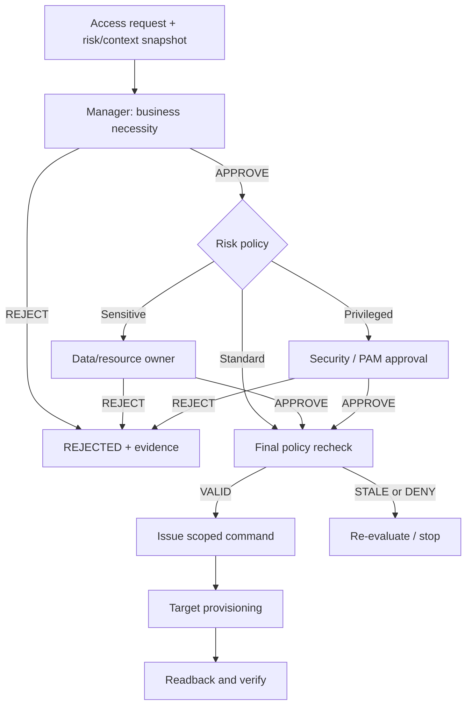
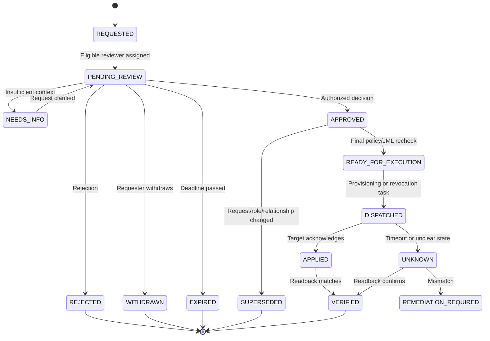
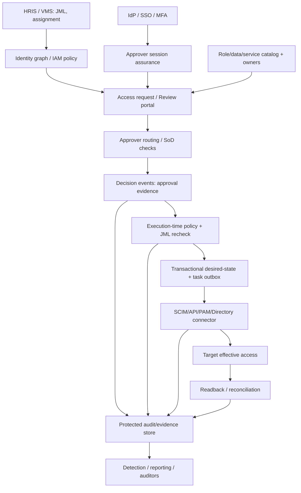
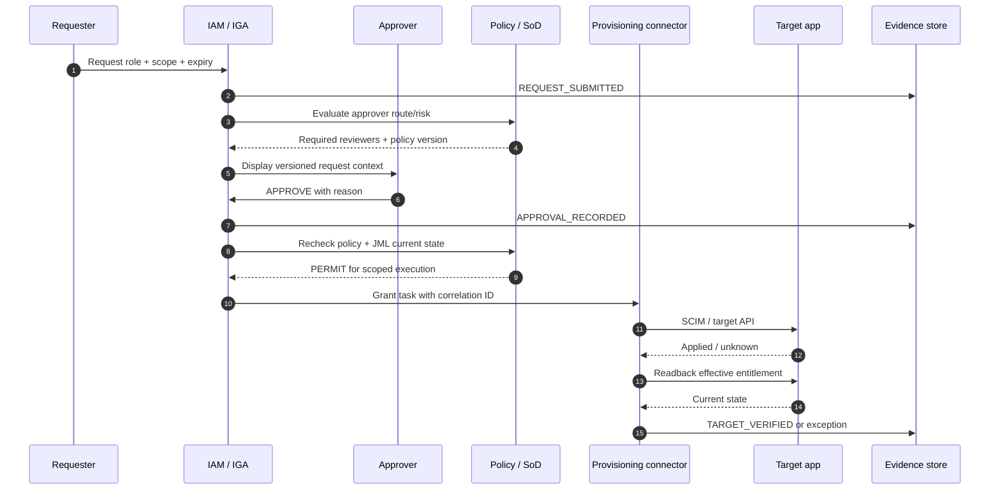

# Approval evidence trong kiểm toán vòng đời danh tính IAM

## 1. Approval evidence là gì?

**Approval evidence (bằng chứng phê duyệt)** là tập dữ liệu có thể kiểm tra lại để chứng minh **một yêu cầu hoặc quyết định liên quan đến danh tính/quyền truy cập đã được người hoặc cơ chế có thẩm quyền xem xét và quyết định theo chính sách tại một thời điểm xác định**.

Trong **Identity and Access Management (IAM)**, bằng chứng phê duyệt cần trả lời ít nhất:

- **Ai yêu cầu?** Người quản lý, nhân viên, service owner hay workflow có thẩm quyền?
- **Ai phê duyệt hoặc từ chối?** Định danh ổn định của approver và vai trò của họ.
- **Được xem nội dung gì?** Identity, account, role/permission, resource, tenant, phạm vi, thời hạn và lý do.
- **Dựa vào chính sách nào?** Policy, role definition, risk tier, SoD và các điều kiện hiệu lực.
- **Quyết định gì, lúc nào?** APPROVE, REJECT, REQUEST_INFO, DELEGATE, WITHDRAW hoặc EXPIRE.
- **Quyết định có còn hợp lệ khi thực thi không?** Quan hệ Joiner–Mover–Leaver (JML), owner, policy và quyền có thay đổi không?
- **Thực tế ra sao?** Hệ thống đích đã cấp/thu hồi quyền hay vẫn đang chờ hoặc thất bại?
- **Có thể truy xuất và tin cậy bằng chứng không?** Audit trail, provenance, integrity và kiểm soát quyền truy cập.

Ví dụ: trưởng bộ phận phê duyệt cho Linh quyền `finance_report_exporter` trong ba ngày để kết sổ. Một dòng `approved=true` không đủ: kiểm toán viên cần biết **người phê duyệt có thẩm quyền với báo cáo ấy không, quyền export nào đã được duyệt, có xung đột SoD không, ngày hết hạn nào, và quyền thực tế có bị gỡ khi hết hạn không**.

Bài học thuộc chương **Identity audit** của module **SECURITY_IDENTITY_ACCESS_MANAGEMENT_IDENTITY_LIFECYCLE**, gắn với mô hình **Joiner–Mover–Leaver**, IdP, SSO, SCIM, RBAC/ABAC, tài khoản dịch vụ, kiểm toán và giảm **quyền truy cập tồn dư**.

**Nguyên tắc:** *Approved* không đồng nghĩa *authorized under current policy*, không đồng nghĩa *provisioned*, và cũng không đồng nghĩa *effective access verified*.

## 2. Phân biệt approval, authorization, execution và attestation

| Khái niệm | Câu hỏi | Đầu ra | Giới hạn |
|---|---|---|---|
| **Request** | Ai cần gì và vì sao? | Request có scope, reason, target | Chưa có quyền |
| **Approval decision** | Người có thẩm quyền có đồng ý không? | APPROVED/REJECTED có evidence | Chưa chắc policy cho phép thực thi |
| **Authorization** | Theo chính sách hiện hành, hành động có được phép không? | PERMIT/DENY từ policy enforcement | Chưa chắc target đã đổi |
| **Execution** | Connector/administrator đã cố thực hiện gì? | Task, API response, retry | HTTP thành công chưa đủ |
| **Reconciliation** | Trạng thái thực tế khớp desired state không? | VERIFIED/PARTIAL/UNVERIFIED | Phụ thuộc độ phủ quan sát |
| **Attestation/recertification** | Quyền đang có có còn cần không? | KEEP/REVOKE/MODIFY và evidence | Quyết định REVOKE không tự gỡ quyền |
| **Audit evidence** | Có thể chứng minh chuỗi quyết định và kết quả không? | Provenance và immutable record phù hợp | Không thay kiểm soát truy cập |

Một approval hợp lệ có thể **bị vô hiệu trước khi thực thi**: nhân viên trở thành Leaver, người phê duyệt mất thẩm quyền, policy đổi, role bị deprecate hoặc yêu cầu đã hết hạn.

### 2.1. Approval evidence không chỉ là ảnh chụp màn hình

Ảnh nút “Approve” không chứng minh đầy đủ người nhấn là ai, request đã được hiển thị đủ hay không, role version nào được duyệt và thay đổi có được thực thi. Cần **structured evidence** cùng sự kiện xác thực và chuỗi thay đổi nghiệp vụ.

## 3. Vì sao cần approval evidence?

Các lỗi điển hình nếu không quản trị bằng chứng:

1. Người quản lý duyệt role kỹ thuật mà không biết role có quyền `export_all`.
2. Một admin tự yêu cầu và tự phê duyệt quyền superuser.
3. Approver đã chuyển phòng ban nhưng vẫn còn trong danh sách duyệt.
4. Yêu cầu được duyệt cho tenant A nhưng worker cấp quyền ở tenant B.
5. Ticket được duyệt trước Leaver, job retry cấp role sau Leaver.
6. Approval hết hạn nhưng entitlement được giữ lâu hơn thời hạn.
7. Một reviewer quyết định REVOKE nhưng connector SaaS chưa thực thi.
8. Phê duyệt qua email/chat khó chứng minh nội dung và danh tính người chấp thuận.
9. Quyền PAM/JIT được kích hoạt không có lý do hoặc hậu kiểm.
10. Chính sách approval bị sửa sau quyết định khiến không xác định được rule đã dùng.
11. Workflow lưu mỗi status cuối, làm mất vết REJECTED rồi bị override.
12. Bản export audit chứa token hoặc dữ liệu nhân sự nhạy cảm.

**Mục tiêu** không phải tạo nhiều giấy tờ hơn, mà tạo **bằng chứng tin cậy, đúng phạm vi, truy vết được và gắn với quyền hiệu lực**.

## 4. Những quyết định IAM thường cần bằng chứng phê duyệt

| Hành động | Chủ thể phê duyệt có thể phù hợp | Evidence quan trọng |
|---|---|---|
| Cấp business role | Line manager hoặc business owner | Nhiệm vụ, hiệu lực, role scope |
| Quyền đọc/xuất dữ liệu nhạy cảm | Data/resource owner | Data classification, tenant, lý do |
| Role quản trị IdP/cloud | Security/PAM owner theo policy | Risk, SoD, MFA/step-up, TTL |
| Thêm member privileged group | Role/group owner độc lập | User, group ID, effective permission |
| Tạo OAuth client secret/API key | Service owner, security policy | Workload purpose, scope, issuer |
| Đổi RBAC/ABAC/PBAC policy | Policy owner/change authority | Version, diff, impact analysis |
| Mover giữ quyền cũ có hạn | Old/new business owner | Multiple assignments, expiry |
| Leaver exception | Authority được policy chỉ định | Legal/operational basis, controls |
| Approve SCIM remediation | Owner của hệ thống đích | Target, account, operation, verification |
| Access recertification KEEP | Manager/data/role owner | Quyền thực tế, lý do còn cần |
| Access recertification REVOKE | Reviewer có thẩm quyền | Revoke decision + task/target evidence |
| Break-glass | Emergency policy, hậu kiểm độc lập | Incident, session, privilege, post-review |
| Non-human account owner transfer | Service owner/technical authority | Workload continuity, credential risk |
| Audit retention/trust change | Governance/security authority | SoD, retention policy, signed change |

**Không phải mọi tác vụ low-risk cần người bấm duyệt.** Policy có thể cho phép **auto-approval có kiểm soát**, nhưng cần chứng minh **rule/version, dữ liệu đầu vào, giới hạn rủi ro và quyết định của hệ thống**.

## 5. Các vai trò: requester, approver, owner, executor

| Vai trò | Ý nghĩa | Ví dụ |
|---|---|---|
| **Requester** | Người/workflow khởi tạo nhu cầu | Manager gửi yêu cầu cấp role |
| **Beneficiary / subject** | Danh tính nhận hoặc mất quyền | Nhân viên Linh |
| **Approver** | Người có quyền xác nhận/khước từ nhu cầu | Data Owner |
| **Role/resource owner** | Người chịu trách nhiệm quyền hoặc dữ liệu | Finance Controller |
| **Delegate** | Người thay approver theo phạm vi ủy quyền | Phó nhóm được ủy quyền |
| **Policy decision point (PDP)** | Engine đánh giá có cho phép không | IAM policy service |
| **Executor** | Admin hoặc worker thực hiện lệnh | `iga-scim-worker` |
| **Target authority** | Hệ thống lưu trạng thái quyền thực | SaaS/Directory/PAM |
| **Verifier/reconciler** | Đọc lại trạng thái và ghi nhận bằng chứng | Reconciliation worker |
| **Auditor** | Kiểm tra bằng chứng với quyền đọc phù hợp | Internal Audit/Security |

### 5.1. Không gộp tất cả thành actor=system

Nếu một automation thực thi:

```text
requested_by = I-2001
approved_by  = I-3100
decision_by  = POLICY-ENGINE-v12
executed_by  = NHA-SCIM-WORKER
beneficiary  = I-1042
target       = finance-saas / acct-1042
```

Các principal này **không thể thay nhau**. Người tạo bot trước đây cũng không tự động chịu trách nhiệm cho mọi thao tác bot thực hiện hôm nay.

## 6. Bằng chứng của yêu cầu gốc (request evidence)

Một yêu cầu cần đủ thông tin để approver hiểu **đang chấp thuận thay đổi gì**.

Tối thiểu:

- `request_id`, loại hành động: GRANT/REVOKE/MODIFY/EXCEPTION.
- `requester_identity_id`, `beneficiary_identity_id`.
- `target_system_id`, `target_account_id` và `tenant_id`.
- Role/entitlement/permission ID, **version**, phạm vi resource/action.
- Business justification và nhiệm vụ liên quan.
- Start/end time hoặc điều kiện hết hiệu lực.
- Current entitlements và grant path khi hữu ích.
- Risk tier, dữ liệu nhạy cảm, SoD findings.
- Source event/ticket/JML assignment ID nếu có.
- Thời điểm tạo request và snapshot policy/context.
- Các tài liệu hỗ trợ có **reference được bảo vệ**, không đính kèm secret.

### 6.1. Request không được mơ hồ

```text
Kém: Cấp quyền Finance cho Linh.
Tốt: Cấp finance_report_reader@v3 cho I-1042,
     target reports-saas, tenant-company/project-F,
     action report:read, từ 08:00 25/11 đến 18:00 30/11,
     reason=MONTH_END_CLOSING, request=AR-00123.
```

Không cần hiển thị mọi trường kỹ thuật lên UI cùng lúc, nhưng **quyết định phải ràng buộc với một đối tượng/scope có thể xác định được**.

## 7. Bằng chứng danh tính và phiên của approver

Một approval click chỉ có giá trị nếu actor được xác thực và liên kết đúng.

Những trường hữu ích:

| Trường | Điều chứng minh |
|---|---|
| `approver_identity_id` | Principal ổn định đưa ra quyết định |
| `issuer_id` / `tenant_id` | Định danh thuộc nguồn/tenant nào |
| `authn_session_ref` | Tham chiếu phiên đã được xác thực |
| `authn_time` | Mốc xác thực |
| `auth_method_context` | Phương thức/assurance đáp ứng |
| `mfa_satisfied` | Điều kiện MFA theo chính sách |
| `step_up_event_ref` | Step-up cho quyết định đặc quyền nếu yêu cầu |
| `client_app_id` | Portal/CLI/API dùng để phê duyệt |
| `decision_channel` | UI, workflow engine, delegated API |
| `decision_at` | Thời điểm người/engine chốt quyết định |

### 7.1. MFA không tự tạo quyền phê duyệt

Approver có MFA mạnh nhưng **không phải data owner** thì vẫn không được cấp quyền xuất báo cáo nhạy cảm. Ngược lại, data owner có thẩm quyền nhưng phiên không đạt yêu cầu bảo mật có thể phải thực hiện step-up.

### 7.2. Không lưu secret làm bằng chứng

Không ghi OTP, recovery code, passkey private key, access token, refresh token hoặc cookie. Lưu **bằng chứng đã kiểm tra** và session/event reference, không lưu credential có thể bị tái sử dụng.

## 8. Kiểm tra thẩm quyền approver tại thời điểm quyết định

Một người chỉ được phép phê duyệt khi policy công nhận họ có thẩm quyền đối với **loại hành động và resource** tương ứng.

Ví dụ:

- Manager được phê duyệt nhu cầu nghiệp vụ của nhân viên trực thuộc.
- Data Owner được phê duyệt xuất dữ liệu của domain họ quản lý.
- Application Owner hiểu technical role của ứng dụng.
- Privileged Access Owner/Security kiểm tra quyền admin.
- Service Owner phê duyệt scope cho NHA/workload.
- HR/VMS sponsor xác nhận contractor/guest còn quan hệ hợp lệ.

### 8.1. Context cần kiểm tra

```text
is_valid_approver =
    approver.status == ACTIVE
    AND approver.authority.includes(resource, action)
    AND delegation.valid_at(decision_time)
    AND NOT violated_separation_of_duties(...)
    AND required_authentication_assurance_met
```

Đây là công thức **khái niệm**. Thực tế phụ thuộc policy và nhiều approval stages.

### 8.2. Evidence về authority

Ghi **approver role/authority source**, organizational assignment, role ownership version, delegation ID và policy version tại thời điểm quyết định. Tên chức danh trong email không đủ chứng minh quyền phê duyệt.

## 9. Delegated approval: ủy quyền có giới hạn

Một approver có thể ủy quyền xử lý khi nghỉ phép hoặc chuyển công tác.

Một delegation hợp lệ cần:

- `delegation_id`, người ủy quyền và người được ủy quyền.
- Scope: ứng dụng, role, resource, tenant và action.
- `valid_from` / `valid_until`.
- Điều kiện không được chuyển quyền tiếp.
- Quy tắc SoD và self-approval vẫn áp dụng.
- Approver/delegator còn active theo policy.
- Audit về việc tạo, sửa, thu hồi và sử dụng delegation.

### 9.1. Đừng ủy quyền rộng hơn quyền gốc

Một manager có quyền phê duyệt role read-only không thể ủy quyền cho người khác phê duyệt `production_superadmin` chỉ bằng một thao tác “delegate all”.

### 9.2. Delegation hết hạn giữa request và decision

Nếu quyền ủy quyền hết hạn **trước khi decision được chốt**, không được dùng snapshot cũ để cho phép. Nếu delegation hết hạn **sau khi một approval hợp lệ đã được ghi**, cần đánh giá riêng điều kiện còn hiệu lực của decision khi thực thi theo policy.

### 9.3. Không tự động phê duyệt khi người chịu trách nhiệm vắng mặt

Khi không có approver hợp lệ, workflow nên **re-route, escalate hoặc timeout có kiểm soát**, không mặc định APPROVED.

## 10. Separation of Duties (SoD) và chống self-approval

**SoD** ngăn một principal kiểm soát nhiều bước nhạy cảm có thể tạo xung đột lợi ích.

Ví dụ cần chặn:

- Người yêu cầu tự phê duyệt role admin của mình.
- Người tự tạo nhà cung cấp đồng thời duyệt thanh toán nếu policy cấm.
- Admin tự thay policy rồi duyệt quyền theo policy vừa nới.
- Người approve exception cũng là người duy nhất xác minh việc tuân thủ.
- Delegate được dùng để đi vòng SoD.

### 10.1. SoD được kiểm tra ở nhiều thời điểm

1. Khi chọn approver.
2. Khi người dùng mở màn hình quyết định.
3. Khi quyết định được ghi bền vững.
4. Khi lệnh cấp quyền được thực thi.
5. Khi quyền thực tế được reconciliation.

SoD có thể là **static** (không đồng sở hữu hai role) hoặc **dynamic** (không cùng thực hiện hai bước trong một giao dịch), tùy hệ thống.

### 10.2. Bằng chứng phải ghi cả quyết định bị từ chối

Event `APPROVAL_DENIED_BY_SOD` có giá trị điều tra. Không ghi như thể approver đã đồng ý, cũng không xóa attempt khỏi audit chỉ vì nó thất bại.

## 11. Chọn approver theo rủi ro và loại quyền

| Quyền / tình huống | Reviewer phù hợp | Điểm bằng chứng ưu tiên |
|---|---|---|
| Business role nền ít rủi ro | Rule auto/manager nếu policy cho phép | Approved rule/version, input context |
| Export dữ liệu nhạy cảm | Data owner độc lập | Data classification, resource scope |
| Role quản trị IAM/IdP | Privileged authority/Security | Step-up, SoD, PAM policy |
| Cloud production admin | Cloud resource owner + security tùy policy | Environment, TTL, impact |
| Contractor guest | Sponsor + resource owner nếu cần | Contract end, tenant, expiry |
| Service account API credential | Service owner/target owner | Workload identity, action/scope |
| Policy RBAC/ABAC change | Policy owner/change control | Diff, tests, blast radius |
| Emergency break-glass | Emergency mechanism + hậu kiểm | Incident, time bound, session |
| Recertification KEEP | Manager/role owner | Effective permissions, reason |
| Recertification REVOKE | Owner/reviewer có thẩm quyền | Decision, remediation, readback |

**Không phải một manager nào cũng hiểu technical entitlement**. UI và evidence phải thể hiện business role, effective permissions, tenant và sensitivity, hoặc chia nhiều lớp review.

## 12. Phê duyệt nhiều bước, quorum và thứ tự

Một access request nhạy cảm có thể cần:

1. Manager xác nhận **nhu cầu công việc**.
2. Data Owner xác nhận **quyền vào dữ liệu**.
3. Security xác nhận **rủi ro và SoD**.
4. PAM/Platform xác nhận **cách cấp đặc quyền**.

### 12.1. Chuỗi và song song



Một số hệ thống yêu cầu **tất cả approvers (AND)**, một số có quorum **k trên n** hoặc hai nhánh độc lập. Phải định nghĩa chính xác, không lấy “ít nhất một APPROVE” cho mọi trường hợp.

### 12.2. Evidence cho từng stage

Mỗi stage có `stage_id`, policy/approver selection, decision, decision time, comment/reason và outcome. Final decision cần ghi **các stage bắt buộc đã hoàn tất** tại version tương ứng.

### 12.3. Không ghép decision của hai request khác nhau

Khi request bị sửa resource/scope sau stage một, approval cũ có thể **không còn ràng buộc với nội dung mới**. Workflow cần invalidate/re-request phù hợp, không cộng approval của request A vào request B.

## 13. Vòng đời của một approval decision



**State machine minh họa**, không phải trạng thái chuẩn của mọi sản phẩm. Approval workflow có thể hỗ trợ sửa, rút, hết hạn, re-open, escalation và exception theo policy.

### 13.1. Không viết đè lịch sử

Nếu request được APPROVED rồi WITHDRAWN trước khi cấp quyền, cần giữ **cả hai events** và current status. Không sửa dòng decision lịch sử thành “chưa từng được duyệt”.

## 14. Kiến trúc tham chiếu quản lý approval evidence



### 14.1. Lưu evidence và provisioning task có thể ở hệ thống khác

Không cần mọi thành phần chung một database. Quan trọng là **source event, request ID, decision ID, correlation ID, immutable history, policy version và target verification reference** nối được với nhau.

## 15. Schema dữ liệu cho approval evidence

| Nhóm | Trường tham khảo | Ý nghĩa |
|---|---|---|
| Request | `request_id`, `request_version`, `submitted_at` | Nhận dạng đề nghị |
| Subject | `beneficiary_id`, `relationship_id`, `tenant_id` | Người hoặc workload bị tác động |
| Scope | `resource_id`, `role_id`, `role_version`, `action` | Chính xác quyền nào |
| Reason | `justification_ref`, `reason_code` | Căn cứ nghiệp vụ |
| Initiator | `requester_id`, `request_source` | Ai đề nghị |
| Decision | `approval_id`, `stage_id`, `decision` | Quyết định nào |
| Approver | `approver_id`, `authority_ref`, `delegation_id` | Thẩm quyền |
| Session | `authn_event_ref`, `step_up_ref` | Bảo đảm actor |
| Policy | `policy_id`, `policy_version`, `sod_result` | Quy tắc đã áp |
| Times | `decided_at`, `valid_from`, `expires_at` | Hiệu lực |
| Governance | `exception_id`, `compensating_controls` | Ngoại lệ có giới hạn |
| Execution | `task_id`, `operation_id`, `target_system_id` | Thực thi |
| Verification | `verified_at`, `evidence_ref`, `coverage` | Tác động đã quan sát |
| Integrity | `event_id`, `record_version`, `integrity_ref` | Truy vết và kiểm tra |
| Linkage | `correlation_id`, `causation_id`, `source_event_id` | Chuỗi nghiệp vụ |

**Một schema không nên có field yêu cầu lưu raw password, OTP, token, private key hoặc bản sao giấy tờ chỉ vì “kiểm toán cần mọi dữ liệu”.**

## 16. Ví dụ JSON của một approval decision

```json
{
  "event_id": "APP-EVT-2026-1123-091",
  "schema_version": "1.0",
  "event_type": "ACCESS_APPROVAL_DECIDED",
  "correlation_id": "CORR-AR-0191",
  "request_id": "AR-0191",
  "request_version": 3,
  "stage_id": "DATA_OWNER_REVIEW",
  "decision": "APPROVED",
  "decided_at": "2026-11-23T09:15:00Z",
  "approver": {
    "identity_id": "I-3100",
    "tenant_id": "tenant-company",
    "authority_ref": "DATA-OWNER-FINANCE-v4",
    "delegation_ref": null,
    "authn_event_ref": "AUTH-EVT-441",
    "step_up_ref": "STEPUP-055"
  },
  "request": {
    "requester_id": "I-2001",
    "beneficiary_id": "I-1042",
    "target_system_id": "reports-saas",
    "target_account_id": "reports-user-1042",
    "tenant_id": "tenant-company",
    "entitlement_id": "finance_report_exporter",
    "entitlement_version": "v3",
    "resource_scope": "finance/project-f",
    "operation": "GRANT",
    "valid_until": "2026-11-30T18:00:00Z",
    "justification_ref": "BUSINESS-CASE-221"
  },
  "checks": {
    "policy_id": "FINANCE-EXPORT-ACCESS",
    "policy_version": "v12",
    "sod_result": "PASS",
    "subject_relationship_status": "ACTIVE"
  },
  "result": "APPROVAL_RECORDED",
  "provisioning": {
    "status": "NOT_YET_DISPATCHED",
    "verification_ref": null
  }
}
```

Đây là **dữ liệu giả định** và **schema minh họa**, không phải chuẩn bắt buộc. Event ghi **approval đã được lưu**, chưa ghi `ACCESS_VERIFIED`. Không lưu `Authorization` header hoặc nội dung token chứng minh phiên.

## 17. Bằng chứng phải gắn với request snapshot và version

Approval chỉ có ý nghĩa đối với **nội dung approver đã xem**.

Ví dụ:

```text
Request v1: role=report_reader, scope=project-P1
Approver: APPROVED v1

Request v2: role=report_exporter, scope=all_projects
Action: requester edited before provisioning

Required behavior:
  Re-evaluate/re-approve v2 according to policy.
  Do not reuse v1 approval for expanded entitlement.
```

### 17.1. Snapshot nên bao gồm

- Role/entitlement definition version.
- Scope/resource/tenant chính xác.
- Effective permission summary và risk tier.
- Policy/approval workflow version.
- SoD status.
- Identity/HR relationship và authority source version.
- Requested start/end, business purpose.
- Danh sách các stage bắt buộc.

### 17.2. Snapshot không thay current-state check

Snapshot lưu **những gì đã được duyệt**. Trước thực thi phải kiểm tra **nguồn trạng thái hiện hành**; approval cũ không thể giữ quyền sau Leaver hoặc khi policy đã cấm.

## 18. Policy version và “đúng theo luật nào?”

Một decision có thể hợp lệ ngày 01/11 theo `POLICY-v5`, nhưng ngày 15/11 policy thay thành `v6` cấm role ấy.

Admin evidence cần lưu:

1. `policy_id` và `policy_version` khi request/decision.
2. Input attributes và SoD/role mapping version tại thời điểm đó.
3. Quy tắc xử lý **policy change before execution**.
4. Source of truth cho trạng thái JML hiện hành.
5. Ai thay policy và change approval/audit của policy.
6. Cơ chế tạo review mới nếu entitlement/risk thay đổi.

### 18.1. Không mặc định mọi approval cũ đều “sai” khi policy đổi

Chính sách có thể có **quy định chuyển tiếp** rõ ràng. Tuy nhiên hệ thống phải đánh giá điều kiện chuyển tiếp **đã được phê duyệt**, không tùy ý tiếp tục dùng approval cũ.

### 18.2. Role–Permission mapping có blast radius lớn

Một role `finance_reader` có thể được mở rộng thêm `report:export` sau khi các user đã được cấp role. Approval cũ cho role version read-only **không tự là bằng chứng approver đã đồng ý quyền export mới**. Cần impact analysis và role governance.

## 19. Approval expiry, hiệu lực và time-bound access

Một approval có thể có **hạn được sử dụng để thực thi**, còn entitlement đã cấp có **hạn hiệu lực riêng**.

| Mốc | Ý nghĩa |
|---|---|
| `requested_at` | Yêu cầu được tạo |
| `decided_at` | Approver quyết định |
| `approval_expires_at` | Sau mốc này không được dùng approval để thực thi nếu policy yêu cầu |
| `access_valid_from` | Bắt đầu cho phép quyền |
| `access_expires_at` | Quyền phải hết hiệu lực |
| `task_dispatched_at` | Connector được gọi |
| `target_applied_at` | Target xác nhận cập nhật |
| `verified_at` | Đã đọc lại quyền |
| `exception_expires_at` | Ngoại lệ hết thời hạn |

### 19.1. Tránh “phê duyệt một lần, dùng vĩnh viễn”

Một approval cho quyền production trong ca trực không nên trở thành căn cứ cấp lại quyền sau nhiều tháng chỉ vì ticket vẫn ở trạng thái APPROVED.

### 19.2. Hết hạn entitlement cần enforcement

Ghi `access_expires_at` trong form nhưng không có job thu hồi hoặc policy PEP thực thi expiry thì quyền vẫn còn. Bằng chứng cần nối **expiration trigger → revoke task → target readback**.

## 20. APPROVE, REJECT, REQUEST_INFO, WITHDRAW và EXCEPTION

| Decision | Ý nghĩa | Bằng chứng nên ghi |
|---|---|---|
| **APPROVE** | Đồng ý trong scope và điều kiện nhất định | Authority, scope, lý do, thời gian |
| **REJECT** | Không cho phép nhu cầu đề nghị | Reviewer, reason code, context |
| **REQUEST_INFO** | Chưa đủ dữ liệu để quyết định | Trường còn thiếu, người cung cấp, deadline |
| **WITHDRAW** | Request bị chủ thể có quyền rút | Actor, thời gian, trạng thái cấp quyền |
| **EXPIRE** | Review/request hết hạn chưa được chốt | Deadline, escalation, kết quả |
| **DELEGATE** | Chuyển quyền xem xét có giới hạn | Delegation authority và validity |
| **EXCEPTION_REQUEST** | Xin cho phép ngoài policy thông thường | Risk/compensating controls/expiry |
| **AUTO_APPROVE** | Rule hệ thống quyết định trong phạm vi | Rule ID/version, inputs, outcome |
| **OVERRIDE** | Vượt quy trình thông thường nếu được phép | Emergency authority, lý do và hậu kiểm |

### 20.1. Im lặng không phải đồng ý

Một reviewer không trả lời trước hạn **không nên tự được biến thành APPROVE** trừ khi có một cơ chế/phạm vi mặc định được policy quy định rõ và phù hợp rủi ro. Với quyền nhạy cảm, cách an toàn thường là escalation/deny pending review.

### 20.2. REJECT cũng cần audit

Đôi khi nhiều lần cố xin privileged role bị từ chối là tín hiệu hành vi đáng điều tra. Không chỉ lưu approvals thành công.

## 21. Approval evidence trong Joiner lifecycle

Khi một người gia nhập tổ chức, hệ thống có thể tạo identity và cấp role nền theo chính sách, rồi yêu cầu approval cho quyền bổ sung.

### 21.1. Chuỗi chứng cứ

```text
HRIS_JOINER_CONFIRMED
  -> IDENTITY_PROOFED
  -> IAM_ACCOUNT_CREATED
  -> BASELINE_ACCESS_RULE_EVALUATED
  -> SENSITIVE_ROLE_REQUESTED
  -> MANAGER_APPROVED
  -> DATA_OWNER_APPROVED
  -> SOD/POLICY_RECHECK_PASSED
  -> SCIM_ROLE_GRANT_DISPATCHED
  -> TARGET_ROLE_PRESENT_VERIFIED
```

### 21.2. Auto-provision baseline có cần approval evidence không?

Không nhất thiết cần người duyệt từng tài khoản nếu policy đã phê duyệt auto-provision. Nhưng cần chứng minh **baseline rule/version**, HR assignment, effective date, desired entitlements và verification. Đây là bằng chứng **policy-driven approval/authorization**, không được bịa thành approval thủ công của manager.

### 21.3. Pre-hire account không tự có quyền production

Một account được tạo trước ngày bắt đầu có thể chỉ phục vụ chuẩn bị thiết bị. Approval evidence cho quyền nghiệp vụ phải gắn **effective date**, không dùng việc account đã tạo làm căn cứ cấp mọi quyền sớm.

## 22. Approval evidence trong Mover lifecycle

Mover thay vị trí, phòng ban, dự án hoặc loại quan hệ thường cần **cấp role mới và gỡ role cũ**.

```text
Before: sales_report_exporter
After:  finance_report_reader

Actions:
  REVOKE sales_report_exporter
  GRANT finance_report_reader
```

### 22.1. Giữ quyền cũ tạm thời

Nếu nhân viên cần bàn giao trong bảy ngày, có thể có request giữ quyền cũ theo policy. Approval phải ghi **old role, resource scope, business justification, owner, new end date, SoD check và nhiệm vụ thu hồi sau hạn**.

### 22.2. Không thay đổi role mà giữ approval vô hạn

Nếu request ban đầu duyệt `finance_reader` nhưng task chạy với `finance_admin` do mapping sai, đây là **scope escalation**, phải bị chặn và ghi finding.

### 22.3. Multi-assignment

Một người có thể làm hai dự án hợp lệ. Khi một assignment kết thúc, quyền còn căn cứ từ assignment khác không nên bị gỡ bừa. Evidence cần chỉ rõ **grant provenance** và quan hệ nào được chứng nhận.

## 23. Approval evidence trong Leaver lifecycle

Khi HRIS/VMS/sponsor xác nhận Leaver, việc gỡ quyền phải được kích hoạt theo policy và thời điểm có hiệu lực.

### 23.1. Không đợi approval để thu hồi bắt buộc

Một sự kiện Leaver đã xác thực có thể là **nguồn thẩm quyền đủ để tự động revoke** account/role/token theo chính sách. Không tạo workflow yêu cầu một manager “duyệt cho nghỉ quyền” khiến offboarding bị treo.

Bằng chứng nên có:

- Source Leaver event ID/effective time.
- Identity/relationship IDs, target accounts.
- Policy quyết định disable/revoke.
- Tác vụ IdP/SCIM/PAM/token/session.
- Kết quả và phạm vi readback.
- Exception chưa xử lý có owner và hạn.

### 23.2. Nếu cần giữ quyền sau Leaver?

Chỉ có thể theo **cơ chế ngoại lệ được chính sách cho phép**, với authority rõ, scope/TTL tối thiểu, kiểm soát bù và audit độc lập. Approval khi còn làm việc **không tự kéo dài** sau ngày kết thúc quan hệ.

### 23.3. Ngăn stale approval

```text
08:00  Manager approves finance_reader
09:00  HRIS confirms Leaver effective immediately
09:05  Old provisioning worker attempts grant
Expected: DENY / SUPERSEDED, not GRANT.
```

Worker phải kiểm tra trạng thái **hiện hành** trước khi thực thi, ngay cả khi approval trước đó là thật.

## 24. Access request: evidence từ đề nghị tới quyền được cấp

Một access request có thể trải qua nhiều actor và hệ thống.



### 24.1. Không coi ticket đóng là quyền đã cấp

Một workflow ticket có thể ở trạng thái DONE nhưng target SCIM chưa phản ánh quyền. Evidence cần bao gồm **target operation và verification** thay vì chỉ kết quả duyệt.

## 25. Access review và recertification: attestation evidence

Trong recertification, reviewer xác nhận **quyền đang tồn tại có còn phù hợp hay không**, không phải phê duyệt một request cấp mới.

| Quyết định review | Evidence cần có | Hành động sau |
|---|---|---|
| **KEEP** | Quyền hiệu lực, role/scope, reviewer, lý do, snapshot | Attestation có hiệu lực có giới hạn |
| **REVOKE** | Quyền không còn cần, nguồn grant, reason | Target revoke + readback |
| **MODIFY** | Scope/role cần thay | Gỡ quyền cũ, cấp quyền mới có căn cứ |
| **INVESTIGATE** | Dữ liệu thiếu/mâu thuẫn | Owner, deadline, kiểm tra bổ sung |
| **EXCEPTION** | Quyền đặc biệt được giữ có hạn | Independent approval, compensating controls |

### 25.1. Không coi số lượng KEEP là bằng chứng mạnh

Một reviewer bấm KEEP hàng nghìn dòng không biết role là gì có thể là **rubber-stamping**. Nên hiển thị effective permission set, access usage khi đáng tin, risk, manager/owner và lịch sử Mover.

### 25.2. Review snapshot và trạng thái mới nhất

Reviewer cần biết đã xem **snapshot nào**. Nhưng trước khi thực thi REVOKE/MODIFY hoặc dùng KEEP làm căn cứ, hệ thống phải đối chiếu **current JML/policy/role version** để tránh quyết định lỗi thời.

## 26. Privileged access, PAM và JIT approval evidence

Quyền admin sản xuất có thể cần **request có thời hạn, step-up, phê duyệt độc lập và kiểm toán phiên**.

### 26.1. Phân biệt các giai đoạn

| Giai đoạn | Bằng chứng |
|---|---|
| Role **eligible** | Người đủ điều kiện xin quyền JIT |
| Role **activation requested** | Ai xin, tài nguyên, mục đích, TTL |
| Role **activation approved** | Authority, scope, SoD, step-up |
| Role **activated** | Target/PAM xác nhận trạng thái active |
| **Privileged session started** | Session/broker reference |
| **Session ended** | Kết thúc phiên theo cơ chế |
| **Privilege expired/revoked** | Policy TTL và target readback |

APPROVED không chứng minh session đã mở; PAM session ENDED không tự chứng minh **API key checkout hoặc quyền được gán độc lập** đã bị thu hồi.

### 26.2. Break-glass

Quyền khẩn cấp có thể không chờ đầy đủ pre-approval nếu policy cho phép. Evidence cần ghi **incident, actor, scope, thời gian, cảnh báo và hậu kiểm độc lập**. Không gán giả một approval diễn ra trước trong khi thực tế chỉ có hậu kiểm.

## 27. Non-human accounts và approval evidence của service identity

NHA/workload có thể cần quyền cloud, API key, mTLS certificate, DB role và vault secret.

### 27.1. Ai phê duyệt?

- Business/service owner xác nhận workload còn purpose.
- Target/data owner xác nhận resource/action scope.
- Security/Platform đánh giá trust/credential/risk.
- Quản trị đặc quyền áp SoD/JIT theo policy.
- Automation có thể áp **preapproved rule**, không cần email approval cho mỗi token ngắn hạn.

### 27.2. Bằng chứng cho credential issuance

```text
service_identity_id = svc-report-sync
request            = Issue API credential for reports API
scope              = report:read, tenant-company
approved_by        = service-owner and resource-owner
credential_ref     = prod/report-sync/client-key-v3
issued_by          = trusted-issuer
result             = ISSUED, not "all access verified"
```

**Không đưa API key, password, private key hoặc bearer token vào evidence**. Lưu credential ref, version, issuer, quyền và ngày hết hạn.

### 27.3. Owner Mover/Leaver

Khi kỹ sư quản lý NHA nghỉ việc, evidence phải chứng minh **quyền quản trị cá nhân được thu hồi**, owner service được chuyển hợp lệ và credential từng có nguy cơ lộ được đánh giá/rotate. Không tự xóa workload sản xuất còn hợp lệ.

## 28. IdP, MFA, SSO và phiên phê duyệt

Approval portal thường sử dụng IdP/SSO, nhưng **đăng nhập thành công** chỉ là một phần của quyết định.

| Thành phần | Vai trò với approval evidence | Không tự chứng minh |
|---|---|---|
| **IdP** | Identity, authentication event, account status | Approver có thẩm quyền với resource |
| **SSO/SAML/OIDC** | Session hoặc claims từ authentication flow | Nội dung request đã được xem/duyệt |
| **MFA/step-up** | Assurance cho hành động nhạy cảm | Decision không vi phạm SoD |
| **RBAC** | Vai trò quản trị/approver | Delegation còn hiệu lực |
| **ABAC/PBAC** | Scope, risk, tenant và policy conditions | Target thực tế đã cấp/gỡ quyền |
| **SCIM/API** | Provisioning/remediation | Approval đã hợp lệ |
| **PAM** | Privileged activation/session evidence | Các đường privileged khác đã bị thu hồi |

### 28.1. Không lưu SSO token làm bằng chứng

Lưu `authn_event_ref` hoặc `session_ref` có bảo vệ; không xuất raw ID token, refresh token hay SAML assertion vào audit package.

### 28.2. Phiên approver bị thu hồi

Nếu admin bị disable hoặc phiên bị compromise trong lúc review, hệ thống cần **chặn quyết định mới và xem xét các quyết định khả nghi** theo runbook. Không suy từ log portal 200 rằng mọi approval đều hợp lệ.

## 29. SCIM/API: approval evidence nối với target provisioning

Ví dụ connector sau approval hợp lệ cần gỡ một thành viên khỏi SCIM group:

```http
PATCH /scim/v2/Groups/group-finance-export HTTP/1.1
Host: scim.example.org
Authorization: Bearer <redacted-token>
Content-Type: application/scim+json

{
  "schemas": ["urn:ietf:params:scim:api:messages:2.0:PatchOp"],
  "Operations": [
    {
      "op": "remove",
      "path": "members[value eq \"target-user-1042\"]"
    }
  ]
}
```

Đây là **ví dụ minh họa**: target cần hỗ trợ SCIM Group PATCH/filter tương ứng. Raw Authorization header không được lưu trong bằng chứng.

### 29.1. Các mốc cần ghi

```text
REQUEST_APPROVED
  -> IAM_DESIRED_ROLE_REMOVED
  -> SCIM_PATCH_DISPATCHED
  -> SCIM_PATCH_APPLIED
  -> SCIM_GROUP_MEMBERSHIP_ABSENT_VERIFIED
  -> TARGET_EFFECTIVE_PERMISSION_RECHECKED
```

### 29.2. Role local có thể vẫn còn

SaaS có thể có **direct role, local group, token hoặc session** không nằm trong SCIM. Vì vậy approval evidence và remediation package phải nêu rõ **coverage**, không tự kết luận mọi quyền đã mất khi một membership được gỡ.

## 30. Approval evidence và effective access: kết thúc ở đâu?

Phân biệt bốn mức bằng chứng:

| Mức | Mô tả | Ví dụ |
|---|---|---|
| **Decision evidence** | Người/engine có thẩm quyền đã chấp thuận | APPROVED + policy version |
| **Command evidence** | IAM đã gửi thao tác | Task/SCIM PATCH dispatched |
| **Target state evidence** | Target trả/đọc được trạng thái thay đổi | Account `active=false` |
| **Effective access evidence** | Quyền thực sự bị giới hạn trong phạm vi đã xác minh | Role local vắng mặt, API denied theo policy |

### 30.1. Không coi APPROVED là dấu chấm hết

Một quyết định giữ/thu hồi quyền có thể dẫn tới hàng loạt tác vụ tại IdP, SaaS, PAM và credential issuers. **Evidence package cuối phải chỉ ra phần đã xác minh, phần chưa và người xử lý tiếp**.

### 30.2. Xác minh phải an toàn

Không thử quyền production bằng giao dịch phá hủy để xem có bị chặn không. Có thể dùng **read-only access inspection, non-destructive authorization probes, target API readback** và các kiểm chứng được phê duyệt.

## 31. Stale approval, TOCTOU và kiểm tra tại thời điểm thực thi

**Time-of-check vs time-of-use (TOCTOU)** xảy ra khi điều kiện được duyệt không còn đúng vào lúc connector thực thi.

Ví dụ:

```text
09:00 Manager APPROVES production_reader for I-1042
09:03 HRIS marks I-1042 as LEAVER
09:05 Queue worker receives the earlier grant
09:05 Expected: SUPERSEDED / DENY, not GRANT
```

### 31.1. Cơ chế giảm rủi ro

1. Gắn `request_version`, `policy_version`, `role_version`.
2. Trước GRANT, đọc current identity relationship/entitlements.
3. Kiểm tra approval chưa expired/withdrawn/revoked.
4. Kiểm tra actor authority và điều kiện SoD nếu policy yêu cầu hiệu lực tiếp tục.
5. Kiểm tra request vẫn gắn đúng account/tenant.
6. Ngăn grant nếu role definition đã đổi ngoài scope phê duyệt.
7. Dùng optimistic concurrency và idempotency.
8. Đánh dấu `SUPERSEDED` khi JML/policy mới đã phủ định yêu cầu.
9. Lưu event vì sao việc thực thi bị chặn.
10. Không replay stale grant sau Leaver hoặc service decommission.

### 31.2. Bằng chứng cũ vẫn cần giữ

Quyết định APPROVE cũ có thể là sự kiện lịch sử **đúng ở thời điểm nó xảy ra**; khi bị superseded, ghi một event mới thay vì xóa/sửa sự thật cũ.

## 32. Retry, duplicate approval và concurrency

Các tình huống phổ biến:

- Người duyệt bấm hai lần do giao diện chậm.
- Mobile và web cùng gửi cùng một quyết định.
- Approver A đồng ý trong khi approver B từ chối.
- Approval callback được gửi lại từ queue.
- Connector timeout rồi retry.
- Request bị chỉnh version trong lúc reviewer đang mở form.

### 32.1. Biện pháp

- Mỗi `decision_event_id` duy nhất, liên kết `request_id + version + stage`.
- Idempotency key với thao tác chốt decision nếu hỗ trợ.
- State transition dùng **compare-and-swap/transaction**.
- Không cho decision đồng thời tạo trạng thái cuối mâu thuẫn.
- Multi-stage workflow định nghĩa rõ rule ALL/ANY/quorum/ordering.
- Mỗi retry phải lưu attempt mới nếu có ý nghĩa, không tự phát grant hai lần.
- Khi timeout, đọc lại decision/target state trước khi ghi/thi hành thêm.
- Lưu audit event **ngay cả khi request bị conflict** (với privacy controls).

### 32.2. Approval spam và social engineering

Người dùng liên tục gửi yêu cầu tới nhiều approvers để hy vọng ai đó bấm “đồng ý” là một tín hiệu abuse. Cần rate limit, clear owner routing, decision context và detection; không biến một approval ngẫu nhiên thành bypass SoD.

## 33. Phê duyệt qua email/chat/ticket có đủ bằng chứng không?

**Có thể dùng làm nguồn bổ sung**, nhưng độ tin cậy tùy cách xác thực actor, liên kết request, giữ nguyên nội dung và bảo vệ chống giả mạo.

### 33.1. Các câu hỏi kiểm tra

- Địa chỉ email có thật sự thuộc approver, hay bị spoof/forward?
- Approver đã xem đúng **request version và resource scope** chưa?
- Một nút trong email có bị click nhầm/CSRF/phishing không?
- Có MFA/step-up khi quyền nhạy cảm không?
- Nội dung quyết định có được ghi vào audit store dưới identity đáng tin không?
- Ticket bị chỉnh sau khi phê duyệt có làm mất snapshot không?
- Có phân biệt “đã đọc” với “đồng ý” không?

### 33.2. Hướng triển khai tốt hơn

Gửi notification chứa **request reference**, nhưng yêu cầu approver mở portal được xác thực và xem **versioned decision context** trước khi quyết định đối với quyền rủi ro cao.

### 33.3. Không tuyên bố mọi “Approve” là chữ ký số

Một thao tác click có thể tạo audit evidence, nhưng **không tự tương đương chữ ký số có khả năng chống chối bỏ theo mọi cơ chế pháp lý**. Nếu cần e-signature có giá trị cụ thể, phải áp tiêu chuẩn, key/identity binding và quy định áp dụng.

## 34. Tính toàn vẹn của approval evidence

Approval evidence cần chống mất mát, chỉnh sửa hoặc xóa trái phép.

Các lớp kiểm soát:

| Biện pháp | Mục đích | Giới hạn |
|---|---|---|
| Append-only events | Giữ lịch sử decision/transitions | Producer vẫn có thể gửi dữ liệu sai |
| Transactional outbox | Giảm mất event khi DB commit rồi process crash | Cần xử lý duplicate/retry |
| Write Once Read Many (WORM) | Hạn chế sửa/xóa bằng chứng trong retention | Không tự chứng minh actor hợp lệ |
| Encryption at rest/in transit | Bảo vệ bí mật và tính riêng tư | Không thay authorization/immutability |
| Digital signature/MAC | Kiểm tra integrity và nguồn trong trust model | Cần bảo vệ signing keys |
| Hash chaining | Phát hiện chỉnh sửa các record đã neo bằng chứng | Cần external anchor và xử lý gaps |
| Independent audit store | Giảm khả năng admin IAM sửa evidence | Cần SoD và kiểm soát admin của kho |
| Access audit | Ghi ai xem/export/sửa metadata | Không đủ nếu nguồn event không đầy đủ |

### 34.1. Hash/signature không chứng minh approval có thẩm quyền

Một event được ký chính xác bởi service đã bị chiếm quyền vẫn có thể mô tả một approval giả. Cần **xác thực actor, kiểm tra authority, policy, SoD và đối soát với IdP/target**.

### 34.2. Không viết đè quyết định lịch sử

Thay vì sửa APPROVED thành REJECTED trong record cũ, ghi `APPROVAL_WITHDRAWN` hoặc `APPROVAL_SUPERSEDED` với causation và timestamp.

## 35. Bằng chứng phê duyệt có thể kiểm chứng bằng chữ ký số

Khi yêu cầu bảo đảm cao, tổ chức có thể dùng **chữ ký số trên canonical approval payload** hoặc ký từng event/batch theo policy.

Một thiết kế ý niệm:

```text
approved_payload = canonicalize(
    request_id, request_version,
    approver_id, authority_ref,
    decision, scope, policy_version,
    decided_at, expires_at
)
payload_digest = SHA256(approved_payload)
signature = Sign(approved_payload, approver_or_trusted_service_key)
```

**Không phải công thức triển khai sẵn**. Cần giải quyết:

1. Canonical serialization/versioning ổn định.
2. Key ownership và signer authentication.
3. Khả năng key được dùng bởi delegate/service.
4. Timestamp và độ tin cậy thời gian.
5. Key/certificate rotation và revocation.
6. Chữ ký của cá nhân hay chữ ký của dịch vụ ghi nhận?
7. Chính sách lưu/kiểm chứng khóa trong nhiều năm.
8. Cross-system identity và approver authority tại thời điểm ký.
9. Bảo vệ khỏi replay một approval cho request/version/scope khác.
10. Tách legal non-repudiation claim khỏi technical integrity.

### 35.1. Bản audit export nên có manifest

Có thể kèm record IDs, hash của từng evidence item, artifact versions và timestamp export. Không đưa private signing key hoặc raw secrets vào package.

## 36. Data minimization, quyền riêng tư và retention

Approval evidence có thể chứa dữ liệu nhân sự, lý do công việc, tài nguyên nhạy cảm và cấu trúc quyền admin.

### 36.1. Chỉ lưu những gì cần thiết

- Stable identity IDs và role/resource references.
- Request reason code và justification đủ để review.
- Policy/authority version và evidence references.
- Timestamp, outcome, TTL, SoD result.
- Target verification references.

Tránh lưu:

- Mật khẩu, OTP, recovery code, API key, client secret, private key.
- Raw access/refresh token, SAML assertion, cookies.
- Ảnh giấy tờ, sinh trắc hoặc hồ sơ nhân sự không cần thiết.
- Toàn bộ báo cáo nhạy cảm mà user được xin quyền xem.
- Full request/response payload chứa secret.

### 36.2. Retention

Không có một số năm lưu phù hợp mọi tổ chức. Xác định theo **policy nội bộ, pháp luật/hợp đồng áp dụng, mục đích audit, dữ liệu nhạy cảm và legal hold**.

- Có retention riêng cho search index và archive.
- Kiểm soát ai được export/decrypt/đọc.
- Ghi audit của hành động export/xem hồ sơ nhạy cảm khi cần.
- Chỉ cho phép deletion/retention changes theo authority và SoD.
- Không dùng WORM để biện hộ lưu PII vô hạn.
- Bảo vệ backup và tránh phục hồi phiên bản evidence đã bị thay đổi trái phép.

## 37. Evidence package: từ request đến kiểm toán

Một **approval evidence package** cho một grant/revoke có thể gồm:

```text
EVIDENCE_PACKAGE AR-0191
  01 Request snapshot v3
  02 Subject and target identity correlation
  03 Risk + effective entitlement snapshot
  04 Approver routing rule and authority proof
  05 Manager approval event
  06 Data owner approval event
  07 SoD and policy version evidence
  08 Execution-time JML/policy recheck
  09 Desired-state commit/outbox event
  10 Connector operation and target API reference
  11 Target readback/verification evidence
  12 Exception, remediation or expiry evidence
  13 Integrity/retention/export manifest
```

### 37.1. Không phải package nào cũng có đủ 13 phần

Một auto-approved low-risk role có thể không có manager/data-owner stage. Một rejected request không có execution/verification. Package phải mô tả **những bước thực sự tồn tại và bước không áp dụng**, không tự tạo approval giả để “đủ biểu mẫu”.

### 37.2. Trạng thái toàn bộ package

- `APPROVAL_COMPLETE`: required decisions hợp lệ.
- `PROVISIONING_PENDING`: chưa có kết quả đích.
- `VERIFIED`: đáp ứng evidence requirements trong scope.
- `PARTIALLY_VERIFIED`: còn target/role/session chưa xác minh.
- `REJECTED/SUPERSEDED`: không được thực thi grant.
- `UNVERIFIED`: không đủ bằng chứng, có owner và kế hoạch xử lý.

## 38. Java/Spring: ghi quyết định approval an toàn

Một backend Java có thể có service xử lý approval. Không chỉ log HTTP 200: cần kiểm tra **request version, actor authority, SoD và lưu evidence bền vững**.

### 38.1. Mã giả

```java
// MÃ GIẢ: minh họa nghiệp vụ, không phải SDK/code có thể biên dịch nguyên xi.
public final class ApprovalService {
    private final RequestRepository requests;
    private final ApprovalPolicy policy;
    private final EvidenceOutbox evidenceOutbox;

    @Transactional
    public ApprovalResult approve(
            String requestId,
            long expectedVersion,
            ActorContext actor,
            String reasonCode) {

        AccessRequest request = requests.loadForUpdate(requestId);

        if (request.version() != expectedVersion) {
            throw new StaleRequestException();
        }

        PolicyDecision check = policy.evaluateApprover(
            actor, request, "APPROVE"
        );
        if (!check.permitted()) {
            // DENIED event cần cơ chế durable riêng nếu transaction rollback.
            throw new AccessDeniedException();
        }

        ApprovalEvent event = ApprovalEvent.builder()
            .eventType("APPROVAL_RECORDED")
            .requestId(requestId)
            .requestVersion(expectedVersion)
            .approverIdentityId(actor.identityId())
            .authorityRef(check.authorityReference())
            .policyVersion(check.policyVersion())
            .decision("APPROVE")
            .reasonCode(reasonCode)
            .correlationId(request.correlationId())
            .build();

        requests.recordDecision(requestId, event);
        evidenceOutbox.append(event);
        return ApprovalResult.RECORDED_NOT_PROVISIONED;
    }
}
```

### 38.2. Những điều code thật cần có

- Xác thực session/MFA/step-up từ trusted authentication context.
- Check quyền ngay trước commit, không chỉ lúc render UI.
- Atomic state transition/version guard.
- Có lưu rejected/denied attempts bằng cơ chế **không bị rollback mất**.
- Không dùng body của client làm source cho `approver_identity_id`.
- Không lưu secret trong comment/log.
- Multi-stage/quorum và delegation/scope đúng policy.
- Outbox worker thực thi phải **recheck JML/role/policy hiện hành**.
- Error handling, idempotency và race controls.
- Readback và remediation workflow tách khỏi approval recorded.

## 39. KPI và kiểm soát chất lượng approval evidence

| Chỉ số | Câu hỏi |
|---|---|
| **Evidence completeness** | Bao nhiêu decision có đủ approver/scope/reason/policy/version? |
| **Approver authority coverage** | Bao nhiêu approval được chứng minh đúng người có thẩm quyền? |
| **SoD violation prevention** | Có bao nhiêu self-approval/conflict bị chặn? |
| **Stale approval blocked** | Bao nhiêu job grant cũ bị chặn do JML/policy? |
| **Approval-to-execution latency** | Delay từ decision tới connector operation |
| **Verified provisioning rate** | % approved grants có target readback phù hợp |
| **Verified revocation rate** | % REVOKE decisions đã thực thi và kiểm chứng |
| **Expired approval reuse count** | Bao nhiêu approval hết hạn vẫn được sử dụng sai? |
| **Delegation validity exceptions** | Bao nhiêu action do delegate hết hạn/ngoài scope? |
| **Privileged approval coverage** | % PAM/JIT/break-glass có evidence cần thiết |
| **Rubber-stamping signals** | Khối lượng/quyết định KEEP bất thường cần điều tra |
| **Missing source version** | Decision thiếu role/policy/request snapshot |
| **Evidence integrity checks** | Kiểm tra hash/signature/archive đạt không |
| **Export/retention compliance** | Bằng chứng được bảo vệ, lưu/xóa đúng policy |
| **Leaver residual-access age** | Quyền tồn dư sau Leaver được giải quyết khi nào |
| **Unverified target rate** | Bao nhiêu quyết định chưa có kết quả đích |

### 39.1. Không tối ưu chỉ tỷ lệ APPROVE

Tỷ lệ phê duyệt 100% và xử lý rất nhanh có thể là tín hiệu **rubber-stamping**, không nhất thiết thành công. Đo **decision quality, quyền đúng scope, revoke được verified và độ phủ target**.

### 39.2. Metrics cần mẫu số chuẩn

Ví dụ `verified_grant_rate = verified_grants / applicable_approved_grants`. Không tính các rejected/withdrawn requests vào mẫu số theo cách làm sai lệch số liệu, và phải phân nhóm theo risk tier/target capability.

## 40. Tình huống xuyên suốt: quyền xuất báo cáo Finance

Giả sử tổ chức có HRIS, IdP/SSO, IAM/IGA, data catalog, ứng dụng báo cáo dùng SCIM và PAM cho quyền admin.

### 40.1. Ngày 1 — Yêu cầu và approval

Linh là nhân viên Finance và cần export báo cáo trong một kỳ kết sổ:

```text
request=AR-0191
beneficiary=I-1042
entitlement=finance_report_exporter@v3
resource=finance/project-f
tenant=tenant-company
expires_at=2026-11-30T18:00:00Z
reason=MONTH_END_CLOSING
```

Manager xác nhận nhiệm vụ. Data Owner xem permission set, scope, SoD và quyết định APPROVE sau MFA step-up. IAM lưu decision events với request v3.

### 40.2. Ngày 2 — Provisioning

Workflow kiểm tra current-policy/JML và gửi SCIM/API. Target báo áp dụng; reconciliation đọc lại role đúng scope. Evidence package trạng thái `VERIFIED` đối với grant cụ thể.

### 40.3. Ngày 5 — Mover thay đổi căn cứ

Linh chuyển sang nhóm không còn cần export Finance. HRIS gửi Mover event. Policy yêu cầu revoke trước hạn. Approval cũ là **bằng chứng lịch sử**, nhưng không cho phép tiếp tục export trái quyền. IAM gửi revoke, SaaS group membership đã gỡ, song direct local grant vẫn còn.

### 40.4. Ngày 5 — Partial remediation

Evidence ghi `SCIM_MEMBER_REMOVED` nhưng `LOCAL_ROLE_PRESENT`, mở task cho Application Owner. Không báo `ACCESS_REVOKED_VERIFIED` cho tới khi local role được gỡ và readback phù hợp.

### 40.5. Ngày 7 — Owner của service thay đổi

Kỹ sư từng cấu hình integration nghỉ việc. IAM gỡ quyền quản trị cá nhân, cập nhật owner NHA và đánh giá rotation credential đã biết; không xóa integration còn hợp lệ.

### 40.6. Bài học

**Approval evidence có giá trị khi được neo vào đúng request/version/policy và liên kết kết quả quyền thực tế**. Không có một nút “Approved” nào có thể thay thế JML, SoD, connector và reconciliation.

## 41. Ma trận kiểm thử approval evidence

| Tình huống | Kết quả kỳ vọng |
|---|---|
| Request có requester, beneficiary, role/scope rõ | Tạo snapshot/version |
| Request thiếu tenant hoặc target account mapping | NEEDS_INFO, không cấp quyền |
| Reviewer không có authority với role | DENY, ghi evidence |
| Reviewer có authority nhưng MFA/step-up chưa đạt | Yêu cầu assurance đúng policy |
| Người dùng tự approve quyền admin | SoD chặn |
| Delegate ngoài scope resource | DENY |
| Delegation đã hết hạn | Không chấp nhận decision mới |
| Delegation được ủy quyền rộng hơn quyền gốc | DENY |
| Request v1 đã approve, requester tăng role ở v2 | Approval cũ bị superseded/review lại |
| Role definition thêm permission export sau approval | Impact analysis và re-evaluation |
| Policy v5 đổi sang v6 trước execution | Current-policy check, không cấp trái policy |
| User trở thành Leaver trước task grant | SUPERSEDED, không cấp |
| User Mover mất nhu cầu role cũ | Revoke theo lifecycle, approval cũ không giữ quyền |
| Multiple assignments hợp lệ | Giữ quyền đúng scope còn căn cứ |
| Reviewer không trả lời trước hạn | Escalation/expire, không auto-approve tùy tiện |
| Reviewer chọn REQUEST_INFO | Không điều phối grant |
| REJECT rồi automation vẫn gửi SCIM | Test FAIL, ngăn target operation |
| Auto-approval rule không lưu version/inputs | Evidence completeness FAIL |
| Quorum yêu cầu 2 approvers nhưng mới 1 APPROVE | Không final APPROVED |
| Một approver REJECT trong ALL-required workflow | Không thực thi |
| Hai approvers đưa decision đồng thời | Transaction/state guard |
| Email “OK” không gắn request version | Không dùng như evidence đủ cho quyền nhạy cảm |
| Click Approve với session bị revoke | DENY hoặc điều tra theo policy |
| Admin giả mạo `approver_id` trong request body | Server lấy identity từ trusted auth context |
| Approval record có raw token/client secret | Security FAIL |
| SCIM PATCH trả 200 nhưng target chưa đúng | Không đánh dấu VERIFIED |
| SaaS có local role ngoài SCIM | Reconciliation phát hiện |
| Access review REVOKE nhưng task failed | Decision lưu, remediation vẫn mở |
| Privileged JIT approval quá TTL | Không kích hoạt trễ; review/re-request |
| Break-glass thiếu preapproval do policy khẩn | Ghi emergency authority + hậu kiểm thật |
| Bot credential được tạo bởi owner đã Leaver | Chặn credential issuance/stale action |
| NHA owner Mover nhưng workload còn hoạt động | Handoff + credential risk review |
| Retry approval callback hai lần | Idempotent decision, không cấp trùng |
| Target operation timeout | Readback trước retry |
| Outbox chưa publish nhưng state đã commit | Durable event vẫn có thể được gửi |
| Audit store bị sửa trái phép | Integrity verification phát hiện theo trust model |
| Signed approval event từ compromised producer | Cross-check identity/authority và source |
| Đổi retention policy không có approval | Governance alert/deny |
| Evidence export cho auditor | Quyền đọc, scope, manifest và export audit |
| Approver identity email đổi | Stable ID vẫn nối được |
| User có hai tenant với role cùng tên | Không gán sai tenant |
| Recovery backup khôi phục request v1 | Version/causation ngăn replay grant cũ |
| Negative test authz dùng giao dịch phá hủy | Không được phép; dùng safe verification |
| Service app không có readback API | UNVERIFIED có owner và kiểm soát bù |
| Decision bị WITHDRAWN sau APPROVED trước cấp | Không thực thi, giữ cả event |
| Decision APPROVED rồi quyền đã thu hồi | Evidence chain cho thấy cả hai trạng thái |
| Retention hết hạn nhưng đang legal hold | Preservation theo chính sách |
| Approval UI chỉ hiển thị mã role khó hiểu | UX/risk review cần cải thiện |
| Mass approval hàng nghìn item trong vài giây | Risk signal, không tự kết luận gian lận |
| Source HRIS event đến trễ hoặc out of order | Current source version, event effective time |
| Approval cho tenant A bị dùng để cấp tenant B | Scope binding chặn |
| App access token cũ còn sau revoke | Trạng thái effective-access partial/exception |

## 42. Sai lầm thường gặp

| Sai lầm | Rủi ro | Hướng sửa |
|---|---|---|
| Chỉ lưu `approved=true` | Không biết ai/vì sao/scope nào | Structured decision evidence |
| Gộp requester/approver/executor | Mất accountability | Stable IDs cho từng principal |
| Không kiểm tra approver authority | Duyệt bởi người không có thẩm quyền | Authority source + policy |
| Tự phê duyệt quyền nhạy cảm | SoD conflict | Independent approval |
| Delegation không có hạn/scope | Bypass governance | Versioned bounded delegation |
| Duyệt role name không biết permissions | Rubber-stamping | Effective permission summary |
| Đổi request sau khi duyệt | Approval bị dùng sai đối tượng | Request snapshot/version binding |
| Dùng approval đã hết hạn | Cấp quyền trái hạn | Expiry and execution recheck |
| Retry grant sau Leaver | Residual access | JML priority + stale job guard |
| Coi HTTP 200 là đã cấp/gỡ quyền | Trạng thái target không khớp | Reconciliation/readback |
| Không ghi REJECT/WITHDRAW | Mất lịch sử quyết định | Append-only events |
| Không log auto-approval rule | Không giải thích được hệ thống tự duyệt | Policy version + input evidence |
| Chụp màn hình làm chứng cứ duy nhất | Dễ thiếu identity/time/scope | Audit trail + trusted context |
| Lưu token/OTP trong audit | Rò credential | Redaction và references |
| Ký số rồi coi decision hợp lệ về policy | Integrity khác authorization | SoD/authority/current-policy checks |
| Giữ evidence vô hạn | Privacy/compliance risk | Retention policy + legal hold |
| Xóa bot khi owner Leaver | Gián đoạn workload hợp lệ | Service owner handoff |
| Không kiểm tra local SaaS roles | Sai lệch quyền tồn dư | Target effective access coverage |
| Đóng recertification khi reviewer bấm nút | REVOKE chưa thực thi | Verified remediation |
| Không ghi policy/role version | Không biết nội dung approver đã duyệt | Immutable snapshot versions |
| Không kiểm tra hậu kiểm break-glass | Quyền khẩn thiếu governance | Emergency audit and review |

## 43. Checklist thiết kế approval evidence

Trước khi đưa workflow phê duyệt IAM vào production:

- **Request:** Có request ID, version, subject, target, tenant, role, scope, expiry và business reason?
- **Identity:** Requester/approver/beneficiary/executor có stable IDs?
- **Authority:** Người duyệt có quyền tương ứng resource/action/tenant tại thời điểm decision?
- **AuthN:** SSO, MFA hoặc step-up có phù hợp mức rủi ro?
- **Delegation:** Có scope, effective time, expiry và audit?
- **SoD:** Có ngăn self-approval và xung đột nhiều giai đoạn?
- **Multi-stage:** Rule ALL/ANY/quorum rõ, không gộp approvals từ request versions khác?
- **Snapshot:** Role/permission mapping, risk, policy và input attributes được version hóa?
- **Lifecycle:** Joiner/Mover/Leaver có thể làm approval trở nên stale?
- **Expiration:** Approval và entitlement TTL được thực thi đúng?
- **Automation:** Auto-approval dựa rule đã duyệt, có input/version evidence?
- **Privilege:** PAM/JIT/break-glass có bằng chứng session, TTL, hậu kiểm?
- **NHA:** Service owner, credential issuance, trust và decommission có governance?
- **Execution:** Worker kiểm tra current policy/JML trước grant, có idempotency?
- **Targets:** SCIM/API/PAM/IdP có task/correlation IDs và readback?
- **Verification:** Phân biệt APPROVED/APPLIED/VERIFIED/UNVERIFIED?
- **Integrity:** Append-only/WORM/signature theo nhu cầu, audit store độc lập?
- **Security:** Không lưu raw tokens, private keys, passwords hoặc dữ liệu HR quá mức?
- **Privacy:** Retention, access/export controls và legal hold rõ?
- **Incident:** Có runbook khi approval bị giả, token lộ, policy bị đổi?
- **Metrics:** Đo authority, SoD, stale approvals, verified grants/revokes và residual access?
- **Testing:** Có test negative paths, race, rollback, timeouts và out-of-order JML events?

## 44. Nguyên tắc cần ghi nhớ

**Approval evidence không chỉ là dấu vết một người đã nhấn “Đồng ý”, mà là bằng chứng có thể kiểm tra về toàn bộ tính hợp lệ của quyết định phê duyệt và tác động sau quyết định đó.**

Những nguyên tắc chính:

1. **Ràng buộc chính xác request–decision:** beneficiary, role/permission, target, tenant, scope, version và expiry.
2. **Xác định trách nhiệm:** requester, approver, authority, delegate và executor là các principal khác nhau.
3. **Bảo vệ quyết định bằng policy:** kiểm tra SoD, risk, authentication assurance và quyền phê duyệt.
4. **Snapshot là bằng chứng lịch sử:** giữ role/policy/request version mà approver đã thấy.
5. **Current-state check bảo vệ thực thi:** approval cũ không được cấp quyền sau Leaver hoặc policy thay đổi.
6. **Phân biệt approval với authorization và target effect:** APPROVED khác APPLIED, khác VERIFIED.
7. **Không bỏ qua REJECT, EXPIRE và WITHDRAW:** giữ lịch sử đầy đủ theo event.
8. **Auto-approval vẫn cần evidence:** rule/version, inputs, decision và owner của chính sách.
9. **Quyền đặc biệt cần kiểm soát đặc biệt:** data export, PAM/JIT, break-glass, service credentials và policy changes.
10. **Phối hợp Joiner–Mover–Leaver:** quyền được cấp đúng lúc, gỡ khi chuyển vai trò và chấm dứt khi quan hệ hết hiệu lực.
11. **Kiểm chứng trên hệ thống đích:** IdP/SSO, SCIM, SaaS local grants, PAM và token/session có thể là những đường truy cập khác nhau.
12. **Giữ evidence tin cậy mà không lộ secret:** append-only, integrity, access control, data minimization và retention.
13. **Audit phải phục vụ điều tra:** từ yêu cầu/approval tới connector/readback, correlation và root cause.
14. **Không che rủi ro còn mở:** mọi quyền chưa thể kiểm chứng cần trạng thái UNVERIFIED/exception và owner.

**Kết luận:** một chương trình approval evidence hiệu quả giúp chứng minh **đúng người có thẩm quyền đã quyết định đúng quyền, cho đúng chủ thể, đúng thời hạn và theo đúng chính sách**, đồng thời nối quyết định đó với **trạng thái truy cập thực tế**. Khi kết hợp **IAM/IGA, IdP/SSO, SCIM, RBAC/ABAC/PBAC, PAM, Non-human identities, kiểm toán và Joiner–Mover–Leaver**, tổ chức giảm được phê duyệt hình thức và quan trọng hơn là giảm **quyền truy cập tồn dư**.
