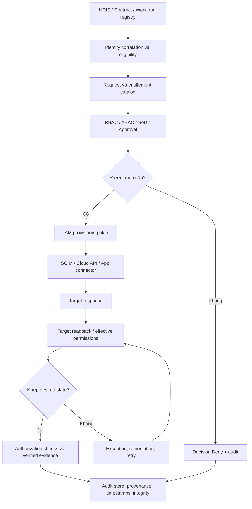
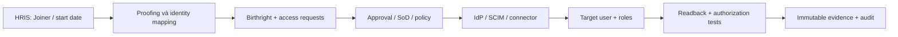

# Provisioning evidence trong Identity audit: bằng chứng cấp phát danh tính và quyền

**Provisioning evidence** (*bằng chứng cấp phát tài khoản và quyền*) là tập hồ sơ có thể kiểm toán chứng minh rằng việc tạo, cập nhật, kích hoạt tài khoản và cấp entitlement trong hệ thống đích **xuất phát từ một nhu cầu hợp lệ, được phê duyệt theo chính sách, thực thi đúng đối tượng và được xác minh sau thực thi**. Bằng chứng không chỉ trả lời “connector đã chạy thành công chưa?” mà còn trả lời **ai yêu cầu, cho ai, quyền nào, vì sao, ai duyệt, chính sách nào áp dụng, hệ thống đích thực sự có gì và có truy cập đúng phạm vi hay không**.

Ví dụ, nhân viên An gia nhập bộ phận Kế toán. HRIS phát sự kiện **Joiner**; IAM xác nhận danh tính, chọn role `invoice-reader`, phê duyệt quyền nhạy cảm nếu cần và gọi SCIM/connector tạo account ở ERP. Một response HTTP thành công chỉ cho thấy bước kỹ thuật đã được chấp nhận. Muốn chứng minh provisioning đúng, kiểm toán cần **readback account, effective role, tenant, trạng thái, thời điểm và kết quả thử quyền tại ERP**. Nếu ERP tự động gán `invoice-admin` ngoài yêu cầu, provisioning chưa đạt mục tiêu least privilege dù connector trả success.

Trong module **Identity and Access Management (IAM)** theo **Joiner–Mover–Leaver (JML)**, Provisioning evidence thuộc **Identity audit** và liên quan đến **identity proofing, IdP, SSO, SCIM, RBAC/ABAC, approval workflow, service/machine identity, access review, authorization logs và account reconciliation**. Nó là bằng chứng cho **quá trình cấp phát và kết quả đạt được**, không phải giấy phép giữ quyền mãi mãi: quyền phải tiếp tục được đánh giá và thu hồi khi quan hệ hoặc nhiệm vụ thay đổi.

## 1. Provisioning evidence chứng minh những điều gì?

Một bộ evidence đáng tin phải có thể kiểm tra các mục tiêu:

1. **Legitimacy:** có identity/workload hợp lệ và lý do kinh doanh rõ ràng.
2. **Authorization:** có người hoặc policy đủ thẩm quyền cho phép tạo/cấp quyền.
3. **Least privilege:** quyền dự kiến phù hợp nhiệm vụ, scope, thời gian và tài nguyên.
4. **Correct target:** account được tạo/cập nhật đúng ứng dụng, tenant, môi trường và chủ thể.
5. **Correct execution:** connector/API thực hiện đúng thao tác, không thêm quyền ngoài yêu cầu.
6. **Effective result:** readback tại đích và khi cần, test authorization chứng minh trạng thái thực tế.
7. **Traceability:** liên kết sự kiện nguồn, yêu cầu, approval, operation, target và kết quả.
8. **Timeliness:** việc cấp phát hoàn thành trong mốc thời gian phù hợp và không cấp quá sớm.
9. **Integrity:** bằng chứng có thể truy nguyên, bảo vệ khỏi sửa đổi trái phép.
10. **Lifecycle consistency:** quyền tiếp tục phù hợp khi Joiner trở thành Mover hoặc Leaver.

**Provisioning requested**, **provisioning approved**, **provisioning attempted**, **provisioning succeeded at connector** và **effective access verified** là các mốc khác nhau; không nên gộp thành một trạng thái “DONE”.

## 2. Phân biệt những loại bằng chứng liên quan

| Loại | Chứng minh điều gì? | Ví dụ |
| --- | --- | --- |
| **Identity source evidence** | Chủ thể/quan hệ có căn cứ | HRIS employee ID, hợp đồng partner |
| **Proofing/enrollment evidence** | Quy trình xác minh/đăng ký được thực hiện | Kết quả proofing, không lưu tài liệu nhạy cảm dư thừa |
| **Request evidence** | Ai đề nghị tạo account hoặc cấp role | Access request ID |
| **Approval evidence** | Người có thẩm quyền đã duyệt phạm vi | Approver, thời điểm, quyết định |
| **Policy evidence** | Quy tắc RBAC/ABAC/SoD đã áp dụng | Policy ID/version, kiểm tra xung đột |
| **Provisioning execution evidence** | IAM/connector gửi và nhận kết quả gì | Operation ID, response đã che |
| **Target state evidence** | Ứng dụng có account/quyền thực tế nào | Account readback, group/role list |
| **Authorization evidence** | API cho phép/từ chối hành động cụ thể | Permit/Deny của test identity |
| **Reconciliation evidence** | Quyền thực tế khác quyền mong muốn ra sao | Missing/excess entitlement report |
| **Deprovisioning evidence** | Quyền đã được thu hồi khi không còn cần | Disable/revoke + negative test |

Provisioning evidence tập trung vào **tạo và cấp đúng**, nhưng phải có khả năng liên kết với **deprovisioning evidence** để kiểm toán toàn bộ vòng đời.

## 3. Chuỗi bằng chứng end-to-end



Mỗi liên kết cần được nhận diện bằng **stable IDs và correlation metadata**. Nếu hệ thống chỉ ghi `userCreated=true` mà không có identity ID, request, thời gian hoặc target account ID, việc tái dựng quyết định rất khó.

## 4. Những nguồn dữ liệu dùng làm evidence

| Nguồn | Bằng chứng phù hợp | Giới hạn |
| --- | --- | --- |
| **HRIS/contract source** | Ngày bắt đầu, loại quan hệ, team, trạng thái | Không biết mọi entitlement ở đích |
| **Identity proofing** | Kết quả xác minh và mức bảo đảm | Không tự quyết định cấp role |
| **IAM/IGA** | Identity mapping, access request, policy decision | Desired state có thể lệch observed state |
| **Approval engine** | Decision, người duyệt, delegation, lý do | Approval không tự thực thi quyền |
| **IdP/Directory** | Account, group, trạng thái đăng nhập | Không thấy mọi local SaaS role |
| **SCIM connector** | Request/response Create/Update/Patch | Không đồng bộ tất cả token hoặc quyền cục bộ |
| **Application/cloud IAM** | Principal, role, direct grant, status tại đích | Có thể chưa có nguồn lý do nghiệp vụ |
| **RBAC/ABAC policy store** | Policy/role definition và version | Không chứng minh PEP đã thực thi |
| **Authorization/API logs** | Permit/Deny cho thao tác được kiểm thử | Không tự thay thế inventory |
| **CMDB/workload registry** | Mục đích service identity và owner | Có thể lỗi thời |
| **SIEM/audit store** | Correlation, alert, retention | Chất lượng phụ thuộc nguồn gửi sự kiện |

**IdP và target application là hai nguồn khác nhau**. Nếu ứng dụng hỗ trợ tài khoản cục bộ, gán role trực tiếp hoặc session riêng, không thể suy ra tất cả quyền từ IdP hoặc log SCIM.

## 5. Một schema tối thiểu của Provisioning evidence

| Field | Vai trò | Giá trị minh họa |
| --- | --- | --- |
| `evidenceId` | Khóa hồ sơ bằng chứng | `ev-prov-2048` |
| `subjectIdentityId` | Danh tính chuẩn hóa | `human-0071` |
| `subjectType` | Human, partner, service, workload | `human` |
| `targetAccountId` | Account ở ứng dụng đích | `erp-user-889` |
| `targetSystemId` | Hệ thống/tenant/environment | `erp-prod-a` |
| `lifecycleEventId` | Event Joiner/Mover liên quan | `jml-2026-901` |
| `requestId` | Yêu cầu truy cập | `req-6632` |
| `approvalId` | Quyết định chấp thuận | `approval-203` |
| `entitlementId` | Role/permission mong muốn | `invoice-reader` |
| `policyVersion` | Chính sách tại thời điểm duyệt | `rbac-19` |
| `operationId` | Lệnh connector/API | `op-scim-331` |
| `executionStatus` | Trạng thái lệnh kỹ thuật | `SUCCESS` |
| `readbackStatus` | Trạng thái quan sát ở đích | `MATCHED` |
| `authorizationOutcome` | Kết quả test quyền nếu có | `READ_PERMIT_WRITE_DENY` |
| `requestedAt/approvedAt/appliedAt/verifiedAt` | Các mốc thời gian | UTC timestamp |
| `evidenceSource` | API/export/run ID | `erp-readback-run-12` |
| `correlationId` | Nối các sự kiện | `trace-prov-02` |

Đây là **mô hình minh họa**, không phải schema SCIM hoặc mẫu chứng nhận của một tiêu chuẩn cụ thể. Một lần provisioning có thể bao gồm **nhiều entitlement và nhiều ứng dụng**; mô hình dữ liệu nên lưu quan hệ one-to-many và kết quả từng đích, không ép toàn bộ vào một trạng thái chung.

## 6. Ví dụ bản ghi bằng chứng đã chuẩn hóa

```json
{
  "evidenceId": "ev-prov-2048",
  "subjectIdentityId": "human-0071",
  "subjectType": "human",
  "lifecycleEvent": {
    "id": "jml-2026-901",
    "type": "JOINER",
    "effectiveAt": "2026-11-23T02:00:00Z"
  },
  "request": {
    "id": "req-6632",
    "entitlementId": "invoice-reader"
  },
  "approval": {
    "decision": "APPROVED",
    "approverId": "finance-data-owner-11",
    "policyVersion": "rbac-19"
  },
  "target": {
    "systemId": "erp-prod-a",
    "accountId": "erp-user-889",
    "tenantId": "tenant-a"
  },
  "operation": {
    "id": "op-scim-331",
    "status": "SUCCESS"
  },
  "verification": {
    "readback": "MATCHED",
    "readPermitted": true,
    "writeDenied": true
  }
}
```

Tất cả ID trong ví dụ đều **giả định**. Trong hồ sơ thật cần provenance, timestamp và evidence reference phù hợp. Không đính kèm access token, refresh token, password, cookie, private key hay API secret vào record.

## 7. Chứng minh yêu cầu có căn cứ hợp lệ

Với **human identity**, căn cứ cấp quyền có thể từ HRIS, manager hoặc workflow được phép. Với **partner**, cần hợp đồng và sponsor; với **workload**, cần purpose, owner và môi trường.

Reviewer nên xác nhận:

1. Identity/workload ID tồn tại và không bị nhầm với account khác.
2. Quan hệ công tác hoặc hợp đồng có hiệu lực tại thời điểm cấp.
3. Resource/tenant nằm trong phạm vi được phép.
4. Yêu cầu có business purpose và entitlement cụ thể.
5. Không dùng tên người dùng/email có thể tái sử dụng làm khóa duy nhất.
6. Người gửi yêu cầu và người hưởng quyền được phân biệt.
7. Yêu cầu có thời hạn nếu quyền chỉ tạm dùng.
8. Có owner chịu trách nhiệm và người xử lý ngoại lệ.

**Một access request hợp lệ không đồng nghĩa mọi entitlement trong request đều hợp lệ**. Policy và approver phải đánh giá từng quyền hoặc tổ hợp quyền theo mô hình tổ chức.

## 8. Approval evidence: ai được quyền quyết định?

Approval evidence cần chứng minh **thẩm quyền của reviewer/approver tại thời điểm quyết định**, không chỉ một chuỗi `approved=true`.

| Câu hỏi | Evidence |
| --- | --- |
| Ai là requester? | Requester identity ID |
| Ai là beneficiary? | Subject identity ID |
| Ai là resource owner? | Owner mapping đúng phiên bản |
| Ai đã duyệt? | Approver ID và decision timestamp |
| Có self-approval không? | So sánh requester/beneficiary/approver |
| Có delegated approval không? | Delegation grant, scope, expiry |
| Có SoD conflict không? | Rule ID, conflict assessment |
| Có entitlement quá hạn không? | End date, revocation plan |
| Có exception không? | Risk owner, lý do, giới hạn, expiry |

**Quy tắc phân tách trách nhiệm (SoD)** có thể cấm tự phê duyệt quyền admin hoặc kết hợp role xung đột. Việc phê duyệt từ người không đủ thẩm quyền **không được coi là evidence hợp lệ** chỉ vì workflow engine ghi trạng thái APPROVED.

## 9. Quyền tự động theo birthright và policy-driven provisioning

Không phải mọi quyền cần một lần phê duyệt thủ công. Quyền birthright có thể được cấp theo chính sách dựa trên thuộc tính HRIS hoặc identity.

Ví dụ:

```text
ELIGIBLE for invoice-reader IF
    identity.lifecycle_status == "ACTIVE"
    AND identity.department == "FINANCE"
    AND identity.employment_type IN allowed_types
    AND identity.tenant == target.tenant
    AND effective_time >= identity.start_date
```

Đây là **giả mã**. Nếu approval được thực thi **theo policy** thay vì con người, evidence cần có **policy ID/version, nguồn thuộc tính, thời điểm đánh giá, kết quả và kiểm soát phê duyệt chính sách**. Không nên tạo “approver ảo” để giả một chữ ký duyệt thủ công không hề xảy ra.

**RBAC** có thể ánh xạ role theo nhiệm vụ, còn **ABAC/PBAC** giới hạn theo tenant, project, environment và điều kiện ngữ cảnh. Bằng chứng phải thể hiện đúng **policy tại thời điểm cấp**, thay vì chỉ chụp role definition hiện nay.

## 10. SCIM provisioning evidence: yêu cầu và response

**SCIM 2.0** (thường tham chiếu RFC 7643/7644) cung cấp mô hình User/Group và giao thức tạo, cập nhật, xóa đối tượng khi target hỗ trợ. Evidence từ SCIM nên bao gồm **operation ID, endpoint/target reference, phương thức, đối tượng, thời điểm, kết quả, đối chiếu ID**.

| Hoạt động | Evidence kỹ thuật | Điều phải xác minh |
| --- | --- | --- |
| `POST /Users` | Request metadata, HTTP response, target `id` | Tạo đúng user và trạng thái |
| `PATCH /Users/{id}` | Path/op/value đã giảm nhạy cảm, response | Thuộc tính đích thật sự đổi |
| `PATCH /Groups/{id}` | Nhóm và membership thay đổi | Membership hiệu lực tại target |
| `PUT` nếu hỗ trợ | Thay resource theo semantics target | Không vô ý xóa trường khác |
| `DELETE` nếu được dùng | Target result | Không suy mọi session/token đã chết |
| Retry/async provisioning | Job ID, retry, acknowledgment | Không tạo duplicate và không bỏ sót |

**Response 200/201/204 không phải luôn là bằng chứng authorization runtime đúng**. Có hệ thống áp dụng eventual consistency hoặc gán thêm default role cục bộ. Cần đọc lại User/Group/entitlement từ target.

**SCIM không phải giao thức chung quản lý mọi OAuth client, API key, certificate hoặc access token.** Service identities thường cần cloud/API-specific provisioning evidence.

## 11. Target readback: bằng chứng về trạng thái thực tế

Bước **readback** giúp kiểm chứng điều xảy ra tại đích sau lệnh cấp quyền:

1. Tra account bằng **target immutable ID** đã nhận, không chỉ username.
2. Xác nhận đúng issuer, tenant, environment và trạng thái.
3. Kiểm tra group/role/ACL đã gán.
4. Mở rộng nested group và inherited role nếu có.
5. Đối chiếu các entitlement ngoài yêu cầu (default/direct grants).
6. Kiểm tra thời điểm hiệu lực và TTL đối với quyền tạm.
7. Xác định quyền đến từ policy ABAC hoặc resource-level grants.
8. Ghi API/export, timestamp và độ trễ sync.
9. Chỉ đánh dấu `VERIFIED` khi kết quả phù hợp tiêu chí được phê duyệt.
10. Nếu sai, mở remediation có owner và thời hạn.

**Readback account tồn tại khác readback permission đúng**. Một user có thể được tạo thành công nhưng thiếu role, hoặc có role thừa do cấu hình mặc định.

## 12. Effective access và negative authorization test

Đối với tài nguyên nhạy cảm, danh sách role chưa đủ; nên thử hành động được phép và bị cấm **trên tài nguyên test**:

| Kiểm tra | Expected result |
| --- | --- |
| User có role reader đọc invoice thuộc tenant mình | PERMIT |
| Cùng user sửa invoice | DENY |
| User tenant A đọc invoice tenant B | DENY |
| User có role approver nhưng chính mình tạo giao dịch | DENY nếu có SoD transaction rule |
| Role chưa đến ngày hiệu lực | DENY |
| Tài khoản chưa được xác minh | Không nhận quyền nhạy cảm ngoài policy |
| Workload chỉ có `queue.publish` thử `queue.admin` | DENY |
| Credential không đúng audience API | DENY |

**Một quyết định Permit của PDP không chứng minh tác vụ nghiệp vụ hoàn thành**, cũng như việc UI hiển thị nút không chứng minh API sẽ cho phép. Evidence mạnh cần gắn **request, response, authorization decision và enforcement outcome** khi phù hợp.

## 13. Provisioning evidence trong Joiner

Một kịch bản Joiner điển hình:



Kiểm toán cần xác nhận **account không được kích hoạt trước thời điểm hợp lệ**, identity proofing phù hợp, role đúng công việc và không có duplicate account. Nếu account được chuẩn bị sớm, cần phân biệt **pre-provisioned** với **usable access**. Một tài khoản đã được tạo không có nghĩa nó được phép đăng nhập và gọi API trước ngày bắt đầu.

Ví dụ nhân viên A gia nhập ngày 1/12, hệ thống chuẩn bị account ngày 28/11. Evidence phải thể hiện điều kiện ngăn quyền có hiệu lực trước ngày được phép, nếu chính sách yêu cầu.

## 14. Provisioning evidence trong Mover

Mover thường cần cả **provisioning quyền mới** lẫn **deprovisioning quyền cũ**. Nếu chỉ kiểm grant mới, có thể bỏ sót quyền tích tụ.

| Trước Mover | Sau Mover được duyệt | Evidence cần có |
| --- | --- | --- |
| Finance editor | Analytics reader | Role Analytics được cấp; role Finance bị gỡ |
| Project A operator | Project B operator | Scope A không còn, B đúng role |
| Production support | Security reviewer | Kiểm tra SoD với quyền còn tồn |
| Tenant A support | Tenant B support | Quyền A bị revoke; B được cấp |
| Ordinary account | Privileged admin | Approval độc lập, PAM/JIT và expiry |

Bộ bằng chứng cần liên kết **HR Mover event, desired entitlement revision, revoke operation cũ, grant operation mới, observed target state và test API**. Nếu role cũ còn trong token/session, cần đánh giá **time-to-deny**, không tuyên bố Mover hoàn tất chỉ vì SCIM group removal thành công.

## 15. Provisioning evidence liên quan Leaver thế nào?

Leaver chủ yếu tạo **deprovisioning evidence**, nhưng kiểm toán provisioning cần kiểm tra **không có lệnh cấp lại quyền sau khi quan hệ đã kết thúc**.

Một số trường hợp:
- Connector retry một grant trước đây sau Leaver.
- IaC/GitOps tái tạo role của account đã retired.
- Access approval cũ còn hiệu lực dù beneficiary đã nghỉ.
- Người dùng được tái tuyển dụng (Rejoiner) nhưng thiếu phân biệt identity đời cũ và đời mới.
- Account phụ/privileged của Leaver vẫn có local grant.
- SCIM `active=false` được áp dụng nhưng token/session vẫn thực thi được.

**Leaver phải có precedence phù hợp so với grant cũ**. Evidence nên lưu policy/lifecycle version, timestamp và kết quả từ chối provisioning muộn. Không tạo một quy tắc tuyệt đối cho mọi rehire; cần đánh giá quan hệ mới bằng chính sách hiện hành và correlation đúng.

## 16. Provisioning evidence cho service và machine identity

**Non-human identities** có thể không có HR employee ID, nhưng vẫn phải có accountable owner, workload và business purpose.

| Đối tượng | Bằng chứng cấp phát cần có |
| --- | --- |
| Service account | Service/workload ID, owner, target system, grants |
| OAuth client | Client ID, issuer, auth method, scopes, owner |
| Managed identity | Resource association, principal, cloud role binding |
| Workload federation | Issuer, subject, audience, trust policy version |
| Kubernetes ServiceAccount | Cluster, namespace, RBAC binding, workload |
| Database technical user | Owner, account, grants và consumer |
| API key | Key ID/fingerprint, scope, expiry, vault reference |
| Partner integration | Contract/sponsor, tenant, expiry và resource grants |

**Không lưu plaintext client secret, private key, API key hay token** trong audit package. Chỉ giữ metadata và tham chiếu bảo vệ. Sau cấp, cần đọc lại quyền ở issuer/resource, không chỉ trong CI/CD manifest.

Nếu owner là nhân viên đã Mover/Leaver, phải chuyển ownership và gỡ quyền cá nhân vào vault/CI/CD; **không mặc định xóa workload còn hoạt động**.

## 17. Privileged access, SoD và emergency access

Quyền đặc biệt cần evidence mạnh hơn quyền thông thường:

1. **Business justification và scope** được xác nhận.
2. **Resource/security owner approval** theo chính sách.
3. **SoD analysis**: requester/beneficiary/approver hoặc role conflict.
4. **PAM/JIT/JEA**: thời điểm kích hoạt, TTL, action/resource scope.
5. **Session/command audit** nếu được kiểm soát.
6. **End of privilege**: quyền tạm được thu hồi khi hết hạn.
7. **Target readback và negative test** sau khi quyền kết thúc.
8. **Exception** có risk owner, mục đích và thời hạn.

Với **break-glass**, có thể sử dụng quy trình khẩn cấp được phê duyệt, bao gồm biện pháp bù trừ và hậu kiểm; không được coi “emergency” là lý do bỏ toàn bộ bằng chứng. Evidence nên gắn incident ID, người kích hoạt, scope, thời điểm và cleanup.

## 18. Reconciliation: desired vs observed sau provisioning

```text
desired = approved_accounts_and_entitlements(identity, lifecycle, policy)
observed = target_accounts_and_effective_permissions(identity)

missing = desired - observed
excess = observed - desired
```

Đây là **mô hình logic**, không phải thuật toán đủ cho ABAC hay quyền kế thừa. Cần so sánh theo **identity ID, account ID, tenant, resource, action và context**.

| Sai lệch | Ví dụ | Hành động |
| --- | --- | --- |
| **Missing account** | Joiner được duyệt nhưng ERP chưa tạo user | Retry có kiểm soát, readback |
| **Missing entitlement** | Account có nhưng thiếu role | Kiểm tra mapping và grant |
| **Excess role** | Default ERP admin được cấp ngoài yêu cầu | Revoke thừa, review policy |
| **Wrong target** | Grant nhầm tenant | Chặn và sửa theo incident/change |
| **Wrong beneficiary** | Identity correlation sai | Ưu tiên xử lý, kiểm tra audit |
| **Stale approval** | Yêu cầu cũ cấp sau Mover | Re-evaluate trước grant |
| **Duplicate account** | Retry POST tạo account thứ hai | Idempotency/correlation cleanup |
| **Provisioning drift** | Role xuất hiện do local admin | Owner review và đối soát |
| **Privilege resurrection** | IaC tái cấp role đã gỡ | Sửa source-of-truth, fence event |

**Connector result SUCCESS không thể thay cho reconciliation**. Điều kiện đóng hoàn tất phải xác định rõ từng sai lệch đã được kiểm chứng ở hệ thống đích.

## 19. Eventual consistency, retry và ordering

Provisioning thường bất đồng bộ: HRIS, IAM, queue, connector và ứng dụng đích không cập nhật trong cùng một transaction.

```text
T0: Request approved
T1: IAM creates operation
T2: Connector accepted
T3: Target account created
T4: Role/group propagated
T5: API effective access verified
```

Bằng chứng cần chứa **các timestamp riêng**. Đừng dùng thời điểm T2 làm thời điểm “đã có quyền thực tế” nếu resource chỉ chấp nhận ở T5.

Kiểm soát kỹ thuật cần xét:

- **Idempotency:** retry không tạo thêm account hoặc double-grant.
- **Generation/version:** grant cũ không ghi đè Mover/Leaver mới.
- **Ordering:** event đến trễ/đảo thứ tự phải được xử lý đúng.
- **Timeout/SLA:** thao tác Pending không bị ghi Success vô hạn.
- **Partial success:** một nhóm quyền thành công nhưng nhóm khác thất bại.
- **Dead-letter/exception queue:** có owner xử lý các lỗi không tự phục hồi.
- **Eventually consistent readback:** retry với giới hạn và ghi độ trễ.
- **Rollback/compensation:** quyền cấp nhầm được thu hồi có kiểm chứng.

Báo cáo kiểm toán cần phân biệt **operation failed**, **still pending**, **completed at target** và **verified effective**.

## 20. Bảo vệ integrity và provenance của evidence

Một evidence package nên lưu:

- **Source identity và target system** (ID, tenant, environment).
- **Extraction method**, API version, job/run ID, filter và phạm vi.
- **Event time** và **ingestion time** nếu có log pipeline.
- **Raw response đã được giảm nhạy cảm**, hoặc tham chiếu đến snapshot bảo vệ.
- **Normalized record** và version của transformation/mapping.
- **Policy ID/version** ở thời điểm approval/execution.
- **Correlation IDs** nối request → connector → target → test.
- **Reviewer/approver attestation** cùng thời điểm và scope.
- **Digest/integrity reference** của artifact phù hợp.
- **Access controls, retention và history** của evidence.
- **Exception/remediation status** và kết quả readback.

**Hash chỉ chứng minh artifact không đổi kể từ khi được băm; không chứng minh nội dung đúng, đầy đủ hoặc được thu thập hợp lệ.** Cần provenance, completeness check và kiểm soát nguồn cùng với integrity.

## 21. Không thu thập credential nhạy cảm vào evidence

Provisioning liên quan cấp password, secret, certificate hoặc token; vì vậy rất dễ vô tình lộ thông tin trong log.

| Dữ liệu | Cách xử lý nên chọn |
| --- | --- |
| Password ban đầu, temporary password | **Không lưu plaintext**; chỉ lưu kết quả/cơ chế cấp |
| MFA seed, OTP, recovery code | **Không đưa vào audit** |
| Access/refresh/ID token | **Không lưu token thô** |
| API key/client secret | Chỉ metadata/key ID hoặc secret reference |
| Private key | Không lưu; bảo vệ trong vault/HSM hoặc cơ chế tương đương |
| Certificate public metadata | Có thể lưu issuer, serial, fingerprint theo nhu cầu |
| Request/response body SCIM | Redact thuộc tính nhạy cảm và secret nếu có |
| Email/HR attributes | Giảm thiểu dữ liệu cá nhân, kiểm soát quyền truy cập |
| Policy evaluation context | Chỉ giữ thông tin cần tái dựng quyết định |

Log của connector không nên tự động in toàn bộ payload request. Một response thành công nhưng tiết lộ secret trong SIEM là **sự cố bảo mật do cơ chế audit gây ra**.

## 22. Sample-based audit testing

Khi audit một tập lớn các provisioning events:

1. Định nghĩa **population** theo application, tenant, kỳ thời gian và loại request.
2. Chứng minh trích xuất đủ record, pagination và source coverage.
3. Phân tầng **birthright, manual request, privileged, partner, service identity** theo rủi ro.
4. Lựa chọn mẫu bằng phương pháp nhất quán và lưu dấu quy trình.
5. Với mỗi mẫu, trace từ source eligibility → request → approval/policy → operation → target.
6. Kiểm tra **thời điểm hợp lệ** và việc không có self-approval trái policy.
7. Kiểm tra role đúng scope và không có extra permissions.
8. Thu kết quả readback và negative authorization test cho các quyền nhạy cảm.
9. Ghi exception, owner, deadline và status xử lý.
10. Không suy diễn độ đầy đủ toàn hệ thống từ mẫu nếu population nguồn chưa được chứng minh đầy đủ.

**Một mẫu chọn từ “successful connector operations” có thiên lệch**: nó bỏ qua các request thất bại, timeout, missing operation và cấp quyền ngoài luồng. Population phải phản ánh control objective, không chỉ những event tiện trích xuất.

## 23. Những lỗi phổ biến trong Provisioning evidence

| Sai lầm | Hậu quả | Cách khắc phục |
| --- | --- | --- |
| Chỉ giữ ticket Approved | Không biết quyền được cấp đúng chưa | Target readback |
| Chỉ lưu connector HTTP 200 | Không chứng minh effective access | Runtime tests theo rủi ro |
| Không liên kết identity/account IDs | Không biết cấp cho ai | Stable correlation IDs |
| Chỉ ghi tên role hiện tại | Không tái dựng policy lịch sử | Policy version và snapshot |
| Thiếu requester/beneficiary | Dễ bỏ sót self-approval | Tách actor và beneficiary |
| Bỏ qua birthright | Không kiểm chứng quyền cấp tự động | Policy-driven evidence |
| Chỉ lấy active accounts | Bỏ sót duplicate/disabled hoặc pending | Population definition |
| Không kiểm role thừa | Role mặc định quá rộng vẫn tồn tại | Effective entitlement check |
| Không ghi thời gian | Không đo provisioning SLA | Event timestamps |
| Không kiểm event retry | Duplicate account và grant | Idempotency + ordering |
| Dùng ID token làm API credential | Lỗi mô hình token | Kiểm đúng access token/audience |
| Ghi client secret trong log | Lộ credential | Redact và reference |
| Không xét Mover/Leaver | Quyền được cấp từ request quá hạn | Re-evaluate lifecycle |
| Không kiểm direct local grant | Desired/observed drift | Reconciliation tại target |
| Chỉ theo dõi quyết định reviewer | Không biết remediation đã xong | Verified closure |

## 24. Test matrix cho provisioning controls

| Tình huống | Expected evidence và kết quả |
| --- | --- |
| Joiner chưa đến ngày hiệu lực | Không usable access ngoài policy |
| Joiner birthright hợp lệ | Policy decision + target role readback |
| User xin role nhạy cảm | Approval đủ thẩm quyền và đúng scope |
| Requester tự duyệt quyền admin của mình | Bị chặn bởi SoD/approval policy |
| User tenant A xin role tenant B | Bị từ chối hoặc điều chỉnh đúng tenant |
| SCIM POST thành công | Có target account ID và readback |
| SCIM PATCH cập nhật role | Entitlement tại đích thay đổi |
| Connector HTTP timeout | Không ghi Success khi chưa kiểm target |
| Retry tạo duplicate account | Phát hiện và xử lý idempotently |
| Mover request cũ hoàn tất trễ | Không tái cấp role không còn cần |
| Leaver sau approval nhưng trước grant | Không cho cấp quyền trái lifecycle |
| SaaS có default role admin ngoài yêu cầu | Excess entitlement detection |
| Cloud role kế thừa | Kiểm effective permission, không chỉ direct grant |
| Service principal thiếu owner | Investigate, không cấp privileged role mặc định |
| Partner contract hết hạn | Không cấp OAuth client/role mới ngoài hợp đồng |
| Privileged JIT cấp có TTL | Activation và expiry được chứng minh |
| Quyền hết hạn nhưng token còn Permit | Negative test thất bại; remediation |
| IaC cấp lại role đã gỡ | Phát hiện drift và sửa desired state |
| Audit evidence bị sửa | Integrity verification thất bại |
| Phân trang export thiếu | Population completeness không đạt |

## 25. Pseudocode kiểm chứng cấp quyền

```text
test "approved role is provisioned without excess privilege":
    identity = create_test_identity(status="ACTIVE", tenant="tenant-a")
    request = request_role(identity, "invoice-reader", target="erp-prod")
    decision = approval_engine.evaluate(request)

    assert decision == APPROVED
    operation = provisioning.execute(request, decision)
    assert operation.has_correlation_id()

    observed = target_api.read_account_and_roles(identity.target_account_id)
    assert "invoice-reader" IN observed.effective_roles
    assert "invoice-admin" NOT IN observed.effective_roles

    assert erp_api.read_test_invoice(identity) == PERMIT
    assert erp_api.approve_test_invoice(identity) == DENY

    evidence.record(
        request_id=request.id,
        policy_version=decision.policy_version,
        operation_id=operation.id,
        target_readback_ref=observed.reference,
        authorization_test="PASS"
    )
```

Đây là **giả mã**, không phải API/syntax chạy ngay. Test thực tế phải có **test identity, resource riêng, cleanup, deadline và đánh giá bất đồng bộ**. Không dùng dữ liệu hóa đơn thật hay mật khẩu người dùng thật để tạo evidence.

## 26. Metrics và theo dõi chất lượng

| Chỉ số | Giá trị kiểm soát |
| --- | --- |
| **Provisioning request coverage** | Tỷ lệ request có trace đầy đủ |
| **Valid approval rate** | Tỷ lệ quyền có approval/policy hợp lệ |
| **Target readback coverage** | Tỷ lệ thao tác có bằng chứng ở đích |
| **Verified provisioning rate** | Tỷ lệ quyền đúng sau readback/test |
| **Provisioning latency** | Thời gian từ hiệu lực đến quyền sẵn sàng |
| **Excess entitlement rate** | Số grant ngoài desired state |
| **Wrong-beneficiary incidents** | Cấp quyền cho nhầm người/account |
| **Duplicate-account rate** | Tạo tài khoản trùng qua retry |
| **Privilege policy exception age** | Tuổi ngoại lệ chưa được giải quyết |
| **Mover grant/revoke consistency** | Quyền mới/cũ đúng sau chuyển vai trò |
| **Late grant after Leaver** | Cấp quyền sau chấm dứt quan hệ |
| **Service identity owner coverage** | NHA có owner hợp lệ |
| **Evidence integrity failure** | Hồ sơ không kiểm chứng được |
| **Reconciliation remediation rate** | Sai lệch được xử lý và readback |
| **Missing-source coverage** | Hệ thống/tác vụ thiếu dữ liệu kiểm toán |

**Tỷ lệ connector success cao không đồng nghĩa provisioning accuracy cao**. Để đo chất lượng, cần target readback, effective permissions, hợp lệ của approval và kết quả giải quyết sai lệch.

## 27. Checklist chuẩn bị Provisioning evidence

- [ ] Có scope, control objective và thời kỳ kiểm toán rõ ràng.
- [ ] Có inventory ứng dụng, tenant và nguồn identity/workload.
- [ ] Có stable subject ID, account ID, target system ID.
- [ ] Có request, requester, beneficiary, purpose và entitlement cụ thể.
- [ ] Có approval hợp lệ hoặc policy-driven grant với version.
- [ ] Có kiểm tra SoD và điều kiện least privilege.
- [ ] Có thời điểm hiệu lực JML và eligibility tại lúc grant.
- [ ] Có operation ID, connector/API, response và timestamp.
- [ ] Không ghi password, token, secret hoặc private key vào evidence.
- [ ] Có target readback, role/group/ACL và account state.
- [ ] Có kiểm tra default/direct/inherited entitlements ngoài yêu cầu.
- [ ] Có runtime authorization test cho quyền nhạy cảm.
- [ ] Có correlation từ source → decision → execution → target.
- [ ] Có cơ chế xử lý Pending/Failed/Partial, retry và event ordering.
- [ ] Có phân biệt operation success và verified effective result.
- [ ] Có exception, owner, deadline, remediation và readback.
- [ ] Có evidence package được bảo vệ integrity/retention.
- [ ] Có population completeness và sampling method khi audit mẫu.
- [ ] Có kiểm tra tránh late grants sau Mover/Leaver.
- [ ] Có khả năng truy vết và xử lý cấp quyền ngoài luồng.

## 28. Câu hỏi tự kiểm tra

**Tình huống A:** Manager phê duyệt `invoice-reader`, connector trả HTTP 201 nhưng ERP tự gán thêm `invoice-admin`. Có thể kết luận provisioning đạt chưa? **Chưa.** Cần target readback, phát hiện quyền thừa và remediation.

**Tình huống B:** Một birthright role được cấp tự động không có approval thủ công. Có phải luôn thiếu evidence? **Không.** Cần policy ID/version, nguồn thuộc tính, quyết định hợp lệ và readback.

**Tình huống C:** Role đã được approve trước Mover nhưng grant đến đích sau Leaver. Có được tiếp tục cấp? **Không nếu beneficiary không còn eligible.** Cần đánh giá lại trạng thái lifecycle trước provisioning.

**Tình huống D:** SCIM group update thành công, nhưng SaaS giữ local admin role. Evidence nào còn thiếu? **Effective entitlement readback và authorization test** tại SaaS.

**Tình huống E:** Một service account do kỹ sư đã nghỉ tạo ra vẫn chạy production. Có thể xóa ngay không? **Không mặc nhiên.** Chuyển owner, thu hồi quyền cá nhân và đánh giá purpose/dependencies của workload.

**Tình huống F:** Bằng chứng có hash nhưng export bỏ sót một trang API. Có đủ để kiểm toán không? **Không.** Integrity không thay cho completeness.

**Tình huống G:** Reviewer chứng nhận quyền được cấp nhưng không có target account ID. Có thể truy vết đầy đủ không? **Chưa.** Cần liên kết với principal/account đích và kết quả xác minh.

**Tình huống H:** Quyền được cấp theo role hợp lệ nhưng token dùng thử có `aud` cho API khác. API nên làm gì? **Deny.** Token validation và authorization phải phù hợp resource server.

## Ghi nhớ

**Provisioning evidence** phải chứng minh **quyền được yêu cầu hợp lệ, phê duyệt theo chính sách, cấp đúng danh tính/tài nguyên, có hiệu lực đúng thời điểm và được kiểm chứng ở hệ thống đích**. Chuỗi **source → request → approval/policy → connector/API → target readback → authorization evidence → audit** cần được liên kết bằng stable IDs, policy versions và timestamps. Trong vòng đời **Joiner–Mover–Leaver**, phối hợp **IdP/SSO, SCIM, RBAC/ABAC, SoD, service/machine identities, access review và reconciliation** để phát hiện cấp sai, cấp thừa hoặc cấp lại quyền đã hết căn cứ. **Kết quả provisioning có thể được đánh dấu hoàn tất về mặt kiểm soát chỉ khi bằng chứng phù hợp mục tiêu đã được xác minh**, không chỉ khi một connector trả Success.
