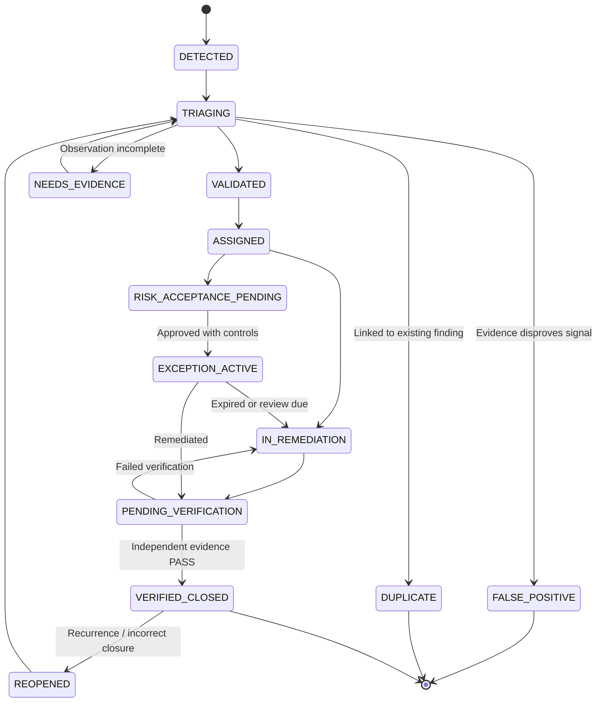
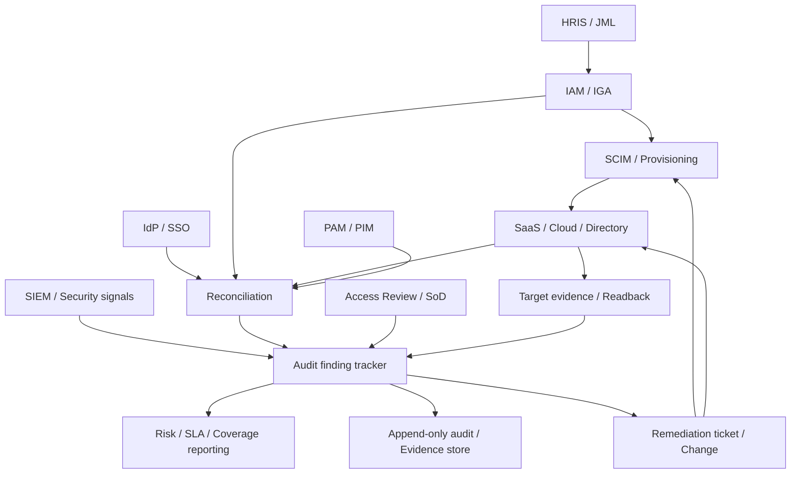

# Theo dõi audit finding trong IAM: Từ phát hiện sai lệch đến xác minh đóng quyền tồn dư

Một nhân viên đã nghỉ việc nhưng vẫn còn vai trò **Cloud Administrator** trên tài khoản cloud cũ. Hệ thống kiểm toán tạo một **audit finding** với mức rủi ro cao. Đội IAM gửi yêu cầu thu hồi role, nhận kết quả `200 OK` từ API rồi chuyển finding sang trạng thái “Closed”. Hai ngày sau, người kiểm toán phát hiện tài khoản phụ của nhân viên vẫn có quyền thông qua một nhóm khác. Báo cáo trước đó đã **đóng finding quá sớm**: hệ thống chỉ kiểm lệnh thu hồi đã được gửi, chưa kiểm **quyền truy cập hiệu lực** tại toàn bộ phạm vi ảnh hưởng.

Trường hợp khác, một finding ghi nhận **xung đột Segregation of Duties (SoD)** giữa quyền sửa nhà cung cấp và quyền duyệt thanh toán. Chủ sở hữu nghiệp vụ chấp thuận một ngoại lệ trong 30 ngày, nhưng công cụ lại coi ngoại lệ là “đã khắc phục”. Sau 90 ngày, quyền xung đột vẫn còn và không có ai theo dõi thời hạn hết ngoại lệ.

Những tình huống này cho thấy **phát hiện sai lệch** chỉ là bước khởi đầu. Cần một cơ chế **theo dõi audit finding từ lúc phát hiện đến khi xử lý có bằng chứng**, quản lý trách nhiệm, thời hạn, mức độ rủi ro, trạng thái chưa rõ và việc tái phát.

**Audit finding** trong ngữ cảnh quản lý danh tính là một **phát hiện kiểm toán hoặc kiểm soát** cho thấy quyền, danh tính, cấu hình, hành vi hay bằng chứng kiểm soát có thể không phù hợp với **chính sách, tiêu chí kiểm tra hoặc trạng thái mong muốn**. **Theo dõi audit finding (audit finding tracking)** là hoạt động tiếp nhận, chuẩn hóa, phân loại, xác minh, giao trách nhiệm, quản lý xử lý/ngoại lệ, kiểm chứng kết quả, theo dõi tái phát và báo cáo rủi ro của những phát hiện này.

Bài thuộc chương **Identity audit** của mô-đun **Identity Lifecycle** trong **Identity and Access Management (IAM)**. Phạm vi kết nối mô hình **Joiner–Mover–Leaver (JML)** với **IdP, SSO, SCIM, RBAC/ABAC, PAM/PIM, SoD, tài khoản dịch vụ, logging và reconciliation**, nhằm đo và giảm **quyền truy cập tồn dư**.

> **Nguyên tắc trung tâm:** **“Đã có ticket” không phải “đã xử lý”. “Connector trả thành công” không phải “đã thu hồi”. “Ngoại lệ được chấp nhận” không phải “không còn rủi ro”.** Một audit finding chỉ được đóng xác minh khi đạt tiêu chí đã phê duyệt, có bằng chứng đủ mới và đúng phạm vi từ hệ thống có thẩm quyền, hoặc được quản lý riêng theo quy trình chấp nhận rủi ro minh bạch.

## 1. Audit finding là gì và vì sao phải theo dõi?

Trong IAM, nguồn phát hiện có thể là:

- Kiểm toán nội bộ/độc lập hoặc đánh giá tuân thủ.
- Chiến dịch **Access Review / Access Certification**.
- **Provisioning log** và log lifecycle.
- Hệ thống **reconciliation** giữa IAM với tài nguyên thực tế.
- Bộ kiểm tra **Segregation of Duties (SoD)**.
- Phát hiện **orphan/dormant accounts**.
- Giám sát **privileged access** qua PAM/PIM.
- SIEM phát hiện access ngoài quy trình.
- Lỗi cấu hình IdP, federation, SSO hoặc SCIM.
- Quét machine identities/certificates/secrets.
- Một incident thực tế hoặc lỗi được xác nhận khi kiểm thử.

Audit finding có thể là **một sai lệch đã xác thực**, **một rủi ro tiềm ẩn đang cần xác minh**, hoặc **khoảng trống bằng chứng** khiến tổ chức chưa thể chứng minh kiểm soát đang hoạt động.

### 1.1. Mục tiêu của việc tracking

1. Không bỏ sót phát hiện rủi ro cao.
2. Xác định **một người/nhóm thực sự chịu trách nhiệm** với từng finding.
3. Phân biệt **sai lệch kỹ thuật, lỗ hổng quy trình, thiếu bằng chứng và ngoại lệ được phê duyệt**.
4. Ưu tiên theo rủi ro thực tế, không chỉ theo số lượng cảnh báo.
5. Theo dõi thời hạn và escalation khi khắc phục chậm.
6. Giữ lịch sử thay đổi, bằng chứng và người ra quyết định.
7. Xác minh **quyền hiệu lực** đã đúng sau remediation.
8. Phát hiện tái phát hoặc remediation không bền vững.
9. Cung cấp báo cáo đáng tin cho security, audit, quản lý và chủ hệ thống.
10. Giảm thời gian quyền truy cập không được phê duyệt tồn tại trong JML.

### 1.2. Finding khác incident, ticket và alert

| Khái niệm | Nghĩa | Ví dụ |
|---|---|---|
| **Audit finding** | Một thiếu sót/sai lệch/điểm rủi ro có tiêu chí và evidence. | Leaver còn quyền SaaS trực tiếp. |
| **Alert** | Tín hiệu cần điều tra, có thể chưa thành finding. | “Account đã disable nhưng còn API request”. |
| **Security incident** | Sự kiện bảo mật cần ứng phó theo quy trình. | Credential bị lộ và đã bị lạm dụng. |
| **Remediation ticket** | Công việc sửa lỗi có owner, hạn và bước thực thi. | Gỡ direct role, revoke token, sửa connector. |
| **Risk exception** | Chấp nhận sai lệch có điều kiện và thời hạn. | SoD conflict được cho phép 14 ngày với compensating controls. |
| **Audit observation** | Quan sát/bằng chứng ở thời điểm kiểm tra. | Target role có trạng thái ACTIVE. |
| **Control deficiency** | Thiếu/không vận hành hiệu quả một kiểm soát. | Không có quy trình revoke local accounts. |
| **Reconciliation mismatch** | Desired state khác observed/effective state. | IAM yêu cầu quyền ABSENT nhưng target thấy PRESENT. |

Một alert chưa được xác minh **không tự là vi phạm**. Ngược lại, một finding có thể cần kích hoạt **incident response ngay**, không chờ luồng ticket thông thường.

## 2. Những loại audit finding thường gặp trong Identity Lifecycle

### 2.1. Theo vòng đời danh tính

| Nhóm | Finding ví dụ | Nguy cơ |
|---|---|---|
| **Joiner** | Account active trước ngày bắt đầu; cấp quyền không có approval. | Truy cập trái thẩm quyền. |
| **Mover** | Group/role cũ chưa thu hồi; xung đột SoD khi chuyển phòng ban. | Privilege creep và toxic combination. |
| **Leaver** | Account, token, session hoặc role còn dùng sau termination. | Quyền tồn dư rủi ro cao. |
| **Rehire** | Account được khôi phục kèm quyền lịch sử không phù hợp. | Legacy privileges. |
| **Contractor expiry** | Tài khoản bên thứ ba vẫn hoạt động sau hợp đồng. | Truy cập trái thời hạn. |
| **Identity proofing** | Nhiều account liên kết sai người, trùng identity. | Gán quyền hoặc audit attribution sai. |

### 2.2. Theo loại kiểm soát

- **Access governance:** role không có owner, thiếu approval, thiếu re-certification.
- **Least privilege:** standing admin, role quá rộng, role không cần thiết.
- **SoD:** người cùng lúc có các capabilities xung đột.
- **Authentication:** thiếu MFA theo policy, credential yếu, account recovery không an toàn.
- **SSO/federation:** app local login bypass, issuer/audience/trust sai.
- **Provisioning:** SCIM connector sai mapping, retry tạo cấp quyền trùng.
- **Privileged access:** PAM/JIT hết TTL nhưng target còn role.
- **Session management:** phiên/token còn usable sau Leaver hoặc revoke.
- **Machine identity:** service principal không có owner, key/certificate hết hạn hoặc bị lộ.
- **Audit/logging:** thiếu log, log bị sửa, không nối được quyết định tới target.
- **Reconciliation:** không có target readback, trạng thái không đủ mới.
- **Segmentation/tenant:** role có tác động vượt tenant/project được duyệt.

### 2.3. Một finding có thể có nhiều mức ảnh hưởng

Ví dụ một Leaver bị phát hiện còn quyền `Global Administrator` trên cloud tenant A:

- **Root cause:** SCIM connector chỉ vô hiệu IdP account, không quản lý direct cloud role.
- **Exposure:** privileged access tiếp tục ALLOW theo một đường xác thực khác.
- **Control deficiency:** inventory không theo dõi admin account phụ.
- **Detection gap:** chương trình review không kiểm direct grants.
- **Impact scope:** tenant A, các tài nguyên quản trị trong tenant.

Không nên tạo năm ticket độc lập trùng lặp mà mất **quan hệ nguyên nhân – bằng chứng – khắc phục**. Có thể có một finding chính và các remediation tasks, hoặc nhiều findings liên kết rõ tùy governance model.

## 3. Chu trình theo dõi một audit finding

### 3.1. Các giai đoạn

1. **Detect:** công cụ hoặc auditor ghi nhận tín hiệu.
2. **Register:** tạo finding ID, tiêu chí, đối tượng và nguồn.
3. **Triage:** xác minh bằng chứng, tính ảnh hưởng, xác định duplicate/false positive.
4. **Classify & prioritize:** gán loại rủi ro, severity, thời hạn.
5. **Assign:** chỉ định accountable owner và remediation team.
6. **Contain nếu cần:** chặn nguy cơ đang hoạt động trước khi sửa gốc.
7. **Plan remediation:** root cause, phương án, dependent tasks và verification criteria.
8. **Execute:** sửa account/role/policy/connector hoặc thực hiện kiểm soát bù trừ.
9. **Verify:** đọc lại target, kiểm effective access và bằng chứng audit.
10. **Close hoặc exception:** đóng xác minh hoặc quản lý ngoại lệ/rủi ro minh bạch.
11. **Monitor recurrence:** phát hiện quyền/sai lệch tái xuất hiện.
12. **Learn:** sửa policy, connector hoặc control để tránh lặp lại.

### 3.2. Sơ đồ trạng thái



Đây là state machine tham khảo. Không bắt buộc mọi công cụ có đúng tên trạng thái, nhưng phải tránh dùng một trường `closed=true` cho cả **đã sửa, bị bác bỏ, trùng lặp và chấp nhận rủi ro**.

### 3.3. Bảng trạng thái và bằng chứng tối thiểu

| Trạng thái | Ý nghĩa | Bằng chứng cần có |
|---|---|---|
| `DETECTED` | Có tín hiệu/quan sát ban đầu. | Rule/source, observedAt, entity, target. |
| `TRIAGING` | Đang xác minh. | Người xử lý, test plan, evidence refs. |
| `VALIDATED` | Sai lệch đã được xác thực. | Control criterion, actual state, impact. |
| `ASSIGNED` | Đã giao trách nhiệm xử lý. | Owner/team, due date, priority. |
| `IN_REMEDIATION` | Đang thực hiện biện pháp sửa. | Tasks, change approvals, log thao tác. |
| `PENDING_VERIFICATION` | Có tuyên bố đã sửa nhưng chưa xác minh. | Target readback cần thực hiện. |
| `VERIFIED_CLOSED` | Đạt tiêu chí đóng bằng evidence. | Independent verification, thời gian, scope. |
| `EXCEPTION_ACTIVE` | Có chấp nhận rủi ro còn hạn. | Risk owner, justification, TTL, compensating controls. |
| `NEEDS_EVIDENCE` | Không đủ dữ liệu kết luận. | Coverage gap và kế hoạch bổ sung. |
| `FALSE_POSITIVE` | Tín hiệu sai theo evidence. | Lý do, rule correction, reviewer. |
| `DUPLICATE` | Trùng finding có sẵn. | Link đến finding chính. |
| `REOPENED` | Lỗi tái phát hoặc closure sai. | New evidence, prior closure reference. |

### 3.4. Tách vòng đời finding và remediation task

Một finding có thể chứa nhiều tasks:

```text
Finding F-100: Leaver still privileged
  Task T1: Disable auxiliary cloud account       VERIFIED
  Task T2: Remove direct Global Admin role        VERIFIED
  Task T3: Revoke active sessions and tokens      UNKNOWN
  Task T4: Fix IAM/SCIM mapping root cause        IN_PROGRESS
  Task T5: Reconcile access on all scoped tenants PENDING

Finding F-100 overall:
  PENDING_VERIFICATION / OPEN
```

Dù ba task đầu được xem là “done”, không nên đóng finding nếu **điều kiện bắt buộc về quyền và root cause** chưa đạt.

## 4. Mô hình trách nhiệm: actor, owner, verifier và risk acceptor

### 4.1. Vai trò trong tracking

| Vai trò | Nhiệm vụ | Không nên tự làm |
|---|---|---|
| **Finding reporter** | Đưa quan sát và bằng chứng ban đầu. | Tự xóa finding không có review. |
| **Triage analyst** | Xác minh, loại duplicate/false positive. | Sửa evidence gốc để giảm severity. |
| **Accountable owner** | Chịu trách nhiệm kết quả cuối. | Đẩy trách nhiệm cho connector mà không theo dõi. |
| **Remediation implementer** | Thực hiện thay đổi tại target. | Tự đánh dấu independent verification khi bị SoD cấm. |
| **Target/application owner** | Xác minh cấu hình/role thực tế. | Tự phê duyệt ngoại lệ ngoài thẩm quyền. |
| **IAM/IGA owner** | Sửa policy, connector, identity mapping. | Bỏ qua target khác ngoài IdP. |
| **Security/risk owner** | Xếp hạng, phê duyệt exception theo thẩm quyền. | Chấp nhận rủi ro không có TTL/controls. |
| **Independent verifier** | Readback và kiểm criteria. | Chỉ tin nhãn `SUCCESS` trong ticket. |
| **Auditor** | Đánh giá evidence và control efficacy. | Thực thi remediation trái vai trò kiểm toán. |
| **Escalation manager** | Quyết định ưu tiên khi quá hạn. | Đóng finding chỉ để đẹp KPI. |

### 4.2. Trách nhiệm không nên phụ thuộc một người duy nhất

Một người có thể chuyển bộ phận, nghỉ phép hoặc Leaver. Finding tracker cần:

- Accountable team còn tồn tại và có quyền hành động.
- Primary/backup owner.
- Escalation chain.
- Ownership transfer event có lý do và timestamp.
- Không để orphan findings khi owner nghỉ việc.
- Đánh giá SoD khi người sửa và người xác minh là cùng identity.
- Thông báo tới hệ thống quản lý công việc được ủy quyền.

### 4.3. Identity trong audit không chỉ là email

Một người có thể dùng:

```text
humanId: person-1045
requestAccount: lan@example.invalid
adminAccount: adm-lan
cloudAccount: cloud-lan
externalTenantAccount: ext-lan
```

Khi finding nói “Admin của Lan vẫn hoạt động”, cần biết **đường liên kết account → stable human ID** có bằng chứng từ nguồn có thẩm quyền. Email có thể đổi hoặc tái sử dụng, không nên là khóa duy nhất.

Với workload, chủ thể được phát hiện có thể là **servicePrincipalId/workloadId**, còn người chịu trách nhiệm là **owner team**, không phải một tài khoản nhân viên được giả định.

## 5. Chuẩn hóa finding record và thông tin bắt buộc

### 5.1. Cấu trúc dữ liệu gợi ý

| Nhóm | Các trường | Lý do |
|---|---|---|
| Định danh | `findingId`, `schemaVersion`. | Không trùng, theo dõi qua thay đổi. |
| Phân loại | `findingType`, `controlId`, `ruleVersion`. | Gắn tiêu chí kiểm toán. |
| Source | `detectorId`, `sourceSystem`, `sourceEventId`. | Truy vết provenance. |
| Subject | `humanId`/`workloadId`, `accountId`. | Xác định ai/cái gì bị ảnh hưởng. |
| Resource | `targetSystemId`, `tenantId`, `resourceScope`. | Giới hạn quyền/ảnh hưởng. |
| Evidence | `evidenceRefs`, `observedState`, `desiredState`. | Hỗ trợ kiểm chứng. |
| Risk | `severity`, `riskReason`, `businessImpact`. | Ưu tiên đúng. |
| Trách nhiệm | `accountableOwner`, `remediationTeam`, `verifierId`. | Tránh orphan work. |
| Thời gian | `detectedAt`, `effectiveAt`, `dueAt`, `verifiedAt`. | Đo độ trễ/SLA. |
| Trạng thái | `status`, `statusReason`, `revision`. | Theo dõi transition. |
| Remediation | `taskIds`, `changeIds`, `targetReadbackRefs`. | Nối công việc tới kết quả. |
| Exception | `riskAcceptanceId`, `expiresAt`, `compensatingControls`. | Không che tồn dư. |
| Correlation | `jmlEventId`, `provisioningJobId`, `reviewItemId`. | Nối lifecycle và quyết định. |
| Coverage | `verificationScope`, `unknownPaths`. | Tránh kết luận quá mức. |

### 5.2. JSON mẫu — finding Leaver còn admin role

```json
{
  "schemaVersion": 2,
  "findingId": "IAM-AUD-2026-0187",
  "findingType": "LEAVER_PRIVILEGED_ACCESS_RESIDUAL",
  "controlId": "IAM-JML-REVOCATION-01",
  "controlVersion": "v5",
  "source": {
    "detectorId": "reconciliation-cloud-privilege",
    "sourceEventId": "recon-event-7021",
    "observedAt": "2026-12-01T09:05:00+07:00"
  },
  "subject": {
    "identityType": "HUMAN",
    "humanId": "person-1045",
    "accountRefs": ["cloud-admin-1045"]
  },
  "target": {
    "systemId": "cloud-tenant-a",
    "tenantId": "tenant-a",
    "entitlementId": "global-admin",
    "resourceScope": "tenant-a"
  },
  "lifecycle": {
    "eventType": "LEAVER",
    "effectiveAt": "2026-12-01T09:00:00+07:00",
    "sourceVersion": 75
  },
  "desiredState": "ABSENT",
  "observedState": "PRESENT",
  "effectiveAccess": "UNKNOWN",
  "risk": {
    "severity": "HIGH",
    "reason": "Privileged role remains after termination"
  },
  "status": "VALIDATED",
  "accountableOwner": "cloud-security-team",
  "remediationTeam": "cloud-iam-operations",
  "dueAt": "2026-12-01T10:00:00+07:00",
  "evidenceRefs": [
    "evidence/recon/7021",
    "evidence/hris/leaver/person-1045/v75"
  ],
  "verificationScope": ["cloud-tenant-a/global-admin"],
  "unknownPaths": ["cloud-tenant-a/existing-session"]
}
```

Đây là **dữ liệu học tập tổng hợp**. Mức `HIGH` và hạn 10:00 chỉ để minh họa, không đại diện SLA bắt buộc. `effectiveAccess=UNKNOWN` có nghĩa đã thấy assignment nhưng **chưa chứng minh action hiện còn ALLOW** — không được đổi thành VERIFIED khi chưa kiểm.

### 5.3. Khóa định danh phải hỗ trợ đổi cấu trúc

Không dùng trực tiếp tên hiển thị `FinanceAdmin` để đồng nhất role trên mọi hệ thống. Ghi:

- Target-specific entitlement ID và resource scope.
- Role/group source: direct, nested, inherited, eligible, active.
- Version của role-capability mapping nếu kiểm SoD.
- Stable identity binding và source authority.
- Mốc thời gian desired/observed mới nhất.

Một finding “group Finance vẫn có” không tương đương finding “khả năng payment.approve vẫn ALLOW” trừ khi có bằng chứng mapping/PEP.

## 6. Phân loại, xếp hạng severity và ưu tiên xử lý

### 6.1. Severity phải theo mức độ rủi ro, không chỉ tên rule

Những thuộc tính cần xét:

- **Impact:** hành động nào có thể xảy ra (đọc PII, phê duyệt thanh toán, tạo admin).
- **Privilege level:** user thường, privileged, break-glass, cloud root-like.
- **Exposure:** internet-facing, nội bộ, tenant nhạy cảm, production.
- **Reachability:** quyền có thực sự dùng được không, cần bước nào.
- **Exploit likelihood:** kiểm soát MFA/device/policy/session còn không.
- **Identity state:** ACTIVE, Mover, Leaver, LOST, UNKNOWN.
- **Duration:** sai lệch đã tồn tại bao lâu.
- **Breadth:** bao nhiêu identities/targets bị ảnh hưởng.
- **Compensating controls:** detective/preventive controls còn hiệu quả không.
- **Evidence confidence:** thông tin đủ mới/đủ nguồn hay còn UNKNOWN.
- **Regulatory/business impact:** yêu cầu nội bộ và ngành liên quan.

### 6.2. Mô hình rủi ro minh họa

```text
risk = severity_of_impact
       x likelihood_with_current_controls
       x exposure_adjustment

priority = risk
           + active_exploitation_or_incident_flag
           + JML_or_privileged_criticality
           + age_and_due_date
```

Đây là **cách diễn đạt định tính**, không phải công thức chấm điểm được kiểm định. Các tổ chức có thể áp risk matrix, CVSS-like factors hoặc phương pháp riêng, nhưng phải công bố rule/owner/threshold và lưu version.

### 6.3. Ma trận ưu tiên gợi ý

| Tình huống | Mức ưu tiên tương đối | Lý do |
|---|---|---|
| Leaver còn active cloud admin có đường truy cập. | Rất cao. | Quyền đặc biệt không còn thẩm quyền. |
| Một máy quản trị bị mất còn token/certificate tin cậy. | Rất cao. | Credential/device compromise risk. |
| Mover có toxic SoD combination ở hệ thống thanh toán. | Cao. | Khả năng thao túng giao dịch. |
| Account thường thiếu approver nhưng không có entitlement nhạy cảm. | Phụ thuộc đánh giá. | Governance gap cần phân loại. |
| Finding thiếu target evidence vì connector outage. | Có thể cao nếu là quyền nhạy cảm. | UNKNOWN không phải an toàn. |
| Tên nhóm trong inventory khác display name target. | Thấp nếu không ảnh hưởng quyền. | Data quality, không tự là privilege breach. |

**Không nên tự động coi mọi finding UNKNOWN là LOW.** Nếu không quan sát được quyền root-like của Leaver, thiếu evidence có thể là rủi ro cao.

### 6.4. Severity không biến thành “closed” nhờ ticket

Nếu remediation team đã tạo ticket, mức rủi ro có thể vẫn giữ nguyên. Chỉ thay severity/risk khi có **bằng chứng giảm tác động hoặc kiểm soát bù trừ thực sự hoạt động**; giữ audit trail của các lần đánh giá lại.

## 7. SLA, deadline và đồng hồ theo dõi

### 7.1. Các mốc thời gian khác nhau

| Mốc | Ý nghĩa |
|---|---|
| `firstObservedAt` | Lần đầu phát hiện thực tế (nếu biết). |
| `detectedAt` | Lúc hệ thống tạo finding. |
| `triagedAt` | Lúc xác minh/phân loại. |
| `assignedAt` | Lúc có owner xử lý. |
| `lifecycleEffectiveAt` | Thời điểm JML đã có hiệu lực. |
| `remediationStartedAt` | Bắt đầu thay đổi. |
| `targetAcknowledgedAt` | Target nhận command. |
| `targetObservedAt` | Đọc lại target. |
| `effectiveDeniedAt` | Có bằng chứng action bị chặn. |
| `verifiedAt` | Independent verifier xác minh. |
| `closedAt` | Finding chính thức đóng. |
| `exceptionExpiresAt` | Thời điểm ngoại lệ không còn được phê duyệt. |

Không lấy `closedAt - detectedAt` thay cho **thời gian quyền còn hiệu lực sau Leaver**, bởi finding có thể được phát hiện muộn hoặc đóng sau khi quyền đã bị chặn.

### 7.2. Ví dụ timeline

```text
09:00  HRIS Leaver effective
09:03  IAM yêu cầu revoke privileged grant
09:04  Connector nhận 204/ACK
09:05  Audit finding phát hiện target còn role
09:07  Remediation owner bắt đầu xử lý
09:12  Target role ABSENT sau readback
09:15  Session/API test trên đường được duyệt DENY
09:18  Independent verifier ký xác minh
09:20  Finding VERIFIED_CLOSED
```

Từ timeline này có thể tính nhiều KPI khác nhau:

- HRIS effective → detection: 5 phút.
- Finding detected → target role absent: 7 phút.
- Lifecycle effective → effective deny observed: 15 phút.
- Finding detected → verified closure: 13 phút.

Các con số chỉ minh họa. Hệ thống cần chọn **nguồn thời gian đáng tin** và công bố giới hạn đo khi target logs bị trễ.

### 7.3. SLA không phải phép tự gia hạn vô hạn

Khi quá hạn:

1. Ghi `SLA_BREACHED` hoặc trạng thái tương đương.
2. Escalate theo severity/risk owner.
3. Áp containment nếu feasible.
4. Cập nhật lý do chậm, blockers và kế hoạch.
5. Không sửa `detectedAt` để làm lại đồng hồ.
6. Nếu có deadline extension, lưu **ai phê duyệt, lý do, ngày cũ và mới**.
7. Theo dõi quyền/rủi ro vẫn còn hiện hữu.

SLA countdown không nên dừng vì chuyển owner hoặc đổi ticket nếu rủi ro chưa được xử lý, trừ khi policy minh bạch cho phép và có audit.

## 8. Evidence: bằng chứng cần đủ mới, đáng tin và đúng phạm vi

### 8.1. Evidence ladder

Một finding revocation có thể có các bằng chứng khác nhau:

| Cấp | Ví dụ | Chứng minh điều gì? |
|---|---|---|
| **Decision evidence** | Reviewer chọn REVOKE; HRIS Leaver effective. | Có yêu cầu/điều kiện phải thu hồi. |
| **Command evidence** | IAM gửi SCIM PATCH, PAM revoke. | Lệnh được phát đi. |
| **API ACK evidence** | Target trả 204 hoặc operation ID. | Request được chấp nhận theo API semantics. |
| **Observed target state** | GET target thấy role ABSENT. | Target hiện báo role đã gỡ. |
| **Effective access evidence** | Authorized test: action không còn ALLOW. | Đường truy cập đã kiểm hiện bị chặn. |
| **Coverage evidence** | Danh sách hệ thống/role/session đã và chưa kiểm. | Giới hạn của kết luận. |

Một `200 OK` thường chưa đủ để đánh dấu **VERIFIED_CLOSED** nếu mục tiêu là quyền không còn sử dụng được.

### 8.2. Bằng chứng phải có provenance

Mỗi evidence ref nên chỉ rõ:

- Hệ thống phát sinh và độ tin cậy.
- Actor/collector thực hiện.
- CollectedAt, observedAt, effectiveAt nếu có.
- Target/tenant/identity/entitlement scope.
- Query/method sử dụng và policy version.
- Correlation ID với finding và remediation job.
- Integrity/retention metadata khi yêu cầu.
- Độ mới (freshness) và giới hạn API.
- Sensitive-data classification và access controls.

### 8.3. Evidence về quyền hiệu lực cần thiết kế an toàn

Không nên tự dùng tài khoản Leaver thật để đăng nhập production nhằm “thử xem còn vào được không”. Có thể dùng:

- Target-side authorization/readback API.
- Audit về việc action vẫn ALLOW hoặc đã DENY có nguồn tin cậy.
- Controlled test principal/resource được phê duyệt.
- Admin console query về active sessions/grants/token state.
- Session revocation confirmation với semantics được nhà cung cấp hỗ trợ.
- Reconciliation từ nhiều nguồn.

Khi không thể xác minh trực tiếp, phải đánh dấu **UNKNOWN_COVERAGE** và áp risk controls phù hợp, không tự tuyên bố quyền không còn.

### 8.4. Evidence cũ không đủ để đóng mới

Nếu readback role `ABSENT` lúc 09:10 nhưng một job stale có thể cấp role lại lúc 09:11, closure lúc 09:30 cần cân nhắc:

- Desired-version/current lifecycle state.
- Events giữa readback và closure.
- Policy về freshness window.
- Retry queues và deferred operations.
- Reconciliation sau khi hệ thống ổn định.

Một ảnh chụp console cũ không tự chứng minh trạng thái tại thời điểm đóng.

## 9. Triage finding: xác minh sai lệch trước khi hành động

### 9.1. Checklist triage

1. Finding xuất phát từ rule/source nào?
2. Control criterion và desired state là gì?
3. Subject/entity có đúng identity không?
4. Target account thuộc tenant/environment nào?
5. Role là direct, inherited, nested hay eligible?
6. Quan sát còn mới không?
7. Có approved exception còn hiệu lực không?
8. Có source event JML đang chờ hiệu lực không?
9. Có nguy cơ active privileged access cần containment ngay không?
10. Có finding tương tự đã mở không?
11. Có thể xác minh target state/effective access an toàn không?
12. Trường hợp này là false positive, violation hay UNKNOWN?

### 9.2. Ví dụ false positive không nên xóa thẳng

Rule tìm tài khoản “không có login trong 90 ngày”. Một disaster-recovery service account cố ý chỉ được dùng khi có sự cố, có owner và credential rotation đúng policy.

Finding ban đầu có thể là **potential dormant account**. Triage xác minh mục đích và ngoại lệ, thay rule/exception scope phù hợp. Không xóa log gốc hoặc đánh dấu tài khoản “đã dùng” để làm đẹp dashboard.

### 9.3. Identity correlation sai

```text
Email trước: employee-old@example.invalid
Email mới:  employee-new@example.invalid

Cùng hay khác underlying human?
```

Nếu không có stable identity binding đáng tin, không được gộp hai account chỉ vì email hoặc tên tương tự. Ghi finding **IDENTITY_MAPPING_UNRESOLVED** nếu không đủ bằng chứng; việc gắn sai có thể làm thu hồi nhầm hoặc bỏ sót người Leaver.

### 9.4. Duplicate không có nghĩa mất evidence

Hai scanners có thể cùng phát hiện direct admin role của một Leaver. Có thể liên kết một finding chính và ghi hai nguồn evidence; **không xóa dấu vết**. Nếu hai finding có tenant/resource scope khác nhau, có thể không trùng dù cùng human ID và tên role.

## 10. Tạo remediation plan có thể kiểm chứng

### 10.1. Thành phần của kế hoạch

- Root cause đã biết hoặc giả thuyết cần kiểm.
- Mục tiêu trạng thái (desired state) cụ thể.
- Scope account/role/tenant/resource/session/token.
- Actions và dependencies.
- Đội thực hiện và quyền thao tác.
- Phê duyệt thay đổi nếu policy yêu cầu.
- Containment tạm thời khi nguy cơ còn hoạt động.
- Phương án rollback/recovery nếu thay đổi lỗi.
- Test/readback method và **acceptance criteria**.
- Due date và escalation.
- Cách ngăn tái phát (connector, policy, inventory, monitoring).

### 10.2. Khắc phục biểu hiện và khắc phục nguyên nhân

Ví dụ Leaver còn local SaaS account:

| Biện pháp | Loại | Ý nghĩa |
|---|---|---|
| Disable tài khoản và revoke token. | Containment/remediation trực tiếp. | Cắt quyền hiện tại. |
| Gỡ direct role ở SaaS. | Remediation trực tiếp. | Loại privilege tồn dư. |
| Sửa SCIM connector mapping. | Root-cause correction. | Ngăn Leaver mới bị bỏ sót. |
| Tạo reconciliation job cho local account. | Detective control. | Phát hiện phát sinh mới. |
| Bổ sung Access Review theo risk. | Governance control. | Xác định owner và nhu cầu quyền. |
| Kiểm thử lại workflow JML. | Verification/prevention. | Có bằng chứng bản sửa hoạt động. |

Chỉ sửa manual account mà không sửa connector có thể khiến finding **tái phát mỗi lần có Leaver**.

### 10.3. Không sửa đổi production thiếu kế hoạch

Với identity/role rủi ro cao, remediation có thể gây khóa quản trị hoặc gián đoạn dịch vụ. Kế hoạch cần đánh giá:

- Dependencies và fallback/break-glass.
- Change window theo risk.
- Người phê duyệt/observer.
- Backup owner/service principal.
- Stop conditions.
- Readback và rollback.
- Không để một người tự cấp quyền bất chấp SoD trong quá trình sửa.

**Chặn quyền sai** vẫn phải ưu tiên an toàn, nhưng cách làm cần có thẩm quyền và bảo đảm không phá hỏng khả năng phục hồi.

## 11. Đóng finding: tiêu chí và independent verification

### 11.1. Closure criteria phải được định nghĩa trước

Một finding **Leaver still Global Admin** có thể yêu cầu:

1. HRIS/source state vẫn là `TERMINATED`.
2. Target admin account/role đúng desired state.
3. Không có đường role/group/direct grant khác trong verification scope.
4. Token/credential/session liên quan được xử lý theo policy.
5. Target readback đủ mới.
6. Authorization outcome phù hợp với mức bảo đảm mà target hỗ trợ.
7. Không có stale provisioning jobs có thể cấp lại quyền.
8. Audit đủ liên kết decision/command/observation.
9. Independent verifier xác nhận và ghi giới hạn.
10. Root-cause fix/retest hoặc kế hoạch riêng được theo dõi theo governance policy.

Một tổ chức có thể cho phép **đóng finding truy cập hiện tại** sau containment và mở **finding riêng về lỗi connector**, nhưng phải minh bạch scope và liên kết, không coi root cause đã biến mất.

### 11.2. Điều không được coi là closure evidence đầy đủ

- “Đã gửi email nhắc owner.”
- “Ticket chuyển Done.”
- “Connector trả 204.”
- “PAM UI hiển thị Expired.”
- “IdP account Disabled.”
- “Người dùng nói không còn cần quyền.”
- “Không thấy login mới trong 7 ngày.”
- “Không có sự kiện SIEM.”
- “Ngoại lệ được phê duyệt.”
- “Một ảnh chụp không có thời điểm/target rõ.”

Những thứ này có thể là **một phần** bằng chứng, nhưng không đủ để kết luận quyền hiệu lực đã xử lý theo mọi đường cần kiểm.

### 11.3. Independent verification và SoD

Khi người thực hiện sửa có thể tự chỉnh log/role, cần tách vai trò verification. Có thể dùng:

- Read-only verifier account.
- Separate audit/reconciliation service.
- Independent reviewer.
- Tamper-evident evidence store.
- Approval binding với finding ID và version.

Nếu tổ chức nhỏ không thể tách mọi vai trò, cần **exception/quy trình review sau** được risk owner chấp thuận, không giả vờ đã có SoD độc lập.

### 11.4. Reopen khi phát hiện quyền quay trở lại

```text
Finding F-100:
  10:00 Target role ABSENT, VERIFIED_CLOSED
  11:00 Stale provisioning event reapplies role
  11:05 Reconciliation finds role PRESENT
  11:06 Finding REOPENED, evidence linked to prior closure
```

Cần giữ cả **closure cũ, finding lần mới và root cause**, không xóa thời điểm đã đóng. Nếu phát hiện thực ra là một recurrence mới theo policy, có thể mở finding mới và liên kết recurrence group.

## 12. Ngoại lệ rủi ro và compensating controls

### 12.1. Exception không phải remediation

Một business owner có thể chấp nhận tạm một quyền vì hệ thống legacy không hỗ trợ revoke nhanh. Khi đó:

- Sai lệch có thể vẫn tồn tại.
- Rủi ro còn được theo dõi.
- Phải có người có thẩm quyền phê duyệt.
- Có thời hạn, scope và điều kiện.
- Có kiểm soát bù trừ thực sự hoạt động.
- Có kế hoạch thay đổi hoặc tái đánh giá.
- Có báo cáo riêng với closed-remediated findings.

### 12.2. Trường dữ liệu exception

```yaml
exceptionId: IAM-EX-2026-0044
relatedFindingId: IAM-AUD-2026-0187
status: ACTIVE
riskOwner: finance-risk-officer
scope:
  targetSystem: legacy-finance
  entitlement: invoice-approver
  legalEntity: VN01
justification: "Temporary dual-operation during audited migration"
approvedAt: "2026-12-01T09:00:00+07:00"
expiresAt: "2026-12-15T09:00:00+07:00"
compensatingControls:
  - independent-transaction-review
  - alert-on-privileged-action
  - restrict-source-network
reviewOwner: iam-risk-team
remediationPlanRef: IAM-CHANGE-2026-122
```

Đây chỉ là schema ví dụ. **Một exception hữu hiệu phải có evidence kiểm soát bù trừ**, không chỉ văn bản nói “monitor closely”.

### 12.3. Khi exception hết hạn

- Không tự biến finding thành VERIFIED_CLOSED.
- Reopen/đưa về remediation theo policy.
- Đánh giá risk và actual access.
- Gửi escalation trước/sau hạn.
- Chặn hoặc giới hạn quyền nếu policy bắt buộc.
- Có thể gia hạn chỉ qua **quy trình phê duyệt mới**, giữ lịch sử cũ.
- Không tự gia hạn do hệ thống ticket còn trạng thái Done.

### 12.4. SoD exception đặc biệt nhạy cảm

Với **Segregation of Duties**, cần phân biệt:

- **Static SoD conflict:** hai quyền cùng được gán.
- **Dynamic SoD violation:** cùng người kích hoạt/hành động trong session hoặc giao dịch xung đột.
- **Transaction-level conflict:** một người thực hiện cả hai bước nghiệp vụ cấm.
- **Potential conflict:** role mapping cho thấy có thể xung đột nhưng chưa có evidence hành động.
- **Approved exception:** xung đột có thể tồn tại tạm, kèm kiểm soát.

Không đánh dấu static violation là “không có vi phạm” chỉ vì chưa thấy giao dịch trái phép.

## 13. Theo dõi finding theo Joiner–Mover–Leaver

### 13.1. Joiner

Các finding thường gặp:

- Account được enable trước effective start date.
- Phê duyệt cấp quyền chưa tồn tại.
- Birthright role cấp sai bộ phận.
- Identity proofing chưa hoàn tất.
- Group/role ngoài role catalog.
- Chưa có manager/owner hợp lệ.
- Account được tạo ở sai tenant.

Theo dõi cần nối **HRIS start date → approved entitlement → provisioning job → target readback → effective access**. Nếu chỉ xác minh account đã được tạo, finding “cấp sai quyền” vẫn chưa xử lý.

### 13.2. Mover

Các finding:

- Quyền phòng ban cũ tồn dư.
- Quyền mới cấp trước khi gỡ quyền SoD xung đột.
- App local role không đồng bộ.
- Token/session chứa role cũ.
- Managed resource ownership chưa chuyển.
- Direct admin assignment không được rà soát.
- Group được tái cấp bởi stale event.

Mục tiêu theo dõi phải gồm cả **revocation của quyền cũ** và **grant đúng quyền mới**, kèm window mà hai bộ quyền cùng tồn tại.

### 13.3. Leaver

Các finding:

- IdP/directory account còn ACTIVE.
- SaaS local account hoặc direct role chưa gỡ.
- PAM/PIM eligible/active role còn.
- Session/token refresh chưa được xử lý.
- API key/service credential có thể được người cũ sử dụng.
- Break-glass custody chưa bàn giao.
- Admin phụ không liên kết đúng human identity.
- Connector thất bại nhưng dashboard hiển thị xanh.
- Không có readback/coverage từ target quan trọng.

**Leaver finding rủi ro cao không nên chờ idle timeout hoặc chu kỳ Access Review tiếp theo** để bắt đầu containment.

### 13.4. Rehire và contractor expiry

Khi người cũ quay lại:

- Không tự mở lại quyền lịch sử chỉ vì cùng email.
- Kiểm identity binding, employment version và approval mới.
- Liên kết findings cũ nếu có cùng root cause.
- Tạo quyền mới dựa trên desired state hiện tại.
- Chặn session/credential được phát hành từ hợp đồng trước.

Contractor expiry nên được xử lý tương tự event lifecycle có hiệu lực tại thời điểm hợp đồng kết thúc, không phụ thuộc việc người đó còn login hay không.

### 13.5. Sự kiện đến trễ và version

```text
HRIS version 61: ACTIVE, team=procurement
HRIS version 62: ACTIVE, team=finance
HRIS version 63: TERMINATED

Connector đã xử lý version 63.
Một job version 62 đến trễ:
  -> không được regrant Finance role
  -> log STALE_EVENT_REJECTED
  -> audit finding kiểm nguồn retry nếu vẫn có action ALLOW
```

Finding tracker cần lưu `sourceVersion`, `effectiveAt` và reference đến job; nếu lỗi lặp từ stale event, remediation không chỉ là gỡ role thủ công mà còn **sửa logic idempotency/order**.

## 14. IdP, SSO và SCIM trong xử lý audit finding

### 14.1. IdP/SSO là một lớp bằng chứng

IdP có thể báo user disabled, nhưng:

- Ứng dụng SaaS có local account độc lập.
- SAML/OIDC SP/RP có local sessions.
- OAuth access token còn TTL.
- Refresh token có thể tồn tại theo issuer policy.
- Cloud resource có direct IAM policy.
- Break-glass/admin account không đi qua tuyến IdP bình thường.

Finding closure cần **mô tả lớp đã được kiểm**. “IdP disabled” không đồng nghĩa “mọi SaaS target DENY”.

### 14.2. SCIM và sự khác biệt giữa ACK và state

SCIM có thể hỗ trợ User/Group provisioning như:

- `POST /Users` tạo account.
- `PATCH /Users/{id}` cập nhật thuộc tính như `active` tùy target.
- `PATCH /Groups/{id}` cập nhật membership.
- `GET /Users/{id}`, `GET /Groups/{id}` để readback nếu được hỗ trợ.

Nhưng:

- `204 No Content` cho một thao tác chỉ phản ánh API semantics của thao tác đó.
- Target có thể xử lý bất đồng bộ.
- Group SCIM không đồng nhất mọi role SaaS.
- Direct grants có thể nằm ngoài connector.
- SCIM không mặc định revoke sessions/tokens.
- API target có thể bị rate limit hoặc permission error.

### 14.3. Finding do connector coverage gap

Ví dụ:

```text
Desired:
  procurement-role = ABSENT

SCIM:
  group membership = REMOVED, ACK/READBACK VERIFIED

SaaS:
  direct role procurement-admin = PRESENT
  session/token state = UNKNOWN

Finding:
  Residual direct role + insufficient token coverage
```

Không nên gắn lỗi này chỉ cho “SCIM protocol”. Root cause thường là **scope/mapping của connector hoặc governance**. Nếu target không hỗ trợ đủ API, cần manual controls/compensating process và ghi limitation.

### 14.4. Audit correlation qua hệ thống

Một finding nên liên kết:

```text
HRIS_EVENT
  -> IAM_POLICY_DECISION
  -> ACCESS_REQUEST / APPROVAL
  -> PROVISIONING_JOB
  -> CONNECTOR_ATTEMPT
  -> TARGET_RESPONSE
  -> TARGET_OBSERVATION
  -> EFFECTIVE_ACCESS_VERIFICATION
  -> FINDING_STATUS_CHANGE
```

Với các mũi tên, lưu **correlation ID, causation ID hoặc stable references**, không chỉ time-window search thủ công.

## 15. RBAC/ABAC, SoD và tính quyền hiệu lực

### 15.1. RBAC có thể gây sai lệch theo đường kế thừa

Quyền có thể đến từ:

- Role trực tiếp.
- Group membership.
- Nested group.
- Parent organization/project.
- Delegated role.
- Eligible/active privilege.
- Resource-specific ACL.
- Service principal hoặc policy attachment.
- Local account ngoài IdP.

Một finding `REMOVE_ROLE_DONE` mới giải quyết một cạnh trong **access graph**. Nếu capability vẫn được cấp qua đường khác, rủi ro tồn dư vẫn còn.

### 15.2. ABAC và dữ liệu cũ

ABAC có thể xét department, manager, lifecycle state, tenant, device posture, resource classification hoặc time. Những sai lệch có thể là:

- Department cập nhật tại HRIS nhưng cache PDP cũ.
- Session mang claims từ trước Mover.
- Resource classification thay nhưng policy không đánh giá lại.
- Người Leaver vẫn được ALLOW do cache.
- Device LOST nhưng API không kiểm device state.

Finding phải ghi **policy input version, freshness, PEP decision evidence**, không chỉ một nhãn role.

### 15.3. SoD finding cần capability model

Ví dụ:

```text
Capability 1: vendor.bank-account.modify
Capability 2: payment.release

Policy:
  cùng personId và legalEntity = VN01
  không được có quyền/kích hoạt cả hai theo rule
```

Khi triage phải phân biệt:

- **Potential/static conflict:** hai quyền tồn tại.
- **Dynamic conflict:** hai quyền được kích hoạt trái chính sách.
- **Confirmed transaction violation:** hành vi nghiệp vụ cấm xảy ra.
- **Unknown:** không có mapping hoặc transaction logs đủ.

Severity/closure criteria không nên gộp ba loại trên.

### 15.4. Tiêu chí đóng SoD finding

Một số cách xử lý:

1. Gỡ một trong hai entitlement và xác minh effective rights.
2. Thay workflow/approval để không thể dùng cả hai capability.
3. Chia trách nhiệm giữa người khác và cập nhật governance.
4. Bật independent review/dual control có evidence nếu exception được phép.
5. Chặn transaction trên PEP nếu chỉ gỡ group không đủ.
6. Kiểm SoD sau Mover/reconciliation để tránh xung đột tái xuất hiện.

Không đóng finding chỉ vì tên group bị đổi nếu **capability thực tế** vẫn gây xung đột.

## 16. PAM/PIM, Emergency Access và finding đặc quyền

### 16.1. Privileged access có nhiều lớp

| Lớp | Ví dụ | Kiểm chứng cần |
|---|---|---|
| Eligibility | User được quyền yêu cầu Global Admin. | PIM eligible role đã gỡ khi cần. |
| Activation | Global Admin tạm đã active. | TTL/activation state ở target. |
| Broker session | RDP/SSH/console qua PAM. | Session đã dừng hoặc bị kiểm soát. |
| Target-local role | Local admin/cloud role trực tiếp. | Readback target. |
| Credential | Password, key, API token. | Rotation/revocation theo cơ chế hỗ trợ. |
| Resource action | Quyền thực hiện API/admin operation. | Authorization outcome trong scope. |

PAM portal ghi `CLOSED` **không tự bảo đảm target SSH session đã đóng**.

### 16.2. Emergency/break-glass finding

Một số finding:

- Emergency account không có owner.
- Một mình operator có thể mở credential và xóa audit.
- Break-glass login không tạo alert.
- Credential đã dùng nhưng không rotate/reseal.
- Global admin privilege vẫn còn sau sự cố.
- Recovery path phụ thuộc IdP/PAM đang hỏng.
- Account cứu hộ của người Leaver không được bàn giao.

Khi theo dõi, phân biệt **availability gap** (không cứu được khi cần) và **security gap** (lạm dụng hoặc quyền còn tồn dư). Một test phải kiểm cả hai, nhưng remediation và severity có thể khác.

### 16.3. Audit finding rủi ro cao cần containment

Nếu người đã Leaver vẫn có privileged access hoặc secret bị lộ, không nên chờ quy trình báo cáo thông thường:

- Escalate tới security/incident response khi phù hợp.
- Chặn grant, session, credential theo thẩm quyền.
- Giữ bằng chứng để điều tra.
- Kiểm hệ thống/tenant bị ảnh hưởng.
- Theo dõi việc khắc phục gốc.
- Tránh thao tác nguy hiểm lên production khi không có runbook.

## 17. Machine identities, tài khoản dịch vụ và ownership finding

### 17.1. Khác với human lifecycle

Một **service account/workload identity** thường không có HRIS employment record. Nó cần:

- Stable workload/service principal ID.
- Owner team và technical custodian.
- Business purpose và environment.
- Credential/certificate/key reference và expiry.
- IAM role/scope/audience.
- Deployment source/pipeline.
- Last-used, decommission status.
- Review/rotation schedule.

### 17.2. Những finding thường gặp

- Service principal không có owner.
- Access key không rotate theo policy.
- Credential đã hết hạn vẫn có dependent applications (availability risk).
- Role quá rộng hoặc cross-tenant scope.
- Key bị sử dụng từ môi trường không phù hợp.
- Certificate của device/IoT đã revoked nhưng target vẫn ALLOW.
- Workload đã decommission nhưng token/role vẫn còn.
- Người tạo service credential Leaver nhưng owner chưa bàn giao.
- Shared credential không có attribution.
- CI/CD bot có quyền tự sửa audit và tự cấp quyền.

### 17.3. Owner Leaver không đồng nghĩa xóa service account ngay

Quy trình đúng có thể là:

1. Thu hồi quyền cá nhân của người Leaver.
2. Tìm service accounts người đó từng quản lý/đọc secret.
3. Chuyển ownership sang nhóm có trách nhiệm.
4. Đánh giá rotation/reissue nếu secret có thể đã lộ.
5. Thu hẹp scope và audit.
6. Chỉ decommission workload khi business owner xác nhận không còn nhu cầu.
7. Đối soát target state và credential dùng được.
8. Đóng finding theo verification criteria.

Xóa thẳng account DR/backup vì creator Leaver có thể làm mất khả năng phục hồi.

### 17.4. Credential rotation phải kiểm target

Vault ghi `ROTATED` chỉ là một sự kiện quản lý credential. Nếu target tiếp tục chấp nhận private key/API key cũ, finding chưa được xác minh giải quyết. Có thể dùng readback hoặc negative test trên môi trường được phép; không đưa secret thật vào log/ticket.

## 18. Audit trail của chính audit finding

Theo dõi finding cũng tạo ra những quyết định nhạy cảm: ai giảm severity, ai đổi deadline, ai bỏ finding và ai phê duyệt đóng. **Nhật ký của finding tracker** phải là bằng chứng riêng, không chỉ cập nhật một dòng trạng thái hiện tại.

### 18.1. Những event nên được ghi

- `FINDING_DETECTED`: detector/source, rule, scope và initial evidence.
- `FINDING_REGISTERED`: finding ID, correlation, dedup key.
- `FINDING_TRIAGE_STARTED`: analyst, thời gian, work item.
- `FINDING_VALIDATED`: evidence và control criterion được xác nhận.
- `FINDING_FALSE_POSITIVE_CLASSIFIED`: người duyệt và lý do.
- `FINDING_DUPLICATE_LINKED`: ID finding chính.
- `FINDING_SEVERITY_CHANGED`: mức cũ/mới, người duyệt, lý do.
- `FINDING_OWNER_CHANGED`: owner cũ/mới và trách nhiệm.
- `FINDING_SLA_BREACHED`: loại SLA và thời điểm.
- `REMEDIATION_PLAN_APPROVED`: plan, version, risk owner.
- `REMEDIATION_ACTION_APPLIED`: change/job và target evidence.
- `TARGET_STATE_OBSERVED`: trạng thái đọc lại, source/version.
- `EFFECTIVE_ACCESS_VERIFIED`: outcome và phạm vi đã kiểm.
- `VERIFICATION_FAILED`: criteria chưa đạt.
- `RISK_EXCEPTION_APPROVED`: risk acceptance, scope, expiry.
- `RISK_EXCEPTION_EXPIRED`: không tự coi finding sạch.
- `FINDING_VERIFIED_CLOSED`: verifier, criteria version, evidence.
- `FINDING_REOPENED`: recurrence, root cause, prior closure.
- `FINDING_EVIDENCE_ACCESS`: khi evidence nhạy cảm bị đọc/export.
- `FINDING_POLICY_OVERRIDDEN`: hoạt động ngoại lệ/thay rule.

### 18.2. Không ghi đè lịch sử quyết định

Ví dụ:

```text
10:00 FINDING_REGISTERED severity=HIGH
10:10 OWNER_ASSIGNED cloud-iam-team
10:15 REMEDIATION_STARTED
10:20 TARGET_ROLE_ABSENT_OBSERVED
10:25 VERIFICATION_FAILED because token still usable
10:40 TOKEN_REVOKED_VERIFIED
10:45 FINDING_VERIFIED_CLOSED
11:30 FINDING_REOPENED because stale connector re-granted role
```

Một dashboard có thể hiển thị status hiện tại `REOPENED`, nhưng **event history không được xóa bản ghi đã từng closed**. Điều này giúp kiểm chứng tốc độ phát hiện recurrence và hiệu quả remediation.

### 18.3. Event schema minh họa

```json
{
  "eventId": "faudit-event-000391",
  "eventType": "FINDING_STATUS_CHANGED",
  "findingId": "IAM-AUD-2026-0187",
  "findingRevisionBefore": 7,
  "findingRevisionAfter": 8,
  "fromStatus": "PENDING_VERIFICATION",
  "toStatus": "VERIFIED_CLOSED",
  "actorRef": "auditor-verifier-07",
  "actorRole": "INDEPENDENT_VERIFIER",
  "decisionReason": "Acceptance criteria met on scoped paths",
  "criteriaVersion": "leaver-privileged-v3",
  "evidenceRefs": [
    "evidence/cloud/role-readback-811",
    "evidence/pam/session-revoke-922"
  ],
  "unknownPaths": [],
  "occurredAt": "2026-12-01T10:45:00+07:00",
  "correlationId": "jml-leaver-person-1045-v75"
}
```

Đây là dữ liệu giả lập. Không đưa raw access tokens, private keys, HRIS PII không cần thiết hoặc API Authorization headers vào audit event.

## 19. Tính toàn vẹn và khả năng truy vết của evidence

### 19.1. Ba câu hỏi kiểm toán

1. **Completeness:** có bằng chứng cho các hành động bắt buộc và các hệ thống trong phạm vi không?
2. **Integrity:** evidence có bị sửa/xóa không đúng thẩm quyền không?
3. **Attribution:** ai/hệ thống nào thực hiện thay đổi và ai xác minh?

Hash/signed log hỗ trợ integrity nhưng không giải quyết completeness nếu một agent **không ghi sự kiện ngay từ đầu**.

### 19.2. Các lớp bảo vệ

| Lớp | Kiểm soát có thể sử dụng |
|---|---|
| Source | Structured logging, kiểm clock, correlation IDs. |
| Transport | TLS, authentication, backpressure, retry, buffering. |
| Ingestion | Schema validation, dedup, sequence gap detection. |
| Storage | Append-only/WORM khi áp dụng, versioning, retention. |
| Access | RBAC/ABAC, least privilege, separation of duties. |
| Evidence integrity | Hash/checksum/signature theo risk requirement. |
| Recovery | Backup/replication, kiểm restore. |
| Monitoring | Cảnh báo khi logging tắt, ingest lag hoặc tamper. |
| Privacy | Data minimization, encryption, restricted exports. |

### 19.3. Evidence có thể ở nhiều hệ thống

Một finding về quyền tồn dư có thể có:

- HRIS event `TERMINATED`.
- IAM desired state `ABSENT`.
- Provisioning log `REVOKE_DISPATCHED`.
- SCIM response `204`.
- SaaS role query `PRESENT`.
- PAM log session `ACTIVE`.
- SIEM alert anomalous authentication.
- Post-remediation target query `ABSENT`.
- Controlled access denial proof nếu được phép.

Cần giữ **stable references, identity/target IDs, policy versions, timestamps** để tái dựng từ nguồn, thay vì chỉ đính một file screenshot không nêu ngữ cảnh.

### 19.4. Evidence repository khác ticket attachment

Ticketing system có thể là giao diện người dùng, nhưng attachment dễ bị sửa, hết hạn hoặc bị cấp quyền xem quá rộng. Với findings nhạy cảm, có thể lưu bằng chứng ở **kho có access controls riêng** và tham chiếu bất biến từ ticket.

Quyền đọc evidence phải được ghi nhận khi yêu cầu; không cho remediation implementer xóa dữ liệu chứng minh hành động của mình.

## 20. Quyền riêng tư và bảo mật dữ liệu trong audit finding

### 20.1. Data minimization

Audit finding thường liên quan dữ liệu nhân sự nhạy cảm. Không nên ghi:

- Mật khẩu, API key, private key, session cookie.
- Raw OAuth access/refresh token.
- Mã khôi phục, OTP, recovery secret.
- Toàn bộ HRIS hồ sơ cá nhân khi chỉ cần employment state.
- Số tài khoản ngân hàng, giấy tờ định danh không liên quan.
- Nội dung bảng lương hoặc hồ sơ bệnh án khi không cần.
- SCIM request/response nguyên bản chứa sensitive fields.
- Nội dung giao dịch nghiệp vụ không cần cho SoD proof.

Thay bằng **opaque stable IDs**, evidence references có quyền truy cập, các thuộc tính tối thiểu và những kết luận theo phạm vi.

### 20.2. Finding vẫn có thể là dữ liệu cá nhân

Ngay cả `personId`, `department` và `targetAccess` có thể dùng để liên hệ một người cụ thể. Cần quy định:

- Ai được xem findings theo phòng ban/tenant.
- Ai được xuất báo cáo chứa identity.
- Retention, deletion và legal hold.
- Mục đích sử dụng dữ liệu.
- Encryption in transit/at rest.
- Bảo vệ search index và exported CSV.
- Redaction trước khi đưa vào báo cáo executive.

### 20.3. Không làm lộ secret trong error reason

Ví dụ connector trả lỗi:

```text
401 Unauthorized: bearer=eyJ... (RAW TOKEN)
```

Không đưa toàn bộ thông điệp này vào finding. Cần parse/redact ở nguồn hoặc adapter, log loại lỗi `CONNECTOR_AUTHENTICATION_FAILED` và tham chiếu bảo vệ nếu thật sự cần điều tra.

Một leak vào SIEM/ticket có thể cần xử lý như **credential compromise**, không chỉ xóa text trong dashboard.

### 20.4. Log injection và notification

Finding title, username hoặc exception reason có thể chứa ký tự đặc biệt, HTML hoặc chuỗi trông như lệnh. Khi hiển thị/gửi thông báo:

- Escape theo ngữ cảnh UI.
- Dùng structured serialization.
- Không thực thi Markdown/HTML/script từ field untrusted.
- Kiểm độ dài và encoding.
- Không để attacker đặt title tạo cảnh báo giả.

## 21. Deduplication, grouping và recurrence

### 21.1. Vì sao finding thường bị trùng?

Một direct admin role có thể được phát hiện bởi:

- Daily reconciliation.
- Access Review campaign.
- PAM privileged entitlement audit.
- SIEM rule.
- External auditor.
- Compliance scanner.

Nếu mỗi lần quét tạo ticket không liên kết, đội vận hành mất thời gian và KPI phản ánh sai số findings.

### 21.2. Dedup key gợi ý

```text
dedupKey =
  normalizedControlId
  + canonicalIdentityRef
  + targetSystemAndTenant
  + entitlementOrCapabilityAndScope
  + activeViolationWindow
```

Đây là công thức khái niệm, cần bổ sung source/version và chính sách. **Không được gộp findings của hai tenant khác nhau chỉ vì cùng tên user/role**.

### 21.3. Phân biệt duplicate và recurrence

| Trường hợp | Ví dụ | Cách xử lý |
|---|---|---|
| Duplicate | Hai scanners thấy cùng role cùng thời điểm. | Liên kết một finding chính, giữ hai evidence sources. |
| Distinct scope | Cùng human nhưng hai tenants khác nhau. | Có thể hai findings riêng, liên kết cause. |
| Related root cause | Nhiều Leaver cùng bỏ sót local accounts. | Findings cá nhân + problem/root-cause item. |
| Recurrence | Role bị gỡ rồi được cấp lại sau closure. | Reopen hoặc new linked finding theo policy. |
| False positive | Mapping rule sai, target không có quyền thực. | Ghi false positive cùng evidence, sửa detector. |
| Unknown | Không đọc được effective status. | Giữ investigation/coverage gap, không gộp thành PASS. |

### 21.4. Idempotent ingestion

Nếu broker phát lại event cùng `sourceEventId`:

- Không tạo finding mới vô điều kiện.
- Có thể ghi received duplicate metrics.
- Không làm mất detection evidence từ source khác.
- Không reset `firstObservedAt`.
- Không reset SLA khi đến event lặp.
- Không đóng finding đang REOPENED bằng một kết quả cũ.

### 21.5. Khi finding cần gộp theo root cause

Nếu 500 Leaver bị bỏ sót quyền cùng một ứng dụng do connector mapping, có thể có:

- Một **problem/control deficiency finding** cho connector.
- Một số **exposure findings** cho identities/roles rủi ro.
- Một remediation program chung.
- Chỉ số coverage và quyền còn effective.

Không chỉ có một ticket “fix connector”, vì **quyền rủi ro của từng người** có thể cần containment ngay.

## 22. Root Cause Analysis (RCA), CAPA và chống tái phát

### 22.1. Phân biệt defect, symptom và root cause

Ví dụ:

```text
Symptom:
  Leaver person-1045 còn role supplier-maintainer.

Technical defect:
  SCIM connector chỉ xóa group, bỏ direct app role.

Process defect:
  Inventory không liệt kê direct entitlement này.

Root cause:
  Onboarding ứng dụng thiếu access-model review
  và không có target reconciliation cho direct grants.
```

Nếu chỉ gỡ role của một user, đó là **containment**, không phải xử lý root cause.

### 22.2. CAPA trong IAM

**Corrective Action:** sửa sai lệch đang tồn tại.

**Preventive Action:** thay đổi policy, connector, inventory, tests hoặc governance để tránh tái phát.

| Phân loại | Ví dụ |
|---|---|
| Containment | Disable account/terminate session khi xác nhận rủi ro. |
| Corrective | Revoke direct app role, rotate key đã lộ. |
| Root-cause fix | Sửa mapping và đồng bộ lifecycle. |
| Preventive | Test Mover/Leaver end-to-end khi onboard SaaS. |
| Detective | Periodic reconciliation và alert privileged residue. |
| Governance | Gán target owner, access review, SoD approval. |
| Verification | Retest với synthetic Leaver và target readback. |

### 22.3. RCA có thể chưa biết ngay

Không được trì hoãn chặn quyền rủi ro vì chưa biết root cause. Có thể dùng:

```text
containmentStatus = VERIFIED
rootCauseStatus   = INVESTIGATING
preventiveAction  = OPEN
findingStatus     = IN_REMEDIATION
```

Tùy policy, có thể tách finding tức thời về access khỏi finding control deficiency dài hạn, nhưng liên kết rõ để không mất trách nhiệm.

### 22.4. Tránh root cause chung chung

“Human error” hoặc “connector issue” quá rộng nếu không chỉ rõ:

- Cấu hình/logic nào sai?
- Vì sao tests không phát hiện?
- Vì sao inventory/owner không thấy?
- Vì sao exception hoặc retry cho quyền tồn dư?
- Biện pháp nào làm lỗi không thể tái diễn hoặc bị phát hiện sớm?
- Ai chứng minh bản sửa?

Một RCA hữu ích phải dẫn đến **hành động có tiêu chí kiểm chứng**, không chỉ bản mô tả.

## 23. Kiến trúc tích hợp hệ thống audit finding tracking

### 23.1. Các hệ thống liên quan

- **HRIS:** nguồn employment state và lifecycle effectiveAt.
- **IAM/IGA:** desired entitlements, identity mapping, workflow.
- **IdP/SSO:** trạng thái login/session/federation.
- **SCIM/connector:** account/group provisioning.
- **PAM/PIM:** privileged eligibility, activation, sessions.
- **Target systems:** actual roles, local accounts, API keys.
- **Reconciliation engine:** desired vs observed/effective.
- **SIEM/security analytics:** alerts/detections.
- **Audit finding service:** canonical findings, state machine, owners, SLA.
- **Ticket/change manager:** remediation tasks, approvals.
- **Evidence repository:** protected observations and reports.
- **Reporting/KPI:** theo dõi risk exposure và closure quality.

### 23.2. Sơ đồ kiến trúc



Sơ đồ thể hiện vai trò logic, không có nghĩa mọi source đều hỗ trợ readback hoặc revoke real time. **Coverage metadata** là bắt buộc để biết nơi nào chưa thể xác minh.

### 23.3. State transition và audit nên nguyên tử khi phù hợp

Một lỗi thường gặp:

```text
Finding database: status = VERIFIED_CLOSED
Process crashes before writing audit event.
Auditor sees no approval or evidence of closure.
```

Có thể dùng **transactional outbox** trong cùng transaction ghi finding state + event để giảm mất event khi publish. Publisher/consumer vẫn phải hỗ trợ retry/idempotency, không tuyên bố exactly-once toàn hệ thống.

### 23.4. Event-driven và scheduled checks

- Reconcile ngay sau Mover/Leaver.
- Scan định kỳ tìm drift/out-of-band grants.
- Trigger verify khi remediation job báo applied.
- Reopen khi target state trở lại vi phạm.
- Nhắc owner trước due date/exception expiry.
- Escalate khi high-risk finding còn OPEN quá hạn.
- Ghi UNKNOWN nếu source/API bị outage.
- Kiểm data freshness và collector health.

### 23.5. Automation không có quyền tự đóng mọi rủi ro

Có thể tự động:

- Tạo finding.
- Gán owner từ resource catalog.
- Đặt SLA theo risk policy.
- Kéo evidence.
- So target state.
- Đề xuất closure khi đủ criteria.

Nhưng không nên để một worker connector tự:

- Giảm severity ngoài policy.
- Tự duyệt risk exception.
- Xóa evidence.
- Tự tuyên bố verification độc lập cho hành động của chính mình.
- Bỏ qua unknown paths để chuyển CLOSED.

## 24. SQL: tìm finding quá hạn và quyền còn tồn dư

Giả định schema học tập:

```text
iam_findings(
    finding_id,
    finding_type,
    subject_id,
    target_system_id,
    target_tenant_id,
    status,
    severity,
    accountable_owner,
    first_observed_at,
    detected_at,
    due_at,
    last_updated_at,
    revision
)

finding_evidence(
    evidence_id,
    finding_id,
    evidence_type,
    observed_state,
    coverage,
    observed_at,
    verified_by
)

finding_status_events(
    event_id,
    finding_id,
    from_status,
    to_status,
    actor_id,
    occurred_at
)
```

Đây là schema tối giản. Production nên có riêng entitlement/resource scope, lifecycle effectiveAt, exceptions, risk scores, operation references, desired state/version và evidence access controls.

### 24.1. Finding quá hạn chưa được đóng

```sql
SELECT finding_id,
       finding_type,
       severity,
       accountable_owner,
       due_at,
       status
FROM iam_findings
WHERE due_at < CURRENT_TIMESTAMP
  AND status NOT IN (
      'VERIFIED_CLOSED',
      'FALSE_POSITIVE',
      'DUPLICATE'
  )
ORDER BY severity DESC, due_at ASC;
```

Đây là ví dụ. `ORDER BY severity DESC` chỉ đúng nếu severity có thứ tự ký tự phản ánh ưu tiên; thực tế nên dùng severity rank/priority number. Ngoại lệ `EXCEPTION_ACTIVE` vẫn cần quản lý thời hạn, không tự loại khỏi báo cáo.

### 24.2. Tìm Leaver findings thiếu effective-access evidence

```sql
SELECT f.finding_id,
       f.subject_id,
       f.target_system_id,
       f.status
FROM iam_findings f
WHERE f.finding_type = 'LEAVER_PRIVILEGED_ACCESS_RESIDUAL'
  AND NOT EXISTS (
      SELECT 1
      FROM finding_evidence e
      WHERE e.finding_id = f.finding_id
        AND e.evidence_type = 'EFFECTIVE_ACCESS'
        AND e.observed_state = 'DENY'
        AND e.coverage = 'VERIFIED'
  );
```

Query tìm **thiếu evidence kiểu DENY** trong schema này, không chứng minh quyền còn active; cũng chưa kiểm **freshness/scope** của evidence. Không dùng query đơn giản để tự chuyển finding sang VERIFIED_CLOSED.

### 24.3. Đọc observation mới nhất

```sql
WITH ranked AS (
  SELECT e.*,
         ROW_NUMBER() OVER (
           PARTITION BY e.finding_id, e.evidence_type
           ORDER BY e.observed_at DESC, e.evidence_id DESC
         ) AS rn
  FROM finding_evidence e
)
SELECT f.finding_id,
       f.status,
       r.evidence_type,
       r.observed_state,
       r.coverage,
       r.observed_at
FROM iam_findings f
LEFT JOIN ranked r
  ON r.finding_id = f.finding_id
 AND r.rn = 1
WHERE f.status IN (
    'PENDING_VERIFICATION',
    'IN_REMEDIATION',
    'REOPENED'
);
```

Lưu ý nếu finding gồm nhiều target/scope, cần partition theo **target identity + entitlement + verification path**, không chỉ `finding_id/evidence_type` như ví dụ. Observation mới nhất chưa chắc là authoritative nếu collector clock/source khác nhau; production cần đánh giá reliability/freshness.

### 24.4. Phát hiện finding đóng nhưng không có closure event

```sql
SELECT f.finding_id, f.accountable_owner, f.last_updated_at
FROM iam_findings f
WHERE f.status = 'VERIFIED_CLOSED'
  AND NOT EXISTS (
    SELECT 1
    FROM finding_status_events e
    WHERE e.finding_id = f.finding_id
      AND e.to_status = 'VERIFIED_CLOSED'
  );
```

Đây là **audit integrity check** đơn giản, không thay kiểm chữ ký/append-only/sequence. Một closure event tồn tại chưa đủ; phải kiểm actor, evidence, version và authorization.

## 25. Java: finding state transition và kiểm closure gate

Các ví dụ dưới đây chỉ mô tả logic, dùng `Clock` để kiểm thời gian và không phụ thuộc SDK. Production phải bổ sung RBAC/SoD, transaction/outbox, persisted versioning, schema validation, target APIs, secret protection và integration tests.

### 25.1. Định nghĩa trạng thái

```java
enum FindingStatus {
    DETECTED,
    TRIAGING,
    NEEDS_EVIDENCE,
    VALIDATED,
    ASSIGNED,
    IN_REMEDIATION,
    PENDING_VERIFICATION,
    EXCEPTION_ACTIVE,
    VERIFIED_CLOSED,
    FALSE_POSITIVE,
    DUPLICATE,
    REOPENED
}

enum VerificationOutcome {
    VERIFIED_PASS,
    VERIFIED_FAIL,
    UNKNOWN_COVERAGE
}
```

### 25.2. Finding snapshot

```java
import java.time.Instant;
import java.util.Set;

record AuditFinding(
    String findingId,
    String subjectId,
    String targetSystemId,
    String targetTenantId,
    FindingStatus status,
    String accountableOwner,
    String remediationTeam,
    Instant detectedAt,
    Instant dueAt,
    long revision,
    Set<String> requiredVerificationPaths
) {}
```

`requiredVerificationPaths` nên chứa stable identifiers cho **role/account/session/token/tenant scope** cần kiểm. Không lưu secret hoặc PII ngoài nhu cầu.

### 25.3. Kết quả xác minh theo từng đường quyền

```java
import java.time.Instant;

record VerificationEvidence(
    String findingId,
    String verificationPath,
    VerificationOutcome outcome,
    Instant observedAt,
    String verifierId,
    String evidenceRef
) {}
```

### 25.4. Closure gate đơn giản

```java
import java.time.Clock;
import java.time.Duration;
import java.time.Instant;
import java.util.List;
import java.util.Map;
import java.util.stream.Collectors;

final class FindingClosureGate {
    private final Clock clock;
    private final Duration maxEvidenceAge;

    FindingClosureGate(Clock clock, Duration maxEvidenceAge) {
        if (maxEvidenceAge.isNegative() || maxEvidenceAge.isZero()) {
            throw new IllegalArgumentException("Invalid evidence age");
        }
        this.clock = clock;
        this.maxEvidenceAge = maxEvidenceAge;
    }

    boolean canClose(
            AuditFinding finding,
            List<VerificationEvidence> evidence
    ) {
        if (finding.status() != FindingStatus.PENDING_VERIFICATION) {
            return false;
        }

        Instant now = clock.instant();
        Map<String, VerificationEvidence> latest = evidence.stream()
            .filter(e -> finding.findingId().equals(e.findingId()))
            .collect(Collectors.toMap(
                VerificationEvidence::verificationPath,
                e -> e,
                (a, b) -> a.observedAt().isAfter(b.observedAt()) ? a : b
            ));

        for (String path : finding.requiredVerificationPaths()) {
            VerificationEvidence observed = latest.get(path);
            if (observed == null
                    || observed.outcome() != VerificationOutcome.VERIFIED_PASS
                    || observed.observedAt().isBefore(now.minus(maxEvidenceAge))
                    || observed.observedAt().isAfter(now)) {
                return false;
            }
        }
        return !finding.requiredVerificationPaths().isEmpty();
    }
}
```

**Giới hạn quan trọng:** Mẫu này **chưa bảo đảm** evidence thực sự authoritative, verifier độc lập, source version hiện hành, không có job stale đang chờ, không có event cấp lại quyền giữa readback và closure. Production cần kiểm những điều kiện đó trong **cùng quyết định closure có concurrency protection**, không chỉ dựa danh sách evidence có sẵn.

`Collectors.toMap` khi hai evidence có cùng thời gian sẽ chọn một theo merge rule; ứng dụng thật nên có unique event ID/sequence/source priority để quyết định nhất quán.

### 25.5. Atomic state transition pseudocode

```text
closeFinding(findingId, expectedRevision, verifier):
    finding = readAuthoritativeFinding(findingId)

    require verifier.hasPermission("finding.verify")
    require independencePolicySatisfied(verifier, finding)
    require finding.status == PENDING_VERIFICATION

    evidence = collectFreshAuthoritativeTargetEvidence(finding)
    result = evaluateAcceptanceCriteria(
        finding.criteriaVersion, finding.scope, evidence
    )

    if result.UNKNOWN:
        appendAudit(VERIFICATION_INCONCLUSIVE)
        keepFindingOpen()
        return

    if result.FAIL:
        appendAudit(VERIFICATION_FAILED)
        moveToRemediation()
        return

    atomic transaction:
        current = readForUpdate(findingId)
        require current.revision == expectedRevision
        require current.status == PENDING_VERIFICATION
        require current.lifecycleDesiredVersion == verifiedVersion
        require noDisqualifyingEventsSinceEvidence(current)

        update status=VERIFIED_CLOSED
        update verifiedAt=trustedClock.now()
        update verifiedBy=verifier.stableId
        increment revision
        appendOutbox(FINDING_VERIFIED_CLOSED, evidenceRefs)

    return COMPLETED
```

Đây là pseudocode khái niệm. Trên hệ phân tán, không thể giả định kiểm `noDisqualifyingEventsSinceEvidence` là atomic với mọi target khác; cần version/freshness windows, readback và surveillance sau closure theo mức rủi ro.

### 25.6. Test bằng Clock cố định

```java
import java.time.Clock;
import java.time.Duration;
import java.time.Instant;
import java.time.ZoneOffset;

class ClosureGateExample {
    static FindingClosureGate createForTest() {
        Clock fixed = Clock.fixed(
            Instant.parse("2026-12-01T03:00:00Z"),
            ZoneOffset.UTC
        );
        return new FindingClosureGate(fixed, Duration.ofMinutes(10));
    }
}
```

Một unit test đầy đủ nên kiểm evidence đúng trước/sau freshness boundary, UNKNOWN, missing paths, wrong verifier, stale desired version và close/reopen race. `Clock.fixed` giúp kiểm **thời gian** nhưng không thay integration test với target thật.

## 26. KPI, dashboard và chất lượng xử lý finding

### 26.1. KPI cốt lõi

| KPI | Đo điều gì? | Cảnh báo diễn giải |
|---|---|---|
| **Open findings by risk** | Số findings còn mở theo severity/scope. | Không chỉ nhìn tổng số. |
| **Age of open findings** | Thời gian từ firstObserved/detected tới hiện tại. | Finding lâu có thể rủi ro cao dù ít event. |
| **SLA compliance** | Tỷ lệ đáp ứng mục tiêu cụ thể. | Đừng reset deadline bằng reopen/reassign. |
| **Mean/median time to triage** | Thời gian phân loại finding. | Đo riêng detection lag. |
| **Time to containment** | Từ phát hiện tới chặn đường rủi ro. | Containment không đồng nghĩa root cause fix. |
| **Time to verified remediation** | Đến khi verification PASS. | Không dùng ticket Done hay API ACK. |
| **Leaver residual access duration** | Từ termination effective tới effective DENY. | Cần source timestamps đáng tin. |
| **Privileged finding exposure** | Quyền đặc biệt còn active/unknown. | Ưu tiên high-risk pathways. |
| **Evidence freshness/coverage** | Tỷ lệ paths có readback đủ mới. | Không tính UNKNOWN là PASS. |
| **Reopen/recurrence rate** | Finding đã đóng nhưng tái xuất hiện. | Đo hiệu quả root-cause correction. |
| **Exception expiry compliance** | Ngoại lệ hết hạn được xử lý đúng. | Không trộn exception với remediated. |
| **False-positive rate** | Tín hiệu rule không phản ánh vi phạm. | Không giảm detection bằng cách giấu alert. |
| **Orphan finding rate** | Finding không có owner hợp lệ. | JML của owner ảnh hưởng vận hành. |
| **Control coverage** | Bao nhiêu identity/target/role được kiểm. | Không báo zero finding nếu không quét. |
| **Retest pass rate** | Khắc phục được kiểm lại. | Phân biệt staging với production evidence. |

### 26.2. Những KPI dễ bị thao túng

- Số findings đóng nhiều có thể do **đóng sai/duplicate suppression**.
- SLA đạt cao có thể do **gia hạn deadline không kiểm soát**.
- Zero high-risk findings có thể do **scanner mất kết nối**.
- Thời gian xử lý ngắn có thể do **chỉ đếm API ACK**.
- Ít false positives có thể do rule không phát hiện gì.
- Zero recurrence có thể do **không chạy lại reconciliation**.

Dashboard tốt nên công bố **coverage, missing sources, exception counts và evidence quality** bên cạnh số findings.

### 26.3. Phân tách báo cáo

- **Executive:** residual high-risk exposure, due dates, trend và root-cause themes.
- **IAM operations:** queues, connector failures, owner tasks, retries.
- **Security:** privilege/session/token risk, containment và incidents.
- **Audit:** control criteria, test evidence, exceptions, verifier/closure.
- **Application owner:** specific target/entitlement, remediation instructions.
- **Privacy/compliance:** access/retention của evidence và policy adherence.

Không hiển thị raw person/HRIS data cho mọi người chỉ để làm dashboard.

## 27. Kiểm thử audit finding tracking: ma trận thực hành

### 27.1. Registration, identity và triage

| ID | Test | Expected |
|---|---|---|
| `AF-01` | Tín hiệu hợp lệ từ reconciliation. | Tạo finding với source/evidence/control. |
| `AF-02` | Hai scanners cùng báo một role trên một tenant. | Dedup/link nguồn, không mất evidence. |
| `AF-03` | Cùng role nhưng khác tenant. | Không gộp sai scope. |
| `AF-04` | Email tái sử dụng cho human mới. | Không tự map cùng identity. |
| `AF-05` | Account phụ không tìm được personId. | UNKNOWN_MAPPING/triage, không bỏ sót. |
| `AF-06` | Evidence quá cũ so với policy. | NEEDS_EVIDENCE, không VALIDATED bừa. |
| `AF-07` | Rule sai do mapping role đổi. | FALSE_POSITIVE có review/evidence. |
| `AF-08` | Finding báo severity HIGH nhưng target không nhạy cảm. | Reassessment có reason, audit trail. |
| `AF-09` | Signal thiếu target tenant. | Không sửa/quyết định quyền mù. |
| `AF-10` | Duplicate event do broker replay. | Idempotent ingest, giữ firstObservedAt. |

### 27.2. Ownership, SLA và risk exception

| ID | Test | Expected |
|---|---|---|
| `AF-11` | Finding không có accountable owner. | Orphan queue + escalation. |
| `AF-12` | Owner Leaver/Mover sang đội khác. | Reassign có audit, không reset SLA trái phép. |
| `AF-13` | Finding vượt dueAt. | SLA breach event + alert. |
| `AF-14` | Operator sửa deadline quá khứ. | Authorization/approval rule, lưu old/new. |
| `AF-15` | Risk exception chưa phê duyệt. | Không EXCEPTION_ACTIVE. |
| `AF-16` | Exception được duyệt đúng TTL/scope. | Tách accepted risk khỏi remediated. |
| `AF-17` | Exception hết hạn. | Return to remediation/reevaluation và alert. |
| `AF-18` | Exception áp cho tenant A, finding tenant B. | Không áp ngoài scope. |
| `AF-19` | Implementer tự chấm verified khi policy yêu cầu độc lập. | Reject SoD/self-verification. |
| `AF-20` | Compensating control được khai nhưng không có evidence. | Không coi risk reduced đã xác minh. |

### 27.3. Remediation, evidence, closure

| ID | Test | Expected |
|---|---|---|
| `AF-21` | Connector trả 204 sau revoke. | PENDING_VERIFICATION, không auto-close. |
| `AF-22` | Target vẫn có direct grant. | Verification FAIL / remediation open. |
| `AF-23` | SCIM group đã gỡ nhưng SaaS token còn usable. | Effective-access residual/UNKNOWN theo evidence. |
| `AF-24` | PAM UI session closed nhưng target SSH active. | Không VERIFIED_CLOSED. |
| `AF-25` | Target readback stale ngoài freshness window. | NEEDS_EVIDENCE. |
| `AF-26` | Một required verification path UNKNOWN. | Closure gate DENY. |
| `AF-27` | Đủ evidence đúng scope và current version. | Eligible for independent closure. |
| `AF-28` | Target role reappears sau closure. | REOPENED/linked recurrence. |
| `AF-29` | Job stale Mover cấp quyền sau Leaver. | Reopen, xử lý job/event version. |
| `AF-30` | Hai verifiers cùng chuyển state. | Optimistic concurrency, một transition hợp lệ. |
| `AF-31` | Finding đã CLOSED được sửa evidence quá khứ. | Append correction, không silent overwrite. |
| `AF-32` | Root cause còn mở nhưng access đã revoked. | Tách containment và preventive task theo governance. |
| `AF-33` | Target không cho effective-access test. | Ghi limitation/UNKNOWN, không overclaim. |
| `AF-34` | Rehire sau Leaver có cùng email. | Không tự phục hồi quyền cũ, finding linkage rõ. |
| `AF-35` | SCIM operation timeout có outcome không rõ. | Readback/triage trước khi kết luận lỗi. |

### 27.4. Security, logging, integration

| ID | Test | Expected |
|---|---|---|
| `AF-36` | Audit event chứa access token. | Redaction/leakage detection và incident handling. |
| `AF-37` | Admin cố xóa finding history. | Tamper control/alert theo policy. |
| `AF-38` | Tracker DB commit xong, event publish fail. | Outbox/backfill chống mất log. |
| `AF-39` | Report xuất dữ liệu nhân sự vượt audience. | RBAC/privacy access DENY. |
| `AF-40` | Connector bị outage, scanner báo 0 findings. | Coverage UNKNOWN, không tuyên bố sạch. |
| `AF-41` | SoD conflict được tái kiểm chỉ ở final desired state. | Phát hiện toxic transition overlap. |
| `AF-42` | Service principal không có owner. | Governance finding + handover. |
| `AF-43` | Credential rotated nhưng target chấp nhận key cũ. | Verification FAIL. |
| `AF-44` | Back-channel logout event chưa đến app. | Session-coverage gap được ghi rõ. |
| `AF-45` | Evidence ref trỏ kho không còn quyền truy cập. | Broken evidence link/retention finding. |
| `AF-46` | Policy rule version thay sau detection. | Giữ historical rule, re-evaluate có audit. |
| `AF-47` | Một user được cấp quyền ngoài approval workflow. | Direct-grant finding, linked evidence. |
| `AF-48` | Request reviewer REMOVE nhưng target chưa revoke. | Finding vẫn OPEN/PENDING. |
| `AF-49` | Finding được “closed” nhưng thiếu closure audit event. | Audit integrity alert. |
| `AF-50` | Dashboard chỉ báo zero high-risk khi collector fail. | Disclose coverage gap, không báo PASS. |

### 27.5. Tiêu chí PASS cho hệ thống finding tracking

- State transitions hợp lệ theo role/policy.
- Event history không mất hoặc bị sửa âm thầm.
- Identity/tenant/entitlement mapping đúng.
- Due date, SLA và exceptions không tự reset.
- Severity có cơ sở và audit.
- Findings rủi ro có owner, escalation.
- Remediation nối được từ ticket sang target.
- Closure có evidence đúng scope, đủ mới, độc lập khi yêu cầu.
- UNKNOWN/partial/failed verification không bị chuyển sang sạch.
- JML Leaver/Mover stale events không tái mở quyền.
- Service identity có owner riêng.
- Báo cáo nêu rõ giới hạn coverage.

## 28. Case study 1: Leaver vẫn có quyền Cloud Administrator

### 28.1. Bối cảnh

Doanh nghiệp sử dụng HRIS, IdP/SSO, IGA/SCIM, cloud tenant, PAM và SIEM. Nhân viên **Mai** nghỉ việc có hiệu lực lúc 09:00. Một account cloud admin phụ của Mai không được quản lý qua SCIM group và còn direct privilege.

### 28.2. Timeline

```text
09:00 HRIS Leaver effective version=75
09:01 IAM subject TERMINATED
09:02 IdP disabled observed
09:04 SCIM PATCH active=false ACK
09:05 Reconciliation finds direct cloud Global Admin PRESENT
09:06 Finding IAM-AUD-0187 created HIGH
09:07 Owner assigned cloud-security
09:08 Security containment blocks privileged authentication
09:10 Target role revoke requested
09:12 Target role ABSENT readback
09:15 Session/token paths evaluated; one UNKNOWN
09:18 Additional token revocation method applied
09:20 Independent evidence verifies required scoped paths DENY
09:25 Finding VERIFIED_CLOSED with evidence links
```

Các thời điểm minh họa, không phải SLA chuẩn.

### 28.3. Vì sao không đóng lúc 09:04?

`SCIM 204` chỉ là ACK cho một thao tác account tại target SCIM; direct cloud privilege có thể nằm ngoài phạm vi. Một finding Leaver **không thể đóng dựa trên một hệ thống đã disable user**.

### 28.4. Khối bằng chứng

| Bằng chứng | Source | Độ tin cậy/giới hạn |
|---|---|---|
| Employment terminated | HRIS event version 75. | Authoritative for human lifecycle. |
| IdP login disabled | IdP readback. | Không chứng minh direct cloud role/session. |
| Direct Global Admin present | Cloud IAM role query. | Assignment observed, chưa chắc session. |
| Cloud role absent | Cloud IAM role readback. | Assignment removed. |
| Privileged auth blocked | Target authorization log. | Chứng minh đường đã kiểm. |
| Token/session remediation | PAM/issuer logs. | Theo semantics và coverage của provider. |
| Closure | Independent audit finding event. | Chứng minh decision và evidence scope. |

### 28.5. Root cause và hành động ngăn tái phát

- Direct cloud role không được inventory.
- Account phụ chưa gắn stable human ID.
- SCIM chỉ disable app account.
- Không có reconciliation cloud roles với Leaver.
- Không có alert khi privileged account tồn tại sau HRIS termination.

Hành động:

1. Bổ sung cloud account mapping vào IAM/IGA.
2. Quản lý direct grants hoặc loại bỏ khỏi default policy.
3. Chạy privileged reconciliation ngay khi Leaver.
4. Kiểm token/session revocation support và giới hạn.
5. Viết test stale events, direct roles và account phụ.
6. Có dashboard residual privileged findings.

### 28.6. Kết luận case

**Closure có cơ sở** khi phạm vi privileged access được xác minh không còn và những path UNKNOWN còn được quản lý theo yêu cầu, chứ không phải khi ticket đầu tiên chuyển sang Done. Nếu sau closure quyền xuất hiện lại từ job retry, phải reopen/link recurrence và sửa root cause.

## 29. Case study 2: Mover tạo xung đột SoD

### 29.1. Bối cảnh

Nhân viên **Huy** chuyển Procurement sang Finance. Cùng lúc tồn tại:

- `vendor.bank-account.modify`.
- `payment.release`.

Policy cấm một human có cả hai capabilities trong cùng legal entity khi không có exception hợp lệ.

### 29.2. Phát hiện

```text
10:00 HRIS Mover effective
10:01 IAM grants payment.release role
10:02 Procurement revoke command dispatched
10:03 Connector timeout; outcome UNKNOWN
10:04 Reconciliation: vendor.bank-account.modify still PRESENT
10:05 SoD rule detects static conflict
10:06 Finding opens with scope VN01 and rule v4
10:07 Payment release blocked pending remediation
10:12 Procurement direct role removed
10:13 Role and transaction authorization verified
10:20 SoD finding VERIFIED_CLOSED on tested scope
```

### 29.3. Điều phải lưu

- Underlying human ID, không chỉ admin account.
- Business capability mapping và source role IDs.
- Legal entity/project scope.
- SoD rule version.
- Transition order.
- Có hay không transaction vi phạm thật.
- Temporary controls khi conflict còn tồn tại.
- Target readback cho cả hai capabilities.
- Evidence review độc lập.

### 29.4. Static conflict khác confirmed transaction abuse

Nếu role cùng tồn tại nhưng chưa có giao dịch trái phép, finding là **static/potential SoD conflict**, chưa tự kết luận gian lận. Nếu audit chứng minh người này đã vừa sửa tài khoản ngân hàng vừa release payment, đó là **confirmed transaction violation** có thể cần incident/fraud investigation khác.

### 29.5. Tránh tái diễn

Thay workflow:

- Kiểm SoD trên **trạng thái chuyển tiếp thực tế**.
- Revoke quyền cũ trước cấp quyền xung đột khi policy yêu cầu.
- Không xem timeout là failure chắc chắn; readback.
- Chặn stale Mover job sau Leaver.
- Dùng independent transaction approval hoặc time-boxed exception khi business cần overlap.
- Chạy reconciliation sau role change.

## 30. Case study 3: Workload service principal không có owner

### 30.1. Bối cảnh

Một service principal `release-deployer` có quyền triển khai production. Người tạo principal đã Leaver. Hệ thống quét thấy:

- Chủ sở hữu là account đã nghỉ việc.
- Credential chưa rotate theo policy.
- Role production deploy vẫn còn cần thiết.
- Không rõ ai có quyền đọc secret.

### 30.2. Triage không được xóa mù quáng

Nếu vô hiệu hóa principal ngay, pipeline sản phẩm có thể ngừng. Nhưng nếu giữ nguyên không xử lý, quyền machine identity có thể bị lạm dụng.

Cách làm:

1. Xác định workload/business purpose và team thực.
2. Xác nhận principal đã dùng gần đây theo audit.
3. Lập accountable owner mới và phê duyệt scope.
4. Thu hồi quyền cá nhân của engineer đã Leaver.
5. Kiểm secret exposure, rotate/reissue nếu cần.
6. Kiểm old credential không còn usable.
7. Thu hẹp IAM permissions nếu thừa.
8. Cập nhật service catalog và JML owner-handoff flow.
9. Reconcile deployment role và production target.
10. Independent verifier đóng finding khi đạt điều kiện.

### 30.3. Tách findings

Có thể có hai nội dung khác nhau:

- **Unowned service principal:** governance gap.
- **Credential potentially exposed:** security risk.

Chúng liên quan nhưng có **closure criteria khác**. Một role có owner mới không chứng minh key cũ đã được rotate.

## 31. Playbook vận hành audit finding theo từng bước

### Bước 1 — Nhận finding

Lưu source, control/rule, observedAt, stable entity/target/tenant và evidence refs. Đánh dấu chưa xác minh nếu dữ liệu thiếu.

### Bước 2 — Kiểm rủi ro cần chặn ngay

Đánh giá active privileged access, Leaver, exposed credential, SoD transaction abuse hoặc tenant-wide privilege. Escalate incident response khi phù hợp.

### Bước 3 — Xác minh và deduplicate

Kiểm identity mapping, target scope, quyền thực tế, event/version, ngoại lệ còn hạn và các findings đã mở.

### Bước 4 — Assign owner và deadline

Dùng target/identity owner catalog, có escalation backup. Không để findings orphan nếu responsible person Leaver.

### Bước 5 — Viết acceptance criteria

Định nghĩa rõ desired account/role/session/credential state, verification methods, freshness window và nguồn evidence.

### Bước 6 — Xử lý sai lệch

Triển khai containment, direct remediation, root-cause fix và preventive controls với change authority phù hợp.

### Bước 7 — Verify độc lập

Không chỉ tin ticket Done. Đọc target state, kiểm effective access trên đường được phép; ghi UNKNOWN khi API không hỗ trợ.

### Bước 8 — Đóng đúng loại trạng thái

- `VERIFIED_CLOSED`: đã xử lý và đủ evidence.
- `FALSE_POSITIVE`: tín hiệu không phản ánh vi phạm, có evidence.
- `DUPLICATE`: liên kết finding chính.
- `EXCEPTION_ACTIVE`: rủi ro đang được chấp nhận có điều kiện, không gọi remediated.
- `NEEDS_EVIDENCE`: chưa đủ dữ liệu.
- `REOPENED`: phát hiện tái xuất hiện.

### Bước 9 — Theo dõi tái phát

Chạy reconciliation/event-driven checks, kiểm stale jobs, role drift, expired exceptions và đánh giá root-cause action.

### Bước 10 — Báo cáo có giới hạn coverage

Báo số high-risk open, quá hạn, quyền tồn dư, UNKNOWN, exceptions và xác minh được; không dùng số ticket đóng như thước đo duy nhất.

## 32. Sai lầm thường gặp khi theo dõi audit finding

| Sai lầm | Hệ quả | Cách tránh |
|---|---|---|
| Đánh dấu Closed khi connector trả 200/204. | Sai lệch ở target vẫn còn. | Target readback/effective check. |
| Xem IdP disabled là Leaver hoàn tất. | SaaS local account/token còn. | Cross-target verification. |
| Gộp UNKNOWN với PASS. | Ẩn blind spots. | Coverage status rõ. |
| Tính SLA từ lúc có ticket, bỏ effectiveAt. | Không đo exposure thật. | Giữ nhiều đồng hồ. |
| Reset detectedAt khi đổi owner. | KPI bị bóp méo. | Immutable first detection. |
| Risk exception được coi là remediated. | Rủi ro hết hạn không được theo dõi. | Time-boxed exception workflow. |
| Người sửa tự xác minh không có kiểm soát. | SoD thiếu độc lập. | Reviewer/compensating approval. |
| Bỏ qua direct/inherited roles. | Gỡ một group nhưng quyền vẫn còn. | Capability/effective access graph. |
| Không đánh giá session/token. | Quyền có thể dùng sau revoke. | Token/session-specific verification. |
| Chỉ kiểm final desired state SoD. | Toxic overlap khi Mover. | Transition-aware SoD. |
| Finding bị xóa khi false positive. | Mất lịch sử rule quality. | Close as false-positive with evidence. |
| Một loại ticket chung cho incident và finding. | Không đáp ứng triage rủi ro cao. | Incident escalation riêng. |
| Không có owner backup. | Finding orphan khi owner Leaver. | Accountable team/escalation. |
| Không version source event. | Job cũ tái cấp quyền. | Current-state/version checks. |
| Không ghi policy version. | Không giải thích rule thay đổi. | Snapshot/reference rule. |
| Chỉ lưu screenshot không có source/time. | Evidence không tái dựng được. | Metadata/provenance/retention. |
| Cho admin xóa audit về chính mình. | Che dấu sai phạm. | Append-only + SoD/tamper alert. |
| Ghi raw tokens/PII vào finding. | Rò rỉ bí mật/dữ liệu cá nhân. | Redaction + secure evidence refs. |
| Dedup chỉ bằng email. | Gộp người/tenant sai. | Stable canonical IDs/scope. |
| Gộp tất cả Leaver vào một ticket chung. | Không xác định ai còn quyền. | Per-exposure tracking + program root cause. |
| Chỉ xử lý symptoms. | Lỗi tái phát. | CAPA/retest. |
| Không reopen khi role tái xuất hiện. | Closure sai kéo dài. | Recurrence monitoring. |
| Dashboard zero findings khi collector hỏng. | Assurance giả. | Collector health/coverage KPI. |
| Đo time-to-close thay time-to-effective-deny. | Không phản ánh access exposure. | Target access evidence. |
| Không kiểm policy của exception hết hạn. | Quyền ngoài chuẩn thành thường trực. | Expiry alerts + reapproval. |

## 33. Bài tập tình huống

### Tình huống A — Mới gửi lệnh thu hồi

PAM connector trả `200 OK` cho yêu cầu revoke role, nhưng cloud IAM API vẫn báo user có role qua nested group.

**Câu hỏi:** Finding có thể đóng không?

**Gợi ý:** Không. Readback/authorization cho thấy một đường quyền khác vẫn tồn tại. Cần phân tích effective access graph.

### Tình huống B — Finding bị trùng

SIEM và reconciliation engine cùng tạo alert về quyền Global Admin của một Leaver trên tenant A.

**Câu hỏi:** Làm sao không tạo hai quy trình xử lý rời rạc?

**Gợi ý:** Dùng canonical subject/target/tenant/entitlement scope dedup key, liên kết cả hai evidence sources.

### Tình huống C — Dữ liệu chưa đủ

SaaS chỉ cung cấp API disable account, không có API xem sessions. IAM đã disable user và chờ access token tự hết hạn.

**Câu hỏi:** Nên dùng trạng thái nào?

**Gợi ý:** Account state có thể VERIFIED nhưng session/token path là UNKNOWN hoặc expiry-bounded theo evidence; đừng overclaim toàn bộ quyền đã đóng.

### Tình huống D — Ngoại lệ SoD hết hạn

Business owner phê duyệt overlap hai quyền 14 ngày, hết hạn nhưng role vẫn active.

**Câu hỏi:** Khi nào cần reopen/escalation?

**Gợi ý:** Theo dõi exceptionExpiresAt, re-evaluate role/transaction risk và kích hoạt remediation khi không còn approval hợp lệ.

### Tình huống E — Owner Leaver

Một finding high-risk mở 10 ngày không ai xử lý vì accountable owner đã rời doanh nghiệp.

**Câu hỏi:** Quy trình governance thiếu gì?

**Gợi ý:** Ownership tied to team, backup/escalation, JML reassignment và orphan-finding monitoring.

### Tình huống F — Ticket đóng nhưng access vẫn ALLOW

Remediation ticket được đánh dấu Done. Một API vẫn chấp nhận token cũ của người Leaver.

**Câu hỏi:** Bằng chứng nào quyết định closure?

**Gợi ý:** Target authz/resource evidence theo scope, token/session handling và independent verification, không phải trạng thái ticket.

### Tình huống G — Root cause chỉ ghi “human error”

Auditor phát hiện 30 người Mover còn role cũ. Ticket remediation chỉ ghi “nhắc nhân viên IT chú ý”.

**Câu hỏi:** Vì sao giải pháp chưa bền?

**Gợi ý:** Chưa tìm nguyên nhân ở connector, event versioning, inventory và thiếu reconciliation; cần CAPA có test.

### Tình huống H — Rehire cùng email

Người cũ được tái tuyển, dùng lại email, scanner liên kết finding Leaver cũ và xóa cảnh báo vì thấy account ACTIVE.

**Câu hỏi:** Có an toàn không?

**Gợi ý:** Không. Cần stable identity/employment version và approval mới; role lịch sử không tự hợp lệ.

### Tình huống I — Evidence bị lộ

Auditor đính kèm full HTTP request có SCIM bearer token vào ticket được hàng trăm người xem.

**Câu hỏi:** Tình huống này cần xử lý thế nào?

**Gợi ý:** Credential compromise/data exposure procedure, rotate/revoke token và source-side redaction; không chỉ xóa attachment bề mặt.

### Tình huống J — Dashboard “đã sửa hết”

Kỳ này báo cáo 0 high-risk findings. Kiểm tra thấy collector cloud tenant production bị mất quyền đọc suốt 2 tuần.

**Câu hỏi:** Dashboard phải hiển thị gì?

**Gợi ý:** Coverage UNKNOWN, ingestion/readback failure, potentially unobserved risk và thời gian gián đoạn, không tuyên bố môi trường sạch.

## 34. Checklist theo dõi audit finding trong IAM

1. Có định nghĩa rõ audit finding, alert, incident, remediation ticket và exception?
2. Có control criterion/rule version cho từng finding?
3. Có stable finding ID và schema version?
4. Có source system, detector, event ID và observedAt?
5. Có stable human/workload identity và account mapping provenance?
6. Có target system, tenant, resource và entitlement/capability scope?
7. Có phân biệt desired state, observed state và effective access?
8. Có ghi đúng mức evidence confidence/freshness?
9. Có state machine tách triage, remediation, verification và closure?
10. Có trạng thái UNKNOWN/NEEDS_EVIDENCE thay vì gắn PASS khi thiếu dữ liệu?
11. Có duplicate linking mà không xóa evidence từ source khác?
12. Có phát hiện recurrence và reopen/link finding cũ?
13. Có owner/backup/escalation cho mọi finding quan trọng?
14. Có JML owner-handoff khi người chịu trách nhiệm Mover/Leaver?
15. Có risk/severity theo impact, reachability, privilege và exposure?
16. Có giữ lịch sử severity thay đổi và authority phê duyệt?
17. Có nhiều đồng hồ detectedAt/effectiveAt/targetVerifiedAt/closedAt?
18. Có SLA/escalation theo rủi ro mà không reset đồng hồ vô lý?
19. Có containment plan cho active privileged/Leaver access?
20. Có remediation owner, tasks, dependencies và rollback khi cần?
21. Có acceptance criteria trước khi thực hiện remediation?
22. Có target readback sau connector API ACK?
23. Có kiểm direct/nested/inherited/local role ngoài IdP groups?
24. Có kiểm token/session/PAM active grants theo phạm vi rủi ro?
25. Có xét SSO/IdP session riêng với ứng dụng?
26. Có hiểu giới hạn SCIM `active=false` và group mapping?
27. Có phân loại SoD static/dynamic/transaction và rule scope?
28. Có kiểm toxic overlap trong Mover transition?
29. Có chặn stale event/job tái cấp quyền sau Leaver?
30. Có theo dõi rehire và contractor expiry chính xác?
31. Có quản lý owner và credential lifecycle của service identities?
32. Có phân biệt machine account decommission với human Leaver?
33. Có readback sau credential rotation, không chỉ vault status?
34. Có risk exception có thẩm quyền, scope, TTL, controls và review?
35. Exception hết hạn có tự kích hoạt re-evaluation/remediation?
36. Có independent verifier/SoD cho closure rủi ro cao?
37. Có lưu evidence refs và provenance, không chỉ screenshot trôi nổi?
38. Evidence store có access control và retention đúng?
39. Có structured append-only finding status events?
40. Có giám sát log completeness/tampering/ingestion gaps?
41. Có transactional outbox hoặc thiết kế giảm mất event sau DB commit?
42. Có source-side redaction cho tokens, secrets và HRIS PII?
43. Có bảo vệ exports/dashboard khỏi cross-tenant disclosure?
44. Có CAPA/root-cause tasks và retest sau khắc phục?
45. Có báo cáo open findings theo severity, tuổi và owner?
46. Có đo effective-deny latency, không chỉ connector response time?
47. Có theo dõi UNKNOWN coverage và collector health?
48. Có test concurrency/version khi hai actors thay finding status?
49. Có test false-positive, dedup, exception expiry và reopen?
50. Có test Leaver residual privilege và Mover toxic overlap end-to-end?
51. Có ghi rõ giới hạn verification khi target không hỗ trợ API?
52. Có thể chứng minh **finding chỉ đóng khi quyền thực tế đúng theo phạm vi kiểm, ngoại lệ vẫn được quản lý và phát hiện tái phát không bị bỏ qua**?

## Kết luận

**Theo dõi audit finding** là hoạt động quản trị rủi ro liên tục của **Identity Audit**, không phải một bảng đếm số cảnh báo đã đóng. Một finding tốt phải nối **control criterion, source observation, identity/target scope, mức độ rủi ro, owner, remediation và bằng chứng xác minh** qua một state machine có audit trail. **Triaging, containment, remediation, independent verification, risk exception và recurrence** là các trạng thái/quyết định khác nhau; không được dùng một ô “Closed” che lấp quyền còn tồn dư hoặc thiếu coverage.

Trong **Identity Lifecycle**, **Joiner** cần kiểm quyền cấp đúng thời điểm và phê duyệt, **Mover** cần phát hiện quyền cũ/xung đột SoD, **Leaver** cần xác minh thu hồi account, role, token và session ở từng target. **IdP/SSO/SCIM** là các thành phần xác thực/provisioning có phạm vi, **RBAC/ABAC** quyết định capability và policy, **PAM/PIM** kiểm soát đặc quyền, còn **service/workload identities** có owner và credential lifecycle riêng. **Audit logs, provisioning evidence và reconciliation** là những nguồn giúp phát hiện và đóng finding theo kết quả quan sát được.

Chỉ khi tổ chức đo **từ lúc quyền sai xuất hiện đến lúc quyền thực sự bị chặn**, bảo vệ bằng chứng và trách nhiệm quyết định, ghi nhận trung thực những đường **UNKNOWN_COVERAGE**, theo dõi ngoại lệ hết hạn và kiểm lỗi tái phát, chương trình audit finding mới giúp **giảm quyền truy cập tồn dư** một cách kiểm chứng được mà không đánh đổi an toàn vận hành.


