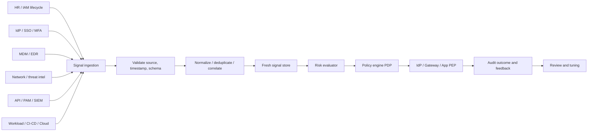
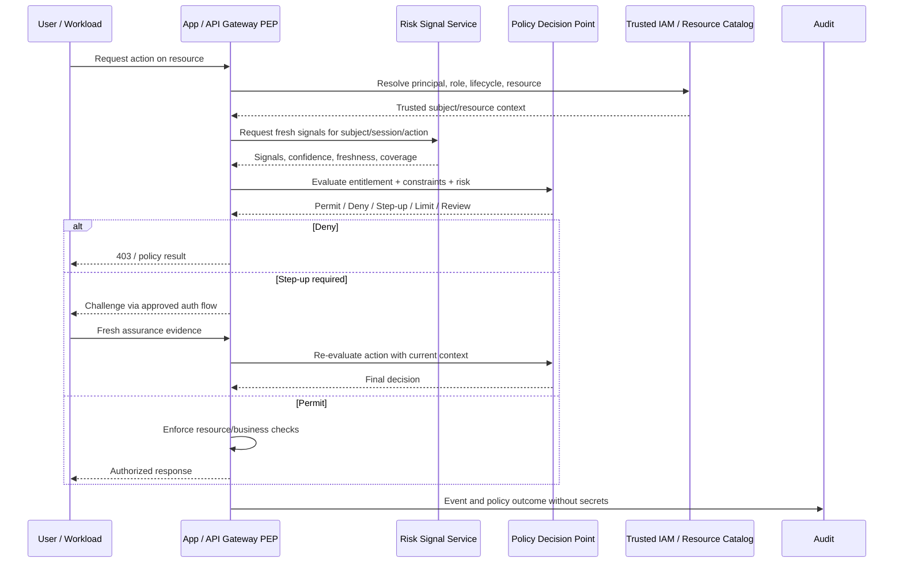

# Risk signal trong Risk-based access: Thu thập, đánh giá và sử dụng tín hiệu rủi ro để kiểm soát truy cập

**Risk signal** (*tín hiệu rủi ro*) là một thông tin quan sát hoặc kết quả phân tích có thể giúp hệ thống đánh giá **nguy cơ gắn với danh tính, phiên xác thực, thiết bị, mạng, hành động, tài nguyên hoặc ngữ cảnh truy cập**. Tín hiệu có thể là sự kiện thực tế như “đăng nhập vừa thất bại nhiều lần”, thuộc tính đã xác minh như “thiết bị không đạt chính sách quản lý”, hoặc nhận định từ một mô hình như “mẫu hoạt động khác thường”.

Trong **risk-based access** (truy cập dựa trên rủi ro), tín hiệu **không phải** là quyết định cuối cùng. Một địa chỉ IP nằm trong danh sách đáng ngờ có thể nâng mức thận trọng; một phiên từ thiết bị được quản lý có thể giảm một phần lo ngại; một thao tác xóa dữ liệu nhạy cảm có thể yêu cầu kiểm soát mạnh hơn thao tác xem dashboard công khai. Hệ thống phải **kết hợp tín hiệu với chính sách, độ tin cậy, thời gian hiệu lực và quyền được cấp** để lựa chọn hành động phù hợp.

Ví dụ, Lan dùng tài khoản công việc để đăng nhập ứng dụng kế toán từ thiết bị công ty. Trong vài phút, hệ thống thấy hai yêu cầu: đọc báo cáo nội bộ và thay đổi thông tin tài khoản ngân hàng nhà cung cấp. Cả hai đến từ cùng một IP, nhưng thao tác thứ hai **có rủi ro nghiệp vụ cao hơn**, nên có thể yêu cầu xác minh bổ sung và phê duyệt độc lập. **Tín hiệu rủi ro** mô tả bối cảnh; **authorization/SoD** vẫn phải ngăn một người tự tạo và duyệt thay đổi trái quy định, ngay cả khi mọi tín hiệu xác thực đều “sạch”.

Bài thuộc chương **Risk-based access** của module `SECURITY_IDENTITY_ACCESS_MANAGEMENT_IDENTITY_LIFECYCLE`. Module nghiên cứu **quản lý vòng đời danh tính trong IAM theo Joiner–Mover–Leaver**, từ xác minh, tạo tài khoản và cấp quyền tới rà soát, thu hồi khi đổi vai trò; kết nối **IdP, SSO, SCIM, RBAC/ABAC, service account, kiểm toán và giảm quyền truy cập tồn dư**. Risk signal giúp phát hiện thay đổi đáng ngờ trong các giai đoạn đó, bổ sung quyết định theo thời điểm nhưng **không thay thế việc cấp và thu hồi quyền dựa trên căn cứ hợp lệ**.

Sau bài học, bạn có thể nhận diện các nhóm risk signal; đánh giá **nguồn gốc, độ mới, chất lượng và khả năng giả mạo**; thiết kế pipeline thu thập–chuẩn hóa–tương quan–đánh giá; phân biệt tín hiệu với risk score và policy decision; xây dựng phản ứng **step-up MFA, giới hạn quyền, chặn hoặc điều tra** theo mức rủi ro; xử lý false positive và tín hiệu thiếu; tích hợp vào JML, IdP/SSO/SCIM, authorization và service identity; đồng thời thiết kế audit, KPI và bộ kiểm thử thực tế.

> **Nguyên tắc cốt lõi:** Một risk signal chỉ là **bằng chứng có độ tin cậy và thời hạn xác định**. Không chuyển trực tiếp tín hiệu đơn lẻ thành kết luận “người dùng bị xâm nhập”, không tự cấp quyền chỉ vì risk score thấp, và không bỏ qua kiểm soát nghiệp vụ vì authentication đã thành công.

## 1. Risk signal, risk score và access decision khác nhau như thế nào?

Ba khái niệm thường bị dùng lẫn:

| Thành phần | Định nghĩa | Ví dụ |
| --- | --- | --- |
| **Risk signal** | Quan sát/thuộc tính/nhận định về một yếu tố rủi ro | `deviceManaged=false` |
| **Risk feature** | Biến được chuẩn hóa để hệ thống đánh giá | `deviceAssurance=LOW` |
| **Risk score/level** | Kết quả tổng hợp đánh giá tại một thời điểm | `riskLevel=HIGH` |
| **Policy decision** | Hành động bảo mật dựa trên rủi ro, entitlement và policy | `STEP_UP_REQUIRED` |
| **Enforcement outcome** | PEP/IdP/API thực thi quyết định | Yêu cầu xác thực mạnh rồi cho phép, hoặc Deny |
| **Business outcome** | Kết quả giao dịch sau authorization | Thay đổi nhà cung cấp được duyệt và commit |

Ví dụ:

```text
Tín hiệu:
  - Thiết bị chưa được quản lý
  - Đăng nhập từ network mới
  - Hành động định thay đổi dữ liệu tài chính

Đánh giá:
  - Risk level: HIGH
  - Confidence: MEDIUM
  - Policy version: access-risk-v12

Quyết định:
  - Yêu cầu step-up bằng phương thức chống phishing
  - Bắt buộc phê duyệt độc lập của nghiệp vụ
  - Không tự động cấp thêm permission

Kết quả:
  - Step-up thành công
  - Nhưng người dùng không có quyền chỉnh thông tin ngân hàng
  - API trả Deny
```

**Risk thấp không tạo quyền mới. Risk cao không tự chứng minh một hành vi gian lận.** Entitlement là điều kiện nền tảng; risk-based controls là lớp quyết định bổ sung.

### 1.1. Authentication risk và transaction risk

- **Authentication risk:** xác suất/nguy cơ một lần xác thực không thực sự do chủ thể hợp lệ thực hiện.
- **Session risk:** nguy cơ trong phiên đang hoạt động, chẳng hạn session bất thường hoặc bị chiếm đoạt.
- **Authorization/access risk:** nguy cơ của việc cho phép một principal thực hiện action trên resource ở ngữ cảnh cụ thể.
- **Transaction risk:** tác động và dấu hiệu bất thường của giao dịch nghiệp vụ, ví dụ thay đổi tài khoản nhận tiền hoặc export dữ liệu số lượng lớn.
- **Lifecycle risk:** nguy cơ do quyền không còn căn cứ khi Joiner–Mover–Leaver hoặc provisioning drift.
- **Workload risk:** nguy cơ từ service principal, credential, workload posture và trust configuration.

Hệ thống tốt không gom tất cả thành một điểm “người dùng có nguy cơ cao” rồi áp y hệt lên mọi hành động.

## 2. Tại sao chỉ dùng RBAC/ABAC tĩnh có thể chưa đủ?

RBAC trả lời chủ thể thuộc role nào. ABAC/PBAC cho phép xét thuộc tính subject, resource và environment. Nhưng nhiều nguy cơ **thay đổi theo thời gian**:

- Thiết bị được quản lý hôm qua có thể hôm nay bị đánh dấu mất an toàn.
- Account có thể vừa bị phát hiện đăng nhập qua credential đã lộ.
- Session đã được cấp token trước khi HR phát Leaver.
- Một user có quyền đọc dữ liệu nhưng bắt đầu export khối lượng bất thường.
- Service principal có thể vừa tạo credential mới ngoài quy trình.
- Access request được phê duyệt đúng nhưng nguồn IP hiện bị lạm dụng.

Risk signal cung cấp dữ liệu để hệ thống **tái đánh giá theo phiên, hành động và sự kiện**, thay vì chỉ dựa vào role/group tại thời điểm đăng nhập.

### 2.1. Ví dụ hai yêu cầu cùng role

| Thuộc tính | Request A | Request B |
| --- | --- | --- |
| User role | `finance-reader` | `finance-reader` |
| Tài nguyên | Báo cáo nội bộ | Báo cáo nội bộ |
| Thiết bị | Công ty quản lý, posture đạt | Thiết bị lạ |
| Phiên MFA | Vừa xác thực mạnh | MFA cũ, assurance thấp |
| Mạng | Môi trường quen thuộc | ASN/proxy chưa được xác minh |
| Dữ liệu cần truy xuất | Một báo cáo | Export nhiều tài liệu |
| Kết quả có thể phù hợp | Permit theo policy | Step-up, giới hạn export hoặc review |

**Cả hai vẫn phải được kiểm tra authorization resource-level**. Risk signal không hợp thức hóa quyền `finance-reader` đối với tenant không được phép.

## 3. Phân loại tín hiệu rủi ro

Có thể nhóm thành nhiều họ, nhưng không nên giới hạn chỉ IP và vị trí địa lý.

| Nhóm | Tín hiệu ví dụ | Điều cần nhớ |
| --- | --- | --- |
| **Identity/account** | Account mới tạo, password reset, vừa được nâng role, Leaver pending | Sự kiện lifecycle không tự là compromise |
| **Authentication** | Nhiều lần thất bại, đăng nhập lạ, MFA reset, phishing-resistant MFA | Thành công MFA không chứng minh mọi hành động hợp lệ |
| **Credential** | Key bị lộ, token replay suspected, secret rotation overdue | Credential status phải kiểm tra từ nguồn đáng tin |
| **Device posture** | Managed/unmanaged, patch level, device compliance, EDR alert | Device signal có thể stale/không chính xác |
| **Network/IP** | IP reputation, proxy/Tor/VPN signal, ASN mới, nguồn bất thường | NAT/VPN hợp pháp có thể gây cảnh báo sai |
| **Geo/travel** | Vùng truy cập mới, tốc độ di chuyển phi thực tế | GeoIP chỉ là ước lượng; cần xem VPN/proxy |
| **Behavior/UEBA** | Mẫu truy cập hiếm, giờ hoạt động khác thường, download spike | Mô hình dễ ảnh hưởng bởi thay đổi công việc |
| **Application/resource** | Dữ liệu nhạy cảm, hành động admin, cross-tenant request | Risk của action khác risk của identity |
| **Authorization/SoD** | Self-approval, role conflict, direct grant ngoài IGA | Có thể là hard deny theo policy, không chỉ cộng điểm |
| **Session/context** | Session mới, token age, device binding thất bại, assurance xuống thấp | Cần xét token/session lifecycle và caching |
| **Threat intelligence** | IOC, domain/IP độc hại, credential exposure alert | Dữ liệu có thể sai hoặc hết hạn |
| **Workload/service** | CI job từ nhánh lạ, cloud key tạo ngoài chuẩn, trust mở rộng | Không phải mọi identity đều có MFA tương tác |
| **Control health** | IdP/EDR/SIEM đang lỗi, dữ liệu không đầy đủ | Không đồng nhất thiếu tín hiệu với “an toàn” |
| **Business transaction** | Sửa tài khoản ngân hàng, vượt hạn mức, thay người phê duyệt | Cần chính sách nghiệp vụ độc lập |

## 4. Tín hiệu liên quan danh tính và vòng đời

Một account không tồn tại ngoài thời gian. JML và entitlement changes có thể làm biến đổi ngữ cảnh rủi ro:

- Joiner vừa được tạo account, chưa hoàn thành enrollment bắt buộc.
- Mover chuyển từ role maker sang checker nhưng direct grant cũ chưa được thu hồi.
- Leaver có hiệu lực nhưng target account vẫn enabled.
- User được cấp role admin ngoài access request.
- Một privileged group membership vừa bị thay đổi.
- Account được phục hồi sau disable mà thiếu approval.
- Owner của service identity đã nghỉ, credential không được rotate.

### 4.1. Phân biệt trạng thái có thẩm quyền và suy đoán

**HR Leaver effective** có thể là **trạng thái lifecycle có thẩm quyền** bắt buộc chặn quyền theo policy. Nó không nên chỉ tăng risk score một chút rồi vẫn cho đăng nhập nếu nghĩa vụ offboarding yêu cầu Deny.

Tương tự:
- SoD violation đã được policy xác định có thể là **hard constraint**.
- Role ngoài scope có thể bị từ chối độc lập với điểm rủi ro.
- User chưa được provisioning hợp lệ thì không thể dùng “risk thấp” để được cấp quyền.

Risk-based access là **kiểm soát bổ sung**, không được biến điều kiện bắt buộc thành lựa chọn tùy điểm.

### 4.2. Dữ liệu JML phải có phiên bản

Một event `Mover approved` đến sau khi Leaver đã có hiệu lực không được kích hoạt lại quyền. Pipeline risk signal cần giữ:
- `identityId` ổn định.
- `sourceEventId`, `effectiveAt`.
- Version/generation quan hệ nhân sự.
- Mốc xử lý và nguồn.
- Trạng thái hiện hành có thẩm quyền.

## 5. Authentication signals: Password, SSO và MFA

Các tín hiệu phổ biến:

| Signal | Quan sát | Cách hiểu phù hợp |
| --- | --- | --- |
| `failedLoginBurst` | Nhiều login failure trong thời gian ngắn | Có thể password spray, user quên mật khẩu, lỗi client |
| `newAuthenticatorEnrolled` | Thêm factor mới | Có thể onboarding hợp lệ hoặc takeover |
| `recentMfaReset` | Reset factor gần đây | Cần xem approval và phương thức recovery |
| `phishingResistantMfa` | Phiên vừa đạt assurance mạnh | Giảm một số rủi ro, không miễn kiểm tra quyền |
| `sessionAge` | Thời gian từ lần xác thực | Cần xem action sensitivity và policy |
| `idpSignInRisk` | IdP phát hiện dấu hiệu bất thường | Là kết quả nguồn, cần provenance/confidence |
| `tokenReplaySuspected` | Dấu hiệu token được tái sử dụng bất thường | Cần containment và xác minh |
| `federationTrustChanged` | Issuer/trust policy thay đổi | Có thể hợp lệ nhưng cần thẩm định |

### 5.1. MFA không phải thuốc chữa mọi rủi ro

Nếu người dùng vừa bị chiếm session, yêu cầu step-up có thể hữu ích tùy cơ chế ràng buộc, nhưng:
- Attacker có thể thực hiện MFA fatigue.
- Factor reset có thể bị lạm dụng.
- Một session cookie bị đánh cắp có thể bỏ qua luồng login nếu backend không enforce lại.
- Xác thực thành công không cho phép bypass SoD hoặc resource authorization.

Với hành động rủi ro cao, ưu tiên **phương thức chống phishing và xác thực gắn với ngữ cảnh** khi có thể; không dùng OTP lặp lại vô hạn như cách phản ứng mặc định.

### 5.2. Risk signal ở IdP và API không đồng nhất

IdP có thể biết đăng nhập từ thiết bị mới; API có thể biết user đang export dữ liệu nhạy cảm. Cần liên kết nhưng không để API tin một risk label do client tự cung cấp.

## 6. Device posture và độ tin cậy của thiết bị

Các tín hiệu có thể gồm:
- Thiết bị đã đăng ký/được quản lý.
- Thiết bị đáp ứng compliance policy.
- Mã hóa ổ đĩa, screen lock, phiên bản OS/patch.
- EDR có cảnh báo malware.
- Certificate/attestation hợp lệ.
- Device identifier liên kết với phiên.

**Device ID là định danh, không phải bằng chứng thiết bị luôn an toàn.** Posture có thể đổi sau lần đánh giá; nguồn dữ liệu có thể offline hoặc báo chậm.

### 6.1. Device freshness

Ví dụ:
- 09:00: MDM báo device COMPLIANT.
- 09:10: EDR phát hiện suspicious process.
- 09:12: App nhận request privilege escalation.

Nếu hệ thống chỉ cache COMPLIANT từ 09:00 và bỏ cảnh báo EDR, quyết định có thể thiếu thông tin quan trọng. Mỗi signal cần **observedAt, validUntil/TTL và chính sách xử lý khi stale**.

### 6.2. Không phân biệt đối xử bằng loại thiết bị đơn giản

Một thiết bị cá nhân không mặc định là malware; một thiết bị công ty không mặc định an toàn tuyệt đối. Policy có thể yêu cầu managed device cho **resource nhạy cảm**, nhưng phải giải thích bằng rủi ro và phương án truy cập hợp lệ, không suy đoán về con người từ nhãn thiết bị.

## 7. Network, IP reputation và địa lý

Tín hiệu mạng có thể hỗ trợ phát hiện:
- IP được biết đang phát tán tấn công.
- Proxy/VPN/Tor exit node theo nguồn phân loại.
- ASN/đường mạng khác thường.
- Đăng nhập từ vùng chưa từng quan sát.
- Hành vi truy cập từ nhiều IP trái với device/session binding.

### 7.1. GeoIP có sai số

Vị trí suy ra từ IP có thể đại diện:
- Điểm thoát VPN.
- Cloud proxy.
- Nhà cung cấp di động.
- NAT tập trung.
- Vị trí đăng ký IP, không phải thiết bị vật lý.

Do đó **không kết luận “người này đang ở quốc gia X” chỉ dựa vào GeoIP**. Cần mô tả đó là *location estimate* kèm nguồn, thời điểm và confidence.

### 7.2. Impossible travel

Một hệ thống có thể tính **tốc độ di chuyển suy ra** giữa hai login:

\[
v = \frac{d(\text{location}_1,\text{location}_2)}{\Delta t}
\]

Trong đó `d` là khoảng cách ước lượng và `Δt` là chênh lệch thời gian. Nếu tốc độ vượt ngưỡng tương ứng với policy, có thể phát `impossibleTravelSuspected`.

**Nhưng ngưỡng này không thể dùng như kết luận chắc chắn**, vì:
- IP geolocation có thể sai.
- User đang dùng VPN hoặc proxy.
- Hai login có thể qua cùng SSO broker nhưng log ghi IP trung gian.
- Có thể có service automation dùng account không đúng cách.
- Độ lệch đồng hồ và ingest delay làm sai thứ tự sự kiện.

Tín hiệu cần được kết hợp với **device binding, session lineage, known corporate egress, MFA và activity pattern**.

### 7.3. IP reputation là tín hiệu có thời hạn

Một IP có thể đổi chủ hoặc đổi mức rủi ro. IOC không nên có TTL vô hạn; phải lưu feed source, version, confidence và observedAt.

## 8. Hành vi người dùng và UEBA

**User and Entity Behavior Analytics (UEBA)** tìm sai khác giữa hoạt động hiện tại và baseline. Ví dụ:
- Số lượng resource truy xuất tăng mạnh.
- Lần đầu truy cập một nhóm dữ liệu.
- Download lớn ngoài thời gian thường thấy.
- Hành vi admin sau nhiều tháng chỉ đọc.
- Nhiều API 403/404 trên các object khác nhau.
- Trình tự gọi API hiếm gặp.
- Một account/service identity hoạt động đồng thời ở các vùng khác nhau.

### 8.1. “Bất thường” không bằng “độc hại”

Một nhân viên mới Joiner, Mover hoặc tham gia incident có thể hành động khác trước. Điều này làm mô hình báo anomaly dù công việc hợp lệ. Cần:
- Baseline theo vai trò/workload và giai đoạn.
- Context từ lịch thay đổi, change ticket, on-call roster.
- Mức độ nghiêm trọng của action/resource.
- Cơ chế nhận feedback sau triage.
- Đánh giá drift và thay đổi mô hình.

### 8.2. Cold start

User mới hoặc ứng dụng mới chưa có lịch sử. Không thể coi **không có baseline** là “risk thấp” hoặc “risk cao” một cách máy móc. Nên dùng policy theo role, device, authentication assurance và resource sensitivity trong giai đoạn cold start.

### 8.3. Avoid feedback loops

Nếu mô hình tự dùng “đã bị chặn bởi risk engine” làm nhãn xác nhận attacker, nó có thể tự củng cố lỗi. Ground truth nên dựa trên **kết luận điều tra và tín hiệu độc lập**, có mức chắc chắn rõ.

## 9. Resource và transaction risk: Mức tác động của hành động

Rủi ro không chỉ phụ thuộc “ai đang gọi” mà còn “muốn làm gì”.

| Action | Nguy cơ/tác động | Kiểm soát thường cân nhắc |
| --- | --- | --- |
| Xem dashboard ít nhạy cảm | Thấp | Authentication, authorization cơ sở |
| Đọc dữ liệu nhân sự nhạy cảm | Cao hơn | Managed device, MFA assurance phù hợp |
| Export hàng loạt | Có thể cao | Step-up, quota, anomaly detection |
| Sửa tài khoản ngân hàng nhà cung cấp | Cao | Transaction verification, approval độc lập |
| Đổi role admin | Cao | PAM/JIT, resource owner approval |
| Revoke credential của hệ thống | Cao | Dual control hoặc policy khẩn có audit |
| Disable audit logging | Rất nhạy cảm | Hard deny hoặc quy trình đặc biệt |
| Khôi phục production | Tác động lớn | Change/incident approval, JIT scope |

### 9.1. Resource sensitivity phải có nguồn đáng tin

Client không được tự khai `resource.classification=PUBLIC` để giảm risk. Dữ liệu classification phải từ **resource registry, data catalog hoặc hệ thống chính sách có thẩm quyền**.

### 9.2. Transaction SoD là rào cản cứng

Nếu Bình đã tạo phiếu thanh toán, risk score “LOW” không được cho Bình tự duyệt cùng phiếu khi chính sách maker-checker cấm điều đó. **SoD và business authorization cần được enforced độc lập**.

## 10. Tín hiệu risk cho service identity và non-human account

Danh tính máy thường không có vị trí cá nhân hoặc MFA tương tác. Các tín hiệu phù hợp hơn gồm:

- Service principal vừa được tạo ngoài IaC hoặc workflow đăng ký.
- Key/certificate sắp hết hạn hoặc rotation quá hạn.
- API key bị phát hiện trong repository/log.
- Workload federation trust có subject/audience rộng bất thường.
- Token được phát từ repository/branch không hợp lệ.
- Kubernetes ServiceAccount dùng ngoài namespace được dự kiến.
- CI/CD job dùng production credential từ pipeline thử nghiệm.
- Workload tăng đột ngột quyền cloud IAM.
- Service identity có owner Leaver hoặc workload đã decommission.
- API pattern lệch mục đích: collector read-only bắt đầu gọi delete.
- Một key được dùng từ nhiều workload không khai báo.
- App-only token thực thi hành động theo user không có quyền.

### 10.1. Phân biệt credential và principal

Một principal có thể có nhiều API keys. Key A bị nghi lộ không có nghĩa principal khác mặc định cũng bị lộ, nhưng cần đánh giá:
- Tất cả credentials và consumers của principal.
- Quyền gán cho principal.
- Token/session dẫn xuất.
- Owner và workload.
- Có thể tách/revoke key nào mà không phá dịch vụ.

### 10.2. Không dùng “impossible travel” cho robot theo logic người

Một workload chạy nhiều region cùng lúc có thể là bình thường. Với service identity, baseline nên theo **deployment topology, expected issuer, pipeline identity và resource scope**, không theo quãng đường di chuyển của nhân viên.

### 10.3. Workload attestation có giới hạn

Token OIDC hợp lệ từ CI có thể chứng minh nguồn phát token theo trust policy, nhưng không tự bảo đảm mã trong job an toàn hoặc permission không quá rộng. Cần kiểm tra repository/environment, artifact provenance và approval khi action nhạy cảm.

## 11. Thu thập và chuẩn hóa risk signal

Một risk engine có thể nhận dữ liệu từ:
- HRIS/lifecycle.
- IdP/SSO, MFA.
- MDM/EDR.
- SIEM/threat intelligence.
- API gateway và application audit.
- IGA/entitlement registry.
- PAM/JIT.
- Cloud IAM và secret manager.
- CI/CD/workload platform.
- Resource catalog/data classification.



### 11.1. Mỗi nguồn có thẩm quyền khác nhau

| Thuộc tính | Nguồn nên ưu tiên | Cảnh báo |
| --- | --- | --- |
| HR relationship/effective date | HRIS hoặc lifecycle registry đã duyệt | Không dùng địa chỉ email như trạng thái HR |
| Authentication assurance | IdP/authenticator có thẩm quyền | Không nhận từ client body |
| Device compliance | MDM/EDR đã xác thực | Posture có thể stale |
| Threat indicators | Feed được đánh giá, SOC analysis | IOC có false positive |
| Roles/entitlements | IAM/target grants | Desired ≠ effective |
| Resource sensitivity | Data/resource catalog | Không tin query param |
| Business approval | Workflow approval/case registry | Ticket ID do client gửi chưa chứng minh approval |
| API activity | PEP/resource server audit | Chưa chắc có mọi endpoint |
| Workload trust | Cloud IAM/CI issuer/registry | Không chỉ tin tên repository |
| Risk engine health | Monitoring/control-plane telemetry | Thiếu dữ liệu không là risk thấp |

### 11.2. Risk signal không phải raw data dump

Không gửi toàn bộ HR record, EDR process tree hoặc raw request body tới risk engine chỉ để tính một thuộc tính. Có thể gửi **normalized signal** và **reference** tới nguồn được bảo vệ, kết hợp phân quyền và retention phù hợp.

## 12. Mô hình dữ liệu risk signal

Một signal record nên có **ngữ nghĩa, phạm vi, nguồn gốc, thời gian, độ tin cậy**:

| Trường | Vai trò |
| --- | --- |
| `signalId` | ID duy nhất để dedupe/audit |
| `signalType` | Loại tín hiệu có định nghĩa rõ |
| `subjectRef` | Human/service identity ID ổn định |
| `sessionId / requestId` | Phạm vi phiên hoặc yêu cầu |
| `deviceRef / workloadRef` | Nguồn device/workload nếu phù hợp |
| `resourceRef` | Tài nguyên liên quan |
| `sourceSystem` | Nguồn phát có thẩm quyền |
| `observedAt` | Khi sự kiện thực sự quan sát |
| `ingestedAt` | Khi nhận vào pipeline |
| `validUntil` | Giới hạn dùng signal trong quyết định |
| `severity / confidence` | Mức rủi ro gợi ý và độ chắc chắn |
| `sourceTrustLevel` | Độ tin cậy được gán cho nguồn |
| `evidenceRef` | Tham chiếu tới bằng chứng, không chứa secret |
| `schemaVersion` | Phiên bản hợp đồng dữ liệu |
| `correlationId` | Liên kết sự kiện |
| `evaluationContext` | Thiết bị/tenant/env/case scope được phép sử dụng |

### 12.1. JSON minh họa

```json
{
  "signalId": "sig-2026-01172",
  "signalType": "RECENT_MFA_FACTOR_RESET",
  "subjectRef": "iam-user-1042",
  "sessionId": "session-ref-88",
  "sourceSystem": "trusted-idp-audit",
  "observedAt": "2026-11-23T01:20:00Z",
  "ingestedAt": "2026-11-23T01:20:04Z",
  "validUntil": "2026-11-24T01:20:00Z",
  "severity": "ELEVATED",
  "confidence": "HIGH",
  "sourceTrustLevel": "AUTHORITY",
  "evidenceRef": "idp-event-5190",
  "schemaVersion": "risk-signal-v2",
  "correlationId": "auth-flow-2048"
}
```

Dữ liệu và TTL đều **minh họa**, không phải quy định hay mặc định chuẩn. Thời hạn rủi ro của MFA reset phải được chọn theo threat model, risk appetite và kết quả đánh giá thực tế.

### 12.2. Không để client tự chọn risk

Một HTTP header như `X-Risk-Level: LOW` từ client không thể là nguồn tin cậy. Risk claims nếu được truyền giữa gateway và backend cần có **kênh tin cậy, kiểm tra issuer/audience/expiry hoặc chứng thực thích hợp**, và không cho client chèn đè.

## 13. Chất lượng tín hiệu: Freshness, confidence, coverage

Ba câu hỏi không thể bỏ qua:

1. **Freshness:** Tín hiệu còn phản ánh tình trạng hiện tại không?
2. **Confidence:** Tín hiệu được xác nhận tới mức nào?
3. **Coverage:** Hệ thống đã quan sát đủ nguồn cần thiết chưa?

| Tình huống | Diễn giải phù hợp |
| --- | --- |
| EDR báo COMPLIANT 2 ngày trước | Có thể stale; không dùng như posture hiện tại |
| GeoIP báo quốc gia mới | Confidence không tuyệt đối |
| IdP xác nhận user DISABLED | Trạng thái có thẩm quyền cho identity |
| SIEM không thấy attack event | Có thể thiếu log, không đồng nghĩa an toàn |
| Threat intel indicator chưa cập nhật | Cần xem TTL/feed freshness |
| SCIM revoke requested nhưng target timeout | Không rõ effective access |
| Ứng dụng không báo session activity | UNKNOWN thay vì “no active session” |
| Device vừa bị quarantine | Cần cập nhật ngay signal store/policy cache |

### 13.1. Signal state khi thiếu hoặc quá hạn

Có thể dùng:

- `PRESENT_VALID`: hiện có và còn đủ điều kiện sử dụng.
- `PRESENT_STALE`: có dữ liệu nhưng quá hạn.
- `MISSING_EXPECTED`: đáng lẽ phải có nhưng chưa nhận.
- `NOT_APPLICABLE`: không phù hợp loại subject/action.
- `SOURCE_UNAVAILABLE`: connector/nguồn lỗi.
- `CONFLICTING`: nhiều nguồn có kết quả đối nghịch.
- `UNVERIFIED`: chưa xác minh provenance.

**MISSING không nên được mã hóa thành “0 điểm rủi ro” theo mặc định**. Nó là trạng thái riêng cần policy xử lý.

### 13.2. Confidence không giống severity

Một feed báo “IP có liên hệ với botnet” có thể rất nghiêm trọng nếu đúng, nhưng confidence thấp. Ngược lại, “thiết bị chưa đạt một yêu cầu patch nhỏ” có thể confidence cao nhưng tác động thấp với resource ít nhạy cảm.

## 14. Thời hạn hiệu lực và giảm trọng số theo thời gian

Nhiều signals giảm giá trị theo thời gian:
- Đăng nhập từ mạng lạ hôm nay khác mạng lạ một năm trước.
- Password reset hôm qua khác password reset cách sáu tháng.
- IOC được cập nhật mỗi giờ có TTL khác HR Leaver.
- Device posture cần xác minh liên tục hơn role catalog.

Một mô hình tham khảo cho **signal tạm thời**:

\[
w_{\text{effective}}(t) = w_0 \cdot e^{-\lambda (t-t_0)}
\]

Với `w0` là trọng số ban đầu, `t0` là mốc quan sát, `λ` là tham số decay được hiệu chỉnh. Đây là **ví dụ toán học**, không phải công thức chuẩn cho mọi rủi ro.

**Không áp decay để làm nhẹ hard constraint** như Leaver đã có hiệu lực, credential đã revoked hoặc role không được phép. Các điều kiện đó phải được đánh giá theo **trạng thái hiện hành**, không tự “hết rủi ro” vì thời gian trôi qua.

### 14.1. Temporal validity

Có thể cần cả:
- `observedAt`: khi hiện tượng xảy ra.
- `validFrom/validUntil`: cửa sổ có ý nghĩa.
- `ingestedAt`: khi hệ thống biết.
- `effectiveAt`: khi HR/policy có hiệu lực.
- `evaluatedAt`: thời điểm quyết định.

Không chỉ dựa vào thứ tự sự kiện đến queue; các nguồn có thể gửi trễ hoặc đảo thứ tự.

## 15. Kết hợp tín hiệu: Tránh cộng điểm máy móc

Một ví dụ scoring **minh họa để học**:

| Feature | Điểm gợi ý |
| --- | ---: |
| Session vừa được xác thực mạnh từ managed device | 0 |
| Nguồn IP mới chưa được xác nhận | +15 |
| Recent MFA reset | +25 |
| Device posture không đáp ứng policy | +30 |
| Privileged action trên production | +20 |
| Tín hiệu credential exposure có confidence cao | +50 |

Nếu tổng từ 0–100, risk engine có thể ánh xạ:
- 0–29: LOW.
- 30–59: MEDIUM.
- 60–79: HIGH.
- 80–100: CRITICAL.

**Các số và ngưỡng trên chỉ minh họa cơ chế**, không đủ cơ sở đưa thẳng vào production. Các tín hiệu có quan hệ với nhau, ảnh hưởng khác nhau theo action và cần calibration bằng dữ liệu thực.

### 15.1. Đếm trùng tín hiệu có cùng nguyên nhân

Ví dụ:
- IP mới.
- Quốc gia mới.
- ASN mới.
- Impossible travel.

Cả bốn có thể do **một VPN mới**. Cộng đủ điểm như bốn bằng chứng độc lập sẽ phóng đại risk. Nên nhóm theo **causal origin**, xét tương quan và sử dụng nguồn bổ sung như device binding.

### 15.2. Không lấy trung bình khi tồn tại điều kiện cấm

Nếu user Leaver đã có hiệu lực và account phải disable, mười tín hiệu “trusted device” không được làm trung bình thành Permit. Nên thiết kế:
1. Kiểm tra **hard deny/eligibility**.
2. Kiểm tra subject/resource/action authorization.
3. Đánh giá contextual risk trong trường hợp còn đủ điều kiện.
4. Áp controls như step-up/limit/review.

### 15.3. Calibration

Điểm 80 không tự có nghĩa “80% xác suất bị tấn công”. Muốn diễn giải xác suất cần **mô hình được hiệu chuẩn**, validation dataset, metric và cách kiểm thử phù hợp. Mức LOW/MEDIUM/HIGH có thể chỉ là **nhãn policy**.

## 16. Từ tín hiệu tới quyết định: Policy và hành động

Một risk policy nên rõ cả **subject eligibility, entitlement, resource sensitivity, confidence và risk level**.

| Điều kiện | Hành động có thể phù hợp | Lưu ý |
| --- | --- | --- |
| Không có entitlement | **Deny** | Không xem điểm rủi ro để “bù quyền” |
| User Leaver đã có hiệu lực | **Deny / revoke** theo policy | Lifecycle constraint |
| Risk thấp, action thông thường | Permit nếu authorized | Vẫn audit và resource check |
| Risk trung bình, session assurance thấp | Step-up MFA | Xem rủi ro và khả năng MFA |
| Device posture không đạt, data nhạy cảm | Chặn hoặc chỉ cho limited mode | Không phải lúc nào MFA đủ |
| Risk cao + hành động privileged | Deny, JIT/reapproval hoặc SOC review | Theo risk appetite |
| Credential exposure confirmed | Revoke/contain session | Không chỉ gửi cảnh báo |
| SoD hard conflict | Deny và finding | Không thể bỏ qua vì risk thấp |
| Source risk unavailable | Policy fallback theo sensitivity | Không mặc định Permit |
| Emergency recovery được ủy quyền | Luồng break-glass riêng có audit | Không bypass tự do |

### 16.1. “Step-up” là một kết quả, không phải permission

**Step-up MFA** xác minh assurance cao hơn. Sau step-up thành công, backend **vẫn phải kiểm tra entitlement, tenant và SoD**. Nếu user không có quyền, không được Permit.

### 16.2. Adaptive authentication khác dynamic authorization

- **Adaptive authentication:** thay đổi yêu cầu xác thực theo risk.
- **Dynamic authorization:** có thể đổi quyết định cho một action/resource tại mỗi request hoặc thời điểm.
- **Continuous access evaluation:** tái đánh giá khi session đang tồn tại hoặc khi có sự kiện quan trọng, tùy khả năng IdP/API.

Không coi logout/step-up của IdP tự làm mọi access token đã cấp mất hiệu lực ở API.

## 17. Kiến trúc PDP/PEP với Risk Signal Service



### 17.1. Nếu risk service lỗi thì sao?

Policy cần quy định theo loại action:
- Với **quyền admin/financial/secret**, có thể chặn hoặc yêu cầu quy trình bảo đảm bổ sung khi thiếu tín hiệu bắt buộc.
- Với **resource ít nhạy cảm**, có thể dùng fallback có giới hạn, TTL ngắn và audit.
- Với **dịch vụ cứu hộ thiết yếu**, phải có break-glass route an toàn, được kiểm soát và hậu kiểm.

**Không có một lựa chọn fail-open/fail-closed tuyệt đối đúng cho mọi hành động**. Tuy nhiên, không được bỏ mọi authorization chỉ vì risk engine không sẵn sàng.

### 17.2. Chống spoofing trusted context

Chỉ trust risk claims được tạo bởi dịch vụ có thẩm quyền qua kết nối bảo vệ, token được ký với `issuer/audience/expiry` đúng hoặc cơ chế truyền tin tương đương. Client không được tự đặt `riskLevel=LOW` hoặc `deviceCompliant=true` rồi được backend tin.

## 18. Xử lý tín hiệu mâu thuẫn

Ví dụ:
- MDM báo thiết bị COMPLIANT.
- EDR báo malware suspicious.
- IdP ghi session MFA mạnh.
- Risk feed ghi source IP bất thường.

Không đơn giản chọn “nguồn mới nhất” mà bỏ qua **authority và semantics**. Cần:
1. Xác minh device/session linkage.
2. So timestamp và phạm vi của từng nguồn.
3. Đánh giá nguồn nào có thẩm quyền cho thuộc tính nào.
4. Phân biệt trạng thái device compliance với detection alert.
5. Ghi `CONFLICTING` nếu chưa giải quyết.
6. Áp policy dự phòng cho action/resource nhạy cảm.
7. Mở finding với owner để điều tra dữ liệu.

**Không “tự trấn an” bằng một tín hiệu tốt để phủ nhận mọi tín hiệu xấu** nếu chúng đo các chiều khác nhau.

## 19. Quy trình normalize và evaluate có kiểm soát

Một pipeline hợp lý:

```text
Raw sources
   ↓ authenticate producer
Event schema validation
   ↓ check timestamps, source, scope
Canonical subject/session/resource correlation
   ↓ identity history and source version
Feature normalization and freshness check
   ↓ no raw secret / no client-supplied risk label
Risk evaluation with correlation and hard constraints
   ↓ explainable reasons, confidence, version
Policy decision for action/resource
   ↓ Permit / Step-up / Limit / Deny / Review
Enforcement at IdP, gateway or application
   ↓ audit, triage, safe feedback
```

### 19.1. Một event không nên được áp cho mọi account có tên giống nhau

Dùng **canonical identity ID** và native ID có security boundary. Email hoặc display name có thể đổi/tái sử dụng. Device, session và workload bindings phải có nguồn tin cậy, tránh áp signal của người này cho người khác.

### 19.2. Deduplication

Sự kiện có thể đến nhiều lần qua SIEM và IdP. Deduplicate dựa trên event/source ID và version khi đủ tin cậy. Không xóa các event khác nhau chỉ vì cùng action, vì hai lần thất bại thực sự là hai tín hiệu.

## 20. Ví dụ schema của một lần đánh giá rủi ro

```yaml
riskEvaluationId: risk-eval-20261123-0901
principal:
  identityId: iam-user-1042
  principalType: HUMAN
sessionRef: session-818
request:
  action: reports.export
  resourceRef: finance/reports/org-17
  environment: production
evaluation:
  evaluatedAt: "2026-11-23T03:12:00Z"
  riskLevel: HIGH
  confidence: MEDIUM
  modelVersion: rule-engine-v4
  policyVersion: risk-access-policy-v12
signals:
  - signalId: device-compliance-190
    signalType: DEVICE_POSTURE_NON_COMPLIANT
    confidence: HIGH
    freshness: CURRENT
  - signalId: network-191
    signalType: NEW_NETWORK
    confidence: MEDIUM
    freshness: CURRENT
  - signalId: mfa-192
    signalType: RECENT_MFA_FACTOR_RESET
    confidence: HIGH
    freshness: CURRENT
coverage:
  mandatorySourcesAvailable: true
  missingOptionalSources:
    - behavioral-history
authorization:
  baseEntitlement: ALLOWED
  sodConstraint: CLEAR
decision:
  action: STEP_UP_REQUIRED
  reasonCodes:
    - SENSITIVE_EXPORT
    - DEVICE_POSTURE_REVIEW
  policyRef: risk-access-policy-v12
```

**Đây là YAML minh họa, không phải schema chuẩn**. Không log raw access tokens, password, session cookie, biometric data hay dữ liệu riêng tư thừa. Một hệ thống thật cần định nghĩa trạng thái post-step-up và kết quả cuối tách khỏi quyết định bước đầu.

## 21. Ví dụ quyết định theo rule, không biến rule thành “AI phán quyết”

Có thể dùng policy-as-code/rule engine để có giải thích rõ:

```text
evaluateAccess(context):
    principal = resolveTrustedPrincipal(context)
    resource = resolveTrustedResource(context)
    action = context.requestedAction

    if principal.lifecycle == TERMINATED:
        return DENY("LIFECYCLE_INELIGIBLE")

    if not authorizedByCurrentEntitlements(principal, action, resource):
        return DENY("NO_ENTITLEMENT")

    if violatesHardSoD(principal, action, resource, context):
        return DENY("SOD_CONFLICT")

    signals = getFreshAuthenticatedSignals(
        principal, context.session, action, resource
    )

    coverage = assessRequiredSourceCoverage(signals, resource)
    if coverage.missingMandatory:
        return fallbackForResourceSensitivity(resource, context)

    evaluation = riskEvaluator.evaluate(
        signals,
        correlationGroups = true,
        policyVersion = currentRiskPolicy()
    )

    if signals.confirmedCompromisedCredential:
        return DENY_AND_CONTAIN("CREDENTIAL_COMPROMISE")

    if evaluation.high and resource.sensitive:
        return STEP_UP_OR_REVIEW("ELEVATED_CONTEXTUAL_RISK")

    if context.session.assuranceBelowRequired(resource):
        return STEP_UP("INSUFFICIENT_AUTH_ASSURANCE")

    return PERMIT_WITH_AUDIT("AUTHORIZED_AND_ACCEPTABLE_RISK")
```

**Đây là giả mã mô tả kiến trúc**, không dùng thẳng trong production. Kết quả `STEP_UP_OR_REVIEW` cần được thực thi bằng workflow có trạng thái và approval cụ thể. Sau step-up phải **tái đánh giá current policy**; không dùng kết quả cũ làm token cấp quyền vĩnh viễn.

### 21.1. Bắt buộc có chính sách cho các tín hiệu không áp dụng

Với service principal, không có device GPS hay human MFA có thể là **NOT_APPLICABLE** chứ không phải data source hỏng. Policy phải chọn signal set theo loại subject/workload.

## 22. Step-up MFA, hạn quyền và session control

Một số kết quả dựa trên risk:

| Kết quả | Hệ quả thực thi |
| --- | --- |
| `PERMIT` | Cho action nếu đủ quyền; audit |
| `STEP_UP` | Yêu cầu chứng minh assurance cao hơn; evaluate lại |
| `LIMITED_ACCESS` | Chỉ một tập action/resource hẹp, khi chính sách cho |
| `READ_ONLY_MODE` | Ngăn write/delete nhưng vẫn cho chức năng cần thiết |
| `DENY` | Chặn request/action |
| `REVOKE_SESSION` | Chấm dứt session được định danh theo khả năng |
| `CONTAIN_CREDENTIAL` | Revoke/disable key hoặc token, mở incident |
| `REVIEW_REQUIRED` | Chờ người có thẩm quyền phê duyệt |
| `ALERT_ONLY` | Ghi nhận/cảnh báo, không thay quyết định |
| `EMERGENCY_FLOW` | Sử dụng đường kiểm soát khẩn đặc biệt |

### 22.1. Điểm quan trọng về access token

Nếu access token tự chứa chứa role/claims được API xác minh offline, cập nhật risk score ở IdP có thể **không thay đổi token đó ngay**. Có thể cần:
- Introspection hoặc server-side session state.
- Policy enforcement tại API.
- Token expiry phù hợp.
- Revocation/deny list theo khả năng.
- Continuous evaluation hooks nếu nền tảng hỗ trợ.

**Không tuyên bố “đã block user” chỉ vì IdP risk level=HIGH** khi resource server vẫn Permit token cũ.

### 22.2. Không gây vòng lặp challenge vô tận

Nếu step-up thành công nhưng signal “new network” vẫn giữ risk HIGH, không nên liên tục yêu cầu người dùng MFA mỗi request. Cần policy về **fresh assurance, action sensitivity, challenge cooldown và decision TTL**. Tuy nhiên, cooldown không được vô hiệu các hard constraints mới.

## 23. Risk signal và Joiner

Với Joiner:
- Account mới chưa có lịch sử hành vi (**cold start**).
- MFA enrollment mới.
- Chưa có device compliance history.
- Role được cấp lần đầu.
- Identity proofing có outcome và độ tin cậy riêng.
- Ngày bắt đầu công việc chưa có hiệu lực.

### 23.1. Không gán “suspicious” chỉ vì là người mới

Một user mới truy cập hệ thống mới là bình thường. Có thể dựa vào:
- HR effective date.
- Phương thức xác minh/activation.
- Managed device.
- Định nghĩa role baseline.
- Resource sensitivity.
- Thời hạn onboarding.

Nếu `employmentStartAt` chưa đến, cấp quyền phải dựa trên **lifecycle eligibility**, không cần dùng risk model để đoán.

### 23.2. Joiner provisioning có race condition

Nếu IdP đã phát session nhưng SCIM chưa hoàn tất cập nhật role, cần:
- Trạng thái `PENDING_PROVISIONING`.
- Không tự grant rộng từ risk thấp.
- Audit target readback.
- Yêu cầu step-up hoặc chặn action cho tới khi entitlement hợp lệ, tùy policy.

## 24. Risk signal và Mover

Mover có thể tạo:
- Tổ hợp role cũ/mới vi phạm SoD.
- Session cũ giữ claim về role trước.
- Direct SaaS grant chưa bị xóa.
- User truy cập data của phòng ban cũ.
- Workload/owner permissions chưa được cập nhật.

Ví dụ Bình đổi từ Maker sang Checker:
1. HR có `effectiveAt`.
2. IAM tính desired entitlements mới.
3. Quyền Maker cũ phải được thu hồi theo chính sách.
4. IdP group được gỡ nhưng DB/SaaS direct grant còn.
5. Risk signal `ENTITLEMENT_DRIFT_AFTER_MOVER` được phát.
6. API/SoD vẫn phải Deny self-approval.
7. Workflow khắc phục và readback target cho kết quả `VERIFIED_REVOKED`.

**Đây không chỉ là login risk**. Một người hoàn toàn hợp lệ vẫn có thể gây rủi ro do quyền tồn dư sau Mover.

## 25. Risk signal và Leaver

Leaver phát sự kiện có thẩm quyền:
- Employment relationship terminated.
- Account disable expected.
- PAM/IdP sessions cần kết thúc.
- Refresh token/API key/PAT cần xử lý theo loại.
- Target service/DB/SaaS accounts cần deprovision.
- Mọi privileged action sau mốc Leaver đáng kiểm tra.

### 25.1. Không biến Leaver thành một điểm rủi ro “có thể bù”

Khi policy quy định nhân viên đã hết quan hệ không còn quyền, đây là **hard deny condition**. Mười tín hiệu tốt như managed device, IP quen thuộc và MFA thành công không làm khôi phục eligibility.

### 25.2. Leaver và session tồn dư

Một tín hiệu `POST_LEAVER_ACCESS_ATTEMPT` có thể nâng mức nghi vấn nhưng cần phân biệt:
- User cố đăng nhập.
- Job dùng PAT cũ.
- Session/token cũ vẫn được API chấp nhận.
- Backend có account riêng tiếp tục hoạt động hợp lệ.

**Đừng kết luận người Leaver trực tiếp truy cập chỉ từ key do họ tạo**. Cần mapping credential–principal–workload–consumer và log request.

## 26. Risk signal và access request/access review

Risk có thể được đánh giá ở nhiều thời điểm:
- Khi xin quyền.
- Trước khi phê duyệt quyền nhạy cảm.
- Khi active JIT role.
- Khi phiên dùng quyền.
- Khi đến hạn access review.
- Khi role/target có thay đổi.

Ví dụ request production admin từ account có MFA reset bất thường nên:
- Kiểm tra policy và entitlement.
- Yêu cầu approver độc lập.
- Có thể yêu cầu MFA assurance mạnh hơn.
- Giới hạn thời gian và scope.
- Lưu audit; không tự gắn label fraud cho user.

### 26.1. Risk không thay reviewer

Risk engine có thể đưa **risk explanation** để người duyệt cân nhắc; không nên tự chuyển “risk thấp” thành approval của resource owner nếu quy trình yêu cầu phê duyệt.

### 26.2. Risk sau recertification

Nếu reviewer KEEP một role nhưng sau đó có Leaver hoặc credential compromise, quyết định KEEP cũ không được **tái cấp quyền**. Policy phải kiểm tra trạng thái hiện hành và version trước provisioning.

## 27. Tín hiệu đặc quyền, PAM/JIT và break-glass

Với privileged access, các signals quan trọng:
- Request JIT ngoài on-call schedule.
- Activation từ unmanaged device.
- MFA bị reset gần thời điểm yêu cầu admin.
- Admin role vừa bị cấp thủ công.
- Session thực thi command ngoài scope.
- Target vault credential checkout từ đường bất thường.
- Role không được thu hồi sau TTL.
- Một session admin mở trực tiếp ngoài PAM.
- Break-glass được dùng lặp lại cho công việc thông thường.

### 27.1. Risk không được chặn cứu hộ theo thiết kế một cách mù quáng

Khi IdP/EDR gặp sự cố, device compliance hoặc risk feed có thể không sẵn. Nếu hệ thống chặn mọi access, đội vận hành có thể không khôi phục được dịch vụ.

Nên thiết kế **emergency flow được phê duyệt trước**, gồm:
- Recovery identity độc lập khi cần.
- Dual control/escrow phù hợp.
- Phạm vi và time window.
- Log thủ công/đệm nếu SIEM chưa hoạt động.
- Post-use review.
- Thu hồi/rotate credential sau sử dụng.

**Break-glass không phải “bỏ qua mọi chính sách khi risk service lỗi”**. Nó là workflow rủi ro cao với kiểm soát bù trừ.

## 28. Xử lý false positive và false negative

| Khái niệm | Ví dụ | Hậu quả |
| --- | --- | --- |
| **False positive** | Corporate VPN làm phát impossible travel | User hợp lệ bị chặn/step-up quá nhiều |
| **False negative** | Token bị đánh cắp nhưng hoạt động từ IP quen | Request nguy hiểm được Permit |
| **Data gap** | MDM offline, risk engine coi thiếu là OK | Đánh giá thiếu rủi ro |
| **Concept drift** | Đội chuyển sang remote work, model vẫn học office pattern cũ | Tăng cảnh báo không hữu ích |
| **Adversarial behavior** | Attacker dùng proxy hợp pháp để giảm dấu hiệu | Né một số rules |
| **Feedback bias** | Chỉ case bị chặn mới được điều tra | Không đo được lỗi trên traffic Permit |

### 28.1. Cơ chế giải thích và kháng nghị

Với access bị hạn chế bởi risk signal:
- Cho user biết bước xác minh/khôi phục phù hợp, không tiết lộ chi tiết có thể giúp bypass.
- Có kênh hỗ trợ/appeal khi không thể dùng factor/device.
- Ghi reason codes nội bộ và decision version.
- Phân loại incident thực sự với tín hiệu sai.
- Sửa baseline/nguồn theo bằng chứng.

### 28.2. Đánh giá công bằng và quyền riêng tư

Không sử dụng trực tiếp hay gián tiếp thuộc tính nhạy cảm của cá nhân để tạo hạn chế truy cập không có căn cứ. Đánh giá hệ thống với các tình huống hợp pháp như:
- Nhân viên làm việc từ xa.
- Người dùng thường xuyên đi công tác.
- Hệ thống sử dụng VPN.
- Người dùng mới chưa có lịch sử.
- Thiết bị hỗ trợ khả năng tiếp cận khác nhau.

**Risk signal phải gắn với nhu cầu bảo mật xác đáng, không suy đoán phẩm chất cá nhân**.

## 29. Độ an toàn của nguồn tín hiệu: Spoofing, poisoning và trust boundary

Một attacker có thể:
- Chèn header `X-Device-Managed: true`.
- Gửi request với `userRisk=LOW` trong JSON.
- Tạo event giả qua webhook không kiểm chữ ký.
- Làm mất log của hành vi thật.
- Sửa timestamp để một IOC trông đã hết hạn.
- Lạm dụng API thay đổi risk policy.
- Poison baseline bằng nhiều hoạt động “bình thường giả”.
- Dùng compromised connector credentials để phát signal xanh.

Phòng vệ:
1. Xác thực producer và bảo vệ transport.
2. Validate schema, issuer, signature hoặc cơ chế chứng thực thích hợp.
3. Kiểm tra source authorization cho signal type.
4. Chống replay bằng event ID, timestamp và nonce khi cần.
5. Không tin principal/resource được client tự khai.
6. Kiểm soát quyền sửa signal store, policy và model.
7. Ghi immutable/tamper-evident audit khi cần.
8. Monitor collector health và dropped events.
9. Đối soát nguồn độc lập với signal nhạy cảm.
10. Có incident flow khi risk pipeline bị compromise.

### 29.1. Không tự động dùng output risk model làm ground truth

Nếu model tự sinh nhãn rồi dùng nhãn đó để huấn luyện vòng sau mà không review, attacker hoặc dữ liệu nhiễu có thể củng cố bias. Cần **feedback đã được xác minh, versioning và giám sát drift**.

## 30. Dữ liệu cá nhân và retention của risk signal

Risk signals có thể chứa:
- IP, device ID, geolocation ước lượng.
- Lịch sử đăng nhập.
- Hoạt động ứng dụng.
- Thông tin hợp đồng/lifecycle.
- Security incident labels.
- Behavioral anomaly score.

Cần:
- Chỉ thu những trường cần cho policy và điều tra.
- Phân quyền theo need-to-know.
- Ghi purposes rõ.
- Không lưu raw password/token/OTP/cookie.
- Quy định retention của **raw events, features, scores, decisions và audit evidence** riêng.
- Xem xét quy định bảo vệ dữ liệu và hợp đồng áp dụng với Legal/Privacy.
- Có cơ chế xử lý dữ liệu sai hoặc lịch sử cần điều chỉnh, không sửa im lặng audit.
- Ghi audit những người đã xem/export dữ liệu.

### 30.1. Feature store không phải nơi giữ mọi log mãi mãi

Một risk feature như `failedLoginCountLast10Minutes` có thể hết giá trị sau cửa sổ ngắn, trong khi audit về **quyết định Deny đã áp và policy version** có thể cần retention lâu hơn vì mục đích điều tra. Không áp chung một TTL thiếu căn cứ.

### 30.2. Pseudonymization vẫn có thể cho phép liên kết

Nếu feature store giữ mã thay tên nhưng có bảng map về người thật, nó vẫn phải được bảo vệ theo yêu cầu dữ liệu có thể liên kết lại. Không gọi đó là dữ liệu “vô danh tuyệt đối”.

## 31. Risk evaluation audit và khả năng giải thích

Một decision quan trọng nên lưu:
- `riskEvaluationId`.
- Principal/session/request/resource IDs.
- Evaluation time và action.
- Signal IDs/types đã sử dụng.
- Source freshness/coverage/confidence.
- Risk level/score (nếu có) và model/rule version.
- Policy version.
- Hard constraints được áp.
- Decision: Permit/Step-up/Deny/Limit/Review.
- Enforcement outcome tại PEP.
- Post-step-up re-evaluation nếu có.
- Case/incident/finding correlation.
- Có thể dùng **evidence references** thay raw payload.

### 31.1. Không log nhạy cảm để dễ debug

Tránh raw:
- Access token, refresh token, API key.
- Password, OTP/TOTP seed, passkey private key.
- Session cookie.
- Dữ liệu HR đầy đủ.
- Location precision cao không cần thiết.
- Request body chứa thông tin tài chính/PII ngoài mục đích.

### 31.2. Quyết định “Permit” không chứng minh business commit

Một API có thể được Permit bởi PDP nhưng transaction fail hoặc bị block bởi business rule. Khi điều tra phải nối **policy decision, PEP action và business result** thay vì chỉ một event.

## 32. Chống sử dụng risk signal để mở rộng quyền

Một sai lầm nguy hiểm: “Risk thấp nên tự grant privilege theo context”. Risk-based access nên làm việc trong **trần quyền đã được phê duyệt**.

| Tình huống | Xử lý đúng |
| --- | --- |
| User không có `payments.approve` | Deny dù risk thấp |
| Role `report-reader` có, nhưng request cross-tenant | Deny theo resource authorization |
| Credential lộ, role vẫn còn | Contain/revoke credential, không chỉ cộng risk |
| HR Leaver đã có hiệu lực | Deny và deprovision |
| Access request đã hết hạn | Không tái kích hoạt vì IP quen |
| Self-approval trái SoD | Deny theo nghiệp vụ |
| JIT role chưa có activation hợp lệ | Không tự active khi device trusted |
| Service key chỉ staging | Không cho production vì risk thấp |

**Low-risk là điều kiện bảo mật thuận lợi, không phải approval, role assignment hoặc entitlement source.**

## 33. Tình huống thực tế 1: “Impossible travel” do VPN

Lan đăng nhập IdP lúc 09:00 từ mạng gia đình; 09:05 có login ghi nhận tại một quốc gia khác. Risk engine gắn `IMPOSSIBLE_TRAVEL` và chuyển HIGH.

Điều tra có thêm:
- Hai request dùng cùng managed device và session hợp lệ.
- Lần thứ hai qua VPN doanh nghiệp.
- GeoIP của VPN là điểm egress ở nước khác.
- Không có EDR alert hoặc hành động bất thường.
- MFA mới vừa được thực hiện.

**Kết luận:** tín hiệu vị trí cần được giải thích theo network architecture. Không nên auto-tag Lan là compromised vĩnh viễn. Có thể yêu cầu step-up theo risk policy trong lúc xác minh, sau đó cập nhật known egress list/baseline và audit lý do.

**Bài học:** IP/geo estimate có giá trị cảnh báo nhưng phải kèm provenance, confidence, device/session context và feedback.

## 34. Tình huống thực tế 2: Mover còn quyền cũ dù đăng nhập an toàn

Bình chuyển từ Finance Maker sang Audit Reviewer. Trong 2 giờ đầu sau Mover, IdP đã gỡ group cũ nhưng SaaS vẫn giữ direct role Maker.

| Tín hiệu | Ý nghĩa |
| --- | --- |
| `HR_MOVER_EFFECTIVE` | Role cũ không còn phù hợp |
| `IDP_ROLE_REMOVED` | Desired/group thay đổi |
| `TARGET_DIRECT_GRANT_PRESENT` | Quyền target còn tồn dư |
| `SESSION_MFA_STRONG` | Authentication có assurance cao |
| `SOD_CONFLICT` | Có rủi ro quyền chồng |
| `API_MAKER_ACTION_ATTEMPT` | Có action cần kiểm tra |

Không được cho thao tác Maker vì “MFA đã tốt và IP quen”. Cần áp **authorization/SoD Deny**, thu hồi direct grant, xử lý session và verify target.

**Bài học:** Risk signal của lifecycle và entitlement drift có thể quan trọng hơn login anomaly, nhưng hành động thu hồi phải dựa trên policy có thẩm quyền.

## 35. Tình huống thực tế 3: API key của workload xuất hiện từ pipeline lạ

Service principal `deploy-orders-prod` thường nhận short-lived token từ CI protected production environment. Bỗng thấy token exchange từ một branch không được duyệt.

Dấu hiệu:
- Issuer hợp lệ nhưng subject claim khác trust scope dự kiến.
- Job run không có production approval.
- Key/secret mới được tạo ngoài IaC.
- Request có hành động deploy production.
- Resource target là cluster quan trọng.

Hướng xử lý:
1. Kiểm tra trust issuer/subject/audience và policy version.
2. Chặn token exchange không hợp lệ tại provider.
3. Kiểm tra access token/session đã phát.
4. Revoke/rotate credentials khi cần.
5. Đối soát audit, CI run, artifact và deployment outcome.
6. Thu hẹp trust conditions và role scope.
7. Mở incident nếu có bằng chứng lạm dụng.
8. Không dùng step-up MFA của người dùng để giải quyết một workflow app-only.

**Bài học:** Service identity cần risk signals về workload provenance và credential lifecycle, không chỉ network/geolocation.

## 36. Tình huống thực tế 4: Risk service lỗi khi thực hiện giao dịch nhạy cảm

Một API tài chính được bảo vệ bằng risk evaluation. Trong sự cố mạng, device signal service timeout. User có role `payment-maker` và đang tạo giao dịch.

Thiết kế yếu:
- Map timeout thành `deviceRisk=0`.
- Cho phép tất cả transaction.
- Không audit missing data.

Thiết kế tốt hơn:
- Ghi `SOURCE_UNAVAILABLE` và policy fallback.
- Kiểm tra base entitlement/SoD bắt buộc.
- Với action nhạy cảm, có thể chặn, giảm chức năng hoặc yêu cầu approval bảo đảm hơn theo chính sách.
- Có circuit breaker và giới hạn thời gian chờ.
- Audit dependency failure.
- Theo dõi SLA, khôi phục nguồn và re-evaluate khi thích hợp.

**Bài học:** Thiếu tín hiệu là **độ bất định**, không phải bằng chứng an toàn.

## 37. Tình huống thực tế 5: MFA reset rồi yêu cầu admin role

Một người dùng vừa reset factor do mất điện thoại, sau đó xin JIT production admin.

Các risk signals:
- `RECENT_MFA_FACTOR_RESET`.
- `NEW_DEVICE`.
- `PRIVILEGED_ACCESS_REQUEST`.
- `INCIDENT_TICKET_PRESENT`.
- `PAM_APPROVAL_PENDING`.

Có thể:
1. Xác minh recovery process hợp lệ và actor.
2. Yêu cầu phương thức assurance phù hợp.
3. Không grant admin trước khi có approval JIT/owner cần thiết.
4. Giới hạn resource scope và thời gian.
5. Ghi session/audit theo policy.
6. Khi hết nhiệm vụ, revoke/verify và post-use review.

**Bài học:** Signal làm tăng cường kiểm tra; không thay căn cứ cấp quyền.

## 38. Tình huống thực tế 6: Threat intel báo IP xấu nhưng device và session ổn

Một security feed gắn IP có dấu hiệu nguy hiểm. IdP thấy device managed, token mới và user đang đọc dữ liệu ít nhạy cảm.

Điều tra thấy:
- IP là NAT gateway dùng chung.
- Threat intel entry từ vài tuần trước, chưa được xác nhận mới.
- Không thấy action ngoài scope trong log có coverage tốt.
- Không có session anomaly.

Không nên coi kết quả feed là bằng chứng đã bị compromise. Hệ thống có thể:
- Áp step-up có cân nhắc sensitivity nếu policy yêu cầu.
- Kiểm tra feed freshness, confidence, ASN và use-case.
- Cập nhật triage/allowlisting có kiểm soát, có thời hạn.
- Theo dõi tiếp thay vì khóa toàn bộ công việc.

**Bài học:** Tín hiệu phải được kiểm tra trong **ngữ cảnh và theo thời hạn**, không đối xử tất cả IOC như sự thật vĩnh viễn.

## 39. Ma trận kiểm thử Risk signal

| Ca kiểm thử | Kết quả mong đợi |
| --- | --- |
| User có entitlement và signals bình thường | Permit theo resource policy |
| User không có entitlement, risk LOW | Deny |
| Leaver effective, device COMPLIANT | Deny/deprovision theo policy |
| Mover còn direct grant cũ | Drift signal và enforce policy/revoke |
| Self-approval trái SoD | Deny bất kể risk |
| MFA vừa reset + yêu cầu admin | Step-up/approval theo policy |
| Recent MFA phishing-resistant | Assurance được xét, không bypass authorization |
| IdP risk label từ client header | Bị bỏ qua/từ chối |
| Signal schema sai | Quarantine/validation error |
| Event nguồn không có chữ ký/cơ chế tin cậy | Không gắn authority |
| Event ID trùng do retry | Dedupe đúng, không cộng đôi |
| Hai event thực sự giống nhau | Không xóa nhầm |
| Timestamp trong tương lai bất thường | Validate/flag anomaly |
| Signal quá TTL | STALE, không dùng như CURRENT |
| MDM không phản hồi | SOURCE_UNAVAILABLE theo policy |
| Device signal không áp dụng với service principal | NOT_APPLICABLE |
| SIEM không có log vì collector lỗi | Không suy thành LOW |
| GeoIP qua VPN hợp lệ | Kiểm tra context, giảm false positive |
| IP feed hết hạn | Không dùng làm IOC hiện hành vô thời hạn |
| Bốn geo/network signals cùng một nguyên nhân | Tránh cộng điểm trùng |
| Token JWT còn hạn sau đổi risk | API enforcement vẫn xét state/policy |
| Step-up thành công nhưng resource không thuộc user | Deny |
| Step-up thành công nhưng SoD conflict | Deny |
| Session assurance thấp với resource nhạy cảm | Challenge phù hợp |
| Repeat challenge sau step-up hợp lệ | Không vòng lặp challenge vô tận |
| Risk HIGH khi PAM/IdP outage | Recovery flow có kiểm soát |
| Branch lạ xin token production | Workload trust/policy Deny |
| Workload dùng key ngoài inventory | Risk finding + owner review |
| Service principal owner Leaver | Chuyển owner/rotate theo rủi ro |
| Credential exposure confirmed | Revoke/contain và verify |
| Risk feed compromised/poisoned | Bảo vệ nguồn và cách ly tín hiệu |
| Policy version mới áp hành động cũ | Historical decisions giữ version gốc |
| Cloud resource classification thiếu | UNKNOWN và fallback theo sensitivity |
| Resource do client tự khai PUBLIC | Không tin metadata client |
| Một client tự đặt `riskScore=0` | Không được dùng |
| High-confidence nhưng low-impact signal | Phân biệt confidence với severity |
| Low-confidence high-impact feed | Escalate/verify tùy policy |
| Device posture stale sau EDR alert | Không tiếp tục coi COMPLIANT hiện hành |
| API payment có role nhưng thiếu checker | Business authorization Deny |
| Risk model dùng nhãn chặn làm ground truth | Tránh feedback bias |
| Risk service timeout | Chính sách fallback, audit và SLA |
| Cache policy không cập nhật sau Leaver | Chặn decision stale |
| Event Mover cũ đến sau Leaver | Không regrant |
| Data export audit chứa raw token | Redact/incident xử lý |
| Cross-tenant resource request | Deny theo tenant scope |
| “Impossible travel” user mới chưa có baseline | Không suy attack nếu thiếu dữ liệu |
| Different device but same IP | Không gộp các sessions vô căn cứ |
| No device GPS on workload | Không biến thành human risk |
| Risk explanation có secret | Chặn trước khi log/response |
| SOC review xác nhận false positive | Feedback có provenance/approval |
| Risk engine vô hiệu quyền đang phục hồi hợp lệ | Điều tra policy/fail-mode, không bypass tự do |

**Bộ kiểm thử phải kiểm tra cả tín hiệu đúng, sai, thiếu, quá hạn, giả mạo và mâu thuẫn**, cùng với khả năng PEP thực thi quyết định trên resource.

## 40. KPI và vận hành Risk signal

| KPI | Ý nghĩa |
| --- | --- |
| **Signal source coverage** | Bao nhiêu IdP/EDR/API/workload sources đang cung cấp dữ liệu |
| **Freshness/latency** | Thời gian từ quan sát tới khả năng đánh giá |
| **Missing mandatory signals** | Tần suất dữ liệu cần thiết không sẵn |
| **Conflicting signals** | Chất lượng correlation và dữ liệu |
| **False positive rate** | Quyết định cản trở truy cập hợp lệ |
| **False negative findings** | Trường hợp rủi ro bỏ sót qua điều tra |
| **Step-up completion rate** | Khả năng user hoàn thành kiểm soát |
| **Step-up abandonment/support load** | Tác động usability và khả năng tiếp cận |
| **Challenge loop rate** | Lỗi policy lặp xác thực |
| **Risk-driven deny rate** | Số request bị chặn vì điều kiện rủi ro |
| **Privilege misuse detection lag** | Trễ phát hiện hành động đáng ngờ |
| **Post-Leaver access attempts** | Access sau mốc offboarding |
| **Mover residual entitlement findings** | Quyền cũ tồn sau chuyển vai trò |
| **Unmanaged privileged service credentials** | Rủi ro từ non-human identities |
| **Policy drift/override rate** | Mức thay đổi hoặc bypass không chuẩn |
| **Model/rule calibration quality** | Mức tương quan giữa nhãn và kết quả điều tra |
| **Appeal/exception closure** | Thời gian xử lý cảnh báo sai |
| **Audit decision completeness** | Tỷ lệ decision có signal IDs, policy, outcome |
| **Enforcement coverage** | Bao nhiêu API/PEP thực sự dùng risk decision |
| **Time to contain compromised credential** | Khả năng giảm quyền sau xác minh |
| **Break-glass post-use review** | Tỷ lệ hậu kiểm truy cập khẩn |

### 40.1. Đừng chỉ tối ưu số lượng Deny

Một hệ thống chặn tất cả request sẽ có tỷ lệ “không cho request nguy hiểm” cao nhưng **không đáp ứng vận hành**. Cần đánh giá cả bảo mật, business impact, false positive, latency và privacy.

### 40.2. Chất lượng ground truth

Tỷ lệ false positive/negative có thể khó đo chính xác vì không thể điều tra toàn bộ traffic. Cần khai báo **mẫu kiểm tra, nhãn confirmed/suspected và độ bao phủ**, không báo chỉ số như xác suất chắc chắn khi dữ liệu thiếu.

## 41. Checklist thiết kế và triển khai Risk signal

1. Đã phân biệt **risk signal, risk score/level, policy decision và enforcement outcome** chưa?
2. Các hard constraints như Leaver, entitlement và SoD có được enforce **trước hoặc độc lập** với risk score không?
3. Có danh mục signal types và ngữ nghĩa rõ theo **human, workload, device, network, resource, session, transaction** không?
4. Mỗi signal có source, observedAt, ingestedAt, validUntil và confidence không?
5. Có xác thực nguồn/provenance, chống header spoofing và webhook replay không?
6. Có phân biệt severity với confidence và authority không?
7. Có biết source nào có thẩm quyền cho HR/device/role/resource không?
8. Có xử lý stale, missing, conflicting, not applicable và source unavailable khác nhau không?
9. Có tránh dùng GeoIP/IP reputation như dữ liệu chính xác tuyệt đối không?
10. Có tránh double-counting các signals có chung nguyên nhân không?
11. Có baseline riêng cho user mới, Mover, remote worker và service workload không?
12. Có policy/action sensitivity và data classification từ nguồn đáng tin không?
13. Risk score có được hiệu chỉnh và không bị hiểu nhầm như xác suất chưa được kiểm chứng không?
14. Có workflow step-up thích hợp và tái đánh giá authorization sau challenge không?
15. Có ngăn vòng lặp MFA và xử lý user không thể hoàn tất challenge không?
16. IdP và resource server có đồng bộ rủi ro đủ cho token/session đang tồn tại không?
17. Có TTL cho cached risk/decision và invalidation sau revoke/Leaver không?
18. Có phản ứng mạnh với credential compromise thay vì chỉ cộng điểm không?
19. Risk service outage có fallback riêng cho low-risk, privileged và emergency tasks không?
20. Có audit đầy đủ signal IDs, policy version, evaluation time, outcome, PEP result không?
21. Có redaction để tránh raw token, password, OTP, private key, PII thừa trong logs không?
22. Có bảo vệ feature store và retention schedule cho raw events/features/decisions không?
23. Có luồng SOC triage, appeal/false-positive feedback và review policy không?
24. JML events có trigger review/containment quyền tồn dư ở target không?
25. Có signal coverage cho service principals, cloud keys, CI pipelines và workload federation không?
26. Có đánh giá model drift, source compromise và attack/adversarial manipulation không?
27. Có kiểm thử Permit đúng scope, Deny ngoài scope và step-up trên resource quan trọng không?
28. Có evidence rằng **PEP thực sự thực thi** risk decision chứ không chỉ dashboard hiển thị HIGH không?
29. Có phân biệt observed action và business transaction commit trong điều tra không?
30. Có thể giải thích **tín hiệu nào, từ nguồn nào, còn hiệu lực khi nào, dẫn tới quyết định gì và ai chịu trách nhiệm** không?

## 42. Câu hỏi tự kiểm tra

**Câu 1.** Risk signal có phải là risk score hoặc kết luận account đã bị chiếm đoạt không?

**Trả lời:** Không. Signal là quan sát/nhận định có nguồn, phạm vi và độ tin cậy. Risk score tổng hợp tín hiệu; kết luận compromise cần bằng chứng/điều tra, còn access decision do policy quyết định.

**Câu 2.** Người dùng có risk LOW nhưng không có quyền `finance.approve`. Có thể cho approve không?

**Trả lời:** Không. Risk thấp không tạo entitlement. API phải Deny theo authorization.

**Câu 3.** Một IdP cho biết đăng nhập từ quốc gia mới. Có chắc người dùng đi đến quốc gia đó không?

**Trả lời:** Không. GeoIP có sai số và có thể phản ánh VPN/proxy/NAT; phải xét device, session, network và nguồn dữ liệu.

**Câu 4.** EDR không gửi tín hiệu trong 2 giờ. Có thể cho `deviceRisk=LOW` không?

**Trả lời:** Không tự động. Ghi SOURCE_UNAVAILABLE hoặc STALE, chọn fallback theo resource sensitivity và policy.

**Câu 5.** MFA thành công có cho phép người tạo tự phê duyệt giao dịch khi SoD cấm không?

**Trả lời:** Không. MFA là authentication assurance, không thay policy SoD hoặc business authorization.

**Câu 6.** Vì sao phải tính risk theo action/resource thay vì chỉ một điểm cho người dùng?

**Trả lời:** Đọc dashboard và sửa IAM policy có tác động rất khác nhau, dù cùng user/session. Risk và yêu cầu kiểm soát phải xét **transaction sensitivity và resource context**.

**Câu 7.** Recent MFA reset là tín hiệu rủi ro, vậy mọi lần reset là tấn công?

**Trả lời:** Không. Reset có thể hợp lệ khi mất thiết bị; cần xem approval, recovery method, signal khác và behavior.

**Câu 8.** User Leaver có managed device và IP quen thuộc. Risk engine có thể giảm điểm rồi cho đăng nhập không?

**Trả lời:** Không nếu policy yêu cầu chặn khi Leaver có hiệu lực. Đây là hard lifecycle constraint độc lập với các signal tốt.

**Câu 9.** Service principal có nên dùng impossible travel như user không?

**Trả lời:** Không mặc định. Workload có thể chạy multi-region hợp lệ; nên dùng deployment/workload provenance, trust issuer, credential lifecycle và action/resource scope.

**Câu 10.** Tại sao bốn network anomalies có thể không mạnh bằng bốn nguồn độc lập?

**Trả lời:** Chúng có thể cùng xuất phát từ một VPN hoặc proxy, nên cộng điểm độc lập gây overcount. Cần correlation/causal grouping.

**Câu 11.** Một API token đã được cấp trước khi IdP gắn user HIGH risk. Có chắc token bị chặn ngay không?

**Trả lời:** Không. Phụ thuộc API có kiểm policy/session state, introspection, TTL hoặc revocation control. Phải xác minh effective access ở resource server.

**Câu 12.** MDM nói COMPLIANT nhưng EDR báo malware. Chọn tín hiệu nào?

**Trả lời:** Xác minh nguồn, thời gian, thiết bị và semantics; không đơn giản “tín hiệu mới nhất thắng”. Có thể đánh dấu CONFLICTING và áp fallback rủi ro theo action.

**Câu 13.** Step-up MFA thành công có nghĩa phải Permit mọi yêu cầu sau đó?

**Trả lời:** Không. Phải tái kiểm tra entitlement, tenant, SoD và current security state. Fresh MFA không cấp role mới.

**Câu 14.** Tại sao risk engine phải lưu policy/model version và signal IDs trong audit?

**Trả lời:** Để tái dựng vì sao một decision được đưa ra tại thời điểm đó, kiểm tra chất lượng nguồn, phục vụ review và phân biệt policy hiện tại với policy lịch sử.

**Câu 15.** Nếu user liên tục bị challenge dù MFA đúng, vấn đề có thể ở đâu?

**Trả lời:** Step-up state/assurance TTL không được lưu hoặc policy cứ coi cùng signal là risk chưa được xử lý. Cần thiết kế challenge cooldown và re-evaluation, không làm lỏng hard constraints.

**Câu 16.** Có thể dùng risk signal để tự cấp quyền admin khi có incident không?

**Trả lời:** Không. Emergency/JIT access phải có workflow, eligibility, approval/dual control và audit riêng. Risk là dữ liệu để điều chỉnh kiểm soát, không phải nguồn cấp admin.

## Kết luận

**Risk signal là lớp quan sát giúp truy cập dựa trên rủi ro phản ứng với bối cảnh biến đổi liên tục, nhưng không phải một phép phán quyết độc lập về con người hay một cách cấp quyền.** Hệ thống phải thu thập tín hiệu từ **IdP/SSO/MFA, HR/JML, device, network, threat intel, API/authorization, PAM và service workload** theo **provenance, freshness, confidence, coverage**; đối soát và tránh trùng đếm, thiếu dữ liệu hay nguồn giả mạo. Sau đó chính sách mới quyết định **Permit, step-up, limited access, Deny hoặc điều tra** theo action/resource sensitivity, entitlement, SoD và trạng thái vòng đời hiện hành. Những ràng buộc bắt buộc như **Leaver có hiệu lực, permission không tồn tại, credential đã revoke và transaction SoD** không được “bù” bằng tín hiệu risk thấp. Kiểm tra thực thi ở PEP, quản trị token/session cache, bảo vệ dữ liệu cá nhân, audit quyết định và xử lý false positives là phần thiết yếu. Kết hợp với **Joiner–Mover–Leaver, SCIM, RBAC/ABAC/PBAC, JIT và non-human account** cho phép tổ chức **giảm truy cập tồn dư và phát hiện bất thường đúng bối cảnh mà vẫn giữ khả năng vận hành, minh bạch và kiểm soát được**.
