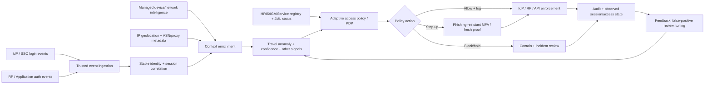
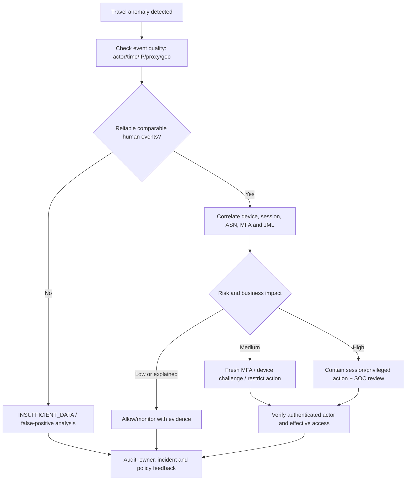

# Impossible travel trong Risk-based access và vòng đời danh tính IAM

## 1. Impossible travel là gì?

**Impossible travel** (*di chuyển bất khả thi*) là một tín hiệu rủi ro danh tính được suy ra khi **các hoạt động xác thực hoặc truy cập gắn với cùng một chủ thể** được ghi nhận từ **những vị trí địa lý khác nhau quá nhanh** so với khả năng di chuyển hợp lý của con người. Hệ thống thường dựa trên địa chỉ IP công khai, dịch vụ định vị IP, thời điểm sự kiện và lịch sử hoạt động để phát hiện bất thường.

Ví dụ minh họa: một tài khoản nhân viên có đăng nhập tương tác từ mạng được định vị ở TP. Hồ Chí Minh lúc 09:00, rồi xuất hiện đăng nhập mới từ mạng được định vị ở một thành phố cách đó khoảng 1.000 km lúc 09:10. Nếu **cả hai vị trí đều chính xác, cùng một người đang hiện diện và timestamp phản ánh thời điểm xác thực**, vận tốc trung bình cần thiết là khoảng 6.000 km/h — không phù hợp với di chuyển thông thường. Tuy nhiên, có thể **người dùng ngồi yên và chuyển sang VPN có điểm thoát ở nước khác**. Vì vậy, detector chỉ tạo **risk signal cần phân tích**, không tự kết luận tài khoản đã bị xâm nhập.

Bài học thuộc chương **Risk-based access**, trong module **SECURITY_IDENTITY_ACCESS_MANAGEMENT_IDENTITY_LIFECYCLE**. Mục tiêu học tập của module là quản lý vòng đời danh tính **Joiner–Mover–Leaver (JML)**: từ xác minh, cấp account/quyền tới rà soát, thay vai trò và thu hồi. Impossible travel liên kết với **IdP/SSO**, xác thực, **SCIM**, **RBAC/ABAC**, quản lý phiên/token, **PAM**, tài khoản dịch vụ và kiểm toán nhằm giảm **quyền truy cập tồn dư**.

Sau bài này, bạn có thể:
- Hiểu giới hạn của tín hiệu địa lý và tính một **vận tốc biểu kiến** từ hai hoạt động.
- Phân biệt **đăng nhập thật, refresh token, session reuse, proxy/VPN và machine traffic**.
- Thiết kế pipeline rủi ro dùng **nguồn đáng tin, danh tính ổn định, thời gian, network context và mức độ tin cậy của geolocation**.
- Kết hợp tín hiệu với thiết bị, phương thức xác thực, session và quyền truy cập để chọn **Allow, Step-up, Hold, Deny hoặc Incident response** theo chính sách.
- Kiểm thử false positives, đối phó giả mạo và liên kết cảnh báo với **Mover/Leaver, revoke session, audit và reconciliation**.

> **Nguyên tắc:** Impossible travel là **bất thường dựa trên mô hình và dữ liệu quan sát**, không phải sự thật rằng một người đã ở hai nơi. Quyết định truy cập phải dựa trên **chất lượng tín hiệu, rủi ro của thao tác, chính sách và khả năng khắc phục**, không chỉ một con số km/h.

## 2. Phân biệt vị trí quan sát, vị trí thật và hành vi đáng ngờ

Một địa chỉ IP có thể chỉ ra **điểm thoát kết nối Internet**, không nhất thiết chỉ ra nơi thiết bị hoặc người dùng đang ngồi.

| Khái niệm | Nguồn phổ biến | Ý nghĩa thực sự |
| --- | --- | --- |
| **Observed source IP** | Reverse proxy, IdP sign-in log, API gateway | IP mà dịch vụ tin cậy nhìn thấy cho kết nối |
| **Geolocated IP** | IP intelligence provider | Ước lượng vị trí gắn với IP/prefix, có sai số và độ trễ |
| **Device physical location** | Tín hiệu GPS/OS do ứng dụng có thẩm quyền thu thập | Có thể chính xác hơn nhưng vẫn cần consent, kiểm integrity và chống spoofing |
| **Corporate egress location** | VPN, ZTNA/SASE, NAT gateway, secure web gateway | Nơi traffic thoát, không nhất thiết nơi nhân viên ở |
| **Authentication location** | Vị trí suy ra từ IP của sự kiện login | Có thể khác vị trí lúc hành động tài nguyên xảy ra |
| **Access location** | IP/token context tại resource server | Có thể là API gateway, service backend hoặc proxy |
| **Known travel/remote-work context** | Lịch công tác, managed device, trusted network | Bằng chứng bổ sung, không mặc định là authority tuyệt đối |
| **Impossible travel alert** | Risk engine kết hợp hai hay nhiều event | Đánh giá xác suất rủi ro, không phải phán quyết gian lận |

### Không nhầm event của người dùng với request của máy

Một browser của người dùng có thể đăng nhập IdP qua VPN, còn API calls của ứng dụng chạy từ cloud region khác. Ghép **IP login người** với **IP server-to-server request** rồi tính vận tốc có thể tạo cảnh báo vô nghĩa. Cần biết **actor, loại sự kiện, client và đường mạng**.

### Không lạm dụng địa chỉ IP như định danh

IP có thể thay đổi khi thiết bị chuyển Wi-Fi sang 4G/5G, dùng IPv6 privacy address, CGNAT hoặc corporate proxy. **Một IP không đồng nghĩa một người**, và **một người không đồng nghĩa một IP**.

## 3. Risk-based access khác với chỉ kiểm password/MFA

**Risk-based access** (còn gọi **adaptive access** trong nhiều sản phẩm) đánh giá bối cảnh đăng nhập và hành động để quyết định điều kiện xác thực hoặc truy cập phù hợp mức rủi ro.

| Lớp | Câu hỏi | Ví dụ tín hiệu |
| --- | --- | --- |
| **Authentication** | Chủ thể có chứng minh được danh tính? | Passkey, MFA, IdP assertion, device-bound credential |
| **Session security** | Phiên còn hợp lệ và thuộc actor nào? | Session ID, auth_time, token audience/TTL, revoke state |
| **Behavioral/geo risk** | Hoạt động có khác kỳ vọng? | Impossible travel, new device, new ASN, unusual time |
| **Device/network posture** | Thiết bị/kết nối có đáng tin theo policy? | Device compliance, managed browser, proxy classification |
| **Authorization** | Subject có quyền action–resource–tenant không? | RBAC role, ABAC attributes, resource owner, SoD |
| **Lifecycle/JML** | Subject có còn đủ điều kiện truy cập? | Joiner effectiveAt, Mover role version, Leaver disable |
| **Enforcement** | Điểm thực thi đã áp quyết định? | Allow, step-up, deny tại IdP/RP/API/PEP |
| **Audit/reconciliation** | Quyết định có được ghi và quyền còn tồn dư? | Event lineage, readback, token/session status |

**Impossible travel không cấp hoặc xóa quyền RBAC.** Một tài khoản có thể đã vượt qua MFA nhưng vẫn phải bị từ chối `payroll:export` do thiếu role, hoặc do tài khoản đã Leaver. Ngược lại, quyền có tồn tại cũng không có nghĩa một **đăng nhập rủi ro cao** luôn được tiếp tục nếu policy yêu cầu step-up hoặc chặn.

### Risk score là đầu vào, không phải permission

Một risk engine có thể trả `RISK_HIGH`. Đó không phải một role/entitlement; hệ thống cần chuyển tín hiệu thành **policy decision** với actor, resource, độ mới của sự kiện, phương thức xác thực hiện có và trạng thái lifecycle.

## 4. Từ hai sự kiện đến một tín hiệu Impossible travel

Một detector cơ bản nhận hai quan sát có thể tin cậy, cùng một user và có thứ tự thời gian rõ:

```text
Observation A
  principal: (issuer=idp-prod, sub=user-1042)
  eventType: INTERACTIVE_AUTHENTICATION_SUCCESS
  time: 2026-11-23T02:00:00Z
  sourceIp: example-ip-A
  geo: location-A, confidence=MEDIUM

Observation B
  principal: (issuer=idp-prod, sub=user-1042)
  eventType: INTERACTIVE_AUTHENTICATION_SUCCESS
  time: 2026-11-23T02:10:00Z
  sourceIp: example-ip-B
  geo: location-B, confidence=MEDIUM

Estimated geodesic distance: about 1000 km
Elapsed time: 10 min = 1/6 h
Apparent speed: 1000 / (1/6) = 6000 km/h
```

Đây là **dữ liệu giả định**, không phải bản ghi từ người thật hay bản định vị địa lý có xác minh.

### Những điều kiện thường bị quên

1. `A` và `B` phải thuộc **cùng canonical identity**, không chỉ cùng email hiển thị.
2. Hai bản ghi phải phản ánh **cùng loại hành vi có thể so sánh**, không trộn hoạt động API của backend.
3. Timestamp phải là **event time đáng tin**; không tính bằng thời gian ingestion của queue.
4. IP phải là **client source IP đã được proxy tin cậy xác định**; không lấy trực tiếp một header do client tùy ý gửi.
5. Geo nên có **accuracy/confidence**; một IP được gắn quốc gia khác không tự là hai vị trí vật lý thật.
6. Hai sự kiện có thể gắn **cùng session** hoặc hai sessions; mức nghi ngờ có thể khác nhau.
7. Máy có thể dùng VPN/ZTNA, cloud proxy hoặc mobile egress ở nơi xa.
8. Người dùng có thể **thực sự đi công tác**; không nên coi lịch sử truy cập một nơi là cấm truy cập nơi khác.

## 5. Dữ liệu đầu vào tối thiểu và độ tin cậy

| Trường | Vai trò | Lưu ý chất lượng |
| --- | --- | --- |
| `eventId` | Dedupe, correlation | Không dùng event text làm khóa |
| `eventTime` (UTC) | Tính elapsed time | Xem clock skew và sự kiện đến muộn |
| `ingestedAt` | Đo pipeline delay | Không thay eventTime |
| `issuer` + `subject` | Correlate identity được chứng minh | Không so email đơn thuần |
| `identityId` + `lifecycleGeneration` | Gắn account vào chu kỳ JML | Ngăn ghép với Rehire khác generation |
| `eventType` | Login, token refresh, session action, API call… | Chỉ so cặp hợp ngữ nghĩa |
| `clientId`, `applicationId` | Biết app và luồng SSO | SSO có thể phát nhiều events cho một login |
| `sourceIp` + `ipProvenance` | Nguồn IP và vị trí | Proxy chain và header trust phải rõ |
| `geoLat/geoLon` | Ước tính điểm trên Trái Đất | Có sai số; không mặc định GPS |
| `geoConfidence` / `accuracyRadiusKm` | Khoảng bất định | Cách định nghĩa tùy provider |
| `asn` / `networkType` | ISP, corporate VPN, proxy, cloud | Tag provider có thể thiếu/sai |
| `deviceId` / `deviceTrust` | Correlate thiết bị | Device ID phải được cấp/kiểm tin cậy |
| `sessionIdRef` / `authEventId` | Phân biệt một session hay nhiều login | Không log raw cookie/token |
| `authMethods` / `assurance` | MFA, passkey, step-up | Lấy từ IdP đã xác minh |
| `resource/action` | Đánh giá tác động | Một login thường và hành động admin khác risk |
| `policyVersion` | Quy tắc đánh giá | Phục vụ audit/replay có kiểm soát |

**Một record không đủ thông tin không nên bị “bù” bằng dữ liệu đoán.** Ví dụ không có client IP thật thì gắn `ipConfidence=UNKNOWN` và đưa vào nhánh không đủ chứng cứ/điều tra.

## 6. Độ chính xác IP geolocation và nguồn sai lệch

**IP geolocation là ước lượng**, có thể suy từ cơ sở dữ liệu routing, thông tin ISP, nơi đăng ký dải IP và các nguồn thống kê khác. Nó **không phải cảm biến vị trí vật lý của con người**.

Những nguồn false positive phổ biến:

- **Corporate VPN**: đăng nhập 09:00 qua egress Singapore, 09:05 qua egress Việt Nam dù user không di chuyển.
- **ZTNA/SASE/SWG**: traffic được đưa qua PoP khác nhau theo ứng dụng hoặc sự cố mạng.
- **Mobile carrier/CGNAT**: IP đại diện cho gateway của nhà mạng, có thể được geolocate ở tỉnh/thành hoặc quốc gia khác.
- **Cloud-hosted browser/VDI**: browser chạy ở datacenter, không phải laptop tại nhà.
- **DNS/anycast/CDN và proxy**: kết nối ra Internet qua dịch vụ trung gian; IP cho biết egress chứ không phải actor.
- **Database geolocation cũ**: IP/prefix vừa chuyển nhà mạng nhưng bản đồ chưa cập nhật.
- **IPv6 và roaming**: thiết bị hoặc nhà mạng thay đổi địa chỉ/prefix và điểm thoát nhanh.
- **Shared network**: nhiều nhân viên đi qua cùng NAT IP.
- **Clock/timezone lỗi**: log nguồn ghi local time nhưng collector tưởng UTC, dẫn đến khoảng cách thời gian ảo.
- **App/backend calls**: một request token từ máy chủ không có cùng ngữ nghĩa với interactive login của người dùng.

Không phải mọi **VPN/proxy** đều an toàn: VPN do tổ chức quản trị có thể giải thích vị trí, còn residential proxy lạ có thể là dấu hiệu attacker. Việc gắn nhãn network phải dựa vào **nguồn có thẩm quyền và mức confidence**, không allowlist mọi ASN cloud.

### Khi chỉ có country-level location

Nếu provider chỉ tin được quốc gia hoặc có độ chính xác nhiều trăm km, không nên lấy **tọa độ trung tâm quốc gia** rồi suy ra một tốc độ chính xác từng km/h. Có thể **đánh giá vùng bất định**, hạ độ tin cậy hoặc tạm hoãn kết luận.

## 7. Công thức khoảng cách và vận tốc biểu kiến

Một mô hình hình học đơn giản có thể dùng **Haversine** để ước tính khoảng cách đường tròn lớn giữa hai tọa độ. Nó cho **khoảng cách ngắn gần đúng trên mặt cầu**, không phải tuyến đường người dùng thực sự đi.

Với vĩ độ `φ`, kinh độ `λ` tính bằng radian và bán kính Trái Đất xấp xỉ `R = 6371 km`:

```text
dLat = phiB - phiA
dLon = lambdaB - lambdaA

h = sin(dLat / 2)^2 +
    cos(phiA) * cos(phiB) * sin(dLon / 2)^2

distanceKm = 2 * R * asin(sqrt(h))
elapsedHours = (eventTimeB - eventTimeA) / 3600000
apparentKmh = distanceKm / elapsedHours
```

**Phải kiểm soát đầu vào**: nếu `elapsedHours <= 0`, cùng event bị lặp, tọa độ lỗi hoặc clock không đáng tin, **không chia cho 0 rồi coi tốc độ vô hạn là bằng chứng**.

Ví dụ minh họa với khoảng cách 1.000 km và 10 phút:
- `elapsedHours = 10 / 60 ≈ 0,1667`.
- `apparentKmh ≈ 1000 / 0,1667 ≈ 6000 km/h`.
- Đây là **vận tốc biểu kiến từ hai điểm geolocation**, không phải vận tốc thực của user.

### Không biến threshold thành quy luật vật lý tuyệt đối

Một ngưỡng như `900 km/h` hoặc `1200 km/h` **chỉ là ví dụ cấu hình policy để thảo luận**, không phải tiêu chuẩn áp dụng toàn cầu. Có hành trình hàng không, thời gian chờ ở sân bay, sai số geolocation và nhiều kiểu egress. Khi xây detector thực, cần **đánh giá dữ liệu lịch sử, sai số và khả năng gây outage**, không dùng ngưỡng bừa như sự thật khách quan.

## 8. Đưa độ bất định vào mô hình thay vì chỉ một con số

Hai IP có thể được gắn tọa độ trung tâm, nhưng vị trí thực có thể nằm trong một **vùng sai số**. Để giảm false positive, detector có thể tính **một cận dưới thô** cho khoảng cách sau khi xét sai số:

```text
centerDistanceKm = haversine(geoA.center, geoB.center)
uncertaintyKm = geoA.errorRadiusKm + geoB.errorRadiusKm
minimumPlausibleSeparationKm = max(0, centerDistanceKm - uncertaintyKm)

deltaHours = (eventTimeB - eventTimeA) / 3600000
minimumApparentKmh = minimumPlausibleSeparationKm / deltaHours
```

Đây chỉ là **heuristic minh họa**. Các bán kính sai số của nhà cung cấp **không nhất thiết** là các ranh giới đảm bảo hay phân phối thống kê chuẩn; phép trừ bán kính không chứng minh một xác suất thực. Có thể chọn **ngưỡng confidence, loại mạng và mô hình phân phối sai số** tùy chất lượng provider.

### Ví dụ

- Hai vị trí trung tâm cách nhau 800 km.
- Provider A ước lượng sai số 250 km; provider B ước lượng sai số 350 km.
- Cận dưới sơ bộ chỉ còn `max(0, 800−250−350)=200 km`.

Tốc độ từ **800 km** có thể rất đáng ngờ trong 10 phút, nhưng nếu định vị thực tế chỉ ràng buộc **200 km** thì detector không nên trình bày rằng khoảng cách chắc chắn là 800 km.

**Nếu geolocation sai số quá lớn, label phù hợp là `GEO_LOW_CONFIDENCE`**, không phải tự động `ACCOUNT_COMPROMISED`.

## 9. Correlation danh tính và session: ghép đúng các sự kiện

**Không chỉ so `username`.** Người dùng có thể đổi email, có account admin riêng hoặc được tuyển lại. Nhiều tenants có account trùng tên. Một event bị gán sai có thể tạo cảnh báo impossible travel cho hai người khác nhau.

Các bước:
1. Xác minh issuer/IdP có authority và subject ID ổn định.
2. Resolve sang **canonical `identityId`** với `lifecycleGeneration`.
3. Giữ riêng account bình thường và privileged account, nhưng biết chúng có thể thuộc cùng một người để phân tích risk.
4. Xác định **auth transaction**, session ID reference và client app.
5. Dedupe events do cùng một lần đăng nhập sinh ra ở nhiều RP/IdP.
6. Chỉ ghép sự kiện có **cùng semantics** hoặc quy tắc hợp lệ để so.
7. Kiểm timestamp/event order và tránh cross-tenant false correlation.
8. Ghi lý do lựa chọn cặp A–B để auditor có thể tái kiểm tra.

### Cặp sự kiện đặc biệt

| Event A | Event B | Cách hiểu |
| --- | --- | --- |
| Interactive login A | Interactive login B | Cặp cơ bản cho human impossible travel |
| Interactive login | SSO silent login tại RP khác | Có thể là cùng một IdP session qua proxy, không có di chuyển vật lý |
| Interactive login | Refresh token request | Refresh có thể từ backend/refresh worker; cần phân biệt IP egress |
| Interactive login | API request qua BFF | BFF IP thường không phải vị trí user |
| Admin login | Privileged session activation | Cần xem actor, session và risk vì quyền cao |
| User login | Service account API call | **Không** coi là cùng một người di chuyển |
| Human access | Workload token issuance | **Không** suy vận tốc con người từ machine endpoint |
| Event user cũ trước Leaver | Rehire cùng email | Không ghép khác lifecycle generation như một phiên liên tục |

## 10. Vì sao threshold cố định thường gây false positive?

Một quy tắc `distance > 500 km AND time < 30 phút` rất dễ áp dụng nhưng dễ sai vì:
- Geolocation provider khác nhau cho cùng IP kết quả khác nhau.
- Corporate VPN egress khiến một người “xuất hiện” ở nhiều nước trong vài phút.
- Event có thể đến từ browser, mobile app, service backend, VDI.
- Có thể có nhiều sign-ins thực từ cùng user khi dùng các thiết bị khác nhau.
- Những event do IdP được ghi timestamp theo hệ thống khác hoặc được ingest trễ.
- Có thể có travel hợp lệ, roaming, đường bay hoặc quốc gia biên giới.
- Một attacker có thể dùng **proxy gần user** để tránh impossible travel hoàn toàn.

### Cách hiệu chỉnh

Thiết kế **detection confidence** tách khỏi **business impact**:
- **Geo confidence:** tọa độ đáng tin tới mức nào?
- **Identity confidence:** có chắc hai event cùng actor/user session?
- **Network explanation confidence:** IP thuộc VPN egress được quản trị hay proxy không rõ?
- **Temporal confidence:** timestamp đúng và có đủ thời gian?
- **Behavioral deviation:** thiết bị/ASN/method/session có mới, bất thường không?
- **Resource impact:** chỉ xem trang thông tin hay thao tác cấp quyền admin/xuất dữ liệu?
- **Mitigation confidence:** có MFA/passkey, device-bound credential và session revocation khả dụng không?

Policy có thể dùng **ngưỡng phân tầng** và nhiều tín hiệu. Đừng tự biến một **risk score thống kê** thành khẳng định “99% chắc chắn attacker” nếu score không được hiệu chuẩn theo xác suất.

## 11. Kiến trúc Risk-based access cho Impossible travel



**Tín hiệu không có giá trị nếu PEP không thực thi.** Nếu risk engine gửi `HIGH` tới log nhưng ứng dụng vẫn cấp session hoặc API vẫn Permit theo cache, không thể gọi là đã thực hiện adaptive access.

Một hệ thống hiện đại có thể đánh giá ở **lúc login**, **khi phát token**, **khi dùng session** hoặc **trước hành động nhạy cảm**. Khả năng và độ trễ khác nhau; phải ghi rõ khi nào chính sách được đánh giá và điểm enforcement nào thực hiện.

## 12. JSON event minh họa: không chứa secret

Ví dụ dưới đây mô tả một observation đã chuẩn hóa. Tọa độ là **điểm giả định**, chỉ để trình bày cấu trúc; không phải dữ liệu vị trí thật.

```json
{
  "eventId": "auth-incident-example-101",
  "eventType": "INTERACTIVE_AUTHENTICATION_SUCCESS",
  "eventTime": "2026-11-23T02:00:00Z",
  "ingestedAt": "2026-11-23T02:00:03Z",
  "source": {
    "systemId": "idp-prod",
    "issuer": "https://idp.example.test",
    "producerTrust": "VERIFIED"
  },
  "subject": {
    "identityId": "person-1042",
    "issuerSubject": "user-1042",
    "lifecycleGeneration": 7,
    "tenantId": "tenant-vn"
  },
  "client": {
    "clientId": "hr-portal",
    "interactionType": "INTERACTIVE",
    "deviceRef": "managed-device-51",
    "sessionRef": "session-record-5001"
  },
  "network": {
    "ipReference": "protected-ip-ref-101",
    "asnReference": "asn-example-a",
    "networkType": "UNCLASSIFIED",
    "geo": {
      "lat": 10.0,
      "lon": 106.0,
      "accuracyRadiusKm": 120,
      "confidence": "MEDIUM",
      "providerVersion": "geo-model-v12"
    }
  },
  "authentication": {
    "assurance": "MFA_VERIFIED",
    "method": "PASSKEY",
    "authTime": "2026-11-23T02:00:00Z"
  },
  "rawCredentialRecorded": false
}
```

**`ipReference` không phải một địa chỉ IP để route**; đây là tham chiếu tới kho bảo mật có kiểm soát. Thực tế detector có thể cần địa chỉ IP đầy đủ để tra geolocation, nhưng evidence export cho auditor nên **redact/pseudonymize** theo mục tiêu. Đừng đưa raw access token, cookie, session bearer secret hoặc OTP vào audit event.

## 13. Ví dụ hành trình có cảnh báo và phân tích nguyên nhân

Giả sử một nhân viên đăng nhập vào HR Portal qua IdP lúc 09:00 từ một IP được định vị ở **vùng A**, rồi đăng nhập tương tác vào Finance Portal lúc 09:08 từ IP được định vị ở **vùng B** cách khoảng 1.200 km.

```text
09:00  Interactive sign-in A — region A, managed device D1
09:08  Interactive sign-in B — region B, unknown device D2
09:08  Detector calculates apparent speed:
       1200 km / (8 / 60 h) = 9000 km/h
09:08  Risk signal: IMPOSSIBLE_TRAVEL_CANDIDATE
09:09  Context: different device, unfamiliar ASN, no known corporate VPN
09:09  Policy: require strong step-up or hold privileged access
09:11  Incident correlation with user and session inventory
```

Cặp sự kiện này **đáng ưu tiên** vì không chỉ vị trí, mà còn **thiết bị mới và mạng chưa biết**. Nhưng điều tra vẫn cần kiểm **IP geolocation, source timestamps, session correlation và khả năng hai app đi qua egress khác nhau**.

### Kịch bản false positive với cùng người dùng

Ngược lại:
- 09:00 user tại văn phòng truy cập IdP qua **VPN corporate egress A**.
- 09:08 VPN chuyển PoP sang **egress B** nhưng laptop/device ID, credential binding và IdP session giữ nguyên.
- Geo map báo A–B cách 1.200 km.

Trong kịch bản này, **vận tốc biểu kiến cao không tương ứng người dùng di chuyển**. Một risk engine chất lượng nên **hạ confidence hoặc classify known network transition**, không tự khóa toàn bộ tài khoản vì mỗi lần VPN failover.

## 14. Device signals, session continuity và authentication assurance

Để giảm cảnh báo sai, kết hợp những tín hiệu có thể xác minh:

| Tín hiệu | Gợi ý hữu ích | Không được hiểu quá mức |
| --- | --- | --- |
| **Managed device ID** | Cùng một thiết bị đã attested qua hai event | Device ID do client tự khai có thể giả |
| **Device compliance** | Thiết bị còn được quản trị, posture đạt policy | Không chứng minh người cầm thiết bị đúng chủ |
| **Passkey/WebAuthn** | Xác thực mạnh, một số credential có ràng buộc thiết bị | Không ngăn mọi session hijack sau login |
| **MFA result** | Đã đáp ứng yêu cầu authentication tại mốc cụ thể | OTP/passkey không tự cấp authorization |
| **Session continuity** | Hai event thuộc cùng RP/IdP session | Session bị chiếm vẫn có thể tạo hoạt động bất thường |
| **New device/OS/client** | Bất thường nếu ngoài baseline | User có thể thay thiết bị hợp lệ |
| **New ASN/network class** | Chuyển residential sang cloud/proxy | ASN là dấu hiệu, không phải danh tính attacker |
| **Impossible travel + MFA fatigue** | Tín hiệu phối hợp nghiêm trọng hơn | Không gộp score một cách không giải thích |
| **Admin action after login** | Tăng business impact | Cần RBAC/ABAC/PAM enforcement ở tài nguyên |
| **Credential or token reuse** | Gợi ý session/token theft | Cần phân biệt refresh/roaming hợp lệ |

**Không phụ thuộc một định danh thiết bị do JavaScript tạo trên browser** như bằng chứng chắc chắn hai hoạt động từ cùng máy. Một tín hiệu thiết bị đáng tin thường cần **enrollment/attestation và bảo vệ khỏi tự khai** theo khả năng nền tảng.

## 15. Rủi ro liên quan session cookie, access token và refresh token

Impossible travel thường được áp trên **IdP sign-in logs**, nhưng truy cập trái phép có thể xảy ra **sau khi phiên đã tạo**.

| Hoạt động | Có thể quan sát ở đâu? | Rủi ro và giới hạn |
| --- | --- | --- |
| **Interactive login** | IdP/RP auth logs | Phù hợp đánh giá vị trí người dùng nếu IP đáng tin |
| **Silent SSO** | IdP hoặc RP auth transaction | Có thể là browser/session cũ, không phải user mới di chuyển |
| **Refresh token exchange** | OAuth authorization server | IP có thể thuộc backend/BFF/thiết bị; không so trực tiếp nếu khác semantics |
| **Access token use** | Resource server/API gateway | Địa chỉ có thể là API proxy, không phải user |
| **Session cookie reuse** | RP session logs | Có thể báo chiếm phiên khi IP/device thay bất thường |
| **API key/PAT use** | SaaS/cloud API | Là hoạt động principal kỹ thuật, không bắt buộc là human travel |
| **mTLS service request** | Service mesh/API gateway | Là network placement/workload identity, không phải di chuyển con người |

**Một logout ở IdP không nhất thiết kết thúc mọi RP sessions hoặc token đã phát**. Khi cảnh báo là **session hijacking**, chỉ bắt user làm MFA ở phiên mới chưa chặn được bản sao cookie cũ nếu RP vẫn chấp nhận. Phải có **session revocation/token strategy** phù hợp với loại credential.

### JWT và quyền tồn dư

Resource server có thể tiếp tục chấp nhận JWT đã ký tới `exp` nếu chỉ kiểm chữ ký và claim tĩnh. Cần biết introspection, denylist, session/entitlement version, TTL và policy runtime có hỗ trợ hay không. Đừng báo “đã chặn” khi mới phát notification mà API vẫn Permit.

## 16. Giới hạn baseline và các nhóm nguồn mạng tin cậy

**Baseline** nên là mô hình có kiểm soát, không phải một allowlist “người này luôn ở Việt Nam”.

Một số nguồn hợp pháp nên xem xét:
- **Known corporate VPN/SASE/ZTNA egress** được đội Network quản lý; có danh sách versioned, owner, thời hạn và xác nhận nguồn.
- **Managed VDI/browser virtualization**: traffic đi ra từ region được quản trị, event user nên gắn device/VDI session.
- **Mobile carriers/roaming**: IP egress không luôn ở đúng địa điểm user.
- **Partner IdP/B2B access**: nguồn login và home tenant khác resource organization.
- **Travel policy exceptions**: có phê duyệt và thời hạn, nhưng không cho phép bỏ qua credential compromise.
- **High-risk hosting or anonymizing networks**: cloud proxy, Tor hoặc dịch vụ anonymization; dùng reputation có chất lượng.

### Known network không được thành bỏ qua mọi rủi ro

Nếu attacker chiếm một corporate VPN account hoặc xuất hiện từ egress đã allowlist, **impossible travel có thể không cảnh báo**. Do đó, chính sách chỉ nên **điều chỉnh trọng số geolocation**, còn **MFA, device trust, JML status, risk signals và resource authorization** vẫn phải được thực thi.

### Baseline drift

Khi công ty đổi VPN/SASE provider hoặc chuyển region của IdP, một batch false positives có thể tăng đột ngột. Ghi thay đổi hạ tầng, version network metadata và monitor precision sau rollout; không “chữa” bằng cách tắt toàn bộ geo risk detector vĩnh viễn.

## 17. Risk score nhiều tín hiệu và chính sách ra quyết định

Một risk engine có thể tính **độ bất thường** và **độ nghiêm trọng** riêng, sau đó áp policy theo loại tài nguyên.

| Trường hợp | Geo anomaly | Bối cảnh khác | Hành động tham khảo |
| --- | --- | --- | --- |
| VPN egress change có quản trị | Cao trên tọa độ | Same attested device, same session, verified egress | Log/suppress geo signal theo scope; vẫn enforce authz |
| IP mới nhưng vị trí gần | Thấp | Managed device + passkey | Allow theo policy thông thường |
| Hai nơi rất xa | Cao | New unmanaged device, unfamiliar ASN | Strong step-up, restrict risky action, triage |
| Hai nơi xa + hành động cấp admin | Cao | Privileged role activation requested | Hold/deny privileged action, SOC/PAM escalation |
| Location dữ liệu mơ hồ | Không chắc | No corroborating signal | Không kết luận compromise; thử bổ sung dữ liệu |
| Leaver account đăng nhập | Không quan trọng | Lifecycle status=LEAVER | Deny theo lifecycle, không cần geo score |
| Service Retired mint token | Không áp dụng human travel | Trust vẫn phát credentials | Deny/retire service principal theo JML |
| Session token từ mạng khác | Có thể cao | Token cùng `sid` bị dùng đồng thời | Revoke/challenge theo session-theft policy |
| Guest truy cập tenant hết sponsor | Không quan trọng | Local resource access hết hiệu lực | Deny entitlement dù home IdP login hợp lệ |

**Không có một bảng điểm cố định đạt chuẩn cho mọi tổ chức.** Threshold và phản ứng cần được version hóa, kiểm thử đối với **false positives, false negatives, tác động availability và nguy cơ dữ liệu**.

### Actions nên được mô tả rõ

- `ALLOW`: cấp phiên/truy cập nếu authentication, lifecycle và authorization đều hợp lệ.
- `ALLOW_WITH_MONITORING`: cho truy cập trong phạm vi nhưng ghi tín hiệu rủi ro/giám sát.
- `STEP_UP_REQUIRED`: yêu cầu authentication mạnh hoặc mới hơn, **không tự mở role**.
- `RESTRICT_PRIVILEGED_ACTION`: giữ phiên cơ bản nhưng không cho thao tác có blast radius cao.
- `HOLD_FOR_REVIEW`: chờ xử lý theo workflow/incident SLA khi policy cho phép.
- `DENY`: từ chối request hoặc tạo session khi quy tắc rủi ro/lifecycle yêu cầu.
- `REVOKE_AND_INVESTIGATE`: vô hiệu session/token có liên quan và mở incident khi đủ dấu hiệu.

Đừng tự động khóa toàn bộ tài khoản vì **một GeoIP lookup thiếu tin cậy** nếu có giải pháp đánh giá rủi ro ít gây gián đoạn hơn mà vẫn bảo vệ resource.

## 18. Risk engine pseudocode: đánh giá hai sự kiện có kiểm soát

Giả mã này minh họa cách **tách event quality, geo anomaly, supporting signals và policy action**. Đây **không** phải thuật toán của một IdP cụ thể.

```text
evaluateImpossibleTravel(candidateA, candidateB, requestedAction):
    require trustedEventSource(candidateA)
    require trustedEventSource(candidateB)
    require comparableHumanAuthenticationSemantics(candidateA, candidateB)

    a = normalizeVerifiedEvent(candidateA)
    b = normalizeVerifiedEvent(candidateB)

    if a.eventId == b.eventId:
        return NO_SIGNAL_DUPLICATE
    if a.identityId != b.identityId:
        return NO_SIGNAL_DIFFERENT_IDENTITY
    if a.lifecycleGeneration != b.lifecycleGeneration:
        return NO_SIGNAL_DIFFERENT_LIFECYCLE
    if a.issuerSubjectMappingIsAmbiguous() or b.issuerSubjectMappingIsAmbiguous():
        return INSUFFICIENT_IDENTITY_CONFIDENCE

    if b.eventTime <= a.eventTime:
        return INSUFFICIENT_TEMPORAL_CONFIDENCE
    if not eventClockSourcesAreReliable(a, b):
        return INSUFFICIENT_TEMPORAL_CONFIDENCE

    ipA = trustedNetworkResolver.resolveEffectiveClientIp(a)
    ipB = trustedNetworkResolver.resolveEffectiveClientIp(b)
    if ipA == UNKNOWN or ipB == UNKNOWN:
        return INSUFFICIENT_NETWORK_PROVENANCE

    geoA = geoProvider.lookup(ipA, versionedDataset=true)
    geoB = geoProvider.lookup(ipB, versionedDataset=true)
    if not geolocationMeetsQualityPolicy(geoA, geoB):
        return GEO_LOW_CONFIDENCE

    distance = haversineKm(geoA.center, geoB.center)
    elapsedHours = hoursBetween(a.eventTime, b.eventTime)
    if elapsedHours <= 0:
        return INSUFFICIENT_TEMPORAL_CONFIDENCE

    adjustedDistance = max(
        0, distance - geoA.uncertaintyKm - geoB.uncertaintyKm
    )
    apparentSpeed = adjustedDistance / elapsedHours

    context = riskSignals.collectTrusted(
        principal=b.identityId,
        sessions=[a.sessionRef, b.sessionRef],
        devices=[a.deviceRef, b.deviceRef],
        networks=[ipA, ipB],
        authentication=[a.authContext, b.authContext],
        resourceAction=requestedAction
    )

    networkExplanation = networkPolicy.evaluateKnownEgress(context)
    risk = riskModel.scoreWithConfidence(
        impossibleTravelSpeed=apparentSpeed,
        geoQuality=[geoA.quality, geoB.quality],
        knownNetworkTransition=networkExplanation,
        deviceChange=context.deviceChange,
        sessionReuse=context.sessionReuse,
        privilegedAction=context.isPrivileged
    )

    lifecycle = identityRegistry.readCurrentState(b.identityId)
    decision = adaptivePolicy.evaluate(
        risk=risk,
        lifecycle=lifecycle,
        targetAction=requestedAction,
        assurance=b.authContext.assurance
    )
    audit.recordSanitizedInputsAndDecision(
        [a.eventId, b.eventId], risk, decision
    )
    return decision
```

### Giới hạn của giả mã

- `uncertaintyKm` không phải metadata có cùng semantics giữa mọi GeoIP provider.
- Identity/session correlation phải chống **trộn người hoặc trộn egress của backend**.
- `riskModel` cần calibration; scoring không đồng nghĩa xác suất chắc chắn attacker.
- Policy engine cần kiểm **nguồn vòng đời hiện hành**; một Leaver bị disable không được Allow do geo score thấp.
- Nếu dữ liệu không đủ, chuyển `INSUFFICIENT_DATA` chứ không suy ra `TRAVEL_CONFIRMED`.
- Khi user đã có session, event này chưa tự revoke phiên; **enforcement** và runtime verification là các bước riêng.

## 19. SQL minh họa: lấy cặp đăng nhập kế tiếp của cùng identity

Trong một hệ thống đã chuẩn hóa sign-in events, có thể lấy các cặp đăng nhập liên tiếp rồi đưa vào geo/risk engine. Ví dụ SQL dưới đây là **giả định cho một schema nội bộ có dữ liệu đã được phép xử lý**, không phải truy vấn chạy được trên mọi IdP:

```sql
WITH trusted_interactive_signins AS (
    SELECT
        e.identity_id,
        e.lifecycle_generation,
        e.event_id,
        e.event_time_utc,
        e.geo_lat,
        e.geo_lon,
        e.geo_quality,
        e.network_class,
        e.device_ref,
        e.session_ref
    FROM identity_signin_events AS e
    WHERE e.event_time_utc >= :start_time_utc
      AND e.event_time_utc < :end_time_utc
      AND e.event_type = 'INTERACTIVE_AUTHENTICATION_SUCCESS'
      AND e.trusted_source = TRUE
      AND e.geo_lat IS NOT NULL
      AND e.geo_lon IS NOT NULL
),
paired AS (
    SELECT
        s.*,
        LAG(s.event_id) OVER (
            PARTITION BY s.identity_id, s.lifecycle_generation
            ORDER BY s.event_time_utc, s.event_id
        ) AS previous_event_id,
        LAG(s.event_time_utc) OVER (
            PARTITION BY s.identity_id, s.lifecycle_generation
            ORDER BY s.event_time_utc, s.event_id
        ) AS previous_event_time,
        LAG(s.geo_lat) OVER (
            PARTITION BY s.identity_id, s.lifecycle_generation
            ORDER BY s.event_time_utc, s.event_id
        ) AS previous_lat,
        LAG(s.geo_lon) OVER (
            PARTITION BY s.identity_id, s.lifecycle_generation
            ORDER BY s.event_time_utc, s.event_id
        ) AS previous_lon
    FROM trusted_interactive_signins AS s
)
SELECT *
FROM paired
WHERE previous_event_id IS NOT NULL;
```

**Giới hạn quan trọng:**

- Truy vấn này **chưa tính Haversine, geo uncertainty hoặc risk score**. Nó chỉ dựng các cặp event để bộ xử lý chuyên trách đánh giá.
- `PARTITION BY identity_id, lifecycle_generation` tránh ghép Rehire khác generation; trong môi trường nhiều issuer/tenant, mapping phải bảo đảm ổn định trước khi chạy.
- Nếu `start_time_utc` cắt giữa hai lần login, event ngay trước đầu cửa sổ sẽ không có trong nguồn và cặp có thể **bị bỏ sót**. Cần lookback đủ theo policy và đánh dấu sampling window.
- `LAG` trên events đã **lọc** có thể bỏ qua những event trung gian quan trọng như successful silent SSO, device migration hoặc session revocation. Pipeline nên giữ liên kết tới full event stream để giải thích.
- Không dùng query này để **khóa tài khoản trực tiếp** chỉ vì xuất ra một cặp. Phải đánh giá nguồn, device/network context, quyền và policy enforcement.
- Không gửi bảng chứa IP hoặc dữ liệu cá nhân cho nơi không có quyền. Có thể dùng protected references và audit access cho pipeline.

### Sự kiện đến muộn

Nếu một login lúc 09:02 được ingest sau khi detector đã đánh giá cặp 09:00 và 09:10, hệ thống có thể cần **tính lại window**. Giữ `eventId`, source sequence và evaluation version; không phát nhiều incident giống nhau vì event queue retry.

## 20. Impossible travel tại IdP, RP và luồng OIDC/SSO

**IdP** thường là nơi quan sát login event xuyên nhiều ứng dụng; **Relying Party (RP)** có session riêng và có thể đưa ra chính sách truy cập mạnh hơn cho nghiệp vụ nhạy cảm.

### Ở IdP

IdP có thể:
1. Nhận authentication request và xác định account/tenant.
2. Đánh giá IP, device, history và authentication method.
3. Phát risk signal từ các sign-ins có thể so sánh.
4. Yêu cầu MFA/step-up, challenge device hoặc deny login theo policy.
5. Tạo session hoặc phát OIDC/SAML assertion/token khi đủ điều kiện.
6. Ghi sự kiện decision/risk và session reference, không log secret.

**IdP `SUCCESS` không có nghĩa RP phải cấp mọi quyền.** RP vẫn phải kiểm assertion, map account, kiểm policy JML và entitlement của ứng dụng.

### Ở OIDC RP

Một RP nhận Authorization Code Flow nên kiểm `state`/PKCE và validation ID token (`iss`, `aud`, `exp`, `nonce` khi sử dụng), rồi **tạo session riêng**. Nếu RP đòi authentication mới, có thể dùng các tham số giao thức như **`max_age`** khi OP hỗ trợ và RP xác minh `auth_time` tương ứng. Yêu cầu **mức bảo đảm** có thể gắn với `acr`/`amr` theo **contract và policy của OP**, không đoán MFA đã xảy ra chỉ vì thấy một trang login.

**`prompt=login` không tự biến xác thực yếu thành phishing-resistant MFA.** Cần xác định và xác minh phương thức thực sự đạt yêu cầu.

### Ở SAML SP

SP phải kiểm chữ ký, issuer, audience, recipient, điều kiện thời gian, InResponseTo/replay theo profile trước khi cấp session. Risk signal từ IdP có thể không có định dạng chung trong assertion của mọi sản phẩm; nếu SP cần quyết định riêng, phải có **đường nhận tín hiệu đáng tin và contract rõ**.

### Logout SSO là vấn đề riêng

OIDC RP-Initiated/Front-/Back-Channel Logout hoặc SAML SLO **có thể** phối hợp kết thúc phiên khi được hỗ trợ và tích hợp đúng, nhưng **không thể mặc định logout IdP vô hiệu mọi SP/RP sessions tức thời**. Một quyết định `REVOKE_AND_INVESTIGATE` phải kiểm **những sessions/tokens thực sự đã bị chặn**.

## 21. Chọn step-up MFA phù hợp thay vì khóa account vô điều kiện

Khi Impossible travel có độ tin cậy và rủi ro đủ cao, **step-up authentication** là một trong các hành động có thể dùng, đặc biệt trước hành động nhạy cảm.

| Tình huống | Hành động hợp lý theo policy | Lưu ý |
| --- | --- | --- |
| Geo risk trung bình, session hợp lệ | Thêm monitoring hoặc yêu cầu freshness khi nhạy cảm | Không tạo ma sát cho mọi request |
| Geo risk cao, device mới | Yêu cầu MFA mạnh/reauthentication, có thể hold thao tác đặc quyền | Đừng dựa OTP SMS nếu policy yêu cầu phishing-resistant |
| Nghi session hijack | Revoke session bị nghi và yêu cầu login mới từ channel tin cậy | Step-up chỉ ở phiên mới không chặn cookie bị đánh cắp |
| Account Leaver | Deny và deprovision | MFA không được override trạng thái Leaver |
| Admin/PAM activation bất thường | Step-up và approval/JIT, hoặc deny theo rủi ro | Approval không thay SoD và role eligibility |
| VPN corporate đã xác minh | Điều chỉnh geo signal, vẫn kiểm role/tenant | Không miễn mọi authentication/authorization |
| High-value data export | Resource action policy có thể yêu cầu fresh proof | Kiểm action/resource ngoài geo anomaly |

### Yêu cầu step-up an toàn

- Thông báo/challenge phải được tạo bởi **IdP hoặc RP tin cậy**, không bằng link lạ trong email/SMS theo mẫu dễ phishing.
- Xác minh **đúng identity, session, authentication transaction và thời điểm**.
- Kiểm chống MFA fatigue và push bombing; không dùng “user đã bấm approve” một cách mù quáng nếu có nhiều push bất thường.
- Ưu tiên **phương thức chống phishing như WebAuthn/FIDO2 passkeys/security keys** khi phù hợp rủi ro và chính sách.
- Sau khi MFA hoàn thành, vẫn cần kiểm **entitlement và lifecycle**, không auto cấp role admin.
- Lưu **outcome/method/assurance reference**, không lưu OTP, password hoặc private key trong audit.
- Nếu tài khoản nghi đã bị chiếm, **chỉ step-up có thể không đủ**; phải cân nhắc revoke phiên, reset authenticator, kiểm recovery methods và incident.

### Không chặn người dùng hợp lệ không có đường phục hồi

Rủi ro của policy gồm **account lockout, hỗ trợ bị quá tải và ngắt quy trình sản xuất**. Đối với nhiều use cases, có thể cho **read-only operations**, bắt step-up cho write/admin hoặc đưa vào review ngắn hạn thay vì khóa toàn bộ. Tuy nhiên, lựa chọn phải theo **mức rủi ro dữ liệu và hậu quả**, không chỉ trải nghiệm người dùng.

## 22. Joiner: baseline của danh tính mới và tín hiệu địa lý

Trong giai đoạn **Joiner**, người mới có ít lịch sử đăng nhập; “unusual country” hoặc “new device” có thể là **trạng thái bình thường của account mới**, không mặc định là attacker.

Các kiểm soát:
1. Xác minh **identity proofing/enrollment** và source HRIS/contract có thẩm quyền.
2. Account chỉ active theo **effective start date** và quyền được duyệt.
3. IdP phát credential/MFA đúng người, kiểm đăng ký thiết bị hoặc authenticator.
4. Đặt **baseline confidence thấp** khi chưa đủ lịch sử; dùng signals khác.
5. Phân biệt initial enrollment, first login, password reset và silent SSO.
6. Nếu invitation hoặc bootstrap credential bị lộ, xử lý **credential exposure**, không chỉ đánh dấu geo anomaly.
7. Role birthright được cấp theo policy/role catalog; không vì risk score thấp mà cấp quyền cao.
8. Nếu onboarding bị hủy, ngăn phát session/token mới và xử lý account/entitlements đã tạo.

### Ví dụ

Nhân viên mới ở môi trường làm việc từ xa có thể lần đầu login qua corporate VPN với egress ở quốc gia khác nơi đăng ký hợp đồng. Đây là trường hợp **cần kiểm device/identity binding**, không nên coi country mismatch một mình là xác nhận mạo danh.

### JIT provisioning

Một số RP tạo account lúc first SSO login theo **Just-in-Time provisioning**. Quy trình đó vẫn phải kiểm issuer/subject correlation, tenant, entitlement policy và eligibility. **Email được đánh dấu verified không chứng minh user là nhân viên hoặc có quyền Finance**.

## 23. Mover: khi user đổi nơi làm việc, team, tenant hoặc quyền

**Mover** có thể đi kèm thay thành phố, quốc gia, văn phòng, team, legal entity hoặc chuyển sang làm remote. Nếu baseline cũ được xem là “địa điểm đúng duy nhất”, false positives có thể tăng sau chuyển đổi hợp lệ.

Cần tách:
- **Job/role change:** RBAC/ABAC entitlements cần `toGrant/toRevoke/toKeep`.
- **Work-location change:** context để hiệu chỉnh geo baseline theo nguồn có thẩm quyền, không tự cấp role.
- **Tenant/legal entity move:** resource access phải giới hạn tenant mới, gỡ tenant cũ đúng effectiveAt.
- **Manager/owner change:** quyền phê duyệt và review routing cần cập nhật, ghi authority thời điểm quyết định.
- **Device/network change:** onboarding thiết bị mới, VPN mới, policy của văn phòng mới.
- **Session continuity:** RP session/JWT claims có thể lưu role cũ sau khi Mover.

### Ví dụ privilege creep

```text
Before Mover:
  role = SALES_EXPORTER
  allowedTenant = VN
  knownNetwork = office-A / VPN-A

After Mover:
  role = FINANCE_REPORT_READER
  allowedTenant = SG
  knownNetwork = office-B / VPN-B

Expected:
  REVOKE SALES_EXPORTER / tenant VN entitlement
  GRANT FINANCE_REPORT_READER / tenant SG
  UPDATE work-location context through trusted process
  REEVALUATE sessions, tokens, PAM and direct grants
```

**Không chỉ suppress Impossible travel vì user đã chuyển quốc gia.** Một event lạ vẫn cần authentication, device assurance và policy check. Và **đổi location không tự gỡ quyền cũ**; entitlement reconciliation là một workflow riêng.

## 24. Leaver, suspension và rehire: lifecycle vượt lên trên geo score

Khi người đã **Leaver** hoặc account bị suspend vì rủi ro, chính sách truy cập không được phụ thuộc vào việc có Impossible travel hay không.

| Trạng thái JML | Nguyên tắc quyết định | Evidence liên quan |
| --- | --- | --- |
| **Pending Joiner** | Chưa full access trước `effectiveAt` theo policy | HRIS/contract start date và provisioning status |
| **Active** | Risk-based access + authorization đang có | IdP auth, roles, sessions, risk |
| **Mover** | Quyền hiện hành cập nhật; session và geo baseline được rà | HRIS event, role diff, readback |
| **Suspended/Blocked** | Restrict/deny theo nguồn policy | Risk/incident decision, account state |
| **Leaver** | Không cho login/authorization trái policy sau effective time | Deprovisioning, token/session revocation, runtime denial |
| **Rehire** | Bắt đầu generation mới, kiểm entitlement lại | New lifecycle event, mapping và approval |

Một tài khoản đã Leaver có thể được attacker truy cập từ **cùng thành phố với chủ tài khoản**, nên Impossible travel không cảnh báo. Vì vậy **lifecycle deny** phải là một cổng kiểm soát độc lập.

### Event đến trễ

Giả sử HRIS gửi Leaver version 52 lúc 10:00, rồi worker queue nhận một Mover version 49 lúc 10:02. Không được dùng event cũ để tái cấp role hoặc đánh dấu account Active. Risk engine và IAM orchestrator cần **source version, generation và idempotency**.

### Rehire

Cùng email hoặc username có thể được dùng lại sau tái tuyển dụng. Một event geo cũ thuộc lifecycle generation trước **không nên tự đóng vai sự kiện cùng phiên** của user mới; đồng thời session/token/role cũ không được hồi sinh khi account được active lại.

## 25. Service identity và machine traffic: khi nào không dùng Impossible travel?

Không phải mọi principal là con người di chuyển. **Service accounts, CI/CD jobs, Kubernetes workloads, cloud principals và API clients** có thể gọi endpoint ở nhiều region **cùng lúc** như một hành vi hoàn toàn hợp lệ.

| Tình huống | Vì sao human travel detector sai? | Điều nên kiểm |
| --- | --- | --- |
| CI pipeline ở region A và B | Workload song song ở nhiều vùng | Issuer/subject/branch/environment trust |
| Kubernetes autoscaling đa vùng | Pod thay IP hoặc node/cluster | Workload identity, service registry, namespace |
| Cloud service-to-service call | Source IP là NAT gateway của cloud | IAM role, account/project, token audience |
| Database replication | Tác vụ ở nhiều datacenter | Machine principal, certificate/trust policy |
| API key được dùng bởi nhiều jobs | Không có một vị trí người sử dụng | Key sharing, service owner, observed resource actions |
| Federated workload credential | Source issuer khác target cloud | Token subject/audience, STS session và role |
| TLS/mTLS machine credential | Certificate có thể dùng ở nhiều endpoints | Certificate inventory, SAN/trust, key custody |

**Không dùng “tốc độ di chuyển của user” để khóa workload production**. Đối với machine identities, tín hiệu tương tự có thể là **unusual deployment region, unexpected cloud account, new service principal, issuer/subject anomaly hoặc key use outside expected environment**. Đó là **workload access anomaly** cần chính sách riêng, không phải Impossible travel theo nghĩa con người.

### Owner Leaver khác Service Retired

Nếu kỹ sư quản trị một service nghỉ việc, phải chuyển ownership/credential custody và rà quyền cá nhân; **không tự xóa workload còn nhiệm vụ hợp lệ**. Khi service thực sự retired, gỡ **trust, role, credential/token và scheduled jobs**, đồng thời kiểm quyền thực tế đã Deny.

## 26. Guest, contractor và B2B federation

Một **guest** có thể xác thực tại **home IdP** nhưng truy cập **resource tenant** khác. Hai bên có thể thấy địa chỉ IP, country hoặc device khác nhau do federation, proxy và vị trí đặt dịch vụ.

### Cần giữ ba identity contexts

1. **Home identity:** `(homeIssuer, homeSubject)` và authentication assurance do bên nguồn phát hành.
2. **Resource identity:** guest/local account ID tại tenant đích, sponsor/contract và entitlement.
3. **Observed request context:** nơi RP/API ở tenant đích thấy connection, session và token audience.

Đừng ghép hai tài khoản khách chỉ theo email; mapping cần ổn định và được chứng thực. **Home IdP login PASS không tự chứng minh guest còn quyền ở resource tenant**. Khi sponsor/contract hết hạn, access phải bị Deny theo nguồn có thẩm quyền của tài nguyên.

### False positives đặc trưng

Partner dùng cloud VDI ở region khác, traffic đi qua security proxy, hoặc người dùng truy cập nhiều tenants với **các route khác nhau**; có thể tạo hai country markers trong vài phút. Cần phân tích **flow và provenance**, không mặc định “partner account bị chiếm”.

### Phối hợp điều tra

Nếu risk cao, resource organization có thể chặn local session/grants và thông báo partner qua kênh được phê duyệt. **Không chia sẻ raw session token, dữ liệu vị trí không cần thiết hoặc security logs vượt thẩm quyền** giữa các tổ chức.

## 27. Privileged access, PAM/PIM và SoD trong Impossible travel

Với admin, break-glass, payment approval hoặc production deployment, một anomaly có thể gây tác động lớn hơn login thông thường.

| Tín hiệu hoặc sự kiện | Kiểm soát bổ sung |
| --- | --- |
| Impossible travel khi admin login | Fresh phishing-resistant MFA, managed device, incident triage |
| Privileged role activation tại nơi bất thường | PAM/PIM approval, JIT duration, reason, SoD |
| Admin session và sign-in nghi bị chiếm | Revoke privileged sessions/temporary cloud credentials khi cần |
| Direct admin grant ngoài PAM | Discovery/reconciliation với cloud/SaaS resource policy |
| Break-glass được dùng từ network lạ | Emergency playbook, independent audit, hậu kiểm |
| Service principal có quyền impersonate admin | Trust/role constraint, không gán risk human travel giả |
| Mover còn role create-payment và approve-payment | SoD analysis, không phụ thuộc geo score |
| Leaver còn admin session | Urgent deprovision/session termination theo SLA |

**PAM session recording** có thể cung cấp bằng chứng hành động, nhưng recording không nên được phân phối cho mọi nhân viên có quyền xem alert. Metadata, risk correlation và quyền xem recording phải được quản lý riêng.

### Step-up không thay thế entitlement

Nếu user không có role admin, việc hoàn thành passkey/MFA không tạo ra quyền admin. Ngược lại, một admin có role hợp lệ vẫn có thể bị **deny** vì device không đạt trust policy hoặc session bị nghi chiếm. Đây là hai điều kiện **authorization và authentication/risk** độc lập.

### Điều tra không được tự cấp quyền

Một SOC analyst chỉ có quyền xem risk alert **không nhất thiết có quyền reset tất cả admin hoặc truy cập dữ liệu production**. Tác vụ containment phải chạy bằng role và approval thích hợp, ghi actor/audit đầy đủ, tránh self-approval và privilege escalation.

## 28. Đánh giá rủi ro trong lúc phiên đang tồn tại

Nhiều hệ thống kiểm Impossible travel **khi login**, nhưng cuộc tấn công có thể xảy ra **sau đó** qua stolen cookie, access token hoặc remote session.

Một thiết kế phòng thủ nhiều lớp:
1. **Login-time policy:** đánh giá sign-in risk trước phát phiên/SSO assertion.
2. **Token issuance/refresh policy:** đánh giá context khi cấp hoặc refresh token theo capability.
3. **Session-time policy:** khi session IP/device thay đổi bất thường, có thể đánh risk và step-up.
4. **Action-time authorization:** API/PEP kiểm subject, action, resource, tenant và JML/role state.
5. **Privileged action freshness:** yêu cầu authentication gần đây hoặc PAM activation hợp lệ.
6. **Event-driven revocation:** cảnh báo severity cao có thể kích hoạt revoke/deny có kiểm soát.
7. **Continuous reconciliation:** xác minh target/session/token/role không còn quyền trái policy.

### Risk freshness

Một risk signal từ tối qua **không nhất thiết** còn đủ để chặn một phiên mới sau khi chủ tài khoản đã được xác minh, nhưng cũng không nên bị bỏ qua nếu incident chưa đóng. Ghi **evaluatedAt, signal window, policyVersion, incident status và expiry** cho risk decision.

### Quyền hạn của PEP

Ứng dụng có thể gửi `riskLevel=HIGH` từ client; **không được tin trường đó như nguồn rủi ro chính thức**. PEP/PDP phải dùng service-to-service channel đã xác thực hoặc token/claim có nguồn đáng tin và tuổi phù hợp. Một attacker không được tự khai `risk=LOW` để bỏ qua kiểm soát.

## 29. Playbook triage: từ cảnh báo đến quyết định có căn cứ



### Bước 1: xác minh dữ liệu

- Nguồn nào phát cả hai events, có được xác thực và schema đúng không?
- Cùng identity thực sự không: `issuer/sub`, account IDs, lifecycle generation?
- `eventTime` có đáng tin, UTC, bị queue replay/late arrival không?
- IP ở proxy chain có được lấy từ **trusted ingress** không?
- GeoIP dataset version/confidence/radius? Có dữ liệu mâu thuẫn từ nguồn khác?
- Cả hai là **interactive human logins** hay một cái là refresh/API/backend activity?

### Bước 2: thu thập bối cảnh để phân loại

- Same/different managed device? Cùng trusted IdP session hay hai sessions?
- Corporate VPN failover hoặc network maintenance có giải thích IP không?
- ASN/residential/cloud/hosting và reputational signals đáng tin tới đâu?
- Authentication method/assurance, step-up gần nhất, MFA challenge bất thường?
- Có các thao tác cấp role, đọc secrets, chuyển tiền, export data hoặc thay trust policy gần thời điểm đó không?
- Tài khoản thuộc employee/guest/admin/service? JML có event mới không?
- Có user báo thiết bị mất, lộ credential, nhận MFA push lạ hay không?

### Bước 3: quyết định và kiểm chứng

- Phân loại `FALSE_POSITIVE/EXPLAINED`, `INDETERMINATE`, `SUSPICIOUS` hoặc `CONFIRMED_COMPROMISE` **với evidence**.
- Nếu nghiêm trọng, triển khai containment theo quyền/incident policy; không chờ user tự logout.
- Xác minh **session/token revocation và effective access**; chỉ một ticket `CLOSED` không chứng minh quyền đã bị chặn.
- Sau triage, cập nhật **known egress metadata** hoặc risk policy nếu cần, nhưng giữ change approval và rollback.

### Liên hệ với người dùng

Nên dùng **kênh tổ chức tin cậy** như app/IdP chính thức, helpdesk xác minh hoặc security notification theo chính sách. Không gửi một đường dẫn đăng nhập giả trong email rủi ro cao; nếu cần, hướng dẫn user vào ứng dụng đã biết để xác nhận.

## 30. Containment và residual access: đóng cảnh báo không phải đóng phiên

Nếu có căn cứ nguy cơ account/session compromise, hành động có thể gồm:

| Thành phần | Containment phù hợp tùy mức rủi ro | Cần verify |
| --- | --- | --- |
| **IdP account** | Temporarily block risky sign-in, require reauth, disable theo incident | Login mới có thực sự bị chặn? |
| **IdP session** | Revoke SSO session | RP sessions có còn active? |
| **RP application** | Invalidate server-side session IDs | Stolen cookie có còn sử dụng được? |
| **OAuth refresh token** | Revoke grant/token family theo issuer | Access tokens đã phát còn hạn không? |
| **OAuth access token** | Introspection/revocation/denylist/short TTL theo capability | Resource server còn chấp nhận JWT không? |
| **PAM/PIM** | Terminate privileged session/activation | Direct admin role và cloud temporary credentials? |
| **SCIM/IGA** | Suspend/disable User hoặc revoke entitlements khi có thẩm quyền | Local account/direct grant/session? |
| **Device** | Revoke device trust/certificate theo incident | Các sessions/credential từ thiết bị còn không? |
| **Service/workload** | Gỡ trust/role nếu service bị chiếm/retired | Temporary sessions và scheduled grants? |
| **API/PEP** | Deny target action/resource/identity khi phù hợp | Runtime denial ở scope liên quan? |

**Không tự động reset password hoặc disable mọi tài khoản chỉ vì GeoIP sai.** Tuy vậy, khi có **bằng chứng token bị chiếm, role admin bất thường hoặc user phủ nhận login**, cần containment phù hợp, không giảm mức sự cố chỉ vì user vừa hoàn thành MFA.

### Timeline revocation

```text
T0  Risk signal detected
T1  SOC/policy decides containment
T2  IdP/session/token/grant operation submitted
T3  Target readback confirms configured state
T4  Resource API/PEP denies previously allowed action
T5  Audit confirms scope or marks remaining gaps
```

**`T2` khác `T4`.** Với JWT tự chứa, role cache, đa region hoặc session tồn tại, quyền có thể còn sau thao tác revoke. Ghi `PARTIAL/UNKNOWN`, SLA, owner và compensating controls nếu không xác minh được mọi đường access.

### Kiểm chứng có phạm vi

Không thử gọi API phá hoại hoặc phát lại **token thực bị nghi đánh cắp** ngoài kênh kiểm thử được cấp quyền. Có thể dùng read-only policy simulation, target session status API, tài nguyên sandbox hoặc negative tests được phê duyệt. Luôn ghi **phạm vi test và giới hạn quan sát**.

## 31. Threat model: attacker có thể né và lợi dụng detector như thế nào?

Impossible travel là **một lớp phát hiện**, không phải biện pháp chống account takeover toàn diện.

| Kỹ thuật/tình huống | Detector có thể sai thế nào? | Phòng vệ bổ sung |
| --- | --- | --- |
| Attacker dùng residential proxy gần user | **False negative**: hai IP gần nhau | Device assurance, phishing-resistant MFA, session analysis |
| Stolen cookie dùng cùng region | Không có cặp login mới | Session binding/revocation, high-value action policy |
| Attacker điều khiển cloud-hosted browser | Geo thể hiện datacenter | Client posture, issuer/session evidence |
| VPN routing hợp lệ đổi PoP | **False positive**: geo nhảy quốc gia | Verified corporate egress and context |
| IP geolocation database sai | Cặp tính tốc độ ảo | Confidence/accuracy policy và provider version |
| Header `X-Forwarded-For` không được bảo vệ | User có thể tự khai IP giả | Trusted proxy chain configuration |
| Events đến sai thứ tự | Vận tốc biểu kiến vô hạn/không hợp lệ | eventTime UTC, source sequence/version |
| Multi-tenant email trùng | Hai người bị ghép một user | `(issuer,sub)` + canonical ID |
| Service traffic bị ghép với human sign-in | Cảnh báo giả từ cloud region | Event semantics và workload classification |
| Alert flood/detection spam | SOC bỏ sót incident thật | Dedup, threshold, queue health, escalation |
| Attack sau khi risk score được cache | Policy Allow trên snapshot cũ | Risk freshness và action-time PEP |
| Stale token sau account revoke | API vẫn Permit | Revocation strategy, TTL và resource checks |
| User bị ép approve MFA push | Step-up bị lợi dụng | Phishing-resistant methods, fatigue prevention |
| Device compromise trên managed laptop | Device trust signal có thể vẫn xanh | Behavior, EDR/incident context, step-up |

**Không dùng danh sách network “quen” để miễn mọi xét duyệt.** Một kẻ có quyền dùng VPN doanh nghiệp cũng có thể xuất hiện từ egress tin cậy. **Không công bố cho client đầy đủ threshold và suppression rules** nếu điều đó tạo kênh né chính sách; cần vừa bảo đảm tính giải thích cho auditor, vừa bảo vệ logic chống abuse.

### Chính sách rủi ro không thay quy tắc RBAC/ABAC

Một attacker không cần Impossible travel nếu account có **quyền vượt phạm vi** ngay từ đầu. Least privilege, SoD, object-level authorization và deprovisioning vẫn là lớp phòng thủ cốt lõi.

## 32. Audit evidence: chứng minh tín hiệu, quyết định và kết quả

Một cảnh báo Impossible travel đủ khả năng kiểm toán phải nối được **quan sát → enrichment → risk decision → enforcement → verification**.

| Nhóm evidence | Trường nên lưu |
| --- | --- |
| **Detection** | Alert ID, detector/model version, event pair IDs |
| **Identity** | Canonical identityId, issuer/subject reference, lifecycle generation |
| **Source** | IdP/RP source IDs, eventTime, ingestion/source version |
| **Network** | Protected IP references, network class, ASN, proxy-confidence |
| **Geolocation** | Provider/version, location estimate, accuracy/confidence |
| **Math/risk** | Distance, elapsed time, computed speed, adjusted uncertainty, rule version |
| **Context** | Device refs, session refs, MFA/assurance, new ASN, known egress |
| **Decision** | Policy ID/version, `ALLOW/STEP_UP/DENY`, decision time, actor |
| **Enforcement** | IdP/RP/PEP action, operation ID, affected sessions/tokens |
| **Verification** | Target readback, runtime Deny/Permit checks within authorized scope |
| **Investigation** | Analyst decision, evidence limits, user confirmation reference nếu có |
| **JML** | Current status/version, role/tenant policy, Mover/Leaver effectiveAt |
| **Privacy** | Data classification, retention, access logs, redaction status |
| **Closure** | Outcome, false-positive category, residual risk, owner/deadline |

### JSON minh họa cho một quyết định

```json
{
  "riskDecisionId": "risk-2026-1123-041",
  "signalType": "IMPOSSIBLE_TRAVEL",
  "evaluationTime": "2026-11-23T02:09:00Z",
  "subject": {
    "identityId": "person-1042",
    "lifecycleGeneration": 7
  },
  "observationEventIds": ["auth-101", "auth-102"],
  "geoAssessment": {
    "apparentDistanceKm": 1200,
    "elapsedMinutes": 8,
    "estimatedApparentSpeedKmh": 9000,
    "dataConfidence": "MEDIUM",
    "knownCorporateEgressExplainsPair": false
  },
  "riskAssessment": {
    "riskLevel": "HIGH",
    "supportingSignals": ["NEW_DEVICE", "UNFAMILIAR_ASN"],
    "modelVersion": "travel-risk-v5"
  },
  "policyDecision": {
    "policyId": "adaptive-access-prod",
    "policyVersion": "v12",
    "action": "STEP_UP_AND_RESTRICT_PRIVILEGED",
    "status": "ENFORCEMENT_PENDING"
  },
  "privacy": {
    "rawIpIncluded": false,
    "rawTokenIncluded": false,
    "classification": "RESTRICTED"
  },
  "finalOutcome": "NOT_YET_VERIFIED"
}
```

Các số liệu là **tình huống giả định**; `HIGH` là **phân loại risk policy**, không phải xác suất toán học attacker. `ENFORCEMENT_PENDING` không được biến thành `BLOCKED_CONFIRMED` cho tới khi điểm thực thi trả kết quả có thể kiểm chứng.

### Không sao chép bí mật

Không ghi raw access token, refresh token, session cookie, mật khẩu, OTP, private key hoặc full IP khi không cần. Ngay cả protected references và device IDs cũng có thể là dữ liệu cá nhân/cơ sở hành vi, phải phân quyền và lưu giữ đúng mục đích.

## 33. Quyền riêng tư, công bằng, lưu giữ và giới hạn sử dụng dữ liệu

Impossible travel dùng dữ liệu hành vi và vị trí suy đoán, có thể tạo **giám sát quá mức** nếu thiếu governance.

Các nguyên tắc:

1. **Purpose limitation:** dữ liệu phục vụ bảo mật truy cập/điều tra theo mục đích được công bố và phê duyệt, không tự chuyển thành công cụ chấm công hoặc đánh giá năng suất.
2. **Data minimization:** chỉ thu IP/device/location detail cần cho risk policy; xuất evidence đã che theo đối tượng nhận.
3. **Access control:** security analysts/auditors được xem đúng incident và tenant; không public user travel timelines.
4. **Retention:** xác định thời hạn cho raw events, normalized features, incidents, audit và legal hold theo chính sách/yêu cầu áp dụng.
5. **Transparency và recourse:** có cơ chế để user báo **VPN, công tác hoặc false positive** qua kênh tin cậy, không bị buộc tự tiết lộ vị trí chính xác vượt cần thiết.
6. **Bias assessment:** không dùng quốc gia/nơi xuất hiện làm lý do tự động phân biệt đối xử; chú ý remote/roaming/mobile users dễ bị cảnh báo sai.
7. **Provider quality review:** GeoIP dataset có version, thay đổi và độ tin cậy; kiểm coverage theo vùng/mạng, không chỉ accuracy trung bình.
8. **Secure analytics:** nguồn IP/raw device detail nên có encryption/access logging, chỉ truyền qua kênh quản trị.
9. **Cross-border considerations:** guest/B2B và data residency có thể đòi đánh giá quy định/quyền riêng tư áp dụng.
10. **No secret propagation:** logs/risk pipeline không trở thành điểm lộ credential thứ hai.

**Đừng dùng precision location/GPS một cách mặc định để “sửa” IP geolocation**. Nếu thiết kế thật sự cần dữ liệu vị trí thiết bị, phải có căn cứ pháp lý/chính sách, quyền và sự minh bạch phù hợp; GPS cũng có thể bị giả mạo hoặc không sẵn có.

### Hậu kiểm tác động lên người dùng

Nếu rule mới khiến nhiều nhân viên ở một quốc gia hoặc loại mạng liên tục bị khóa dù không có incident thật, cần **điều chỉnh chất lượng tín hiệu và chính sách**. Không coi số lần deny cao là minh chứng detector tốt.

## 34. KPI, hiệu chỉnh ngưỡng và chất lượng vận hành

| Chỉ số | Phải đo/giải thích gì? |
| --- | --- |
| **Impossible travel alerts per 1,000 logins** | Theo ứng dụng/tenant/device class, không chỉ tổng |
| **Confirmed malicious share** | Tỷ lệ alert được xác minh là compromise trong mẫu có điều tra |
| **False-positive rate** | Phân theo corporate VPN, mobile, VDI, roaming, guest |
| **Signal precision/recall** | Chỉ tính nếu có ground truth đủ tin cậy; không tự bịa recall |
| **Geo low-confidence rate** | Tỷ lệ event không đủ dữ liệu địa lý |
| **Detection latency** | Từ eventTime đến risk signal; ảnh hưởng event late arrivals |
| **Step-up success/failure** | Có bao nhiêu login/challenge được xử lý hợp lệ |
| **User friction/outage** | Thời gian bị chặn sai, support tickets và work disruption |
| **Privileged action protection** | High-risk admin actions có bị hold/step-up đúng policy? |
| **Effective containment latency** | Từ quyết định tới API/session thực sự Deny |
| **Residual token/session backlog** | Bao nhiêu incident còn `PARTIAL/UNKNOWN` |
| **Known-network data freshness** | Corporate egress inventory và provider data đã cập nhật? |
| **Identity mapping quality** | Events không map đúng identity/tenant/session bao nhiêu? |
| **JML exception rate** | Leaver/Mover grants/sessions còn quyền dù geo risk thấp? |
| **Audit completeness** | Có đủ event pair, decision, enforcement và verification? |
| **Rule/model change impact** | Drift sau thay GeoIP database, threshold, policy hoặc VPN topology |

### Cách tuning

- Chạy rule ở **monitor mode** trên dữ liệu được phép, xác minh source và phân loại false positives.
- Lấy mẫu **có stratification theo mạng/tenant/risk tier**, không chỉ chọn sự cố nổi bật.
- So sánh **ngưỡng và supporting signals**, đo tác động user, không tối ưu cho số alert nhỏ nhất đơn thuần.
- Với privileged accounts có thể chọn action chặt hơn, nhưng phải có quy trình **recovery và kiểm toán**.
- Version policy, provider database và scoring; giữ khả năng rollback.
- Review định kỳ known egress lists với network owner và expiry.
- Khi incident được điều tra, đưa feedback vào detection tuning, tránh gắn nhãn “benign” tự động dựa user đã bấm nút.
- Đo cả **effectiveness của enforcement**, không chỉ chất lượng detector.

**Số `riskLevel=HIGH` không đại diện xác suất 90% hay 99%** trừ khi score được hiệu chuẩn và định nghĩa rõ. Dashboard nên thể hiện **confidence và lý do**, tránh false precision.

## 35. Ma trận kiểm thử Impossible travel và Risk-based access

Thực hành bằng **sandbox, danh tính tổng hợp và event giả lập đã được ủy quyền**, không tạo đăng nhập đáng ngờ trên account thật hoặc thử token bị nghi chiếm chỉ để có báo cáo.

| ID | Kịch bản | Kết quả kỳ vọng |
| --- | --- | --- |
| IT-01 | Hai interactive logins cùng identity, cách xa trong thời gian ngắn | Tạo candidate theo ngưỡng và geo quality |
| IT-02 | Hai event cùng `eventId` do queue retry | Dedupe, không phát hai alerts |
| IT-03 | Email giống nhau nhưng `issuer/sub` khác | Không ghép hai users |
| IT-04 | Cùng email, khác lifecycle generation | Không coi là liên tục của một session |
| IT-05 | Event B có timestamp trước A do ingest trễ | Sắp theo eventTime/source version, không speed âm |
| IT-06 | `deltaTime=0` do clock lỗi | `INSUFFICIENT_TEMPORAL_CONFIDENCE`, không chia 0 |
| IT-07 | IP geolocation chỉ country-level | Không suy tọa độ chính xác giả |
| IT-08 | Geo accuracy radius lớn hơn distance | Hạ confidence, tránh false positive chắc chắn |
| IT-09 | Hai IP cùng corporate VPN egress family có xác minh | Điều chỉnh geo risk, không bỏ các controls khác |
| IT-10 | VPN failover giữa hai quốc gia trong vài phút | False positive được phân loại có evidence |
| IT-11 | Mobile carrier CGNAT đổi gateway nhanh | Nhận diện network pattern và giảm false alert |
| IT-12 | VDI/cloud browser egress khác laptop | Tách network placement với user location |
| IT-13 | IP từ untrusted `X-Forwarded-For` | Không tin header giả và không ghi geo sai |
| IT-14 | Event interactive login so với backend refresh request | Không tính human travel nếu semantics khác |
| IT-15 | Event user so với Kubernetes service account call | Không ghép thành một người |
| IT-16 | Không tìm thấy source IP đáng tin | `INSUFFICIENT_DATA`, không auto compromise |
| IT-17 | Two close IPs nhưng device mới + suspicious session reuse | Các risk signals khác vẫn hoạt động |
| IT-18 | Attacker dùng residential proxy cùng vùng | Detector có thể không alert, device/behavior tests bảo vệ |
| IT-19 | User passkey trên managed device, geo bất thường do proxy | Policy tránh deny quá mức nhưng vẫn kiểm context |
| IT-20 | MFA push fatigue kèm geo anomaly | Escalate/contain theo policy |
| IT-21 | User được step-up nhưng thiếu RBAC role | API vẫn Deny |
| IT-22 | Admin role có nhưng geo risk HIGH và device không trusted | PAM/high-risk action bị hold/deny |
| IT-23 | Session cookie bị lộ, IdP login không đổi | RP session anomaly/revocation được thử riêng |
| IT-24 | JWT cũ vẫn còn `exp` sau revoke | Nhận diện residual access và mitigation |
| IT-25 | RP logout nhưng OAuth refresh token còn active | Không kết luận all tokens revoked |
| IT-26 | OIDC RP được IdP gửi login thành công nhưng account Leaver | RP từ chối theo lifecycle |
| IT-27 | Leaver event đến sau login đang xử lý | Lifecycle fence/reconciliation chặn access |
| IT-28 | Mover chuyển location, role cũ chưa revoke | Finding entitlement creep tách geo context |
| IT-29 | Mover event cũ đến sau Leaver event mới | Version/generation ngăn tái cấp |
| IT-30 | Rehire cùng email, sessions thế hệ cũ còn | Không phục hồi session/role cũ |
| IT-31 | Joiner lần đầu login từ network chưa có baseline | Risk unknown, không tự kết luận attacker |
| IT-32 | Guest home IdP dùng VDI khác vùng resource RP | Correlate federation và network path |
| IT-33 | Guest sponsor hết hạn nhưng home IdP ACTIVE | Resource tenant Deny theo contract |
| IT-34 | CI job đa vùng phát token song song | Không chạy human travel detector |
| IT-35 | Workload Retired vẫn mint short-lived credential | Trust/role revocation policy chặn |
| IT-36 | PAM session active sau role revoked | Privileged residual access flagged |
| IT-37 | Risk event được gửi hai lần tới IdP/RP | Correlation và idempotency không double contain |
| IT-38 | Rule nhận client-supplied riskLevel=LOW | Bỏ qua giá trị không tin cậy |
| IT-39 | Model version thay khi incident đang mở | Audit giữ policy/model version mỗi decision |
| IT-40 | Một event geolocation provider đổi dataset | Có thể giải thích drift/version |
| IT-41 | Risk HIGH nhưng enforcement API timeout | `PARTIAL/UNKNOWN`, không `VERIFIED` |
| IT-42 | Logout toàn bộ RP khi chỉ một session cần revoke | Policy scope kiểm tránh ngắt nhầm |
| IT-43 | Reviewer xem alert tenant khác bằng ID đoán | Backend deny object-level access |
| IT-44 | Raw access token/cookie bị ghi risk event | Redaction security test FAIL |
| IT-45 | Timestamps từ timezones khác nhưng thiếu offset | Flag time-quality issue, không tạo speed ảo |
| IT-46 | Alert được đánh benign không có source evidence | Quality workflow không tự đóng |
| IT-47 | Corporate egress allowlist đã quá hạn | Không suppress tín hiệu bằng cấu hình cũ |
| IT-48 | Risk engine không hoạt động khi user gọi admin API | Enforce fail-safe theo policy đã duyệt |
| IT-49 | User thực sự đi công tác, device đã xác minh | Không khóa vô lý vì baseline cũ |
| IT-50 | API policy chỉ kiểm `session=ACTIVE` không xét resource tenant | BOLA/ABAC test phát hiện |
| IT-51 | Incident high-risk được xử lý nhưng old token vẫn Permit | Closure status PARTIAL và follow-up |
| IT-52 | Không có audit ở một RP vì retention hết hạn | `EVIDENCE_GAP`, không “no misuse” |

### Ba nhóm test phải tách

1. **Detection quality:** correlation, time, distance, geolocation và false positives.
2. **Policy/enforcement:** step-up/deny/Allow, session/role/resource checks, multi-region consistency.
3. **Lifecycle/audit:** JML, revocation, evidence completeness, privacy và incident closure.

**Cảnh báo được phát ra không chứng minh attacker bị chặn.** Tương tự **một runtime negative test** chỉ chứng minh phạm vi API/role/session đã thử, không tự bao phủ mọi đường truy cập.

## 36. Tình huống end-to-end: dấu hiệu Impossible travel trước truy cập đặc quyền

Một doanh nghiệp có HRIS, IdP dùng OIDC SSO, HR Portal, Finance API, PAM và IGA/SCIM. Nhân viên **Hà** có canonical `identityId=person-1042`, role `FINANCE_REPORT_READER` và có thể yêu cầu role quản trị đặc biệt qua PAM khi được phê duyệt.

### Giai đoạn A — Joiner và phiên hợp lệ

HRIS xác nhận Hà đã đến ngày bắt đầu công việc. IGA cấp role thông thường theo policy. Hà đăng nhập HR Portal lúc 09:00 bằng passkey trên managed laptop D1. IdP tạo session có metadata, RP kiểm OIDC flow và cấp phiên cookie riêng.

Cảnh báo `LOW` tại thời điểm này không tự cấp thêm quyền. Finance API vẫn kiểm **subject, action, resource, tenant, role và session validity**.

### Giai đoạn B — Impossible travel candidate

09:08, có sign-in vào Finance Portal với cùng `issuer/sub` nhưng từ IP được định vị cách khoảng 1.200 km, trên device D2 chưa quản trị, ASN lạ. Geo risk engine tính vận tốc biểu kiến khoảng 9.000 km/h và đánh `HIGH` theo policy minh họa.

**Chưa có kết luận compromise**: Security kiểm thời gian, GeoIP provider version, source proxy chain, device trust và khả năng VPN đổi egress.

### Giai đoạn C — Quyết định theo độ rủi ro của hành động

Risk policy cho phép portal **chặn đăng nhập mới của D2 chờ step-up và kiểm chứng**, đồng thời **không cho kích hoạt PAM role** từ D2. Hà được hướng dẫn xác nhận qua kênh IdP chính thức, không qua đường link lạ trong email.

Nếu D2 chỉ là **VDI được công ty triển khai hợp lệ** và mọi thông tin khớp, incident có thể phân loại `EXPLAINED_NETWORK_TRANSITION` với evidence và cập nhật metadata theo quy trình. Không để một nhân viên tự khai “đang dùng VPN” là đủ để mở toàn quyền.

### Giai đoạn D — Nếu xác nhận là thiết bị lạ

Giả sử Hà phủ nhận đã dùng D2 và logs cho thấy role admin từng được thử kích hoạt. Security áp playbook: chặn phiên D2, đánh giá account recovery/credential compromise, kiểm IdP/RP sessions, OAuth refresh/access tokens và PAM activation, đồng thời đối soát direct grants. **Không coi step-up thất bại là đủ bảo đảm token đã phát bị vô hiệu.**

### Giai đoạn E — Mover rồi Leaver

Một tháng sau, Hà chuyển sang bộ phận khác. HRIS Mover cập nhật location context và team, còn IGA gỡ quyền Finance không còn cần. **Detector không được suppress role revocation** chỉ vì IP ở vùng mới hợp lệ.

Sau đó khi Hà Leaver, tài khoản phải bị chặn theo lifecycle ngay cả khi login xuất hiện từ “vùng bình thường” và không có Impossible travel. Các RP/PAM sessions/credential cũ được xử lý theo deprovisioning và SLA, có readback/runtime evidence.

### Giai đoạn F — Audit và học từ sự cố

Audit bundle liên kết **hai auth events → GeoIP version/confidence → device/ASN/session context → risk policy decision → action IdP/PAM → token/session readback → kết quả kiểm chứng**. Nếu một SaaS chưa hỗ trợ session revocation API, record phải là `PARTIAL` với deadline và compensating control.

Từ incident, đội IAM cải thiện dữ liệu corporate VPN egress, đánh giá precision của detector và tăng bảo vệ khi có **new unmanaged device + privileged action**, không chỉ đơn giản tăng threshold km/h để giảm alert.

**Bài học:** Impossible travel hữu ích khi đóng vai trò **tín hiệu cùng nhiều bằng chứng**, có enforcement thật và được nối với vòng đời danh tính; một tốc độ địa lý cao không tự đủ để kết luận người dùng bị xâm nhập.

## 37. Những hiểu lầm phổ biến

**1. “Hai IP ở hai nước trong 5 phút chắc chắn account bị hack.”** Có thể là VPN, NAT, proxy, VDI hoặc sai số geo.

**2. “IP geolocation là GPS chính xác.”** Đây là ước tính location của IP/egress; độ tin cậy khác nhau.

**3. “Vận tốc lớn hơn ngưỡng là bằng chứng pháp lý.”** Threshold là heuristic kỹ thuật cần nguồn, confidence và giới hạn.

**4. “Không có Impossible travel nghĩa account an toàn.”** Attacker có thể dùng proxy gần user, cookie đã lấy cắp hoặc cùng thiết bị bị chiếm.

**5. “Mọi event đều dùng được cho tính travel.”** Backend refresh, service-to-service và user interactive login có semantics khác nhau.

**6. “Email giống nhau nghĩa cùng identity.”** Cần issuer/sub, canonical ID, tenant và lifecycle generation.

**7. “Corporate VPN luôn an toàn, có thể bỏ qua mọi tín hiệu.”** VPN account cũng có thể bị chiếm; chỉ nên điều chỉnh geo signal theo context.

**8. “Passkey/MFA thành công thì chắc chắn không cần risk policy.”** Session/device có thể bị chiếm; authentication assurance không thay authorization.

**9. “Step-up xong là có quyền admin.”** Quyền admin cần role, scope, approval/SoD và PAM control.

**10. “Risk score có thể thay RBAC/ABAC.”** Risk là điều kiện, role và resource authorization vẫn độc lập.

**11. “Logout ở IdP sẽ tự đóng mọi phiên.”** RP sessions, refresh/access tokens và PAM có lifecycle riêng.

**12. “Đã revoke ở issuer thì API từ chối JWT ngay.”** Resource server có thể dùng token tự chứa tới `exp` nếu thiếu cơ chế khác.

**13. “Người đổi văn phòng phải disable geo detector.”** Điều chỉnh baseline từ nguồn đáng tin; không tắt kiểm soát.

**14. “Leaver chỉ cần chờ phát hiện truy cập từ nơi bất thường.”** Lifecycle deny phải hoạt động ngay cả từ địa điểm quen thuộc.

**15. “Machine identity ở hai region là impossible travel.”** Workload chạy đa vùng là thường; cần workload-specific anomalies.

**16. “Đã có alert và ticket Closed thì kiểm soát hoạt động tốt.”** Cần chứng minh step-up, deny, revoke và audit scope.

**17. “Dữ liệu vị trí càng chi tiết càng tốt.”** Thu thập quá mức tăng rủi ro quyền riêng tư; phải có mục đích và giới hạn.

**18. “Tỷ lệ cảnh báo thấp chứng minh detector chính xác.”** Có thể detector bỏ sót; cần đánh giá precision/coverage/ground truth phù hợp.

## 38. Checklist triển khai Impossible travel trong Risk-based access

1. **Phạm vi:** detector đang áp cho interactive human login, không nhầm machine/API/refresh traffic?
2. **Source:** IdP/RP event producer, proxy chain và event timestamps có được xác thực?
3. **Identity:** dùng `(issuer,sub)`, canonical ID, tenant và lifecycle generation, không dựa email đơn lẻ?
4. **Event semantics:** cặp A/B có thể so được, có dedupe login/SSO events và late arrivals?
5. **Time:** eventTime UTC, clock skew, source sequence và window lookback được quản lý?
6. **Network provenance:** client IP lấy từ trusted ingress, bỏ qua forged forwarded headers?
7. **GeoIP:** provider/data version, accuracy/confidence và cập nhật IP prefixes có được theo dõi?
8. **Uncertainty:** distance/speed có xét vị trí bất định, không cho kết quả chính xác giả?
9. **Threshold:** mức ngưỡng/logic được hiệu chỉnh theo risk và dữ liệu thực, không coi là quy luật cố định?
10. **False positives:** corporate VPN, SASE, VDI, mobile CGNAT, roaming, shared NAT có được phân loại?
11. **False negatives:** residential proxies, cùng region, cookie hijack và compromised device có được xử lý bằng tín hiệu khác?
12. **Device:** managed device/attestation, new device và posture có nguồn đáng tin?
13. **Session:** biết `sid`/session reference và phân biệt IdP vs RP sessions?
14. **Token:** phân biệt access/ID/refresh token, audience và hiệu lực revocation?
15. **SSO:** IdP/OP, OIDC RP và SAML SP có rõ những session và logout integrations đang hỗ trợ?
16. **MFA:** step-up dùng phương thức phù hợp, có phishing-resistant khi risk yêu cầu, không bị push fatigue?
17. **Risk score:** tách confidence, anomaly và business impact; model/policy version rõ?
18. **Decision:** quy tắc Allow/Monitor/Step-up/Restrict/Hold/Deny được tài liệu hóa và thử trước deploy?
19. **Enforcement:** IdP/RP/API/PAM PEP áp quyết định thực sự, không chỉ log alert?
20. **Authorization:** action–resource–tenant/SoD được kiểm độc lập với geo score?
21. **Joiner:** initial login/new device có baseline hợp lý, không mở role trước effectiveAt?
22. **Mover:** work-location context thay đúng nguồn và role cũ được revoke, không tích lũy quyền?
23. **Leaver/Rehire:** lifecycle deny và generation ngăn quyền/phiên cũ hồi sinh dù geo bình thường?
24. **Guest/B2B:** home IdP, resource tenant, sponsor và proxy route được correlation đúng?
25. **Service/NHI:** machine multi-region không bị khóa bằng human travel rule; có workload trust checks riêng?
26. **Privileged:** admin/PAM/JIT có step-up, approval, SoD và active-session checks khi risk cao?
27. **Containment:** có playbook IdP/RP session, refresh/access tokens, PAM và direct grant cho incident thật?
28. **Residual access:** có readback và kiểm API Deny, ghi `PARTIAL/UNKNOWN` khi không đủ evidence?
29. **Incident triage:** SOC có xem source quality, device/network và user confirmation qua kênh tin cậy?
30. **Audit:** event pair, geo dataset, decision, policy version, actor/enforcement và verification liên kết?
31. **Privacy:** không log raw credentials; IP/device/geo được minimization, access control và retention theo policy?
32. **Monitoring:** có detection latency, false positives, detection gaps, support friction và effective revoke latency?
33. **Drift:** thay GeoIP provider, VPN architecture hoặc threshold có impact analysis và rollback?
34. **Testing:** đã có negative cases cho IP spoof, same-region attack, VDI, stale JWT, Mover/Leaver và role bypass?
35. **Closure:** chỉ công bố `VERIFIED` cho phạm vi được chứng minh; các exceptions có owner, deadline và compensating controls?

**Impossible travel là một tín hiệu cảnh báo về địa điểm biểu kiến của các hoạt động xác thực, không phải phép đo vị trí con người và không phải bằng chứng chắc chắn tài khoản bị xâm nhập.** Một hệ thống **Risk-based access** có chất lượng phải ghép **danh tính ổn định, event time, độ tin cậy GeoIP, VPN/proxy context, device assurance, session/token state và mức độ rủi ro của tài nguyên** để quyết định **Allow, Step-up, Restrict, Deny hoặc Incident response** phù hợp. Khi nối với **IdP/SSO, SCIM, RBAC/ABAC, PAM, service identities, Joiner–Mover–Leaver, audit và reconciliation**, tổ chức vừa có thể phát hiện hành vi đáng ngờ vừa hạn chế false positives, bảo vệ quyền riêng tư và giảm **quyền truy cập tồn dư** sau thay đổi vai trò hoặc chấm dứt quan hệ.

