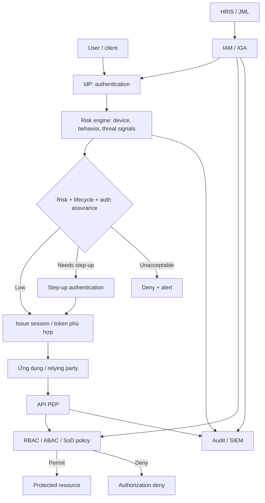

# Adaptive authentication trong Risk-based access và vòng đời danh tính IAM

**Adaptive authentication** (*xác thực thích ứng*) là cách điều chỉnh **yêu cầu xác thực theo mức rủi ro và bối cảnh của từng lần truy cập** thay vì áp dụng một thử thách giống nhau cho mọi người, mọi thiết bị, mọi thời điểm. Hệ thống có thể cho phép phiên đăng nhập rủi ro thấp tiếp tục với cơ chế đã đáp ứng, yêu cầu **step-up authentication** khi rủi ro tăng, hoặc **từ chối/cách ly** một phiên có dấu hiệu nguy hiểm.

Ví dụ, một nhân viên đã đăng nhập bằng phương thức chống phishing trên thiết bị được quản lý và đang đọc tài liệu nội bộ có thể không cần bị hỏi lại liên tục. Nhưng khi cùng người đó muốn thay đổi cấu hình **Identity Provider (IdP)** từ thiết bị mới, hệ thống có thể yêu cầu xác thực lại bằng phương thức mạnh và chỉ cho tiếp tục khi những kiểm soát khác cũng cho phép. Nếu tài khoản đã **Leaver**, câu trả lời đúng không phải “bắt MFA thêm lần nữa” mà là **từ chối truy cập** vì quan hệ và quyền không còn hợp lệ.

Bài học thuộc chương **Risk-based access**, trong module **SECURITY_IDENTITY_ACCESS_MANAGEMENT_IDENTITY_LIFECYCLE**. Nội dung liên hệ quản lý vòng đời danh tính **Joiner–Mover–Leaver (JML)**, từ proofing và onboarding đến cấp quyền, thay đổi nhiệm vụ, rà soát và thu hồi; đồng thời phối hợp **IdP, SSO, SCIM, RBAC/ABAC, service identity, session/token management, audit và reconciliation**. **Adaptive authentication là kiểm soát xác thực dựa trên rủi ro, không thay thế authorization hoặc deprovisioning.**

## 1. Vì sao cần xác thực thích ứng?

Một chính sách chỉ yêu cầu mật khẩu cho mọi tình huống dễ bỏ sót thiết bị bị chiếm, token bị đánh cắp hoặc thao tác đặc quyền. Ngược lại, buộc mọi request xác thực mạnh lặp lại có thể gây gián đoạn và khiến người dùng hình thành thói quen phê duyệt MFA vô thức.

Adaptive authentication tìm điểm cân bằng giữa:
- **Bảo vệ:** nhận biết thay đổi bối cảnh, tăng bảo đảm khi thao tác rủi ro.
- **Khả dụng:** giảm thử thách không cần thiết ở những phiên có đủ tín hiệu tin cậy.
- **Tính liên tục:** hỗ trợ người dùng hợp lệ xử lý công việc đúng thời điểm.
- **Khả năng giải thích:** biết yếu tố nào khiến hệ thống quyết định step-up, deny hoặc điều tra.
- **Vòng đời quyền:** áp dụng chính sách theo trạng thái Joiner/Mover/Leaver hiện hành.

| Truy cập | Bối cảnh minh họa | Hành động chính sách có thể chọn |
| --- | --- | --- |
| Đọc nội dung thông thường | Thiết bị đã quản lý, phiên có đủ assurance | Cho tiếp tục trong scope |
| Xem dữ liệu nhạy cảm | Thao tác có tác động cao | Step-up trước khi truy cập |
| Thay IAM policy | Hành động privileged | Xác thực mạnh, phê duyệt và authorization riêng |
| Login từ thiết bị mới | Tín hiệu thiết bị chưa đủ | Yêu cầu MFA hoặc enrollment có kiểm soát |
| Tín hiệu session bị chiếm | Token reuse hoặc hành vi bất thường | Revoke/session deny và điều tra |
| Account Leaver | Quan hệ không còn hiệu lực | Deny, không dùng MFA để hợp thức hóa |
| Partner hết hợp đồng | Trust/authorization hết căn cứ | Deny và deprovision tại ứng dụng |

Bảng trên chỉ là **hướng xử lý minh họa**. Mức risk và hành động thực tế cần được quyết định bằng chính sách, độ tin cậy tín hiệu và yêu cầu bảo vệ của từng ứng dụng.

## 2. Authentication, authorization và risk-based access

**Authentication (AuthN)** xác nhận chủ thể đang chứng minh danh tính bằng cách nào và với mức bảo đảm nào. **Authorization (AuthZ)** quyết định chủ thể đó có quyền thực hiện **hành động trên tài nguyên cụ thể** hay không. **Risk assessment** dùng tín hiệu về bối cảnh để điều chỉnh quá trình ra quyết định.

| Lớp | Câu hỏi | Ví dụ |
| --- | --- | --- |
| Identity proofing | Danh tính này đã được xác minh đáng tin chưa? | Xác minh nhân viên mới |
| Authentication | Ai đang đăng nhập và dùng yếu tố nào? | Passkey/FIDO2 hoặc MFA |
| Adaptive authentication | Có cần chứng minh thêm ngay lúc này? | Step-up vì thiết bị mới |
| Authorization | Có được duyệt khoản thanh toán này không? | RBAC + tenant + SoD |
| Provisioning | Account/entitlement đã được tạo ở đích chưa? | SCIM group update |
| Session management | Phiên còn sống và còn phù hợp chính sách? | Idle timeout, reauth, revoke |
| Audit | Vì sao quyết định này được đưa ra? | Policy version, reason code |

**MFA thành công không tạo quyền quản trị.** Nếu một user không có role `payment-approver`, họ vẫn bị từ chối `approvePayment` dù đã hoàn thành step-up. Tương tự, tài khoản đã disabled không được phục hồi quyền chỉ nhờ nhập đúng OTP.

## 3. Các tín hiệu rủi ro phổ biến

Adaptive authentication thường đánh giá một tập tín hiệu có chất lượng khác nhau:

| Nhóm | Tín hiệu minh họa | Lưu ý |
| --- | --- | --- |
| **Identity** | Trạng thái active, loại quan hệ, mức proofing | Ưu tiên nguồn HR/IAM đáng tin |
| **Device** | Managed/compliant, posture, key binding | Dữ liệu endpoint có thể trễ |
| **Network** | Vùng mạng, proxy, reputation, IP bất thường | IP/geolocation có thể sai hoặc dùng chung |
| **Behavior** | Thay đổi nhịp đăng nhập, hành động bất thường | Cần baseline và chống false positive |
| **Authentication** | Phương thức đã dùng, thời điểm auth, lần MFA thất bại | Không suy đồng đều mọi yếu tố MFA |
| **Session** | Tuổi phiên, token reuse, thay thiết bị/context | Có thể cần revoke thay vì step-up |
| **Resource** | Phân loại dữ liệu, mức đặc quyền, thao tác | Phải xét ngữ cảnh request |
| **Threat intelligence** | Credential compromise hoặc risk indicator | Độ tin cậy và freshness quan trọng |
| **Workload** | Issuer, audience, workload subject, runtime trust | Không áp đặt human MFA lên máy |
| **Lifecycle** | Joiner chưa hiệu lực, Mover đang chuyển, Leaver | Có thể là hard deny, không phải risk score |

**Không dựa duy nhất vào vị trí IP hoặc geolocation để xác nhận gian lận**. VPN, mạng di động, NAT và tuyến mạng quốc tế có thể tạo tín hiệu sai. Các chỉ báo nên được tổng hợp có kiểm soát, đồng thời có cách giải thích và giải quyết khi dữ liệu thiếu.

## 4. Risk score, policy và quyết định

Một hệ thống có thể chuyển tín hiệu thành risk tier như **Low, Medium, High** hoặc sử dụng policy rules không cần score số. Điểm rủi ro không phải “sự thật tuyệt đối”; nó là **ước lượng dựa trên tín hiệu và mô hình tại thời điểm đánh giá**.

| Risk tier minh họa | Quyết định khả dĩ | Kiểm soát bổ sung |
| --- | --- | --- |
| Low | Tiếp tục theo assurance hiện tại | Log, thời hạn phiên bình thường |
| Medium | Step-up MFA hoặc re-authenticate | Giảm thời hạn phiên, kiểm posture |
| High | Deny, quarantine hoặc challenge theo chính sách | Alert và điều tra |
| Unknown/missing signals | Xử lý theo policy và mức nhạy cảm | Không mặc nhiên coi là Low |

**Không có ngưỡng điểm chuẩn chung cho mọi hệ thống.** Cần xác định risk appetite, mức tác động của resource và năng lực hỗ trợ người dùng. Một policy tốt có thể có **hard guardrail** như `subject.active == true` đứng trước bước xếp hạng rủi ro.

Ví dụ pseudo-policy:

```text
IF subject.lifecycle_status != "ACTIVE":
    DENY

IF NOT current_entitlements_allow(subject, action, resource):
    DENY

risk = evaluate_risk(trusted_signals, action, resource)

IF risk == "HIGH":
    DENY_AND_ALERT
ELSE IF risk == "MEDIUM" OR action.requires_step_up:
    REQUIRE_PHISHING_RESISTANT_STEP_UP
ELSE:
    ALLOW_WITH_EXISTING_AUTH_CONTEXT
```

Đây là **giả mã để giải thích**, không phải cú pháp của sản phẩm cụ thể. Mô hình thực tế có thể đánh giá AuthN trước AuthZ hoặc ở nhiều điểm khác nhau, nhưng kết quả cuối phải bảo đảm **không cho phép hành động thiếu quyền**.

## 5. Các dạng phản ứng thích ứng

1. **Silent allow:** không yêu cầu người dùng thao tác thêm khi assurance còn đủ.
2. **Reauthentication:** yêu cầu chứng minh lại vì phiên cũ hoặc ngữ cảnh thay đổi.
3. **Step-up MFA:** dùng yếu tố/phương thức mạnh hơn cho thao tác nhạy cảm.
4. **Device verification:** yêu cầu thiết bị đạt posture hoặc xác minh thiết bị.
5. **Session restriction:** rút ngắn session, giới hạn tính năng hoặc yêu cầu kiểm tra lại.
6. **Conditional denial:** chặn truy cập khi điều kiện nguy hiểm hoặc thiếu tin cậy.
7. **Alert/manual review:** chuyển đội Security hoặc service owner xử lý.
8. **Token/session revocation:** thu hồi đường truy cập khi nghi bị chiếm.
9. **Access reduction:** thực thi authorization giới hạn resource/action theo policy.
10. **Recovery path:** cung cấp quy trình hỗ trợ đã xác minh khi người dùng hợp lệ bị khóa.

**Không biến “thích ứng” thành MFA prompt liên tục**. MFA fatigue có thể tăng nếu hệ thống phản ứng quá thường xuyên bằng push. Với thao tác rủi ro cao, nên ưu tiên **phương thức chống phishing** khi có thể và kiểm tra ngữ cảnh cụ thể.

## 6. Kiến trúc phối hợp IdP, ứng dụng và policy engine



**Risk engine không nhất thiết nằm trong IdP**: có thể ở identity protection service, application gateway hoặc policy service. Quan trọng là **đường tin cậy giữa tín hiệu, quyết định và enforcement**. Nếu chỉ đánh giá risk khi login nhưng không kiểm tra khi người dùng thực hiện giao dịch nhạy cảm, một session rủi ro thấp ban đầu có thể trở nên nguy hiểm về sau.

## 7. Step-up authentication

**Step-up** là yêu cầu xác thực bổ sung hoặc mạnh hơn tại một thời điểm cụ thể. Ví dụ người dùng xem dashboard bằng phiên có sẵn nhưng cần xác thực lại khi thay đổi người phê duyệt thanh toán.

Cần xác định:

- **Trigger:** thao tác nhạy cảm, thay đổi thiết bị, session age hoặc risk tier.
- **Required assurance:** phương thức đáp ứng mục tiêu chống phishing/chiếm phiên.
- **Freshness:** xác thực gần đây đến mức nào mới được dùng.
- **Binding:** chứng minh thuộc đúng subject, phiên và yêu cầu đang thực hiện.
- **Scope:** step-up dùng cho một thao tác hay một nhóm thao tác.
- **Timeout:** thời gian challenge có hiệu lực.
- **Fallback:** quy trình recovery bảo vệ, không hạ kiểm soát vô điều kiện.
- **Audit:** challenge issued/completed/failed, policy và kết quả API.

**MFA đã hoàn thành ở thời điểm đăng nhập không luôn đủ cho một thao tác đặc quyền nhiều giờ sau đó**. Phải xét `auth_time`, ngữ cảnh và yêu cầu policy ứng dụng, không chỉ có một cờ `mfa=true`.

## 8. Phương thức xác thực và khả năng chống phishing

| Phương thức | Giá trị trong adaptive flow | Rủi ro cần biết |
| --- | --- | --- |
| **Passkey/FIDO2/WebAuthn** | Có thể cung cấp xác thực chống phishing gắn với origin | Cần enrollment, recovery và quản lý thiết bị |
| **Hardware-backed authenticator** | Tăng bảo đảm nắm giữ khóa | Phụ thuộc thiết bị và quy trình dự phòng |
| **Authenticator OTP** | Yếu tố bổ sung phổ biến | OTP có thể bị phishing |
| **Push approval** | Dễ dùng trong nhiều môi trường | Push fatigue và social engineering |
| **SMS OTP** | Kênh dự phòng ở một số tình huống | Rủi ro chuyển SIM, phishing và phụ thuộc mạng |
| **Password** | Yếu tố knowledge | Không đủ cho nhiều tình huống rủi ro cao |
| **Certificate / mTLS** | Xác thực client hoặc thiết bị trong kiến trúc phù hợp | Cần PKI, rotation và revocation |

Lựa chọn phải dựa trên **threat model, mức assurance và hỗ trợ nền tảng**. Không kết luận mọi MFA có độ mạnh như nhau. Với tài khoản privileged, phương thức chống phishing và bảo vệ recovery thường có giá trị quan trọng.

## 9. Risk signals có thể bị thao túng hoặc lỗi thời

Risk engine chỉ tốt khi tín hiệu đầu vào đáng tin:

- Device posture có thể bị giả nếu lấy từ client tự khai.
- IP location có thể phản ánh proxy thay vì vị trí người dùng.
- Behavioral baseline bị lệch bởi thay đổi công việc hoặc lịch trực.
- Threat intelligence có thể có false positive.
- Tín hiệu `lastKnownGoodDevice` có thể lỗi thời khi máy bị mất.
- Role/department claim trong access token có thể phản ánh thông tin trước Mover.
- Signal aggregator có thể mất kết nối hoặc bị chậm cập nhật.
- Attacker có thể cố “làm quen” hệ thống bằng hoạt động nhỏ và đều đặn.

Cần **nguồn tín hiệu được xác thực, kiểm tra timestamp, giới hạn cache và monitor chất lượng dữ liệu**. Các thuộc tính có vai trò hard guardrail như lifecycle status, entitlement hoặc tenant phải được kiểm tra theo nguồn đáng tin, không tin trường request body do client tự gửi.

## 10. Adaptive authentication theo Joiner

Khi **Joiner**, người mới thường chưa có lịch sử thiết bị/hành vi. Không nên mặc nhiên quy mọi hành vi mới là tấn công, nhưng cũng không cấp quyền trước khi đạt điều kiện.

Kịch bản:

1. HRIS tạo sự kiện Joiner, identity được xác minh theo quy trình.
2. IdP tạo account và cấu hình MFA/passkey enrollment phù hợp.
3. Giai đoạn đầu, tín hiệu hành vi còn ít: policy dựa nhiều hơn vào credential assurance, device trust và role.
4. Birthright role chỉ có hiệu lực theo start date và policy.
5. Nếu người mới xin quyền nhạy cảm, cần approval và step-up nếu được yêu cầu.
6. Sau login, resource server vẫn kiểm RBAC/ABAC/tenant.
7. Log các false positive để hiệu chỉnh, không tự xóa hard guardrail.

**Account được provision trước ngày bắt đầu không có nghĩa được nhận usable access ngay**. Adaptive authentication không được phép biến trạng thái chưa đủ điều kiện thành Allow chỉ vì thiết bị hoặc IP trông “an toàn”.

## 11. Adaptive authentication theo Mover

Mover thay đổi nhiệm vụ và phạm vi quyền. Một nhân viên từ Support chuyển sang Security có thể nhận thao tác mới, môi trường mới và thiết bị mới; baseline cũ không còn phù hợp.

Cần kiểm soát hai chiều:

- **Giảm quyền cũ:** deprovision role Support không còn cần.
- **Đánh giá role mới:** approval, SoD và mức assurance cho hành động Security.
- **Cập nhật risk context:** chức năng mới có thể thay đổi hành vi bình thường.
- **Không tin stale claims:** access token hoặc session có thể chứa nhóm cũ.
- **Step-up theo rủi ro:** admin action có thể cần xác thực mạnh hơn.
- **Negative test:** dùng session cũ thử action của role đã mất phải bị Deny.
- **Audit:** phân biệt cảnh báo do Mover hợp lệ với nỗ lực trái phép.

**Step-up không thay cho việc gỡ entitlement cũ**. Nếu Mover vẫn có `production-admin` qua quyền trực tiếp ở ứng dụng, risk score thấp không thể hợp thức hóa quyền ngoài nhiệm vụ.

## 12. Adaptive authentication theo Leaver

Leaver là trường hợp cần **hard deny và deprovisioning**, không chỉ tăng điểm rủi ro:

```text
IF identity.lifecycle_status == "LEAVER"
   OR contract.access_end_time <= now:
    DENY_NEW_AUTHENTICATION
    REVOKE_REFRESH_AND_SESSIONS_AS_SUPPORTED
    REMOVE_ENTITLEMENTS
    VERIFY_TARGET_AUTHORIZATION_DENY
```

Đây là mô hình logic. Với token tự chứa, resource server có thể còn chấp nhận token cũ đến hết hạn nếu không có kiểm tra trạng thái hoặc cơ chế revoke. Vì vậy cần kiểm thử **time-to-deny** và ghi rõ giới hạn công nghệ.

| Đường truy cập | Sau Leaver cần xác minh |
| --- | --- |
| IdP login mới | Không được cấp session mới |
| Refresh token | Không xin được access token mới trái policy |
| RP session đã có | Không thực hiện action đã mất quyền |
| Access token còn hạn | Resource server Deny theo cơ chế/SLA |
| Local SaaS account | Không còn quyền riêng tại target |
| Privileged account phụ | Quyền và eligibility bị thu hồi |
| Partner/session độc lập | Được xử lý theo hợp đồng và nguồn quyền |
| Audit | Có bằng chứng trạng thái cuối, không chỉ connector success |

**SCIM `active=false` không cam kết thu hồi tất cả cookie, refresh/access token và local role**. Cần kiểm chứng tại ứng dụng/API.

## 13. Continuous và transaction-time evaluation

Nhiều hệ thống chỉ đánh giá rủi ro tại thời điểm login. Nhưng hành động nhạy cảm có thể đến **sau nhiều giờ**, khi thiết bị không còn compliant hoặc credential đã bị nghi chiếm.

Các điểm đánh giá lại:

- Khi đổi ứng dụng hoặc mở tài nguyên phân loại cao.
- Khi kích hoạt role privileged qua PAM/JIT.
- Trước thay đổi IAM policy, credential hoặc phương thức MFA.
- Trước phê duyệt giao dịch giá trị cao.
- Khi risk signal mới báo thiết bị bất thường.
- Khi session bị thu hồi hoặc identity Mover/Leaver.
- Khi entitlement hoặc SoD policy thay đổi.
- Khi access token được đổi mới, nếu kiến trúc yêu cầu.

Không nhất thiết yêu cầu xác thực lại trước **mọi API request**. Có thể dùng session assurance với thời hạn, signal streaming và policy tại resource server. Mục tiêu là **phát hiện thay đổi rủi ro đủ sớm mà không tạo điểm lỗi hoặc overhead không cần thiết**.

## 14. Quan hệ với session và token

Adaptive authentication có thể ảnh hưởng đến việc tạo hoặc nâng mức bảo đảm của phiên. Tuy nhiên cần phân biệt:

| Thành phần | Cần kiểm tra |
| --- | --- |
| **IdP SSO session** | Có đủ assurance cho ứng dụng mới không? |
| **RP/local session** | Có stale authentication context hoặc role? |
| **Access token** | Issuer, audience, scope, expiry và quyền hiện hành |
| **Refresh token** | Có được cấp token mới sau thay đổi risk/JML? |
| **Authentication context** | `acr`, `amr`, `auth_time` nếu phù hợp |
| **Session cookie** | Secure, HttpOnly, SameSite, timeout, revoke |
| **Step-up result** | Đúng identity, challenge và policy? |

Trong OIDC, các claim như `acr`, `amr` và `auth_time` có thể giúp RP diễn giải ngữ cảnh xác thực nếu nhà cung cấp hỗ trợ; **không suy rằng mọi IdP dùng cùng giá trị `acr` hoặc cùng semantics**.

**ID token OIDC không phải access token gọi API.** Nếu RP cần step-up, phải sử dụng flow được nhà cung cấp hỗ trợ và kiểm tra kết quả đáng tin; API vẫn phải xác minh token/authorization riêng.

## 15. IdP, SSO, SCIM, RBAC/ABAC phối hợp ra sao?

| Thành phần | Đóng góp | Giới hạn |
| --- | --- | --- |
| **IdP/SSO** | Authentication, MFA, conditional access, session | Không quản lý mọi local app role |
| **Risk engine** | Phân tích tín hiệu và policy step-up | Score không thay thế entitlement |
| **IAM/IGA** | Lifecycle state, approval, desired permissions | Cần target readback |
| **SCIM/connector** | Provision/deprovision tài khoản và nhóm | Không phải giao thức thu hồi mọi token |
| **RBAC** | Quyền theo vai trò | Cần xét role kế thừa/direct grant |
| **ABAC/PBAC** | Context/resource/subject policy | Cần nguồn thuộc tính tin cậy |
| **PAM/JIT** | Kích hoạt đặc quyền đúng thời điểm | Có thể cần MFA mạnh và session monitoring |
| **Resource server/PEP** | Enforce action-resource authorization | Không được chỉ dựa vào UI |
| **Audit/SIEM** | Theo dõi risk decisions, denied access | Log không tự chặn hành vi |

**Một request có risk thấp vẫn có thể bị Deny vì không có permission**. Ngược lại, một user có permission có thể bị yêu cầu step-up hoặc chặn nếu session bị rủi ro.

## 16. Service identity và non-human accounts

Workload thường không thể thực hiện push MFA như con người. Với **service/machine identity**, kiểm soát thích ứng cần dựa trên tín hiệu kỹ thuật:

- Workload issuer/subject/audience có khớp trust policy không?
- Certificate/mTLS hoặc token có đúng client binding?
- Managed identity gắn với resource đang chạy hợp lệ?
- CI/CD deployment từ repo, branch, environment được cho phép?
- Token issuance có thay đổi bất thường về tần suất hoặc audience?
- Secret hoặc service principal đã bị rotate/revoke?
- Workload có owner và scope không còn nhu cầu?
- Partner contract hoặc machine lifecycle đã kết thúc?
- Tài nguyên API có chặn quyền ngoài RBAC/ABAC không?

Hành động phù hợp có thể là **deny token exchange, hạn chế scope, thu hồi secret, cô lập workload hoặc yêu cầu approval triển khai**, chứ không phải gửi OTP đến email của bot. **Không gắn điện thoại cá nhân làm MFA thủ công cho một service account chạy 24/7** nếu có cơ chế danh tính máy thích hợp hơn.

## 17. Partner và federation

Một identity B2B được xác thực qua IdP của đối tác có thể đáp ứng authentication nhưng chưa chắc đủ **risk, assurance và authorization** của hệ thống doanh nghiệp.

Cần đánh giá:

1. Đối tác có còn hợp đồng và sponsor nội bộ không?
2. Federation metadata, issuer, certificate và trust có hợp lệ?
3. Assertion/claim có đủ assurance theo hợp đồng không?
4. Thiết bị hoặc phiên có rủi ro cần step-up ở ứng dụng không?
5. Tài nguyên tenant nào được truy cập?
6. Partner được phép những action nào theo RBAC/ABAC?
7. Phiên và quyền có bị thu hồi khi hợp đồng kết thúc?
8. Kênh khôi phục MFA/đăng nhập có bảo vệ thích hợp?

Không tin một claim `trusted=true` do client tự gửi. Những giá trị assurance phải được xác minh qua **issuer đáng tin và cấu hình federation**, đồng thời phải giới hạn quyền đích.

## 18. Privileged access và step-up bắt buộc

Các hành động như thay IAM policy, cấp quyền admin, đọc secrets, thay MFA recovery hoặc xóa audit logs cần kiểm soát chặt:

| Action | Điều kiện xác thực | Kiểm soát độc lập |
| --- | --- | --- |
| Xem log thường | Assurance thông thường phù hợp | RBAC scope |
| Đọc dữ liệu nhạy cảm | Step-up khi chính sách yêu cầu | Data owner + ABAC |
| Kích hoạt production admin | Phương thức mạnh, freshness phù hợp | PAM/JIT + approval |
| Thay authentication policy | Re-authentication/step-up | SoD, change approval |
| Quản trị secret | Identity và device assurance | Vault ACL, audit |
| Break-glass | Recovery authentication riêng đã thử | Incident ID, custodian, hậu kiểm |

**Step-up không phải phê duyệt nghiệp vụ.** Một quản trị viên hoàn tất MFA nhưng chưa được phép tự phê duyệt thay đổi nhạy cảm vẫn phải bị chặn theo SoD/change policy.

## 19. Điều kiện thiếu tín hiệu và lỗi hệ thống

Tình huống production thường có signal collector hoặc risk engine gián đoạn. Khi đó phải có **failure policy** rõ:

- Không tự xem mọi rủi ro là Low vì không lấy được device posture.
- Không tự bật chế độ “allow all” để duy trì khả dụng.
- Có thể chọn hạn chế một số thao tác, yêu cầu chứng minh mạnh hơn hoặc từ chối hành động rủi ro cao.
- Với tác vụ thiết yếu, định nghĩa phương án dự phòng được kiểm soát và giám sát.
- Đặt timeout, circuit breaker và cache freshness theo risk tier.
- Ghi quyết định khi thiếu dữ liệu và cảnh báo.
- Kiểm tra sự khác biệt giữa rủi ro **không xác định** và **cao**; không làm giả tín hiệu.

**Fail-open/fail-closed** phải được thiết kế theo tài nguyên và mức tác động. Một phiên chỉ đọc thông tin công khai và hành động sửa quyền quản trị cần cách xử lý khác nhau.

## 20. Quyền riêng tư, công bằng và false positive

Adaptive authentication có thể xử lý dữ liệu như vị trí ước lượng, địa chỉ IP, thiết bị, giờ truy cập và hành vi. Những tín hiệu này có thể nhạy cảm, sai lệch hoặc phân biệt không công bằng.

Các nguyên tắc quản trị:

- **Data minimization:** chỉ thu thập tín hiệu cần cho kiểm soát.
- **Retention rõ ràng:** không giữ dấu vết hành vi vô hạn.
- **Giới hạn quyền truy cập:** risk telemetry không phải báo cáo mở cho mọi nhân viên.
- **Mã hóa và bảo vệ integrity** dữ liệu risk và audit.
- **Giải thích được reason code** khi điều tra, không nhất thiết công khai công thức risk đầy đủ.
- **Kiểm tra false positive/false negative** theo nhóm tình huống, thiết bị và khu vực.
- **Recovery có bảo vệ:** người dùng hợp lệ có đường chứng minh khác nếu mất thiết bị.
- **Không suy nhạy cảm cá nhân** từ thiết bị hoặc địa chỉ mạng nếu không có căn cứ.
- **Chống automation abuse:** hạn chế spam challenge, MFA fatigue và brute-force.
- **Review policy thường xuyên** khi môi trường và baseline thay đổi.

**Adaptive authentication không nên biến thành giám sát hành vi không giới hạn**. Mục đích là bảo vệ quyền truy cập; cần sử dụng dữ liệu đúng mục tiêu và nghĩa vụ pháp lý/tổ chức áp dụng.

## 21. Audit event cho adaptive authentication

Một record sự kiện có thể ghi:

| Trường | Giá trị minh họa | Công dụng |
| --- | --- | --- |
| `eventId` | `auth-risk-102` | Định danh event |
| `subjectId` | `identity-52` | Correlation với IAM |
| `clientId` | `erp-app` | Ứng dụng/thiết bị |
| `resourceRef` | `invoice-approval` | Phạm vi yêu cầu |
| `action` | `invoice.approve` | Hành động |
| `riskTier` | `MEDIUM` | Mức rủi ro đánh giá |
| `riskReasonCodes` | `NEW_DEVICE` | Lý do dạng mã |
| `policyId/version` | `adaptive-auth/v7` | Quy tắc tại thời điểm |
| `requiredAssurance` | `phishing-resistant` | Yêu cầu xác thực |
| `challengeOutcome` | `SUCCESS` | Kết quả step-up |
| `authorizationDecision` | `DENY` hoặc `PERMIT` | Kết quả quyền riêng |
| `sessionReference` | ID đã che | Liên kết phiên |
| `lifecycleEventId` | `mover-883` | Nguồn JML nếu có |
| `timestamp` | UTC time | Thời điểm |

Đây là **schema minh họa**. Không log plaintext password, OTP, access/refresh token, session cookie, biometric template hoặc private key. Có thể giữ tham chiếu không nhạy cảm và giới hạn log chi tiết theo mục đích kiểm toán.

## 22. Đo lường hiệu quả adaptive authentication

| Chỉ số | Giải thích |
| --- | --- |
| **Step-up completion rate** | Tỷ lệ challenge được hoàn thành hợp lệ |
| **Unnecessary challenge rate** | Tỷ lệ challenge bị xác nhận không cần thiết |
| **Risk detection coverage** | Mức bao phủ tình huống cần kiểm tra |
| **False-positive rate** | Tỷ lệ đánh giá rủi ro cao nhầm |
| **False-negative rate** | Tỷ lệ rủi ro không được phát hiện qua tập đánh giá |
| **MFA fatigue indicators** | Tần suất challenge bất thường gây mệt mỏi |
| **Compromised-session time-to-deny** | Thời gian chặn phiên khi phát hiện rủi ro |
| **Privileged step-up coverage** | Hành động đặc quyền được bảo vệ đúng |
| **Recovery success rate** | Người dùng hợp lệ khôi phục truy cập an toàn |
| **Risk signal freshness** | Độ mới device/identity/threat context |
| **JML stale-access incidents** | Quyền tồn dư sau Mover/Leaver |
| **Policy override/exception age** | Ngoại lệ risk policy chưa được đóng |
| **Adaptive decision latency** | Thời gian ra quyết định trong luồng đăng nhập |
| **API authorization test coverage** | Quyền tại backend được kiểm chứng |

Không tối ưu **số lần yêu cầu MFA càng nhiều càng tốt**. Một hệ thống tốt phải giảm rủi ro thực tế, không tạo phiền nhiễu và có thể kiểm chứng hiệu quả với incident/negative tests.

## 23. Kiểm thử chính sách thích ứng

| Test case | Expected result |
| --- | --- |
| User active, thiết bị đáng tin, action thường | Tiếp tục theo assurance hiện có |
| User active, hành động nhạy cảm | Step-up đúng phương thức và freshness |
| Thiết bị mới nhưng user hợp lệ | Challenge/verification theo policy |
| Token sai issuer/audience | API Deny dù risk score Low |
| User thiếu role | API Deny dù step-up thành công |
| Tenant A thử tài nguyên tenant B | API Deny theo authorization |
| Joiner chưa tới ngày hiệu lực | Không cấp usable access trái policy |
| Mover gỡ Finance role | Phiên cũ không tiếp tục approve Finance |
| Leaver có session/token cũ | Không được gọi protected API ngoài SLA |
| Service identity retired | Trust/token issuance và API quyền cũ bị chặn |
| Signal collector unavailable | Áp dụng failure policy, không tự cho Low |
| Risk engine trả kết quả trễ | Timeout và fallback theo chính sách |
| Đổi role JIT thành privileged | Step-up và approval độc lập |
| MFA challenge bị từ chối/hết hạn | Không tiếp tục action nhạy cảm |
| MFA prompt nhiều lần | Phát hiện và giảm nguy cơ fatigue |
| Replayed step-up result | Không dùng được ngoài session/action cho phép |
| False-positive login | Recovery và audit có kiểm soát |
| Event Mover/Leaver đảo thứ tự | Grant cũ không hồi sinh quyền |

**Test phải thực hiện cả API trực tiếp**, không chỉ nhìn nút giao diện được ẩn hay màn hình yêu cầu OTP.

## 24. Pseudocode kiểm thử step-up và authorization

```text
test "sensitive action requires fresh assurance and current permission":
    user = create_test_identity(status="ACTIVE", role="payment-approver")
    session = login(user, method="allowed-baseline")
    payment = create_test_payment(tenant=user.tenant)

    response = api.approve(payment, session)
    assert response == STEP_UP_REQUIRED

    result = complete_test_step_up(
        session=session,
        method="phishing-resistant",
        request_context=payment
    )
    assert result == SUCCESS

    assert api.approve(payment, upgraded_session(session)) == PERMIT

    iam.revoke_role(user, "payment-approver")
    wait_until_policy_updates(timeout=policy.sla)

    assert api.approve(new_test_payment(user.tenant), session) == DENY
```

Đây là **giả mã**, không phải API thực thi. Tùy hệ thống, action `approve` đầu tiên có thể chưa được xử lý khi thiếu assurance. Khi kiểm thử phải xác nhận **không có side effect nghiệp vụ** trước step-up và không có lần phê duyệt kép do retry.

Một bài test khác cần chứng minh **step-up thành công không vượt qua role revocation** sau Mover/Leaver.

## 25. Lỗi triển khai thường gặp

| Sai lầm | Hậu quả | Cách khắc phục |
| --- | --- | --- |
| Dùng risk score thay quyền RBAC | Người thiếu quyền vẫn được truy cập | AuthZ độc lập tại PEP |
| Tin IP location như sự thật tuyệt đối | False positive và bỏ sót abuse | Nhiều tín hiệu có độ tin cậy |
| Chỉ đánh giá khi login | Không phát hiện thay đổi lúc action nhạy cảm | Continuous/transaction-time checks |
| Bắt OTP liên tục | MFA fatigue, phản tác dụng | Risk-tier và chống phishing |
| Xem MFA thành công = được phê duyệt | Bỏ qua resource owner/SoD | Approval và authorization riêng |
| Tin role claim cũ sau Mover | Quyền tồn dư | Runtime policy/cache invalidation |
| Dùng step-up cho Leaver | Hợp thức hóa account hết quan hệ | Hard deny và deprovision |
| Xem SCIM disable = mọi token chết | Session/API tiếp tục Permit | Negative tests và time-to-deny |
| Không có policy cho missing signals | Risk engine hỏng làm mở rộng quyền | Failure mode theo độ nhạy |
| Không bảo vệ event/risk telemetry | Rò PII và cấu trúc security | Minimization + audit controls |
| Dùng human MFA cho cron job | Dịch vụ bị gián đoạn | Workload credentials/trust |
| Không kiểm fallback/recovery | Người dùng hợp lệ bị khóa lâu | Recovery có proofing/monitoring |
| Không gắn policy version | Khó giải thích quyết định | Versioned policy evidence |
| Token sai audience vẫn accepted | AuthN lẫn AuthZ và token validation | RS xác minh issuer/audience |

## 26. Checklist thiết kế Adaptive authentication

- [ ] Xác định hệ thống, actor, resource và action trong phạm vi.
- [ ] Phân biệt xác thực, risk assessment và authorization.
- [ ] Có hard guardrail cho JML status, entitlement và tenant.
- [ ] Các tín hiệu có nguồn tin cậy, timestamp và độ mới.
- [ ] Không phụ thuộc duy nhất vào vị trí IP hoặc behavioral signal.
- [ ] Có risk tiers hoặc policy logic được quản trị/versioned.
- [ ] Ánh xạ hành động risk thấp/vừa/cao sang response phù hợp.
- [ ] Ưu tiên phishing-resistant step-up ở những điểm rủi ro cao.
- [ ] Xác định assurance, freshness, scope và session binding.
- [ ] Có policy cho device/risk engine unavailable.
- [ ] Không cho step-up vượt quyền hoặc phê duyệt nghiệp vụ.
- [ ] Mover làm mất quyền cũ trong SLA, kể cả stale token.
- [ ] Leaver bị deny và thu hồi session/token theo khả năng nền tảng.
- [ ] Service/machine identity dùng trust/credential control riêng.
- [ ] Partner federation có assurance, sponsor và tenant scope.
- [ ] Có privacy, data minimization và retention phù hợp.
- [ ] Log risk decision, challenge result, policy version và authz outcome.
- [ ] Kiểm thử positive, negative, false-positive và fail-safe cases.
- [ ] Đo time-to-deny, prompt fatigue và hiệu quả phòng xâm nhập.
- [ ] Có quy trình incident, recovery và kiểm tra exception.

## 27. Câu hỏi tự kiểm tra

**Tình huống A:** Nhân viên không có role Finance nhưng hoàn thành step-up bằng passkey. Có thể duyệt hóa đơn không? **Không.** Xác thực mạnh không tạo quyền nghiệp vụ.

**Tình huống B:** Người dùng Leaver đăng nhập từ thiết bị được quản lý, risk score Low. Có nên Allow không? **Không.** Lifecycle status không hợp lệ phải được xử lý bằng deny/deprovision.

**Tình huống C:** Thiết bị mới làm risk tăng, nhưng người dùng hợp lệ. Có nên khóa vĩnh viễn? **Không mặc định.** Có thể yêu cầu xác minh/step-up và recovery theo policy.

**Tình huống D:** Hệ thống đánh giá risk tại login nhưng sau đó user đổi thành production admin. Còn thiếu gì? **Đánh giá lại assurance và authorization khi thực hiện thao tác đặc quyền**.

**Tình huống E:** SCIM gỡ group Finance nhưng ERP vẫn dùng token có claim cũ để approve. Adaptive authentication đã đủ chưa? **Chưa.** Cần chặn runtime authorization và kiểm chứng time-to-deny.

**Tình huống F:** Job CI/CD không thể trả lời MFA push. Nên xử lý thế nào? **Dùng service/machine identity, workload federation hoặc credential control phù hợp**, không cấp tài khoản người dùng giả cho automation.

**Tình huống G:** Risk engine lỗi và trả Unknown, ứng dụng xem đó là Low. Rủi ro gì? **Fail-open ngoài ý muốn**, cần failure policy theo mức độ nhạy cảm.

**Tình huống H:** User step-up thành công nhưng tạo giao dịch rồi tự duyệt giao dịch đó. Kiểm soát nào phải chặn? **Transaction-level Separation of Duties**, không phải MFA.

## Ghi nhớ

**Adaptive authentication** điều chỉnh yêu cầu xác thực dựa trên **rủi ro, bối cảnh truy cập và độ nhạy của hành động**. Kiểm soát hiệu quả cần tín hiệu đáng tin, **step-up có bảo đảm phù hợp**, chính sách khi thiếu tín hiệu, bảo vệ session/token, log và đánh giá false positive. Trong **Joiner–Mover–Leaver**, phải kết hợp **IdP/SSO, SCIM, RBAC/ABAC, service identity, PAM, SoD, audit và reconciliation**; đặc biệt **không để risk score thấp hoặc MFA thành công thay thế việc kiểm tra quyền hiện hành và thu hồi quyền của Mover/Leaver**.
