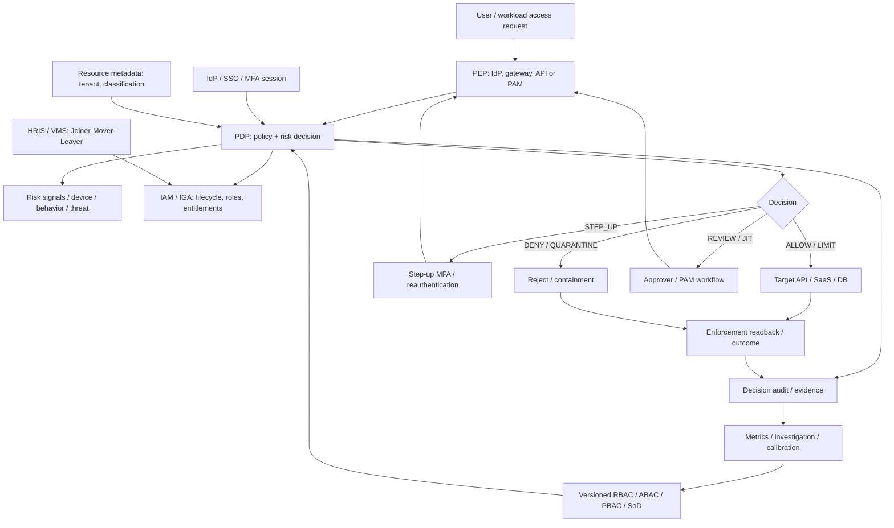
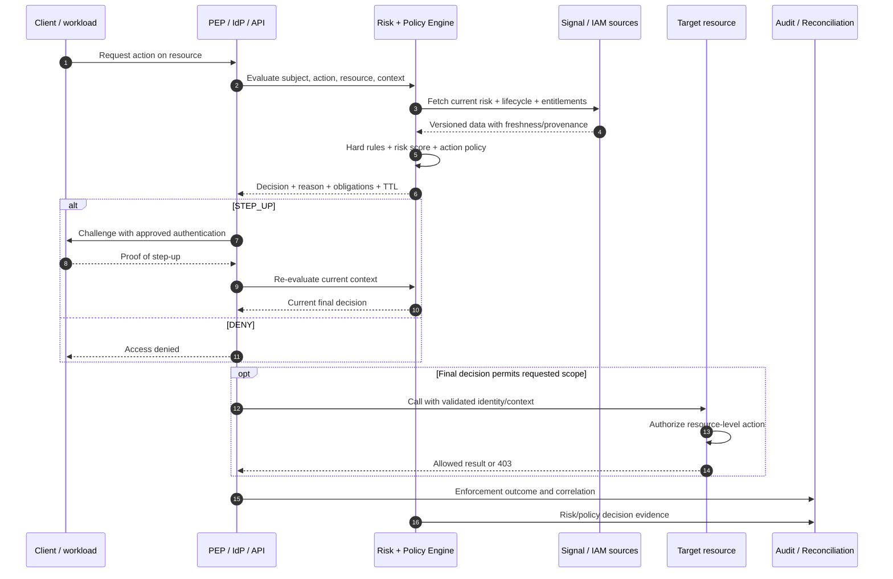

# Đánh giá quyết định risk trong quản lý vòng đời danh tính IAM

## 1. Đánh giá quyết định risk là gì?

**Đánh giá quyết định risk (risk decision evaluation)** là quá trình kiểm tra xem hệ thống **truy cập dựa trên rủi ro (risk-based access)** đã đưa ra **quyết định đúng, có căn cứ, được thực thi nhất quán và mang lại kết quả bảo mật phù hợp** đối với một yêu cầu truy cập hay chưa.

Trong hệ thống **Identity and Access Management (IAM)**, các quyết định có thể là:

- **ALLOW:** cho phép sau khi đã đạt các điều kiện xác thực và phân quyền.
- **STEP_UP:** yêu cầu thêm bằng chứng xác thực, chẳng hạn MFA chống phishing.
- **CHALLENGE/VERIFY:** xác minh bổ sung tình trạng thiết bị hoặc ngữ cảnh.
- **LIMIT:** cấp scope hẹp hơn, chỉ đọc hoặc phiên có thời hạn ngắn.
- **REQUIRE_APPROVAL:** cần người có thẩm quyền duyệt theo chính sách.
- **JIT/PAM:** chỉ kích hoạt đặc quyền trong khoảng thời gian được phép.
- **DENY:** từ chối khi vượt rủi ro cho phép hoặc vi phạm quy tắc bắt buộc.
- **SUSPEND/QUARANTINE:** tạm cô lập danh tính, thiết bị hay workload khi có dấu hiệu nghiêm trọng.
- **MONITOR:** cho phép với giám sát tăng cường khi chính sách cho phép.

Đánh giá quyết định risk không chỉ hỏi **“risk score là bao nhiêu?”**, mà phải hỏi:

1. Các tín hiệu rủi ro có **đáng tin, đủ mới và liên quan** đến yêu cầu không?
2. Chính sách có **chọn đúng hành động** so với mục tiêu bảo vệ không?
3. Quyết định có tôn trọng **RBAC/ABAC/PBAC, SoD, tenant, role và vòng đời Joiner–Mover–Leaver (JML)** không?
4. **Policy Enforcement Point (PEP)** tại IdP/API/PAM có thực thi hành động không?
5. Quyết định làm giảm rủi ro hay tạo nhiều false positive, gián đoạn và đường truy cập tồn dư?
6. Có **audit evidence** để điều tra, đo lường và điều chỉnh không?

**Nguyên tắc trung tâm:** risk score không phải permission; một quyết định `ALLOW` tại bước đánh giá rủi ro cũng **không thay thế quyền nghiệp vụ** tại API, DB hoặc hệ thống đích.

## 2. Phân biệt signal, score, risk decision và effective access

| Lớp | Câu hỏi | Ví dụ | Sai lầm thường gặp |
|---|---|---|---|
| **Risk signal** | Quan sát được dấu hiệu gì? | Thiết bị không quản lý, IP mới | Coi một tín hiệu là bằng chứng xâm nhập chắc chắn |
| **Risk feature** | Tín hiệu được chuẩn hóa ra sao? | `device_trust=unknown` | Mất nguồn, độ mới và độ tin cậy |
| **Risk score/level** | Mức rủi ro ước lượng là gì? | `HIGH` hoặc 82/100 | Coi số 82 là xác suất 82% bị hack |
| **Policy evaluation** | Rule nào áp dụng? | High risk + admin action → STEP_UP | Không tính SoD và entitlement |
| **Risk decision** | Cần xử lý yêu cầu ra sao? | STEP_UP, DENY, LIMIT | Đồng nhất step-up với ALLOW |
| **Enforcement** | Hệ thống đã làm gì? | IdP yêu cầu passkey rồi tiếp tục | Chỉ ghi request accepted |
| **Business authorization** | Chủ thể có quyền trên resource nào? | `report:read` tenant A | Cho truy cập vì MFA đã qua |
| **Observed outcome** | Sau quyết định có gì xảy ra? | API 403, session revoked, incident | Không đối soát quyền thực tế |

### 2.1. Ví dụ quyết định hai lớp

Linh đăng nhập từ thiết bị mới và yêu cầu xuất báo cáo Finance:

- **Risk engine:** rủi ro vừa → STEP_UP.
- **IdP:** xác minh bổ sung thành công.
- **RBAC:** Linh có `finance_reader`, không có `finance_exporter`.
- **API:** DENY hành động `report:export`.

Đó là **hệ thống hoạt động đúng**, không phải bug vì Linh vừa vượt qua MFA nhưng vẫn bị từ chối xuất dữ liệu.

## 3. Mục tiêu đánh giá quyết định risk

Một chương trình đánh giá cần đồng thời tối ưu:

| Mục tiêu | Ý nghĩa |
|---|---|
| **Security effectiveness** | Giảm truy cập trái phép và tổn thất dự kiến |
| **Decision correctness** | Chọn hành động phù hợp policy, risk và entitlement |
| **Coverage** | Mọi đường truy cập cần bảo vệ đều đi qua quyết định |
| **Timeliness** | Phát hiện và phản ứng kịp trước khi quyền bị lạm dụng |
| **Consistency** | Kết quả nhất quán giữa ứng dụng, tenant, môi trường |
| **Explainability** | Có reason codes, policy/signal provenance và phiên bản |
| **User experience** | Tránh challenge/deny không cần thiết |
| **Availability** | Không tạo outage từ tín hiệu lỗi hoặc phụ thuộc không sẵn sàng |
| **Fairness** | Tránh tác động thiếu căn cứ lên nhóm người dùng/thiết bị |
| **Auditability** | Tái dựng chính xác quyết định và kiểm chứng thực thi |
| **Governance** | Owner, approval, override, change control và kiểm tra định kỳ |

### 3.1. Không có ngưỡng “càng chặn nhiều càng an toàn”

Một engine luôn `DENY` sẽ giảm yêu cầu được chấp nhận, nhưng cũng làm dịch vụ **không sử dụng được**. Chất lượng phải đánh giá bằng **khả năng phân biệt hoạt động hợp lệ và nguy hiểm**, hiệu quả biện pháp thay thế và chi phí của sai lầm.

## 4. Những yếu tố cấu thành một risk decision

Một quyết định đầy đủ thường xét:

1. **Subject:** identity/user, account hoặc workload principal.
2. **Lifecycle:** ACTIVE, PREJOINER, MOVER, LEAVER, SUSPENDED, RETIRED.
3. **Authentication:** IdP issuer, MFA/assurance, session age.
4. **Device/workload:** độ tin cậy thiết bị, attestation, quản trị endpoint.
5. **Network/context:** nguồn truy cập, chất lượng IP signal và địa điểm ước lượng.
6. **Behavior:** tốc độ, mẫu truy cập bất thường, sự kiện đáng tin.
7. **Resource:** API, dataset, application, privileged endpoint.
8. **Action:** READ, EXPORT, WRITE, GRANT, DELETE, ISSUE_CREDENTIAL.
9. **Entitlement:** role, group, permission, grant source và scope.
10. **Data sensitivity:** classification, tenant, business criticality.
11. **Policy:** risk tolerance, hard constraints, SoD, approval rules.
12. **Time:** hiệu lực quyền, freshness, session TTL và JML effective date.
13. **Threat state:** confirmed compromise, alert đã được xác minh, token replay.
14. **Compensating control:** step-up, JIT, read-only, session restriction.
15. **Auditability:** có thể giải thích và đọc lại enforcement hay không.

**Đánh giá risk phải gắn với một hành động trên một tài nguyên cụ thể**. Rủi ro của `view_public_dashboard` không giống `change_iam_policy` ngay cả khi cùng user và thiết bị.

## 5. Kiến trúc tham chiếu cho risk-based access



Đây là kiến trúc logic: IdP, risk engine, PDP, PEP hoặc PAM có thể cùng nằm trong một sản phẩm. Điều cần tách rõ là **nguồn tín hiệu**, **đánh giá chính sách**, **thực thi** và **quan sát kết quả**.

### 5.1. Risk engine không được tự ý bỏ qua PEP

Nếu PDP trả `DENY` nhưng một legacy API đi vòng gateway vẫn chấp nhận access token, quyết định chưa có hiệu quả. Đánh giá cần kiểm tra các **đường truy cập thực sự**, không chỉ kết quả dashboard của engine.

## 6. Luồng đánh giá một yêu cầu truy cập



### 6.1. Step-up không phải nhánh “cho phép vô điều kiện”

Sau khi passkey/MFA thành công, chính sách cần **đánh giá lại session, resource và entitlement**. Nếu identity đã bị disable hoặc role bị thu hồi trong lúc challenge, không cấp quyền.

## 7. Tín hiệu rủi ro: chọn đúng nguồn và ngữ cảnh

| Nhóm tín hiệu | Ví dụ | Cần thận trọng |
|---|---|---|
| Authentication | MFA failures, password spraying, suspicious login | Nhiều lần nhập sai có thể do lỗi UX |
| Device | Managed/unmanaged, compliance, attestation | Trạng thái thiết bị có độ trễ |
| Network | Tor/proxy risk, ASN, địa chỉ lạ | VPN doanh nghiệp hoặc IP dùng chung có thể gây nhiễu |
| Location | Khoảng cách địa lý bất thường | GeoIP thường chỉ là ước lượng, không phải GPS |
| Behavior | Spike export/download, anomaly pattern | Cần so với đặc điểm công việc |
| Threat intel | Known malicious source, compromised indicators | IOC có false positive và thời hạn |
| User/HR context | Leaver, Mover, contractor expiry | Phải dùng nguồn có thẩm quyền và effective date |
| Session/token | Token replay, session age, impossible token usage | Đảm bảo correlation và clock chính xác |
| Resource | Data classification, sensitive role | Thiếu metadata có thể làm thấp risk sai |
| Administrative action | IAM role update, OAuth client secret issue | Có thể cần step-up/approval dù login risk thấp |

### 7.1. Không dùng GeoIP như “bằng chứng nhân viên ở quốc gia X”

IP có thể định tuyến qua VPN, cloud egress, ISP NAT hoặc proxy. Dùng như **risk signal với confidence**, không làm nguồn duy nhất cho một kết luận nghiêm trọng nếu không có policy rõ.

### 7.2. Nguồn rủi ro cũng cần được kiểm toán

Ghi `signal_source`, `observed_at`, `collected_at`, `expires_at` hoặc freshness window, confidence và version. Không nhận `device_trust=high` hay `is_admin=false` do client tự khai qua HTTP không được xác thực.

## 8. Data quality: thiếu dữ liệu và dữ liệu lỗi thời

Rủi ro đầu vào thường không hoàn hảo:

- HRIS chưa gửi Mover mới nhất.
- IdP cache role cũ.
- Thiết bị chưa check-in EDR.
- Mô hình hành vi chưa có baseline cho Joiner.
- Risk intelligence feed lỗi hoặc quá hạn.
- SaaS local role không được đồng bộ về IAM.
- Nhiều account map sai vào cùng một identity.

### 8.1. Phân biệt “LOW” với “UNKNOWN”

`UNKNOWN` nghĩa là **không đủ bằng chứng**, không phải rủi ro thấp. Chẳng hạn:

```text
device.trust = UNKNOWN
device_signal_age = 48h
resource.sensitivity = HIGH
requested_action = EXPORT
```

Không được tự ánh xạ `UNKNOWN → TRUSTED` để tránh friction. Hành động phù hợp có thể là **CHALLENGE, LIMIT, RECHECK hoặc DENY** theo mức rủi ro và chính sách.

### 8.2. Một số đặc tính dữ liệu nên kiểm tra

| Tiêu chí | Câu hỏi |
|---|---|
| Completeness | Có đủ thông tin quan trọng để quyết định không? |
| Freshness | Signal còn nằm trong giới hạn thời gian cho phép? |
| Provenance | Nguồn nào phát, có xác thực không? |
| Integrity | Có bị sửa/tráo bởi caller không? |
| Consistency | HRIS/IdP/IAM/SaaS có mâu thuẫn không? |
| Semantic validity | Giá trị/range có đúng định nghĩa không? |
| Correlation | Signal có thực sự thuộc identity/device/session này không? |
| Tenant isolation | Không dùng tín hiệu tenant B để quyết định tenant A? |

## 9. Risk score: đọc và diễn giải đúng

Risk score có thể là **mức LOW/MEDIUM/HIGH**, một số nguyên 0–100, một xác suất được hiệu chuẩn hoặc kết quả mô hình có ý nghĩa khác.

**Không được mặc định score 80/100 tương đương 80% xác suất compromise.** Ý nghĩa cần được mô tả trong contract của risk provider.

### 9.1. Mô hình trọng số minh họa

```text
risk_score =
    0.30 * identity_anomaly
  + 0.25 * device_risk
  + 0.20 * behavior_anomaly
  + 0.15 * network_risk
  + 0.10 * resource_exposure_context
```

Mỗi feature trong ví dụ giả định đã được chuẩn hóa về `[0,100]`. Các hệ số **chỉ minh họa cách kết hợp**, không phải ngưỡng/thuật toán chuẩn. Trong thực tế cần xem tương quan tín hiệu, missingness, calibration và cost of errors.

### 9.2. Không cho score thay hard constraints

Nếu `identity.lifecycle_status=TERMINATED`, một score thấp **không được dùng để cấp quyền**. Các ràng buộc bắt buộc như Leaver, SoD deny, tenant mismatch hoặc resource policy có thể **ưu tiên hơn** score.

## 10. Mức rủi ro và chính sách quyết định

Một ma trận minh họa:

| Mức risk | Resource thông thường | Dữ liệu nhạy cảm | Privileged admin |
|---|---|---|---|
| **LOW** | ALLOW nếu đủ quyền | ALLOW hoặc STEP_UP theo policy | STEP_UP/JIT/approval nếu cần |
| **MEDIUM** | STEP_UP hoặc LIMITED | STEP_UP + scope giới hạn | REQUIRE_APPROVAL/JIT hoặc DENY |
| **HIGH** | DENY, VERIFY hoặc session restriction | DENY/QUARANTINE | DENY và điều tra |
| **UNKNOWN** | Risk-aware fallback | CHALLENGE/LIMIT | Không tự fail-open |
| **CONFIRMED COMPROMISE** | Block/revoke theo incident policy | Block/revoke | Block/contain ngay |

**Ma trận chỉ là ví dụ**, không phải bảng ngưỡng dùng chung. Quyết định cuối phải xét **mức tin cậy, action, dữ liệu, điều kiện vận hành và chính sách cụ thể**.

### 10.1. Quy tắc “deny overrides” cần được định nghĩa rõ

Với các điều kiện cấm bắt buộc như terminated principal, missing permission hay cross-tenant request, engine không được cho `ALLOW` chỉ vì risk score thấp hoặc user đã pass MFA.

### 10.2. Risk action phải có nghĩa thống nhất

`LIMIT` nên nêu **scope nào bị hạn chế**, `STEP_UP` nêu authentication assurance yêu cầu và `REVIEW` nêu **authority, deadline, hành động khi hết hạn**. Một quyết định thiếu obligations có thể bị PEP diễn giải khác nhau.

## 11. Đánh giá threshold và chi phí sai lầm

Một threshold chia risk score thành hành động. Chọn threshold phải cân nhắc:

- **False negative:** hoạt động thực sự nguy hiểm nhưng được cho phép.
- **False positive:** hoạt động hợp lệ bị chặn hoặc thử thách quá mức.
- **Friction:** thời gian hoàn thành công việc và tỷ lệ bỏ cuộc khi step-up.
- **Business impact:** truy cập admin bị chặn khác xem tài liệu nội bộ.
- **Attack adaptation:** kẻ tấn công có thể điều chỉnh hành vi né tín hiệu.
- **Capacity:** số alert/manual approvals mà đội vận hành xử lý được.

### 11.1. Ngưỡng minh họa

```text
score < 30  -> LOW
30..69      -> MEDIUM
>= 70       -> HIGH
```

**Không dùng trực tiếp trong production**: cần calibration và thử nghiệm trên dữ liệu đã được đánh giá. Những số này không phải khuyến nghị tiêu chuẩn.

### 11.2. Chi phí khác nhau theo hành động

Sai khi cho phép `finance:export_all` có thể nghiêm trọng hơn sai khi cho phép `view_public_help`. Threshold nên theo **risk tier của tài nguyên/hành động**, chứ không một giá trị chung cho mọi API.

## 12. Các tầng risk: identity, session, transaction và resource

| Tầng | Đối tượng đánh giá | Ví dụ |
|---|---|---|
| **Identity risk** | User/workload bị chiếm hoặc không còn hợp lệ? | Leaver, compromised service identity |
| **Sign-in risk** | Lần xác thực này có bất thường? | Untrusted network, suspicious auth |
| **Session risk** | Phiên hiện tại còn đáng tin? | Token replay, MFA age |
| **Transaction risk** | Hành động cụ thể rủi ro cao? | Bulk export, role grant |
| **Resource risk** | Dữ liệu/ứng dụng nhạy cảm ra sao? | Payroll, secrets, admin policy |
| **Relationship risk** | Quan hệ có cho phép tác vụ? | Contractor contract expired |
| **Workload risk** | CI job/node/certificate trust ra sao? | Untrusted pipeline environment |

### 12.1. Không thay transaction authorization bằng sign-in risk

Một user đăng nhập an toàn vào buổi sáng không có nghĩa buổi chiều được phép **export toàn bộ dữ liệu khách hàng**. Action có sensitivity cao có thể cần **step-up hoặc approval tại thời điểm thực hiện**.

### 12.2. Tách risk severity khỏi entitlement

“Linh là admin” không tự làm login đáng ngờ, nhưng **hành động admin có impact cao** nên response policy có thể nghiêm hơn dù tín hiệu compromise chưa rõ.

## 13. RBAC, ABAC và PBAC tham gia ra sao?

- **RBAC** xác định role nào cấp các permission nào.
- **ABAC** xét subject, action, resource, environment và condition.
- **PBAC** quản trị tập policy ra quyết định và obligations.
- **Risk engine** cung cấp một số feature hoặc quyết định trung gian.
- **PEP** phải thực thi kết quả trên đường truy cập thật.

### 13.1. Biểu thức quyết định khái niệm

```text
PERMIT =
  subject.active
  AND subject.has_required_entitlement
  AND resource.tenant == subject.allowed_tenant
  AND NOT sod_conflict
  AND risk_obligation_satisfied
  AND policy_constraints_satisfied

DENY otherwise (or return a non-permit action like STEP_UP)
```

Đây không phải công thức chuẩn cho mọi PDP; nó chỉ thể hiện **risk là thêm điều kiện, không thay quyền**.

### 13.2. Risk score không cấp role

Một login “trust cao” không tạo quyền `cloud_admin`. Nếu user thiếu role, một challenge thành công vẫn phải bị từ chối đối với thao tác không được ủy quyền.

### 13.3. Policy precedence cần kiểm thử

Nếu một policy cho ALLOW và một hard-deny rule phát hiện Leaver, cần có cơ chế precedence rõ để **hard deny thắng**, tránh engine kết hợp rule sai.

## 14. Adaptive MFA và step-up: đánh giá hiệu quả

**Adaptive MFA** yêu cầu bảo đảm xác thực cao hơn khi ngữ cảnh hoặc rủi ro tăng.

Ví dụ:

1. User đăng nhập bằng một phương thức phù hợp cho truy cập thông thường.
2. Khi truy cập `payroll:export`, PDP yêu cầu `STEP_UP`.
3. IdP/ứng dụng đưa challenge qua cơ chế chống phishing theo policy.
4. Sau thành công, engine **đánh giá lại** entitlement, session và risk.
5. API chỉ cho hành động nếu quyền và điều kiện vẫn hợp lệ.

### 14.1. Những chỉ số cần xem

- Challenge completion rate.
- Challenge abandon rate.
- Repeated challenge per session/user.
- Phân bố phương thức xác thực được dùng.
- Tỷ lệ bắt được phiên có nguy cơ trong các case đã kiểm chứng.
- Thời gian thực hiện action.
- Helpdesk/account lockout rate do challenge.
- Tỷ lệ truy cập trái phép còn lọt qua sau step-up.

### 14.2. Đừng coi MFA giải quyết mọi rủi ro

Attacker chiếm một **đã mở session**, dùng phishing proxy hoặc có thể thao túng app vẫn có thể gây thiệt hại. Cần token binding/session monitoring, authorization và incident containment theo khả năng.

## 15. Dynamic risk và continuous access evaluation

Risk không chỉ đánh giá một lần khi đăng nhập. Các tín hiệu có thể thay đổi trong khi phiên còn hoạt động:

- Phát hiện token replay hoặc session hijack.
- Device compliance chuyển từ trusted sang compromised.
- Identity chuyển sang Leaver.
- Quyền admin bị rút theo recertification.
- Security incident chỉ ra credential bị lộ.
- Resource classification tăng độ nhạy.

### 15.1. Những khả năng cần thiết

- Re-evaluation theo sự kiện và tại action nhạy cảm.
- Session/token TTL hợp lý.
- Event propagation tới PEP/resource server nếu hỗ trợ.
- Khả năng revoke refresh grant, access token hoặc session theo thiết kế.
- API enforcement/target readback.
- Audit các lần chuyển `ALLOW → STEP_UP → DENY`.

### 15.2. Không hứa revoke mọi JWT tức thì

Một resource server xác minh JWT cục bộ có thể tiếp tục tin token đến khi hết TTL nếu không dùng introspection, denylist, session version hoặc policy check động. Đánh giá risk decision cần đo **độ trễ hiệu lực thật**, không chỉ log “risk=high”.

## 16. JML Joiner: risk của danh tính mới

Một người mới vào tổ chức thường **chưa có lịch sử hành vi**, thiết bị có thể chưa được enroll, và account có thể được pre-provision trước ngày làm việc.

### 16.1. Những điều nên kiểm tra

1. HRIS/VMS/nguồn có thẩm quyền xác nhận Joiner và effective date.
2. Identity proofing và account creation đúng người.
3. Role baseline phù hợp job và tổ chức.
4. Thiết bị được enroll và mức trust được xác minh.
5. IdP/MFA enrollment hoàn tất theo policy.
6. Không dùng thiếu behavior baseline để mặc định “high risk attacker”.
7. Không cho quyền production trước effective date nếu policy cấm.
8. Có quy trình bootstrap/assisted authentication an toàn.

### 16.2. Đánh giá quyết định công bằng

Joiner chưa có lịch sử không nên bị chặn vô hạn; có thể dùng **trusted onboarding flow, temporary limited permissions, assisted verification** với audit rõ ràng.

## 17. JML Mover: đánh giá risk khi thay vai trò

**Mover** đổi phòng ban, project, manager hoặc loại hợp đồng. Risk decision cần phản ánh thay đổi quyền **cũ và mới**.

Ví dụ:

```text
Before: SALES / sales_export
After:  FINANCE / finance_read
Risk:
  sales_export still assigned after effective Mover date

Expected:
  Revoke old access or restrict to separately approved overlap.
  Grant new rights only after current approval/policy checks.
```

### 17.1. Risk của quyền dư thừa

- Old role còn vì nhóm IdP nested.
- App local grant chưa gỡ qua SCIM.
- Direct entitlement không nằm trong RBAC group.
- Token/session cũ vẫn có scope cũ.
- PAM eligible role tồn tại sau chuyển nhiệm vụ.

Risk engine có thể tăng mức cần review, nhưng remediation phải **gỡ quyền thực tế** ở target.

### 17.2. Nhiều assignment hợp lệ

Người dùng có thể làm song song hai dự án. Đánh giá không được tự xem mọi quyền thuộc nhóm cũ là trái phép nếu **vẫn có grant source độc lập hợp lệ**. Cần attribution theo relationship/assignment.

## 18. JML Leaver: hard constraints và phản ứng rủi ro

**Leaver** có thể là chính sách cấm bắt buộc không phụ thuộc score.

Ví dụ:

```text
if authoritative_relationship_status == TERMINATED
   and no other valid relationship grants this access:
    deny_new_access()
    revoke_refresh_grants()
    start_target_deprovisioning()
    verify_access_removed()
```

### 18.1. Không chờ score cao mới thu hồi

Nếu HRIS xác nhận một quan hệ kết thúc, IAM phải thực thi quy tắc theo hiệu lực và nguồn authority, **không đợi phát hiện hành vi login đáng ngờ**.

### 18.2. Những đường truy cập tồn dư

- IdP account disabled nhưng SaaS local session còn sống.
- SCIM disabled User nhưng app direct grants chưa gỡ.
- Refresh token bị revoke nhưng access JWT còn hạn.
- SSH key, PAT, API key hoặc mật khẩu local vẫn hợp lệ.
- Privileged PAM session vẫn đang hoạt động.
- Service account owner là Leaver nhưng workload còn hợp lệ với owner mới.

### 18.3. Phạm vi phải rõ

Khi một contract kết thúc nhưng người đó còn một assignment khác hợp lệ, quyền thuộc contract đã kết thúc phải bị thu hồi, còn các quyền có căn cứ khác cần được xét riêng theo policy.

## 19. Risk-based access với service/workload identity

Các **non-human identities** (NHA) không có MFA tương tác như người dùng. Tín hiệu rủi ro phù hợp hơn gồm:

- Workload attestation/issuer trust.
- Cloud managed identity hoặc Kubernetes ServiceAccount binding.
- Certificate/key version, expiry, revocation.
- CI/CD repository, workflow, environment, branch trust.
- Network segment và API audience.
- Lệch scope giữa deployment và service catalog.
- Secret exposure hoặc token replay.
- Tài khoản không owner hoặc đã decommission.
- Tần suất/đích gọi API bất thường.

### 19.1. Không áp “mời người dùng nhập OTP” cho bot

Thay vì STEP_UP MFA tương tác, policy cho workload có thể là:

- **REJECT** token assertion sai issuer/subject/audience.
- **REQUIRE_ATTESTATION** hoặc rotate credential.
- **LIMIT** API scope và tenant.
- **QUARANTINE** compromised workload.
- **REQUIRE_APPROVAL/JIT** cho automation đặc quyền.
- **SHORT_LEASE** cho database/cloud credentials.
- **REVOKE** credential tại issuer và xác minh target.

### 19.2. Owner Mover/Leaver khác service retirement

Kỹ sư An rời nhóm không đồng nghĩa service `svc-report-sync` phải dừng nếu workload vẫn có purpose. IAM thu hồi quyền An, bàn giao owner và đánh giá secret từng được tiếp cận; risk decision về service cần dựa trên **trạng thái workload và trust thực tế**.

## 20. Risk trong access request và approval

Một access request có thể có người phê duyệt hợp lệ nhưng vẫn rủi ro cao vì:

- Role chứa permission nhạy cảm.
- Data classification thay đổi.
- Requester và approver xung đột SoD.
- Request vượt tenant hoặc project.
- Approval quá cũ so với current policy.
- Role granted cho Leaver hoặc account đã suspended.
- Phạm vi được yêu cầu quá rộng so với business purpose.
- JIT window dài bất thường.

### 20.1. Risk không thay người có thẩm quyền

Engine có thể yêu cầu approval bổ sung hoặc giảm scope, nhưng không tự biến một reviewer thiếu thẩm quyền thành hợp lệ. Approval evidence phải lưu **approver, authority, request snapshot, policy version, decision, TTL**.

### 20.2. Risk đánh giá cả trước và sau approval

Ngay trước khi connector cấp role, cần **recheck lifecycle, current entitlement, policy và request version**. Một approval hợp lệ hôm qua không phải căn cứ cấp quyền sau Leaver hôm nay.

## 21. Risk và PAM/Privileged Access

Với quyền `cloud_admin`, `iam_policy_update`, `vault_root` hoặc `production_db_write`, risk decision có thể yêu cầu:

1. Privileged role **eligible** nhưng chưa active.
2. Just-in-Time activation có lý do và TTL.
3. MFA chống phishing/step-up.
4. Approval độc lập theo SoD.
5. Privileged Access Management (PAM) session controls.
6. Recording/audit theo chính sách.
7. Continuous monitoring trong phiên đặc quyền.
8. Revoke/review khi risk tăng hoặc incident phát sinh.
9. Readback role/session/credential sau khi kết thúc.

### 21.1. Không chỉ dựa vào sign-in score

Một admin đăng nhập từ thiết bị trusted vẫn có thể thực hiện hành động có blast radius rất lớn. **Transaction risk** và quyền được cấp cần dẫn tới kiểm soát tương xứng.

### 21.2. Break-glass

Emergency access có thể đi theo cơ chế khác approval thông thường để tránh sự cố diện rộng; phải có **policy rõ, giới hạn, cảnh báo, audit và hậu kiểm độc lập**. Không coi emergency flow là đường bỏ mọi đánh giá rủi ro.

## 22. IdP, SSO, OAuth và token lifecycle

Risk-based decisions trong IAM thường liên quan:

- **IdP sign-in:** risk ở lần xác thực.
- **SSO session:** user có thể dùng nhiều app qua một phiên.
- **OAuth access token:** chứa quyền/scopes, expiry và audience.
- **Refresh token:** có thể xin token mới nếu grant còn hợp lệ.
- **Resource API:** kiểm tra authorization và current state theo thiết kế.
- **SaaS local session:** có thể tồn tại ngoài phiên IdP.

### 22.1. Revoke đúng lớp

| Sự kiện | Cần làm gì? | Không tự bảo đảm |
|---|---|---|
| Sign-in risk HIGH | Deny/step-up hoặc session restriction | Xóa mọi token đã phát |
| Account disabled | Chặn refresh/issuance theo AS policy | Mọi SaaS session chết ngay |
| Refresh grant revoked | Không phát access token mới theo grant | JWT access token cũ bị API chặn tức thì |
| API token expired | API từ chối token sau hạn | Browser IdP session đã hết |
| Resource role revoked | PEP/API gỡ quyền | Token cached claims được cập nhật ngay |
| Device compromised | Quarantine/revoke device-bound grants | Mọi bot credential khác đã revoke |

### 22.2. Risk decision không được dựa vào token thiếu kiểm tra

JWT hợp lệ về chữ ký vẫn có thể sai **issuer, audience, expiry, tenant hoặc scope**. Resource server phải kiểm tra token contract và resource-level policy.

## 23. SCIM, directory và reconciliation sau risk decision

Risk engine có thể trả `DISABLE_ACCOUNT` hoặc `REVOKE_ROLE` theo workflow; **SCIM/Directory/Target API** mới là nơi cần áp thay đổi.

### 23.1. Luồng logic

```text
Risk decision: subject compromised
  -> IAM desired state: SUSPENDED
  -> IdP session/token revocation where supported
  -> SCIM PATCH/DELETE or target disable
  -> Role/group direct grant cleanup
  -> Target readback
  -> Effective access validation
  -> Audit VERIFIED or UNVERIFIED
```

### 23.2. Không coi SCIM success là access revoked

Target có thể còn **local roles, API keys, existing sessions hoặc shadow accounts**. Đánh giá chất lượng risk decision cần xét **remediation coverage** của các đường độc lập.

### 23.3. Account reconciliation phát hiện false confidence

Nếu PDP nói DENY nhưng account bị suspend chỉ trong IAM và vẫn active ở SaaS, đây là **enforcement failure**, không nhất thiết là lỗi risk model. Phải phân biệt **dự đoán sai** với **lỗi áp dụng quyết định**.

## 24. Đánh giá trước triển khai: policy correctness

**Ex-ante evaluation** kiểm tra policy/risk model trước khi đưa vào thực thi rộng.

Các bước:

1. Xác định mục tiêu bảo vệ và threat scenarios.
2. Phân loại action/resource theo sensitivity.
3. Liệt kê hard constraints: Leaver, tenant mismatch, SoD, denylisted principal.
4. Kiểm tra sources, schema, freshness và tenant isolation.
5. Viết policy decision table có outcomes rõ.
6. Tạo positive/negative test fixtures.
7. Đánh giá authorization invariants độc lập score.
8. Mô phỏng tác động lên lưu lượng hợp lệ.
9. Dự kiến false positive, challenge burden, support capacity.
10. Review change bởi security/IAM/app owner theo SoD.
11. Roll out shadow mode hoặc canary.
12. Định nghĩa rollback/kill-switch có kiểm soát và audit.

### 24.1. Các invariants không nên bị threshold ảnh hưởng

```text
INVARIANT-1: Leaver without valid assignment -> never grant.
INVARIANT-2: Missing permission -> never grant requested action.
INVARIANT-3: Cross-tenant access -> deny unless explicitly authorized.
INVARIANT-4: Invalid token issuer/audience -> deny.
INVARIANT-5: SoD violation -> enforce approved deny/exception process.
INVARIANT-6: Challenge success != privilege escalation.
```

## 25. Đánh giá sau triển khai: outcome evaluation

**Ex-post evaluation** xem quyết định đã hoạt động thế nào trong thực tế.

| Câu hỏi | Nguồn quan sát |
|---|---|
| PDP trả quyết định gì? | Decision logs |
| PEP đã áp đúng action không? | Gateway/IdP/PAM enforcement logs |
| User có hoàn thành challenge không? | MFA/authentication events |
| API có cho đúng resource không? | Authorization logs/readback |
| Có sự cố security xác nhận không? | Incident outcomes/threat investigation |
| Có làm gián đoạn user hợp lệ không? | Support tickets, business operations |
| Những quyền nào bị thu hồi? | IGA/SCIM/PAM/target reconciliation |
| Có time lag từ risk HIGH đến containment không? | Correlated timestamps |
| Có khác biệt không mong muốn giữa nhóm người dùng? | Privacy-preserving aggregate metrics |
| Policy version nào gây thay đổi? | Versioned decision evidence |

### 25.1. Không lấy “người dùng đăng nhập được” làm ground truth an toàn

Attacker có thể đăng nhập thành công. Ngược lại, người dùng hợp lệ có thể thất bại vì thiết bị chưa enroll. Ground truth cần **điều tra đã xác minh**, các nhãn tin cậy và nhận thức về dữ liệu thiếu.

## 26. Confusion matrix cho quyết định risk

Để đánh giá detection, cần xác định **positive class** (ví dụ “phiên thực sự nguy hiểm”) và khoảng thời gian đo.

| | Thực sự nguy hiểm | Thực sự hợp lệ |
|---|---:|---:|
| **Flagged high risk / block** | True Positive (TP) | False Positive (FP) |
| **Not flagged** | False Negative (FN) | True Negative (TN) |

Các chỉ số thường dùng:

\[
\mathrm{Precision}=\frac{TP}{TP+FP}
\]

\[
\mathrm{Recall}=\frac{TP}{TP+FN}
\]

\[
\mathrm{FPR}=\frac{FP}{FP+TN},\quad
\mathrm{FNR}=\frac{FN}{FN+TP}
\]

### 26.1. Ví dụ giả định

Giả sử trong một tập **được gắn nhãn đáng tin** có:

- TP = 80
- FP = 20
- FN = 40
- TN = 860

Suy ra precision = 80%, recall ≈ 66,7%, FPR ≈ 2,27%, FNR ≈ 33,3%.

**Đây chỉ là dữ liệu minh họa**, không phải hiệu suất của một sản phẩm IAM cụ thể.

### 26.2. Những sai lệch cần tránh

- Chỉ các trường hợp bị chặn mới được điều tra, khiến **FN không được phát hiện**.
- Incident labels đến trễ hoặc thiếu.
- Challenge thành công bị coi là “không nguy hiểm” dù attacker có thể pass.
- Ngưỡng thay đổi nhưng tập đánh giá không thống nhất.
- Chỉ dùng accuracy khi positive class rất hiếm.

## 27. Base rate, precision–recall và chi phí điều tra

Khi attack hiếm, ngay mô hình có FPR thấp vẫn có thể sinh nhiều alerts sai.

### 27.1. Ví dụ tư duy

Trong 100.000 lượt truy cập, nếu chỉ 100 lượt nguy hiểm và một model flag 1% lượt hợp lệ, số false positives có thể lớn hơn số true positives. Vì vậy cần tính:

- Precision ở ngưỡng cụ thể.
- Recall các case rủi ro cao đã xác minh.
- Alert volume theo ca trực.
- Review capacity của SOC/helpdesk.
- Tác động khi chặn nhầm người dùng hợp lệ.
- Cost/impact của FN đối với resource nhạy cảm.

### 27.2. Không dùng một KPI để chọn policy

Một model precision cao nhưng recall rất thấp có thể bỏ sót nhiều vụ thật. Một model recall cao nhưng liên tục challenge tất cả người dùng làm giảm hiệu quả và niềm tin. Cần **Pareto tradeoff** theo từng action/risk tier.

## 28. Calibration: score có khớp xác suất sự cố không?

**Calibration** chỉ áp dụng theo nghĩa xác suất nếu score **được định nghĩa là xác suất hoặc có ánh xạ được hiệu chuẩn**.

Ví dụ một model nói risk probability = 0,8 cho nhiều phiên. Nếu trong nhóm phiên **được quan sát và gắn nhãn đáng tin**, tỷ lệ sự cố thật rất khác 80%, model có thể chưa calibrated.

### 28.1. Công cụ đánh giá

- Reliability diagrams/calibration curves.
- Expected Calibration Error (ECE) với giới hạn về cách phân bin.
- Brier score hoặc log loss cho xác suất.
- Precision–Recall curve ở nhiều thresholds.
- Stability theo thời gian, ứng dụng, tenant, action và risk tier.

### 28.2. Nếu score chỉ là ordinal?

Một score 0–100 do quy tắc trọng số tạo ra có thể chỉ xếp thứ tự. Khi đó **không nên đo calibration xác suất** nếu chưa định nghĩa conversion; có thể đo **ranking quality, threshold outcomes và stability**.

### 28.3. Score drift sau thay dữ liệu

Khi thay EDR vendor, IdP risk API hoặc network architecture, phân bố feature và score có thể đổi mà threat level thật không đổi. Cần có baseline và change management.

## 29. Human review và chất lượng quyết định

Risk-based access có thể cần **manual review** đối với hành động nhạy cảm hoặc dữ liệu mâu thuẫn.

### 29.1. Reviewer cần thấy gì?

- Subject và relationship status.
- Resource/action/tenant chính xác.
- Risk level và **reason codes**, không chỉ một số.
- Tín hiệu quan trọng và freshness.
- Quyền hiện có, grant source và SoD findings.
- Request/approval context.
- Các lựa chọn ALLOW/LIMIT/STEP_UP/DENY/ESCALATE.
- Hạn quyết định và exception process.
- Link tới audit evidence, không hiển thị raw secrets.

### 29.2. Chống rubber-stamping

Nếu reviewer liên tục APPROVE mọi case HIGH risk trong vài giây, cần quality review. Tuy nhiên **tốc độ nhanh không tự chứng minh gian lận**; xem độ phức tạp case, auto-suggested evidence và sampling độc lập.

### 29.3. Không cho override tùy ý

Một manual override phải có **authority, lý do, phạm vi, TTL, compensating controls, second review khi cần và audit**. Không dùng override để vô hiệu hard-deny Leaver/cross-tenant trừ ngoại lệ chính sách đặc thù được cấp có thẩm quyền.

## 30. Explainability: giải thích quyết định để kiểm toán

Một risk decision có thể cần nêu **vì sao** đưa ra STEP_UP/DENY mà không tiết lộ logic dễ bị kẻ tấn công lợi dụng.

### 30.1. Reason codes ví dụ

```text
RISK_DEVICE_UNTRUSTED
RISK_SIGNIN_ANOMALY
RISK_TOKEN_REPLAY
RISK_THREAT_SIGNAL_CONFIRMED
RISK_SOURCE_UNAVAILABLE
POLICY_LEAVER_DENY
POLICY_TENANT_SCOPE_MISMATCH
POLICY_SOD_CONFLICT
POLICY_PRIVILEGED_STEP_UP_REQUIRED
POLICY_RESOURCE_HIGH_SENSITIVITY
```

### 30.2. Phân biệt thông điệp cho user và audit

- **User-facing:** “Cần xác minh bổ sung” hoặc “Không đủ quyền cho thao tác này”.
- **Security/auditor:** reason codes, policy version, signal source và context hợp lệ.
- **Restricted evidence:** nguyên nhân kỹ thuật nhạy cảm phục vụ điều tra.

Không nên đưa toàn bộ threshold, threat indicator bí mật hoặc cách bypass engine cho client không đáng tin.

### 30.3. Explainability không tự bảo đảm fairness/correctness

Một quyết định có reason code đầy đủ vẫn có thể sai nếu feature bị lỗi hoặc policy không công bằng. Cần outcome testing và governance.

## 31. Fairness, accessibility và quyền riêng tư

Risk signal có thể vô tình tác động nhiều hơn lên người làm từ xa, khách nước ngoài, người dùng thiết bị hỗ trợ tiếp cận hoặc nhóm có mạng không ổn định.

### 31.1. Những kiểm tra nên làm

- Chênh lệch challenge/deny giữa nhóm người dùng theo **điều kiện truy cập kỹ thuật** và rủi ro hợp lệ.
- Tác động của mạng/VPN dùng chung hoặc thiết bị doanh nghiệp chưa enroll.
- Kịch bản người dùng không thể dùng một phương thức MFA cụ thể.
- Người dùng có hành vi ít xuất hiện vì mới gia nhập.
- Tương quan không mong muốn giữa feature và thuộc tính nhạy cảm.
- Có **phương án xác minh thay thế an toàn** theo chính sách và accessibility.

### 31.2. Privacy-by-design

- Thu thập dữ liệu tín hiệu theo mục đích bảo mật rõ.
- Tránh lưu vị trí chính xác, lịch sử hoạt động hoặc PII quá mức.
- Pseudonymize/aggregate cho đánh giá khi phù hợp.
- Kiểm soát quyền đọc feature và risk evidence.
- Retention, legal hold và data subject rights theo quy định.
- Không chuyển dữ liệu tenant A sang báo cáo tenant B.

**Không suy thuộc tính nhạy cảm của người dùng từ hành vi truy cập** để quyết định quyền nếu không có cơ sở hợp lệ và chính sách phù hợp.

## 32. Đánh giá risk decision với Java/Spring

Trong backend Java, risk decision nên được xử lý như **một kết quả policy có cấu trúc**, không phải boolean `isRisky` duy nhất.

### 32.1. Định nghĩa giả lập

```java
// MÃ GIẢ, không phải thư viện Java/Spring có sẵn.
enum RiskAction {
    ALLOW, STEP_UP, LIMIT, REQUIRE_APPROVAL, DENY, QUARANTINE
}

record RiskDecision(
    RiskAction action,
    String decisionId,
    String policyVersion,
    String[] reasonCodes,
    String[] obligations,
    long validForSeconds
) {}

RiskDecision evaluate(AccessRequest request) {
    Subject current = identitySource.loadCurrent(request.subjectId());
    Resource resource = resourceCatalog.load(request.resourceId());

    if (current.isTerminatedFor(request.tenantId())) {
        return deny("POLICY_LEAVER_DENY");
    }
    if (!authorization.hasPermission(current, resource, request.action())) {
        return deny("POLICY_PERMISSION_MISSING");
    }
    if (sodPolicy.conflicts(current, resource, request.action())) {
        return deny("POLICY_SOD_CONFLICT");
    }

    RiskSignals signals = riskSource.fetchVerifiedSignals(
        current.id(), request.deviceRef(), request.sessionRef()
    );

    if (signals.isStaleOrUntrusted()) {
        return requireVerificationOrDenyByPolicy(resource.riskTier());
    }
    if (signals.hasConfirmedCompromise()) {
        return quarantine("RISK_THREAT_SIGNAL_CONFIRMED");
    }
    if (signals.isMediumRisk() || resource.requiresStepUp()) {
        return stepUp("POLICY_STEP_UP_REQUIRED");
    }
    return allowWithScopedObligations(resource, request.action());
}
```

### 32.2. Những điều bắt buộc trong code thực tế

- Dùng nguồn xác thực của subject, không tin role/tenant do client tự gửi.
- Verify OAuth access token/issuer/audience trước khi tin principal.
- Validate resource ownership/scope ở API, không chỉ gateway.
- Policy evaluation và obligation semantics được version hóa.
- Tránh TOCTOU với current JML/role state.
- Có timeout/fallback rõ khi risk source lỗi.
- Audit quyết định, policy và PEP enforcement.
- Không log token, password, private key hoặc raw biometric/PII.
- Test cross-tenant, revoke, stale role và bypass path.

## 33. Ví dụ JSON của một risk decision

```json
{
  "event_id": "RISK-EVT-2026-1123-092",
  "decision_id": "RD-2026-8112",
  "correlation_id": "CORR-7711",
  "subject": {
    "type": "HUMAN",
    "identity_id": "I-1042",
    "relationship_status": "ACTIVE",
    "tenant_id": "tenant-company"
  },
  "request": {
    "action": "report:export",
    "resource_id": "finance-report-P1",
    "resource_risk_tier": "HIGH",
    "client_app_id": "finance-portal"
  },
  "signals": {
    "device_trust": "UNKNOWN",
    "device_observed_at": "2026-11-23T08:00:00Z",
    "sign_in_anomaly": "MEDIUM",
    "signal_source_version": "risk-feed-v7"
  },
  "assessment": {
    "risk_level": "MEDIUM",
    "risk_score": 55,
    "score_scale": "illustrative-ordinal-0-100",
    "policy_id": "FINANCE-RISK-ACCESS",
    "policy_version": "v12"
  },
  "decision": {
    "action": "STEP_UP",
    "required_assurance": "PHISHING_RESISTANT_MFA",
    "reason_codes": [
      "RISK_DEVICE_TRUST_UNKNOWN",
      "POLICY_RESOURCE_HIGH_SENSITIVITY"
    ],
    "result": "PENDING_CHALLENGE"
  },
  "enforcement": {
    "pep_id": "finance-gateway",
    "status": "PENDING",
    "verified_at": null
  }
}
```

Dữ liệu và score **hoàn toàn minh họa**. Event chưa chứng minh người dùng đã step-up, chưa chứng minh access được cho phép. Một event sau cần ghi `CHALLENGE_COMPLETED` và **authorization outcome** hoặc `DENIED`.

## 34. Audit: có thể tái dựng quyết định risk không?

Một event hữu ích cần có:

| Nhóm | Trường |
|---|---|
| Identity | `subject_id`, `issuer`, `tenant`, `relationship_source_version` |
| Session | `session_ref`, `authn_method`, `mfa_context`, `token/grant_ref` |
| Request | `action`, `resource_id`, `scope`, `target_system` |
| Risk | `risk_level/score`, `score_semantics`, `feature_version` |
| Source | `signal_sources`, `observed_at`, `freshness`, `confidence` |
| Policy | `policy_id`, `policy_version`, `hard_rule_hits` |
| Decision | `action`, `reason_codes`, `obligations`, `ttl` |
| Enforcement | `pep_id`, `attempt/result`, `step_up_ref` |
| Outcome | `target_response`, `verified_at`, `incident_ref` |
| Correlation | `event_id`, `decision_id`, `correlation_id`, `causation_id` |
| Lifecycle | `HRIS/SCIM/PAM event refs`, `effective_at` |

### 34.1. Không log raw secret

Không log **access/refresh token, session cookie, client secret, password, private key hoặc full Authorization header**. Dùng reference, version và signal metadata đã được giảm dữ liệu.

### 34.2. Không “sửa lại” quyết định lịch sử

Nếu policy v12 quyết định STEP_UP rồi policy v13 đổi thành DENY, cần hai events với thời gian/phiên bản tương ứng. Không viết lại log cũ để tạo ấn tượng engine luôn đúng.

## 35. Reconciliation: từ quyết định tới trạng thái truy cập thật

Một risk decision có thể thất bại vì **PEP không thực thi hoặc target còn một đường truy cập khác**.

Ví dụ:

```text
Risk decision:
  subject I-1042 = HIGH
  action = DENY and DISABLE_ACCOUNT

Observed:
  IdP account = DISABLED
  SaaS account = ACTIVE
  SaaS local role = finance_exporter
  refresh grants = REVOKED
  access JWT = NOT YET EXPIRED
  PAM active session = PRESENT

Conclusion:
  RISK_DECISION_ACCEPTED
  EFFECTIVE_ACCESS_PARTIALLY_REVOKED
  REMEDIATION_REQUIRED
```

### 35.1. Mức bằng chứng

1. **Decision issued**: PDP đã trả DENY/STEP_UP.
2. **Enforcement accepted**: PEP nhận được decision.
3. **Enforcement applied**: PEP/target báo đã xử lý.
4. **Target readback**: trạng thái account/role đã cập nhật.
5. **Effective access verification**: đường truy cập cần bảo vệ đã từ chối đúng.
6. **Residual exceptions**: các target/session không xác minh được có owner và deadline.

### 35.2. Không lẫn model error và connector error

- Engine tính LOW khi phiên compromise đã xác nhận → **risk detection/evaluation error**.
- Engine trả DENY đúng nhưng gateway vẫn ALLOW → **enforcement error**.
- Gateway DENY, nhưng SaaS local account còn hoạt động → **coverage/reconciliation gap**.
- User bị challenge nhầm do device signal lỗi → **data quality / false positive**.

Phân loại đúng giúp sửa **đúng tầng**.

## 36. Shadow mode, canary và đánh giá policy mới

Không nên triển khai một threshold mới trực tiếp lên toàn bộ user nếu có khả năng làm dừng công việc.

### 36.1. Shadow mode

```text
Production policy v12 -> enforce actual decision
Candidate policy v13  -> evaluate same allowed context, log only
Compare:
  changed ALLOW->STEP_UP
  changed ALLOW->DENY
  privileged coverage
  expected false positives
  detection of known bad cases
```

Trong shadow mode, candidate **không thực thi**, nên outcomes dự báo cần được đánh dấu là counterfactual chứ không phải sự cố/challenge thực tế đã xảy ra.

### 36.2. Canary rollout

- Chọn nhóm thử nghiệm phù hợp, có owner và khả năng hỗ trợ.
- Theo dõi authentication success, challenge completion, helpdesk, incident signals.
- Tách canary theo app/risk tier/tenant khi cần.
- Thiết lập stop conditions và rollback có audit.
- Giữ hard constraints bất kể thử nghiệm.
- Đánh giá sự khác biệt về dữ liệu và workload của canary so với production.

### 36.3. A/B test và tính đạo đức

Không chủ ý giảm bảo vệ bắt buộc hoặc cho phép truy cập trái policy để lấy “dữ liệu đối chứng”. A/B chỉ thực hiện trong **các phương án đều đáp ứng an toàn/pháp lý hiện hành**, có approval phù hợp.

## 37. Concept drift và monitoring chất lượng theo thời gian

Một risk model/policy từng tốt có thể giảm chất lượng vì:

- Hành vi nhân viên thay đổi (làm việc từ xa).
- IP ranges/VPN thay đổi.
- Provider thay device signals/semantics.
- Một loại attack mới xuất hiện.
- Tỉ lệ Joiner/contractor tăng.
- Tenant mới có hành vi khác.
- Mô hình được huấn luyện trên dữ liệu cũ.
- Role/resource sensitivity thay đổi.

### 37.1. Theo dõi các mức drift

| Loại | Ví dụ |
|---|---|
| **Data drift** | Tỷ lệ device `UNKNOWN` tăng từ 5% lên 30% |
| **Concept drift** | Mối liên hệ giữa signal và compromise thay đổi |
| **Policy drift** | Ngưỡng/obligation giữa tenant lệch không có owner |
| **Enforcement drift** | Một ứng dụng mới bỏ qua gateway |
| **Entitlement drift** | Role direct grants không còn khớp IGA |
| **Label drift** | Incident classification thay đổi cách gắn nhãn |

### 37.2. Không dùng drift tự động thay policy mà không kiểm soát

Drift alert nên kích hoạt **điều tra, review dữ liệu, impact analysis và versioned change**. Tự động nới risk threshold vì số challenges tăng có thể mở lỗ hổng.

## 38. Failure mode và tính sẵn sàng của risk engine

Một risk provider có thể timeout, trả data stale, score không hợp lệ hoặc phân vùng mạng.

| Sự cố | Rủi ro | Cách ứng phó |
|---|---|---|
| Risk API timeout | Không ra quyết định kịp | Bounded retry/timeout, risk-tier fallback |
| IdP unreachable | Không lấy trạng thái account | Không tự ALLOW privileged requests |
| HR feed delayed | Không biết Leaver mới | Source version/freshness alert, reconciliation |
| Device trust unknown | Nhầm thành trusted | Challenge/limit theo policy |
| Threat feed stale | Miss hoặc false alarm | Confidence/freshness checks |
| Score NaN/out of range | Policy branch sai | Validate schema/range, safe fallback |
| PDP down | PEP không lấy quyết định | Explicit fail behavior theo resource risk |
| PEP cache stale | DENY không đến target | Cache TTL/invalidation và tests |
| SIEM delayed | Không phát hiện kịp | Durable event queue và lag alerts |
| MFA provider outage | User không step-up được | Approved alternatives; không bypass hard constraints |

### 38.1. Fail-open và fail-closed theo loại tác vụ

Một thao tác đọc dữ liệu công khai và một thao tác cấp `cloud_admin` có thể cần fallback khác nhau. **Không đặt “risk engine down → allow all”**; nhưng cũng tránh outage diện rộng nếu có **cơ chế suy giảm an toàn được duyệt** cho low-risk operations.

### 38.2. Circuit breaker không thay chính sách

Circuit breaker chỉ ngăn gọi backend lỗi lặp lại; nó **không có thẩm quyền tự chuyển DENY thành PERMIT**. Fallback action phải được security policy quy định.

## 39. Manual override, exception và đánh giá hậu kiểm

Đôi khi nguồn risk cảnh báo nhầm khi nhân viên phải xử lý sự cố gấp. Override cần:

1. Một yêu cầu gắn **business/incident reason**.
2. Người có authority độc lập và MFA/step-up nếu áp dụng.
3. Phạm vi quyền/action/resource chính xác.
4. TTL và deadline hủy override.
5. Compensating controls: session monitoring, read-only, PAM/JIT.
6. Lưu snapshot tín hiệu/policy của quyết định ban đầu.
7. Không mở rộng sang các tenant/resource không liên quan.
8. Auto-expiry và readback.
9. Alert/audit và hậu kiểm.
10. Phân tích vì sao false positive xảy ra để sửa gốc.

### 39.1. Không dùng override để bỏ chặn Leaver tùy ý

Một người đã hết quan hệ và không còn assignment hợp lệ **không được cấp lại quyền** chỉ qua override của helpdesk. Nếu có quy trình ngoại lệ do pháp lý/incident, phải theo authority đặc thù, ràng buộc thời hạn và hậu kiểm nghiêm ngặt.

## 40. Ví dụ xuyên suốt: Finance export sau Mover

Giả sử doanh nghiệp có HRIS, IdP/OIDC, IAM/IGA, SaaS dùng SCIM, PAM và ứng dụng báo cáo.

### 40.1. Trạng thái ban đầu

Linh thuộc Sales, có `sales_report_exporter`. Sau khi chuyển sang Finance, desired role là `finance_report_reader`. App còn giữ một local `sales_report_exporter` từ lần cấp cũ.

### 40.2. Yêu cầu truy cập

Linh đăng nhập từ laptop chưa đồng bộ EDR, xin export báo cáo Finance. Risk engine ghi:

```text
identity ACTIVE in Finance
device trust UNKNOWN (telemetry stale)
sign-in anomaly MEDIUM
resource sensitivity HIGH
action report:export
current entitlement finance_reader only
```

### 40.3. Risk decision và authorization

Engine đề xuất STEP_UP vì device signal và sensitivity, nhưng **RBAC/ABAC không có permission `report:export`**. API trả DENY sau khi policy được kiểm tra. Đánh giá đúng cần ghi:

- STEP_UP có cần thiết cho request bị từ chối bởi authorization sớm không?
- Policy có thể **deny thiếu quyền trước** để giảm friction không?
- Có lộ thông tin về quyền trong error response không?
- Có giữ được audit reason mà không tiết lộ logic nhạy cảm?

### 40.4. Phát hiện quyền tồn dư

Reconciliation thấy local `sales_report_exporter` vẫn có hiệu lực sau Mover. Dù phiên login hôm nay bị DENY vì request Finance, **quyền Sales cũ** vẫn là rủi ro. IAM mở task revoke role ở target; không coi login risk decision là remediation hoàn tất.

### 40.5. Leaver sau đó

Khi HRIS phát Leaver hợp lệ, hard rule chặn cấp grant/token mới và kích hoạt offboarding. Nếu access token cũ còn được API legacy chấp nhận, ghi **PARTIALLY_VERIFIED** tới khi session/token/role được xử lý theo chính sách.

### 40.6. Bài học

Risk decision có thể **đúng tại một request** nhưng hệ thống vẫn tồn tại **quyền thừa ở đường truy cập khác**. Chất lượng chương trình đòi cả **policy correctness và effective access governance**.

## 41. KPI và SLO đánh giá quyết định risk

| KPI | Cách hiểu | Cảnh báo về cách đo |
|---|---|---|
| **Risk decision coverage** | % yêu cầu trong scope có PDP decision | Không bỏ bypass paths |
| **Policy enforcement compliance** | % decision được PEP thực thi đúng | Tách ALLOW, STEP_UP, DENY |
| **True-positive detection / recall** | % incident đã gắn nhãn được phát hiện | Ground truth có thể thiếu |
| **False-positive rate** | % request hợp lệ bị flag | Phân theo app/action |
| **Precision** | % high-risk flagged thật sự nguy hiểm | Chịu ảnh hưởng base rate |
| **Step-up completion** | % challenge hoàn tất | Không mặc định pass = an toàn |
| **Unnecessary challenge rate** | Challenge không cần theo policy/outcome review | Cần tiêu chí rõ |
| **Risk response latency** | Thời gian từ signal tới enforcement | Phân biệt detection và revoke |
| **Leaver effective-access lag** | Quyền còn tồn dư sau Leaver | Đọc target/session |
| **Untrusted/missing signal coverage** | % quyết định thiếu input tin cậy | Không biến UNKNOWN thành LOW |
| **Manual override rate** | Tỷ lệ cần ngoại lệ | Kiểm tra abuse/rubber stamp |
| **Policy drift frequency** | Số thay đổi chưa duyệt/lệch phiên bản | Có change governance |
| **Risk assessment explainability** | % decision có reason/policy refs | Chất lượng giải thích quan trọng |
| **Cross-tenant denial coverage** | % test vi phạm tenant bị chặn | Không thử phá dữ liệu thật |
| **Security incident loss** | Tác động thực tế khi kiểm soát thất bại | Cần nguồn hậu kiểm |
| **Session containment latency** | Từ rủi ro xác nhận tới session mất quyền | Token TTL là giới hạn quan trọng |
| **PAM high-risk JIT compliance** | Privileged activation có bước bắt buộc | SoD và TTL |
| **NHA credential risk coverage** | Bot/workload có kiểm tra issuer/trust/scope | Không áp MFA người lên bot |
| **Decision appeal resolution time** | Xử lý challenge/deny nhầm | Fairness và UX |

### 41.1. Công thức mẫu

```text
enforcement_coverage =
    verified_enforced_decisions / eligible_decisions

leaver_residual_access_rate =
    leaver_identities_with_confirmed_residual_access
    / verified_leaver_identity_population
```

Cần nêu định nghĩa mẫu số, phạm vi target, thời gian đo và những case **UNVERIFIED**; không giấu thiếu dữ liệu bằng cách loại hết khỏi báo cáo.

## 42. Ma trận kiểm thử đánh giá risk decisions

| Tình huống | Kết quả kỳ vọng |
|---|---|
| Login risk LOW, user thiếu permission | DENY action vì authorization |
| Login risk HIGH, user có role nhạy cảm | STEP_UP/DENY theo policy, không auto ALLOW |
| Leaver với score LOW | Hard deny và offboarding |
| Mover giữ role cũ không còn căn cứ | Reconciliation/remediation |
| Multiple valid assignments | Chỉ gỡ quyền hết căn cứ |
| Tenant A token gọi resource tenant B | DENY |
| Token sai issuer hoặc audience | DENY trước risk-based ALLOW |
| Resource metadata HIGH nhưng risk LOW | Áp controls theo sensitivity |
| Device signal UNKNOWN | Không mặc định trusted |
| Signal quá hạn freshness | Recheck/limited/deny theo policy |
| Client gửi `risk=LOW` trong JSON | Không tin dữ liệu tự khai |
| Risk score ngoài miền hoặc NaN | Validate và safe fallback |
| Sign-in từ VPN mới | Không kết luận compromise chỉ vì GeoIP |
| Joiner chưa có behavior baseline | Onboarding flow hợp lệ, không khóa mù |
| Device bị đánh dấu compromised giữa session | Re-evaluate/contain theo policy |
| MFA step-up thành công nhưng role thiếu | DENY |
| MFA step-up thành công nhưng Leaver vừa cập nhật | DENY |
| API bypass gateway | Test FAIL, sửa PEP coverage |
| PDP DENY nhưng resource vẫn ALLOW | Enforcement failure |
| PDP DENY, SCIM account disabled nhưng local session còn | PARTIAL, xử lý residual |
| Expired role vẫn trong access token | API behavior/TTL được đánh giá |
| OAuth refresh grant đã revoke, JWT cũ còn | Không báo instant global revocation |
| User quyền admin truy cập từ device trusted | Vẫn áp JIT/transaction controls |
| PAM JIT session vượt TTL | Session cleanup/alert |
| Break-glass dùng có incident hợp lệ | Audit, TTL và hậu kiểm |
| Bot dùng OAuth client credential không có MFA tương tác | Workload trust kiểm tra đúng |
| CI staging job xin production role | DENY theo environment binding |
| Workload token sai audience | DENY |
| Machine identity đã retired xin credential mới | DENY |
| SCIM connector timeout | Readback/UNKNOWN, không báo VERIFIED |
| Leaver event đến trễ sau cấp token | Current-policy evaluation, remediation |
| Stale grant job retry sau decommission | SUPERSEDED |
| Model score 85 nhưng uncalibrated | Không diễn giải là 85% |
| Tập dữ liệu incident chỉ gồm flagged sessions | Không tuyên bố recall/FNR chính xác |
| Base rate hiếm và FPR tăng | Đo precision/alert burden |
| Candidate shadow policy trả DENY | Không ghi như actual enforcement |
| Canary gây challenge storm | Stop conditions/rollback có kiểm soát |
| Risk source timeout trong admin action | Không fail-open |
| Risk source timeout trên low-risk action | Chỉ fallback theo policy đã duyệt |
| Quyền cần approval nhưng reviewer vắng mặt | Escalation/pending, không auto grant |
| Override do helpdesk không có authority | DENY và audit |
| Manual override chưa hết hạn nhưng subject Leaver | Recheck hard constraints |
| Risk decision thiếu reason code/policy version | Audit completeness FAIL |
| Log chứa access token hoặc session cookie | Security FAIL |
| PEP cache decision quá lâu | Policy freshness/invalidation test |
| Risk model drift do thay EDR vendor | Data drift alert + review |
| Tín hiệu người dùng remote bị flag quá mức | Fairness/UX evaluation |
| MFA inaccessible với user hợp lệ | Có phương án xác minh thay thế an toàn |
| Data tenant B lộ qua debug risk context | Privacy/isolation failure |
| Role definition mở rộng sau approval | Risk/authorization re-evaluation |
| Privileged permission thay đổi policy | Version/SoD and impact audit |
| API negative test gây giao dịch thật | Không được phép; test không phá hủy |
| Target không cho readback | UNVERIFIED với owner |
| SIEM ingest chậm làm tăng alert latency | Ingestion/coverage monitoring |
| JWT signature đúng nhưng action cross-project | Resource-level DENY |
| Decision good nhưng direct SaaS grant còn thừa | Drift detected, remediation |

## 43. Sai lầm thường gặp khi đánh giá quyết định risk

| Sai lầm | Hậu quả | Cách khắc phục |
|---|---|---|
| Risk score thấp = có quyền | Bỏ qua RBAC/ABAC | Check entitlement riêng |
| Risk score 80 = xác suất 80% | Hiểu sai score | Mô tả semantics/calibration |
| Chỉ xem tín hiệu IP/địa lý | False positive | Context + confidence |
| UNKNOWN thành LOW | Fail-open vô tình | Safe fallback theo risk tier |
| Chỉ đánh giá khi login | Không thấy hành động nguy hiểm sau đó | Transaction/session re-evaluation |
| Pass MFA = được mọi action | Privilege escalation | Resource authorization |
| Dùng score để vượt Leaver hard deny | Quyền sau nghỉ việc | JML authority ưu tiên |
| Không kiểm tra role source sau Mover | Quyền tồn dư | Grant provenance/reconciliation |
| Risk engine DENY nhưng API không chặn | Hệ thống giả an toàn | PEP coverage tests |
| Chỉ nhìn IdP, bỏ local SaaS role | Residual access | Effective target readback |
| Chỉ đo accuracy | Bỏ base rate và FN | Precision/recall/FPR/FNR |
| Gắn nhãn an toàn từ login success | Evaluation bias | Validated incident labels |
| Không phân biệt detection vs enforcement error | Sửa sai tầng | Layered evidence |
| Mọi HIGH risk đều manual review | Tắc nghẽn | Risk-tier controls và capacity |
| Mọi score MEDIUM đều DENY | Tác động UX lớn | STEP_UP/LIMIT khi phù hợp |
| Override không có TTL/owner | Bypass chính sách vĩnh viễn | Controlled exception |
| Nới threshold khi alerts tăng | Có thể mở lỗ hổng | Investigate drift/quality |
| Không quản lý policy version | Không tái dựng decision | Versioned policy/evidence |
| Chia sẻ raw risk signals giữa tenants | Privacy/security issue | Isolation/minimization |
| Dùng OTP tương tác cho machine workload | Bot không vận hành | Workload identity/attestation |
| Nghĩ revoke refresh token tắt JWT ngay | False verified state | TTL/target session controls |
| Không kiểm tra stale event sau Leaver | Quyền bị cấp lại | Source version + deny |
| Đo step-up completion = security effectiveness | Không phát hiện attack bypass | Incident/outcome review |
| Coi shadow DENY là DENY đã thực thi | Sai dashboard | Mark counterfactual |
| Tự động đổi model không approval | Policy drift | Governance/change control |

## 44. Checklist triển khai đánh giá risk decision

Trước khi đưa risk-based access vào production:

- **Purpose:** xác định threat scenarios, risk appetite và resource sensitivity.
- **Subject:** stable identity/service ID, tenant, lifecycle relationship có nguồn authority.
- **Context:** action, resource, scope, environment, session và device context đáng tin.
- **Signals:** provenance, freshness, confidence và missing-value handling.
- **Score:** semantics rõ; nếu là xác suất, có calibration và monitoring.
- **Hard rules:** Leaver, cross-tenant, invalid token, missing entitlement, SoD không bị score override.
- **Policy:** ALLOW/STEP_UP/LIMIT/REVIEW/DENY có obligation và precedence rõ.
- **AuthN:** IdP/SSO/MFA/step-up được tích hợp theo risk tier.
- **AuthZ:** RBAC/ABAC/PBAC kiểm tra mỗi resource/action tại PEP.
- **PAM:** JIT/privileged flow có approval, TTL và audit.
- **NHA:** workload identity/credential trust thay cho MFA người dùng.
- **JML:** Joiner được bootstrap hợp lệ, Mover gỡ quyền cũ, Leaver chặn grant mới.
- **Tokens:** kiểm tra access/refresh grants, JWT TTL và session handling.
- **Target:** SCIM/Directory/SaaS/local grants có readback và reconciliation.
- **Quality:** TP/FP/FN/TN, precision/recall, cost-of-errors theo đúng nhãn và scope.
- **Drift:** theo dõi nguồn tín hiệu, model/policy và enforcement changes.
- **Fairness:** đánh giá tác động và phương án tiếp cận thay thế an toàn.
- **Privacy:** tối thiểu hóa PII, không log token/secret.
- **Resilience:** explicit fallback khi risk source/PDP/MFA unavailable.
- **Change control:** shadow/canary, stop conditions, rollback và independent approval.
- **Audit:** decision ID, reason codes, policy/signal version, PEP outcome và correlation.
- **Overrides:** authority, reason, scope, TTL, hậu kiểm và không bypass hard constraints.
- **Verification:** không gọi VERIFIED khi còn access path chưa kiểm chứng.
- **Testing:** negative, cross-tenant, stale event, timeout, session revocation và bypass routes.

## 45. Nguyên tắc cần ghi nhớ

**Đánh giá quyết định risk là đánh giá chất lượng của toàn bộ chuỗi tín hiệu → chính sách → hành động → thực thi → kết quả, chứ không phải chỉ kiểm tra giá trị của một risk score.**

Các nguyên tắc chính:

1. **Risk và permission là hai chiều khác nhau:** score LOW không cấp quyền còn thiếu.
2. **Đúng mục đích hành động:** resource/admin action nhạy cảm có thể cần step-up/JIT dù login risk thấp.
3. **Phân biệt tín hiệu với sự thật:** nguồn, freshness, confidence và UNKNOWN quan trọng.
4. **Hard constraints ưu tiên:** Leaver, invalid token, tenant mismatch và SoD không bị nới vì score thấp.
5. **Evaluate theo phiên và giao dịch:** không chỉ lúc đăng nhập.
6. **Step-up phải được kiểm tra lại:** challenge thành công không tự bypass authorization.
7. **Đo false positive và false negative bằng nhãn đáng tin:** không tin accuracy hay score số thuần túy.
8. **Hiểu base rate/calibration:** tránh diễn giải 0–100 thành xác suất khi chưa được xác định.
9. **Phân biệt model, policy và enforcement failures:** sửa đúng tầng của hệ thống.
10. **Theo dõi quyền hiệu lực:** IdP/SSO, SCIM/SaaS, PAM, token/session và local grants có thể không hội tụ đồng thời.
11. **Kết nối Joiner–Mover–Leaver:** thực hiện quyền đúng lúc, gỡ khi đổi vai trò và thu hồi khi hết quan hệ.
12. **Đánh giá service/workload riêng:** workload attestation, issuer, audience, key/secret và tenant thay cho MFA tương tác.
13. **Minh bạch có kiểm soát:** reason codes, policy versions, audit và dữ liệu bảo vệ.
14. **Quản lý sai lệch và ngoại lệ:** shadow/canary, drift monitoring, override có TTL và hậu kiểm.
15. **Đánh giá kết quả thực tế:** chỉ báo VERIFIED khi PEP/target đã thực thi theo phạm vi được chứng minh.

**Kết luận:** một chương trình risk-based access tốt không chỉ biết **yêu cầu nào đáng ngờ**, mà còn đưa ra **phản ứng tương xứng, kiểm chứng được và không bỏ qua quyền nghiệp vụ**. Kết hợp **IAM/IGA, IdP/SSO, SCIM, RBAC/ABAC/PBAC, PAM, workload identity, kiểm toán và vòng đời Joiner–Mover–Leaver** giúp giảm rủi ro tấn công đồng thời hạn chế sai lệch, gián đoạn và **quyền truy cập tồn dư**.
