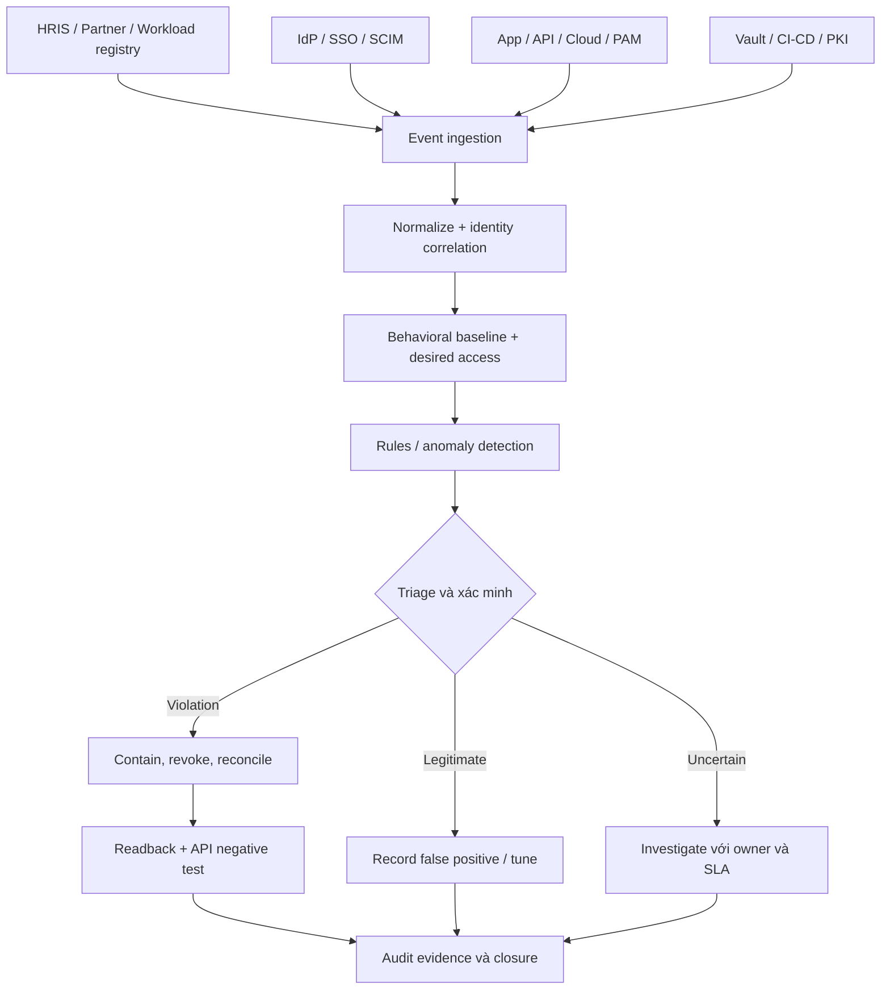
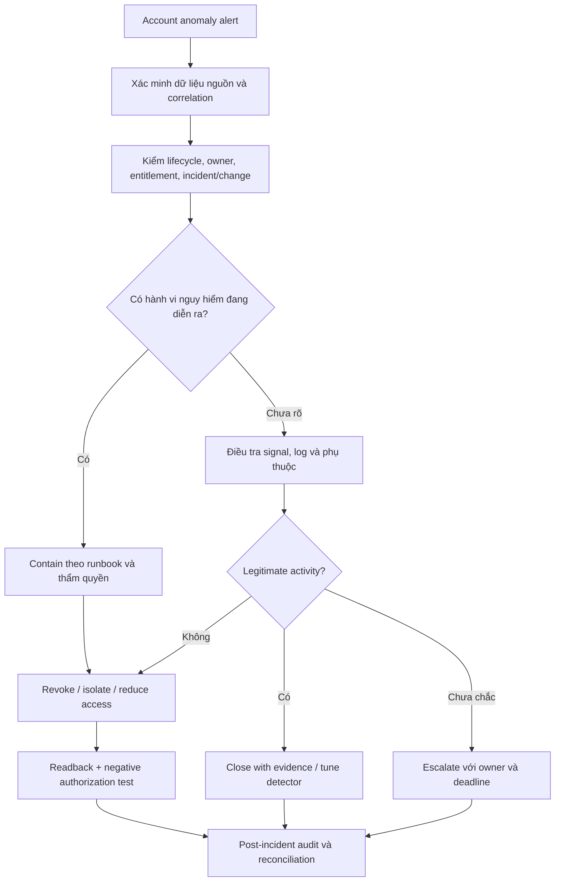

# Account anomaly trong Identity monitoring và vòng đời danh tính IAM

**Account anomaly** (*bất thường của tài khoản*) là sự kiện, hành vi hoặc trạng thái của một account **khác đáng kể so với chính sách, vòng đời, quyền được phê duyệt hoặc mẫu hoạt động đáng tin cậy**. Trong quản lý danh tính, bất thường có thể là một đăng nhập có dấu hiệu chiếm quyền, một tài khoản được cấp quyền không có phê duyệt, service account dùng ngoài mục đích hoặc tài khoản đã Leaver vẫn truy cập được ứng dụng.

Điều quan trọng: **anomaly không đồng nghĩa incident đã được xác nhận**. Một lần đăng nhập từ địa chỉ IP mới có thể do VPN, công tác hoặc dịch vụ mạng; trong khi một request có vẻ bình thường nhưng được thực hiện bằng quyền admin tồn dư sau Mover có thể là vi phạm rõ ràng. Hệ thống giám sát cần kết hợp **baseline hành vi, dữ liệu vòng đời và bằng chứng authorization thực tế**, sau đó triage trước khi kết luận và hành động tương xứng.

Ví dụ, một nhân viên chuyển từ bộ phận Finance sang Analytics nhưng tài khoản ERP vẫn phê duyệt hóa đơn bằng session cũ. IdP có thể ghi login thành công và không coi địa chỉ IP là lạ, nhưng đối chiếu với sự kiện **Mover** cho thấy `invoice.approve` không còn hợp lệ. Đây là **lifecycle entitlement anomaly** quan trọng, thường đáng ưu tiên hơn một cảnh báo vị trí địa lý đơn lẻ.

Bài học thuộc chương **Identity monitoring**, trong module **SECURITY_IDENTITY_ACCESS_MANAGEMENT_IDENTITY_LIFECYCLE**. Mục tiêu của module là kiểm soát vòng đời **Joiner–Mover–Leaver (JML)** từ xác minh, cấp tài khoản và quyền đến rà soát và thu hồi. Account anomaly monitoring liên kết **IdP, SSO, SCIM, RBAC/ABAC, tài khoản dịch vụ, session/token, kiểm toán và account reconciliation** để phát hiện quyền truy cập tồn dư.

## 1. Phân biệt anomaly, violation, alert và incident

| Khái niệm | Ý nghĩa | Ví dụ |
| --- | --- | --- |
| **Anomaly** | Khác với mẫu hoặc trạng thái mong đợi | Service account gọi API vào giờ khác thường |
| **Policy violation** | Hành động/trạng thái trái quy tắc có thể kiểm chứng | Leaver account vẫn có role admin |
| **Detection** | Quy tắc hoặc mô hình nhận ra tín hiệu | Correlate Leaver với API Permit |
| **Alert** | Thông báo cần triage và mức độ ưu tiên | Cảnh báo Permit sau Leaver |
| **Finding** | Sai lệch đã có căn cứ | Direct grant ở SaaS không có approval |
| **Incident** | Sự kiện an ninh được xác nhận/quản lý theo quy trình | Credential bị đánh cắp và dùng để xuất dữ liệu |
| **False positive** | Cảnh báo nhưng không thực sự có vi phạm/rủi ro như giả định | VPN khiến geo-IP đổi |
| **False negative** | Hành vi rủi ro thực tế không được phát hiện | Local API key không được thu thập log |

**Không tự khóa tất cả account chỉ vì một anomaly score cao**, trừ khi chính sách ứng cứu đã định rõ điều kiện và biện pháp bảo vệ. Ngược lại, **không bỏ qua hard violation** như access sau Leaver chỉ vì hành vi giống trước đây.

## 2. Những nhóm bất thường account thường gặp

| Nhóm | Tín hiệu | Rủi ro cần điều tra |
| --- | --- | --- |
| **Authentication** | Nhiều lần login thất bại, MFA challenge bất thường | Brute force, password spray, MFA fatigue |
| **Session/token** | Refresh token reuse, token sau revoke vẫn dùng | Session theft, stale session |
| **Authorization** | Permit vượt tenant, role hoặc resource | Broken access control |
| **Privilege escalation** | Role admin được thêm bất thường | Cấp quyền không phê duyệt, takeover |
| **Lifecycle** | Account Leaver active hoặc Mover giữ role cũ | Residual access |
| **Provisioning** | Account được tạo ngoài IAM workflow | Shadow account, orphan |
| **Account ownership** | Owner đã nghỉ, sponsor/hợp đồng hết hạn | Không ai giải trình |
| **Non-human identity** | API key dùng sau retirement, workload gọi đích mới | Credential leak hoặc drift |
| **Recovery/break-glass** | Emergency login không có incident | Lạm dụng đường khẩn cấp |
| **Data access** | Đọc số lượng lớn tài nguyên nhạy cảm | Exfiltration, automation lỗi |
| **Policy/configuration** | Gỡ MFA, sửa conditional access, thay trust | Mở rộng đường truy cập |

Một account có thể có nhiều loại anomaly cùng lúc. Correlation giúp phân biệt **triệu chứng** và **chuỗi hoạt động có tác động thực tế**.

## 3. Dữ liệu cần cho giám sát

Phát hiện chính xác cần dữ liệu từ nhiều lớp:

- **HRIS/contract source**: trạng thái Joiner/Mover/Leaver, thời điểm hiệu lực, manager, partner expiry.
- **IdP/directory**: login, MFA, account status, group, session và rủi ro xác thực.
- **SSO/OIDC/SAML**: liên hệ giữa IdP session, RP session, token grant và client.
- **SCIM/provisioning connector**: tạo, cập nhật, vô hiệu account/group cùng kết quả xử lý.
- **Application/ERP/SaaS**: local account, entitlement, authorization Permit/Deny và business action.
- **PAM/cloud IAM**: privileged role assignment, activation, policy change và emergency access.
- **Secrets manager/PKI**: key retrieval, credential rotation/revocation, certificate metadata.
- **CI/CD/Kubernetes**: principal, workload subject, runner, deployment và service identity.
- **Resource server/API gateway**: actor, tenant, resource, action, access result.
- **CMDB/workload/partner register**: owner, purpose, contract, environment và dependencies.

**Không dùng IdP login log làm bằng chứng đầy đủ của mọi truy cập**. API có thể chấp nhận access token đã phát, SaaS có session cục bộ, còn ứng dụng kỹ thuật có API key độc lập với SSO.

## 4. Thiết kế event schema cho account anomaly

Một event chuẩn hóa có thể dùng metadata sau:

| Field | Ý nghĩa |
| --- | --- |
| `eventId` | ID sự kiện duy nhất để deduplicate |
| `eventTime`, `ingestedAt` | Phân biệt thời điểm xảy ra và nhận log |
| `subjectId`, `accountId` | Liên kết identity với account ở đích |
| `subjectType` | Human, partner, service, machine |
| `clientId`, `workloadId` | Ứng dụng hoặc workload thực hiện |
| `sourceSystem`, `tenantId` | Nguồn và ranh giới tài nguyên |
| `action`, `resourceRef` | Hành động/tài nguyên liên quan |
| `decision`, `outcome` | Permit/Deny và kết quả thực thi nếu có |
| `sessionRef`, `tokenRef` | Tham chiếu bảo vệ, không phải token thật |
| `policyId`, `policyVersion` | Quy tắc đang áp dụng |
| `lifecycleEventId` | Event JML liên quan |
| `reasonCode`, `riskTier` | Lý do/mức độ ưu tiên |
| `correlationId` | Nối event xuyên hệ thống |
| `ownerId` | Người/nhóm chịu xử lý, có thể được enrich |
| `confidence` | Mức tin cậy của detector nếu có |

Đây là **schema minh họa**, không phải chuẩn bắt buộc. Không log mật khẩu, access/refresh token, session cookie, private key hoặc API key dưới dạng plaintext. Kể cả địa chỉ IP, user ID và resource ID cũng cần giới hạn mục đích, phân quyền xem và thời hạn lưu.

## 5. Baseline hành vi và trạng thái kỳ vọng

Một baseline có thể mô tả **mẫu hành vi bình thường** của subject hoặc workload: tần suất request, giờ hoạt động, loại API, device posture hoặc tenant quen thuộc. Nhưng IAM cần thêm **baseline chuẩn tắc**: account có nên tồn tại, ai sở hữu, những quyền nào được phê duyệt và quan hệ còn hiệu lực không.

| Baseline | Câu hỏi | Ví dụ |
| --- | --- | --- |
| **Behavioral** | Account thường hoạt động như thế nào? | Job báo cáo chạy sáng thứ Hai |
| **Lifecycle** | Account có đủ điều kiện hoạt động không? | Contractor contract chưa hết hạn |
| **Entitlement** | Account có quyền nào được phê duyệt? | Role `invoice.read` |
| **Resource** | Account được truy cập tenant nào? | Chỉ tenant A |
| **Credential** | Loại key/token nào đang hợp lệ? | Client certificate chưa bị revoke |
| **Ownership** | Ai xác nhận và quản lý account? | Nhóm Data Platform |
| **Operational** | Có bảo trì, disaster recovery hay migration? | Runbook on-call có lịch |

**Một hành vi quen thuộc vẫn có thể trái chính sách**, chẳng hạn service account có thói quen dùng role admin quá rộng. Ngược lại, một lần chạy khôi phục hiếm gặp có thể hợp lệ dù chưa có trong baseline hành vi.

## 6. Bộ máy phát hiện: rule, correlation và analytics

Có thể kết hợp:

1. **Deterministic rules:** phát hiện violation rõ như `Leaver AND API Permit`.
2. **Threshold rules:** số lần login failure hoặc credential retrieval tăng đột biến.
3. **Sequence detection:** đăng nhập bất thường → cấp role admin → xuất dữ liệu.
4. **Entity correlation:** ghép HR identity với account phụ và service principal.
5. **Behavioral analytics:** đánh giá khác biệt theo actor, nhóm tương đương, ứng dụng.
6. **Graph analysis:** tìm đường privilege qua group kế thừa, federated trust và principal.
7. **Risk scoring:** kết hợp tín hiệu theo tác động, độ tin cậy và độ mới.
8. **Threat intelligence:** bổ sung indicator khi đã kiểm chứng nguồn và ngữ cảnh.

Không nên coi một mô hình bất thường là nguồn quyết định cuối cùng. Các kết quả từ mô hình phải được **giải thích, kiểm thử trên dữ liệu đại diện và giám sát false positives/negatives**.

## 7. Sơ đồ giám sát end-to-end



**Pipeline có thể mất log hoặc trễ event**, vì vậy phải đo coverage và freshness. Một dashboard không thấy truy cập sau Leaver **không chứng minh access đã bị chặn** nếu không có request hoặc log đang mất.

## 8. Authentication anomaly

Những tín hiệu thường quan sát:

- **Password spray:** nhiều identity bị thử mật khẩu tương tự; phân tích theo nguồn, ứng dụng và khoảng thời gian.
- **Credential stuffing:** đăng nhập thất bại/thành công theo mẫu tự động, có thể phân tán IP.
- **MFA push fatigue:** nhiều challenge liên tục, đặc biệt sau khi login password thành công.
- **Impossible travel:** hai điểm địa lý trong khoảng ngắn, nhưng cần tính độ tin cậy geo-IP.
- **Unfamiliar sign-in:** thiết bị, browser hoặc ASN khác mẫu cũ.
- **Authentication method downgrade:** chuyển từ passkey/FIDO2 sang cơ chế yếu hơn bất thường.
- **Recovery anomaly:** đổi MFA/password/recovery method không gắn quy trình hợp lệ.
- **Privileged login anomaly:** tài khoản admin đăng nhập ngoài lịch, từ môi trường mới.

**Impossible travel là tín hiệu, không phải chứng cứ tuyệt đối** vì VPN, cellular carrier, proxy và IP geolocation có sai số. Đối với quyết định chặn, cần đánh giá bối cảnh và cơ chế hỗ trợ khôi phục an toàn.

## 9. Authorization anomaly

Anomaly về authorization đặc biệt quan trọng vì login hợp lệ vẫn có thể đi kèm quyền không còn phù hợp.

| Tín hiệu | Điều cần kiểm tra |
| --- | --- |
| API Permit sau Leaver | Account/token/session nào còn được chấp nhận? |
| Action cũ Permit sau Mover | Stale role, local grant hoặc JWT claim? |
| Cross-tenant request | Enforcement đã Deny hay chỉ UI chặn? |
| SoD conflict | Có self-approval hoặc tổ hợp role xung đột? |
| Privileged role grant ngoài change | Ai cấp, nguồn policy và approval? |
| Role kế thừa bất ngờ | Group lồng nhau, cloud project parent |
| API Permit sau credential revoke | Token TTL, cache, revocation mechanism |
| Local SaaS grant không có trong IAM | Provisioning bypass, direct grant |
| Data export lớn bằng admin | Mục đích nghiệp vụ, incident và authorization |

**Authorization log cần phân biệt PDP decision và PEP enforcement outcome**. Nếu policy engine ghi `DENY` nhưng API thực tế vẫn xử lý do bypass middleware, đó là lỗi enforcement nghiêm trọng.

## 10. Account anomaly trong Joiner

Ở giai đoạn Joiner, rủi ro gồm tạo tài khoản sai người, kích hoạt quá sớm hoặc cấp quyền vượt birthright.

Kiểm tra:

1. Account mới có identity proofing/registration hợp lệ?
2. HR start date hoặc trạng thái quan hệ đã có hiệu lực?
3. Account ở đúng ứng dụng, tenant và môi trường?
4. Account ID có trùng hoặc gắn sai employee/partner identity không?
5. Birthright role có được tính theo dữ liệu HR đáng tin?
6. Privileged entitlement có request, approval và SoD phù hợp?
7. Có login trước ngày hiệu lực hoặc trước MFA enrollment bắt buộc?
8. Có direct grant ngoài provisioning workflow?
9. Có session/token được cấp khi identity chưa eligible?
10. Có quyền ở đích ngoài desired state không?

Một `SCIM_CREATE_SUCCESS` không chứng minh role đúng. Cần target readback và khi rủi ro yêu cầu, **positive/negative authorization tests**.

## 11. Account anomaly trong Mover

Mover thay đổi trách nhiệm. Cảnh báo hữu ích nhất là **quyền cũ còn dùng được sau thời điểm thay đổi**.

Ví dụ:

```text
T0: User có Finance role
T1: HRIS phát sự kiện MOVER sang Analytics
T2: IAM yêu cầu gỡ role Finance
T3: SCIM connector hoàn thành
T4: ERP API vẫn PERMIT invoice.approve
T5: Detector tạo alert STALE_MOVER_ENTITLEMENT
```

Có thể có độ trễ propagation đã được phê duyệt, nhưng cần đo **time-to-deny** và so với SLA. Khi điều tra phải xác định:

- Role Finance còn được gán trực tiếp tại ERP?
- Session/JWT có claim cũ, cache có refresh không?
- Group kế thừa vẫn cấp entitlement?
- Yêu cầu revoke thất bại hoặc queue bị trễ?
- Grant cũ bị retry sau khi revoke?
- Có exception được phê duyệt và chưa hết hạn?

**Mover không chỉ thêm quyền mới**. Giám sát cần tìm cả quyền dư và xung đột SoD sau thay đổi.

## 12. Account anomaly trong Leaver

Leaver cần các **hard invariants** rõ ràng: tài khoản đã chấm dứt quan hệ không còn được cấp truy cập trái chính sách.

| Đường truy cập | Tín hiệu bất thường |
| --- | --- |
| IdP login | Login Success sau thời điểm Leaver có hiệu lực |
| Refresh token | Token mới vẫn được cấp cho subject bị chặn |
| RP session | Cookie cũ vẫn thực hiện hành động nghiệp vụ |
| Access token | API Permit quyền cũ ngoài SLA |
| Local SaaS account | Account còn Active ngoài exception |
| Privileged account | Admin login/activation sau Leaver |
| API key cá nhân | Key còn truy cập tài nguyên |
| Partner identity | Truy cập sau hợp đồng hết hạn |
| Credential custody | Leaver còn đọc vault hoặc thay pipeline |
| Re-provisioning | Grant cũ sống lại sau sự kiện revoke |

**SCIM `active=false` không bảo đảm mọi phiên, token và local role bị vô hiệu tức thì**. Cần theo dõi các lớp thực thi. Đồng thời, phải phân biệt **Leaver của nhân viên sở hữu service account** với **Leaver của workload**: không xóa mù dịch vụ sản xuất, mà chuyển owner, thu hồi custody của người cũ và đánh giá credential.

## 13. Service, machine và non-human account anomalies

Workload thường ít tương tác nên giám sát cần khác với user login.

| Anomaly | Nguyên nhân có thể | Cách điều tra |
| --- | --- | --- |
| OAuth client dùng audience mới | Config drift hoặc credential theft | Kiểm issuer, client ID, API scope |
| API key được dùng từ workload lạ | Key bị sao chép hoặc thay deployment | Correlate runner/host/secret reference |
| Service principal không có owner | Workload đổi nhóm hoặc orphan | Tra CMDB, approval, consumer |
| Token issuance tăng mạnh | Vòng lặp lỗi hoặc lạm dụng | Kiểm traffic và deployment |
| Service account xin quyền admin mới | Privilege escalation | Kiểm IaC/change/approval |
| Workload federation subject đổi | Repo/branch/env thay hoặc trust rộng | Kiểm issuer-subject-audience |
| Key cũ dùng sau rotation | Consumer chưa cutover hoặc attacker | Revoke tại issuer, tìm bản sao |
| Retired job vẫn truy cập API | Pipeline cũ hoặc principal tồn dư | Kiểm desired state, role và token |
| Certificate sắp hết hạn | Rotation owner thiếu | Thông báo và kế hoạch thay |
| Tài khoản chạy job khác lịch | Bảo trì hoặc hoạt động trái mục đích | Đối chiếu workload schedule |

**Không gửi MFA push đến bot như cách giải quyết chung.** Với machine identity, biện pháp phù hợp là quản lý issuer/trust, chứng chỉ, managed identity, workload scope và quyền thực thi ở resource server.

## 14. Orphan và dormant account

**Orphan account** không có owner hoặc workload/purpose xác minh được; **dormant account** ít hoạt động trong khoảng quan sát. Hai trạng thái không đồng nghĩa.

Một account phục vụ disaster recovery có thể không đăng nhập nhiều tháng nhưng vẫn cần. Đối với account nghi bỏ quên:

1. Xác định issuer, account ID, tenant và effective entitlements.
2. Tra workload register, owner và contract.
3. Kiểm tra lịch batch, DR runbook, backup hoặc emergency access.
4. Đối chiếu credential references và đường sử dụng thực tế.
5. Phân loại Keep, Reduce, Transfer, Rotate, Investigate hoặc Revoke.
6. Không tự động xóa production account chỉ dựa `lastUsed`.
7. Nếu có credential compromise, ưu tiên chặn theo incident runbook.
8. Readback quyền sau remediation, đánh dấu trạng thái xử lý.

**Phát hiện nhiều orphan hơn có thể do discovery tốt hơn**, không nhất thiết do bảo mật xấu hơn. Cần đánh giá cùng mức bao phủ inventory.

## 15. Risk scoring và ưu tiên xử lý

Một alert cần ưu tiên theo **tác động, độ tin cậy, mức đặc quyền, độ nhạy tài nguyên và khả năng quyền đang hoạt động**.

| Tiêu chí | Tăng độ ưu tiên khi |
| --- | --- |
| Identity status | Leaver/inactive vẫn Permit |
| Privilege | Global admin, IAM policy, vault, audit delete |
| Data | Dữ liệu nhạy cảm hoặc xuất hàng loạt |
| Credential | Key bị lộ hoặc token reuse |
| Reachability | API có thể truy cập từ môi trường ngoài |
| Source confidence | Event từ target/resource server đáng tin |
| Cross-system evidence | Nhiều nguồn xác nhận cùng bất thường |
| Activity | Đã có Permit và side effect, không chỉ attempt |
| Blast radius | Nhiều tenant, project hoặc service |
| Time since detection | Quyền tồn dư vượt SLA |

Không nên cộng điểm máy móc nếu tín hiệu phụ thuộc nhau, chẳng hạn IP lạ và địa lý lạ đều suy từ cùng một IP. Cần tránh **double counting**, ghi reason code và có quy trình điều chỉnh mức độ.

## 16. Quy trình triage một alert



Các bước triage:

- Xác nhận **identity/account mapping** bằng ID ổn định, không chỉ username/email.
- Đối chiếu request/authorization logs và application business outcomes.
- Tìm policy change, JML event, maintenance window, deployment hoặc incident hợp lệ.
- Đánh giá có token/session/credential còn tác dụng không.
- Phân tích **phạm vi tài nguyên, tenant, role kế thừa và các đường trust khác**.
- Liên hệ owner hoặc incident commander theo mức độ; không gửi bí mật qua kênh chat.
- Chọn containment phù hợp, tránh mở rộng sự cố bằng thao tác thiếu kiểm soát.
- Ghi kết luận và evidence, không chỉ đổi trạng thái alert thành Closed.

## 17. Phản ứng với account compromise

Khi có bằng chứng credential bị lộ hoặc phiên bị chiếm:

1. Xác định account, principal, client, tenant và nguồn credential.
2. Chặn access phù hợp theo incident runbook, có thẩm quyền được xác định trước.
3. Thu hồi/rotate credential tại **issuer**, không chỉ xóa bản lưu ở vault.
4. Xử lý refresh token, access token đã phát và RP sessions theo khả năng nền tảng.
5. Kiểm tra role, policy, group, trust binding bị attacker sửa.
6. Theo dõi dấu vết API Permit, data access, grant và thay credential.
7. Bảo toàn log và dấu vết cần điều tra, không lưu token thô vào ticket.
8. Cấp đường truy cập mới được bảo vệ cho workload/user hợp lệ khi cần.
9. Xác minh resource server **Deny credential/quyền cũ**.
10. Kiểm tra tài khoản phụ, service account và đường persistence được tạo.
11. Ghi remediation owner, SLA và kết quả hậu kiểm.

**Password reset không tự đảm bảo mọi JWT tự chứa hoặc session tại ứng dụng mất hiệu lực**. Kết luận ứng cứu cần dựa vào mức chặn thực tế và cửa sổ token tồn dư đã được xác định.

## 18. Time-to-detect, time-to-contain và time-to-deny

Ba chỉ số khác nhau:

```text
T0: Sự kiện bất thường hoặc quyền hết hiệu lực
T1: Detector tạo alert
T2: Incident team quyết định containment
T3: IAM/issuer thực hiện revoke hoặc policy change
T4: Resource server không còn Permit trái quyền

Time to detect  = T1 - T0
Time to contain = T3 - T1
Time to deny    = T4 - T0
```

**Không thể tính time-to-deny chỉ từ không có log mới**: có thể không ai gọi API hoặc log pipeline bị lỗi. Cần negative authorization test hoặc cơ chế xác minh enforcement tương đương, ghi giới hạn kiểm chứng.

Đối với Mover/Leaver, bắt đầu đo từ **thời điểm hiệu lực chính sách/JML** thay vì thời điểm báo cáo được mở. Với cấp quyền tạm/JIT, cần xác định rõ thời hạn và điều kiện kết thúc.

## 19. SIEM correlation và ví dụ truy vấn

Giả sử hệ thống tập trung có bảng trạng thái `lifecycle_events` và `authorization_events`. Có thể phát hiện **API Permit sau Leaver** bằng truy vấn minh họa:

```sql
-- SQL minh họa, cần điều chỉnh theo dữ liệu và lifecycle version.
SELECT
    a.subject_id,
    a.account_id,
    a.source_system,
    a.action,
    a.resource_id,
    a.event_time
FROM authorization_events AS a
JOIN lifecycle_events AS l
  ON a.subject_id = l.identity_id
WHERE l.event_type = 'LEAVER'
  AND a.decision = 'PERMIT'
  AND a.event_time >= l.effective_at;
```

Truy vấn tạo **ứng viên điều tra**; cần xử lý rehire, nhiều event lifecycle, tình trạng các quyền được phép sau khi chấm dứt và enforcement outcome. Nếu API log chỉ ghi PDP `PERMIT` nhưng request thất bại trước khi thực thi, không được tự kết luận đã có side effect nghiệp vụ.

Một truy vấn khác để tìm **account đặc quyền mới**:

```sql
SELECT subject_id, target_system, role_id, actor_id, event_time
FROM privilege_change_events
WHERE role_classification = 'PRIVILEGED'
  AND approval_reference IS NULL;
```

Không có approval reference trong event **không tự chứng minh chưa được phê duyệt**; correlation có thể lỗi hoặc một emergency workflow hợp lệ lưu evidence ở nguồn khác. Cần tra chéo và phân biệt missing evidence với policy violation.

## 20. Tín hiệu sai lệch từ IdP, SSO, SCIM và RBAC/ABAC

| Công nghệ | Điều nên giám sát | Giới hạn |
| --- | --- | --- |
| **IdP** | Login risk, account disabled, group changes | Không luôn kiểm soát local app session |
| **SSO** | Federation, RP login, logout events | Logout IdP không chắc revoke mọi RP |
| **SCIM** | Create/Update/Deactivate, retry, error | Không thu hồi mọi token/key |
| **RBAC** | Role grant/revoke, inherited permission | Role name không nói hết effective access |
| **ABAC/PBAC** | Attribute drift, policy version, context | Decision thay đổi theo resource/environment |
| **PAM/JIT** | Elevation, activation, expiry, privileged session | Cần kiểm chứng thu hồi sau kết thúc |
| **Resource server** | Permit/Deny action, tenant, scope | Có thể thiếu actor correlation |
| **Audit/reconciliation** | Desired vs observed, evidence integrity | Không tự chặn truy cập |
| **Secret/PKI** | Credential issuance/rotation/revoke | Xóa record không đồng nghĩa revoke token |

Một hệ thống chỉ giám sát “login failure tăng” sẽ bỏ qua **đặc quyền tồn dư sau Mover**, **bot chạy ngoài mục đích** và **đăng nhập emergency không có incident**.

## 21. Phòng chống false positive và alert fatigue

Giám sát không nên gây khóa nhầm liên tục:

- **Context enrichment:** lịch bảo trì, VPN, địa chỉ NAT, thay đổi ca trực và lịch batch.
- **Entity-specific baseline:** phân biệt admin, nhân viên văn phòng, bot và DR account.
- **Threshold theo rủi ro:** hành động privileged nhạy cảm không nên đợi nhiều lần.
- **Deduplication:** nhóm các alert cùng incident, token hoặc principal.
- **Suppression có thời hạn:** chỉ cho use case được phê duyệt, không che hard violations.
- **Feedback loop:** lưu kết luận false positive và nguyên nhân.
- **Confidence annotation:** cho analyst thấy nguồn dữ liệu và độ mới.
- **Review định kỳ:** kiểm tỷ lệ bỏ sót, phản hồi analyst và tín hiệu không còn hữu ích.
- **Manual override có audit:** không biến exception thành quyền bỏ qua giám sát vĩnh viễn.

Ví dụ một VPN doanh nghiệp có thể làm địa chỉ IP trông như từ quốc gia khác. Không nên vì thế bỏ mọi cảnh báo IP lạ; nên nâng độ chính xác bằng **device trust, session history và hành động thực tế**.

## 22. Bảo vệ quyền riêng tư và chất lượng dữ liệu

Account monitoring có thể chứa IP, thông tin thiết bị, lịch làm việc và quan hệ nhân sự. Nguyên tắc thiết kế:

1. **Purpose limitation:** thu thập cho bảo mật IAM với mục tiêu rõ.
2. **Data minimization:** không sao chép toàn bộ nội dung resource nếu không cần.
3. **Access control:** giới hạn người xem sự kiện và truy vấn account.
4. **Retention:** thời hạn phù hợp nghĩa vụ, không giữ vô hạn.
5. **Integrity:** bảo vệ log khỏi sửa/xóa trái phép.
6. **Separation of Duties:** người bị kiểm toán không tự sửa/xóa bằng chứng của mình.
7. **Secret redaction:** che token, cookie, password, key, OTP.
8. **Timestamp quality:** phân biệt event time và ingestion time.
9. **Correlation quality:** tránh ghép nhầm identity qua email tái sử dụng.
10. **Transparency và review:** có cơ chế kiểm tra false positive hợp lệ.

Một event `LoginFailed` có thể chứa username không có thật, attacker nhập tên người khác hoặc alias cũ; phải tránh tự động khẳng định đó là hành động của một nhân viên cụ thể khi correlation chưa chắc chắn.

## 23. Bằng chứng kiểm toán cho một anomaly

Một hồ sơ điều tra nên ghi:

| Field | Vai trò |
| --- | --- |
| `caseId`, `alertId` | Liên kết detector và điều tra |
| `detectionRuleVersion` | Giải thích quy tắc lúc phát hiện |
| `subjectId/accountId` | Danh tính/tài khoản liên quan |
| `sourceEventRefs` | Tham chiếu log đã bảo vệ |
| `lifecycleContext` | Joiner/Mover/Leaver và thời điểm |
| `expectedEntitlements` | Quyền mong muốn đã được duyệt |
| `observedEntitlements` | Quyền thực tế tại đích |
| `authorizationEvidence` | Permit/Deny và enforcement outcome |
| `triageDecision` | Legitimate, suspicious, confirmed violation |
| `containmentActions` | Disable/revoke/isolate và kết quả |
| `verification` | Readback và negative authorization test |
| `owner`, `deadline` | Trách nhiệm remediation |
| `closedAt`, `reviewer` | Chứng nhận kết thúc |

Chỉ ghi **token reference/fingerprint không nhạy cảm** nếu cần. Việc đưa bearer token thô vào báo cáo có thể tạo một đường đánh cắp credential từ chính hệ thống kiểm toán.

## 24. Kiểm thử detection end-to-end

| Kịch bản | Expected outcome |
| --- | --- |
| Joiner có account trước ngày hiệu lực | Alert hoặc hard deny đúng policy |
| User Login Success từ IP mới hợp lệ | Risk evaluation, không tự kết luận compromise |
| Login failures trên nhiều account | Correlation nhận ra password-spray pattern |
| MFA push liên tục | Alert/response chống MFA fatigue |
| Mover gỡ Finance role | API Finance Deny trong SLA |
| Leaver còn RP session | Phát hiện Permit nếu API thực sự còn cho quyền |
| SCIM disable nhưng SaaS role cục bộ còn | Reconciliation tạo finding |
| OAuth client retired vẫn xin token | Cảnh báo issuance trái lifecycle |
| Service key cũ dùng sau rotation | Alert credential residue |
| Workload từ tenant A gọi resource B | API Deny và log đúng scope |
| Break-glass được dùng ngoài incident | Alert cần hậu kiểm |
| Một account được cấp admin ngoài workflow | Alert và đối chiếu approval |
| Risk engine/collector ngừng gửi log | Health alert về thiếu coverage |
| Event duplicate/out-of-order | Không tạo false finding hoặc bỏ mất revoke |
| Log có raw access token | Redaction/quality test thất bại |
| Incident remediation đã thực hiện | API negative test chứng minh deny |
| Credential bị chiếm nhưng owner đã nghỉ | Escalate theo backup owner/security |
| Emergency identity ít hoạt động | Không auto-delete chỉ vì dormant |

Các kiểm thử nên dùng **test identity, test resources và event synthetic có nhãn** để không tạo hoạt động nguy hiểm hoặc tác động nhầm tới production.

## 25. Các chỉ số vận hành account monitoring

| Chỉ số | Ý nghĩa |
| --- | --- |
| **Detection coverage** | Hệ thống/loại account trong scope có nguồn dữ liệu |
| **Event freshness** | Độ trễ thu thập log |
| **Time to detect** | Từ sự kiện đến alert |
| **Time to contain** | Từ phát hiện đến biện pháp chặn |
| **Time to deny** | Từ revoke có hiệu lực đến API từ chối |
| **True-positive rate** | Tỷ lệ alert xác nhận có giá trị |
| **False-positive rate** | Tỷ lệ cảnh báo sai theo định nghĩa |
| **Missed detection rate** | Lỗi bỏ sót trong tập kiểm thử có nhãn |
| **High-risk residual access** | Quyền nhạy cảm còn sau Mover/Leaver |
| **Unowned active NHA** | Machine/service accounts không owner nhưng active |
| **Uninvestigated high-severity alerts** | Alert rủi ro cao chưa có người xử lý |
| **Overdue remediation** | Finding quá SLA |
| **Privileged activity coverage** | Mức log cho admin/break-glass |
| **Re-provision incidents** | Grant cũ sống lại sau revoke |
| **Verified closure rate** | Case có readback/negative test và audit |

**Số alert tăng** không tự chứng minh tình hình xấu đi: có thể do mới mở rộng log coverage. Đánh giá cần xét mẫu kiểm thử, chất lượng detection và rủi ro được giảm thực tế.

## 26. Sai lầm thường gặp

| Sai lầm | Hệ quả | Khắc phục |
| --- | --- | --- |
| Coi mọi IP lạ là compromise | Khóa nhầm user hợp lệ | Multi-signal triage |
| Chỉ xem authentication logs | Bỏ sót local API rights và token tồn dư | Target authorization logs |
| Không correlation HR/JML | Không thấy Permit sau Leaver | Stable identity IDs |
| Chỉ giám sát human identities | Bỏ sót OAuth clients/API keys | Machine identity telemetry |
| Last-used cũ thì xóa account | Hỏng DR hoặc batch theo kỳ | Owner/purpose verification |
| Không phân biệt PDP/PEP | Log Deny nhưng API vẫn xử lý | Enforcement verification |
| Alert không có owner | Không ai xử lý finding | Ownership/escalation |
| Tối ưu alert count thay risk | Bỏ sót privilege anomalies | Risk-based metrics |
| Không xem policy version | Khó tái dựng quyết định | Versioned rules |
| Không quan sát mất log | False negative âm thầm | Pipeline health checks |
| Reset password và đóng incident | Token/session còn Permit | Session/token revoke tests |
| Chỉ tin SCIM response | Role cục bộ vẫn active | Target readback |
| Grant cũ có thể retry | Privilege resurrection | Lifecycle fencing + reconciliation |
| Ghi plaintext token vào SIEM | Lộ credential | Secret redaction |
| Không nhận diện SoD | Self-approval tồn tại | Transaction authorization logs |

## 27. Checklist triển khai Account anomaly monitoring

- [ ] Định nghĩa rõ account anomalies, hard violations và incident criteria.
- [ ] Có inventory nguồn IdP, HRIS, SCIM, app, cloud IAM, vault, CI/CD.
- [ ] Identity/account/workload correlation dùng ID ổn định.
- [ ] Theo dõi cả human, partner, privileged và non-human accounts.
- [ ] Có baseline behavioral và desired-state/entitlement.
- [ ] Có detection rule cho Permit sau Leaver, role dư sau Mover.
- [ ] Theo dõi OAuth token issuance, refresh reuse và session anomalies.
- [ ] Theo dõi role admin, SoD, break-glass và privileged activations.
- [ ] Có cảnh báo credential/key sau retirement hoặc rotation.
- [ ] Risk scoring phân biệt độ tin cậy và impact.
- [ ] Triage có owner, SLA, exception và escalation.
- [ ] Không tự coi geolocation một mình là bằng chứng compromise.
- [ ] Có response runbook và kiểm soát tác động vận hành.
- [ ] Readback quyền tại đích sau remediation.
- [ ] Negative API test khi kết luận đã thu hồi quyền.
- [ ] Đo event freshness, coverage và log pipeline health.
- [ ] Có schema/version, deduplication và event ordering.
- [ ] Bảo vệ PII, token/secret và integrity của audit.
- [ ] Có thử nghiệm false positive/negative định kỳ.
- [ ] Không đóng case chỉ vì alert biến mất khỏi dashboard.

## 28. Câu hỏi tự kiểm tra

**Tình huống A:** Nhân viên đăng nhập từ IP mới sau khi bật VPN. Có thể kết luận account bị chiếm không? **Không.** Cần xác minh nguồn, thiết bị, MFA, phiên và hành vi, không chỉ vị trí.

**Tình huống B:** IdP đã disable người Leaver nhưng ERP vẫn ghi `invoice.approve=PERMIT`. Đây là gì? **Bất thường quyền tồn dư có rủi ro cao**, phải điều tra RP session, role tại đích và token.

**Tình huống C:** Job backup không đăng nhập suốt sáu tháng. Có tự động xóa service account? **Không** nếu workload vẫn có purpose DR; phải xác minh owner và runbook.

**Tình huống D:** SCIM trả success cho role revoke, nhưng access token cũ vẫn được API chấp nhận. Có thể đóng case chưa? **Chưa**, cần đo time-to-deny và kiểm tra authorization ở API.

**Tình huống E:** Alert chứa một credential bearer token đầy đủ. Vấn đề gì? **Giám sát tự gây rò bí mật**; cần hạn chế truy cập, xử lý sự cố tiết lộ và redaction.

**Tình huống F:** PDP log Deny, nhưng backend bypass PEP nên giao dịch vẫn được thực hiện. Kết luận? **Policy enforcement failure**; chỉ log Deny không đủ.

**Tình huống G:** Kỹ sư owner service account nghỉ việc, job vẫn hoạt động. Cần làm gì? **Chuyển owner và thu hồi custody của người cũ**, không xóa mù account hợp lệ.

**Tình huống H:** Detector không ghi nhận Permit nào sau Leaver. Có phải bằng chứng mọi truy cập đã mất hiệu lực? **Không.** Có thể không có request hoặc log thiếu; cần negative test nếu mục tiêu là chứng minh deny.

## Ghi nhớ

**Account anomaly monitoring** phải phát hiện không chỉ hành vi đăng nhập khác thường mà còn **trạng thái tài khoản hoặc quyền trái với vòng đời và chính sách hiện hành**. Một hệ thống đáng tin cần **đa nguồn dữ liệu, identity correlation, behavioral baseline và desired state, risk-based triage, phản ứng có kiểm soát, readback và negative authorization testing**. Kết hợp **Joiner–Mover–Leaver, IdP/SSO, SCIM, RBAC/ABAC, service/machine identities, session/token, kiểm toán và reconciliation** để nhận diện **quyền truy cập tồn dư**, giảm false positives và **chứng minh biện pháp thu hồi đã có hiệu lực tại hệ thống đích**.
