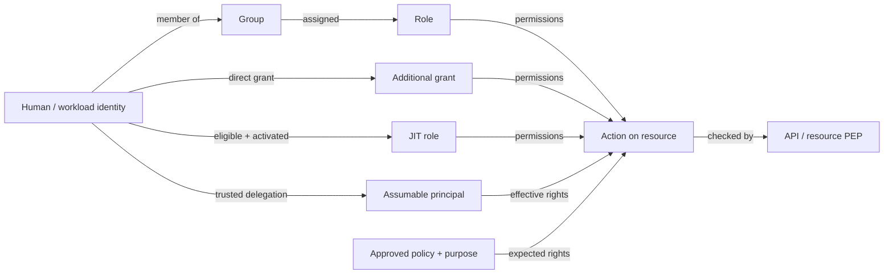
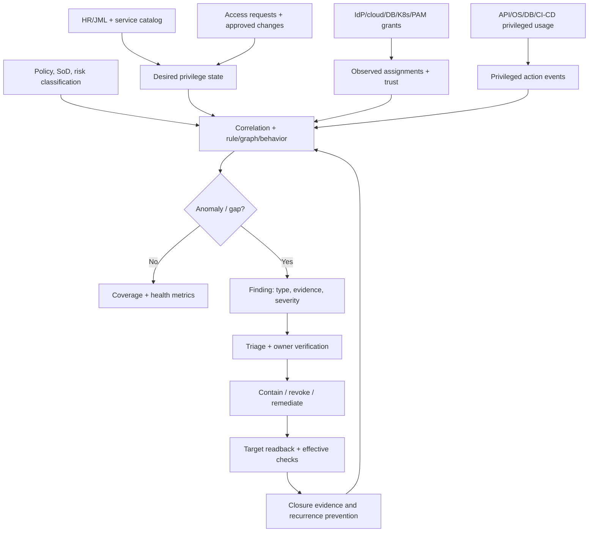
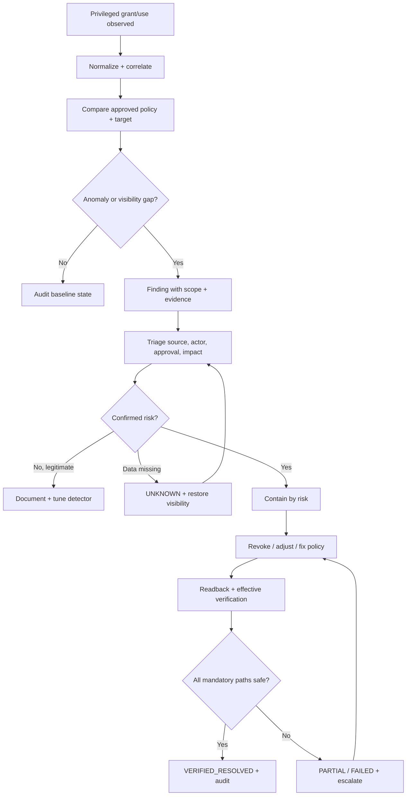

# Privilege anomaly trong Identity monitoring: Phát hiện và xử lý bất thường về đặc quyền trong IAM

**Privilege anomaly** (*bất thường về đặc quyền*) là một trạng thái hoặc hành vi liên quan đến **quyền truy cập có mức nhạy cảm cao** không phù hợp với quyền đã được phê duyệt, nhiệm vụ hiện tại, chính sách hoặc mẫu sử dụng có căn cứ của một danh tính. Bất thường có thể xuất hiện **khi cấp quyền, kích hoạt quyền, sử dụng quyền, thay đổi chính sách hoặc thu hồi quyền**. Mục tiêu của identity monitoring không chỉ là phát hiện một người vừa thực hiện hành động admin, mà là trả lời **quyền đó đến từ đâu, có hợp lệ vào đúng thời điểm không, phạm vi thực tế là gì, có tạo đường leo thang đặc quyền không và cần phản ứng thế nào**.

Ví dụ, Bình chuyển từ Finance Maker sang Audit Reviewer vào lúc 09:00. IdP đã gỡ group `payment-maker` nhưng ứng dụng tài chính vẫn giữ một **direct role assignment** cho phép Bình tạo giao dịch. Đến 09:15, Bình gọi API tạo thanh toán bằng token cũ. Đây là hai dấu hiệu khác nhau: **quyền tồn dư sau Mover** (*residual privilege*) và **việc sử dụng quyền không còn phù hợp** (*privileged use anomaly*). Nếu SIEM chỉ nhìn log đăng nhập và thấy MFA thành công, nó có thể bỏ sót cả hai.

Một ví dụ khác: service principal dùng bởi CI/CD được cấp quyền `iam.roles.update` trên toàn cloud account, dù pipeline chỉ cần triển khai một ứng dụng. Không có người đăng nhập lạ hay thất bại MFA; bất thường xuất hiện tại **quan hệ principal–permission–resource**, chứ không phải địa chỉ IP. Đây cũng là privilege anomaly.

Bài thuộc chương **Identity monitoring** của module `SECURITY_IDENTITY_ACCESS_MANAGEMENT_IDENTITY_LIFECYCLE`. Module nghiên cứu quản lý vòng đời danh tính theo **Joiner–Mover–Leaver (JML)**, từ xác minh, tạo tài khoản, cấp quyền đến rà soát và thu hồi khi vai trò thay đổi; kết nối **IdP, SSO, SCIM, RBAC/ABAC, tài khoản dịch vụ, kiểm toán** nhằm giảm quyền truy cập tồn dư. Privilege anomaly là chủ đề giám sát nối trực tiếp **lifecycle intent, trạng thái quyền tại đích, phiên/token và hành động được API thực thi**.

Sau bài học, bạn có thể phân biệt các kiểu bất thường đặc quyền; xây dựng nguồn dữ liệu và baseline; thiết kế rule phát hiện cấp admin ngoài chuẩn, privilege escalation, SoD conflict, quyền còn sau Mover/Leaver, JIT quá hạn và service identity bị mở rộng quyền; hiểu hạn chế của risk scoring và UEBA; thực hiện triage, containment, revoke và xác minh hiệu lực; đồng thời thiết kế audit, KPI, ma trận kiểm thử và quy trình vận hành có thể giải trình.

> **Nguyên tắc:** “Bất thường” không đồng nghĩa “đã bị tấn công”. Một grant admin có thể được phê duyệt trong incident, còn một grant nhìn bình thường có thể là đường leo thang nghiêm trọng. Phải đánh giá **nguồn cấp quyền, nhiệm vụ, phạm vi, thời điểm, chủ thể, đường kế thừa và bằng chứng hành động**, rồi mới đưa ra kết luận hoặc biện pháp phản ứng.

## 1. Privilege anomaly thực sự là gì?

Trong IAM, **privilege** không chỉ là role tên `admin`. Đó có thể là khả năng:
- Đọc, sửa hoặc xóa dữ liệu nhạy cảm.
- Tạo/sửa user, group, role và authorization policy.
- Đọc hoặc rotate credential và secret.
- Tự cấp quyền, sửa trust policy hoặc assume một role mạnh hơn.
- Thực hiện giao dịch tài chính có ảnh hưởng.
- Thay đổi cấu hình production, backup hoặc audit.
- Kích hoạt JIT/PAM/break-glass.
- Truy cập resource vượt tenant, project hoặc môi trường được giao.

Một anomaly có thể là:

1. **Quyền được cấp bất thường:** role/permission mới rộng hơn nhu cầu hoặc không có approval.
2. **Đường quyền bất thường:** group inheritance, trust, delegation hoặc resource policy mở đường truy cập ngoài baseline.
3. **Kích hoạt quyền bất thường:** JIT role được active ngoài ticket, thời hạn hoặc thiết bị cho phép.
4. **Sử dụng quyền bất thường:** account hợp lệ thực hiện action nhạy cảm không khớp nhiệm vụ, thời điểm hoặc đối tượng.
5. **Quyền tồn dư:** entitlement phải thu hồi theo JML hoặc decommission nhưng vẫn effective.
6. **Tự nâng quyền:** một principal dùng quyền hiện có để tạo quyền mới cho chính mình hoặc principal có thể điều khiển.
7. **Vi phạm SoD:** một actor có thể hoặc đã thực hiện những bước cần độc lập.
8. **Bất thường của workload:** service principal/CI bot được cấp hoặc sử dụng quyền ngoài purpose.

### 1.1. Không có “role admin” vẫn có thể có đặc quyền

| Ví dụ | Vì sao là quyền nhạy cảm? |
| --- | --- |
| `billing.refund.create` | Có thể ảnh hưởng dòng tiền |
| `users.password.reset` | Có thể dẫn đến takeover account |
| `groups.members.add` | Có thể giúp đạt quyền khác qua group |
| `secrets.read` | Có thể lấy credential của hệ thống |
| `iam.policy.attach` | Có thể tự mở rộng khả năng truy cập |
| `audit.logs.delete` | Có thể che giấu hoạt động |
| `backups.delete` | Có thể phá khả năng khôi phục |
| `cloud.role.assume` | Có thể tới resource khác thông qua trust |
| `database.schema.alter` | Có thể gây mất dữ liệu hoặc làm sai logic |
| `payments.approve` | Có thể hoàn tất nghiệp vụ nhạy cảm |

Phân loại privilege dựa vào **khả năng thực tế, resource scope, effect và các đường kế thừa**, không chỉ tìm chuỗi `admin` trong tên role.

## 2. Năm lớp cần giám sát: Desired, Assigned, Effective, Activated và Used

| Lớp | Câu hỏi | Ví dụ |
| --- | --- | --- |
| **Desired** | Theo HR, service catalog, policy và approval, quyền nào nên tồn tại? | Bình là `audit-reader` |
| **Assigned/Observed** | Target hiện đang gán role, group, ACL, key/trust nào? | SaaS còn `payment-maker` |
| **Effective** | Trong ngữ cảnh cụ thể, hệ thống thực sự có thể Permit action gì? | API còn cho `payment.create` |
| **Activated** | Quyền đủ điều kiện có đang được kích hoạt trong phiên/JIT không? | Admin role active tới 10:00 |
| **Used** | Chủ thể đã gọi action gì và nghiệp vụ có commit không? | Tạo giao dịch lúc 09:15 |

**Desired ≠ Assigned ≠ Effective ≠ Activated ≠ Used.**

Một role được gán có thể bị policy Deny; một role đã revoke có thể còn trong token cũ; một permission effective có thể chưa bao giờ được dùng. Giám sát đặc quyền phải biết mình đang nói về **quyền sở hữu, khả năng sử dụng hay hành động thực hiện**.

### 2.1. Ví dụ hậu quả của việc đánh đồng

- IAM phát `REVOKE_REQUESTED` nhưng target trả timeout: không được báo `VERIFIED_REVOKED`.
- PAM session kết thúc nhưng direct admin grant ngoài PAM còn tồn tại: không được kết luận toàn bộ admin access đã hết.
- Audit chỉ thấy một API Permit nhưng transaction fail: chưa thể nói giao dịch đã hoàn tất.
- Không thấy admin action trong 90 ngày: không chứng minh role admin không tồn tại.
- Đã bỏ user khỏi IdP group nhưng SaaS direct assignment còn: vẫn có quyền ngoài đường IdP.

## 3. Phân loại privilege anomaly theo nguồn và hành vi

| Loại | Dấu hiệu | Rủi ro chính |
| --- | --- | --- |
| **Unexpected grant** | Một role/permission mới không có request hoặc IaC được duyệt | Cấp quyền ngoài chuẩn |
| **Excessive scope** | Read-only job có `tenant.admin` | Blast radius lớn |
| **Privilege escalation** | Principal thay policy, group hoặc role để tăng quyền | Chiếm quyền điều khiển |
| **Self-grant / self-approval** | Người yêu cầu tự duyệt quyền admin của mình | Vi phạm thẩm quyền |
| **Role chaining** | Assume một role qua trust hoặc delegation bất thường | Đi vòng qua kiểm soát trực tiếp |
| **Residual entitlement** | Mover/Leaver vẫn còn direct grant, token hoặc session | Quyền tồn dư |
| **Privilege creep** | Quyền tích lũy qua nhiều nhiệm vụ và dự án | Vượt nhu cầu hiện tại |
| **SoD conflict** | Một subject vừa tạo vừa duyệt cùng nghiệp vụ | Thiếu độc lập |
| **Unusual privileged use** | Admin API ngoài tác vụ hoặc change window | Misuse/compromise cần điều tra |
| **Break-glass misuse** | Emergency role dùng hằng ngày | Né kiểm soát thông thường |
| **Expired JIT still usable** | JIT hết hạn nhưng target/API vẫn Permit | Thu hồi chưa hiệu lực |
| **Shadow admin** | Local/cloud/SaaS admin ngoài inventory | Khó rà soát và thu hồi |
| **Dormant admin activated** | Privileged account lâu không dùng bỗng hoạt động | Có thể misuse, cũng có thể DR |
| **Privileged service key** | API key/workload identity có quyền IAM vượt mục đích | Rủi ro NHI |
| **Audit-control tampering** | Admin sửa logging, retention hoặc policy cảnh báo | Che giấu hoặc làm giảm quan sát |
| **Unexpected delegation** | Cấp quyền quản trị cho external identity | Mở rộng trust boundary |

### 3.1. Bất thường cấu hình và bất thường hành vi

**Configuration anomaly** là grant/trust/role quá rộng dù chưa sử dụng. **Behavioral anomaly** là cách dùng quyền lệch mẫu. Cả hai cần dữ liệu khác nhau:
- Cấu hình: target IAM snapshot, role/ACL/trust, policy version, baseline.
- Hành vi: API/PAM/OS/DB audit, session, action, resource, outcome, time.
- Kết hợp: ai được cấp gì, lúc nào, và có hành động nào sau grant.

Chỉ dùng SIEM login logs không đủ phát hiện **quyền mạnh chưa bị sử dụng**. Chỉ quét IAM config không đủ phát hiện **hành động đã xảy ra**.

## 4. Privilege được định nghĩa theo tác động và phạm vi

Có thể phân tầng quyền theo **mức ảnh hưởng**:

| Tier tham khảo | Quyền mẫu | Tình huống |
| --- | --- | --- |
| **Routine** | Đọc dashboard nội bộ đã duyệt | Nhiệm vụ thường ngày |
| **Sensitive read** | Xem dữ liệu cá nhân hoặc tài chính | Need-to-know, audit |
| **Sensitive write** | Sửa hồ sơ nhân viên, hóa đơn | Object authorization |
| **Privileged operator** | Deploy/restart production service | Change control |
| **Security admin** | Sửa IAM policy, reset MFA, rotate secret | Kiểm soát chặt và SoD |
| **Recovery/root** | Khôi phục IdP, tenant admin, xóa backup | Quyền rất cao, break-glass |
| **Indirect privileged** | Có thể sửa CI job để lấy cloud admin token | Quyền gián tiếp qua dependency |

Đây chỉ là **mô hình ví dụ**; tổ chức cần đánh giá capability thật. Đặc biệt, một permission **đổi policy hoặc tạo token** có thể mạnh hơn nhiều thao tác dữ liệu trực tiếp.

### 4.1. Scope làm thay đổi mức rủi ro

`reports.read` trên một tenant khác `reports.read` trên toàn tổ chức. `role.admin` ở staging khác `role.admin` ở production. Một permission có thể “nhỏ” theo tên nhưng **lớn theo số resource**.

### 4.2. Blast radius

Khi phân loại anomaly, xét:
- Bao nhiêu tenant/project/resource bị ảnh hưởng?
- Có quyền sửa authorization, audit hoặc credential không?
- Có thể di chuyển từ environment này sang environment khác?
- Có đường truy cập tới dữ liệu/khôi phục production?
- Là human, service, shared account hay third-party principal?
- Có thể tạo thêm principal hoặc key mới không?

## 5. Quan hệ quyền là một đồ thị, không phải một danh sách role phẳng

Một subject có thể nhận quyền qua:
- Direct assignment.
- Group membership, nested groups.
- Role hierarchy.
- Resource policy hoặc ACL.
- Trust relationship/assume-role.
- Application permissions và OAuth scopes.
- Database role/ownership.
- Kubernetes RoleBinding/ClusterRoleBinding.
- PAM/JIT activation.
- Delegation hoặc service-account impersonation.
- CI/CD service connection và quyền sửa pipeline.



Một privilege anomaly có thể ẩn trong **đường nối**, ví dụ user chỉ có quyền sửa membership của một group, nhưng group đó có role admin. Nếu dashboard chỉ đếm direct admin assignments, đường tăng quyền này có thể bị bỏ sót.

### 5.1. Direct privilege vs indirect privilege

| Đường quyền | Bằng chứng cần |
| --- | --- |
| Role admin gán trực tiếp | Grant ID, scope, approver |
| Group được gán admin | Membership history + role assignment |
| Có thể assume cloud role | Trust policy, allowed principals, conditions |
| Có thể sửa CI workflow để dùng prod token | Repo permissions, workflow trust, CI environment policy |
| Có thể thay role mapping IGA | Policy edit privilege và deployment controls |
| Có thể đọc vault credential admin | Secret path access, key/lease lifecycle |
| Có thể quản lý service account có quyền cao | Impersonation/act-as policy, target bindings |

**Không đồng nhất “chưa có admin role trực tiếp” với “không thể đạt đặc quyền admin”.** Để đánh giá các đường gián tiếp cần phân tích quan hệ quyền và trust.

## 6. Baseline đặc quyền: So với cái gì là “bất thường”?

Một baseline có thể lấy từ:
1. **Role catalog và least-privilege policy** đã duyệt.
2. **Access request/approval** có scope và expiry.
3. **HR JML status** và vai trò hiện hành.
4. **Service catalog/workload purpose** cho non-human identities.
5. **IaC/GitOps desired state** với version và approval.
6. **Target IAM snapshot** cho quyền đang tồn tại.
7. **Historical usage** đã xác minh để đánh giá hành vi.
8. **Peer group** có nhiệm vụ tương đồng, nhưng không nên coi số đông luôn đúng.
9. **PAM/JIT eligibility/activation rules**.
10. **Business SoD policy** và object-level constraints.

### 6.1. Baseline policy và baseline hành vi khác nhau

| Baseline | Câu hỏi | Hạn chế |
| --- | --- | --- |
| **Normative/policy** | Theo thẩm quyền, subject *được phép* có quyền gì? | Cần cập nhật đúng vai trò và nghiệp vụ |
| **Observed state** | Hiện target thực sự cấp quyền gì? | Có thể đã chứa quyền sai |
| **Behavioral** | Subject thường làm gì? | Thường xuyên làm sai không biến thành đúng |
| **Peer-group** | Những chủ thể cùng công việc có pattern gì? | Peer group có thể sai hoặc không phù hợp |
| **Risk/context** | Ở thời điểm này, action nhạy cảm tới mức nào? | Tín hiệu có thể thiếu/sai/stale |

**Không học “normal” chỉ từ dữ liệu từng được Permit**. Nếu một account admin ngoài chuẩn hoạt động mỗi ngày, behavior baseline sẽ coi thường xuyên, nhưng policy baseline vẫn phát hiện quyền bất hợp lệ.

### 6.2. Thời hạn và scope của baseline

Bản ghi baseline cần:
- Version.
- Owner/phê duyệt.
- Valid-from/valid-to hoặc effectiveAt.
- Môi trường, tenant/resource.
- User/workload category.
- Mức rủi ro và quyền ngoại lệ có hạn.
- Source và confidence.

Một baseline cũ trước Mover không được dùng để giữ role cũ sau khi HR event có hiệu lực.

## 7. Nguồn dữ liệu cần thu thập

| Nguồn | Tín hiệu về đặc quyền | Lỗ hổng thường gặp |
| --- | --- | --- |
| **HRIS/lifecycle registry** | Joiner, Mover, Leaver, owner status | Không mô tả trực tiếp grant tại target |
| **IdP/directory** | Group/role changes, MFA, sign-in sessions | Không thấy local/direct SaaS grants |
| **IGA/access requests** | Approved entitlements, reviewer decisions | Desired không phải effective |
| **SCIM/provisioning** | Create/update/disable, target response | 202 Accepted không phải đã áp |
| **Cloud IAM** | Role bindings, trust, policy changes, assume-role | Cross-account delegation phức tạp |
| **Kubernetes** | RoleBinding, ClusterRoleBinding, SA access | Ephemeral tokens, namespaces |
| **Database/OS** | Privileged user/role, sudo, DDL | Audit coverage có thể thiếu |
| **PAM/JIT** | Activation, session, expiry, checkout | Direct grants ngoài PAM vẫn còn |
| **Secrets manager/PKI** | Key/cert issuance, read, rotate, revoke | Secret metadata không chứng minh usage |
| **CI/CD** | Pipeline permissions, service connections, deploy runs | Code/approval lineage có thể thiếu |
| **API gateway/app PEP** | Privileged action Permit/Deny, resource ID | Không thấy endpoint bypass |
| **SIEM/UEBA** | Correlation, behavior anomaly | Chỉ thấy những nguồn đã ingest |
| **Service/CMDB catalog** | Workload purpose/owner/decommission | Có thể stale hoặc không bao phủ manual principals |
| **Policy/IaC repository** | Desired grants, rule version, change approval | Không thấy manual drift nếu không readback |

### 7.1. Coverage là một thuộc tính bắt buộc

Một detection engine báo `NO_ANOMALY` nhưng chưa quét một cloud account hoặc mất SCIM logs thì không thể tuyên bố toàn hệ thống an toàn.

Cần ghi:
- Những tenant/account/project/cluster/app đã quét.
- Connector permissions/last successful scan.
- Log ingestion lag.
- Event types không được nguồn hỗ trợ.
- Khoảng mất dữ liệu.
- Trạng thái completeness: `COMPLETE`, `PARTIAL`, `UNKNOWN`.

**Không thấy grant không đồng nghĩa grant không tồn tại** khi nguồn không được đọc đầy đủ.

## 8. Chuẩn hóa dữ liệu đặc quyền thành entitlement graph

Để phát hiện bất thường xuyên hệ thống, cần tách các thực thể:

| Thực thể | Trường quan trọng |
| --- | --- |
| **Identity** | Canonical ID, human/service, lifecycle status |
| **Native account** | Provider, tenant, immutable native ID |
| **Workload** | Service ID, environment, owner, purpose |
| **Role/permission** | Action, resource type, effect |
| **Grant** | Direct/inherited, source, approval, scope, expiry |
| **Group/trust edge** | Membership, assume-role, delegation, condition |
| **Credential/session** | Key/token/session reference, validity/state |
| **Privileged action** | Request ID, actor, resource, result |
| **Policy** | Version, effective date, SoD constraints |
| **Finding** | Anomaly type, evidence, confidence, owner, status |

### 8.1. Canonical identity không dựa vào displayName

`admin-prod` có thể trùng giữa nhiều tenants. Một Kubernetes ServiceAccount bị xóa/tạo lại cùng tên có native UID khác. Tên người/email cũng có thể đổi.

Phải gắn:
- Native immutable ID.
- Security boundary (tenant/account/cluster).
- Canonical identity/workload ID.
- Historical mapping theo effective interval.

Nếu mapping chưa chắc chắn, đánh dấu `MAPPING_AMBIGUOUS`; không tự đổ hành vi của hai principals vào cùng một người.

### 8.2. Một quyền có thể có nhiều đường cấp

Giả sử `reports.write` tồn tại qua:
- Approved baseline role.
- JIT role đang active.
- Direct SaaS grant ngoài IaC.

Thu hồi JIT không đồng nghĩa permission mất hiệu lực nếu direct grant vẫn tồn tại. Giám sát phải liệt kê **mọi grant path** và xác minh action tại target khi cần.

## 9. Mô hình sự kiện Privilege anomaly

Một event nên mang **bằng chứng, thời gian, policy context và liên kết đường quyền**.

```json
{
  "eventId": "iam-priv-evt-01912",
  "eventType": "PRIVILEGE_GRANT_OBSERVED",
  "principalRef": "tenant-17/principal-901",
  "canonicalIdentityId": "iam-user-1042",
  "resourceRef": "cloud-prod/project-reporting",
  "permissionRef": "iam.roleAdmin",
  "grantId": "grant-221",
  "grantSource": "DIRECT_TARGET",
  "actorRef": "iam-user-290",
  "changeRequestRef": null,
  "observedAt": "2026-11-23T02:15:00Z",
  "ingestedAt": "2026-11-23T02:15:06Z",
  "policyVersion": "iam-least-privilege-v8",
  "sourceSystem": "cloud-iam-audit",
  "correlationId": "authz-change-490",
  "observationCompleteness": "VERIFIED_FOR_SCOPE"
}
```

**JSON là ví dụ minh họa**. Một log thực tế cần tránh raw token, password, client secret và thông tin cá nhân không cần thiết.

### 9.1. Đừng thiếu actor chain

Một privileged action có thể do automation thay người dùng thực hiện. Nên lưu:
- Human initiator nếu có và được xác thực.
- Workload principal thực gọi target.
- Approver hoặc JIT ticket.
- Target resource và action.
- Policy decision và PEP enforcement.
- Business outcome.

**Service principal không mặc định là “người duyệt độc lập”** khi một người có thể điều khiển automation.

## 10. Mẫu phát hiện 1 — Unapproved privilege grant

Một role nhạy cảm được gán mà không tìm thấy approval/policy source hợp lệ.

Rule logic:
1. Quan sát `GRANT_CREATED` tại target.
2. Resolve principal/resource/scope.
3. Phân loại role/permission có đặc quyền không.
4. Tìm access request hoặc IaC change đã phê duyệt cho **chính scope**.
5. Kiểm tra effective time, approval owner, expiry.
6. Nếu không có căn cứ hoặc approval không khớp, tạo finding.

```text
if observedGrant.isPrivileged:
    approved = findTrustedApproval(
        principalId=observedGrant.principalId,
        permission=observedGrant.permission,
        resourceScope=observedGrant.resourceScope,
        effectiveAt=observedGrant.grantedAt
    )

    if approved is ABSENT:
        emitFinding("UNAPPROVED_PRIVILEGE_GRANT")
    else if approved is INCOMPLETE_OR_UNAVAILABLE:
        emitFinding("GRANT_PROVENANCE_UNKNOWN")
```

### 10.1. Không suy approval từ ticket ID do requester tự nhập

Một trường `ticket=CHG-123` không đủ. Phải đọc **trạng thái approval, phạm vi và người phê duyệt** từ workflow tin cậy. Ticket có thể đã bị đóng, từ chối hoặc áp cho resource khác.

### 10.2. Ngoại lệ hợp lệ

Có thể có emergency break-glass theo quy trình riêng. Cần xác nhận incident, actor, scope, TTL và hậu kiểm. **Không tự bỏ qua rule chỉ vì tên role chứa `emergency`**.

## 11. Mẫu phát hiện 2 — Privilege creep qua Joiner–Mover–Leaver

### 11.1. Joiner

Một nhân viên vừa gia nhập chưa được onboarding xong nhưng đã có role admin ở nhiều hệ thống.

Cần kiểm:
- HR effective start.
- Role baseline theo nhiệm vụ.
- Approval, separation of duties.
- Target grants.
- Credential/MFA enrollment.
- Đối soát scope sau provisioning.

Một Joiner có nhiều quyền **không tự là vi phạm** nếu nhiệm vụ admin được phê duyệt; vấn đề là quyền không khớp purpose/approval.

### 11.2. Mover

Người dùng chuyển nhóm nhưng giữ quyền cũ:
- HR Mover effective.
- Desired entitlements tính lại.
- New roles có thể đã cấp.
- Old group bị gỡ trong IdP.
- Target direct grant/DB role còn.
- Session/token cũ vẫn dùng.

Tín hiệu: `POST_MOVER_RESIDUAL_PRIVILEGE`.

### 11.3. Leaver

Sau ngày hiệu lực, một account vẫn:
- Được enabled.
- Có cloud role.
- Được PAM/JIT active.
- Có personal access token.
- Gọi API thành công.
- Có local OS/DB account.

Tín hiệu: `POST_LEAVER_PRIVILEGE_PRESENT` hoặc `POST_LEAVER_PRIVILEGED_ACTION`.

**Leaver có hiệu lực thường là điều kiện chặn truy cập theo policy, không chỉ điểm rủi ro để tính trung bình.** Nếu tài khoản dịch vụ do người Leaver tạo còn chạy hợp lệ, phải phân biệt human account với workload principal.

### 11.4. Lịch sử role phải có phiên bản

Nếu snapshot role hiện tại cho thấy user chỉ còn Reviewer, không thể suy họ **chưa từng có Maker** tại thời điểm giao dịch. Cần lưu role assignment intervals và policy version để tái dựng quyền lịch sử.

## 12. Mẫu phát hiện 3 — Privilege escalation và đường tăng quyền gián tiếp

Privilege escalation có thể xuất hiện khi subject:
- Thêm mình vào privileged group.
- Tự gán policy/role.
- Thay trust policy để assume role khác.
- Thay IAM permission boundary hoặc account policy.
- Tạo service principal rồi cấp quyền mạnh.
- Sửa pipeline có thể truy xuất production secret.
- Đổi workflow approval để bỏ checker.
- Đổi policy engine/default deny hoặc rule ưu tiên.
- Sửa audit settings để che giấu thay đổi.

### 12.1. Tự cấp quyền không chỉ là direct self-grant

Một user không có `role.admin` nhưng có `groups.members.add` vào group Admin có **đường gián tiếp**. Rule cần xem privilege closure, không chỉ actor == grantee trực tiếp.

### 12.2. Tách detection và prevention

**Detection:** cảnh báo có hành động thay IAM policy hoặc phát hiện đường tăng quyền mới.

**Prevention:** authorization/PDP/permission boundary, protected change workflow và SoD phải **chặn hành động không hợp lệ trước khi được áp** khi có thể.

**Giám sát không thay thế kiểm soát phòng ngừa**. Một alert tới SOC sau khi root role đã bị cấp có thể quá muộn.

### 12.3. Chuỗi hành vi

Một chuỗi nhiều event có thể đáng chú ý hơn một event:
1. User nhận role có thể sửa group.
2. Thêm service principal vào privileged group.
3. Service principal nhận token.
4. Token được dùng để thay IAM policy.
5. Audit configuration bị tắt.

Correlation dựa trên **principal/grant/role/credential IDs, event time và causal links** giúp nhận diện đường tăng quyền; không chỉ ghép theo IP.

## 13. Mẫu phát hiện 4 — SoD conflict

**Segregation of Duties** yêu cầu những nhiệm vụ xung đột được tách theo policy, chẳng hạn:
- Tạo và duyệt thanh toán.
- Thêm nhà cung cấp và phê duyệt chi trả.
- Yêu cầu và tự duyệt privileged access.
- Sửa IAM policy và tự duyệt thay đổi.
- Thay production config và xóa audit.

| Loại SoD | Cần kiểm |
| --- | --- |
| **Static SoD** | Một subject có đồng thời các role xung đột? |
| **Dynamic SoD** | Hai role xung đột có được active cùng ngữ cảnh? |
| **Transaction SoD** | Maker và Checker của cùng business object có độc lập? |
| **Cross-system SoD** | Quyền qua SaaS A và ERP B tạo xung đột? |
| **Delegation SoD** | Automation thay người có che giấu actor thực? |

### 13.1. “Có hai accounts” chưa chứng minh SoD

Nếu Bình dùng human account tạo payment và cùng kiểm soát bot `payment-checker` để phê duyệt, đây có thể là SoD violation dù log hiển thị hai principals.

Cần liên kết:
- Human initiator.
- Workload executor.
- Business object ID.
- Approver được xác thực.
- Policy, delegation constraints.
- Action/commit outcome.

**Bất thường SoD có thể là ràng buộc cứng**; không chờ behavior model xác nhận.

## 14. Mẫu phát hiện 5 — Privileged use ngoài nhiệm vụ hoặc lịch sử

Một người có quyền hợp lệ vẫn có thể dùng quyền bất thường:
- Xóa nhiều dữ liệu production.
- Tạo hàng loạt admin accounts.
- Export dữ liệu nhạy cảm lần đầu.
- Truy cập ngoài change window.
- Sửa audit configuration ngay sau privileged access.
- Chạy DDL trên database production không có change request.
- Reset MFA của nhiều account.
- Đọc nhiều secrets không thuộc service vận hành.

### 14.1. Baseline hành vi có ngữ cảnh

| Yếu tố | Câu hỏi |
| --- | --- |
| Work role | Đây có phải nhiệm vụ thường ngày? |
| Resource | Production hay staging? Dữ liệu nhạy cảm? |
| Action | Đọc, viết, xóa hay sửa quyền? |
| Time | Change window, on-call, incident? |
| Session | JIT activation có hợp lệ không? |
| Device | Managed device và assurance? |
| Volume | Bao nhiêu object, so với workload bình thường? |
| Pattern | Nhiều action hiếm có cùng chuỗi sự kiện? |
| Outcome | API Deny hay nghiệp vụ đã commit? |
| Approval | Có ticket được duyệt đúng resource/scope? |

**“Lần đầu làm” không tự là tấn công**: người dùng có thể là on-call mới, vừa Mover hoặc đang xử lý sự cố. Nên đánh giá confidence và thêm triage, không gắn nhãn độc hại vĩnh viễn.

### 14.2. Một event vs chuỗi event

Một `users.resetPassword` có thể là ticket hợp lệ. Nhưng **hàng chục reset, sau đó tạo new admin role và tắt logging** có thể cho tín hiệu cao hơn. Cần lưu thứ tự thời gian, actor lineage và service correlation.

## 15. Mẫu phát hiện 6 — Privileged access qua PAM và JIT

PAM/JIT cho phép:
- Principal đủ điều kiện nhận role cao.
- Quyền được active trong thời hạn/tác vụ.
- Access được ghi audit/session.
- Hết hạn thì revoke và kiểm tra target.

Các anomaly:
1. Activate role không có incident/change ticket.
2. Activate từ identity không eligible.
3. TTL vượt giới hạn được duyệt.
4. Scope resource rộng hơn request.
5. Một actor vừa request vừa approve nếu SoD cấm.
6. Đăng nhập trực tiếp vào target bỏ qua PAM.
7. Session/credential vẫn active sau khi hết hạn.
8. Key được checkout nhưng không rotate sau session nhạy cảm.
9. Repeated break-glass dùng thay workflow thường ngày.
10. Audit hoặc session recording bị vô hiệu.

### 15.1. Hết phiên không đồng nghĩa mất hết quyền

Một PAM session kết thúc nhưng:
- Direct grant ngoài PAM còn.
- Token JWT đã được phát còn hiệu lực.
- Cloud role session còn TTL.
- Account OS/DB đang enabled.
- Credential checkout vẫn dùng được.

Vì vậy finding `JIT_EXPIRED_BUT_EFFECTIVE` cần kết hợp **PAM logs, target readback và PEP outcome**.

### 15.2. Emergency không được tự coi là anomaly malicious

Break-glass có thể là hoạt động hợp lệ nếu incident, actor, mục đích và hậu kiểm đầy đủ. Tín hiệu “emergency role activated” nên kích hoạt **high-assurance audit/review**, không tự động block khi control plane thông thường đang outage mà không có recovery route.

## 16. Mẫu phát hiện 7 — Non-human identity có đặc quyền bất thường

Service identity có thể:
- Được cấp tenant-wide admin trong khi chỉ cần gọi API.
- Dùng chung key giữa nhiều workloads.
- Bị tạo ngoài IaC.
- Có owner đã Leaver.
- Được gán role mới không có approval.
- Có workload federation trust mở cho mọi branch/repo.
- Gọi API xóa hoặc sửa policy ngoài purpose.
- Dùng production credential từ dev/staging.
- Tiếp tục có quyền sau workload decommission.

### 16.1. Bảng so sánh baseline của human và machine

| Chiều | Human privileged account | Service/workload identity |
| --- | --- | --- |
| Ownership | HR + manager/team | Service catalog + technical owner |
| Authentication | MFA, device, SSO | Federation, secret, certificate, token |
| Expected activity | Nhiệm vụ/on-call/change window | Job schedule, deployment, API purpose |
| Anomaly về session | Login lạ, session hijack | Token exchange từ issuer/branch lạ |
| Anomaly về quyền | Unexpected admin grant | Overprivileged service principal |
| JML | Joiner/Mover/Leaver trực tiếp | Owner JML + workload lifecycle |
| Revoke | Account/role/session/token | Principal/grants/trust/secret/session |
| Evidence | Human initiator, approvals | Workload run ID, CI job, owner, trust |

**Không áp cùng một bộ tín hiệu MFA/GeoIP của con người cho workload đa vùng**, vì nó có thể gây false positive hàng loạt mà không phát hiện nguy cơ thật.

### 16.2. Credential exposure là tín hiệu về quyền đang có thể bị lợi dụng

Nếu static key bị lộ và key có quyền `iam.policy.write`, risk không chỉ là “secret exposed” mà là **privilege accessible by possession of credential**. Cần:
- Tìm mọi principals/grants liên quan.
- Revoke/rotate key theo incident response.
- Kiểm tra token/session dẫn xuất.
- Đối soát những action thực tế đã xảy ra.
- Giảm quyền và thay auth mechanism nếu phù hợp.

## 17. Mẫu phát hiện 8 — Shadow admin và unmanaged access

Một quyền có thể tồn tại:
- Local root/sudo trên host.
- Database superuser.
- SaaS app administrator trực tiếp.
- Cloud role được gán ngoài IaC.
- Kubernetes ClusterRoleBinding.
- Token đặc quyền trong CI/CD.
- Emergency account không có owner.
- Resource-level delegation.

Nếu inventory chỉ lấy IdP roles, những quyền này bị “vô hình”.

### 17.1. Discovery và reconciliation

Kết hợp:
- Scheduled target scans.
- Event-driven grant changes.
- Native IAM/DB/OS/Kubernetes APIs.
- IaC desired state.
- Access request/approval registry.
- Privileged usage audit.

**Không thấy account trong catalog không có nghĩa được phép xóa ngay**. Nó có thể đang phục vụ backup/DR. Cần finding có owner và deadline, xác minh dependency trước decommission, trong khi áp containment theo rủi ro nếu cần.

## 18. Mẫu phát hiện 9 — Policy và audit tampering

Người có quyền cao có thể cố:
- Giảm retention log.
- Tắt audit emitter.
- Xóa SIEM export.
- Sửa IAM policy để permit rộng.
- Thay role mapping.
- Gỡ security alerts.
- Tắt MFA requirement cho privileged role.
- Thay trust issuer hoặc audience.
- Bỏ approval gate trong CI/CD.

Những event này có thể hợp lệ trong change được duyệt, nhưng **tác động phòng vệ rất lớn**, cần monitor ưu tiên cao và audit độc lập.

### 18.1. Đừng chỉ dựa vào log của hệ thống đang bị thay

Nếu user có quyền tắt logging tại nguồn, cần có:
- Control-plane audit từ provider khi khả dụng.
- Forward logs sớm ra kho bảo vệ.
- Tamper-evident storage và access separation.
- Detector theo dõi **heartbeat/coverage**, vì “không còn log” có thể là tín hiệu sự cố.
- Policy chặn unauthorized disabling khi có thể.

## 19. Mẫu phát hiện 10 — Cross-tenant và cross-environment privilege

Một user/service được duyệt trong:
- Tenant A nhưng nhận quyền ở tenant B.
- Staging nhưng có production role.
- Project nhỏ nhưng được cấp organization-wide rights.
- Namespace `orders` nhưng được ClusterRoleBinding toàn cluster.
- Read-only customer data nhưng có export all tenants.

Phát hiện cần kiểm tra **resource scope và trust boundary**, không chỉ permission name.

### 19.1. Đừng tin tenant do client tự khai

API request body ghi `tenantId=org-17` không phải bằng chứng được phép truy cập org-17. Resource ownership/classification phải được resolve từ **trusted target registry** hoặc theo tài nguyên được xác thực.

### 19.2. Cross-account role assumption

Cloud principal có thể assume một role khác qua trust. Phát hiện escalation phải:
- Đi theo trust edges.
- Kiểm tra condition.
- Lấy policy của assumed role.
- Ghi session principal thật và source identity khi khả dụng.
- So với approved workload purpose.

## 20. Phát hiện theo rule, graph và hành vi

Ba cách bổ sung:

| Phương pháp | Phù hợp | Hạn chế |
| --- | --- | --- |
| **Deterministic rules** | Leaver still enabled, unapproved admin, JIT expired | Phụ thuộc metadata và đúng logic policy |
| **Graph/path analysis** | Indirect escalation, nested groups, trust chaining | Cần normalize policy và hiệu lực |
| **Behavior/UEBA** | Usage tăng đột ngột, action hiếm, chuỗi bất thường | False positives, data drift và thiếu ground truth |
| **Statistical threshold** | Grant spikes, privileged downloads | Ngưỡng khác nhau theo workload |
| **Correlation/time windows** | Grant → admin action → audit disabled | Nhiều nguồn và clock skew |
| **Target reconciliation** | Desired vs observed/effective mismatch | Snapshot interval có độ trễ |

**Không nên chọn một kỹ thuật rồi bỏ các kỹ thuật còn lại**. Rule có thể bắt một account Leaver vẫn admin kể cả không có action; behavior có thể bắt người dùng hợp lệ bắt đầu thao tác nguy hiểm; graph phát hiện đường quyền gián tiếp.

### 20.1. Rule chính xác hơn risk score chung

Một signal `PRIVILEGED_GRANT_WITHOUT_APPROVAL` có thể cần rule hard finding. Nó không nên bị triệt tiêu bởi device compliant, IP quen thuộc hoặc MFA mạnh.

## 21. Kiến trúc phát hiện end-to-end



### 21.1. Phải có hai đường giám sát

- **Event-driven:** phát hiện nhanh khi grant, session hoặc policy thay đổi.
- **Scheduled scan/reconciliation:** phát hiện manual grants, missed events, slow propagation, quyền ngoài IaC.

Event stream không tự bảo đảm đầy đủ: connector có thể offline, sự kiện có thể đến trễ hoặc bị mất.

## 22. Event schema cho privilege monitoring

Một event normalized nên phân biệt **change, assignment, authorization và usage**.

| Trường | Mục đích |
| --- | --- |
| `eventId` | Chống trùng, chain of custody |
| `eventType` | GRANT/REVOKE/ACTIVATE/USE/POLICY_CHANGE |
| `subjectId` | Identity được cấp quyền |
| `actorId` | Ai thực hiện thay đổi |
| `workloadId` | Nếu actor là automation |
| `resourceId` | Tài nguyên liên quan |
| `permissionId` | Quyền/role cụ thể |
| `grantPath` | Direct/group/trust/JIT |
| `scope` | Tenant/project/namespace |
| `status` | REQUESTED/APPLIED/DENIED/VERIFIED |
| `occurredAt` | Event time từ nguồn |
| `ingestedAt` | Ingestion time |
| `policyVersion` | Phiên bản áp dụng |
| `approvalRef` | Provenance của quyền |
| `correlationId` | Ghép JML/request/API |
| `sourceTrust` | Nguồn có thẩm quyền |
| `completeness` | Độ phủ của quan sát |
| `evidenceRef` | Tham chiếu log/target readback |

### 22.1. Example event

```yaml
eventId: priv-grant-20261123-501
eventType: ENTITLEMENT_ASSIGNMENT_OBSERVED
subject:
  canonicalIdentityId: iam-user-1042
  nativeAccountRef: finance-saas/account-418
actor:
  principalId: iac-provisioner-prod
resource:
  targetRef: finance-saas/tenant-org-17
  entitlement: role-payment-maker
grant:
  nativeGrantId: assign-881
  origin: DIRECT
  approvalRef: null
  observedStatus: ACTIVE
temporal:
  occurredAt: "2026-11-23T02:15:00Z"
  ingestedAt: "2026-11-23T02:15:06Z"
context:
  lifecycleStatus: MOVER_EFFECTIVE
  desiredStatus: REVOKED
  source: finance-saas-admin-audit
  completeness: VERIFIED_FOR_SCOPE
  policyVersion: jml-access-v7
correlationId: jml-mover-811
```

**Đây là schema minh họa**, không phải chuẩn của SCIM, SIEM hoặc một cloud provider. Trong production cần xác minh authority, xử lý version và tránh tiết lộ secret/raw token.

## 23. Chuẩn hóa thời gian và thứ tự sự kiện

Một chuỗi JML có nhiều mốc:
- `effectiveAt`: thời điểm quyền phải thay theo HR/policy.
- `eventOccurredAt`: khi target ghi nhận thay đổi.
- `ingestedAt`: khi SIEM nhận.
- `appliedAt`: khi target thực sự hoàn tất.
- `verifiedAt`: khi đọc lại.
- `expiresAt`: deadline của JIT/grant.
- `lastUsedAt`: bằng chứng sử dụng cuối, có độ tin cậy.

### 23.1. Event đến muộn và đảo thứ tự

Không giả định event vào queue cuối cùng là trạng thái mới nhất. Ví dụ:
1. HR Leaver effective.
2. IAM revoke.
3. Callback từ một grant cũ đến muộn.
4. Provisioner thử cấp lại.

Cần **version/generation và kiểm tra lifecycle hiện hành** để không cho callback cũ tái cấp quyền.

### 23.2. Clock skew

Hai máy lệch vài phút có thể làm sai kết luận “admin action sau khi revoke”. Ghi nguồn thời gian, UTC offset, đồng hồ và confidence. Khi phải xác định trách nhiệm, cần đối soát logs từ target, IdP và gateway thay vì kết luận theo một timestamp thiếu kiểm chứng.

## 24. Logic đối soát Desired–Observed–Effective

Một detector nên xem các trường hợp:

| Desired | Observed | Effective | Finding |
| --- | --- | --- | --- |
| Chỉ read role | Có admin direct grant | Admin Permit | EXCESS_PRIVILEGE |
| Role cũ phải REVOKED | Target còn role | Có thể Permit | RESIDUAL_AFTER_MOVER |
| Leaver disabled | Account enabled | Có session Permit | POST_LEAVER_ACCESS |
| JIT expired | Role vẫn assigned | Token còn Permit | JIT_REVOCATION_INCOMPLETE |
| Không có app principal | Target có service principal | Chưa đủ telemetry | SHADOW_IDENTITY |
| Approved admin | Target admin đúng scope | Action admin trong change window | Không nhất thiết anomaly |
| Approved admin | Target admin đúng scope | Thực hiện xóa audit trái policy | PRIVILEGED_MISUSE |
| Không có grant | Scan thiếu quyền đọc | UNKNOWN | COVERAGE_GAP, không khẳng định absent |

### 24.1. Effective permission khó liệt kê hoàn toàn

Một số policy dựa trên ABAC, thời gian, resource properties, deny rule hoặc request context. Không có công cụ nào chắc chắn liệt kê mọi khả năng trong mọi điều kiện.

Có thể kết hợp:
- Readback assignments/trust/resource policy.
- Simulate policy khi provider hỗ trợ.
- Kiểm tra **critical action** bằng negative tests không phá hủy.
- Log PEP Permit/Deny thực tế.
- Ghi giới hạn và confidence của kết luận.

**Không thực hiện thao tác thật như xóa dữ liệu production chỉ để thử đặc quyền**. Có thể dùng API simulate/dry-run hoặc test resource an toàn nếu được phê duyệt.

## 25. Correlation: Gắn thay đổi quyền với hành động

Một chuỗi sự kiện:

```text
T0  HR Mover effective
T1  IAM role revoke requested
T2  SaaS direct grant still PRESENT
T3  SSO session unchanged
T4  API privileged action PERMIT
T5  Business transaction COMMITTED
T6  Security finding opened
T7  Direct grant removed
T8  Token/session invalidated or expired
T9  Effective access verified DENY
```

Một anomaly đáng tin cần có:
- **Causal links**: HR event → provisioning operation → target assignment.
- **Identity lineage**: human user → native account → session/token.
- **Permission path**: role/group/direct grant/trust → action.
- **Business object**: transaction/resource ID.
- **Time ordering** có xét skew.
- **Outcome**: PEP Permit, business commit, revoke verified.

### 25.1. Correlation ID không thay authorization

Một request có ticket ID hợp lệ chưa chắc đúng principal, action hoặc resource. Một log có correlation ID trùng chưa chứng minh workflow được duyệt. Cần đối chiếu trusted request/approval state.

### 25.2. Giới hạn ghép theo IP

Một IP có thể là NAT của hàng nghìn người hoặc proxy CI. Không kết luận nhiều actions cùng IP là cùng principal nếu không có account/session/credential binding tin cậy.

## 26. Privilege anomaly score: Có thể dùng, nhưng không thay hard rules

Một mô hình scoring tham khảo:

| Tín hiệu | Trọng số minh họa |
| --- | ---: |
| Unapproved privileged grant | +45 |
| Production resource | +15 |
| Account vừa MFA reset | +10 |
| Privileged action ngoài change window | +15 |
| Cross-tenant/unknown resource | +20 |
| Credential exposure confirmed | +50 |
| Target grant residual after Leaver | Hard Deny / Critical finding |
| SoD transaction conflict | Hard Deny |
| Source incomplete | UNKNOWN, không phải 0 |

Các trọng số **không phải mặc định chuẩn**, không được áp vào production thiếu calibration. Chúng minh họa cách tín hiệu thay đổi ưu tiên điều tra.

### 26.1. Severity khác confidence

- **Severity/impact:** nếu đúng, rủi ro lớn tới mức nào?
- **Confidence:** bằng chứng đáng tin tới đâu?
- **Urgency:** cần hành động nhanh không?
- **Coverage:** detector đã thấy đủ nguồn chưa?

Một role admin production ngoài catalog có severity cao nhưng chưa rõ provenance; cần triage nhanh. Một login lạ có confidence thấp không tự chứng minh attacker.

### 26.2. Tránh cộng trùng

Một grant IAM mới có thể sinh:
- Cloud audit event.
- SIEM normalized event.
- IGA change event.
- API gateway notification.

Đó có thể là **một thay đổi**, không phải bốn lần escalation. Deduplicate qua native operation ID/source lineage.

## 27. Phát hiện dựa trên luật: Pseudocode

```text
detectPrivilegeAnomalies(identity, target, evaluationTime):
    lifecycle = trustedLifecycleState(identity, evaluationTime)
    desired = approvedEntitlements(identity, target, evaluationTime)
    observed = readTargetGrantGraph(identity, target)
    coverage = validateScanCoverage(target)

    if coverage != COMPLETE:
        openFinding("PRIVILEGE_VISIBILITY_GAP", target, coverage)
        doNotAssumeMissingGrantIsAbsent()
        return

    for grant in observed.grants:
        impact = classifyPermissionAndScope(grant)

        if lifecycle.isLeaverEffective and grant.allowsAccess:
            openFinding("POST_LEAVER_PRIVILEGE_PRESENT",
                        grant, impact)

        if lifecycle.isMoverEffective
           and grant.notAllowedBy(desired):
            openFinding("POST_MOVER_RESIDUAL_PRIVILEGE",
                        grant, impact)

        if grant.isPrivileged
           and not hasValidScopeMatchedApproval(grant):
            openFinding("UNAPPROVED_PRIVILEGE_GRANT",
                        grant, impact)

        if createsProhibitedEscalationPath(grant, observed.graph):
            openFinding("PRIVILEGE_ESCALATION_PATH",
                        grant, impact)

    for action in recentPrivilegedActionEvents(identity, target):
        if violatesTransactionSoD(action):
            openFinding("SOD_VIOLATION", action)
        if outsideApprovedPurposeOrWindow(action):
            openFinding("PRIVILEGED_USE_ANOMALY", action)
        if action.afterRevocationEffectiveAt:
            verifyWithTargetAndSessionEvidence(action)

    assignEvidenceConfidenceOwnerAndSLA()
```

**Giả mã mô tả logic**, không phải thuật toán đầy đủ. Sự vắng mặt của approval có thể do connector lỗi; cần phân biệt `APPROVAL_ABSENT` với `APPROVAL_SOURCE_UNKNOWN`. Không tự xóa quyền production khi dữ liệu thiếu hoặc chưa điều tra dependency.

### 27.1. Thứ tự đánh giá

Để tránh cấp lại quyền sai:
1. Lifecycle/incident restrictions có thẩm quyền.
2. Entitlement và policy/SoD.
3. Privilege graph và trust paths.
4. Context risk/behavior.
5. Decision/enforcement và verification.

**Không dùng “behavior bình thường” để hợp thức hóa một quyền bị cấm theo JML hoặc policy**.

## 28. Cảnh báo phải mô tả sự kiện hành động được

Một alert chỉ ghi `admin anomaly detected` là chưa đủ.

Một finding nên gồm:

| Trường | Mục đích |
| --- | --- |
| `findingId` | Theo dõi triage và remediation |
| `anomalyType` | UNAPPROVED_GRANT, POST_LEAVER… |
| `severity` | Mức ưu tiên |
| `confidence` | Độ tin cậy |
| `identityId` | Subject canonical |
| `nativePrincipalRef` | Principal target |
| `permission/grantPath` | Đường quyền bất thường |
| `resourceScope` | Tác động tới resource nào |
| `expectedState` | Policy/baseline đã duyệt |
| `observedState` | Grant/usage nhìn thấy |
| `effectiveEvidence` | Readback/PDP/PEP observation |
| `sourceRefs` | Log/snapshot/ticket |
| `correlationId` | Ghép event và case |
| `firstSeen/lastSeen` | Cửa sổ phát hiện |
| `ownerTeam` | Ai điều tra và sửa |
| `status` | Open/Triaging/Contained/Verified… |
| `actionDeadline` | SLA theo rủi ro |
| `policyVersion` | Rule có hiệu lực |
| `coverage` | Scope đầy đủ hay chưa |

### 28.1. Ví dụ JSON finding

```json
{
  "findingId": "finding-priv-019",
  "anomalyType": "POST_MOVER_RESIDUAL_PRIVILEGE",
  "severity": "HIGH",
  "confidence": "HIGH",
  "canonicalIdentityId": "iam-user-1042",
  "targetAccountRef": "finance-saas/account-418",
  "resourceScope": "finance-saas/tenant-org-17",
  "permission": "payment.create",
  "expectedState": "REVOKED_AFTER_MOVER",
  "observedState": "DIRECT_GRANT_PRESENT",
  "effectiveEvidenceRef": "api-authz-event-510",
  "sourceRefs": [
    "hr-mover-event-118",
    "iam-revoke-request-119",
    "target-readback-120"
  ],
  "policyVersion": "jml-access-v7",
  "firstSeenAt": "2026-11-23T02:15:00Z",
  "ownerTeam": "finance-platform",
  "coverage": "COMPLETE_FOR_TARGET",
  "status": "OPEN"
}
```

**Ví dụ không chứa secret và không khẳng định user cố ý vi phạm**. Finding chỉ phản ánh bằng chứng kỹ thuật về quyền tồn dư.

## 29. Triage: Không coi mọi anomaly là incident đã xác nhận

Khi SOC/IAM nhận alert, nên:

1. **Xác minh nguồn và integrity:** event có đúng native ID, timestamp, source không?
2. **Xác định scope:** principal, role, resource, environment, tenant.
3. **Kiểm tra approval và change window:** có ticket được duyệt đúng scope không?
4. **Xác minh lifecycle:** Joiner/Mover/Leaver, decommission, on-call.
5. **Kiểm tra đường quyền:** direct/inherited/trust/JIT/credential.
6. **Đánh giá usage:** có action thật? PEP Permit hay transaction commit?
7. **Tìm nguồn độc lập:** target readback, cloud audit, app logs.
8. **Đánh giá business impact và blast radius**.
9. **Chọn containment** theo mức khẩn và ảnh hưởng vận hành.
10. **Ghi trạng thái:** Confirmed, Benign, Needs Investigation, Data Quality, v.v.

### 29.1. Những câu hỏi kỹ thuật quan trọng

- Grant vừa xuất hiện hay vừa được phát hiện qua scan?
- Principal còn ACTIVE không?
- Nó có quyền **thay IAM policy** để tự phục hồi sau revoke không?
- Có token/session/credential dẫn xuất không?
- Ngoài quyền trực tiếp còn đường nào khác?
- Ứng dụng có endpoint bypass PEP không?
- Một workflow khẩn có hợp lệ và đang active không?
- Có tài khoản dịch vụ đang dùng cùng principal không?

### 29.2. Không tự đóng alert vì hiện trạng đã bình thường

Một role vừa bị gỡ không có nghĩa giai đoạn trước đó không có hành động sai. Cần kiểm tra **timeline của privileged usage, giao dịch và artifact liên quan** trước khi đóng.

## 30. Định mức severity theo tác động và bằng chứng

Một ma trận tham khảo:

| Tình huống | Severity có thể cao khi | Phản ứng |
| --- | --- | --- |
| Unapproved admin grant | Production/root/cross-tenant | Triage khẩn, hạn quyền/contain |
| Post-Leaver Permit | API nhạy cảm hoặc account privileged | Chặn truy cập và điều tra |
| Expired JIT | Vẫn Permit privileged action | Revoke/verify, kiểm tra session |
| Self-approval | Giao dịch tài chính/đổi IAM policy | Chặn transaction, review SoD |
| Role tạo nhầm dev | Ít tác động, chưa dùng | Remediate có kiểm soát |
| Dormant admin login | DR hợp lệ hay không chưa rõ | Check runbook và owner |
| Audit logging disabled | Có thể làm mất bằng chứng | Khôi phục giám sát, bảo vệ nguồn khác |
| Unowned service admin key | Static secret + global scope | Assign owner, contain/rotate |

**Mức severity là chính sách nội bộ dựa trên threat model**, không phải con số pháp lý hay sự thật áp dụng mọi hệ thống.

### 30.1. Confidence không được dùng để bỏ qua critical finding

Một production admin grant có severity cao và confidence MEDIUM nên mở điều tra có ưu tiên, xác minh thêm evidence. Không tự kết luận benign chỉ vì không có API usage.

## 31. Containment và remediation: Tách ngăn chặn với sửa nguyên nhân

**Containment:** giảm khả năng tiếp tục gây tác động.
- Tạm suspend account/key hoặc session.
- Revoke JIT grant hoặc restrict trust.
- Block một action ở PEP.
- Hạn network/tenant scope có kiểm soát.
- Protect audit/backup nếu có dấu hiệu tampering.

**Remediation:** đưa hệ thống về trạng thái policy đúng.
- Gỡ direct grant ngoài chuẩn.
- Sửa role mapping/approval workflow.
- Thu hẹp IAM policy và federation trust.
- Chuyển owner và rotate credential.
- Đồng bộ target permission qua IaC/SCIM.
- Khắc phục race condition trong provisioning.
- Thêm preventive SoD hoặc permission boundary.

### 31.1. Lưu ý với production services

Không tự xóa service principal hoặc admin key đang phục vụ production chỉ vì inventory thiếu owner, trừ khi chính sách sự cố yêu cầu containment ngay. Cần xác định dependency và recovery path, nhưng **không trì hoãn vô hạn** đối với credential đã bị lộ hoặc quyền tấn công nghiêm trọng.

### 31.2. Revoke không đủ nếu principal có nhiều đường quyền

Sau khi xóa role A:
- Group B có thể vẫn cấp cùng permission.
- Token cũ còn hiệu lực.
- Resource policy có thể cho truy cập.
- Assume-role trust vẫn tồn tại.
- Local/DB admin account khác vẫn hoạt động.

Phải đối soát **effective access theo mọi đường quan trọng**.

## 32. Xác minh thu hồi và tránh quyền tồn dư

Một lifecycle remediation được xem là hoàn tất khi:
1. Quyền không còn có căn cứ đã được nhận diện.
2. Lệnh revoke/disable được thực thi tại các đích bắt buộc.
3. Target readback xác nhận grant/status.
4. Token/session/secret có liên quan được xử lý theo khả năng nền tảng.
5. API/PEP không còn Permit action cấm trong những kiểm thử an toàn cần thiết.
6. Reconciliation không thấy đường quyền thừa còn lại.
7. Audit và owner xác nhận outcome.
8. Nếu còn thiếu dữ liệu, giữ `PARTIAL/UNKNOWN` thay vì “Closed Verified”.

### 32.1. Ba mức kết quả

| Trạng thái | Có thể khẳng định |
| --- | --- |
| `REVOKE_REQUESTED` | Đã gửi yêu cầu |
| `REVOKE_APPLIED` | Target báo đã đổi trạng thái |
| `VERIFIED_REVOKED` | Đã có evidence cần thiết về chặn quyền |
| `PARTIAL/UNKNOWN` | Chưa đủ bằng chứng hoặc còn đường tồn dư |

Một API trả `202 Accepted` chưa chứng minh revoke hoàn tất. Target có thể eventual consistent hoặc token cache trễ.

### 32.2. Không làm test phá hoại để chứng minh Deny

Có thể dùng:
- Policy simulator.
- Dry-run endpoint.
- Test resource không nhạy cảm và được duyệt.
- Revoke readback.
- Audit của request Deny an toàn.

**Không thực hiện xóa user, dữ liệu hoặc production resource chỉ để thử quyền**.

## 33. Quan hệ với risk-based access

Privilege anomaly có thể là **risk signal**, nhưng không phải mọi anomaly chỉ cần “cộng điểm”.

| Dạng | Xử lý đúng |
| --- | --- |
| Login từ network mới trong phiên admin | Risk signal cho adaptive control |
| Privileged action ngoài window | Triage/step-up/hạn chế theo policy |
| User không có entitlement | Hard Deny |
| Leaver đã có hiệu lực | Hard Deny/deprovision |
| JIT expired | Revoke/deny theo state |
| Self-approval trái SoD | Hard Deny |
| Credential confirmed exposed | Contain/revoke theo incident workflow |
| Thiếu log từ một target | Data quality finding, không xem là “low risk” |

**Risk thấp không cấp permission**. Risk cao không tự chứng minh attacker; nhưng các điều kiện bắt buộc như SoD và Leaver không nên chờ risk score.

### 33.1. Adaptive authentication không thay dynamic authorization

MFA step-up xác minh mạnh hơn, nhưng sau đó vẫn phải kiểm tra quyền ở API theo action/resource, tenant và trạng thái lifecycle mới nhất.

## 34. Token, session và stale authorization context

Một grant có thể bị revoke nhưng:
- JWT access token cũ còn claim role.
- Session cookie còn hiệu lực.
- Cloud STS session chưa hết hạn.
- App cache permission lâu.
- PEP không kiểm tra revocation state.
- Database connection đang giữ role.

Vì vậy detector cần:
- Biết token/session issuance và expiry.
- Biết resource server có introspection hay offline validation.
- Biết khả năng revoke và invalidation.
- Ghi event `POST_REVOKE_PRIVILEGED_PERMIT` với độ tin cậy phù hợp.
- Đánh giá cache TTL và quyền của phiên tại thời điểm action.

### 34.1. “Logout” không phải luôn là revoke mọi token

SSO logout có thể kết thúc trình duyệt nhưng không làm token tự chứa ở API hết hiệu lực ngay. Không được dựa vào một IdP session log để tuyên bố effective admin access đã mất.

### 34.2. State change mới phải thắng snapshot cũ

Một access review chọn KEEP từ snapshot tháng trước không được làm provisioner khôi phục role đã bị gỡ do Leaver hoặc incident sau đó. Cần versioning, policy revalidation và guardrail chống stale regrant.

## 35. Quản trị ngoại lệ quyền đặc biệt

Một số quyền cao cần hợp lệ trong giai đoạn giới hạn:
- Migration dữ liệu.
- Production restore.
- Security incident response.
- Infrastructure upgrade.
- Disaster recovery.
- Khắc phục lỗi IAM/IdP.

Ngoại lệ cần:
- Purpose và scope.
- Owner và người duyệt độc lập nếu policy yêu cầu.
- Start/end time.
- Resource/tenant.
- Credential hoặc JIT plan.
- Monitoring/recording.
- Compensating controls.
- Review và evidence revoke.

### 35.1. Không “tắt rule” vô thời hạn

Một allowlist cho account break-glass không nên khiến mọi hành động admin của nó **không bao giờ xuất hiện trong SIEM**. Ngoại lệ hợp lệ có thể giảm false positive cho loại quyền đã duyệt, nhưng phải tiếp tục giám sát:
- Usage ngoài thời gian/scope.
- SoD violations.
- Grant escalation.
- Token after expiry.
- Audit configuration changes.

## 36. Cảnh báo sai: False positive và false negative

| Nguyên nhân | False positive ví dụ | False negative ví dụ |
| --- | --- | --- |
| Baseline lỗi thời | Mover hợp lệ bị coi role bất thường | Privilege creep tồn tại nhiều tháng thành “normal” |
| Approval mapping thiếu | Grant theo change được duyệt bị báo unapproved | Ticket giả được coi approval |
| Event ordering | Revoke đi trước grant trong SIEM do delay | Mất revoke event che quyền tồn dư |
| Shared identity | Bot dùng token bị quy cho người tạo | Không thấy workload thực thi |
| Cloud trust | Assume-role hợp lệ trong DR bị cảnh báo | Trust rộng được coi bình thường |
| Telemetry gap | Thiếu PEP logs bị coi misuse | Privileged action không được ghi |
| Peer group bias | Người mới on-call hành động khác thường | Cả nhóm đang overprivileged |
| JIT cache | Session cũ bị báo còn active dù đã chặn | Token cũ Permit ở API khác |
| Device/IP | Corporate VPN tạo anomaly | Attacker dùng known egress |

### 36.1. Feedback loop

Khi analyst xác nhận legitimate/false positive:
- Ghi evidence, reviewer, reason.
- Cập nhật baseline hoặc detector mapping nếu hợp lý.
- Không loại hẳn principal khỏi mọi monitoring.
- Dùng holdout/test set để đánh giá rule mới.
- Kiểm tra bỏ sót trường hợp nguy hiểm sau tuning.

**Không dùng mọi alert bị đóng là “ground truth an toàn”**; có case bị đóng vì thiếu dữ liệu, hết thời gian hoặc không xác minh được.

## 37. Quality gates cho detector

Một detector nên theo dõi:
- Source freshness.
- Event completeness.
- Coverage của tenant/project/app.
- Identity mapping confidence.
- Privilege catalog coverage.
- Approval source availability.
- Rule/policy version.
- Late-arriving event rate.
- Duplicate/out-of-order rate.
- Target readback success.
- Case triage quality.

### 37.1. UNKNOWN khác ABSENT

Nếu target connector bị lỗi:
- `UNKNOWN`: không biết hiện có admin grant hay không.
- `ABSENT`: đã có readback đáng tin xác minh không có.
- `PRESENT`: có grant hoặc đường quyền.
- `CONFLICTING`: nguồn đưa thông tin không khớp.

Không chuyển `UNKNOWN` thành `ABSENT` để làm đẹp dashboard.

### 37.2. Dừng auto-remediation khi nguồn không đáng tin

Một connector bị compromise có thể báo grant không tồn tại để trigger xóa account quan trọng, hoặc báo “đã revoke” dù không. Cần source authentication, versioning và **cross-check** theo risk cho thay đổi có tác động.

## 38. Tín hiệu bất thường trong cloud IAM

Một số nhóm cần giám sát:
- Role binding mới ở account/project production.
- Organization policy thay đổi.
- Trust policy mới cho external principal.
- Access key được tạo cho privileged service identity.
- Assume-role từ principal ngoài baseline.
- Permission boundary bị thay.
- Resource policy mở public/cross-account.
- Admin role không owner.
- Managed identity bị gán role nhạy cảm ngoài scope.
- Cloud audit service bị tắt hoặc giảm lưu log.

### 38.1. Privilege thông qua resource policy

Một principal không có direct IAM admin role vẫn có thể truy cập resource qua **resource-based policy** hoặc assume-role trust. Detector cần đọc cả principal policy và resource/trust policies trong phạm vi có thẩm quyền.

### 38.2. Không mặc định một cloud event là xấu

Infrastructure-as-Code deployment được duyệt có thể thay hàng trăm role bindings. Cần phân biệt planned change, actor/pipeline identity, scope và drift so desired state.

## 39. Tín hiệu trong Kubernetes và database

### 39.1. Kubernetes

- ServiceAccount nhận ClusterRoleBinding admin.
- RoleBinding chuyển namespace ngoài scope.
- Subject có quyền `impersonate`, `bind` hoặc `escalate` theo Kubernetes policy.
- ServiceAccount token được dùng từ deployment lạ.
- Admission/RBAC policy bị sửa.
- Một workload dev được quyền truy cập production cluster.

**Không chỉ tìm `cluster-admin`**. Những verb hoặc quyền tạo/sửa workload có thể tạo đường leo thang tùy cấu hình cụ thể.

### 39.2. Database

- User được cấp superuser/DBA.
- Application account nhận DDL/GRANT OPTION.
- Stored procedure hoặc role ownership làm tăng quyền.
- Privileged connection từ job ngoài mục đích.
- Permission tồn sau ứng dụng decommission.
- DDL nhạy cảm ngoài change window.

DB audit có thể khác nhiều so với cloud IAM. Cần normalize **principal, database instance, schema, action, connection, result** và quyền effective tại đích.

## 40. Mẫu tình huống 1 — Mover giữ quyền Maker sau khi chuyển role

Bình là nhân viên Finance Maker, chuyển sang Reviewer theo HR effectiveAt 09:00.

| Thời điểm | Sự kiện |
| --- | --- |
| 09:00 | HR Mover effective |
| 09:01 | IAM gửi revoke Maker |
| 09:03 | IdP group removed |
| 09:04 | SaaS direct Maker role vẫn PRESENT |
| 09:08 | Bình gọi `payment.create` |
| 09:08 | API trả Permit |
| 09:09 | Transaction commit |
| 09:12 | Detector mở `POST_MOVER_RESIDUAL_PRIVILEGE` |
| 09:14 | Target grant removed |
| 09:17 | API action bị Deny sau xử lý token/session |
| 09:18 | Finding chuyển VERIFIED_RESOLVED |

### Phân tích

- IdP group removed không đủ vì còn direct grant.
- MFA thành công không hợp thức hóa quyền Maker.
- Phải xem business transaction thật đã commit chưa.
- Cần giải thích thời gian chồng quyền và approval của role mới.
- Không xóa lịch sử sau khi grant được revoke.

**Bài học:** Giám sát cần nối JML effective time với **target grant và effective authorization**, không chỉ HR/IdP snapshots.

## 41. Mẫu tình huống 2 — Service principal được cấp admin ngoài IaC

Pipeline `report-deploy-prod` chỉ cần deploy Reporting API, nhưng target cloud xuất hiện direct `tenant.admin` grant ngoài repository IaC.

### Bằng chứng

| Nguồn | Kết quả |
| --- | --- |
| Service catalog | Workload `report-deploy-prod` |
| Purpose | Deploy một service |
| IaC | Chỉ role deploy hẹp |
| Cloud IAM | Direct admin grant |
| Approval | Không tìm thấy grant request hợp lệ trong nguồn đủ coverage |
| CI | Token gần đây lấy từ protected environment |
| Usage | Chưa thấy admin action trong telemetry hiện có |

### Hành động

1. Xác minh native principal ID và grant.
2. Kiểm tra quyền tạo credential hoặc sửa IAM policies.
3. Xem actor tạo direct grant và thời điểm.
4. Đánh giá rủi ro, containment.
5. Gỡ quyền thừa sau approval/incident flow phù hợp.
6. Kiểm tra mọi token/trust/secret và target readback.
7. Thêm detective/preventive guardrails chống direct grant ngoài IaC.

**Bài học:** Chưa dùng admin quyền không có nghĩa grant hợp lệ; đây là **configuration anomaly**.

## 42. Mẫu tình huống 3 — JIT đã hết hạn nhưng session vẫn Permit

Một admin kích hoạt JIT role tới 10:00. Lúc 10:05, API production vẫn cho phép sửa policy.

Các khả năng:
- Role chưa bị gỡ.
- Token đã phát còn hiệu lực.
- Gateway cache permission.
- Resource policy mở đường khác.
- Session chưa bị terminate.

Quy trình:
1. Xác minh JIT expiry và activation ID.
2. Target readback và role path analysis.
3. Kiểm tra token/session validity và PEP.
4. Thu hồi đường hiệu lực phù hợp, không chỉ đóng PAM session.
5. Chạy negative test an toàn/kiểm tra audit.
6. Ghi `VERIFIED_REVOKED` chỉ khi có evidence đủ.

**Bài học:** Activation expiry không tự chứng minh effective privilege expiry.

## 43. Mẫu tình huống 4 — SoD vượt qua bằng bot

Bình tạo payment bằng human account nhưng hệ thống dùng robot `payment-bot` để tự phê duyệt.

| Thành phần | Kiểm tra |
| --- | --- |
| Human initiator | Bình |
| Maker | Bình |
| Executor | `payment-bot` |
| Approver thực sự | Không có checker độc lập |
| IAM scopes | Bot có `payment.approve` |
| Risk | Transaction SoD bypass |

Không thể kết luận hợp lệ vì log cho thấy “hai accounts khác nhau”. Phải gắn trusted initiator và transaction ID, enforce maker-checker tại business PEP và phân quyền service automation thích hợp.

**Bài học:** Privilege anomaly không chỉ là role conflict ở một user, mà còn là **delegation và giao dịch nhiều hệ thống**.

## 44. Mẫu tình huống 5 — Break-glass được dùng hằng ngày

Một emergency admin account vốn phục vụ IdP recovery nhưng được team vận hành dùng để cấu hình thông thường vì dễ hơn xin JIT.

Dấu hiệu:
- Frequent activation ngoài incident.
- Không có post-use review.
- Nhiều ngày hoạt động kéo dài.
- Credential không rotate sau sử dụng.
- Session không đi qua PAM khi hệ thống bình thường.

Hướng xử lý:
- Không xóa ngay đường cứu hộ cần thiết.
- Phân tích vì sao workflow thông thường không đáp ứng.
- Chuyển việc thường ngày sang role/JIT đúng scope.
- Siết quản lý emergency credentials và dual control.
- Bổ sung alert và review mọi lần sử dụng.

**Bài học:** Quyền có thể được cấp hợp lệ ban đầu nhưng cách dùng về sau không còn khớp purpose.

## 45. Mẫu tình huống 6 — Privilege escalation qua trust và CI/CD

Một người có quyền sửa CI configuration của repository A. Workload federation trust lại cho phép mọi branch của repository A đổi lấy production cloud role. Người này thay workflow từ branch thử nghiệm rồi yêu cầu token.

Đây là đường gián tiếp:

```text
Repository write privilege
    -> CI workflow control
    -> OIDC token with trusted subject
    -> Cloud role assumption
    -> Production admin action
```

Phát hiện cần:
- CI commit/workflow/job provenance.
- Issuer, subject, audience và trust policy.
- Cloud token exchange và assumed principal.
- Permission của role cloud.
- Approval của environment/release.

Khắc phục: thu hẹp trust conditions, protected environments/approval, tách workload identities, giảm permission và revoke session/credential nếu cần.

**Bài học:** Tên role CI nhìn “developer” vẫn có thể tạo quyền cao qua **chain of trust**.

## 46. Mẫu tình huống 7 — Leaver và personal token còn hiệu lực

An nghỉ việc lúc 18:00. IdP disable human account nhưng một personal access token vẫn gọi SaaS API lúc 18:20.

Có thể:
- Target chưa revoke PAT.
- SaaS token độc lập với SSO session.
- Một script vẫn chạy với PAT của An.
- Token bị lộ.

Không được khẳng định An trực tiếp thực hiện hành động chỉ từ log có creator An. Điều tra cần:
- Token ID/fingerprint, principal binding.
- Workload consumers.
- Source IP/device/CI run.
- SaaS app logs và transaction outcome.
- Credential revocation semantics.

**Bài học:** Offboarding phải phát hiện **effective access sau Leaver**, đồng thời phân biệt con người với automation.

## 47. Mẫu tình huống 8 — Detector im lặng vì mất log

Trong sự cố, SIEM không nhận cloud IAM events từ một project. Dashboard hiển thị zero anomalous grants.

Khi kiểm tra:
- Cloud connector đã lỗi 36 giờ.
- Không có heartbeat.
- Scanner thiếu permission ở project mới.
- Một direct admin grant được tạo trong thời gian đó.

Đây là **monitoring coverage anomaly** trước khi là privilege finding. Cần:
1. Ghi trạng thái UNKNOWN/INCOMPLETE.
2. Khôi phục connector/permissions.
3. Backfill audit nếu nguồn còn.
4. Quét lại target.
5. Reconcile grants với desired.
6. Đánh giá tác động và mọi event không thể thu hồi.

**Bài học:** Số lượng alert bằng 0 không chứng minh không có privilege anomalies.

## 48. Mẫu tình huống 9 — Identity được review KEEP nhưng quyền đã bị revoke

Kỳ recertification tháng trước reviewer chọn KEEP cho role admin. Sau đó HR Leaver có hiệu lực và IAM revoke. Một callback từ hệ thống review cũ đến trễ yêu cầu tái cấp role.

Phòng vệ:
- Kiểm tra lifecycle và policy version hiện hành.
- Không coi KEEP là lệnh GRANT tự động.
- Chống stale callbacks bằng generation/CAS.
- Ghi alert `STALE_PRIVILEGE_REGRANT_ATTEMPT`.
- Không bật lại account vì desired state cũ.

**Bài học:** Quyết định review có giá trị tại thời điểm và phạm vi riêng; không được thắng trạng thái nhân sự mới hơn.

## 49. Mẫu tình huống 10 — Quyền làm thay đổi audit log

Một service principal có permission `audit.retention.update` dù purpose chỉ là monitoring. Nó giảm retention rồi thực hiện một thay đổi IAM nhạy cảm.

Detector cần:
- Policy change event và target config readback.
- Log export heartbeat.
- Role source và owner.
- Các privileged actions trước/sau thay đổi.
- Evidence độc lập nếu source audit bị ảnh hưởng.
- Incident containment và khôi phục retention policy.

**Bài học:** Giám sát đặc quyền phải bảo vệ **chính khả năng giám sát**, không chỉ quyền trên dữ liệu nghiệp vụ.

## 50. Quy trình xử lý finding từ phát hiện đến đóng



### 50.1. Trạng thái finding

- `OPEN`: mới phát hiện.
- `TRIAGING`: xác minh bằng chứng.
- `CONFIRMED`: anomaly xác nhận có vấn đề theo policy.
- `BENIGN_APPROVED`: có căn cứ hợp lệ.
- `CONTAINED`: đã giảm khả năng gây tác động.
- `REMEDIATION_IN_PROGRESS`: đang sửa.
- `PENDING_VERIFICATION`: chưa có readback đủ.
- `PARTIAL/UNKNOWN`: còn đường quyền hoặc thiếu thông tin.
- `VERIFIED_RESOLVED`: kiểm chứng đạt theo tiêu chí.
- `EXCEPTION_ACTIVE`: lệch chuẩn được phê duyệt có hạn.

**Không tự đánh đồng `CONTAINED` và `VERIFIED_RESOLVED`**, vì containment tạm có thể hết hiệu lực hoặc quyền gián tiếp vẫn tồn tại.

## 51. Bảo mật pipeline Privilege monitoring

Một hệ thống monitor thường cần đọc:
- Cloud/IdP/DB entitlements.
- Target audit logs.
- Resource classification.
- HR lifecycle state.
- PAM activations.
- Service catalog.

Đây là nguồn nhạy cảm. Cần:
- Connector read-only nếu chức năng chỉ discovery.
- Phân tách detector và remediation executor.
- Quyền thực thi revoke có approval/policy rõ.
- Mã hóa transport và storage.
- Kiểm tra authenticity của source events.
- Audit mọi thay đổi detector rule/allowlist.
- Giới hạn export privileged identity graph.
- Không ghi raw token/password/API key/SSH private key vào SIEM.
- Bảo vệ secret của connector trong vault.
- Giám sát chính principal dùng để quét quyền.

### 51.1. Detector không được tự có quyền global admin vô điều kiện

Chỉ vì cần liệt kê mọi grant không có nghĩa mọi connector cần quyền thay đổi IAM policy. Đặt read-only grant, phân vùng tenant/project khi có thể và dùng executor riêng cho remediate có kiểm soát.

### 51.2. Chống sự kiện giả

Không tin webhook từ nguồn chưa xác thực, header do client tự đặt, hoặc ticket ID không được xác minh. Nếu kẻ tấn công có thể tạo giả sự kiện `USER_PRIVILEGED`, họ có thể gây DoS bằng auto-disable người dùng hợp lệ.

## 52. Privacy, data minimization và retention

Privilege monitoring có thể chứa:
- Danh tính và account IDs.
- HR JML effective dates.
- Hành vi ứng dụng.
- IP/device metadata.
- Resource/data classification.
- Business transaction IDs.
- Privileged command logs.

Cần:
- Ghi đúng mục đích an ninh và audit.
- Chỉ thu trường cần để đánh giá.
- Phân quyền đọc theo need-to-know.
- Bảo vệ cross-tenant separation.
- Tránh raw secret, token và payload PII không cần.
- Có retention schedule được duyệt cho raw logs, findings và evidence.
- Legal/preservation hold theo quy trình hợp lệ.
- Giám sát export/truy xuất dữ liệu nhạy cảm.

### 52.1. Evidence vs raw payload

Một finding chỉ cần `roleId`, `resourceRef`, `actorId`, time và proof link; không cần sao chép toàn bộ hồ sơ HR hoặc payload thanh toán.

### 52.2. Retention không vô hạn

Giữ bằng chứng đủ cho investigation và audit theo yêu cầu áp dụng; không giữ mọi session transcript, IP và object payload mãi mãi vì “có thể hữu ích”. Thời hạn thực tế theo Legal/Privacy/GRC, không có con số phổ quát cho mọi tổ chức.

## 53. KPI và SLO của privilege anomaly monitoring

| Chỉ số | Ý nghĩa |
| --- | --- |
| **Privileged identities discovered** | Độ phủ principals có quyền nhạy cảm |
| **Target privilege scan coverage** | Tenant/project/app đã quét thành công |
| **Unmanaged privileged grants** | Quyền không có nguồn approval/IaC |
| **Post-Mover residual privileges** | Quyền cũ còn sau đổi vai trò |
| **Post-Leaver effective access** | Quyền còn sử dụng được sau offboarding |
| **Unverified JIT revocations** | Privileged access quá hạn chưa xác minh |
| **Privilege escalation paths** | Số đường lên role nhạy cảm mới xuất hiện |
| **Cross-tenant/cross-env privilege drift** | Quyền ngoài trust/scope |
| **Privileged SoD conflicts** | Role hoặc transaction conflict |
| **Time to detect (MTTD)** | Từ event tới finding |
| **Time to contain** | Từ finding tới giảm rủi ro |
| **Time to verified revoke** | Từ quyết định gỡ quyền tới evidence |
| **False positive rate** | Cảnh báo hợp lệ bị gắn sai |
| **High-risk false negatives** | Những trường hợp bỏ sót được điều tra xác minh |
| **Rule precision by category** | Chất lượng từng detector |
| **Evidence completeness** | Finding có source/policy/approval/PEP evidence |
| **Privileged action log coverage** | Bao nhiêu API/action quan trọng được ghi |
| **Event ingestion lag** | Độ trễ dữ liệu giữa nguồn và SIEM |
| **Orphan privileged service identities** | Principal không owner |
| **Emergency-use post-review completion** | Đảm bảo hậu kiểm break-glass |
| **Unauthorized audit config changes** | Bảo vệ monitoring pipeline |

### 53.1. Không chỉ tối ưu số alert

Giảm 90% alert bằng cách tắt detector có thể cải thiện dashboard nhưng làm mất độ phủ. Nên xem **true actionable findings, false positives, coverage, remediation success và business impact** cùng nhau.

### 53.2. Độ trễ theo giai đoạn

Phân biệt:
- Source event time → ingestion.
- Ingestion → detection.
- Detection → triage.
- Triage → containment.
- Remediation → verified safe.

Nếu MTTD thấp nhưng remediation kéo dài, quyền nguy hiểm vẫn tồn tại.

## 54. Ma trận kiểm thử privilege anomaly

| Ca kiểm thử | Kết quả mong đợi |
| --- | --- |
| Admin grant có ticket đúng scope, còn hiệu lực | Không báo unapproved |
| Ticket tồn tại nhưng chưa được approve | Finding |
| Ticket đã duyệt cho tenant A nhưng grant ở tenant B | Finding scope mismatch |
| Role admin qua direct grant ngoài IaC | Finding |
| Role admin qua nested group | Graph phát hiện đường quyền |
| Tên role không có chữ admin nhưng được sửa IAM policy | Phân loại privileged |
| Service principal có quyền đọc vault admin secret | Đánh giá indirect privilege |
| CI repo write dẫn tới prod role assumption | Path analysis phát hiện |
| Workload federation trust mở cho branch không tin cậy | Finding |
| Joiner chưa đến effective start nhưng đã có admin | Lifecycle anomaly |
| Mover còn direct grant cũ | POST_MOVER_RESIDUAL_PRIVILEGE |
| Mover role cũ đã revoke, token cũ vẫn Permit | Effective residual finding |
| Leaver account enabled | POST_LEAVER_PRIVILEGE |
| Leaver PAT dùng SaaS API | Điều tra principal/token/usage |
| Service principal do Leaver tạo còn phục vụ workload | Chuyển owner, không tự xóa |
| Role được revoke nhưng group khác vẫn cấp cùng quyền | Không báo fully resolved |
| JIT expired nhưng PAM session đóng | Kiểm tra target/tokens trước VERIFIED |
| Break-glass có incident hợp lệ và review | Recognize approved exception |
| Break-glass dùng hằng ngày không incident | Misuse finding |
| Privileged action trong change window nhưng target khác | Scope anomaly |
| Privileged action được Allow nhưng giao dịch fail | Không báo business commit |
| API privileged action Permit sau revoke | Residual access finding |
| SoD maker-checker cùng human | Deny/finding |
| Maker human, checker bot do cùng người điều khiển | Phát hiện delegation SoD khi có evidence |
| One source thiếu events nhưng SIEM báo zero alerts | Coverage UNKNOWN |
| Event duplicate từ nhiều connectors | Dedup một thay đổi |
| Hai grant khác nhau cùng thời điểm | Không dedup nhầm |
| Event Mover đến trễ sau Leaver | Không regrant |
| Access review KEEP từ snapshot cũ | Không tự khôi phục role |
| Identity displayName giống ở tenants khác | Không gộp principal |
| ServiceAccount xóa/tạo lại cùng tên | Phân biệt UID/generation |
| Cloud target scan thiếu quyền một project | PARTIAL, không ABSENT |
| Admin role gán ở staging | Đánh giá scope, không mặc định CRITICAL |
| Tenant-wide read trên dữ liệu nhạy cảm | Đánh giá blast radius |
| Personal token dùng thay automation | Credential/owner finding |
| Policy rule bị disable không change | Audit/control anomaly |
| Log retention bị giảm | Privileged policy change alert |
| SIEM connector health down | Visibility finding |
| Threat intel đánh IP nghi vấn | Không coi tự thân là privilege misuse |
| PAM role self-approved trái policy | SoD/approval finding |
| Actor tự sửa IAM policy để nâng quyền | Escalation path finding |
| Credential của cloud principal exposed | Containment/revoke workflow |
| Revoke API trả 202 | Pending verification |
| Revoke xong token vẫn Permit | Chưa VERIFIED_REVOKED |
| Không có usage 180 ngày | Dormancy review, không tự xóa |
| Backup/DR admin chỉ dùng hằng quý | Kiểm tra runbook trước kết luận anomaly |
| Negative test cần hành động phá hủy | Dùng simulation/test resource an toàn |
| Alert không có owner/approval source | Escalate data quality, không tự close |
| Finding được đánh dấu benign không có evidence | Không chấp nhận auto-suppression |
| Detector tự có global admin quyền write | Vi phạm separation/read-only principle |
| Client gửi header giả `role=admin` | Không tin user-controlled context |
| Reviewer yêu cầu exception vĩnh viễn | Chặn/đòi expiry và approval |
| Risk LOW nhưng user không có entitlement | Deny |
| Device compliant nhưng Leaver effective | Deny |
| Quyền gỡ ở IdP nhưng SaaS direct grant còn | Detector phát hiện drift |
| Source role assignment có permission chưa giải mã | UNKNOWN, không kết luận non-privileged |

Bộ kiểm thử phải chứng minh **grant mapping, hiệu lực quyền, actor lineage, nguồn phê duyệt, sự kiện JML, độ phủ và kết quả xử lý tại target**; không chỉ kiểm tra một phép đếm role có tên “Admin”.

## 55. Checklist thiết kế và vận hành

1. Đã định nghĩa **privileged actions/resources** theo capability và impact, không chỉ tên role chưa?
2. Có inventory đủ **human/service identities**, native principals và trust scopes không?
3. Có phân biệt **desired, assigned, effective, activated và used privilege** không?
4. Có nguồn HR/JML và service catalog có thẩm quyền không?
5. Có readback từ IdP, SaaS, cloud, Kubernetes, DB, OS và PAM trong scope cần quản trị không?
6. Có tính **direct/inherited/group/resource/trust/JIT permissions** không?
7. Có phát hiện grant outside approval/IaC và role scope vượt baseline không?
8. Có phân biệt approval **không tìm thấy** và connector approval **không khả dụng** không?
9. Mọi privileged grant có source, ticket/approval, owner và expiry không?
10. Có phát hiện privilege creep sau Mover hoặc role change không?
11. Có phát hiện access/token/session sau Leaver không?
12. Có phát hiện self-grant, permission boundary/trust policy changes và escalation paths không?
13. SoD có được kiểm tra trên role, session, transaction và automation delegation không?
14. Break-glass có incident, bounded scope, credential rotation và hậu kiểm không?
15. JIT TTL và target revoke có được kiểm chứng không?
16. Có service identity owner và purpose rõ, không dùng shared admin keys ngoài chuẩn không?
17. Có event-driven alerts **và** scheduled reconciliation không?
18. Có identity correlation bằng immutable ID và security boundary không?
19. Có nguồn chứng minh policy version, effective time, resource scope và action outcome không?
20. Có phát hiện source telemetry missing, stale hoặc event out-of-order không?
21. Có cảnh báo khi audit logging/retention/security policy bị thay trái chuẩn không?
22. Detector connectors có read-only và quyền tối thiểu không?
23. Remediation actions có workflow, approval và chặn stale regrant không?
24. Triage có đánh giá confidence, impact, blast radius, dependency và business context không?
25. Có tách containment, remediation, readback và verified closure không?
26. Có xử lý token/session/trust đường khác sau revoke role không?
27. Có hạn chế false positives từ on-call, DR, migrations và legitimate admin windows không?
28. Có quản trị ngoại lệ theo scope, time limit và independent reviewer không?
29. Có audit mọi privileged access event mà không ghi raw secret/PII thừa không?
30. Có KPI đo coverage, latency, SoD, residual rights, false positives và verified revoke không?
31. Có safe negative tests hoặc policy simulation cho quyền nhạy cảm không?
32. Có thể giải thích một finding bằng câu: **“Ai có đường quyền nào, tại sao không hợp lệ, đã làm gì, còn rủi ro gì và ai xác minh khắc phục?”** không?

## 56. Câu hỏi tự kiểm tra

**Câu 1.** Privilege anomaly có nghĩa account chắc chắn đã bị hack không?

**Trả lời:** Không. Anomaly là trạng thái/hành vi không phù hợp baseline hoặc policy và cần xác minh. Có thể do provisioning lỗi, incident hợp lệ, manual grant, Mover, hay attacker. Kết luận phải dựa vào bằng chứng.

**Câu 2.** Một user không có direct admin role thì chắc chắn không có quyền admin?

**Trả lời:** Không. Họ có thể nhận quyền qua group, nested role, trust, impersonation, JIT, resource policy hoặc khả năng sửa CI workflow. Cần phân tích **đường quyền hiệu lực**.

**Câu 3.** Desired state nói role đã revoke. Có thể báo đã an toàn không?

**Trả lời:** Không. Phải so với observed target grants, token/session và effective authorization tại API. Desired là mục tiêu, không phải bằng chứng hoàn tất.

**Câu 4.** Vì sao sử dụng quyền sau Mover dễ bị bỏ sót?

**Trả lời:** Vì IdP group đã gỡ nhưng target có direct grant/role khác hoặc token cũ. Monitoring cần nối HR effectiveAt, provisioning, target readback và PEP action.

**Câu 5.** Risk score LOW có cho phép user Leaver dùng role admin cũ không?

**Trả lời:** Không. Trạng thái Leaver và entitlement/SoD là ràng buộc có thẩm quyền; không dùng điểm rủi ro để khôi phục quyền đã hết căn cứ.

**Câu 6.** Một admin login ngoài giờ có đủ kết luận misuse không?

**Trả lời:** Không tự động. Có thể là on-call/incident/change window hợp lệ. Cần ticket, actor, resource/action, session và business outcome.

**Câu 7.** JIT grant đã expired có nghĩa mọi token đặc quyền hết hiệu lực ngay?

**Trả lời:** Không nhất thiết. Token/session/cache và direct assignments có vòng đời riêng; phải xác minh effective access ở target.

**Câu 8.** Một bot phê duyệt payment do Bình tạo có tự động đáp ứng SoD vì principal khác Bình không?

**Trả lời:** Không. Cần kiểm tra human initiator và approval độc lập ở transaction level; tách username không đủ.

**Câu 9.** Một service principal được cấp tenant admin nhưng chưa từng dùng. Có cần finding không?

**Trả lời:** Có thể rất cần. Đây là **configuration anomaly** và làm tăng blast radius nếu credential bị lộ. Không cần chờ usage mới xử lý.

**Câu 10.** Vì sao detector phải giám sát cả audit configuration changes?

**Trả lời:** Vì quyền sửa/xóa log có thể che hành vi đặc quyền. Monitoring phải bảo vệ chính nguồn bằng chứng và phát hiện mất telemetry.

**Câu 11.** Có nên tự động xóa mọi privileged account không tìm thấy trong CMDB không?

**Trả lời:** Không. Account có thể phục vụ production/DR nhưng thiếu registry. Cần finding, owner/dependency triage, containment theo rủi ro và decommission có kiểm chứng.

**Câu 12.** Một grant bị phát hiện lần đầu khi quét hôm nay. Có chắc nó được tạo hôm nay không?

**Trả lời:** Không. `firstSeenAt` là lúc detector thấy; `createdAt` phải lấy từ native event/history đáng tin. Nếu không có, giữ UNKNOWN, không bịa timeline.

**Câu 13.** Nếu PAM session đã đóng, có thể đánh dấu role revoked không?

**Trả lời:** Không. Phải kiểm target role/grant, tokens và các đường direct/inherited khác. Đóng session không đồng nghĩa hết mọi quyền.

**Câu 14.** Trạng thái `UNKNOWN` của target nên được coi là quyền không tồn tại không?

**Trả lời:** Không. Unknown phản ánh thiếu dữ liệu/coverage. Cần khắc phục connector và readback, tránh khẳng định an toàn giả.

**Câu 15.** Tại sao cần policy version và approval scope trong finding?

**Trả lời:** Để chứng minh tại thời điểm đó quyền có được phép không, phê duyệt áp đúng principal/action/resource/TTL không, và tránh dùng policy hiện tại để giải thích sai lịch sử.

**Câu 16.** Khi nào đóng finding là VERIFIED_RESOLVED?

**Trả lời:** Khi đã khắc phục theo policy, đọc lại target và xác minh những đường quyền quan trọng không còn cho phép action bị cấm; có audit và owner. Nếu còn token/session hoặc target không đọc được, phải giữ PARTIAL/UNKNOWN.

**Câu 17.** Vì sao số lượng alert thấp không tự có nghĩa monitoring tốt?

**Trả lời:** Detector có thể thiếu coverage, source down hoặc rule bị tắt. Phải đo completeness, false negatives, triage quality và time to verified remediation.

**Câu 18.** Có thể chỉ dùng anomaly detection bằng học máy thay review entitlement không?

**Trả lời:** Không. Hành vi thường xuyên không tự hợp lệ. Cần **normative policy baseline**, JML, approval, SoD, graph privilege và target reconciliation song song với behavioral analytics.

## Kết luận

**Privilege anomaly trong Identity monitoring là năng lực nhận diện và xử lý những quyền hoặc hành vi đặc quyền không còn phù hợp với nhiệm vụ, chính sách, thời điểm và phạm vi thực tế.** Hệ thống phải phân biệt **desired, assigned/observed, effective, activated và used privileges**, đồng thời nhìn thấy **direct grants, group inheritance, trust, delegation, PAM/JIT, resource policies và service identities** thay vì chỉ đếm role “Admin”. Với **Joiner–Mover–Leaver**, cần theo dõi quyền cấp sai ban đầu, quyền tồn dư sau Mover, access sau Leaver và stale callbacks; với **RBAC/ABAC/PBAC, SoD, IdP/SSO, SCIM, API và cloud**, cần nối decision ở PDP/PEP với hành động thực tế và business outcome. Các rule cứng, phân tích graph, baseline hành vi, event correlation và scheduled reconciliation bổ sung cho nhau; không có alert không đồng nghĩa không có rủi ro khi telemetry thiếu. Quy trình vận hành đầy đủ phải **triage, đánh giá ảnh hưởng, contain, remediate, readback và xác minh effective revoke**, đồng thời bảo vệ audit, credential và privacy. Kết quả cần đạt không phải “đã gửi cảnh báo” hay “đã yêu cầu revoke”, mà là **có bằng chứng quyền không hợp lệ đã được xử lý, đường truy cập tồn dư đã bị chặn và nguyên nhân tái diễn được giảm thiểu**.
