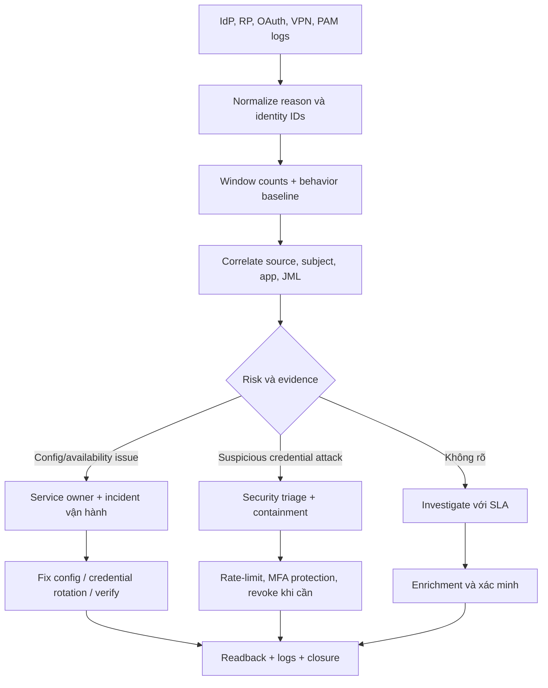
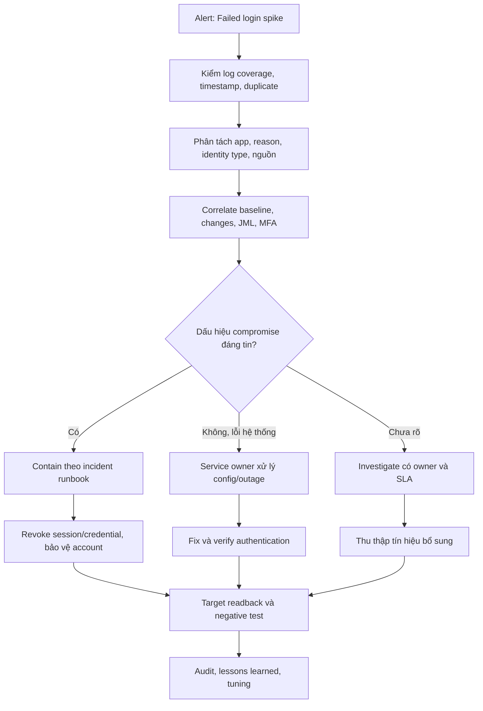

# Failed login spike trong Identity monitoring và quản lý vòng đời IAM

**Failed login spike** (*tăng đột biến số lần đăng nhập thất bại*) là tình huống số lượng hoặc tỷ lệ sự kiện xác thực không thành công tăng bất thường so với **mức nền phù hợp của ứng dụng, nhóm tài khoản, nguồn truy cập hoặc khoảng thời gian**. Đây là một tín hiệu quan trọng trong **Identity monitoring**, vì nó có thể liên quan đến password spraying, brute-force, credential stuffing, MFA failure hoặc một lỗi cấu hình sau triển khai.

Tuy nhiên, **không phải mọi đợt tăng thất bại đều là tấn công**. Một ứng dụng được đổi mật khẩu service account nhưng vẫn gửi credential cũ có thể tạo hàng nghìn lần đăng nhập thất bại. Một đợt triển khai SSO sai redirect URI cũng có thể gây nhiều lần thất bại đồng thời. Việc phân tích đúng cần **xác định nơi phát sinh lỗi, chủ thể nào bị ảnh hưởng, mẫu phân bố và các thay đổi hệ thống**, thay vì chỉ khóa tất cả account.

Ví dụ, hệ thống IAM nhận thấy từ 09:00 đến 09:05 có 1.200 lần login failed trong khi mức nền tương ứng chỉ vài chục lần. Nếu thất bại trải trên hàng trăm username với tần suất thấp mỗi account, đây có thể là **password spraying**. Nếu 1.200 lần đều đến từ một job triển khai với một service account và thông báo `invalid_client`, nguyên nhân có thể là **secret rotation chưa đồng bộ**. Hai trường hợp đều tạo spike nhưng phải có cách ứng phó khác nhau.

Bài học thuộc chương **Identity monitoring**, trong module **SECURITY_IDENTITY_ACCESS_MANAGEMENT_IDENTITY_LIFECYCLE**. Nội dung gắn với quản trị vòng đời danh tính **Joiner–Mover–Leaver (JML)** từ proofing, tạo account và cấp quyền tới rà soát, khóa và thu hồi; đồng thời liên kết **IdP, SSO, SCIM, RBAC/ABAC, tài khoản dịch vụ, session/token, kiểm toán và reconciliation** để giảm quyền truy cập tồn dư.

## 1. Failed login spike là gì và khác những hiện tượng liên quan ra sao?

| Thuật ngữ | Ý nghĩa | Dấu hiệu minh họa |
| --- | --- | --- |
| **Failed login spike** | Tổng số hoặc tỷ lệ lỗi tăng mạnh trong một cửa sổ | 500 lỗi/5 phút thay vì mức nền 20 |
| **Brute force** | Thử nhiều tổ hợp credential nhằm đoán bí mật | Nhiều lỗi tập trung vào một account |
| **Password spraying** | Thử mật khẩu phổ biến trên nhiều danh tính | Nhiều username, ít lần/account |
| **Credential stuffing** | Dùng credential thu được từ nguồn khác | Nhiều cặp user/password, có thể rải nguồn |
| **MFA fatigue** | Gửi nhiều thử thách MFA để người dùng chấp nhận | Nhiều challenge bị từ chối/hết hạn |
| **Account lockout spike** | Nhiều tài khoản bị khóa bởi chính sách | Lockout tăng sau auth failure |
| **SSO/federation failure** | Lỗi luồng xác thực liên kết | Redirect, assertion hoặc metadata sai |
| **Service credential drift** | Workload tiếp tục dùng key/secret cũ | `invalid_client` sau rotation |
| **Availability incident** | Hạ tầng xác thực lỗi gây thất bại | Nhiều request lỗi 5xx/timeout |

**Failed login spike là chỉ báo cần điều tra**, không phải kết luận tự động rằng có credential bị chiếm. Ngược lại, một cuộc tấn công rải đều theo thời gian có thể **không tạo spike rõ rệt** nếu chỉ dùng ngưỡng đếm tổng số.

## 2. Những nguồn log cần thu thập

Một login thất bại có thể xảy ra trước hoặc sau khi đi qua IdP:

- **IdP/Directory:** username/account ID, kết quả xác thực, loại lỗi, phương thức, MFA, lockout.
- **SSO/Relying Party (RP):** yêu cầu SAML/OIDC, callback failure, session, ứng dụng đích.
- **OAuth authorization server:** `invalid_client`, `invalid_grant`, token issuance và refresh errors.
- **API gateway/resource server:** token validation failure hoặc request bị từ chối, nhưng không nên đồng nhất mọi `401` với “password login failed”.
- **PAM/privileged access:** thất bại khi kích hoạt hoặc xác thực account đặc quyền.
- **VPN/VDI/device access:** kết quả đăng nhập từ thiết bị, môi trường và điểm kết nối.
- **HRIS/JML:** account lifecycle và thời điểm Joiner/Mover/Leaver.
- **SCIM/provisioning:** thay đổi account, group, trạng thái và connector errors.
- **Secrets manager/CI-CD:** rotation, credential retrieval và cấu hình workload liên quan.
- **Network/security telemetry:** tín hiệu IP reputation, proxy, rate limit và WAF nếu có.

**Một nguồn duy nhất hiếm khi phản ánh toàn bộ hành trình xác thực.** Ví dụ một ứng dụng SaaS có local login ngoài SSO, hoặc API client dùng `client_credentials` mà không có người dùng tương tác.

## 3. Phân loại thất bại trước khi đếm

Không nên trộn mọi lỗi trong cùng một bộ đếm. Phân biệt ít nhất:

| Nhóm lỗi | Ví dụ reason code | Điều cần suy luận |
| --- | --- | --- |
| Credential không đúng | `BAD_PASSWORD`, `invalid_credentials` | Có thể do gõ sai, spray hoặc secret cũ |
| Account không đủ điều kiện | `USER_DISABLED`, `ACCOUNT_EXPIRED` | Có thể liên quan JML hoặc truy cập sau Leaver |
| Account bị khóa | `ACCOUNT_LOCKED` | Có thể do lockout policy hoặc tấn công |
| MFA thất bại | `MFA_DENIED`, `MFA_TIMEOUT` | Có thể liên quan fatigue hoặc thiết bị |
| Federation/OIDC | `invalid_request`, redirect mismatch | Có thể là lỗi cấu hình |
| OAuth client | `invalid_client` | Secret, certificate hoặc client authentication |
| OAuth grant | `invalid_grant` | Có thể do code/refresh token không hợp lệ, không nhất thiết password |
| Policy/conditional access | `DEVICE_NONCOMPLIANT` | Chính sách từ chối, không đồng nghĩa brute-force |
| Hạ tầng | Timeout, 5xx, IdP unavailable | Availability/config incident |
| Rate-limit | Throttle/challenge | Có thể là kiểm soát đang phát huy tác dụng |

Các tên mã là **ví dụ**, không phải taxonomy chuẩn của mọi nhà cung cấp. Khi tổng hợp, cần ánh xạ lỗi theo **giai đoạn auth và nguyên nhân** để tránh tăng báo động sai.

## 4. Xây baseline phù hợp

Một baseline là mức hoạt động mong đợi dựa trên dữ liệu lịch sử đủ tin cậy. Không nên chọn cùng một ngưỡng cho portal nhân viên, OAuth token endpoint và tài khoản quản trị.

Các chiều phân tích có thể gồm:

1. **Ứng dụng/endpoint**: ERP login, IdP sign-in, VPN, OAuth token.
2. **Account hoặc principal**: user cụ thể, service client, privileged identity.
3. **Nguồn**: IP, ASN, mạng, device fingerprint đã giảm nhạy cảm.
4. **Tenant và environment**: production, staging, partner tenant.
5. **Loại kết quả**: bad password, MFA failure, disabled account, IdP outage.
6. **Thời gian**: giờ hành chính, ca trực, ngày nghỉ, lịch batch.
7. **Mẫu đăng nhập thành công**: failures đi kèm bao nhiêu successes.
8. **Nhóm đồng cấp**: tài khoản có chức năng và luồng xác thực tương tự.

Ví dụ, một batch job được cấu hình chạy mỗi 30 phút có thể tạo đều vài lỗi khi secret hết hạn; một portal công khai có traffic biến động theo ngày. Cần so **mức nền của đúng luồng** thay vì cộng mọi sự kiện rồi so với một trung bình chung.

## 5. Các cách xác định spike

### Đếm theo cửa sổ

Công thức đơn giản:

[
F_{w}(t)=#{	ext{failed auth events trong cửa sổ }[t-w,t]}
]

Trong đó `w` là cửa sổ quan sát. Có thể so `F_w` với ngưỡng tuyệt đối hoặc baseline theo lịch sử.

### Tỷ lệ thất bại

[
R_{mathrm{fail}}=rac{	ext{failed attempts}}{	ext{total authentication attempts}}
]

Tỷ lệ giúp phân biệt tăng do tổng traffic với tăng bất thường, nhưng **mẫu số quá nhỏ** sẽ gây nhiễu. Một tài khoản chỉ có hai lần đăng nhập và cả hai đều thất bại có tỷ lệ 100%, không nhất thiết là sự cố lớn.

### Độ lệch baseline

Một cách minh họa là `observed / expected` hoặc điểm chuẩn hóa theo phân bố lịch sử. Cần xử lý **chu kỳ thời gian, outliers, drift và thiếu dữ liệu**. Không mặc định dữ liệu đăng nhập có phân bố chuẩn.

### Unique accounts và unique sources

```text
failed_count
unique_subjects
unique_source_ips
failures_per_subject
failures_per_source
success_after_failures
reason_code_distribution
```

Hai cửa sổ cùng có 500 failures có thể hoàn toàn khác nhau: **một IP thử 500 account** và **một service account thử 500 lần** cần điều tra khác nhau.

## 6. Ví dụ bộ ngưỡng minh họa

| Điều kiện | Hướng diễn giải | Hành động ban đầu |
| --- | --- | --- |
| Nhiều failure trên một account trong thời gian ngắn | Credential guessing hoặc client cấu hình sai | Kiểm nguồn, loại account, logs |
| Nhiều account từ cùng một source | Password spray nghi vấn | Correlate username dispersion và rate-limit |
| Nhiều source thử cùng account | Distributed attack hoặc user có nhiều thiết bị lỗi | Phân tích IP/ASN/device và MFA |
| Failure rate tăng cùng 5xx của IdP | Hạ tầng lỗi | Escalate availability và kiểm service health |
| `invalid_client` sau deployment | Secret/client configuration drift | Tra change và rotation |
| MFA deny tăng sau password successes | MFA fatigue hoặc push loop | Bảo vệ user và điều tra |
| Account Leaver bị thử liên tục | Persistence attempt hoặc credential cũ | Đảm bảo deny và triage nguồn |
| Failure kèm success sau nhiều attempts | Có thể đoán đúng credential | Ưu tiên điều tra success và session |

**Không lấy các hàng này làm ngưỡng sản phẩm cố định.** Tổ chức phải điều chỉnh theo risk appetite, baseline, tài nguyên và chất lượng nguồn dữ liệu.

## 7. Sơ đồ luồng detection và phản ứng



**Detection, triage, containment và verified closure là bốn giai đoạn khác nhau**. Một alert đã biến mất sau khi thay ngưỡng không chứng minh nguyên nhân đã được khắc phục.

## 8. Các mẫu password spraying và credential stuffing

**Password spraying** thường nhắm nhiều account với số lần thử hạn chế trên từng account, nhằm tránh ngưỡng khóa theo người dùng. Vì thế detector chỉ đếm **failures trên một account** có thể bỏ sót.

Những dấu hiệu kết hợp:
- Nhiều username khác nhau, failure reason tương tự.
- Tần suất thử phân tán trong khoảng thời gian dài.
- Một hoặc nhiều nguồn mạng có cấu trúc traffic liên quan.
- Trùng ứng dụng/endpoint hoặc user-agent bất thường.
- Thỉnh thoảng có success sau một chuỗi failures.
- Nhiều account bị lockout cùng giai đoạn.

**Credential stuffing** có thể dùng cặp credential bị lộ và phân tán request qua nhiều nguồn. Phải kiểm tra cả **success bất thường**, session/token issued, hành vi sau login và MFA outcome; chỉ xem `LOGIN_FAILED` sẽ bỏ sót trường hợp attacker đăng nhập thành công ngay lần đầu.

Bài học phòng thủ không cần tạo traffic tấn công thật. Nên dùng log giả lập và môi trường kiểm thử được phép để đánh giá detector.

## 9. MFA failed login spike

MFA failures là tín hiệu khác password failures:

| Hiện tượng | Giải thích có thể |
| --- | --- |
| Nhiều push bị từ chối | Người dùng không khởi tạo, push fatigue |
| Nhiều prompt hết hạn | User mất thiết bị hoặc client loop |
| OTP liên tục sai | Đồng hồ lệch, nhập sai hoặc phishing |
| Passkey/WebAuthn thất bại | Origin mismatch, device/cert hoặc browser issue |
| Enrollment thất bại tăng | Lỗi rollout hoặc recovery process |
| MFA challenge thành công sau nhiều lần deny | Có thể user bị lừa xác nhận |

Khi nhiều push được gửi đến một tài khoản, cần **giảm nguy cơ MFA fatigue** và hướng dẫn người dùng xác minh yêu cầu trước khi chấp thuận. Không tự coi một lần MFA success là bằng chứng truy cập hợp lệ nếu có tín hiệu attacker nắm password.

Với quyền privileged, có thể cần **phương thức chống phishing** và đánh giá session sau thành công. Không tiết lộ OTP/seed hoặc recovery code trong log/alert.

## 10. OAuth client và service identity

Một service/machine identity không đăng nhập như người dùng. Failed token requests có thể tăng mạnh khi:

- Client secret đã rotate nhưng ứng dụng giữ giá trị cũ.
- Certificate client expired hoặc trust chain thay đổi.
- Workload federation issuer/subject/audience không còn khớp.
- Managed identity không còn liên kết với resource.
- Authorization server thay endpoint hoặc policy.
- CI/CD runner rollback về cấu hình cũ.
- Một secret bị lộ và có người ngoài cố dùng.
- Service principal đã retired nhưng job cũ vẫn chạy.

**Không giải quyết `invalid_client` của bot bằng MFA push cho một nhân viên**. Cần xác định `clientId`, `workloadId`, owner, credential reference, deployment và token endpoint. Sau sửa lỗi, kiểm tra credential cũ không còn được sử dụng ngoài mục đích, role/ACL không vượt quyền, đồng thời không vô tình tái cấp principal đã retired.

## 11. JML Joiner: spike khi onboarding

Trong **Joiner**, người dùng mới có thể gặp failures do chưa đăng ký MFA, nhập sai mật khẩu lần đầu, ngày hiệu lực chưa tới hoặc account chưa đồng bộ vào SaaS.

Cần phân biệt:
1. **Login trước start date**: từ chối đúng chính sách, có thể nhiều lần do user thử.
2. **MFA enrollment còn thiếu**: không được hạ bảo vệ một cách tùy tiện.
3. **Provisioning delay**: account đích chưa sẵn sàng dù IdP đã có account.
4. **Identity correlation mismatch**: tạo account sai hoặc duplicate.
5. **Role not yet granted**: authorization deny không phải authn failure.
6. **High-volume onboarding wave**: spike dự kiến sau đợt tuyển dụng lớn.

Cần lưu HR effective date, provisioning operation, IdP status và target readback. **Không tự mở quyền trước ngày hiệu lực để làm giảm số login failed**.

## 12. JML Mover: spike sau thay vai trò

Khi người dùng đổi nhóm hoặc ứng dụng:
- Group/role cũ bị thu hồi, gây một số request bị từ chối đúng.
- App vẫn cấu hình SSO cũ hoặc không nhận claim mới.
- Session cũ bị yêu cầu re-authentication.
- Quyền mới chưa propagate qua SCIM connector.
- Conditional access thay đổi do cấp thiết bị hoặc phạm vi.

Nếu nhiều người cùng Mover trong tái tổ chức và login failures tăng, cần kiểm **mapping và policy version**, không ngay lập tức kết luận bị tấn công.

Tuy nhiên **Mover còn truy cập được quyền cũ là một anomaly khác cần điều tra**. Nếu ERP API vẫn `PERMIT invoice.approve` sau khi người đó rời Finance, thành công đăng nhập không phải tín hiệu tốt; phải theo dõi authorization ở resource server và xử lý **residual entitlements**.

## 13. JML Leaver: thất bại có thể là kiểm soát đúng

Một Leaver không còn đăng nhập được thường là kết quả mong muốn. Nhưng chuỗi thử liên tục sau ngày nghỉ có thể phản ánh:
- Người cũ cố truy cập.
- Thiết bị/app còn credential lưu tự động.
- Job cũ dùng account cá nhân.
- Attacker có credential đã lộ.
- Dữ liệu lifecycle hoặc account correlation sai.

Các bài kiểm tra cần phối hợp:
- IdP deny new login.
- Refresh token không cấp access token mới trái policy.
- RP/local session không thực hiện tác vụ đã mất quyền.
- Account phụ/privileged và API key cá nhân được xử lý.
- SCIM disable và gỡ entitlement ở target được readback.
- API negative authorization test theo SLA.

**SCIM `active=false` không chứng minh mọi session và access token đã chết**. Sau Leaver, điều quan trọng không chỉ là **thất bại đăng nhập mới** mà còn là **không còn quyền truy cập runtime trái chính sách**.

## 14. Account lockout và rủi ro denial-of-service

Lockout là một cơ chế chống đoán mật khẩu nhưng có thể bị lạm dụng để **khóa hàng loạt user hợp lệ**. Khi detector thấy failed login spike:

1. Xác định lockout có tăng và tác động tới ai.
2. Phân biệt credential attack với lỗi ứng dụng dùng credential cũ.
3. Kiểm chính sách rate limiting, CAPTCHA/challenge nếu phù hợp.
4. Bảo vệ tài khoản đặc quyền và đường khôi phục khẩn cấp.
5. Tránh tự động khóa thêm toàn bộ danh tính theo một IP dùng chung.
6. Xem xét step-up hoặc phishing-resistant authentication.
7. Có quy trình phục hồi account an toàn, chống social engineering.
8. Đo ảnh hưởng tới người dùng và dịch vụ.

**Không cố định một ngưỡng lockout cho mọi tài khoản.** Độ nhạy cần dựa trên loại identity, ứng dụng và threat model. Account machine dùng bởi nhiều job cần phương án bảo vệ khác account người dùng.

## 15. Liên hệ với adaptive authentication

Failed login spike có thể là một tín hiệu của **risk-based/adaptive authentication**, nhưng không tự quyết định toàn bộ kết quả.

Ví dụ:
- Risk thấp, một số lần gõ sai: có thể cho thử lại với bảo vệ giới hạn.
- Thử từ thiết bị mới và nhiều MFA deny: yêu cầu step-up, cảnh báo hoặc block theo policy.
- Account bị khóa/Leaver: deny vì lifecycle, không cho MFA hợp thức hóa.
- Một IP sau NAT có nhiều người dùng: cần kiểm source quality trước block.
- Service account có `invalid_client`: điều tra secret/trust, không dùng human challenge.

**Adaptive authentication không thay thế RBAC/ABAC**. Ngay cả khi login thành công sau step-up, API vẫn phải từ chối action không có quyền.

## 16. Identity correlation và vấn đề nhầm nguồn

Một người có thể có:
- Account thường và account privileged.
- Local SaaS user và IdP identity.
- Account contractor và partner liên quan.
- Nhiều session trên thiết bị khác nhau.

Không nên ghép chỉ bằng display name hoặc email nếu ID có thể đổi/tái sử dụng. Các khóa tốt gồm **issuer, tenant, source account ID, normalized identity ID, client ID và event time**.

Với nguồn login failed, **username do người gửi request nhập có thể không tương ứng người sở hữu thật**. Không quy trách nhiệm cho nhân viên chỉ vì tên họ được thử trong các request thất bại. Cần phân biệt **claimed identifier** và **authenticated subject**; nhiều failure xảy ra khi chưa biết danh tính đã được chứng thực.

## 17. Event schema và mẫu log

Một record chuẩn hóa nên có:

| Field | Ý nghĩa |
| --- | --- |
| `eventId` | ID độc nhất, chống duplicate |
| `eventTime`, `ingestedAt` | Thời điểm sự kiện và nhận log |
| `sourceSystem`, `authFlow` | IdP, SSO, OAuth, VPN, app local |
| `claimedAccountRef` | Tham chiếu username được thử |
| `resolvedSubjectId` | Identity ID nếu ánh xạ chắc chắn |
| `clientId`, `workloadId` | Client hoặc workload nếu là máy |
| `tenantId`, `environment` | Ranh giới truy cập |
| `sourceNetworkRef` | Metadata mạng giảm nhạy cảm |
| `deviceRef` | Metadata thiết bị nếu có |
| `failureCategory` | Bad credential, MFA, policy, outage |
| `reasonCode` | Mã chi tiết nội bộ |
| `mfaOutcome` | Challenge result nếu liên quan |
| `policyVersion` | Rule xác thực đang áp dụng |
| `sessionRef`, `requestId` | Correlation đã che |
| `lifecycleState` | Joiner, Mover, Leaver hoặc Active |
| `riskTier` | Mức ưu tiên theo policy |
| `correlationId` | Liên kết log xuyên nguồn |

Ví dụ:

```json
{
  "eventId": "authfail-demo-1042",
  "eventTime": "2026-11-23T03:00:00Z",
  "sourceSystem": "idp-prod",
  "authFlow": "interactive-login",
  "claimedAccountRef": "user-ref-42",
  "resolvedSubjectId": null,
  "tenantId": "tenant-a",
  "failureCategory": "BAD_CREDENTIAL",
  "reasonCode": "INVALID_PASSWORD",
  "sourceNetworkRef": "net-ref-7",
  "requestId": "req-demo-10",
  "riskTier": "UNDETERMINED"
}
```

Dữ liệu hoàn toàn **minh họa**. Không log password người dùng đã thử, OTP, token, cookie hoặc secret. Việc `resolvedSubjectId=null` có thể là thiết kế đúng khi request chưa chứng minh được identity.

## 18. Correlation giữa login failures và successes

**Thành công ngay sau nhiều thất bại** có thể là tín hiệu nguy hiểm hơn việc chỉ thấy thất bại liên tục. Một quy trình điều tra cần:

1. Tìm failures theo actor/claimed account/source/context.
2. Kiểm success gần đó với **ID danh tính đã xác thực**.
3. Xác định MFA success, device trust, session issuance.
4. Kiểm hành động ngay sau success: role change, secret read, data export.
5. So sánh source/user-agent nhưng không coi chúng là identity proof.
6. Xem event risk, conditional access và token grant.
7. Đối chiếu known maintenance/onboarding/rotation event.
8. Nếu compromise có căn cứ, xử lý session/token và credential.
9. Ghi bằng chứng và thông báo đúng owner/incident commander.

Không tự quy kết success là của attacker chỉ vì xảy ra sau failures; có thể user thật đã đăng nhập sau khi gõ sai. Triage cần **độ tin cậy nguồn và dấu vết hành vi hậu đăng nhập**.

## 19. SQL minh họa phát hiện thất bại tăng

Giả định warehouse lưu bảng `authentication_events` đã được chuẩn hóa:

```sql
-- SQL minh họa, cú pháp cửa sổ thời gian tùy hệ quản trị.
SELECT
    source_system,
    tenant_id,
    COUNT(*) AS failed_attempts,
    COUNT(DISTINCT claimed_account_ref) AS distinct_claimed_accounts,
    COUNT(DISTINCT source_network_ref) AS distinct_sources
FROM authentication_events
WHERE outcome = 'FAILURE'
  AND event_time >= :window_start
  AND event_time < :window_end
GROUP BY source_system, tenant_id;
```

Kết quả phải được so với baseline cho **cùng application, tenant, time slice và event category**. Ngưỡng được cấu hình theo rủi ro và đủ dữ liệu lịch sử, không lấy một con số cố định tùy ý.

Một truy vấn để phát hiện nguồn thử nhiều account:

```sql
SELECT
    source_system,
    source_network_ref,
    COUNT(*) AS failures,
    COUNT(DISTINCT claimed_account_ref) AS targeted_accounts
FROM authentication_events
WHERE outcome = 'FAILURE'
  AND failure_category = 'BAD_CREDENTIAL'
  AND event_time >= :window_start
  AND event_time < :window_end
GROUP BY source_system, source_network_ref
HAVING COUNT(DISTINCT claimed_account_ref) >= :account_threshold;
```

Dù hữu ích để tạo alert, cùng một IP có thể là **NAT/proxy của nhiều user hợp lệ**. Cần xem thiết bị, client, thời gian, reputation và rate pattern trước khi quyết định chặn.

## 20. Phân biệt attack với lỗi cấu hình

| Dấu hiệu | Nghi attack | Nghi configuration/availability |
| --- | --- | --- |
| Nhiều username, credential failures | Password spraying/stuffing | Hiếm hơn |
| Một service client, `invalid_client` liên tục | Key bị lộ và dùng thử | Secret/certificate không khớp |
| Spike ngay sau deployment | Có thể bị khai thác cùng thời điểm | Mapping/redirect/secret rotation lỗi |
| Nhiều 5xx/timeout ở IdP | Có thể là DoS | Dịch vụ mất khả dụng |
| MFA denied nhiều trên một user | MFA fatigue đáng nghi | App loop hoặc người dùng thao tác lặp |
| Nhiều source phân tán thử một user | Distributed guessing | Nhiều client lưu password cũ |
| Success + đổi MFA/role nhanh | Account takeover đáng nghi | Change hợp lệ có thể xảy ra |
| Ticket thay SSO metadata cùng thời điểm | Có thể trùng hợp | Gợi ý federation misconfiguration |

**Sự trùng thời gian với change không chứng minh change là nguyên nhân**. Cần kiểm tra before/after, failure reason, affected population và bằng chứng từ hệ thống thực thi.

## 21. Triage playbook theo bước



**Bước 1 — Xác nhận spike thực:** kiểm dữ liệu có bị gửi trùng, ingestion replay hoặc backfill không. Phân biệt event time và ingestion time.

**Bước 2 — Tách nhóm lỗi:** bad credentials, MFA, policy denial, federation hay infrastructure. Một số provider ghi `SIGN_IN_FAILURE` cho các điều kiện khác nhau.

**Bước 3 — Correlate nguồn và đối tượng:** unique accounts, IP/ASN, device, client ID, privileged status, tenant và workload owner.

**Bước 4 — Kiểm thay đổi hợp lệ:** deployment, password/secret rotation, conditional access, federation metadata, onboarding wave, JML.

**Bước 5 — Xác minh quyền và hoạt động:** có session mới, role grant, token issuance, data access hay không.

**Bước 6 — Chọn hành động:** containment bảo mật, sửa config, tăng challenge hoặc theo dõi. Không phá dịch vụ quan trọng khi chưa cân nhắc blast radius, trừ trường hợp cần chặn nguy cơ cấp bách.

**Bước 7 — Verify closure:** xác nhận nguồn failure trở về trạng thái thích hợp, không có quyền tồn dư và evidence đã được bảo toàn.

## 22. Những biện pháp phòng thủ phù hợp

Có thể phối hợp:
- Rate limiting theo **source, account, client và endpoint**, có cân nhắc shared IP.
- Chống password spray bằng phân tích **nhiều account trên cùng chiến dịch**.
- Phishing-resistant MFA, nhất là tài khoản privileged.
- Adaptive authentication theo rủi ro thiết bị/phiên.
- Bảo vệ MFA challenge khỏi spam/fatigue.
- Khóa account theo chính sách có cân nhắc DoS.
- Bảo vệ OAuth client credentials và rotation an toàn.
- Giới hạn scope/token lifetime và xử lý revoked sessions.
- Alert thành công đăng nhập bất thường cùng privilege changes.
- Đối soát trạng thái JML và entitlement tại ứng dụng.
- Quy trình recovery đáng tin khi user bị khóa nhầm.

**Không áp dụng cùng biện pháp cho human và non-human account**. Việc khóa một service principal dùng bởi payment processing có thể ngừng giao dịch; nếu credential bị chiếm, cần chặn phù hợp và triển khai identity thay thế có kiểm soát.

## 23. Kiểm thử detection bằng dữ liệu tổng hợp

Một bộ test cần có cả **positive, negative và availability cases**:

| Kịch bản | Kỳ vọng |
| --- | --- |
| Nhiều failures trên một account | Nhận biết account-targeted guessing hoặc config loop |
| Một IP thử nhiều account | Detector phát hiện source dispersion |
| Nhiều IP thử một account | Correlate distributed attempt |
| Failures tăng tỷ lệ thuận traffic hợp lệ | Không alert sai chỉ vì tổng request tăng |
| Mọi request lỗi 5xx sau IdP outage | Phân loại availability |
| OAuth client sai secret sau rotation | Nhận diện workload/config issue |
| MFA deny tăng, password success trước đó | Triage MFA fatigue |
| Success sau nhiều failures | Correlate hoạt động hậu đăng nhập |
| Joiner chưa đến ngày hiệu lực | Deny theo lifecycle, không tự mở quyền |
| Mover đổi SSO group | Kiểm mapping, không giữ role cũ |
| Leaver tiếp tục cố login | Login Deny, kiểm session cũ |
| VPN dùng chung IP | Giảm false positive bằng device/context |
| Log collector gửi duplicate | Deduplication theo event ID |
| Event đến trễ | Dùng event time, biết ingestion lag |
| Service account retired vẫn xin token | Alert và revoke đúng issuer |
| User chỉ có login Deny nhưng API vẫn Permit bằng token cũ | Detect residual access qua authorization log |
| Detection engine mất nguồn | Alert telemetry gap thay vì kết luận không có attack |

Các test nên dùng **test identities và synthetic logs**, không tổ chức password spraying thực lên hệ thống sản xuất hoặc người dùng thật.

## 24. Pseudocode phát hiện một spike

```text
for each (source_system, tenant, auth_flow, failure_category):
    events = events_in_window(window=5_minutes)
    unique_events = deduplicate(events, key=event_id)

    observed = count(unique_events where outcome == FAILURE)
    expected = baseline_for_same_context(
        source_system, tenant, auth_flow, failure_category, time_of_day
    )

    if telemetry_incomplete:
        create_data_quality_alert()
        continue

    if observed_above_risk_threshold(observed, expected):
        alert = create_alert(
            reason="FAILED_LOGIN_SPIKE",
            failed_count=observed,
            distinct_accounts=count_distinct(claimed_account_ref),
            distinct_sources=count_distinct(source_network_ref)
        )
        enrich(alert, JML_status, MFA_outcomes, successful_logins, changes)
        route_to_triage(alert)
```

Đây là **giả mã**, không phải implementation production. Hệ thống thật cần xử lý nguồn log không đầy đủ, khoảng thời gian không có dữ liệu, event duplication, timezone, sampling, high-cardinality và threshold tuning.

## 25. Liên kết với RBAC/ABAC và quyền tồn dư

**Failed login spike phát hiện dấu hiệu ở lớp authentication**; nó không chứng minh một tài khoản có hoặc không có authorization.

Ví dụ:
- User đăng nhập thất bại nhiều lần vì password sai: AuthN failure.
- User đăng nhập thành công nhưng không có role `invoice.approve`: AuthZ Deny.
- User Leaver không đăng nhập mới được nhưng vẫn có RP session: có thể còn AuthZ Permit.
- Một service identity không xin được token mới nhưng API vẫn chấp nhận access token cũ: cửa sổ quyền tồn dư.
- Account được gỡ group IdP nhưng ứng dụng vẫn có direct role: provisioning/authorization drift.

Để khép kín kiểm soát cần kiểm **IdP login, refresh/token, RP session, SCIM/target readback, effective RBAC/ABAC permission và API negative authorization test**. Không kết luận tài khoản đã an toàn chỉ vì số failed logins giảm.

## 26. Audit evidence và bảo vệ riêng tư

Một case nên lưu:

| Trường | Mục đích |
| --- | --- |
| `caseId`, `alertId` | Liên kết cảnh báo và điều tra |
| `detectionRuleVersion` | Tái dựng điều kiện phát hiện |
| `timeWindow`, `baselineReference` | Chứng minh spike |
| `failureCategories` | Lý do thất bại |
| `affectedAccountRefs` | Phạm vi chủ thể được bảo vệ |
| `sourcesSummary` | IP/ASN/device metadata theo chính sách |
| `JMLEventRefs` | Liên kết Joiner/Mover/Leaver nếu có |
| `change/incidentRefs` | Thay đổi hoặc sự cố liên quan |
| `triageDecision` | Attack/config/unknown và độ tin cậy |
| `containmentActions` | Quyết định chặn, rotate, step-up |
| `verificationEvidence` | Readback, login tests, API Deny |
| `owner`, `deadline`, `closedAt` | Trách nhiệm và kết quả |

Cần áp dụng **data minimization, access control, encryption, retention và log integrity**. Không đưa credential thô, access token, refresh token, cookie hoặc OTP vào log/case. Username được thử chưa chắc là identity đã chứng thực, vì vậy tránh định danh sai người trong báo cáo.

## 27. Chỉ số vận hành

| Chỉ số | Ý nghĩa |
| --- | --- |
| **Failed login rate** | Tỷ lệ thất bại theo app/luồng |
| **Spike detection coverage** | Tỷ lệ hệ thống có telemetry tương ứng |
| **Time to detect** | Độ trễ sự kiện tới alert |
| **Time to triage** | Độ trễ có người xác minh |
| **True-positive rate** | Tỷ lệ alert có giá trị theo kết luận |
| **False-positive rate** | Mức báo động sai |
| **Unique targeted accounts** | Độ rộng user population bị thử |
| **Successful logins after failures** | Nhóm cần điều tra takeover |
| **MFA failure/deny trend** | MFA fatigue hoặc lỗi |
| **Lockout impact** | Tài khoản hợp lệ bị gián đoạn |
| **Service credential drift** | Job dùng secret/trust cũ |
| **Leaver access anomalies** | Sự kiện truy cập ngoài lifecycle |
| **Log ingestion lag** | Độ trễ nguồn bằng chứng |
| **Verified containment rate** | Tỷ lệ case có bằng chứng chặn thực tế |

Một môi trường tăng user traffic có thể tăng tổng failures nhưng **không tăng rủi ro theo cùng tỷ lệ**. Cần phân tích số lượng, tỷ lệ, đối tượng, bối cảnh và kết quả điều tra.

## 28. Sai lầm thường gặp

| Sai lầm | Hệ quả | Cách khắc phục |
| --- | --- | --- |
| Đếm mọi 401 là mật khẩu sai | Trộn API token, authn và authz | Phân loại endpoint/reason |
| Một ngưỡng cho mọi ứng dụng | False positives/negatives | Baseline theo context |
| Chỉ đo failures/account | Bỏ password spraying nhiều user | Unique account/source correlation |
| Chỉ xem failures | Bỏ success sau tấn công | Correlate session/token/role |
| Coi IP mới là attacker | Khóa nhầm user đi VPN | Device/MFA/change context |
| Không xét deployment | Secret rotation lỗi thành alert tấn công | Change correlation |
| Nhầm claimed username với authenticated subject | Gán trách nhiệm sai | Stable identity mapping và confidence |
| Chặn cả NAT source | Gián đoạn hàng loạt | Rate limit/phân tích đa chiều |
| Không theo dõi service accounts | Bỏ `invalid_client` và secret drift | Machine identity monitoring |
| Coi SCIM status là runtime deny | Leaver session còn quyền | Target authorization tests |
| Bỏ event trễ/trùng | Spike giả hoặc đếm sai | Event ID + event time |
| Không giám sát log gap | Missed detection | Collector health monitoring |
| Ghi password/token vào log | Lộ credential | Redaction và access control |
| Đóng case khi alert tự hết | Không biết đã chặn nguy cơ chưa | Verified closure |

## 29. Checklist triển khai Failed login spike monitoring

- [ ] Có danh sách IdP, RP, VPN, OAuth, PAM và app login sources.
- [ ] Chuẩn hóa failure category; không gộp AuthN/AuthZ.
- [ ] Có event time, source system, client và account references.
- [ ] Không dùng claimed username làm bằng chứng identity đã xác thực.
- [ ] Có baseline theo ứng dụng, tenant, luồng và giờ hoạt động.
- [ ] Theo dõi cả failed count, fail rate, unique accounts/sources.
- [ ] Có detector cho password spraying và distributed attempts.
- [ ] Correlate login success, MFA outcomes và hành động privileged.
- [ ] Có JML status, account owner, partner/workload purpose.
- [ ] Phân biệt service credential drift với human password attack.
- [ ] Kiểm tra lockout impacts và bảo vệ MFA khỏi fatigue.
- [ ] Có telemetry quality, deduplication và ingestion lag monitoring.
- [ ] Triage có owner, risk severity, SLA, exception và escalation.
- [ ] Containment chặn theo incident runbook, không gây DoS ngoài ý muốn.
- [ ] Có readback IdP/target và API authorization negative test khi cần.
- [ ] Token/session còn hạn và quyền tồn dư được xem xét.
- [ ] Evidence không có plaintext password, token, cookie, OTP hoặc private key.
- [ ] Detector được thử với synthetic positive/negative/availability scenarios.
- [ ] Metrics phản ánh hiệu quả và false positives, không chỉ alert count.
- [ ] Case chỉ đóng khi có bằng chứng phù hợp mục tiêu kiểm soát.

## 30. Câu hỏi tự kiểm tra

**Tình huống A:** Nhiều username bị thử một lần từ cùng nguồn trong năm phút. Đây có thể là kiểu tấn công nào? **Password spraying**, nhưng cần correlation và bối cảnh trước khi kết luận.

**Tình huống B:** Một OAuth client có 800 lần `invalid_client` ngay sau secret rotation. Có nên khóa hàng trăm nhân viên? **Không.** Điều tra client credential, workload, deployment và owner.

**Tình huống C:** Nhiều người dùng truy cập qua một IP VPN chung bị lỗi đăng nhập. Có thể chặn toàn IP ngay? **Không mặc nhiên.** Đánh giá tác động, device và nguồn, tránh gây denial-of-service.

**Tình huống D:** Leaver không đăng nhập mới được nhưng cookie ERP cũ còn phê duyệt giao dịch. Failed login spike đã chứng minh an toàn chưa? **Không.** Phải kiểm session và authorization thực tế.

**Tình huống E:** Một chuỗi đăng nhập thất bại được theo sau bởi login success và thêm role admin. Cần ưu tiên điều tra gì? **Khả năng account takeover và privilege escalation**, với xác minh actor, MFA, policy và audit.

**Tình huống F:** Hệ thống nhận lại 1.000 event cũ do collector backfill. Có phải spike thời gian thực không? **Chưa chắc.** Phải xét event time, ingestion time và duplicate IDs.

**Tình huống G:** Account backup không login suốt nhiều tháng. Có thể xóa vì dormant? **Không chỉ dựa vào last-used**; cần owner, nhiệm vụ khôi phục và kiểm thử được phép.

**Tình huống H:** Tỷ lệ login failed cao vì IdP outage. Có thể coi đây là mật khẩu bị brute-force? **Không nếu bằng chứng chỉ ra lỗi hạ tầng**; phải phân loại đúng và xử lý availability.

## Ghi nhớ

**Failed login spike** là tín hiệu tăng bất thường về **số lượng hoặc tỷ lệ lỗi xác thực**, cần được phân tích theo **ứng dụng, account, nguồn truy cập, failure reason và baseline đúng ngữ cảnh**. Hệ thống hiệu quả không chỉ phát hiện password spraying, brute-force và credential stuffing mà còn phân biệt **MFA fatigue, secret rotation lỗi, SSO misconfiguration và sự cố IdP**. Trong **Joiner–Mover–Leaver**, phải liên kết **IdP/SSO, SCIM, RBAC/ABAC, service identity, session/token, kiểm toán và reconciliation** để phát hiện nỗ lực truy cập trái vòng đời và kiểm chứng **quyền truy cập tồn dư thực sự đã bị chặn ở hệ thống đích**.
