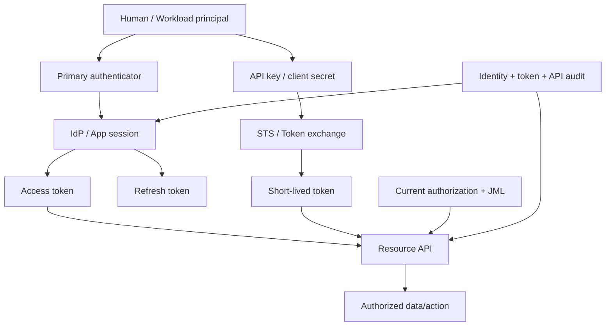
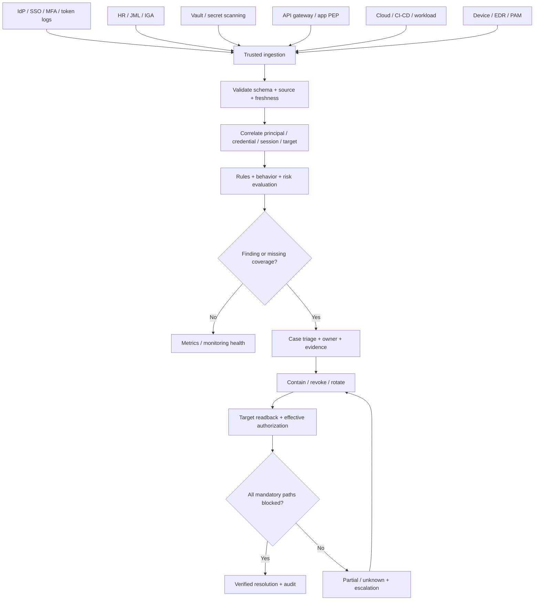
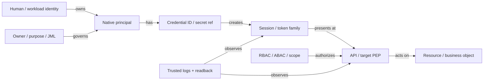

# Credential abuse trong Identity monitoring: Phát hiện, điều tra và ngăn chặn lạm dụng thông tin xác thực

**Credential abuse** (*lạm dụng thông tin xác thực*) là việc **sử dụng, cố sử dụng hoặc khai thác credential/trạng thái xác thực ngoài mục đích, quyền hạn hoặc bối cảnh được cho phép**. Credential ở đây không chỉ là **mật khẩu**: còn có API key, access token, refresh token, session cookie, khóa SSH, client secret, certificate/private key, mã khôi phục, thông tin đăng nhập của tài khoản dịch vụ và những bằng chứng xác thực khác.

Một hệ thống IAM có thể ghi nhận đăng nhập thành công bằng mật khẩu và MFA nhưng **vẫn đang chứng kiến credential abuse**: attacker có thể sử dụng token phiên bị đánh cắp sau khi người dùng xác thực, hoặc một CI job không được phê duyệt đang dùng API key production. Ngược lại, một credential xuất hiện trong repository là **credential exposure**; cần xử lý như một rủi ro nghiêm trọng nhưng **chưa đủ để khẳng định nó đã bị người khác sử dụng**.

Trong **Identity monitoring**, mục tiêu là quan sát **ai hoặc workload nào đang sử dụng credential nào, ở đâu, vào lúc nào, để làm gì, theo đường xác thực nào và ứng dụng đích thực sự cho phép hành động gì**. Quan sát phải nối với trạng thái danh tính, vai trò, nguồn cấp quyền và chính sách hiện hành; không dừng ở nhãn “login success/failure”.

Bài thuộc chương **Identity monitoring** của module `SECURITY_IDENTITY_ACCESS_MANAGEMENT_IDENTITY_LIFECYCLE`. Module nghiên cứu **quản lý vòng đời danh tính theo Joiner–Mover–Leaver (JML)**: từ xác minh, tạo tài khoản, cấp quyền đến rà soát và thu hồi khi vai trò/quan hệ thay đổi; kết nối **IdP, SSO, SCIM, RBAC/ABAC, tài khoản dịch vụ, kiểm toán và giảm quyền truy cập tồn dư**. Credential abuse là một mắt xích quan trọng: account đã được disable ở IdP vẫn có thể có **token, key, phiên hoặc account cục bộ tại target** chưa được kiểm soát đúng.

**Kết quả học tập:** Sau bài này, bạn có thể phân biệt credential exposure, theft, replay, misuse và takeover; nhận diện những mẫu lạm dụng password, MFA, session, OAuth và non-human credentials; thiết kế nguồn log/tín hiệu có provenance; viết detector có kiểm tra độ phủ và độ tin cậy; triage, contain, rotate/revoke và kiểm chứng tại target; nối sự cố với JML, IdP/SSO/SCIM và quyền truy cập; đồng thời vận hành audit, KPI và bộ kiểm thử an toàn.

> **Nguyên tắc nền tảng:** **Credential hợp lệ không chứng minh người gọi là chủ thể được ủy quyền trong nghiệp vụ, và credential đã bị revoke ở một hệ thống không tự chứng minh mọi đường truy cập dẫn xuất đã hết hiệu lực.** Phải tách authentication, authorization, session, credential lifecycle và bằng chứng thực thi.

## 1. Credential, identity và authorization: Ba thứ khác nhau

Một credential là **phương tiện chứng minh** cho cơ chế xác thực hoặc ủy quyền. Nó không phải chính bản thân danh tính và không tự mô tả mọi quyền được phép.

| Khái niệm | Câu hỏi chính | Ví dụ |
| --- | --- | --- |
| **Identity** | Ai hoặc workload nào? | `iam-user-1042`; `report-sync-prod` |
| **Account/principal** | Target nhận diện thực thể nào? | Cloud service principal, SaaS user |
| **Credential** | Dùng bằng chứng gì để xác thực? | Password, API key, certificate |
| **Authenticator** | Bằng chứng được kiểm tra bằng cơ chế nào? | Password verifier, FIDO2, mTLS |
| **Session** | Ngữ cảnh xác thực liên tục nào đang hoạt động? | IdP session, web session |
| **Access token** | Token nào được API chấp nhận? | OAuth bearer access token |
| **Authorization** | Được thực hiện action nào trên resource nào? | `reports.read` cho `org-17` |
| **Grant/entitlement** | Quyền đến từ đâu? | RBAC role, direct policy, JIT |
| **Audit event** | Điều gì đã được quan sát và bởi nguồn nào? | `TOKEN_EXCHANGE_SUCCEEDED` |

Một user có thể có nhiều credential. Một workload có thể có nhiều keys/certificates. Một credential có thể tạo ra **session hoặc token dẫn xuất**. Do đó quan hệ không chỉ là “một tài khoản – một mật khẩu”.

### 1.1. Authentication success không có nghĩa hành động hợp lệ

Giả sử một user có token hợp lệ với `reports.read`. Nếu request nhằm đọc tenant khác, API vẫn phải **Deny** theo resource authorization. Nếu một service principal có quyền `payments.execute`, API nghiệp vụ vẫn phải kiểm tra **maker-checker/SoD** nếu giao dịch cần người phê duyệt độc lập.

**Credential abuse monitoring** phải đặt cạnh **PDP/PEP, RBAC/ABAC/PBAC và business authorization**. Một điều tra chỉ dựa trên login logs dễ bỏ sót request được API Permit sau khi login.

### 1.2. Ba thời điểm cần phân biệt

- **Credential issued:** credential được tạo/cấp.
- **Credential used:** hệ thống nhận một bằng chứng dùng credential hoặc token dẫn xuất.
- **Action committed:** tác vụ nhạy cảm thực sự hoàn thành.

Một access token được phát nhưng chưa sử dụng không giống token được dùng để đọc dữ liệu, và API Permit không tự đồng nghĩa transaction đã commit.

## 2. Exposure, compromise, abuse và incident không đồng nghĩa

| Thuật ngữ | Ý nghĩa | Có thể kết luận điều gì? |
| --- | --- | --- |
| **Credential exposure** | Secret xuất hiện ở nơi ngoài phạm vi bảo vệ | Có nguy cơ bị sử dụng; cần containment theo rủi ro |
| **Credential theft suspected** | Có tín hiệu cho thấy secret/token bị lấy | Nghi vấn; cần điều tra và chặn đường có nguy cơ |
| **Credential compromise confirmed** | Có bằng chứng đủ chắc credential không còn bí mật/đáng tin | Phải xử lý theo incident/policy |
| **Credential misuse** | Credential được dùng ngoài purpose/điều kiện cho phép | Có thể là lạm dụng cố ý, cấu hình sai hoặc job ngoài chuẩn |
| **Credential replay** | Bằng chứng truy cập bị phát lại trong ngữ cảnh trái phép | Cần phân biệt replay với retries hợp lệ |
| **Account takeover (ATO)** | Kẻ không có thẩm quyền chiếm khả năng điều khiển account | Kết luận cần bằng chứng nhiều chiều |
| **Unauthorized access** | Action bị thực hiện/Permit trái policy | Cần chứng minh policy, actor và resource context |
| **Benign anomaly** | Hành vi khác mẫu nhưng hợp lệ | Không nên giữ nhãn compromise không căn cứ |

### 2.1. Ví dụ cùng một key, bốn kết luận

1. Key xuất hiện trong log CI → **exposure confirmed**.
2. Có request từ IP lạ → **suspicious use**, chưa chứng minh actor.
3. Provider log ghi key dùng để export dữ liệu ngoài scope → **misuse/authorization failure** cần xác minh.
4. Target đã revoke key nhưng token trước đó vẫn Permit → **residual effective access**.

Đừng tự nâng mức kết luận từ một tín hiệu duy nhất. Nhưng **không phải đợi chứng minh attacker mới được containment**: credential lộ, đặc biệt có quyền cao, có thể cần rotate/revoke ngay theo chính sách.

## 3. Các loại credential cần được giám sát

| Loại | Nơi sử dụng điển hình | Rủi ro abuse |
| --- | --- | --- |
| **Password/passphrase** | Login người dùng, account hệ thống cũ | Guessing, reuse, phishing |
| **Recovery code/recovery channel** | Khôi phục MFA/account | Bypass luồng xác thực thông thường nếu bị chiếm |
| **Session cookie** | Ứng dụng web/SSO | Session hijack/replay |
| **OAuth access token** | Resource API | Bearer token bị sử dụng ngoài client hợp lệ |
| **OAuth refresh token** | Token endpoint | Có thể kéo dài quyền truy cập nếu chưa revoke |
| **OAuth client secret** | Client xác thực với authorization server | Có thể xin token app-only theo grant |
| **API key** | SaaS/integration API | Reuse, leak, quá scope, thiếu expiry |
| **SSH private key/certificate** | Host/automation | Truy cập OS/server ngoài nhiệm vụ |
| **Certificate/private key cho mTLS** | Workload-to-workload | Giả danh workload/trust boundary |
| **Cloud access key / signed request key** | Cloud API | Lạm dụng quyền cloud principal |
| **Kubernetes ServiceAccount token** | Cluster API/workload | Namespace/cluster privilege misuse |
| **CI/CD secret/service connection** | Build/deploy pipeline | Lộ prod credential qua untrusted job |
| **Database credential** | Service/job/DB client | Đọc/ghi schema ngoài purpose |
| **PAM credential/checkout** | Truy cập đặc quyền | Dùng ngoài session/approval |
| **Workload federation trust** | OIDC/JWT exchange | Trust subject/issuer quá rộng dẫn đến token không phù hợp |

### 3.1. Không phải mọi credential đều là bearer secret

- **Bearer API key/token:** ai giữ giá trị hợp lệ có thể thử dùng nó.
- **Certificate/private key:** cần sở hữu khóa bí mật để tạo bằng chứng mật mã; certificate công khai không tự đủ.
- **Phishing-resistant authentication (ví dụ WebAuthn/FIDO2):** có ràng buộc origin và proof-of-possession theo giao thức, giảm một số kiểu phishing thông dụng.
- **Sender-constrained token:** có thể yêu cầu thêm bằng chứng nắm giữ khóa/thiết bị.

Tuy vậy, **một phiên đã xác thực mạnh vẫn có thể bị lạm dụng** nếu session handling hoặc authorization kém. Không đồng nhất “khó đánh cắp password” với “mọi transaction an toàn”.

## 4. Những hình thức abuse thường gặp

| Nhóm | Dấu hiệu tổng quát | Nguồn cần đối soát |
| --- | --- | --- |
| Password spraying | Nhiều account bị thử số ít password | IdP sign-in failures, identity breadth |
| Credential stuffing | Nhiều cặp username/password bị thử | Login patterns, bot/rate indicators |
| Password guessing/brute force | Nhiều lần sai trên cùng target/account | Auth logs, lockout/rate |
| Phishing/credential capture | Credential được gửi tới luồng không tin cậy | Email/security telemetry, incident evidence |
| MFA fatigue/push abuse | Nhiều prompts/rejects trước approval | MFA challenge events và device binding |
| MFA reset/recovery abuse | Factor được reset rồi dùng cho đăng nhập lạ | Recovery approval và authenticator enrollment |
| Session hijack/replay | Session xuất hiện ở ngữ cảnh không phù hợp | Session IDs/fingerprints, API/IdP logs |
| OAuth token misuse | Access/refresh token dùng ngoài client/policy | AS token events và resource server |
| OAuth consent abuse | Ứng dụng được grant quyền bất thường | Consent, app permission, principal, data use |
| API key leakage/misuse | Key xuất hiện trong repo/log, dùng sai purpose | Secret scanning, vault, API gateway |
| Service identity compromise | CI/workload nhận token hoặc key ngoài trust | Cloud IAM, CI issuer, deployment |
| SSH/DB credential misuse | Login privileged từ nguồn lạ hoặc sau revoke | OS/DB audit, PAM |
| Credential sharing | Một secret dùng bởi nhiều actors/workloads | Vault access, runtime, key usage |
| Stale credential | Owner Leaver/key cũ vẫn hoạt động | JML, registry, target verification |
| Permission escalation using credential | Actor có credential dùng để tự mở role | IAM changes, resource policy, audit |

**Không nên xây detector chỉ cho mật khẩu.** Trong hệ thống SSO/OAuth, abuse thường xảy ra **sau khi user đã login hợp lệ**.

## 5. Password spraying và credential stuffing

### 5.1. Password spraying

Đặc trưng phòng thủ: nhiều account khác nhau xuất hiện failed authentications liên quan cùng chiến dịch, thường có phân bố rộng hơn brute force một tài khoản. Cần xét:
- Số identity duy nhất có thất bại theo cửa sổ.
- Số nguồn mạng/ASN/client app liên quan.
- Password authentication vs token refresh.
- Distribution của lỗi và success sau burst.
- Lockout events và rate-limit outcomes.
- Network proxy/NAT và login hợp lệ của doanh nghiệp.

**Không yêu cầu nhìn được password được thử**; cũng không nên log raw passwords để nhận diện chiến dịch.

### 5.2. Credential stuffing

Sử dụng các credential pairs bị lộ hoặc tái sử dụng để thử trên dịch vụ. Monitoring quan sát:
- Tỷ lệ thất bại và thành công bất thường.
- Nhiều accounts/client sessions liên quan.
- IP/ASN/user-agent changes nhưng có dấu hiệu campaign.
- Login thành công hiếm gặp sau nhiều attempts.
- MFA challenges hoặc reset theo sau.

Một hệ thống chỉ dựa trên **số failed login từ một IP** có thể bỏ sót distributed attempts và gây false positive cho NAT/VPN hợp lệ.

### 5.3. Brute force trên một account

Khác với spraying, một account có thể bị thử nhiều lần. Detector không nên chỉ gắn cờ khi gặp ngưỡng failures vì:
- User có thể quên mật khẩu.
- Một mobile client cũ tự retry password sai.
- Attackers có thể phân tán attempts.
- Nguồn log có thể bị rate limit hoặc không đầy đủ.

**Bối cảnh và xu hướng** quan trọng hơn một ngưỡng duy nhất.

### 5.4. Chặn nhưng tránh DoS vào người dùng hợp lệ

- Rate limiting theo account, principal, network và global policy.
- MFA phù hợp, ưu tiên yếu tố chống phishing khi khả thi.
- Phát hiện bất thường từ IdP.
- Không tiết lộ “username tồn tại” qua lỗi.
- Chống credential enumeration.
- Cơ chế recovery cho người dùng bị lock do tấn công.
- Không auto-disable hàng nghìn nhân viên chỉ vì có nhiều failed attempts do attacker gây ra.

## 6. Abuse trong MFA: Không chỉ chuyện nhập OTP sai

MFA nâng assurance nhưng có thể bị khai thác qua:
- **Push fatigue:** gửi nhiều prompts và hy vọng user approve một lần.
- **Social engineering:** lừa user cung cấp OTP hoặc code.
- **Recovery misuse:** chiếm đường reset factor, thay authenticator.
- **Enrollment abuse:** thêm authenticator mới không được chủ thể chấp thuận.
- **Session-based abuse:** dùng session được tạo trước hoặc sau MFA mà backend không kiểm đúng.
- **Downgrade:** ép dùng yếu tố yếu hơn nếu policy/config cho phép.

### 6.1. Những event cần quan sát

| Event | Điều cần hỏi |
| --- | --- |
| MFA challenge burst | Có bao nhiêu prompts, từ session nào? |
| MFA denied/rejected | User từ chối hay bị lỗi? |
| MFA approved after many denials | Có dấu hiệu fatigue? |
| Factor reset | Recovery đã được xác minh và phê duyệt chưa? |
| New authenticator enrolled | Device/user/approval có khớp? |
| Authenticator removed | Có làm giảm mức bảo vệ không? |
| MFA method changed | Có bị downgrade ngoài chính sách không? |
| Session assurance changed | API có nhận assurance đúng ngữ cảnh không? |

### 6.2. Một challenge được approve không chứng minh user tự nguyện

MFA approval có thể do nhầm lẫn hoặc social engineering. Cần correlation với:
- Login initiating device/session.
- Authentication origin.
- MFA factors đã ghi nhận.
- User report hoặc SOC case.
- Thời điểm và kiểu hành động tiếp theo.
- Risk signals độc lập từ endpoint.

**Không nên lấy mọi MFA success làm bằng chứng phủ định những tín hiệu compromise khác**.

### 6.3. Biện pháp giảm rủi ro

Ưu tiên phishing-resistant authentication và xác thực gắn đúng origin/session theo khả năng nền tảng. Với push MFA, áp các bảo vệ như giới hạn prompts, number matching hoặc quy trình tương đương nếu provider hỗ trợ; không coi các biện pháp này là bảo đảm chống mọi dạng abuse.

## 7. Session hijacking và session replay

Một web session có thể còn sống sau khi login/MFA thành công. Nếu session cookie hoặc token liên quan bị lấy, attacker có thể thử sử dụng mà **không cần nhập lại password**.

### 7.1. Tín hiệu khả nghi

- Cùng session reference được sử dụng từ hai ngữ cảnh không phù hợp.
- Thiết bị/user-agent thay đổi đột ngột nhưng session binding không đổi.
- Resource actions ngoài baseline sau login.
- API calls sau logout, account disable hoặc token revoke.
- High-risk action ngay sau cookie/session mutation bất thường.
- Session không đạt assurance nhưng gọi endpoint nhạy cảm.

**Thay đổi IP không tự chứng minh session hijack**: người dùng có thể chuyển Wi-Fi, mobile network hoặc VPN. IP là một signal, không phải khóa định danh phiên duy nhất.

### 7.2. Cần tách trạng thái ở IdP, application và API

| Lớp | Tình huống |
| --- | --- |
| IdP SSO session | Đã logout hoặc bị disable |
| Application session | Cookie phía app vẫn hợp lệ hoặc đã invalidate |
| Access token | JWT hoặc opaque token có expiry riêng |
| Refresh token | Có thể tiếp tục xin token nếu chưa revoke |
| Gateway authorization cache | Có thể còn decision cũ |
| Target resource | Có thể Permit/Deny theo policy tại request |

**Logout SSO không luôn đồng nghĩa thu hồi mọi app session hoặc access token**. Kết luận phải dựa trên khả năng nền tảng và target evidence.

### 7.3. Bảo vệ session

- Secure, HttpOnly, SameSite cookies khi phù hợp với app.
- TLS và chống mixed content.
- Token/session rotation sau thay đổi assurance nhạy cảm.
- Session timeout, idle timeout và logout propagation theo hệ thống.
- Giới hạn lưu token trên client.
- Ràng buộc phiên với tín hiệu thiết bị khi phù hợp và tránh false positive không cần.
- Bảo vệ resource endpoints khỏi session fixation, CSRF và token replay theo threat model.
- Monitor post-revoke requests, không chỉ trạng thái session tại IdP.

## 8. OAuth/OIDC token abuse

OAuth access token, refresh token và OIDC ID token phục vụ **mục đích khác nhau**.

| Credential | Mục đích chính | Abuse cần theo dõi |
| --- | --- | --- |
| OAuth access token | Gọi protected resource | Token leak, wrong audience/resource, misuse sau revoke |
| OAuth refresh token | Xin access token mới | Stolen refresh token, reuse khi có rotation |
| OAuth client secret | Xác thực confidential client | App-only token issuance ngoài mục đích |
| OIDC ID token | Chứng minh thông tin sự kiện xác thực cho relying party | Bị dùng nhầm thay access token |
| Authorization code | Trao đổi tại token endpoint theo flow | Replay/mis-binding nếu bảo vệ flow sai |
| Session cookie | Duy trì phiên của ứng dụng/IdP | Stolen cookie/session reuse |

### 8.1. Access token hợp lệ chưa đủ

Resource server phải kiểm theo thiết kế:
- Issuer.
- Audience.
- Expiry/not-before.
- Signature/introspection.
- Scope/roles và principal.
- Token type/binding nếu có.
- Resource/tenant authorization.
- Policy/deny/SoD ở thời điểm action phù hợp.

Nếu API chỉ kiểm token signature rồi cho action admin mà không xét resource scope, credential misuse có thể dẫn tới **authorization bypass**.

### 8.2. Refresh token rotation và reuse detection

Một số hệ thống hỗ trợ **refresh token rotation**. Token cũ bị dùng lại có thể là tín hiệu compromise, nhưng cách phản ứng và đặc tính phát hiện phụ thuộc provider, session design và race hợp lệ.

Khi có reuse signal:
- Xác minh client/session/token family.
- Kiểm tra concurrent legitimate requests.
- Đánh giá độ tin cậy của event.
- Contain/revoke token family nếu policy yêu cầu.
- Điều tra API access và downstream tokens.

**Không tự kết luận một refresh token reuse event chắc chắn là attacker**, nhưng không được bỏ qua khi nó có ý nghĩa bảo mật theo cơ chế provider.

### 8.3. OAuth app consent và application permission abuse

Một user hoặc admin có thể cấp permissions cho một ứng dụng mà họ không hiểu đầy đủ. Các tín hiệu:
- App mới được consent quyền đọc mailbox/files nhạy cảm.
- Application permissions vượt purpose.
- Service principal được cấp role cấp tổ chức.
- Consent do actor không đúng thẩm quyền.
- App credential mới được tạo ngoài quy trình.
- Dữ liệu bị đọc hàng loạt sau consent.

**Authorization ở IdP và consent không tự bảo đảm ứng dụng sử dụng quyền đúng mục đích**. Cần app governance, permission reviews, resource auditing và revoke đúng grant/client credentials khi cần.

### 8.4. Workload client credentials

Trong OAuth client credentials, token thể hiện quyền của client/workload, không đại diện cho một người dùng tương tác. Nếu backend xử lý yêu cầu của human user bằng app-only token, cần **object-level authorization/SoD** của user ở nghiệp vụ; không để quyền máy rộng biến thành *confused deputy*.

## 9. API key abuse và credential máy

API key thường là static bearer credential do provider định nghĩa. Dấu hiệu abuse:
- Key được phát hiện trong repo, CI log, chat hoặc artifact.
- Key được dùng ở nguồn/region/workload không được khai báo.
- Key cho staging lại gọi production API.
- Key read-only được gắn role admin ngoài catalog.
- Key còn được dùng sau rotation/revocation.
- Cùng key dùng cho nhiều consumers không kiểm soát.
- Key được tạo mới ngoài approval.
- Key thuộc personal account đã Leaver.
- Một API key gọi nhiều resource ngoài purpose.

### 9.1. Không log secret khi phát hiện misuse

Log nên có:
- `keyId` hoặc fingerprint an toàn.
- Principal/workload ID.
- Action/resource/tenant.
- Result và correlation ID.
- Source IP/network metadata phù hợp.
- Policy version và credential state.

**Không đưa raw API key vào SIEM**, kể cả khi “để so sánh các request” — làm vậy tạo thêm bề mặt lộ credential.

### 9.2. Nên tách key theo nhiệm vụ và môi trường

Một key shared giữa dev/staging/prod khó kiểm soát blast radius và rotation. Thiết kế tốt hơn thường là:
- Principal và credentials theo workload/purpose.
- Scoped API permissions.
- Owner/team và backup.
- Vault/secret manager.
- Rotation có overlap ngắn, có deadline nếu provider hỗ trợ.
- Target revoke và readback.
- Telemetry đủ xác định consumers.

### 9.3. Key bị lộ không đợi có usage bất thường mới xử lý

Nếu secret production có quyền cao xuất hiện trong public repository, **exposure là đủ để kích hoạt containment theo policy**, dù telemetry chưa thấy actor lạ. Xóa commit mới nhất không làm key cũ vô hiệu.

## 10. SSH, certificate và database credential abuse

### 10.1. SSH

Dấu hiệu:
- SSH key của automation dùng trên host ngoài inventory.
- Authorized key còn sau Leaver.
- Privileged login ngoài PAM/JIT.
- Một key dùng chung nhiều hệ thống không có owner.
- SSH certificate hết hạn nhưng vẫn có đường truy cập khác.
- Host key hoặc trust relationship thay đổi ngoài change.

Kiểm tra cần **principal, key fingerprint/reference, host, session, command audit, source, approval**. Không log private key.

### 10.2. mTLS/certificate

Một certificate công khai có thể được ghi log như metadata, nhưng **private key** phải được bảo vệ. Certificate hợp lệ chứng minh client có bằng chứng mật mã theo trust được cấu hình, không tự có quyền gọi mọi API.

Bất thường:
- Certificate được phát từ CA/trust domain không mong đợi.
- Identity SAN/workload binding không phù hợp.
- Private key bị lộ hoặc certificate dùng ngoài runtime được duyệt.
- Rotation tạo hai keys cùng active quá thời hạn.
- Issuer/trust policy bị nới rộng.

### 10.3. Database credentials

Dấu hiệu:
- Service DB user có quyền DDL/GRANT OPTION ngoài purpose.
- Credential được dùng từ interactive workstation.
- App account truy cập schema/tenant khác.
- DB user còn enabled sau decommission.
- Privileged session không có change ticket.

**Credential abuse khác permission drift** nhưng thường đi kèm: account có secret hợp lệ và được cấp quyền rộng sẽ làm hậu quả khi secret bị chiếm lớn hơn.

## 11. JML: Credential abuse thay đổi theo vòng đời danh tính

IAM lifecycle có **sự kiện có thẩm quyền** về quan hệ làm việc, vai trò, sở hữu workload và trạng thái account.

### 11.1. Joiner

Rủi ro:
- Credential khởi tạo được gửi qua kênh không an toàn.
- Temporary password không bị buộc thay khi cần.
- Enrollment/recovery không xác minh chủ thể.
- MFA factor bị thêm bởi actor ngoài quy trình.
- API key được cấp trước khi owner/purpose được phê duyệt.
- Role cấp sớm hơn HR effective date.

Monitoring cần link:
- HR start/effective time.
- Identity proofing/enrollment evidence.
- Credential issuance.
- MFA registration.
- Privilege grant và target activation.
- Authentication outcomes.

**Người mới chưa có behavior baseline không tự là compromised**. Dùng quy tắc onboarding và trusted lifecycle source.

### 11.2. Mover

Rủi ro:
- Credential/session cũ vẫn mang role trước.
- PAT được tạo trong vai trò cũ nhưng chưa rà soát.
- Direct target grant chưa thu hồi.
- Key/secret mà người dùng từng quản lý không đổi owner.
- Token permission snapshot không cập nhật ngay.

Monitoring cần **desired vs observed vs effective access**, không chỉ group membership ở IdP.

### 11.3. Leaver

Rủi ro:
- Human login vẫn được chấp nhận.
- Refresh token/PAT/session còn hiệu lực.
- Local SaaS/DB account chưa disable.
- Shared key vẫn được biết bởi người đã nghỉ.
- Service identity do người Leaver tạo chưa đổi owner.
- Stale provisioning callback tái kích hoạt credential/role.

**Leaver có hiệu lực theo policy thường là điều kiện chặn truy cập**, không phải “risk score tăng một chút”. Đồng thời, không xóa mù quáng service identity còn phục vụ workload hợp lệ; cần chuyển owner, rotate/revoke credentials có rủi ro và xác minh.

### 11.4. Sự kiện JML là trigger, không thay target verification

HR đã ghi Leaver và IdP disable chưa chứng minh:
- SaaS sessions đã hết.
- PAT của target bị revoke.
- Cloud STS tokens mất hiệu lực.
- DB/OS accounts bị khóa.
- Workload secrets không còn ai biết.

Cần đối soát các đường truy cập theo **thời điểm có hiệu lực và target semantics**.

## 12. Cây phụ thuộc credential và đường truy cập dẫn xuất

Một secret có thể tạo nhiều credential/phiên khác:



**Một lệnh revoke ở node gốc không mặc nhiên hủy mọi node con đã phát hành**. Phải biết:
- Token loại gì, expire khi nào?
- Resource server kiểm revocation state hay chỉ verify signature offline?
- Session có server-side state không?
- Cache policy và invalidation thế nào?
- Có alternate credential/direct grant không?
- Đã xác minh API sensitive action Deny chưa?

### 12.1. Không suy theo tên credential

`client_secret` không phải access token. `ID token` không được dùng làm token ủy quyền resource API. API key do provider định nghĩa có thể dùng trực tiếp hoặc để đổi lấy token khác; phải kiểm tra thiết kế thực.

## 13. Phát hiện credential abuse qua nhiều nguồn

| Nguồn | Quan sát hữu ích | Giới hạn |
| --- | --- | --- |
| **HRIS/JML registry** | Employment/role/owner effectiveAt | Không biết target còn token nào |
| **IdP/SSO** | Login, MFA, session, token issuance | Không thấy mọi app-local session |
| **SCIM/provisioner** | Disable/revoke request, retries, readback | 202 Accepted chưa chắc APPLIED |
| **IGA/access request** | Quyền/purpose/approval hợp lệ | Desired không chứng minh effective |
| **API gateway/PEP** | Key/token ID, action/resource, Permit/Deny | Có thể thiếu API bypass |
| **Application/business audit** | Transaction outcome, initiator/approver | Không phải nguồn xác thực credential |
| **Vault/secret manager** | Secret read/rotate/revoke, principal | Read secret không chứng minh dùng |
| **CI/CD** | Job/repo/environment, secrets exposure | Không chứng minh mọi downstream API |
| **Cloud IAM/STS** | Role assumption, keys, token exchange | Cross-account trust phức tạp |
| **MDM/EDR** | Device posture/compromise signal | Device context có thể stale |
| **OS/DB/PAM** | Login, privileged session, command | Không phải toàn bộ endpoint có log |
| **SIEM/threat intel** | Correlation/campaign indicators | Data gap, false positive, IOC stale |
| **Credential scanner** | Secret xuất hiện trong code/log | Exposure, không tự chứng minh misuse |

### 13.1. Một nguồn không đủ để quy trách nhiệm

Ví dụ API ghi `keyId=key-11`, trong inventory `createdBy=An`. Điều đó **không chứng minh An thực hiện request**; key có thể do automation, đồng nghiệp hoặc attacker dùng. Muốn xác định actor cần **runtime consumer, CI run, device/session binding, vault access, network và bằng chứng khác**.

### 13.2. Cần chủ động đo độ phủ

Không thấy login bất thường có thể vì:
- IdP log API chỉ trả 30 ngày.
- Một SaaS không gửi audit.
- Resource API bỏ qua gateway.
- Connector thiếu quyền tenant.
- SIEM ingestion lag.
- Session chưa bao giờ quay lại IdP.

Phải ghi rõ `COMPLETE_FOR_SCOPE`, `PARTIAL` hoặc `UNKNOWN`. **Không được đổi UNKNOWN thành “không có lạm dụng”**.

## 14. Mô hình dữ liệu để correlate abuse

Một event về credential nên liên kết được **credential–principal–session–request–resource**.

| Trường | Ý nghĩa |
| --- | --- |
| `eventId` | ID chống trùng/audit |
| `eventType` | AUTH_FAILURE, TOKEN_REUSE, KEY_EXPOSURE… |
| `principalId` | Danh tính hoặc service principal ổn định |
| `credentialRef` | Key ID/fingerprint an toàn, không raw value |
| `credentialType` | Password, API_KEY, REFRESH_TOKEN… |
| `sessionRef` | Phiên liên quan nếu có |
| `workloadId` | Job/service thực thi |
| `humanInitiatorId` | Người khởi tạo được xác minh, nếu có |
| `resourceRef` | Tenant/API/object liên quan |
| `action` | Hành động đã yêu cầu |
| `sourceSystem` | Nguồn quan sát tin cậy |
| `observedAt/ingestedAt` | Thời điểm và độ trễ |
| `outcome` | DENIED/PERMITTED/COMMITTED… |
| `signalConfidence` | Độ chắc chắn |
| `policyVersion` | Chính sách tại thời điểm event |
| `correlationId` | Liên kết flow |
| `coverage` | Độ đầy đủ nguồn |
| `evidenceRef` | Trỏ tới bằng chứng được bảo vệ |

### 14.1. JSON minh họa

```json
{
  "eventId": "identity-auth-20261123-701",
  "eventType": "POST_LEAVER_TOKEN_USE",
  "principalId": "iam-user-1042",
  "credentialType": "ACCESS_TOKEN",
  "credentialRef": "token-ref-778",
  "sessionRef": "session-ref-501",
  "resourceRef": "finance-api/org-17",
  "action": "reports.export",
  "sourceSystem": "finance-api-pep-audit",
  "observedAt": "2026-11-23T03:12:00Z",
  "ingestedAt": "2026-11-23T03:12:07Z",
  "outcome": "DENIED",
  "lifecycleContext": {
    "status": "LEAVER_EFFECTIVE",
    "effectiveAt": "2026-11-23T02:00:00Z"
  },
  "policyVersion": "finance-authz-v9",
  "correlationId": "request-991",
  "signalConfidence": "HIGH",
  "coverage": "COMPLETE_FOR_TARGET"
}
```

Ví dụ **không chứa token raw, password, OTP hoặc session cookie**. `credentialRef` là tham chiếu an toàn do hệ thống tạo; không nên dùng chuỗi token nguyên vẹn như ID.

### 14.2. Audit event cần nêu đúng ý nghĩa

- `TOKEN_ISSUED`: token được phát.
- `TOKEN_PRESENTED`: token được gửi tới target.
- `TOKEN_VALIDATED`: target xác thực được token.
- `AUTHORIZATION_PERMITTED`: action được chính sách cho phép.
- `BUSINESS_COMMITTED`: giao dịch thực sự hoàn tất.
- `REVOKE_REQUESTED`: đã yêu cầu chặn.
- `REVOKE_APPLIED`: đích báo áp dụng.
- `VERIFIED_DENIED`: đã kiểm chứng đường truy cập bắt buộc bị từ chối.

Không dùng một từ `SUCCESS` chung chung làm bằng chứng cho cả chuỗi.

## 15. Timestamp và quan hệ nhân quả

Trong điều tra cần phân biệt:
- `eventOccurredAt`: event xảy ra tại nguồn.
- `ingestedAt`: nhận ở SIEM.
- `credentialIssuedAt`.
- `credentialExpiresAt`.
- `revokedAt` hoặc `revokeAppliedAt`.
- `identityEffectiveAt` của JML.
- `apiRequestAt` và `businessCommittedAt`.
- `verifiedAt`.

### 15.1. Event đến muộn

SCIM callback có thể đến sau HR Leaver; API log có thể vào SIEM sau vài phút. Không chỉ dựa vào thứ tự nhận log. Cần **source timestamps, clock skew, generation/version, correlation IDs và độ tin cậy**.

### 15.2. “Last seen” không phải thời điểm tạo

Nếu lần đầu thấy API key được dùng hôm nay, không suy key được tạo hôm nay. Lấy `issuedAt` từ registry hoặc ghi `UNKNOWN`.

### 15.3. Mốc revoke khác mốc hết quyền hiệu lực

Một quyền có thể bị xóa ở IAM trước khi token hết hạn. Alert cần xét token policy và PEP để phân loại post-revoke access, không mặc định token còn sống là lỗi trong mọi hệ thống.

## 16. Thiết kế tín hiệu phát hiện: Severity, confidence, freshness và coverage

Một detector cần phân biệt:

| Thuộc tính | Câu hỏi | Ví dụ |
| --- | --- | --- |
| **Severity** | Nếu đúng, ảnh hưởng lớn tới đâu? | Key production có quyền admin |
| **Confidence** | Bằng chứng chính xác tới mức nào? | Token reuse provider xác nhận hay IP anomaly |
| **Freshness** | Tín hiệu còn giá trị không? | IOC feed 2 ngày trước |
| **Coverage** | Đã thấy đủ nguồn không? | API A có log, API B không |
| **Scope** | Chủ thể/resource nào liên quan? | `org-17` production |
| **Actionability** | Có thể chặn/khôi phục bằng đường nào? | Revoke key tại registry |
| **Provenance** | Signal do ai và qua kênh nào cung cấp? | IdP signed event, API native audit |

**Confidence thấp không có nghĩa tác động nhỏ.** Một nghi vấn API key global admin bị lộ có severity cao dù usage chưa được xác minh.

### 16.1. Missing không phải LOW

Khi thiếu EDR telemetry, đừng thay bằng `deviceSafe=true`. Khi SaaS audit API lỗi, đừng kết luận `noCredentialAbuse=true`. Ghi `SOURCE_UNAVAILABLE` hoặc `UNKNOWN`, áp fallback tùy resource sensitivity.

### 16.2. Freshness có ý nghĩa theo signal

Một credential bị confirmed revoked là **trạng thái hiện hành** cần kiểm lại ở target, không phải điểm nguy cơ tự hết sau vài phút. Ngược lại, một IP reputation entry từ nhiều tháng trước có thể đã hết giá trị; không giữ mãi high risk không có bằng chứng mới.

## 17. Ngăn false positives trong phát hiện abuse

Các tình huống hợp lệ có thể giống tấn công:

- Nhân viên chuyển giữa Wi-Fi và mobile network.
- Đăng nhập qua enterprise VPN có geo khác.
- CI job chạy đồng thời nhiều region.
- Retry tự động do client mất kết nối.
- Password đổi làm ứng dụng di động cũ liên tục login fail.
- MFA push lặp do ứng dụng lỗi.
- Recovery/reset thật sự theo ticket.
- DR exercise sử dụng break-glass account.
- Key mới và cũ cùng active trong khoảng rotation được duyệt.
- Một integration chạy ngoài giờ nhân viên vì job schedule.

### 17.1. Không dùng địa lý làm phán quyết tuyệt đối

`Impossible travel` dựa trên GeoIP có thể phản ánh proxy/VPN/NAT. Phải xét device/session, known egress, source trust và business context.

### 17.2. Phân biệt automation với con người

Một key dùng đồng thời từ ba cloud regions có thể bình thường cho workload phân tán; nhưng PAT cá nhân dùng trong CI là thiết kế rủi ro khác. Baseline phải theo **subject type, workload topology, purpose và expected execution path**.

### 17.3. Unknown không phải benign

Không có audit kết luận sau triage không nên tự đóng case `BENIGN`. Có thể ghi `INCONCLUSIVE` với evidence gap, owner và thời hạn rà soát.

## 18. Kiến trúc Identity monitoring cho credential abuse



### 18.1. Event-driven và scheduled review

- **Event-driven:** xử lý login, key exposure, token reuse, unusual grant, access after Leaver gần thời gian thực.
- **Scheduled:** scan vault/keys, so workload inventory, check expired/revoked credentials, recertify owners và kiểm tra orphan secrets.

Event-driven có thể bỏ sót nếu nguồn offline; scheduled scan có độ trễ. **Kết hợp cả hai** với coverage dashboard.

### 18.2. Tách detector và remediation executor

Detector nên ưu tiên quyền đọc; executor có thể cần quyền revoke/disable nhưng phải giới hạn:
- Chính sách hành động.
- Scope và target.
- Approval/manual review khi ảnh hưởng lớn.
- SoD giữa người phân tích và người duyệt nếu yêu cầu.
- Audit, idempotency và rollback plan.

Không cấp cho detector global admin chỉ vì cần theo dõi credential.

## 19. Rule phát hiện 1 — Password attack campaign

Không dùng một ngưỡng duy nhất cho mọi tenant. Thay vào đó tương quan:
- Số account duy nhất có thất bại.
- Số thất bại và tỷ lệ thành công.
- Account có login success sau một giai đoạn failed burst.
- Network/ASN/client/app patterns.
- MFA challenge và lockout.
- Known enterprise proxy.
- Rate-limit outcomes.
- Log coverage và source lag.

### 19.1. Pseudocode cấp khái niệm

```text
detectPasswordAttack(window):
    events = trustedAuthEvents(window)

    coverage = assessAuthSourceCoverage(window)
    if coverage.incomplete:
        recordCoverageGap(coverage)

    grouped = groupByTenantAndCampaignIndicators(events)
    for group in grouped:
        accounts = countDistinctPrincipals(group)
        failures = countFailedPasswordAuth(group)
        successes = countSuccessfulAuth(group)

        if campaignPatternDetected(
            accounts, failures, successes,
            group.networkContext, group.sourceConfidence
        ):
            emitFinding(
                "POSSIBLE_PASSWORD_ATTACK_CAMPAIGN",
                evidenceRefs=group.eventRefs,
                confidence=assessConfidence(group, coverage)
            )
```

**Đây là pseudocode phòng thủ**, không nêu thông số tấn công. Threshold thực tế phải được hiệu chỉnh theo quy mô tenant và dữ liệu kiểm thử, tránh gây lockout hàng loạt.

## 20. Rule phát hiện 2 — MFA fatigue hoặc factor reset đáng ngờ

Tương quan:
- Multiple challenges trên một subject/session.
- Rejection/timeout rồi có approval.
- Authenticator mới được đăng ký.
- Factor reset gần privileged action.
- Device/session/network có thay đổi.
- Recovery ticket/approval thực.
- User report hoặc incident.

### 20.1. Phân cấp response

| Tình huống | Phản ứng |
| --- | --- |
| Người dùng bấm từ chối một challenge | Ghi nhận, chưa kết luận attacker |
| Nhiều challenge và không có session hợp lệ | Throttle/triage theo policy |
| Factor reset không có approval | Suspicious change, xác minh và containment |
| MFA approved từ context bất thường | Step-up hoặc revoke session theo rủi ro |
| User báo không tự tạo login | Điều tra ưu tiên, xử lý credential/session |
| Privileged transaction sau reset | Kiểm tra authorization và SoD độc lập |

**Không liên tục gửi thêm MFA push** để “kiểm tra” khi đang nghi xảy ra fatigue. Dùng kênh xác minh và recovery phù hợp.

## 21. Rule phát hiện 3 — Session/token reuse bất thường

Một event reuse có thể đến từ provider token endpoint hoặc runtime correlation.

Cần đối chiếu:
1. Token/session reference an toàn.
2. Nguồn phát và loại token.
3. Client/workload/session binding.
4. Rotation semantics.
5. Đồng thời requests hợp lệ của client.
6. Resource access sau event.
7. Tình trạng revoke và active sessions.
8. Độ phủ provider/API logs.

### 21.1. Không sử dụng raw token làm correlation key trong SIEM

Nên dùng token ID, opaque reference, hash/fingerprint được tạo trong phạm vi an toàn và không làm lộ bearer secret. Không đưa token thô vào trace hay metrics labels.

### 21.2. Từ nghi vấn tới containment

Với tín hiệu mạnh:
- Revoke token/refresh family hoặc session theo chính sách.
- Đánh giá password reset/reauth nếu phù hợp.
- Kiểm tra user factor và device compromise.
- Xác minh API sensitive actions bị Deny.
- Không đóng case chỉ vì IdP báo logout thành công.

## 22. Rule phát hiện 4 — Credential exposure trong code và pipeline

Tín hiệu:
- Secret scanner xác định key có cấu trúc phù hợp.
- Key ID nằm trong inventory và còn ACTIVE.
- CI build log hoặc artifact chứa credential.
- Pull request từ nguồn không tin cậy được truy cập env secret.
- Private key/certificate material bị commit.
- API key cũ vẫn hoạt động dù đã được rotate.

### 22.1. Cần hạn chế việc “quét để phát hiện” làm lộ thêm secret

Scanner phải xử lý secret trong môi trường hạn chế, log **finding ID, file reference, key ID/fingerprint an toàn** và không tự gửi raw secret tới dashboard, chat hoặc bên thứ ba ngoài thẩm quyền.

### 22.2. Không để chỉ một scanner quyết định đã compromise

Một chuỗi trông giống API key có thể là fixture giả; scanner finding cần kiểm:
- Key format và nguồn.
- Provider/key registry status nếu có.
- Exposure scope.
- Resource permission/owner.
- Tính nhạy cảm và khả năng key bị dùng.
- Chính sách containment.

Đối với secret thật đang ACTIVE và có phạm vi rủi ro cao, **không cần chờ có dấu hiệu use** mới revoke/rotate.

## 23. Rule phát hiện 5 — Credential dùng sau Leaver hoặc revoke

Một rule có căn cứ:

```text
if identity.lifecycle == LEAVER_EFFECTIVE
   and targetObservedCredentialUseAfterEffectiveAt:
       emit("POST_LEAVER_CREDENTIAL_USE")

if credential.registryStatus == REVOKED
   and resourceServerPermittedRequestAfterRevocation:
       emit("POST_REVOKE_EFFECTIVE_ACCESS")

if workload.status == RETIRED_VERIFIED
   and issuedCredentialStillActiveAtTarget:
       emit("RETIRED_WORKLOAD_CREDENTIAL_PRESENT")
```

### 23.1. Đừng nhầm token của người với secret của workload

Một key `createdBy=An` nhưng thuộc `inventory-sync-prod` còn chạy sau An Leaver không tự chứng minh An truy cập. Cần gắn **credential principal** và **actual consumer**.

### 23.2. Callback cũ không được cấp lại quyền

Khi một provisioning callback đến sau revoke/Leaver, cần version/generation và recheck lifecycle hiện tại. Không để retry của grant cũ biến thành quyền truy cập hồi sinh.

## 24. Rule phát hiện 6 — Service identity dùng credential ngoài purpose

Ví dụ:
- Service `report-sync` chỉ được `reports.write` trên `org-17`.
- Key của nó gọi `users.manage` hoặc tenant `org-99`.
- Token được cấp từ CI branch không được trust.
- Credential xuất hiện trên runtime không đăng ký.
- Cloud principal tạo key mới ngoài vault workflow.

Cần tách:
- **Purpose/desired:** workload có nhiệm vụ gì.
- **Assigned:** key/principal có quyền nào.
- **Effective:** API thực sự Permit action nào.
- **Used:** hành động nào đã gọi/commit.

Nếu API Deny đúng, vẫn có thể mở abuse finding cho attempted misuse. Nếu API Permit ngoài scope, còn có **authorization policy failure** cần xử lý.

## 25. Rule phát hiện 7 — Consent và application permission mở rộng bất thường

Những biến cố:
- App mới có application permissions nhạy cảm.
- Admin consent được cấp ngoài approval.
- Service principal owner không xác minh được.
- Client secret mới được tạo ở app có quyền rộng.
- Resource owner không phê duyệt tenant/resource scope.
- App-only token truy cập tài liệu hoặc mailbox ngoài purpose.

Monitoring cần:
- Trusted consent/grant event.
- App registration và publisher/owner metadata.
- Actor/approver.
- Permissions/scope và effective date.
- Token issuance và actual API usage.
- App lifecycle/tenant policy.

**Consent event hợp lệ về kỹ thuật chưa đảm bảo quyền dùng đúng nghiệp vụ**. Phản ứng phải xét thu hồi grant, client secrets, sessions/tokens theo cơ chế provider, không chỉ xóa app registration.

## 26. Phát hiện misuse qua authorization và SoD

Một credential bị dùng hợp lệ về mặt authentication có thể dẫn đến **business privilege abuse** khi backend không kiểm người khởi tạo.

Ví dụ:
- Bình được tạo thanh toán.
- Service bot có app-only token để execute.
- Bình kích hoạt bot tự phê duyệt giao dịch.
- Bot thực hiện giao dịch trong một tenant.

Đây có thể vi phạm **transaction SoD** dù request bot có token hợp lệ và MFA của Bình thành công.

Cần:
- Trusted human initiator.
- Business transaction ID.
- Maker và checker IDs.
- Automation executor.
- Approval record có thẩm quyền.
- PDP/PEP outcome và business commit.
- Credential/trust mapping của bot.

**Identity monitoring không được coi service account như một người phê duyệt độc lập** nếu cùng actor có thể kiểm soát cả hai bước.

## 27. Correlation theo đồ thị Credential–Session–Principal–Resource

Có thể hình dung:



### 27.1. Những đường nối cần lưu

- Account ↔ human/workload canonical identity.
- API key ↔ principal, owner, purpose.
- Refresh token family ↔ application/session.
- PAM credential checkout ↔ approved actor/session.
- Cloud role assumption ↔ original principal and workload.
- CI token ↔ trusted issuer, repository/job/environment.
- Resource request ↔ effective policy/authorization decision.

**Display name/IP một mình không đủ để nối các đồ thị này**. Native IDs, tenant boundaries, timestamps và token/key refs an toàn quan trọng hơn.

## 28. Đánh giá rủi ro theo hành động và tài nguyên

Cùng một suspicious credential use có thể khác tác động:

| Action | Risk impact | Phản ứng cần cân nhắc |
| --- | --- | --- |
| Đọc dashboard không nhạy cảm | Hạn chế | Triage/step-up nếu cần |
| Export tài liệu cá nhân | Cao hơn | Chặn/giới hạn, điều tra data access |
| Sửa payment beneficiary | Rất nhạy cảm | Transaction approval độc lập |
| Tạo API key/cloud role mới | Có thể làm tăng quyền lâu dài | Containment IAM + scan grants |
| Tắt audit logging | Làm mất bằng chứng | Khôi phục bảo vệ và source độc lập |
| Xóa backup | Ảnh hưởng khôi phục | Chặn bởi resource policy, incident |
| JIT admin activation | High privilege | MFA mạnh, approval, time scope |
| CI deploy production | Tác động vận hành | Protected environment, audit provenance |

**Risk thấp không tạo quyền mới**. Nếu principal không có `reports.export`, phải Deny dù credential là của thiết bị quen. **Risk cao không tự chứng minh gian lận**, nhưng có thể là căn cứ để thêm step-up, containment hoặc review.

## 29. Triage một alert: Phương pháp có thể kiểm chứng

Quy trình đề xuất:

1. **Nhận diện finding:** event type, nguồn, timestamp và severity.
2. **Bảo vệ bằng chứng:** chỉ lấy refs/metadata cần thiết, không sao chép secret.
3. **Xác minh credential/principal:** key/token/session thực thuộc ai?
4. **Kiểm tra lifecycle:** Joiner/Mover/Leaver, owner và workload trạng thái gì?
5. **Xem permission:** scope, role, resource, SoD.
6. **Kiểm tra hành động thực tế:** attempted, Permit/Deny hay committed?
7. **Correlate nguồn độc lập:** IdP, API, CI, vault, device, PAM.
8. **Đánh giá confidence, coverage và blast radius**.
9. **Chọn containment theo rủi ro**, không làm gián đoạn production vô căn cứ.
10. **Xác minh target sau xử lý** và ghi kết luận.

### 29.1. Câu hỏi trọng yếu

- Cred bị lộ hay có bằng chứng đã bị dùng?
- Đó là password, PAT, refresh token hay service secret?
- Có session/access token dẫn xuất không?
- Ai có thể đọc/điều khiển secret hợp lệ?
- Có alternate key/grant/role dùng cùng principal?
- Có dữ liệu/transaction nhạy cảm đã bị truy xuất?
- Có incident/change ticket phù hợp không?
- Các nguồn log có đủ và còn đúng thời gian không?
- Tài khoản có đang Leaver hoặc workload retired không?
- Credential nằm ở bao nhiêu regions/consumers?

### 29.2. Các kết luận cần tránh

- “IP lạ = hacker”.
- “MFA success = không có compromise”.
- “Đã reset password = mọi phiên bị thu hồi”.
- “Key do An tạo = An dùng key”.
- “Không thấy misuse = không có misuse”.
- “SCIM 202 Accepted = revoke hoàn tất”.
- “Session ended = mọi role đã hết”.
- “Rotate xong = key cũ bị Deny”.
- “Token signature valid = được phép mọi resource”.

## 30. Containment, eradication và recovery khác nhau

| Bước | Mục đích | Ví dụ |
| --- | --- | --- |
| **Containment** | Chặn tiếp tục ảnh hưởng | Disable key, revoke session, block action |
| **Credential remediation** | Thay bằng chứng bị nghi lộ | Reset/rotate, re-enroll factor |
| **Authorization remediation** | Gỡ quyền không phù hợp | Remove direct grant, narrow scope |
| **Root-cause remediation** | Đóng nguồn lộ/lỗi policy | Fix CI logging, trust conditions |
| **Recovery** | Khôi phục workload/user hợp lệ | Key mới vào vault, verified login |
| **Verification** | Chứng minh đường cũ bị chặn | Readback và safe negative tests |
| **Post-incident review** | Ngăn tái diễn | Update detector, runbook, ownership |

### 30.1. Revoke credential không phải xóa identity

Một service principal có thể vẫn cần cho batch production; có thể revoke/rotate **một key bị lộ** mà không xóa toàn bộ workload. Ngược lại, nếu principal bị compromise và có quyền tự tạo keys, cần kiểm tra mọi credentials và grants liên quan.

### 30.2. Password reset không phải một thao tác “cứu tất cả”

Reset password có thể chặn credential password cũ, nhưng:
- Cookie ứng dụng có thể còn.
- OAuth refresh token có policy riêng.
- API key/PAT vẫn active.
- SSH key và cloud secret độc lập.
- MFA factor bị attacker thêm có thể còn.

Recovery phải dựa trên **credential inventory và session lineage**, không chỉ reset password rồi đóng incident.

## 31. Thu hồi và xác minh effective access

Quy trình chặn quyền:

1. Xác định principal, credential, token family/session, grants và resources.
2. Chặn/revoke ở **authority** phù hợp.
3. Rotate/re-enroll nếu credential đã mất độ tin cậy.
4. Cập nhật/invalid cache hoặc policy tại gateway khi có khả năng.
5. Revoke target-specific sessions/tokens theo semantics provider.
6. Kiểm tra alternative credentials và role paths.
7. Readback status tại các đích bắt buộc.
8. Safe negative authorization tests trên action quan trọng.
9. Giữ `PARTIAL/UNKNOWN` nếu một target không kiểm được.
10. Audit timestamps, owner và bằng chứng.

### 31.1. Bốn trạng thái đừng đánh đồng

| Trạng thái | Có thể nói |
| --- | --- |
| `REVOKE_REQUESTED` | Đã gửi yêu cầu |
| `REVOKE_ACCEPTED` | Target đã nhận request |
| `REVOKE_APPLIED` | Target báo trạng thái đổi |
| `VERIFIED_EFFECTIVE_DENIAL` | Những đường truy cập bắt buộc đã được xác minh Deny |
| `PARTIAL_OR_UNKNOWN` | Thiếu dữ liệu hoặc còn đường khác |

### 31.2. Đừng test bằng thao tác phá hoại

Không dùng key nghi lộ để thử xóa tài khoản hoặc dữ liệu production. Dùng policy simulator/dry-run, readback hoặc test resource được phê duyệt. Nếu cần live negative test, phải dùng hành động an toàn, phạm vi hẹp và log rõ.

### 31.3. Multi-region và eventual consistency

Một provider có thể báo revoke thành công ở control plane nhưng gateway region khác còn cache. Cần xác định **revocation propagation SLA** và verification scope, không đóng case khi chỉ một region trả Deny.

## 32. Rotation: Không mở thêm đường lộ khi thay credential

Rotation có thể cần **khoảng overlap** giữa key cũ và mới để chuyển consumers, nhưng với credential đã bị lộ phải ưu tiên containment.

Một rotation có kiểm soát:
1. Lập inventory consumer/dependency.
2. Phê duyệt scope của replacement.
3. Sinh credential mới độc lập, lưu vault.
4. Chuyển consumer bằng kênh tin cậy.
5. Kiểm thử action hợp lệ và Deny ngoài scope.
6. Revoke credential cũ theo deadline/mức rủi ro.
7. Xác minh old credential không còn dùng.
8. Ghi evidence và next rotation schedule.

### 32.1. Không tái sử dụng secret đã lộ

Không đổi key ID nhưng giữ raw secret, hoặc gửi key mới qua ticket/chat đang bị lộ. Kênh phân phối phải an toàn và quyền đọc secret giới hạn.

### 32.2. Không giữ overlap vô hạn

Nếu key mới đã hoạt động nhưng key cũ vẫn ACTIVE sau nhiều tuần, credential inventory phải tạo finding. Job hiếm cần được owner xác minh, không dùng thiếu telemetry làm lý do giữ key cũ mãi.

## 33. SoD và người khởi tạo trong credential abuse

Một login bằng credential máy hợp lệ có thể che khuất actor người:

```text
Human Bình
  -> Web UI yêu cầu tạo payment
  -> Payment API dùng service principal
  -> Bot thực thi payment.approve/execute
```

Nếu business policy cấm Bình tự phê duyệt giao dịch của mình, backend phải enforce theo **human initiator và object state**, không chỉ service token.

| Kiểm tra | Nguồn |
| --- | --- |
| Người tạo giao dịch | Business transaction log |
| Người duyệt được xác thực | Approval workflow |
| Service principal thực thi | App/service audit |
| Tổ hợp quyền | RBAC/ABAC/PBAC + SoD |
| Credential dùng | Token/session/key ref |
| Kết quả | PEP decision + business commit |

**Sử dụng hai tài khoản khác tên không tự tạo separation of duties**.

## 34. Trường hợp 1 — Credential stuffing và login success bất thường

Một ứng dụng SaaS có hàng nghìn login failures trải trên nhiều accounts trong 20 phút; một account sau đó login thành công từ thiết bị chưa từng được ghi nhận.

### Phân tích

- Có thể là một chiến dịch credential stuffing hoặc lỗi tích hợp.
- Login success cần đối chiếu MFA, device và user activity.
- Nguồn IP một mình không đủ quy trách nhiệm.
- Kiểm tra API access nhạy cảm sau login.
- Tìm login failures liên quan trên các tenants theo phạm vi quản trị.

### Phản ứng

1. Đánh giá confidence/coverage của login events.
2. Áp rate controls và challenge theo policy.
3. Xác minh chủ tài khoản qua kênh đáng tin nếu nghi takeover.
4. Chặn session và reset/rotate credential khi cần.
5. Kiểm tra API actions, token family và damage.
6. Xác minh việc truy cập trái phép đã dừng.
7. Điều chỉnh detector mà không gây lockout hàng loạt.

**Bài học:** Chiến dịch có thể phân tán; cần correlation theo account breadth, behavior và session.

## 35. Trường hợp 2 — MFA fatigue rồi truy cập dữ liệu

Một tài khoản có nhiều push prompts bị từ chối. Sau đó có một approval và session mới gọi endpoint export.

### Tín hiệu cần ghép

| Nguồn | Bằng chứng |
| --- | --- |
| MFA | Challenge attempts và outcomes |
| IdP | Session created, method/assurance |
| Device | Managed/EDR context, freshness |
| API | Export action, tenant, result |
| HR/IGA | User role, scope |
| User report | Có chủ động xác thực không? |

### Xử lý

Nếu xác minh thấy session không được user chấp thuận:
- Contain session và tokens dẫn xuất.
- Kiểm tra/re-enroll authenticator nếu bị compromise.
- Reset credential phù hợp.
- Điều tra action đã Permit/commit.
- Khôi phục truy cập hợp lệ bằng phương thức mạnh.
- Sửa chính sách chống push fatigue và recovery abuse.

**Bài học:** MFA approval là một event, không phải kết luận danh tính không thể bị mạo danh.

## 36. Trường hợp 3 — API key xuất hiện trong CI logs

Workload `invoice-export-prod` dùng API key để ghi báo cáo; key bị vô tình in ra trong build log có nhiều người truy cập.

| Bằng chứng | Trạng thái |
| --- | --- |
| Secret scanner | Exposure confirmed |
| Key registry | Key ACTIVE |
| Owner/purpose | Finance Data Platform, `reports.write` |
| CI access | Log đã được chia sẻ rộng |
| API usage | Chưa đủ log để kết luận ai dùng |
| Credential scope | Chỉ org-17, không admin |

**Phản ứng đúng:** revoke/rotate theo rủi ro, chuyển consumer qua vault, kiểm tra key cũ bị Deny, điều tra API activity, sửa CI logger và access policy. Không chỉ xóa dòng log hoặc chờ misuse confirmed.

**Bài học:** Phân biệt **exposure** với **abuse đã xác nhận**, nhưng không trì hoãn bảo vệ credential.

## 37. Trường hợp 4 — Leaver nhưng refresh token còn sử dụng được

An Leaver có hiệu lực lúc 18:00; IdP đã disable account. Lúc 18:10, một SaaS API vẫn ghi action thành công gắn với token được phát trước đó.

Chuỗi bằng chứng:
1. HR effectiveAt.
2. IdP disable appliedAt.
3. Token/session issuance time.
4. SaaS/resource server validation mode.
5. Action và resource scope.
6. Token revocation/expiry policy.
7. Business result.
8. Source completeness.

Không được kết luận chỉ từ đó An trực tiếp thực hiện action: có thể session bị chiếm hoặc một script sử dụng token còn sống. Cần điều tra actor/consumer và containment phù hợp.

**Bài học:** JML completeness phải tính **effective access ở target**, không chỉ trạng thái IdP.

## 38. Trường hợp 5 — Mover và PAT cũ tiếp tục dùng quyền

Bình Mover từ DevOps sang Audit, đã bị gỡ cloud admin role trong IdP nhưng PAT do Bình tạo vẫn hoạt động tại một công cụ SaaS. PAT còn quyền cấu hình pipeline.

Phân tích:
- PAT có thể liên kết quyền riêng của SaaS.
- Lịch sử Mover không tự revoke mọi PAT.
- Một automation có thể vẫn dùng PAT cá nhân.
- Account SaaS có thể đã giữ direct grants khác role IdP.

Hướng xử lý:
- Tìm PAT owner, consumers và scope.
- Chuyển automation sang service identity.
- Revoke PAT/rights không còn cần.
- Chuyển owner phù hợp.
- Kiểm tra API use sau revoke.
- SoD và access review cho quyền còn lại.

**Bài học:** Quyền tồn dư sau Mover có thể đi qua **credential ngoài hệ thống SSO**.

## 39. Trường hợp 6 — OAuth app consent mở quyền bất thường

Một ứng dụng mới có application permission đọc dữ liệu lớn ở tenant production. Admin consent xuất hiện ngoài cửa sổ change.

Cần xác minh:
- App publisher/owner.
- Client/service principal ID.
- Consent actor và nguồn phê duyệt.
- Scope/role cụ thể.
- Các client credentials mới tạo.
- Token issuance và resource API usage.
- Business purpose và owner.
- Có action đọc/export dữ liệu hay chỉ mới grant.

Nếu quyền trái policy, cần revoke consent/grants, credential/token theo khả năng, bảo vệ data và mở incident nếu có dấu hiệu misuse.

**Bài học:** Credential abuse có thể bắt đầu từ **grant/trust không phù hợp** chứ không chỉ password.

## 40. Trường hợp 7 — CI/CD workload federation bị sử dụng sai ngữ cảnh

Một production service principal nhận short-lived token qua OIDC từ CI. Một token exchange được ghi nhận với repository/branch không thuộc production protected environment.

Phân tích:
- Issuer hợp lệ chưa đủ.
- Subject/repository/branch/environment claims phải phù hợp trust policy.
- Audience đúng resource.
- Job được phê duyệt và artifact provenance.
- Cloud role permissions thực.
- Token có được dùng để deploy/change IAM hay không.

Phản ứng: sửa trust boundaries, revoke sessions khi phù hợp, bảo vệ CI environment, review grant scope và kiểm tra target logs.

**Bài học:** Non-human identity không có MFA tương tác; tín hiệu abuse phải dựa vào **workload provenance, trust và API action**.

## 41. Trường hợp 8 — Session khác thiết bị nhưng qua corporate VPN

Một session xuất hiện cùng thời điểm qua hai địa chỉ IP. Detector báo “session stolen”.

Điều tra thấy:
- User chuyển giữa Wi-Fi và VPN mobile.
- Device/session binding không thay đổi.
- Không có activity ngoài purpose.
- IdP/SaaS logs không có sự kiện độc lập xác nhận misuse.
- Corporate egress policy mới được deploy.

Không nên giữ nhãn compromise confirmed. Có thể mark `BENIGN_WITH_EVIDENCE` và cập nhật network baseline/thresholds, đồng thời không bỏ những tín hiệu mạnh hơn như token reuse confirmed.

**Bài học:** Geo/IP là **context**, không phải nhân chứng tuyệt đối.

## 42. Trường hợp 9 — Revoke API key thành công nhưng vùng khác vẫn Permit

Provider có API gateway nhiều regions. IAM báo key đã REVOKED nhưng region B tiếp tục chấp nhận key thêm vài phút.

Các bước:
1. Ghi `REVOKE_APPLIED_AT_CONTROL_PLANE`.
2. Kiểm tra gateway invalidation/caching semantics.
3. Xác định resources/regions quan trọng.
4. Dùng negative tests an toàn.
5. Theo dõi event `POST_REVOKE_KEY_USE`.
6. Chỉ đánh dấu `VERIFIED_EFFECTIVE_DENIAL` khi tiêu chí đủ.
7. Nếu còn Permit, giữ `PARTIAL` và escalate.

**Bài học:** “Đã revoke key” chưa chắc mọi **đường xác thực và authorization** đều bị chặn ngay.

## 43. Trường hợp 10 — Bot thực hiện phê duyệt thay người

Bình có quyền tạo yêu cầu chi trả. Bot có app-only token `payments.approve`. Ứng dụng cho Bình kích hoạt bot phê duyệt giao dịch do chính mình tạo.

Đây không phải lỗi login. Credential của bot hợp lệ nhưng **workflow thiếu maker-checker**.

Kiểm soát:
- Business object phải có creator và approver thật.
- Approval không được tự tạo từ caller-controlled header.
- Service principal chỉ execute khi approval được xác minh.
- Tách quyền service và policy.
- Audit human initiator → bot executor → transaction.
- Chặn self-approval ở PEP.

**Bài học:** Giám sát credential phải gắn với **authorization nghiệp vụ**, không chỉ token validation.

## 44. Trường hợp 11 — Recovery channel bị chiếm, factor mới được đăng ký

Một account xuất hiện password reset, MFA factor enrollment mới và privileged access request trong thời gian ngắn.

Hệ thống nên:
- Kiểm tra nguồn yêu cầu reset và phương thức xác minh.
- Đối chiếu người phê duyệt và identity proofing.
- Xem device/session association.
- Tạm hạn quyền privileged theo policy.
- Yêu cầu xác minh ngoài băng nếu cần.
- Revoke suspicious sessions và factor khi confirmed.
- Kiểm tra hậu quả như role grant/API use.
- Khôi phục factor hợp lệ và audit.

**Bài học:** Recovery/factor management là đường nhạy cảm ngang với login chính; không chỉ giám sát số lần password sai.

## 45. Trường hợp 12 — Shared production secret không có owner

Một database secret dùng bởi ba jobs trong hai teams. Một job đã retired, một team owner Leaver, secret vẫn ACTIVE và DB user có quyền schema-wide write.

Cần:
- Inventory mọi consumers và dependencies.
- Xác minh owners còn hoạt động.
- Phân chia workload identities/credentials khi phù hợp.
- Thu hẹp DB permissions.
- Rotate secret qua vault có kiểm thử.
- Revoke old credential và readback.
- Không xóa DB user ngay nếu production job còn cần.
- Ghi remediation và review cadence.

**Bài học:** Credential abuse có thể là **dùng credential ngoài purpose và ownership** ngay cả khi không có attacker bên ngoài.

## 46. Pseudocode: Phát hiện credential abuse đa nguồn

```text
detectCredentialAbuse(identityOrWorkload, evaluationWindow):
    lifecycle = readTrustedLifecycleState(identityOrWorkload)
    credentials = readCredentialInventory(identityOrWorkload)
    authEvents = readIdpAndAuthEvents(evaluationWindow)
    resourceEvents = readTargetPepAndBusinessEvents(evaluationWindow)
    coverage = assessMandatorySourceCoverage(evaluationWindow)

    if coverage.incomplete:
        createFinding("CREDENTIAL_VISIBILITY_GAP", coverage)

    for credential in credentials:
        purpose = approvedPurposeFor(credential.principal)
        usage = correlateUsageByTrustedCredentialRef(
            credential, authEvents, resourceEvents
        )

        if credential.confirmedExposed:
            createFinding("CREDENTIAL_EXPOSURE",
                          credential.metadataOnly, purpose)
            triggerRiskBasedContainment(credential)

        if lifecycle.isLeaverEffective
           and credential.isPersonal
           and usage.after(lifecycle.effectiveAt):
            createFinding("POST_LEAVER_CREDENTIAL_USE",
                          usage.evidenceRefs)

        if credential.status == REVOKED
           and usage.hasConfirmedPermitAfter(credential.revokedAt):
            createFinding("POST_REVOKE_EFFECTIVE_ACCESS",
                          usage.evidenceRefs)

        if usage.outsideApprovedWorkloadOrResource(purpose):
            createFinding("CREDENTIAL_USE_OUTSIDE_PURPOSE",
                          usage.evidenceRefs)

        if usage.hasTrustedReplayOrRotationMisuseSignal():
            createFinding("POSSIBLE_TOKEN_OR_SESSION_REPLAY",
                          usage.evidenceRefs)

    for event in resourceEvents:
        if violatesCurrentAuthorizationOrSoD(event):
            enforceDenyOrIncidentPolicy(event)

    attachCoverageConfidenceSeverityAndOwner()
```

**Giả mã minh họa**, không phải production code. Phải xử lý concurrency, late events, duplicate logs, expired tokens, source trust và phân biệt `REVOKE_REQUESTED` với effective denial. Auto-containment cần guardrails để tránh DoS hoặc làm ngừng workload cốt lõi không có recovery plan.

## 47. Pseudocode: Phản ứng và xác minh

```text
respondToCredentialFinding(finding):
    validateFindingSourceAndEvidence(finding)
    context = resolveCurrentPrincipalCredentialAndGrantGraph(finding)

    if finding.requiresEmergencyContainment:
        executeApprovedBoundedContainment(context)
    else:
        routeForTriageAndOwnerApproval(context)

    affectedPaths = enumerateCredentialSessionAndTokenPaths(context)

    for path in affectedPaths:
        applyProviderSupportedRevocationOrRestriction(path)
        recordRequestAndTargetOutcome(path)

    verify = verifyEffectiveDenialOnMandatorySafePaths(affectedPaths)

    if verify.completeAndDenied:
        markFinding("VERIFIED_RESOLVED", verify.evidenceRefs)
    else:
        markFinding("PARTIAL_OR_UNKNOWN", verify.failures)
        assignOwnerAndEscalation()

    restoreAuthorizedWorkloadOrUserViaSecureRecovery()
    preserveIncidentAuditWithoutRawSecrets()
```

### 47.1. Có thể không revoke “mọi thứ” tức thời

Một API có thể phát JWT offline không hỗ trợ revoke tức thời; cần resource-level denies, short expiry hoặc cơ chế hiện hữu. Cần mô tả rõ **điều gì được chặn, khi nào và giới hạn xác minh**.

### 47.2. Tránh callback cũ tái kích hoạt access

Nếu SCIM/provisioning retry một sự kiện grant cũ sau Leaver hoặc incident, phải kiểm tra generation/version và authoritative status. **Không cho sự kiện cũ thắng chính sách mới**.

## 48. Kiểm toán và chain of custody

Một finding đáng tin phải có:
- Event IDs và source refs.
- Trusted principal/native account IDs.
- Credential type, safe reference.
- Observed/ingested time.
- Identity lifecycle effectiveAt.
- Permission/scope/purpose.
- Session/token linkage khi khả thi.
- Policy version và approval refs.
- Action/outcome, business result nếu có.
- Confidence, completeness và source trust.
- Triage decisions, containment actions.
- Revoke/readback/effective tests.
- Incident owner và closure evidence.

### 48.1. Không sao chép secret vào evidence package

Giữ hash/reference/key ID đủ đối soát; nếu secret exposure cần kiểm chứng, scanner/provider nên tạo evidence bảo vệ mà không phát tán giá trị raw qua SIEM/case management.

### 48.2. Event time và chain of custody

Nếu log được backfill, giữ cả `occurredAt` lẫn `ingestedAt` và nguồn thực. Nếu đồng hồ lệch, ghi uncertainty; không quy trách nhiệm dựa trên thứ tự thời gian không xác minh.

## 49. Retention và bảo vệ dữ liệu

Identity monitoring có thể chứa:
- Login history, IP/device metadata.
- Token ID/fingerprint.
- HR lifecycle.
- Resource/action logs.
- Business object IDs.
- CI workload metadata.

Cần phân loại và lưu theo **mục đích điều tra, yêu cầu áp dụng, mức nhạy cảm và thời hạn có căn cứ**. Không có một TTL bắt buộc phổ quát cho mọi IAM log. Legal/Privacy/GRC xác định nghĩa vụ theo phạm vi pháp lý/hợp đồng thực tế.

### 49.1. Raw credential không thuộc log retention

Một token raw hoặc private key không nên được ghi vào log để “giữ bằng chứng lâu hơn”. Nếu phát hiện secret trong log, đây có thể là **incident exposure** cần redaction, rotation/revocation và xử lý các bản sao.

### 49.2. SIEM và archive cần hạn quyền

Người điều tra có thể xem audit theo case/scope; không nên mặc định có quyền xuất mọi hồ sơ hoặc xóa log. Ghi lại truy vấn/export và áp controls với evidence hold/delete.

## 50. KPI đánh giá năng lực monitoring credential abuse

| Chỉ số | Ý nghĩa |
| --- | --- |
| **Authentication source coverage** | IdP/SSO/apps đã có telemetry |
| **Credential inventory coverage** | Tỷ lệ API keys, PATs, service secrets có owner |
| **Time to detect suspected abuse** | Từ event tới finding |
| **Time to contain exposed credential** | Từ exposure confirmed tới chặn đường rủi ro |
| **Time to verified effective denial** | Từ revoke tới target evidence |
| **Post-Leaver credential usage** | Attempts và Permits sau effectiveAt |
| **Post-Mover stale credential findings** | PAT/session/quyền cũ sau đổi role |
| **Unowned service credentials** | Keys không owner/purpose |
| **Shared credential reuse** | Một secret dùng ngoài declared consumers |
| **MFA recovery anomaly cases** | Reset/enrollment bất thường |
| **Token replay/reuse investigation outcomes** | Kết quả điều tra signal token |
| **Secrets-in-code/log findings** | Phát hiện exposure |
| **High-risk application consent changes** | App permissions vượt baseline |
| **Effective access after revoke** | Target vẫn Permit |
| **False positive / inconclusive rate** | Chất lượng detector |
| **Source ingestion lag** | Chậm log vào hệ thống |
| **Authorization enforcement coverage** | API quan trọng có PEP/audit |
| **Remediation recurrence** | Lỗi cũ tái diễn |
| **Audit completeness** | Finding có policy, actor, action, outcome |
| **Incident recovery success** | Khôi phục user/workload hợp lệ an toàn |

### 50.1. Không tối ưu bằng cách tăng số account bị khóa

Một detector khóa mọi user sau hai login failure có thể “giảm login đáng ngờ” nhưng tạo DoS lớn. Cần cân bằng **security impact, false positives, business continuity và incident response**.

### 50.2. Phân biệt chỉ số confirmed và suspected

Không gộp 10.000 IP anomalies thành 10.000 accounts bị tấn công. Công bố **confirmed/suspected/inconclusive, source coverage và methodology**, không tự suy tỷ lệ chính xác.

## 51. Ma trận kiểm thử credential abuse

| Tình huống | Kết quả mong đợi |
| --- | --- |
| Nhiều login failed trên một account | Brute force/retry triage theo ngữ cảnh |
| Nhiều accounts failed theo campaign | Spraying/stuffing signal |
| Distributed attempts qua nhiều IP | Correlation không chỉ per-IP |
| Corporate NAT nhiều user cùng IP | Không tự kết luận cùng actor |
| User quên password | Hạn chế false positive, recovery phù hợp |
| MFA push burst nhiều lần | MFA fatigue signal |
| MFA approved sau nhiều denied | Cần điều tra, không tự xác nhận compromise |
| Factor reset hợp lệ có ticket | Phân loại theo approval và context |
| New factor enrolled không approval | Finding/containment theo risk |
| User login bằng passkey hợp lệ | Không tự miễn resource authorization |
| Session xuất hiện qua VPN | Đánh giá device/session, không mặc định hijack |
| Cookie/session còn sau IdP logout | Kiểm tra app state |
| Access token còn sau account disable | Kiểm tra target/PEP theo policy |
| Refresh token reuse theo provider signal | Điều tra token family và concurrency |
| Access token sai audience | Resource server Deny |
| ID token gửi thay access token | API từ chối |
| OAuth client secret bị lộ | Revoke/rotate và xem tokens dẫn xuất |
| App được consent permission không approval | Consent/app governance finding |
| Service principal nhận quyền admin ngoài purpose | Role/scope review |
| API key trong source repository | Exposure confirmed, xử lý rủi ro |
| API key trong build log | Không log raw secret, incident |
| Key ID hợp lệ, raw secret sai | Authentication Deny |
| Key bị revoked nhưng gateway B Permit | PARTIAL, chưa verified |
| Key mới/cũ overlap quá hạn | Rotation finding |
| Dev key gọi prod API | Deny/finding |
| PAT cá nhân dùng bởi CI | Ownership/credential design finding |
| Leaver dùng PAT hoặc token còn hạn | Post-Leaver finding, verify |
| Service key createdBy Leaver nhưng job hợp lệ | Không tự quy hành vi cho Leaver |
| Mover còn session role cũ | Effective access review |
| SCIM disable gửi 202 Accepted | Pending verification |
| HR Leaver event đến sau login log do lag | Dùng event time/effectiveAt |
| Callback cũ cố cấp lại credential | Chặn stale regrant |
| Vault secret có nhiều consumers | Dependency review |
| Secret manager read event | Chưa đủ kết luận secret đã dùng |
| CI branch ngoài trust xin production token | Federation policy Deny |
| Workload chạy multi-region | Không dùng human impossible travel máy móc |
| SSH key còn ở host sau Leaver | Deprovision finding |
| Certificate private key bị lộ | Rotation/trust revocation review |
| DB credential dùng từ interactive host | Monitoring theo purpose |
| API Key usage từ IP lạ | Tín hiệu điều tra, không chứng minh actor |
| Bot tạo và duyệt cùng một transaction cho cùng user | Business SoD Deny |
| Risk LOW nhưng thiếu entitlement | Deny |
| SIEM thiếu một ứng dụng | Coverage UNKNOWN |
| Scanner key match là fixture giả | False positive được kiểm chứng |
| Revoke request timeout | Readback, không retry mù |
| Token dẫn xuất còn Permit | Không báo revoke hoàn tất |
| Negative test cần xóa production | Không thực hiện thao tác phá hoại |
| Alert thiếu owner | Escalate ownership finding |
| Auto-disable hàng nghìn accounts vì spray | Guardrail tránh DoS |
| Log chứa raw access token | Redaction và xử lý exposure |
| Target audit chỉ có Permit không business result | Không khẳng định commit |
| Incident được đóng nhưng source coverage thiếu | Ghi INCONCLUSIVE/UNKNOWN |
| Repo secret mới rotate nhưng key cũ active | Không đánh dấu verified |
| Break-glass usage trong DR hợp lệ | Audit/review, không mặc định malicious |
| Policy hard Leaver DENY nhưng device trusted | Deny |
| Credential reuse event là retry hợp lệ | Correlation/context giảm false positive |
| Một account có hai authenticators | Đánh giá từng credential, không gộp |
| Service principal có nhiều access keys | Inventory và revoke riêng |
| Credential bị revoke nhưng direct grant còn | Kiểm tra alternate paths |
| Consent grant bị xóa nhưng access token còn | Kiểm tra token/resource server |
| Identity ID trùng display name ở hai tenants | Không gộp user/principal |

**Kiểm thử phải bao phủ tín hiệu đúng/sai, thiếu nguồn, credential dẫn xuất, JML, tác động nghiệp vụ, chống báo động sai và khả năng PEP thực thi Deny.** Chỉ thử parser log hoặc một ngưỡng login không đủ để chứng minh monitoring hoàn chỉnh.

## 52. Checklist triển khai cho đội IAM/SOC

1. Đã kiểm kê **human, service/workload, PAT, API key, OAuth client, SSH/DB/CI secrets** chưa?
2. Có phân biệt credential, principal, session, token và entitlement không?
3. Mỗi credential nhạy cảm có owner, purpose, scope và lifetime không?
4. Có nguồn HR JML với effectiveAt có thẩm quyền không?
5. IdP/SSO/MFA logs có đầy đủ loại sự kiện quan trọng không?
6. API/PEP audit có ghi action/resource/outcome không?
7. Có kết hợp **password spraying, credential stuffing, MFA fatigue, token replay, key exposure** theo nhiều nguồn không?
8. Có phát hiện login/session/token sau Leaver không?
9. Có kiểm tra token/PAT sau Mover và quyền trực tiếp ở SaaS không?
10. Có nhận diện service credentials được dùng ngoài workload/environment không?
11. Có phân biệt owner human Leaver với service identity còn hợp lệ không?
12. Có tách exposure confirmed khỏi misuse/ATO confirmed không?
13. Mỗi finding có confidence, severity, evidence, owner, coverage không?
14. Có policy chống giả mạo event, header và source labels không?
15. Có chống duplicate events và xử lý ingest lag/clock skew không?
16. Có phân biệt API authentication với authorization và business outcome không?
17. Có rule SoD cho automation thực thi thay người không?
18. Có ưu tiên phishing-resistant MFA/recovery control khi phù hợp không?
19. Có rate limits và guardrails để tránh attacker gây mass lockout không?
20. Có script/runbook an toàn cho containment, revoke và rotate không?
21. Có inventory consumer/dependency trước khi rotate service secret không?
22. Có xử lý sessions/refresh tokens và token dẫn xuất theo khả năng provider không?
23. Có readback trên mọi target quan trọng sau revoke không?
24. Có đánh dấu PARTIAL/UNKNOWN khi thiếu bằng chứng không?
25. Có safe negative tests không phá hủy không?
26. Có chống callback cũ tái cấp quyền sau Leaver/incident không?
27. Có theo dõi vault/secret manager access nhưng không log raw secret không?
28. Có monitor app consent và cloud role/token exchange không?
29. Có kiểm tra CI federation trust issuer/subject/audience/env không?
30. Có kiểm toán hành động của detector/remediation executor không?
31. Có retention/log access control phù hợp Legal/Privacy không?
32. Có KPI coverage, false positive, time to containment và verified denial không?
33. Có post-incident review cập nhật source, trust và permission scopes không?
34. Có thể trả lời **“Credential nào bị nghi lộ/dùng sai, ai thực dùng, được quyền gì, đã làm gì và đã bị chặn tới mức nào?”** không?

## 53. Câu hỏi tự kiểm tra

**Câu 1.** Credential abuse có phải chỉ là đoán mật khẩu không?

**Trả lời:** Không. Nó bao gồm lạm dụng session/token, API key, OAuth consent/client secrets, SSH/DB credentials, MFA recovery và service/workload identity.

**Câu 2.** Một API key bị phát hiện trong CI log nhưng chưa thấy API request lạ. Có phải đã chứng minh key bị attacker dùng chưa?

**Trả lời:** Chưa. **Exposure** đã được xác nhận, còn misuse chưa đủ evidence. Tuy nhiên key vẫn cần containment/rotate theo rủi ro.

**Câu 3.** Tại sao MFA thành công chưa đủ kết luận user đã tự nguyện cho một giao dịch?

**Trả lời:** MFA có thể bị social engineering, session bị chiếm hoặc transaction không được user thực sự phê duyệt. Cần business authorization và SoD.

**Câu 4.** Password spraying khác brute force một account như thế nào?

**Trả lời:** Spraying thường trải trên nhiều accounts, còn brute force một account tập trung attempts vào một target. Detection cần xem hành vi và bối cảnh, không chỉ số lần failed trên một IP.

**Câu 5.** Revoke access token ở IdP có chắc API sẽ Deny ngay không?

**Trả lời:** Không mặc định. Tùy opaque/JWT, introspection, cache và resource-server policy. Phải kiểm tra target semantics và effective authorization.

**Câu 6.** Leaver đã disable tại IdP nhưng SaaS PAT còn dùng được. Kết luận nào đúng?

**Trả lời:** Offboarding chưa chặn đủ các đường truy cập; cần revoke PAT, xem session/token liên quan, readback target và xác minh Deny.

**Câu 7.** Một key do An tạo vẫn chạy sau An Leaver. Có thể kết luận An truy cập trái phép không?

**Trả lời:** Không. Key có thể thuộc workload hợp lệ. Cần phân biệt creator, owner, principal và actual consumer.

**Câu 8.** OAuth client secret có được gửi cho resource API như access token không?

**Trả lời:** Không theo vai trò thông thường. Client secret là phương tiện xác thực OAuth client với authorization server; access token mới dùng tại protected resource theo flow được hỗ trợ.

**Câu 9.** Vì sao không được log raw token vào SIEM?

**Trả lời:** Bởi token có thể là bearer credential. Log làm tăng bề mặt lộ secret; dùng token ID/fingerprint/reference an toàn thay thế.

**Câu 10.** IP lạ có chứng minh session hijack không?

**Trả lời:** Không. VPN/NAT/mobile networks có thể thay đổi IP. Cần device/session lineage và hoạt động độc lập.

**Câu 11.** Access token hợp lệ với `reports.read` có cho phép đọc mọi tenant không?

**Trả lời:** Không. API phải kiểm resource/tenant authorization, deny policies và scope; authentication hợp lệ không tạo quyền ngoài entitlement.

**Câu 12.** Khi nào kết luận credential đã được thu hồi hiệu lực?

**Trả lời:** Khi có evidence target không còn chấp nhận credential trên những đường bắt buộc và đã xét sessions/tokens dẫn xuất theo kiến trúc. `REVOKE_REQUESTED` chưa đủ.

**Câu 13.** Tại sao scanner cho kết quả “có secret” không tự chứng minh compromise?

**Trả lời:** Có thể match fixture hoặc dữ liệu giả. Cần verify key/provider/owner và exposure scope, nhưng không nên trì hoãn containment với secret thật rủi ro cao.

**Câu 14.** Vì sao service identity không nên dùng cùng logic impossible travel như human user?

**Trả lời:** Workload có thể chạy multi-region hợp lệ. Baseline nên theo CI issuer, deployment, key binding, trust và resource actions.

**Câu 15.** Có nên đổi trạng thái log thiếu thành LOW risk không?

**Trả lời:** Không. Thiếu telemetry là UNKNOWN/SOURCE_UNAVAILABLE; policy fallback tùy resource sensitivity và nghĩa vụ bảo mật.

**Câu 16.** Nếu bot thanh toán có token hợp lệ thì có thể tự approve giao dịch do caller tạo không?

**Trả lời:** Không nếu SoD yêu cầu người phê duyệt độc lập. Token của bot xác thực workload; business policy phải kiểm human initiator, maker, checker và transaction.

**Câu 17.** Password reset có chắc revoke API keys, OAuth refresh tokens, SSH keys không?

**Trả lời:** Không. Mỗi loại credential có registry và semantics riêng. Cần inventory các đường truy cập, revoke/rotate từng loại và verify.

**Câu 18.** Vì sao một finding nên giữ cả `observedAt` và `ingestedAt`?

**Trả lời:** Để phân biệt thời điểm xảy ra sự kiện với thời điểm SIEM biết, tránh kết luận sai về quan hệ trước/sau JML hoặc revoke khi log đến trễ.

**Câu 19.** Một target báo 202 Accepted cho revoke. Có thể đóng incident không?

**Trả lời:** Chưa. Nó có thể mới nhận request. Cần readback và kiểm chứng ở những đường truy cập bắt buộc.

**Câu 20.** Credential misuse được phát hiện nhưng không có action committed. Có thể bỏ qua không?

**Trả lời:** Không tự động. Một attempt bị Deny vẫn có ý nghĩa phát hiện, nhất là nếu credential bị lộ hoặc attacker còn nhiều đường khác. Cần triage severity/confidence và containment phù hợp.

## Kết luận

**Credential abuse trong Identity monitoring là bài toán theo dõi cách credential được phát hành, bảo vệ, dùng, trao đổi thành session/token và cuối cùng được thu hồi hiệu lực — không chỉ đếm failed logins.** Một chiến lược đầy đủ kết hợp **IdP/SSO/MFA, OAuth/OIDC, SCIM, API gateway/PEP, vault, PAM, CI/CD, cloud và application audit**, nối **human/workload principal–credential–session–resource–action** bằng các ID và bằng chứng đáng tin. Cần phân biệt **exposure, suspected misuse, confirmed compromise và unauthorized business outcome**, đồng thời quan sát cả password spraying/stuffing, MFA fatigue/recovery misuse, session/token replay, API key leak, application consent và service identity anomalies. Với **Joiner–Mover–Leaver**, những event có thẩm quyền phải dẫn tới rà soát quyền, credential, session, ownership và khả năng truy cập tồn dư ở target; **RBAC/ABAC/SoD** vẫn là ranh giới authorization độc lập với authentication success. Xử lý hiệu quả đòi hỏi **triage, containment, revoke/rotate, xử lý token dẫn xuất, target readback và verified denial**, song song với bảo vệ audit, hạn chế secret trong log, kiểm soát false positives và vận hành không gây DoS cho người dùng hợp lệ. Thành công không phải “đã reset mật khẩu” hoặc “đã gửi lệnh revoke”, mà là **có bằng chứng đường truy cập không còn hợp lệ đã bị chặn và nguyên nhân lạm dụng được kiểm soát**.
