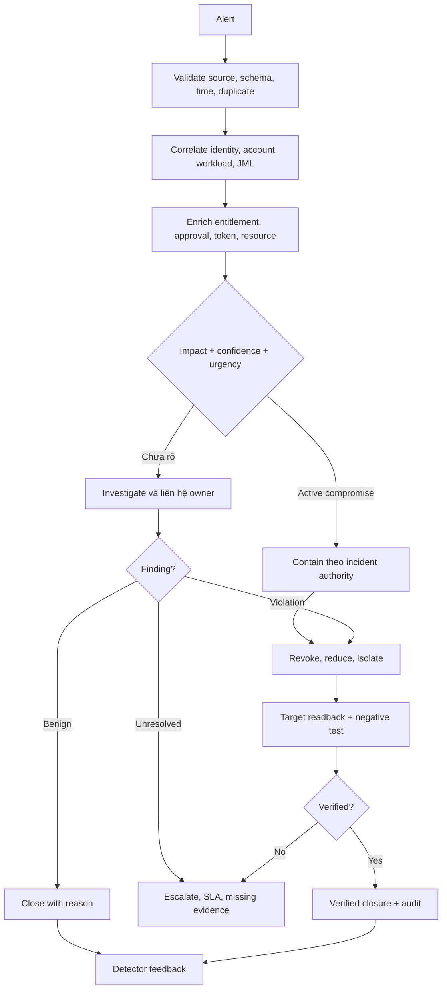

# Alert triage trong Identity monitoring và vòng đời IAM

**Alert triage** (*phân loại và xác minh cảnh báo*) là quy trình đánh giá tín hiệu bất thường liên quan danh tính và truy cập để xác định **độ tin cậy, mức độ ảnh hưởng, ưu tiên xử lý và hành động tiếp theo**. Mục đích không chỉ là đóng cảnh báo nhanh, mà là đưa ra quyết định có bằng chứng: hoạt động hợp lệ, false positive, vấn đề cần theo dõi, vi phạm chính sách hay incident phải containment.

Ví dụ: HRIS xác nhận một nhân viên **Leaver**, IdP đã disable tài khoản, nhưng ERP ghi nhận `invoice.approve=PERMIT` bằng session cũ. Nếu analyst chỉ xem trạng thái IdP sẽ kết luận sai rằng đã thu hồi hết quyền. Triage cần đối chiếu identity, thời điểm Leaver có hiệu lực, tài khoản ERP, token/session, role cục bộ và kết quả API. Nếu còn truy cập trái chính sách, phải thu hồi, kiểm chứng **Deny tại hệ thống đích** và ghi thời gian thực thi.

Bài học thuộc chương **Identity monitoring** của module **SECURITY_IDENTITY_ACCESS_MANAGEMENT_IDENTITY_LIFECYCLE**. Chủ đề liên kết quản lý vòng đời **Joiner–Mover–Leaver (JML)**, IdP, SSO, SCIM, RBAC/ABAC, tài khoản dịch vụ, kiểm toán và account reconciliation để nhận diện và giảm quyền truy cập tồn dư. **Triage là bước đánh giá và điều phối, không tự thay thế authentication, authorization hay provisioning.**

## 1. Những kết quả triage phải tạo ra

Một quy trình tốt cần xác định được:

1. Alert có được tạo từ dữ liệu thật, đúng thời gian, đúng quy tắc không?
2. **Danh tính, account, workload, ứng dụng, tenant, resource và hành động** nào liên quan?
3. Sự kiện là anomaly về hành vi, policy violation hay lỗi collector?
4. Trạng thái Joiner/Mover/Leaver và quyền mong muốn lúc xảy ra sự kiện?
5. Chứng cứ về hành động thực tế mạnh đến đâu: attempted, Permit hay business side effect?
6. Có dấu hiệu lộ credential, token theft hoặc nâng quyền không?
7. Mức ảnh hưởng, độ tin cậy và tính khẩn cấp đủ để containment ngay?
8. Đội nào có thẩm quyền hành động và ai sở hữu remediation?
9. Sau remediation, trạng thái tại đích đã đúng chưa?
10. Những giới hạn chưa xác minh và cải tiến detection nào cần ghi lại?

**Không đóng cảnh báo chỉ vì dòng log đã biến mất.** Không thấy request mới có thể do người dùng không truy cập hoặc log pipeline mất dữ liệu, chứ không chứng minh quyền đã bị chặn.

## 2. Phân biệt các thuật ngữ

| Thuật ngữ | Ý nghĩa | Ví dụ |
| --- | --- | --- |
| **Signal** | Quan sát ban đầu | Login failed, role grant |
| **Anomaly** | Khác với mẫu hoặc trạng thái kỳ vọng | IP mới, bot gọi API mới |
| **Alert** | Thông báo cần triage | High-risk sign-in |
| **Finding** | Sai lệch được xác nhận hoặc thiếu kiểm soát | Local role ngoài IAM |
| **Incident** | Sự cố cần điều phối phản ứng bảo mật | Token bị chiếm và dùng xuất dữ liệu |
| **False positive** | Cảnh báo không phản ánh rủi ro giả định | VPN làm vị trí thay đổi |
| **Benign anomaly** | Khác thường nhưng có căn cứ hợp lệ | Diễn tập break-glass |
| **Unresolved** | Chưa đủ evidence kết luận | Thiếu API authorization log |
| **Verified closure** | Biện pháp xử lý được kiểm chứng | Credential cũ không còn gọi API |

Một cảnh báo có thể đúng về mặt phát hiện hành vi nhưng không phải incident. Ngược lại **vi phạm cứng** như Leaver được Permit ở API có thể nghiêm trọng ngay cả khi hành vi trông bình thường.

## 3. Nguồn cảnh báo trong IAM

| Nguồn | Tín hiệu | Giới hạn |
| --- | --- | --- |
| **HRIS/partner register** | Quan hệ hết hạn, Mover, Leaver | Không biết trạng thái API tại đích |
| **IdP/Directory** | Login, MFA, lockout, group change | Không bao phủ mọi local session |
| **SSO/OIDC/SAML** | Federation, token/session events | IdP logout không chắc đóng RP session |
| **SCIM/connector** | Create, Patch, Disable, lỗi | Success không chứng minh quyền runtime |
| **IAM/IGA** | Entitlement request/approval | Desired state có thể lệch observed |
| **Resource server/ERP** | Permit/Deny, business action | Cần correlation với lifecycle |
| **Cloud IAM/PAM** | Privileged grant và activation | Cần kiểm scope/expiry |
| **Vault/PKI** | Secret retrieval, certificate lifecycle | Không thấy mọi bản sao credential |
| **CI/CD/Kubernetes** | Workload principal và trust | Cần liên kết owner/purpose |
| **SIEM/UEBA** | Behavioral risk, sequence alerts | Phụ thuộc coverage, model và dữ liệu |
| **Reconciliation** | Orphan, excess role, stale account | Không tự chặn truy cập |

**Login Success là bằng chứng AuthN, không phải AuthZ cho mọi resource.** Một tài khoản có thể đăng nhập hợp lệ nhưng thiếu quyền thực hiện nghiệp vụ; hoặc không đăng nhập được nữa nhưng vẫn còn access token được API chấp nhận.

## 4. Workflow triage end-to-end



**Có thể containment trước khi điều tra đầy đủ** nếu credential bị lộ hoặc đang có tác động nguy hiểm. Nhưng với service account production, analyst phải xét blast radius và phương án continuity khi thời gian cho phép; chặn mù có thể gây outage.

## 5. Validate chất lượng cảnh báo

Trước khi đánh giá rủi ro, kiểm tra:
- **Event time** và **ingestion time**: event có bị backfill hoặc lệch đồng hồ?
- Event ID/correlation ID: collector có gửi trùng?
- Nguồn: IdP, RP, API hay connector, có thuộc phạm vi tin cậy?
- Schema: account ID, tenant, action và reason code có đầy đủ?
- Detector version: ngưỡng/rule vừa thay đổi không?
- Coverage: có region hoặc ứng dụng chưa gửi log?
- Source permissions: collector có quyền đọc đủ event?
- Log pipeline: có hàng đợi tồn hoặc mất dữ liệu?
- Secret redaction: có lộ token/cookie trong payload?
- Source status: lỗi 5xx/timeout có làm tăng giả số lần login failure?

Một spike sau khi bật logging có thể là **coverage tăng**. Một khoảng trống log cũng có thể là lỗi nguồn, không phải vì attacker ngừng hoạt động.

## 6. Identity correlation: xác định đúng chủ thể

| Field | Ý nghĩa | Lưu ý |
| --- | --- | --- |
| `identityId` | Danh tính chuẩn trong IAM | Liên kết HRIS/JML |
| `accountId` | Account tại ứng dụng cụ thể | Phải kèm issuer/tenant |
| `principalId` | Machine/cloud identity | Không suy từ display name |
| `clientId` | OAuth client | Có thể khác end-user |
| `workloadId` | Job/service đang chạy | Cần owner riêng |
| `claimedUsername` | Tên được gửi khi login | **Chưa chứng minh actor** |
| `authenticatedSubjectId` | Danh tính đã chứng thực | Chỉ khi authn hợp lệ |
| `sessionRef`, `tokenRef` | Tham chiếu đã che | Không chứa giá trị bearer |
| `tenantId` | Ranh giới tài nguyên | Tránh nhầm cross-tenant |
| `ownerId` | Người/nhóm chịu trách nhiệm | Có thể cần backup owner |

Một người có account thường, privileged và SaaS local; một workload có nhiều client/credential. **Ghép chỉ theo email hoặc username là không đủ**, vì tên có thể đổi, trùng hoặc tái sử dụng.

## 7. Enrich bằng vòng đời JML

Các câu hỏi không thể bỏ qua:

- **Joiner:** identity đã proofing, đủ điều kiện ngày bắt đầu, MFA và approval chưa?
- **Mover:** role nào phải được thêm, role nào phải gỡ; chính sách SoD có thay đổi?
- **Leaver:** thời điểm kết thúc quan hệ, account phụ, session/token và quyền đích nào còn tồn?
- **Partner:** hợp đồng/sponsor còn hợp lệ, tenant nào được phép?
- **Workload:** service có owner/purpose, production dependencies và trạng thái retired?
- **Session:** token phát trước hay sau sự kiện, TTL/cache/revoke như thế nào?
- **Authorization:** role trực tiếp/kế thừa, ABAC resource/environment và API outcome?
- **Exception:** có phê duyệt hợp lệ, scope và expiry chưa?

Đừng đánh đồng **MFA thành công** với entitlement hợp lệ. User Leaver phải bị deny theo chính sách dù thiết bị đáng tin và risk score thấp; Mover không được giữ Finance role chỉ vì phiên chưa hết hạn.

## 8. Đánh giá severity, confidence và urgency

Có thể xây tier **Critical/High/Medium/Low**, nhưng không có ngưỡng chung cho mọi tổ chức.

| Tiêu chí | Mức ưu tiên tăng nếu |
| --- | --- |
| Privilege | Global admin, IAM policy writer, secret administrator |
| Data | PII, tài chính, dữ liệu xuyên tenant |
| Lifecycle | Leaver hoặc retired workload vẫn Permit |
| Credential | Token theft, refresh reuse, key bị lộ |
| Evidence | API đã Permit và business action hoàn thành |
| Reachability | Nhiều tài nguyên/tenant bị ảnh hưởng |
| Urgency | Hoạt động đang diễn ra hoặc lan rộng |
| Controls | Không có enforcement bổ sung |
| Dependency | Containment ảnh hưởng workload trọng yếu |
| Policy | Thao tác vượt SoD hoặc phê duyệt đã hết hạn |

Ví dụ **role admin bị dùng sau Leaver** thường ưu tiên hơn **IP mới nhưng đăng nhập MFA hợp lệ không có hành động lạ**. Khi các tín hiệu được suy ra từ cùng một IP, tránh cộng trọng số lặp lại gây severity giả.

## 9. Dựng timeline và phân biệt ba kết quả

```text
T0: HR/owner cập nhật JML hoặc policy có hiệu lực
T1: IAM tính desired state
T2: IdP/SCIM/connector xử lý
T3: Target account/entitlement thay đổi
T4: Session/token cũ gọi API
T5: PDP decision, PEP enforcement, business outcome
T6: SIEM alert và analyst triage
T7: Containment được thực hiện
T8: Negative test cho thấy API Deny
```

Ba lớp cần phân biệt:
- **Policy decision:** PDP trả Permit/Deny hoặc error.
- **Enforcement outcome:** PEP có thực sự chặn/cho request đi tiếp?
- **Business outcome:** hành động có tạo side effect hay bị validation từ chối?

Một log `DENY` ở PDP không đủ nếu endpoint bypass middleware. Một `PERMIT` ở PDP không chứng minh dữ liệu đã bị thay đổi. Phải đối chiếu với resource server và business audit khi đánh giá tác động.

## 10. Triage login và MFA alerts

Với alert đăng nhập thất bại hoặc thành công bất thường, kiểm:
1. Có nhiều account bị thử hay chỉ một account?
2. Cùng nguồn mạng hay distributed IP/ASN?
3. Là bad password, MFA deny, policy block, SSO misconfiguration hay `invalid_client`?
4. Có login success ngay sau nhiều failures không?
5. Thiết bị có thay đổi, qua VPN/NAT hay làm việc từ xa?
6. Có push MFA lặp lại bất thường, recovery hoặc downgrade phương thức?
7. Sau success có role grant, secret read hoặc data export?
8. Có đợt onboarding, deployment hoặc change hợp lệ?
9. Account có đang Leaver, disabled hoặc privilege elevated?
10. Log có đại diện đầy đủ endpoint hay bị mất telemetry?

**Impossible travel hoặc IP mới là tín hiệu, không phải bằng chứng chắc chắn**. Password spray có thể thử ít lần trên nhiều account nên detector chỉ đếm failures per user sẽ bỏ sót. Triage cần kết hợp behavior và context.

## 11. Triage quyền tồn dư sau Mover

Tình huống: nhân viên đã rời Finance nhưng ERP vẫn cho `invoice.approve`.

1. Xác nhận employee/identity ID và ERP account ID.
2. Kiểm HR Mover effective time, trạng thái role trước/sau.
3. Đọc entitlement tại ERP, gồm direct grants, group và inherited role.
4. Đối chiếu SCIM/connector operation, retry hoặc event đến trễ.
5. Kiểm RP session, JWT claims cũ, role cache và refresh.
6. Phân biệt PDP Permit với business approval đã thực hiện.
7. Xác nhận exception nếu có, người duyệt và thời hạn.
8. Chặn role/session theo authority khi không hợp lệ.
9. Readback và **negative authorization test** bằng dữ liệu thử.
10. Ghi time-to-deny, owner và remediation.

**Step-up authentication không thay thế thu hồi quyền cũ.** Mục tiêu không chỉ cấp Analytics role mà còn **Deny các thao tác Finance đã hết căn cứ**.

## 12. Triage Leaver access và token tồn dư

| Đường truy cập | Kiểm chứng sau Leaver |
| --- | --- |
| IdP login | Không thể xác thực mới ngoài chính sách |
| Refresh token | Không cấp access token mới trái policy |
| JWT access token | Resource server Deny trong cơ chế/SLA |
| RP/local session | Không thực hiện hành động nhạy cảm |
| SaaS local account | Disabled/deprovisioned tại target |
| Privileged accounts | Role/eligibility bị thu hồi |
| API key cá nhân | Được revoke nếu không còn nhu cầu |
| Partner integration | Hợp đồng, sponsor và scope còn hợp lệ |
| Credential custody | Leaver không còn truy cập vault/CI |
| Reconciliation | Không còn account/quyền trái desired state |

**SCIM `active=false` không đồng nghĩa mọi access token và RP session mất hiệu lực tức thì.** JWT tự chứa có thể còn hiệu lực tới `exp` nếu resource server không có revocation/state check. Phải công bố rõ cửa sổ tồn dư và đo kết quả tại API.

## 13. Triage service/machine identity

| Alert | Khả năng và câu hỏi điều tra |
| --- | --- |
| `invalid_client` tăng | Rotation lỗi, cert expired hay secret bị thử? |
| Service client xin audience mới | Đổi purpose/deployment hay credential theft? |
| API key cũ dùng sau rotate | Consumer chưa cutover hoặc bản sao bị lộ? |
| OAuth grant vẫn active sau retirement | Client, token, trust, role nào còn tồn? |
| Workload federation subject thay | Issuer/subject/audience và branch có đúng? |
| Cloud principal nhận admin role | Ai cấp, policy/approval nào? |
| Kubernetes ServiceAccount gọi API lạ | Workload, namespace và binding? |
| Owner NHA đã nghỉ | Ai tiếp quản; quyền vault của người cũ ra sao? |

Không áp dụng MFA push cho cron job như giải pháp mặc định. **Machine identity** cần xử lý issuer, credential, trust, principal, token và quyền tài nguyên. Với hệ thống production, đánh giá continuity trước khi revoke, nhưng khi có compromise đang diễn ra, runbook có thể yêu cầu chặn ngay.

## 14. Privileged, SoD và break-glass alerts

Cần đối chiếu:
- Vai trò admin được kích hoạt bằng PAM/JIT theo approval nào?
- Role có TTL hoặc scope đúng ứng dụng/tenant?
- User có tự phê duyệt yêu cầu của chính mình trái SoD không?
- Có break-glass incident ID, custodian và lý do hợp lệ?
- Session privileged có audit và cảnh báo tương ứng?
- Có sửa IAM policy, vault ACL hoặc tắt logging?
- Sau emergency, role/session đã được thu hồi và hậu kiểm?
- Có account admin phụ không liên kết identity không?

**Break-glass ít dùng không mặc nhiên là account không cần**, nhưng mỗi lần sử dụng phải được giám sát, giới hạn và hậu kiểm. Không cho một completion MFA thay thế business approval hoặc SoD.

## 15. Hành động containment theo thẩm quyền

Tùy mức độ và blast radius có thể:
- Disable account tại IdP và ứng dụng đích.
- Revoke refresh token, session và access token theo khả năng.
- Rotate/revoke client secret, API key hoặc certificate tại issuer.
- Gỡ role, ACL, group, policy binding hoặc federation trust.
- Hạn chế resource/action ở PEP nếu cần chặn nhanh.
- Cô lập thiết bị hoặc workload bị xâm nhập.
- Yêu cầu xác thực lại hoặc step-up khi chính sách phù hợp.
- Bảo toàn log, incident evidence và correlation IDs.
- Triển khai identity thay thế được kiểm soát cho dịch vụ thiết yếu.
- Theo dõi nguy cơ IaC/connector tái cấp quyền.

**Xóa secret khỏi vault không chắc revoke bản sao ngoài vault. Password reset không tự bảo đảm mọi JWT đã phát bị vô hiệu.** Khi cần chặn khẩn, cần kiểm tra cả issuer và resource server.

## 16. Case schema và trạng thái xử lý

Một record minh họa:

```json
{
  "caseId": "iam-triage-demo-008",
  "alertId": "alert-test-155",
  "detector": "LEAVER_API_PERMIT",
  "ruleVersion": "3",
  "subjectId": "identity-test-77",
  "targetAccountId": "erp-test-18",
  "tenantId": "tenant-test",
  "lifecycleEventId": "leaver-test-71",
  "resourceAction": "invoice.approve",
  "decision": "PERMIT",
  "confidence": "HIGH",
  "severity": "HIGH",
  "ownerTeam": "iam-operations",
  "status": "REMEDIATION_PENDING",
  "verification": "NOT_YET_VERIFIED"
}
```

| Trạng thái | Nghĩa |
| --- | --- |
| `NEW` | Alert chưa đánh giá |
| `VALIDATING` | Đang xác minh nguồn/schema |
| `INVESTIGATING` | Thu thập context và evidence |
| `ESCALATED` | Đã chuyển đội có thẩm quyền |
| `CONTAINMENT_IN_PROGRESS` | Đang giảm rủi ro |
| `REMEDIATION_PENDING` | Cần sửa sai lệch |
| `VERIFYING` | Đọc lại trạng thái và thử Deny |
| `CLOSED_FALSE_POSITIVE` | Giả thuyết rủi ro không xác nhận |
| `CLOSED_BENIGN` | Hoạt động hợp lệ có bằng chứng |
| `CLOSED_VERIFIED` | Khắc phục và kiểm chứng hoàn tất |
| `UNRESOLVED` | Thiếu evidence, có owner và deadline |

Case phải có **event time, triage decision, evidence references, remediation actions, approver và audit** trong triển khai thật. Các ID trên chỉ minh họa; không lưu bearer token, cookie hoặc bí mật thô vào ticket.

## 17. Reconciliation và phòng privilege resurrection

Một mô hình logic:

```text
desired = active_identities + approved_entitlements + valid_workloads
observed = target_accounts + effective_permissions + credential_paths
drift = observed_access_outside_desired_policy
```

Phép so này là khái niệm: với RBAC, nested group và ABAC context, phải tính **quyền hiệu lực theo resource/action**, không chỉ so hai chuỗi role.

Một case có thể phát hiện:
- Local SaaS account chưa disable sau Leaver.
- Mover còn direct grant ở ERP.
- Service principal retired nhưng token còn Permit.
- Role admin được cấp ngoài approval.
- IaC/GitOps tái tạo account hoặc role đã revoke.
- Credential trust vẫn hoạt động sau partner contract expiry.
- Session cache hoặc access token cũ còn quyền.
- ABAC attribute lỗi thời khiến policy Permit sai.

Khi sửa, cần chỉnh **nguồn desired state** nếu cần. Xóa grant tại target rồi để Terraform/connector tái tạo là remediation chưa bền vững.

## 18. Verified closure và negative authorization testing

Một case thu hồi quyền chỉ đạt `CLOSED_VERIFIED` khi evidence phù hợp mục tiêu:

1. Issuer không phát credential/token mới ngoài policy.
2. Account/role/ACL tại target phản ánh trạng thái mong muốn.
3. Phiên/refresh token được xử lý theo khả năng công nghệ.
4. Protected API từ chối hành động không còn được phép.
5. Key, cert hoặc trust binding cũ không tiếp tục cấp quyền.
6. Không có job IaC/connector tự grant lại.
7. Các workload hợp lệ khác không bị phá hỏng ngoài dự kiến.
8. Bằng chứng có timestamp, owner, policy version và test reference.
9. Khoảng rủi ro còn tồn do JWT/cache/multi-region được ghi rõ.
10. Có follow-up nếu phạm vi chưa thể kiểm chứng.

**HTTP 200/204 của connector không chứng minh API đã Deny**. Không có log request mới cũng không chứng minh token không dùng được. Negative test phải gửi request kiểm soát tới protected resource, không chỉ thử trang UI.

## 19. Metrics cho triage

```text
T0: JML policy effective hoặc event nguy hiểm
T1: Detector alert
T2: Analyst nhận case
T3: Containment có hiệu lực
T4: API action trái quyền bị Deny

Detection latency = T1 - T0
Triage response = T2 - T1
Containment delay = T3 - T0
Time to deny = T4 - T0
```

Các thời điểm này là định nghĩa **minh họa**, cần ghi rõ đơn vị KPI của hệ thống. Với Leaver, T0 nên là thời điểm quan hệ/quyền hết hiệu lực; với login anomaly, T0 là event xảy ra.

| KPI | Dùng để đánh giá |
| --- | --- |
| Median/P95 time to triage | Tốc độ analyst nhận xử lý |
| High-severity unowned cases | Case nguy cấp chưa có owner |
| Backlog age | Tồn đọng chưa giải quyết |
| True/false-positive rate | Chất lượng detector |
| Escalation accuracy | Case chuyển đúng đội |
| Time to contain | Độ trễ giảm nguy cơ |
| Time to deny | Quyền mất hiệu lực ở API |
| Verified closure rate | Tỷ lệ có readback/test |
| Reopen rate | Lỗi remediation chưa triệt để |
| JML residual access | Quyền tồn dư Mover/Leaver |
| Telemetry freshness | Độ mới và coverage nguồn |

Không tối ưu chỉ số **Closed alerts per hour** đến mức đóng vội mà không kiểm quyền thực tế.

## 20. Escalation và trách nhiệm

| Vai trò | Chuyên môn |
| --- | --- |
| IAM/IGA team | JML event, identity correlation, desired entitlements |
| IdP/SSO administrators | Authentication, MFA, federation và issuer |
| App/resource owner | Local roles, API authorization, dữ liệu |
| SOC/Incident Response | Credential compromise, abuse đang diễn ra |
| PAM/Cloud Security | Privileged grants, cloud roles, key custody |
| Platform/SRE | CI/CD, workload identity, availability |
| HR/Partner governance | Quan hệ và contract status |
| Privacy/Legal | Dữ liệu nhạy cảm và nghĩa vụ liên quan |

Escalation phải chỉ rõ **owner, SLA, handoff evidence và người có thẩm quyền quyết định**. Nếu owner service account đã Leaver, chuyển sang backup owner hoặc nhóm vận hành có trách nhiệm thay vì để case mồ côi.

## 21. False positives, benign activity và tuning

Các trường hợp cần nhận diện:
- VPN/proxy làm IP và geolocation đổi.
- Đợt onboarding tạo nhiều lần login thử.
- Secret rotation lỗi gây `invalid_client`.
- Deployment mới làm workload gọi API khác.
- DR drill dùng break-glass hiếm hoạt động.
- Maintenance window có privileged elevation hợp lệ.
- SIEM backfill tạo spike theo ingestion time.
- SSO metadata sai gây đăng nhập thất bại đồng loạt.
- Rehire hợp lệ cần phân biệt lifecycle version.
- Policy update khiến Deny tăng hợp lệ.

Khi đóng benign/false positive, ghi **căn cứ, reviewer, rule version và đề xuất tuning**. Exception nếu cần phải có scope và expiry. Không tắt toàn bộ rule phát hiện Permit sau Leaver chỉ để giảm cảnh báo.

## 22. Quyền riêng tư và bảo vệ evidence

Alert có thể chứa dữ liệu HR, IP, hành vi, privileged resource và token references. Cần:

1. Data minimization: chỉ thu trường cần cho triage.
2. Stable IDs và pseudonymization khi có thể.
3. Phân quyền người xem/export audit case.
4. Mã hóa trong truyền và lưu.
5. Bảo vệ integrity, retention và legal hold phù hợp.
6. Ghi audit quyền truy cập case và log.
7. Không ghi password, OTP, session cookie, bearer token, API key hoặc private key.
8. Redact tại nguồn trước khi chuyển tới SIEM khi khả thi.
9. Phân biệt claimed username với authenticated actor.
10. Không kết luận trách nhiệm cá nhân khi correlation chưa đủ.

**Một alert chứa access token thô là rủi ro bảo mật riêng**, không phải cách debug chấp nhận được.

## 23. Test matrix cho triage workflow

| Tình huống | Expected |
| --- | --- |
| Password spraying trên nhiều account | Correlation theo source và account dispersion |
| VPN tạo impossible travel | Kiểm bối cảnh, tránh kết luận tự động |
| MFA fatigue | Escalation và bảo vệ session |
| SCIM deprovision thành công nhưng local role còn | Không đóng, readback target |
| Mover có stale JWT role | API action cũ Deny theo SLA |
| Leaver IdP disabled nhưng ERP session Permit | Confirmed violation, containment |
| JWT còn hạn sau revoke | Ghi cửa sổ residual và kiểm enforcement |
| Service secret rotation thất bại | Triage deployment/issuer trước mass disable |
| Key cũ dùng sau service retirement | Tìm consumer/compromise |
| Break-glass dùng trong incident hợp lệ | Hậu kiểm, không mặc định tấn công |
| Privileged role grant ngoài workflow | Kiểm policy/approval/SoD |
| Collector mất log | Telemetry-gap case |
| Event trễ hoặc duplicate | Dùng event time và event ID |
| Credential trong audit payload | Redaction failure |
| IaC cấp lại quyền | Case reopen và sửa desired state |
| Target API vẫn Permit sau HTTP 204 | Verified closure fail |
| Account được rehire | Kiểm identity/lifecycle version |
| Orphan service account | Gán owner và điều tra dependencies |
| User active không có role nhưng MFA thành công | AuthZ vẫn Deny |
| Alert đã hết nhưng chưa thử API | Chưa đủ evidence verified closure |

Sử dụng **test identity, synthetic events và dữ liệu thử**; không thao tác credential người dùng thật hoặc giả lập tấn công nguy hiểm ở production chỉ để thử detector.

## 24. Pseudocode quy trình triage

```text
function triage(alert):
    validate_source_schema_time_and_duplicates(alert)

    if telemetry_missing:
        create_quality_case(owner, deadline)
        return UNRESOLVED

    identity = correlate_stable_ids(alert)
    context = enrich(JML, approvals, entitlements, owner, workload)
    priority = assess(impact, confidence, urgency)

    if active_compromise_likely(priority):
        execute_authorized_containment()

    evidence = collect_issuer_target_and_api_state()
    decision = investigate(alert, context, evidence)

    if decision == CONFIRMED_VIOLATION:
        remediate_and_reconcile()
        require_target_readback_and_negative_test()
    else if decision == BENIGN:
        record_reason_and_detector_feedback()
    else:
        escalate_with_owner_and_deadline()
```

Đây là **giả mã**, không phải logic sản xuất. Automation cần quyền tối thiểu, kiểm soát blast radius và cơ chế tránh một alert thiếu tin cậy tự động disable hàng loạt account.

## 25. Sai lầm thường gặp

| Sai lầm | Hậu quả | Khắc phục |
| --- | --- | --- |
| Chỉ nhìn tiêu đề và risk score | Thiếu căn cứ | Correlate và điều tra source |
| Dùng claimed username như actor đã login | Quy trách nhiệm sai | Authenticated subject ID |
| Coi Login Success là được phép mọi action | Nhầm AuthN/AuthZ | API authorization checks |
| Tin IdP disable là thu hồi mọi session | Quyền tồn dư | RP/token/target tests |
| Chỉ xem direct role | Bỏ quyền kế thừa | Effective permission |
| Bỏ thời điểm hiệu lực JML | Nhầm trạng thái | Lifecycle timeline |
| Khóa mọi anomaly | Gây false positive/outage | Risk-based containment |
| Không gán owner NHA | Case không ai xử lý | Ownership inventory |
| Gộp `invalid_client` với mật khẩu sai | Sai nguyên nhân | Phân loại flow |
| Tin SCIM HTTP success | Local role còn | Target readback |
| Không sửa IaC | Quyền tự tái tạo | Desired state reconciliation |
| Đóng vì hết alert | Không chứng minh Deny | Verified closure |
| Không monitor collector | Bỏ sót incident | Telemetry health |
| Ghi token trong ticket | Rò bí mật | Redaction |
| Không lưu policy version | Khó audit | Versioned evidence |

## 26. Checklist cho analyst

- [ ] Validate source, rule version, event time và ingestion lag.
- [ ] Phân biệt event thiếu, lặp, sai schema.
- [ ] Xác định identity/account bằng stable ID, issuer, tenant.
- [ ] Phân biệt claimed và authenticated subject.
- [ ] Xác định human, privileged, partner hay machine identity.
- [ ] Tra JML effective time, owner và purpose.
- [ ] Tra role/group/ACL, nested/inherited permissions.
- [ ] Tra approval, exception, incident và change hợp lệ.
- [ ] Kiểm session/token, credential, trust và API audience.
- [ ] Kiểm PDP decision, PEP enforcement và business outcome.
- [ ] Đánh giá severity theo impact, confidence và urgency.
- [ ] Containment đúng thẩm quyền và phạm vi.
- [ ] Escalate có owner và deadline.
- [ ] Readback tại issuer và target sau remediation.
- [ ] Dùng negative API test khi cần chứng minh Deny.
- [ ] Kiểm nguồn IaC/connector không tái grant.
- [ ] Ghi cache/token TTL và phần chưa thể kiểm chứng.
- [ ] Không lưu credential thô trong case.
- [ ] Đóng với evidence, thời gian và reviewer.
- [ ] Gửi feedback để cải tiến detection.

## 27. Câu hỏi tự kiểm tra

**Tình huống A:** IdP chặn login của Leaver nhưng ERP vẫn Permit `invoice.approve`. Phải làm gì? **Triage session/token/local role của ERP, containment và kiểm chứng API Deny**, không đóng vì IdP đã disabled.

**Tình huống B:** Login từ IP nước ngoài sau khi người dùng bật VPN. Có chắc là attacker? **Không.** Cần device, MFA, session và hành động liên quan.

**Tình huống C:** SCIM trả HTTP 204 cho revoke, SaaS vẫn có admin role. Case đã verified chưa? **Chưa**, cần gỡ quyền tại SaaS và readback.

**Tình huống D:** Service client báo `invalid_client` sau rotation. Có nên gửi MFA push đến bot? **Không**, kiểm issuer, secret/cert, deployment và owner.

**Tình huống E:** PDP log Deny nhưng endpoint bypass PEP vẫn xử lý. Đây là gì? **Enforcement failure**, cần xử lý tại backend.

**Tình huống F:** Không có request sau revoke. Có thể kết luận token cũ không dùng được? **Không**, cần negative test hoặc bằng chứng tương đương.

**Tình huống G:** Terraform tái tạo role sau khi IAM đã revoke. Cách khắc phục? **Sửa desired configuration, kiểm tra event version và đối soát**.

**Tình huống H:** Người dùng hoàn thành step-up MFA nhưng thiếu role. Có được truy cập? **Không**, authentication assurance không thay authorization.

## Ghi nhớ

**Alert triage trong IAM** là chuỗi **validate tín hiệu → correlate danh tính/JML → enrich entitlement và bối cảnh → phân mức rủi ro → điều tra/containment → target readback, negative authorization test → evidence và closure**. Phải phân biệt **AuthN, AuthZ, provisioning và token/session**, tránh false positive nhưng không bỏ qua **Permit sau Leaver, quyền cũ sau Mover, privileged grants và service identity tồn dư**. Phối hợp **IdP/SSO, SCIM, RBAC/ABAC, service/machine identity, audit và reconciliation** để xử lý đúng trách nhiệm và **chứng minh việc thu hồi quyền đã có hiệu lực tại hệ thống đích**.
