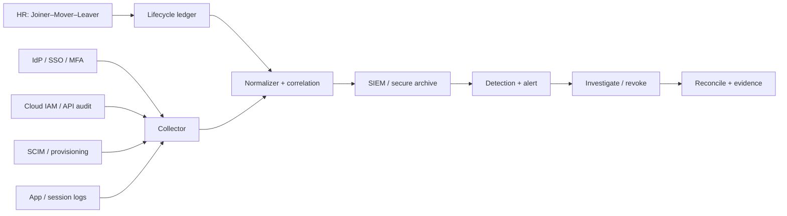
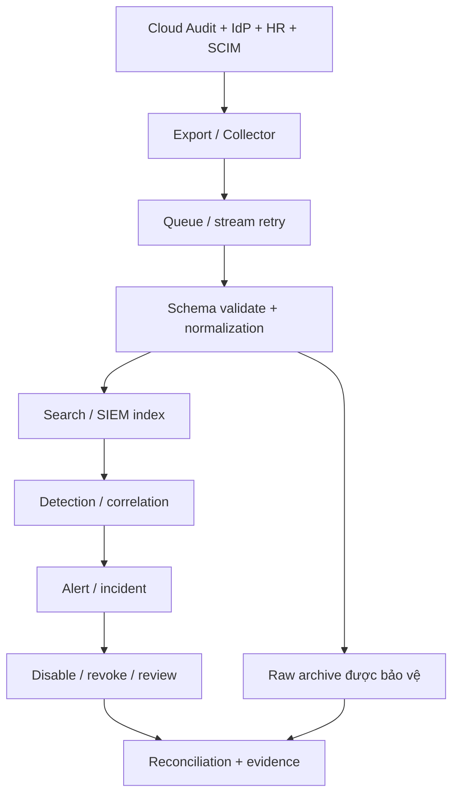
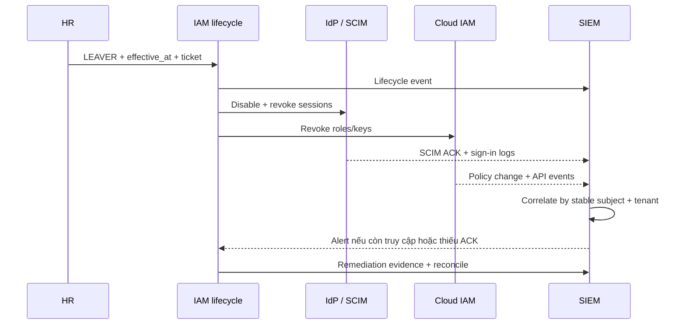

# Cloud IAM logging: Thu thập, đối soát và phát hiện rủi ro trong vòng đời danh tính

> **Chương:** Cloud IAM  
> **Chủ đề:** Cloud IAM logging  
> **Module:** `SECURITY_IDENTITY_ACCESS_MANAGEMENT_IDENTITY_LIFECYCLE` — quản lý vòng đời danh tính theo Joiner–Mover–Leaver, từ xác minh, tạo tài khoản, cấp quyền đến rà soát và thu hồi khi vai trò thay đổi; kết nối HR, IdP, SSO, SCIM, RBAC/ABAC, tài khoản dịch vụ và kiểm toán nhằm giảm quyền truy cập tồn dư.  
> **Mức độ:** Trung cấp đến nâng cao. **Điều kiện tiên quyết:** Hiểu identity, role/policy, SSO, MFA và least privilege.

## 1. Vì sao Cloud IAM cần logging?

Trên đám mây, một thay đổi quyền có thể ảnh hưởng nhiều tài nguyên chỉ trong vài giây: thêm thành viên vào nhóm quản trị, gắn policy cho role, tạo access key, cấp quyền service account hoặc tắt export log. Khi nhân viên chuyển bộ phận hoặc nghỉ việc, câu hỏi không chỉ là “IAM registry đã đổi trạng thái chưa?” mà còn là **quyền cũ đã được thu hồi trên từng hệ thống và còn hoạt động truy cập sau đó hay không?**

**Cloud IAM logging** là quá trình ghi nhận, bảo vệ, vận chuyển và phân tích sự kiện liên quan đến danh tính, xác thực, ủy quyền, credential và thay đổi cấu hình quyền trong hạ tầng cloud. Nó phục vụ bốn mục tiêu:

1. **Điều tra:** Ai hoặc workload nào làm gì, vào lúc nào, trên tài nguyên nào, từ nguồn nào và kết quả ra sao?
2. **Phát hiện:** Có đăng nhập bất thường, tự cấp đặc quyền, tạo credential ngoài phê duyệt, tắt logging hay không?
3. **Chứng minh vòng đời:** Joiner–Mover–Leaver từ HR có dẫn đến provisioning, thay đổi role và thu hồi phiên/quyền thực tế không?
4. **Kiểm toán:** Có bằng chứng bảo vệ được, thời hạn lưu giữ, người phụ trách và quy trình xử lý quyền truy cập tồn dư không?

**Logging không tự chặn truy cập.** Thực thi ALLOW/DENY vẫn thuộc IdP, IAM policy, RBAC/ABAC, ứng dụng/API. Không thấy log **không chứng minh** không có truy cập khi nguồn log chưa bật, bị hạn chế hoặc pipeline có độ trễ.

### 1.1. Tình huống điều tra

Nhân viên An nghỉ việc lúc 09:00 UTC. HR phát `LEAVER_APPROVED`, IAM ghi yêu cầu vô hiệu hóa qua SCIM, nhưng một ứng dụng downstream chưa xác nhận. Lúc 10:20 UTC xuất hiện đăng nhập thành công của An tại IdP, hoặc một service identity do An sở hữu vẫn dùng access key.

Chỉ nhìn trạng thái `IAM_STATUS=DISABLED` không đủ. Cần tương quan thời điểm HR, danh tính bền vững, session IdP/SSO, trạng thái SCIM ACK, role binding và API activity.



### 1.2. Ba câu hỏi khác nhau

| Câu hỏi | Nguồn thường cần | Không nên chỉ suy từ |
|---|---|---|
| Ai xác thực và MFA ra sao? | IdP sign-in, MFA, SSO session events | Thay đổi IAM policy |
| Ai được cấp hoặc thu hồi quyền? | IAM role/policy, directory group, SCIM, approval | Sign-in thành công |
| Ai thực sự gọi API, truy cập tài nguyên? | API audit, data-plane, application access log | HR hoặc SCIM provisioning ACK |

Một lần xác thực thành công không đồng nghĩa ứng dụng cho phép mọi hành động. Ngược lại, một API call bằng temporary credential của role có thể không có sign-in event tương ứng trong cùng hệ thống. Cần bảo toàn chuỗi **human/workload → session → role/service account → resource/action**, hoặc đánh dấu rõ dữ liệu còn thiếu.

## 2. Nhóm sự kiện IAM cần quan sát

| Nhóm | Ví dụ | Câu hỏi điều tra |
|---|---|---|
| **Authentication** | SSO thành công/thất bại, MFA từ chối, tạo session | Có dấu hiệu chiếm tài khoản hoặc bypass MFA? |
| **Authorization/API** | API được phép/bị từ chối, assume role, truy cập object | Quyền nào thực sự được dùng, tại scope nào? |
| **IAM config** | Thêm policy, sửa trust, role assignment, group membership | Có tăng đặc quyền ngoài phê duyệt? |
| **Credential** | Tạo/xóa/rotate key, secret, service principal credential | Credential có owner, expiry, ticket không? |
| **Lifecycle** | Joiner, Mover, Leaver, SCIM enable/disable ACK | Cấp/thu hồi có khớp ngày hiệu lực? |
| **Logging control** | Tắt audit sink, sửa retention, quyền bucket log | Có dấu hiệu xóa hoặc che giấu bằng chứng? |
| **Sensitive data** | Đọc secret, thay policy dữ liệu, truy vấn dữ liệu | Data-plane log có bao phủ đối tượng cần bảo vệ? |

Không phải tất cả cloud service đều xuất một event cho mọi hành động. Mỗi đơn vị phải có **logging coverage matrix** theo tenant, account/subscription/project, region, resource, loại API và thời hạn lưu trữ.

### 2.1. Schema chuẩn hóa tối thiểu

| Trường | Ý nghĩa | Cảnh báo diễn giải |
|---|---|---|
| `event_id` | Mã sự kiện nguồn | Chống trùng theo cặp nguồn và ID, không giả định ID toàn cục |
| `occurred_at` | UTC timestamp từ nguồn | Tách khỏi giờ collector nhận dữ liệu |
| `ingested_at` | UTC timestamp collector nhận | Tính lag và phát hiện sự kiện đến muộn |
| `source/provider` | Hệ thống phát sự kiện | Lưu raw event, version parser và provenance |
| `tenant_scope` | Cloud account/project/subscription hoặc tenant | Không nối nhầm giữa các tổ chức |
| `actor_id` / `actor_type` | Người, role session, workload, service identity | Email và session name không luôn là ID bền vững |
| `target_id` / `resource` | Identity, role, key, app hoặc tài nguyên | Phải rõ phạm vi và đơn vị sở hữu |
| `action` | Hành động chuẩn hóa và hành động gốc | Không đánh mất API name vendor-specific |
| `result` / `error` | Success, failure, deny và lý do | Gán quyền thất bại khác với gán thành công |
| `source_ip` / `user_agent` | Dấu vết client nếu có | Có thể bị ẩn, là proxy, hoặc thiếu |
| `request_id` / `session_id` | Correlation khi có | Không phải nguồn nào cũng cung cấp |
| `auth_context` | MFA, assurance, auth_time nếu có | Thiếu trường nghĩa là `unknown`, không phải `false` |
| `approval_ref` | HR/ITSM ticket liên quan | Có thể phải join từ workflow riêng |

Cần phân biệt **không có dữ liệu** với **đã xác nhận giá trị là false**. Nếu log không có MFA claim, không được tự kết luận MFA đã xảy ra hoặc chưa xảy ra.

### 2.2. Các sai lầm phổ biến

- Dùng email thay identity ID, không tính đến email đổi/tái sử dụng.
- Thu thập duy nhất sign-in logs, bỏ qua thay đổi quyền và cloud API audit.
- Chỉ bật quản trị ở một region/account trong tổ chức nhiều scope.
- Không bật loại data-plane audit cho dịch vụ quan trọng.
- Dùng giờ ingest thay giờ gốc; không xử lý trùng, sự kiện đến muộn và thứ tự đảo.
- Để chính admin bị giám sát có quyền tự xóa hoặc tắt nơi lưu bằng chứng.
- Coi log đã index là bất biến trong khi sink, retention hoặc quyền xóa chưa được bảo vệ.
- Không lưu HR approval, SCIM job status và dấu vết revoke để đối chiếu JML.

## 3. So sánh nguồn logging trên AWS, Azure và Google Cloud

Đây là bản đồ khái niệm để xây kế hoạch thu thập, **không phải khẳng định mọi log đều bật mặc định**. Dịch vụ, giới hạn, trường dữ liệu và cấu hình có thể thay đổi; phải kiểm tra khả năng và cấu hình thực tế tại từng tổ chức.

### 3.1. AWS Cloud IAM logging

| Nguồn | Quan sát | Kiểm soát cần rà soát |
|---|---|---|
| **AWS CloudTrail** | API actions, IAM/STS và các management events; data events khi dịch vụ hỗ trợ và đã cấu hình | Trail/event data store bao phủ đúng account, region và event category? |
| **STS/role context** | AssumedRole, role session, caller, API event, error | Có liên kết role session tới chủ thể nguồn đáng tin? |
| **AWS IAM Identity Center và IdP liên quan** | Hoạt động federated login/provisioning theo phạm vi nguồn | Không coi CloudTrail management events là đầy đủ mọi sign-in |
| **Service/data access logs** | Truy cập dữ liệu, object hoặc hoạt động từng dịch vụ | Phần data plane có được bật và xuất log đúng nơi? |

CloudTrail record thường có `eventTime`, `eventSource`, `eventName`, `userIdentity`, `sourceIPAddress`, `requestParameters`, `responseElements`, `errorCode`, `recipientAccountId` và `requestID` khi được phát sinh. Role ARN, session name và user identity không thể luôn thay thế cho employee ID trong HR.

Ví dụ **rút gọn, giả lập**, không phải log thực:

```json
{
  "eventTime": "2026-11-20T10:00:00Z",
  "eventSource": "iam.amazonaws.com",
  "eventName": "AttachRolePolicy",
  "userIdentity": {
    "type": "AssumedRole",
    "arn": "arn:aws:sts::111122223333:assumed-role/iam-operator/example-session"
  },
  "recipientAccountId": "111122223333",
  "requestParameters": {"roleName": "application-admin"},
  "sourceIPAddress": "198.51.100.10"
}
```

Một sự kiện `AttachRolePolicy` có thể chứng minh hành động gắn policy được gọi theo kết quả log, **không chứng minh policy đã được sử dụng để đọc dữ liệu**. Muốn đánh giá sử dụng quyền, cần API/data events thích hợp. Management events không tự bao phủ mọi truy cập dữ liệu.

### 3.2. Azure: phân biệt Entra và Azure RBAC

| Nguồn | Nội dung |
|---|---|
| **Microsoft Entra ID sign-in logs** | Xác thực, kết quả MFA, ứng dụng, rủi ro theo loại sign-in và dữ liệu nguồn |
| **Microsoft Entra audit logs** | Thay đổi directory users, groups, service principals, directory roles, provisioning |
| **Azure Activity Log** | Azure Resource Manager control-plane operations, gồm thay đổi Azure RBAC |
| **Resource diagnostic logs** | Data-plane operations theo khả năng dịch vụ và diagnostic settings |
| **PIM / identity governance evidence** | Kích hoạt đặc quyền, phê duyệt, access review khi dùng tính năng tương ứng |

**Entra directory role khác Azure resource RBAC role.** Ví dụ thao tác `Microsoft.Authorization/roleAssignments/write` thuộc control plane Azure RBAC; không thể dựa riêng vào Entra sign-in log để xác nhận ai đã gán quyền. Ngược lại, thay đổi nhóm Entra có thể cần Entra audit log chứ không chỉ Azure Activity Log.

### 3.3. Google Cloud Audit Logs

Các nhóm log thường gặp:

- **Admin Activity**: hoạt động cấu hình/quản trị theo phạm vi dịch vụ hỗ trợ.
- **Data Access**: truy cập dữ liệu theo loại và cấu hình; không được giả định mọi Data Access log đã bật.
- **System Event**: sự kiện do dịch vụ tạo theo phạm vi được ghi nhận.
- **Policy Denied**: từ chối do chính sách theo phạm vi hỗ trợ.

Những trường hữu ích thường ở `protoPayload.authenticationInfo`, `authorizationInfo`, `methodName`, `resourceName`, `requestMetadata` và `status`. `principalEmail` có thể vắng hoặc bị che; cần xem thêm subject/principal phù hợp và ngữ cảnh thay vì mặc định nhận dạng được người từ email.

Với `SetIamPolicy` hoặc thao tác tạo service account key, đối chiếu actor, project, policy binding trước/sau, target principal, ticket phê duyệt và việc credential có được sử dụng thực tế hay không.

### 3.4. Tra nguồn theo điều tra

| Câu hỏi | AWS | Azure | Google Cloud |
|---|---|---|---|
| Ai sửa role/policy? | CloudTrail management | Azure Activity hoặc Entra audit tùy loại role | Cloud Audit Logs Admin Activity |
| Ai đăng nhập SSO/MFA? | IdP/Identity Center và log phù hợp | Entra sign-in | IdP/Cloud Identity và log tương ứng |
| Ai dùng API? | CloudTrail API events và session context | Activity/resource logs | Cloud Audit Logs và principal context |
| Ai đọc dữ liệu? | Data events / service logs nếu bật | Resource diagnostic/data-plane logs | Data Access logs theo cấu hình |
| Ai sửa logging? | Audit/control-plane API | Activity / diagnostic settings audit | Logging sink/policy audit |

Tổ chức nhiều account/project cần cơ chế đưa **nguồn mới** vào cấu hình thu log tự động; chỉ bật logging ở một môi trường trung tâm chưa đủ.

## 4. Thiết kế pipeline ghi log và bảo quản bằng chứng



### 4.1. Các lớp kiểm soát

1. **Thu thập:** xác định log bắt buộc; export từ mọi tenant/account/subscription/project/region có liên quan.
2. **Vận chuyển:** TLS, least-privilege và retry có giới hạn; theo dõi độ trễ, mất kết nối, queue backlog.
3. **Chuẩn hóa:** giữ raw event, mã nguồn/parser version và normalized event; phân biệt timestamp gốc với ingest.
4. **Lưu trữ:** mã hóa, phân quyền tách biệt, retention và cơ chế chống sửa/xóa khi cần bằng chứng; kiểm thử phục hồi.
5. **Detection:** rule có owner, version, ngưỡng, mức độ tin cậy, false-positive review và lịch hiệu chỉnh.
6. **Response:** triage, khoanh vùng, thu hồi quyền khi đủ điều kiện; ghi change ticket và rollback path.
7. **Verification:** xác nhận IdP/cloud/app đã áp dụng thu hồi; không coi ticket đóng là đồng nghĩa đã xử lý hết quyền.

### 4.2. Raw khác normalized

Giữ **raw** hoặc định dạng nguồn có checksum, metadata scope và quyền chống xóa; dùng **normalized** để tìm kiếm/correlation. Nếu parser hiểu sai một principal hoặc API, có thể dựng lại kết quả từ raw mà không làm mất bằng chứng. Không xóa trường gốc quan trọng chỉ vì schema chuẩn hóa không có cột tương ứng.

### 4.3. Riêng tư và chi phí

Log IAM có email, IP, thiết bị, nhóm quyền, hành vi đăng nhập và lịch sử người dùng. Chỉ thu nội dung cần thiết, không log password, bearer token, TOTP seed hoặc private key. Quản lý masking, access control, retention, encryption và yêu cầu pháp lý theo môi trường.

Data-plane log có thể rất nhiều và tốn chi phí lưu/index. Có thể phân tầng: lưu raw trong kho phù hợp, chỉ index các trường cần thiết; **không tự ý sampling các sự kiện bắt buộc về bảo mật/tuân thủ**. Với logging control plane, người bị điều tra không được đơn phương tắt hoặc xóa nguồn bằng chứng.

### 4.4. Phân vai

| Chủ thể | Trách nhiệm chính | SoD |
|---|---|---|
| Cloud platform | Cấu hình sink, export, lưu trữ, đảm bảo coverage | Không tự miễn ghi log hành động quản trị của mình |
| IAM owner | Định nghĩa role/policy, trạng thái vòng đời và quyền nhạy cảm | Không tự phê duyệt thay đổi quyền đặc biệt của mình |
| Security operations | Detection, triage, incident response | Quyền sửa policy có kiểm soát, có dấu vết |
| HR/workflow | Sự kiện Joiner–Mover–Leaver và phê duyệt | Không tự cấp quyền cloud ngoài workflow |
| Auditor | Rà soát bằng chứng, độ phủ, ngoại lệ | Quyền xem độc lập, không mặc định sửa log |


## 5. Tương quan Cloud IAM log với Joiner–Mover–Leaver

Muốn đánh giá log theo vòng đời, trước tiên phải có dữ liệu **trạng thái mong muốn** đã được HR/IAM xác thực. Nếu không, một thao tác cấp role có thể là hợp lệ hay trái phép mà không có căn cứ.

### 5.1. Joiner: cấp đúng người và đúng thời điểm

1. HR tạo `employee_id` ổn định, xác minh, phê duyệt, ghi `effective_at` và ticket.
2. IAM ánh xạ chức danh/phòng ban sang role tối thiểu, lưu event/job provisioning.
3. IdP/SCIM cấp account, group và trạng thái; cloud IAM tạo binding theo scope phù hợp.
4. Collector ghi log **request**, **ACK**, **role/policy thay đổi** và kiểm tra account thực tế.
5. Nếu chưa đến ngày bắt đầu hoặc chưa có phê duyệt, mọi quyền được cấp phải được kiểm tra như ngoại lệ.

Đừng coi SCIM request đã phát đi là bằng chứng User/Group thật đã được provision. Khi mất ACK hoặc provider retry, dùng mapping định danh nguồn và ID từ provider để đối soát, tránh kết luận dựa vào một dòng log.

### 5.2. Mover: quyền cũ có thực sự mất?

- HR cập nhật vai trò theo version; IAM tính chênh lệch quyền cũ và quyền mới.
- Rút nhóm/role cũ, cấp quyền mới theo RBAC, kiểm tra SoD và các điều kiện ABAC.
- Audit phải nối được HR event → policy decision → action của provisioning adapter → actual role binding.
- Trong khoảng cửa sổ thu hồi được cho phép, phát hiện role cũ vẫn còn và những hành vi sử dụng quyền cũ.
- Phiên SSO, temporary credential và cache app có thể chậm hơn policy thay đổi; cần kiểm tra thực tế, không chỉ so sánh IAM DB.

### 5.3. Leaver: phát hiện hậu quả còn sót

- HR ghi thời điểm rời tổ chức; IdP vô hiệu hóa tài khoản, revoke session/refresh token, SCIM disable group/account.
- Cloud IAM thu hồi role binding, API key, trust relation và các credential do người đó sở hữu.
- Log sau `leaver_effective_at` có sign-in/API thành công cần điều tra ngay, nhưng phải phân biệt **danh tính người** và **workload đang dùng service account**.
- Theo dõi ACK từng provider, độ trễ tới khi quyền thực tế được thu hồi và những account orphan vẫn còn.
- Quy trình tái phân công service identity có owner mới phải được phê duyệt; không tự xóa workload đang phục vụ nghiệp vụ chỉ vì owner nghỉ việc.



### 5.4. Chú ý về assumed role và workload

Một người sử dụng federated session có thể assume role được nhiều người dùng chung; một workload có thể dùng service principal của team. Đừng tự gán trách nhiệm cho một nhân viên chỉ vì role session có display name giống tên của họ. Hãy bảo tồn chuỗi **HR identity / workload owner → IdP session → principal/role session → API call** và ghi `unknown` nếu không có correlation đủ tin cậy.

## 6. Ưu tiên cảnh báo và quy tắc điều tra

| Detection | Dấu hiệu | Mức độ gợi ý | Cần kiểm tra thêm |
|---|---|---|---|
| Privileged self-grant | Actor cấp vai trò đặc quyền cho chính mình | High/Critical | Break-glass, ticket, phê duyệt và SoD |
| Post-Leaver login | Sign-in thành công sau giờ nghỉ việc | Critical | Subject, tenant, timestamp và nguồn log |
| Unapproved service key | Tạo credential không có approval/owner | High | Rotation tự động, owner hiện hữu, ticket |
| Audit logging disabled | Sink/trail/logging bị tắt, retention giảm mạnh | Critical | Change window và sink thay thế |
| Mover entitlement drift | Role cũ vẫn có sau thời hạn | High | ACK, nhóm ngoài IAM quản lý, ngoại lệ |
| Unexpected assume-role | Principal sử dụng role nhạy cảm mới | High | Identity federation, session source, phạm vi |
| Failures then success | Nhiều login/MFA thất bại rồi thành công | Medium/High | VPN, nguồn IP, password spraying |
| Policy scope expansion | Wildcard quyền hoặc tổ chức-wide binding | High/Critical | Policy diff, tài nguyên, phê duyệt |
| Missing JML ACK | Hết SLA nhưng app chưa xác nhận provisioning/revoke | Medium/High | Queue lag, provider outage, log ingestion |

Severity phải được hiệu chỉnh theo rủi ro, độ tin cậy dữ liệu và phạm vi ảnh hưởng. Nếu sự kiện **không có dữ liệu MFA**, không phát alert “MFA bypass” chỉ bằng cách suy diễn. Dùng nguồn xác thực thực sự từ IdP hoặc đánh dấu là chưa đủ chứng cứ.

### 6.1. Quy tắc chất lượng của detection

- Chỉ kết luận hành động đã xảy ra khi `result=success` từ nguồn phù hợp.
- So sánh giờ **xảy ra** sự kiện với effective time; theo dõi riêng `ingested_at` để biết độ trễ.
- Dedupe theo key có scope, xử lý cả trường hợp source lặp và sự kiện out-of-order.
- Tách event từ human và workload; kiểm tra target, tenant, scope.
- Nối với ticket/change window và exception có thời hạn để giảm false positive.
- Alert phải chứa rule ID, nguồn, độ tin cậy, subject/target, link raw evidence và owner.
- Mọi rule có phiên bản, test case và lịch review; thay rule không được xóa log lịch sử.

## 7. Lab: phát hiện nguy cơ từ normalized Cloud IAM events

Lab dùng Python 3.10+ chỉ với thư viện chuẩn để nhận file JSON Lines, kiểm tra schema, loại bản ghi trùng, tương quan HR Leaver với IdP sign-in, SCIM disable ACK và phát hiện ba loại thay đổi rủi ro. Đây **không phải SIEM production**, không gọi cloud API và không tạo/xóa quyền thật.

### 7.1. Chuẩn bị

Tạo thư mục riêng bất kỳ:

```text
cloud-iam-logging-lab/
├── events.jsonl
└── detect_iam.py
```

Bài dùng schema **đã chuẩn hóa**; không thể nạp raw CloudTrail/Entra/Cloud Audit Logs trực tiếp mà chưa viết adapter riêng. Mỗi dòng JSON độc lập có:

| Trường | Kiểu | Ví dụ |
|---|---|---|
| `event_id` | string | `CLOUD-003` |
| `source` | string | `hr`, `idp`, `cloud`, `scim` |
| `occurred_at` | UTC ISO 8601 string | `2026-11-20T11:00:00Z` |
| `tenant` | string | `tenant-a` |
| `actor` | stable subject/workload ID | `emp-002` |
| `target` | stable identity/resource ID | `svc-billing` |
| `action` | normalized action | `iam.role.granted` |
| `result` | `success` hoặc `failure` | `success` |
| `details` | object chứa metadata bổ sung | `{"role":"organization-admin"}` |

Không có mật khẩu, API key, TOTP seed hoặc access token trong JSONL. Các ID là giả lập, không gắn với người dùng thật.

### 7.2. Tạo dữ liệu giả lập

Lưu **đúng chín dòng** sau vào `events.jsonl`; đừng chèn dấu phẩy giữa các dòng, vì đây là JSONL chứ không phải JSON array.

```jsonl
{"event_id":"HR-001","source":"hr","occurred_at":"2026-11-20T09:00:00Z","tenant":"tenant-a","actor":"hr-system","target":"emp-001","action":"hr.leaver","result":"success","details":{"ticket":"OFF-110"}}
{"event_id":"IDP-002","source":"idp","occurred_at":"2026-11-20T10:20:00Z","tenant":"tenant-a","actor":"emp-001","target":"work-portal","action":"idp.signin","result":"success","details":{"method":"password"}}
{"event_id":"CLOUD-003","source":"cloud","occurred_at":"2026-11-20T11:00:00Z","tenant":"tenant-a","actor":"emp-002","target":"emp-002","action":"iam.role.granted","result":"success","details":{"role":"organization-admin","approval_ticket":""}}
{"event_id":"CLOUD-004","source":"cloud","occurred_at":"2026-11-20T11:05:00Z","tenant":"tenant-a","actor":"emp-099","target":"svc-billing","action":"workload.key.created","result":"success","details":{"owner":"team-billing","approval_ticket":""}}
{"event_id":"CLOUD-005","source":"cloud","occurred_at":"2026-11-20T11:10:00Z","tenant":"tenant-a","actor":"svc-admin","target":"org-audit-sink","action":"audit.sink.disabled","result":"success","details":{"ticket":""}}
{"event_id":"HR-006","source":"hr","occurred_at":"2026-11-20T08:00:00Z","tenant":"tenant-a","actor":"hr-system","target":"emp-003","action":"hr.leaver","result":"success","details":{"ticket":"OFF-111"}}
{"event_id":"SCIM-007","source":"scim","occurred_at":"2026-11-20T08:15:00Z","tenant":"tenant-a","actor":"iam-provisioner","target":"emp-003","action":"scim.disable.completed","result":"success","details":{"app":"idp-main"}}
{"event_id":"IDP-008","source":"idp","occurred_at":"2026-11-20T12:00:00Z","tenant":"tenant-a","actor":"emp-004","target":"work-portal","action":"idp.signin","result":"success","details":{"method":"webauthn"}}
{"event_id":"IDP-008","source":"idp","occurred_at":"2026-11-20T12:00:00Z","tenant":"tenant-a","actor":"emp-004","target":"work-portal","action":"idp.signin","result":"success","details":{"method":"webauthn"}}
```

**Ý nghĩa của kịch bản:**

- `emp-001` đã nghỉ nhưng vẫn sign-in thành công và chưa có ACK disable.
- `emp-002` tự gán role đặc quyền.
- `svc-billing` được tạo key mới nhưng không có ticket.
- `org-audit-sink` bị tắt.
- `emp-003` cũng nghỉ việc nhưng đã có SCIM disable ACK sau 15 phút.
- `emp-004` có sign-in bình thường; event của họ được lặp lại như trong pipeline at-least-once.

Với thời điểm phân tích `2026-11-23T00:00:00Z` và hạn xử lý Leaver 60 phút, **dự kiến đúng 5 cảnh báo**: post-Leaver sign-in, self privilege grant, service key thiếu approval, audit sink bị tắt, deprovision quá hạn cho `emp-001`. Không có cảnh báo SLA cho `emp-003`.


### 7.3. Viết bộ phân tích và cảnh báo

Tạo file `detect_iam.py`. Chương trình không ghi file mới; đầu ra JSON được in ra màn hình. `--as-of` là **thời điểm mô phỏng** để kiểm tra SLA chính xác, tránh kết quả thay đổi theo ngày chạy.

```python
import argparse
import datetime as dt
import json
import sys
from pathlib import Path

REQUIRED = {
    "event_id", "source", "occurred_at", "tenant", "actor",
    "target", "action", "result", "details",
}
SOURCES = {"hr", "idp", "cloud", "scim"}
PRIVILEGED = {"organization-admin", "tenant-admin", "security-admin"}


def strict_object(items):
    """Từ chối key JSON trùng nhau, kể cả bên trong details."""
    output = {}
    for key, value in items:
        if key in output:
            raise ValueError(f"DUPLICATE_JSON_KEY: {key}")
        output[key] = value
    return output


def utc_time(value):
    if not isinstance(value, str) or not value.endswith("Z"):
        raise ValueError("TIMESTAMP_MUST_END_WITH_Z")
    moment = dt.datetime.fromisoformat(value[:-1] + "+00:00")
    if moment.utcoffset() != dt.timedelta(0):
        raise ValueError("TIMESTAMP_NOT_UTC")
    return moment


def validate(event, lineno):
    if not isinstance(event, dict) or set(event) != REQUIRED:
        raise ValueError(f"INVALID_SCHEMA at line {lineno}")
    for field in REQUIRED - {"details"}:
        if not isinstance(event[field], str) or not event[field].strip():
            raise ValueError(f"INVALID_{field} at line {lineno}")
    if event["source"] not in SOURCES:
        raise ValueError(f"INVALID_SOURCE at line {lineno}")
    if event["result"] not in {"success", "failure"}:
        raise ValueError(f"INVALID_RESULT at line {lineno}")
    if not isinstance(event["details"], dict):
        raise ValueError(f"INVALID_DETAILS at line {lineno}")
    return utc_time(event["occurred_at"])


def load_events(path):
    unique = []
    seen = {}
    ignored = 0
    for lineno, line in enumerate(
        Path(path).read_text(encoding="utf-8").splitlines(), start=1
    ):
        if not line.strip():
            continue
        event = json.loads(line, object_pairs_hook=strict_object)
        moment = validate(event, lineno)
        key = (event["source"], event["event_id"])
        canonical = json.dumps(
            event, sort_keys=True, ensure_ascii=False, separators=(",", ":")
        )
        if key in seen:
            if seen[key] != canonical:
                raise ValueError(f"EVENT_ID_COLLISION at line {lineno}")
            ignored += 1
            continue
        seen[key] = canonical
        enriched = dict(event)
        enriched["_time"] = moment
        unique.append(enriched)
    unique.sort(key=lambda e: (e["_time"], e["source"], e["event_id"]))
    return unique, ignored


def make_alert(rule, severity, event, note):
    return {
        "rule": rule,
        "severity": severity,
        "event_id": event["event_id"],
        "tenant": event["tenant"],
        "actor": event["actor"],
        "target": event["target"],
        "occurred_at": event["occurred_at"],
        "note": note,
    }


def analyze(events, as_of, sla_minutes):
    if sla_minutes <= 0:
        raise ValueError("SLA_MUST_BE_POSITIVE")
    if any(e["_time"] > as_of for e in events):
        raise ValueError("AS_OF_BEFORE_SOME_EVENTS")

    leavers = {}
    for event in events:
        if event["action"] == "hr.leaver" and event["result"] == "success":
            key = (event["tenant"], event["target"])
            if key not in leavers or event["_time"] < leavers[key]["_time"]:
                leavers[key] = event

    acked = set()
    for event in events:
        if (event["action"] == "scim.disable.completed"
                and event["result"] == "success"):
            key = (event["tenant"], event["target"])
            leave = leavers.get(key)
            if leave and event["_time"] >= leave["_time"]:
                acked.add(key)

    alerts = []
    for event in events:
        if event["result"] != "success":
            continue
        key = (event["tenant"], event["actor"])
        details = event["details"]

        if (event["action"] == "idp.signin" and key in leavers
                and event["_time"] >= leavers[key]["_time"]):
            alerts.append(make_alert(
                "POST_LEAVER_SIGNIN", "critical", event,
                "Đăng nhập thành công sau khi HR ghi Leaver"
            ))

        if (event["action"] == "iam.role.granted"
                and event["actor"] == event["target"]
                and details.get("role") in PRIVILEGED):
            alerts.append(make_alert(
                "SELF_PRIVILEGE_GRANT", "critical", event,
                "Tự cấp role đặc quyền; kiểm tra phê duyệt và SoD"
            ))

        if (event["action"] == "workload.key.created"
                and not details.get("approval_ticket")):
            alerts.append(make_alert(
                "UNAPPROVED_SERVICE_KEY", "high", event,
                "Tạo key mới không có ticket phê duyệt"
            ))

        if event["action"] == "audit.sink.disabled":
            alerts.append(make_alert(
                "LOGGING_DISABLED", "critical", event,
                "Cấu hình ghi log bị vô hiệu hóa"
            ))

    deadline = dt.timedelta(minutes=sla_minutes)
    for key, leave in sorted(leavers.items()):
        if key in acked:
            continue
        if as_of - leave["_time"] >= deadline:
            overdue = dict(leave)
            overdue["occurred_at"] = as_of.isoformat().replace("+00:00", "Z")
            alerts.append(make_alert(
                "DEPROVISION_OVERDUE", "high", overdue,
                f"Chưa có ACK disable sau {sla_minutes} phút kể từ Leaver"
            ))

    alerts.sort(key=lambda a: (a["occurred_at"], a["rule"], a["event_id"]))
    return alerts


def main():
    parser = argparse.ArgumentParser(
        description="Cloud IAM logging detection - offline lab"
    )
    parser.add_argument("file", help="Đường dẫn JSON Lines đã chuẩn hóa")
    parser.add_argument("--as-of", required=True, help="UTC timestamp ...Z")
    parser.add_argument("--sla-minutes", type=int, default=60)
    args = parser.parse_args()

    events, duplicates = load_events(args.file)
    as_of = utc_time(args.as_of)
    alerts = analyze(events, as_of, args.sla_minutes)

    print(json.dumps({
        "unique_events": len(events),
        "duplicates_ignored": duplicates,
        "alert_count": len(alerts),
        "as_of": args.as_of,
        "sla_minutes": args.sla_minutes,
    }, ensure_ascii=False))
    for alert in alerts:
        print(json.dumps(alert, ensure_ascii=False))


if __name__ == "__main__":
    try:
        main()
    except (OSError, ValueError, json.JSONDecodeError) as exc:
        print(f"INPUT_ERROR: {exc}", file=sys.stderr)
        sys.exit(2)
```

### 7.4. Thực hiện và đọc kết quả

Chạy từ thư mục chứa hai file:

```bash
python detect_iam.py events.jsonl --as-of 2026-11-23T00:00:00Z --sla-minutes 60
```

Dòng đầu tiên phải tương đương:

```json
{
  "unique_events": 8,
  "duplicates_ignored": 1,
  "alert_count": 5,
  "as_of": "2026-11-23T00:00:00Z",
  "sla_minutes": 60
}
```

Chương trình thực tế in JSON ở **một dòng** cho summary và mỗi alert; block trên xuống dòng chỉ để dễ đọc. Năm mã rule mong đợi:

| Rule | Event tham chiếu | Vì sao kích hoạt? |
|---|---|---|
| `POST_LEAVER_SIGNIN` | `IDP-002` | `emp-001` sign-in thành công sau 09:00 UTC |
| `SELF_PRIVILEGE_GRANT` | `CLOUD-003` | `emp-002` tự gán `organization-admin` |
| `UNAPPROVED_SERVICE_KEY` | `CLOUD-004` | Tạo key cho `svc-billing` không có approval ticket |
| `LOGGING_DISABLED` | `CLOUD-005` | Tắt sink quan sát IAM |
| `DEPROVISION_OVERDUE` | `HR-001` | Không có ACK disable của `emp-001` sau SLA 60 phút |

Lý do `emp-003` không bị cảnh báo: có `SCIM-007` xác nhận disable vào 08:15 UTC, trong SLA so với HR lúc 08:00 UTC. Sign-in bình thường của `emp-004` không là cảnh báo; lần xuất hiện trùng của `IDP-008` được bỏ qua.

**Giới hạn của kết quả:** Rule `DEPROVISION_OVERDUE` trong lab coi một ACK SCIM là đủ để đánh dấu đã hoàn tất. Thực tế phải có **inventory từng IdP, app, cloud connector và credential** cùng ACK riêng; một ACK ở một app không đủ chứng minh mọi quyền của người nghỉ việc đã được thu hồi. Cũng cần phân biệt một log ACK được ghi thành công với việc thực sự vô hiệu hóa mọi phiên.

### 7.5. Kiểm thử âm và thay đổi dữ liệu

Sao chép `events.jsonl` thành các bản test khác nhau trong thư mục lab. Không sửa file nguồn đang dùng làm bằng chứng chuẩn nếu chưa lưu bản gốc.

| Thử nghiệm | Thao tác | Kết quả mong đợi |
|---|---|---|
| Đăng nhập không thành công | Đổi `IDP-002.result` thành `failure` | Mất `POST_LEAVER_SIGNIN`, còn 4 alert |
| Có disable ACK đúng hạn | Thêm `scim.disable.completed` cho `emp-001` lúc 09:30 UTC với ID mới | Mất `DEPROVISION_OVERDUE`, vẫn có POST_LEAVER_SIGNIN |
| Tạo key có phê duyệt | Đặt `CLOUD-004.details.approval_ticket` thành `SEC-2026-41` | Mất `UNAPPROVED_SERVICE_KEY` |
| Không phải tự cấp | Đổi `CLOUD-003.target` thành `emp-004` | Mất `SELF_PRIVILEGE_GRANT` |
| Không tắt log thực sự | Đổi `CLOUD-005.result` thành `failure` | Mất `LOGGING_DISABLED` |
| Dữ liệu lặp hoàn toàn | Lặp lại dòng `IDP-008` một lần nữa | `duplicates_ignored` tăng 1, alert không tăng |
| ID trùng nhưng payload khác | Giữ `source,event_id` của `IDP-008` nhưng đổi `target` | Lỗi `EVENT_ID_COLLISION`, không có báo cáo sai |
| Thiếu tenant | Xóa trường `tenant` ở một dòng | `INVALID_SCHEMA` |
| Thời gian không UTC | Đổi timestamp thành dạng thiếu `Z` | `TIMESTAMP_MUST_END_WITH_Z` |
| Thời điểm phân tích quá sớm | `--as-of` nhỏ hơn timestamp một sự kiện | `AS_OF_BEFORE_SOME_EVENTS` |
| Mã lỗi đã thất bại | Đổi `iam.role.granted` thành `failure` | Không cảnh báo như một self-grant thành công |

Không chỉ nhìn số alert: với mỗi test, xác minh **rule ID**, `event_id`, actor, target, tenant và thời điểm. Ghi rõ false positive có thể phát sinh từ break-glass, thay đổi quản trị theo lịch hoặc dữ liệu không đầy đủ.

### 7.6. Điều lab chưa triển khai

- Không đọc trực tiếp CloudTrail, Entra hay Cloud Audit Logs. Cần adapter ánh xạ schema, source identity, error/status và timezone.
- Không kiểm chứng chữ ký/source authenticity của bản ghi log; dữ liệu đầu vào là file học tập tin cậy.
- Không triển khai event bus, retry, index, monitoring độ trễ, phân tán hoặc lưu trữ chống sửa/xóa.
- Không có khái niệm rehire và nhiều chu kỳ Leaver trên cùng subject; production cần version của HR identity, effective dates và employee ID không bị tái sử dụng.
- Không xử lý phân quyền theo scope đầy đủ, chính sách ngoại lệ, SoD động, nguồn phê duyệt có chữ ký hoặc owner của từng workload.
- Không coi một IDP signin là cloud API activity; phải thêm API/data-plane events khi điều tra.
- Không kết luận rằng 5 alert đều là sự cố đã xác minh; đó là **tín hiệu cần triage**.

## 8. Từ detection tới xử lý sự cố

Mỗi alert nên chạy qua playbook có bước xác nhận và bằng chứng sau khắc phục.

### 8.1. Playbook: đăng nhập sau Leaver

1. **Xác nhận danh tính:** stable subject, tenant, HR event version, giờ nghỉ việc, nguồn sign-in; tránh nhầm người tái tuyển.
2. **Xác thực log:** sign-in thành công hay thất bại, IdP nào, client/app nào, IP/thiết bị/MFA nếu có.
3. **Khoanh vùng:** kiểm tra IdP account, RP sessions, refresh token, cloud role sessions, service account và ứng dụng downstream.
4. **Giảm rủi ro:** disable/revoke theo quyền vận hành đã được phê duyệt; không dựa vào riêng việc sửa HR record.
5. **Đối soát:** xác nhận từng connector đã ACK và quyền thực tế không còn, bao gồm role binding và credential.
6. **Đóng sự cố:** lưu incident ID, người xử lý, thời điểm, các log raw và kết quả hậu kiểm; cập nhật root cause.

### 8.2. Playbook: tự gán quyền quản trị

1. Xem policy diff hoặc binding thực tế: scope, role, actor, target, phương thức đăng nhập, temporary credential.
2. Kiểm tra phê duyệt của người có thẩm quyền, SoD, change window và tình huống break-glass.
3. Nếu không hợp lệ, thu hồi binding và session/credential liên quan theo quy trình bảo mật; giới hạn blast radius.
4. Tìm API calls xảy ra sau khi role được gán để xác định quyền đã được sử dụng.
5. Đối soát lại IAM policy và thông báo đơn vị sở hữu tài nguyên; bổ sung guardrail ngăn tự phê duyệt.

### 8.3. Playbook: tắt log hoặc mất ingestion

1. Xác định sink/trail/project nào bị ảnh hưởng, thời điểm thay đổi và actor.
2. Kiểm tra change request, quyền sửa logging và các nguồn dự phòng vẫn đang hoạt động.
3. Khôi phục cấu hình và xác minh bằng sự kiện kiểm thử mới được export tới đích.
4. Gắn nhãn **coverage gap** cho khoảng thời gian thiếu log; không khẳng định trong khoảng đó không xảy ra truy cập.
5. Giảm quyền thay đổi logging, thiết lập cảnh báo ngoài kênh bị ảnh hưởng và kiểm tra retention.

### 8.4. Playbook: key của service identity

Kiểm tra creator, owner, mục đích, quyền của key, kho lưu secret, lịch rotation, expiry và bằng chứng phê duyệt. Một service account có thể tồn tại sau khi người tạo rời công ty, nhưng phải có **owner hiện hành**, policy riêng và kế hoạch thu hồi. Phân biệt **key created**, **key used** và **key revoked** bằng log phù hợp; không suy một sự kiện thay cho tất cả.


## 9. Truy vấn điều tra, baseline và giảm nhiễu

### 9.1. Pseudocode SQL cho sự kiện sau Leaver

Ở hệ thống phân tích có bảng chuẩn hóa, ý tưởng tương quan là:

```sql
-- Ví dụ logic; điều chỉnh cú pháp và schema theo SIEM thực tế.
SELECT
    s.event_id,
    s.tenant_scope,
    s.actor_id,
    s.occurred_at AS signin_time,
    l.effective_at AS leaver_time
FROM normalized_events AS s
JOIN lifecycle_events AS l
  ON s.tenant_scope = l.tenant_scope
 AND s.actor_id = l.identity_id
WHERE s.action = 'idp.signin'
  AND s.result = 'success'
  AND l.event_type = 'LEAVER'
  AND s.occurred_at >= l.effective_at;
```

Query trên chỉ dùng khi hai hệ thống đã **quy về cùng stable identity ID**. Nếu cloud audit dùng role ARN còn HR dùng employee ID, phải thêm bảng mapping từ phiên nguồn sang principal đích, kèm thời gian hiệu lực và tenant. Không join bằng tên hiển thị rồi kết luận actor là một cá nhân.

### 9.2. Phân biệt detection theo mục tiêu

| Rule | Cần dữ liệu baseline nào? | Dễ false positive khi... |
|---|---|---|
| Sign-in sau Leaver | Danh sách người nghỉ, effective time, HR version | Rehire cùng ID, đồng hồ sai hoặc subject mapping nhầm |
| Role grant bất thường | Role nhạy cảm, lịch phê duyệt, actor/target | Break-glass được phê duyệt hoặc migration hàng loạt |
| Credential mới | Owner inventory, key lifecycle, change ticket | Key rotation hợp lệ có ticket ở hệ thống khác |
| Assume role mới | Lịch sử session, nguồn truy cập, workload schedule | Deploy/new cluster hoặc thay IP proxy |
| Logging disabled | Inventory sink, change window, nguồn dự phòng | Cắt chuyển collector có kiểm soát |
| Mover drift | Quyền trước/sau, app owner, SLA | Một nhóm thuộc quyền quản lý của hệ thống khác |

Dùng **allowlist có chủ sở hữu và ngày hết hạn**, không loại trừ vĩnh viễn một actor chỉ vì họ là admin. Thay đổi detection phải được kiểm tra bằng cả positive case và negative case, đồng thời lưu version để giải thích vì sao một alert từng được phát hoặc không.

### 9.3. Khi nào tự động phản ứng?

Không phải cảnh báo nào cũng nên tự động revoke:

- **Độ tin cậy cao, tác động cấp bách:** phát hiện một credential bị lộ đã xác nhận hoặc session của subject Leaver đang dùng quyền đặc biệt có thể yêu cầu containment ngay theo playbook được duyệt.
- **Độ tin cậy chưa đủ:** actor role chung, thiếu provenance hoặc có khả năng break-glass thì nên yêu cầu điều tra và xác nhận trước thay đổi lớn.
- **Thao tác có thể gây outage:** xóa service account hoặc revoke role được workload production dùng cần biết owner và phụ thuộc, có phương án rollback/khôi phục nghiệp vụ.

Khi tự động phản ứng, lưu **ai/điều kiện nào kích hoạt**, thay đổi gì, kết quả API, phạm vi, thời gian và bước xác minh. Revoke phải idempotent và có quy trình khôi phục khi phát hiện false positive.

## 10. Metrics và tiêu chí kiểm soát

Không nên đo chỉ số lượng log đã thu. Hãy đánh giá đồng thời **độ phủ, tính kịp thời, khả năng truy vết và kết quả thu hồi**.

| Chỉ số | Cách tính khái niệm | Mục đích |
|---|---|---|
| **Coverage theo scope** | Số account/subscription/project có tất cả nguồn log bắt buộc ÷ tổng scope phải thu | Phát hiện cloud account mới chưa onboard |
| **Ingestion lag** | `ingested_at - occurred_at` | Biết độ trễ alert, nhận diện nguồn nghẽn |
| **Event parse success** | Số sự kiện hợp lệ ÷ số sự kiện nhận được | Theo dõi sự cố schema/adapter |
| **Identity correlation coverage** | Event IAM trọng yếu nối được stable ID ÷ tổng event cần nối | Đánh giá tính truy vết thật |
| **Time to detect (TTD)** | Thời điểm alert tạo − thời điểm sự kiện xảy ra | Cải thiện detection pipeline |
| **Time to revoke** | Thời điểm quyền/phiên **thực tế** bị thu hồi − thời điểm Leaver/Mover có hiệu lực | Đo hiệu quả lifecycle |
| **JML ACK completeness** | Số app có ACK hợp lệ ÷ số app bắt buộc xử lý | Không bỏ sót downstream |
| **Privileged access drift** | Số quyền đặc biệt không khớp desired state | Ưu tiên access review |
| **False-positive rate** | Alert xác minh không phải sự cố ÷ tổng alert đã triage | Tối ưu rule và workload SOC |
| **Audit integrity incidents** | Số lần sink bị tắt, retention bị sửa sai, mất event | Theo dõi khả năng bảo toàn bằng chứng |

Ví dụ: một tổ chức có 20 cloud project nhưng chỉ 18 project có đủ bộ log bắt buộc thì coverage là 90%; trong khi đó một dashboard báo “collector healthy” vẫn có thể che khuất hai project chưa onboard. Định nghĩa mẫu số phải dựa trên **inventory cập nhật**, không dựa trên chỉ những project collector đã thấy.

### 10.1. Những cảnh báo vận hành không thể thiếu

- **Không có log mới** từ một nguồn vốn có baseline phát sinh đều đặn: kiểm tra cùng health signal của exporter, không tự hiểu là không có hoạt động.
- **Ingestion lag tăng** vượt ngưỡng: ưu tiên đánh giá queue backlog, rate limit, connector và mất kết nối.
- **Coverage giảm:** account/subscription/project mới chưa được đưa vào policy.
- **Schema drift:** parser bỏ trường principal hoặc action mới, ảnh hưởng tới detection.
- **Sink bị vô hiệu hóa:** cảnh báo tới một kênh khác được bảo vệ, tránh phụ thuộc hoàn toàn vào sink đã bị tắt.
- **Leaver overdue:** ACK thiếu và session/credential còn hiệu lực sau SLA được duyệt.

Đặt ngưỡng bằng chính sách rủi ro của tổ chức, không áp một SLA chung cho mọi ứng dụng. Quyền quản trị, credential có thể chạy tự động và dữ liệu nhạy cảm thường cần kiểm soát chặt hơn quyền đọc thông thường.

## 11. Checklist triển khai Cloud IAM logging

### 11.1. Trước khi bật rule

- [ ] Có inventory tất cả cloud account/subscription/project, tenant, region, IdP và ứng dụng quan trọng.
- [ ] Có ma trận nguồn log theo identity, management plane, data plane, logging configuration và service identity.
- [ ] Có quyền export tối thiểu, TLS, queue/retry, lưu raw, checksum và retention phù hợp.
- [ ] Có định danh nguồn và mapping `HR employee_id ↔ IAM identity_id ↔ IdP subject ↔ cloud principal/session`.
- [ ] Có dữ liệu HR event version, timestamp hiệu lực, approval và SCIM/IdP ACK.
- [ ] Có xử lý timestamp UTC, sự kiện trùng, đến muộn và schema mới.
- [ ] Có rule với owner, severity, exception có hạn, positive/negative tests.
- [ ] Có quyền truy cập log độc lập với người có quyền cloud IAM và biện pháp phát hiện log bị tắt.
- [ ] Có playbook containment, xác minh thu hồi, root-cause và chốt bằng chứng.
- [ ] Có dashboard coverage, lag, false positive, role drift, JML revoke delay.

### 11.2. Những giới hạn phải công bố với auditor

Một triển khai có thể thiếu Data Access logs, thiếu session correlation, không thu đủ app downstream, hoặc bị giới hạn bởi retention. Báo cáo phải **nêu rõ lỗ hổng quan sát (coverage gap)**, phạm vi thời gian, mức độ ảnh hưởng và kế hoạch xử lý; không báo “không có phát hiện” như thể đã quan sát 100% hệ thống.

Đừng hứa “exactly once” cho pipeline log phân tán khi nguồn và collector có retry. Có thể thiết kế **at-least-once delivery + deduplication + raw evidence** và kết quả truy vấn nhất quán theo rule, đồng thời giám sát ingestion loss và late arrivals.

## 12. Bài tập tổng hợp và tiêu chí tự đánh giá

### 12.1. Nhiệm vụ

1. Vẽ một sơ đồ tổng hợp HR → IAM → IdP/SSO → SCIM → Cloud IAM → SIEM, ghi rõ từng nguồn phát `event_id` và stable identity key.
2. Hoàn thành **coverage matrix** cho AWS, Azure hoặc Google Cloud: sign-in/MFA, role policy changes, service credential, resource data access và logging configuration; đánh dấu nguồn chưa bật.
3. Viết lại sơ đồ normalized event; phân biệt `occurred_at` và `ingested_at`, account scope, actor role session và target resource.
4. Chạy lab ở mục 7, ghi 8 unique events, 1 duplicate và 5 alerts; giải thích hai event không đáng báo động.
5. Thực hiện tối thiểu bốn biến thể kiểm thử âm và ghi rule thay đổi như thế nào, tại sao.
6. Chọn một cảnh báo Leaver và một cảnh báo role grant để lập playbook điều tra, containment và xác nhận quyền đã thu hồi.
7. Viết phân tích ngắn về account dịch vụ: ai là owner, khi owner nghỉ việc thì xử lý key và quyền ra sao, cần log nào để chứng minh key đã ngừng được dùng?
8. Đề xuất chỉ số coverage, ingestion lag và time to revoke cho hệ thống, nêu mẫu số, nguồn đo và ranh giới độ tin cậy.

### 12.2. Thang điểm gợi ý

| Tiêu chí | Điểm |
|---|---:|
| Phân biệt chính xác sign-in, IAM change, API/data-plane và lifecycle logs | 20 |
| Coverage matrix theo cloud provider và ranh giới dữ liệu đúng | 15 |
| Schema normalization, correlation, bảo mật và bảo quản bằng chứng | 20 |
| Lab detection, dedupe, SLA, positive/negative tests | 20 |
| Playbook JML, self-grant, logging disabled, service identity | 15 |
| Metrics, báo cáo và giới hạn quan sát được trình bày rõ | 10 |
| **Tổng** | **100** |

**Điều kiện đạt:** Có thể truy ngược một alert về sự kiện nguồn, tenant, actor/target và thời điểm; không nhầm sign-in với authorization hoặc SCIM ACK; không kết luận sai từ log thiếu; biết cách phát hiện post-Leaver access, tự cấp đặc quyền và logging bị tắt, đồng thời có kế hoạch xác minh quyền thực tế đã được thu hồi.

### 12.3. Câu hỏi thảo luận

1. Nếu một AWS assumed-role API event chỉ ghi role session, bạn cần dữ liệu nào để kết luận nó liên quan tới nhân viên nào?
2. Vì sao Azure Activity Log và Microsoft Entra sign-in logs không thể thay thế cho nhau?
3. Nếu Google Cloud Data Access logging chưa bật cho một dịch vụ, bạn có thể đưa ra kết luận nào về việc dữ liệu đã được đọc?
4. Một service key được tạo đúng ticket nhưng chưa được rotate và vẫn dùng sau khi owner nghỉ việc: dấu hiệu nào cần phát hiện?
5. Một account Leaver đã có SCIM disable ACK, nhưng còn session RP hoặc refresh token: vì sao cần thêm log từ ứng dụng và IdP?
6. Nếu SIEM không nhận event trong 40 phút, làm sao phân biệt “không có hoạt động” với “logging pipeline bị hỏng”?
7. Khi audit sink bị tắt bởi một tài khoản quản trị, làm sao bảo đảm alert vẫn được gửi qua một kênh độc lập?
8. Tại sao một alert về tự gán quyền cần kiểm tra cả scope, ticket, SoD và dấu vết sử dụng quyền sau khi được cấp?

**Kết luận:** Cloud IAM logging chỉ thật sự hữu ích khi dữ liệu được thu thập **đúng nguồn, đúng scope, có khả năng đối soát và được bảo vệ**, để tổ chức chứng minh việc cấp–đổi–thu hồi quyền trong vòng đời Joiner–Mover–Leaver, phát hiện đặc quyền bất thường và giảm quyền truy cập tồn dư.

