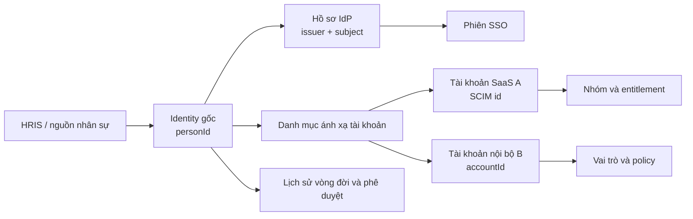
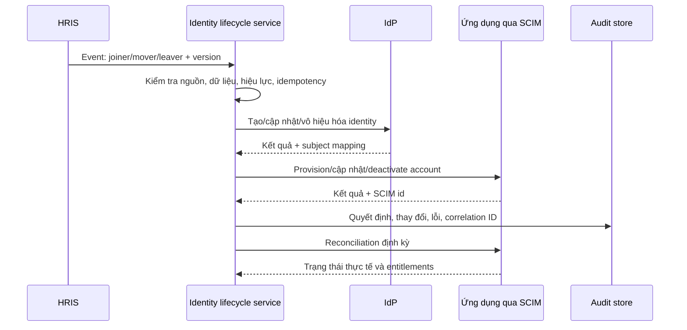

# Identity data: dữ liệu danh tính trong quản lý vòng đời IAM

> **Phạm vi:** Chương *Privacy và identity* của module `SECURITY_IDENTITY_ACCESS_MANAGEMENT_IDENTITY_LIFECYCLE`. Bài học giải thích dữ liệu danh tính được mô hình hóa, thu thập, đồng bộ, sử dụng và bảo vệ như thế nào trong **Identity and Access Management (IAM)**, đặc biệt theo vòng đời **Joiner–Mover–Leaver (JML)**. Các hệ thống liên quan gồm Identity Provider (IdP), Single Sign-On (SSO), SCIM, RBAC/ABAC, tài khoản dịch vụ và hệ thống kiểm toán.

## 1. Identity data là gì?

**Identity data (dữ liệu danh tính)** là tập thông tin dùng để mô tả, định danh, liên kết, xác minh và quản lý một chủ thể trong hệ thống. Chủ thể có thể là nhân viên, đối tác, khách hàng, tài khoản kỹ thuật, workload hoặc dịch vụ. Trong IAM, dữ liệu danh tính còn ghi nhận **chủ thể có những tài khoản nào, thuộc tổ chức nào, được cấp quyền gì, vì sao có quyền đó và trạng thái quyền thay đổi ra sao theo thời gian**.

Ví dụ: một nhân viên có mã nhân sự riêng trong HRIS, một tài khoản trong IdP, các tài khoản ở Git hosting và hệ thống quản lý công việc, các nhóm truy cập gắn với vai trò kỹ sư, cùng lịch sử phê duyệt quyền. Tất cả thuộc bức tranh dữ liệu danh tính, dù mỗi hệ thống chỉ giữ một phần.

Identity data không đồng nghĩa với một bản ghi hồ sơ người dùng (`user profile`):

| Khái niệm | Trả lời câu hỏi | Ví dụ |
|---|---|---|
| **Identity** (danh tính) | Chủ thể này là ai trong phạm vi quản lý? | `personId` nội bộ, `subject` trong IdP |
| **Identity attributes** (thuộc tính danh tính) | Chủ thể có đặc điểm tổ chức và định danh nào? | Phòng ban, mã nhân viên, người quản lý |
| **Account** (tài khoản) | Chủ thể hiện diện trong ứng dụng nào? | `scimUserId` trong ứng dụng A |
| **Authenticator / credential** (phương tiện xác thực / thông tin xác thực) | Chủ thể chứng minh quyền đăng nhập bằng gì? | Passkey, khóa phần cứng, mật khẩu băm |
| **Entitlement** (quyền truy cập cụ thể) | Chủ thể được làm gì trên tài nguyên nào? | Quyền đọc kho mã nguồn X |
| **Identity event** (sự kiện vòng đời) | Điều gì đã thay đổi và khi nào? | Chuyển phòng ban, kết thúc hợp đồng |
| **Audit evidence** (bằng chứng kiểm toán) | Ai hoặc cơ chế nào đã quyết định và thực thi quyền? | Yêu cầu cấp quyền, phê duyệt, log thu hồi |

Phân biệt bốn động từ thường bị trộn lẫn:

- **Identification:** gắn một định danh cho chủ thể, chẳng hạn `personId`.
- **Identity proofing / verification:** kiểm tra chủ thể có đúng là người hoặc thực thể mà họ khai báo, theo mức bảo đảm phù hợp.
- **Authentication:** xác minh thực thể đang tương tác kiểm soát phương tiện xác thực hợp lệ.
- **Authorization:** đánh giá chính sách và quyết định hành động nào được phép.

Một địa chỉ email không tự chứng minh danh tính. Đăng nhập SSO thành công cũng không có nghĩa là mọi tài nguyên đều được phép truy cập.

## 2. Các lớp dữ liệu danh tính

Để quản trị vòng đời chính xác, nên tách dữ liệu theo mục đích và quan hệ, thay vì dồn mọi trường vào một bảng `users`.

| Lớp dữ liệu | Trường tiêu biểu | Ai thường là nguồn có thẩm quyền? | Điểm cần kiểm soát |
|---|---|---|---|
| Danh tính gốc của con người | `personId`, `employeeNumber`, trạng thái lao động | HRIS hoặc hệ thống quản lý đối tác | Định danh ổn định; tránh trùng người |
| Thuộc tính tổ chức | Phòng ban, vị trí, địa điểm, `managerId`, ngày hiệu lực | HRIS, hệ thống quản trị tổ chức | Xử lý chuyển vai trò và dữ liệu đến trễ |
| Hồ sơ IdP | `idpSubject`, `issuer`, tên hiển thị, trạng thái đăng nhập | IdP | Không đồng nhất email với subject ID |
| Tài khoản ứng dụng | `applicationId`, `accountId`, `externalId`, `active` | Ứng dụng đích; hệ thống provisioning lưu quan hệ | Phát hiện tài khoản mồ côi, lệch trạng thái |
| Nhóm, vai trò và quyền | `groupId`, `roleId`, `resourceId`, `permission` | IAM, chủ tài nguyên và policy engine | Nguyên tắc tối thiểu, phân tách nhiệm vụ |
| Xác thực và phục hồi | Phương thức MFA, trạng thái đăng ký passkey, thời điểm thay đổi | IdP / dịch vụ xác thực | Bảo vệ bí mật; hạn chế dữ liệu phục hồi nhạy cảm |
| Sự kiện và phê duyệt | `eventId`, `effectiveAt`, `approvedBy`, `reason` | HRIS / ITSM / workflow IAM | Chống xử lý lặp, có thể truy vết quyết định |
| Dữ liệu kiểm toán | Ai, hành động, tài nguyên, kết quả, thời điểm, correlation ID | Nguồn phát sinh và kho log bảo vệ | Chống sửa, giới hạn truy cập và lưu giữ |
| Danh tính phi con người | `serviceIdentityId`, `ownerId`, `purpose`, `expiresAt` | Nền tảng quản lý workload / secrets / IAM | Có chủ sở hữu, giới hạn quyền và vòng đời |

### 2.1. PII, dữ liệu nhạy cảm và bí mật xác thực

Một số identity data là **dữ liệu cá nhân** vì có thể xác định hoặc liên hệ tới cá nhân; ví dụ họ tên, email công việc, mã nhân viên, lịch sử truy cập. Dữ liệu được mã hóa hoặc giả danh (`pseudonymized`) có thể vẫn là dữ liệu cá nhân khi có khả năng liên kết ngược.

Cần phân biệt:

1. **Thuộc tính cần cho nghiệp vụ:** chẳng hạn mã nhân viên, bộ phận, trạng thái đang làm việc.
2. **Dữ liệu có độ nhạy cao:** giấy tờ xác minh, thông tin sinh trắc, dữ liệu khôi phục tài khoản hoặc lịch sử hoạt động chi tiết.
3. **Secrets:** mật khẩu, token làm mới, khóa API, khóa riêng; không coi chúng là thuộc tính hồ sơ được đồng bộ rộng rãi.

Nếu quy trình xác minh cần xem giấy tờ, kết quả xác minh có thể chỉ lưu `proofingStatus=verified`, phương thức và thời điểm kiểm tra. Không sao chép ảnh giấy tờ vào mọi hệ thống đích chỉ để chúng biết tài khoản đã được xác minh.

## 3. Nhận diện đúng một chủ thể trong nhiều hệ thống

Một người có thể có nhiều định danh khác nhau. Thiết kế tốt cần giữ **một identity gốc ổn định**, đồng thời quản lý ánh xạ tới từng tài khoản trong từng hệ thống.



### 3.1. Chọn khóa định danh

Không dùng email, họ tên hoặc số điện thoại làm khóa liên kết duy nhất lâu dài: chúng có thể đổi, bị tái sử dụng hoặc trùng giữa tổ chức.

| Định danh | Phạm vi ổn định thường thấy | Cách sử dụng |
|---|---|---|
| `personId` do tổ chức cấp | Ổn định trong miền quản lý danh tính | Khóa danh tính gốc; nên không tái sử dụng |
| `employeeNumber` | Theo quy tắc HRIS, có thể đổi khi tái tuyển dụng | Mã nghiệp vụ; xác nhận chính sách trước khi dùng nối dữ liệu |
| `iss` + `sub` trong OpenID Connect | `sub` chỉ duy nhất trong phạm vi `iss` | Nhận diện người dùng từ token OIDC |
| `NameID` trong SAML | Phụ thuộc định dạng và cấu hình federation | Phải kiểm tra tính ổn định và phạm vi với IdP |
| `id` của SCIM User | Do server SCIM cấp trong phạm vi dịch vụ đó | Xác định bản ghi trong ứng dụng đích |
| `externalId` của SCIM User | Do client provisioning gán | Liên kết bản ghi đích về chủ thể nguồn |
| Email / `userName` | Có thể đổi hoặc được cấp lại | Thuộc tính đăng nhập / liên lạc, không phải khóa gốc |

Khi nhiều tenant hoặc nhiều IdP cùng tồn tại, ánh xạ phải bao gồm miền phát hành và tenant. Một cặp `sub` giống nhau do hai issuer khác nhau phát ra **không chỉ về cùng một người**.

Ví dụ bảng liên kết danh tính và tài khoản ở mức khái niệm:

```text
Identity(personId, lifecycleState, employmentType)
IdpSubject(personId, issuer, subject, tenantId)
ApplicationAccount(personId, applicationId, tenantId, externalId, scimId, active)
EntitlementAssignment(personId, resourceId, entitlementId, source, validFrom, validTo)
IdentityEvent(eventId, personId, eventType, effectiveAt, observedAt, sourceVersion)
```

Các ràng buộc quan trọng:

- `personId` bất biến và không tái sử dụng trong miền quản lý đã xác định.
- Khóa ánh xạ ứng dụng phải bao gồm `applicationId` và `tenantId`; `scimId` chỉ có ý nghĩa trong dịch vụ đã cấp nó.
- Một entitlement phải có nguồn gốc cấp quyền (`source`), người/chính sách chịu trách nhiệm và thời hạn khi thích hợp.
- Mọi sự kiện thay đổi phải có khóa chống xử lý trùng và thời điểm hiệu lực; không tin rằng thứ tự giao nhận luôn là thứ tự nghiệp vụ.
- Một tài khoản kỹ thuật nên có `ownerId` hoặc nhóm sở hữu nhưng **không** được gộp thành danh tính con người của owner.

### 3.2. Ví dụ bản ghi identity tối thiểu

Dưới đây là dữ liệu minh họa; hệ thống thực tế có thể tách thành nhiều bảng / service. Email dùng miền giả lập `example.invalid`.

```json
{
  "personId": "p-7f42",
  "source": {
    "system": "HRIS",
    "recordId": "hr-2048",
    "version": 18
  },
  "lifecycle": {
    "state": "active",
    "effectiveFrom": "2026-11-01T00:00:00Z"
  },
  "profile": {
    "workEmail": "linh@example.invalid",
    "departmentId": "engineering-platform",
    "managerId": "p-3a21"
  },
  "federation": [
    {
      "issuer": "https://idp.example.invalid/tenant-a",
      "subject": "subject-9182"
    }
  ],
  "accounts": [
    {
      "applicationId": "source-control",
      "tenantId": "company-a",
      "externalId": "p-7f42",
      "scimId": "app-user-5501",
      "active": true
    }
  ]
}
```

Ví dụ này phục vụ hiểu quan hệ; không nên mặc định xuất toàn bộ bản ghi tới mọi ứng dụng. Mỗi đích chỉ nhận những thuộc tính cần để thực hiện chức năng đã được phê duyệt.

## 4. Nguồn dữ liệu có thẩm quyền và luồng đồng bộ

Identity data thường có nhiều nơi cung cấp nhưng **mỗi thuộc tính quan trọng cần quy định rõ nguồn có thẩm quyền** (*authoritative source*). HRIS có thể chịu trách nhiệm tình trạng lao động; IdP chịu trách nhiệm trạng thái đăng nhập; ứng dụng đích sở hữu ID tài khoản do chính nó cấp; chủ tài nguyên chịu trách nhiệm phê duyệt quyền đặc biệt.



Phân biệt ba kiểu luồng:

- **Federation (SSO):** cho phép đăng nhập qua IdP, thường dùng OIDC hoặc SAML. Federation tự nó không đảm bảo tài khoản, quyền và dữ liệu nhân sự trong ứng dụng đã được tạo hoặc thu hồi.
- **Provisioning (ví dụ SCIM):** tạo, cập nhật, vô hiệu hóa tài khoản và có thể đồng bộ thành viên nhóm tới ứng dụng.
- **Reconciliation:** so sánh trạng thái mong muốn ở IAM với trạng thái thực tế ở ứng dụng, phát hiện tài khoản mồ côi, lệch quyền hoặc thao tác API thất bại.

Một thay đổi ở HRIS không nhất thiết được truyền ngay tức thì. Vì vậy cần theo dõi `effectiveAt`, `observedAt`, phiên bản nguồn, hàng đợi retry, dead-letter và trạng thái đồng bộ theo từng ứng dụng.

## 5. Identity data trong Joiner–Mover–Leaver

Vòng đời identity không chỉ là tạo hoặc xóa một bản ghi: đó là quá trình làm cho **trạng thái tài khoản và quyền truy cập phản ánh đúng quan hệ hiện tại giữa chủ thể và tổ chức**.

| Giai đoạn | Dữ liệu đầu vào | Xử lý danh tính và quyền | Bằng chứng cần có |
|---|---|---|---|
| **Joiner**: gia nhập | Mã nhân sự, ngày bắt đầu, đơn vị, quản lý, loại hợp đồng, kết quả xác minh | Tạo identity gốc; liên kết IdP; đăng ký MFA; tạo tài khoản đích; áp vai trò cơ sở | Ai kích hoạt, chính sách áp dụng, đích provision thành công/thất bại |
| **Mover**: thay đổi vai trò | Bộ phận/vị trí/quản lý mới, ngày hiệu lực, yêu cầu ngoại lệ | Tính lại nhóm/role/attribute; thu hồi quyền cũ không còn hợp lệ; cấp quyền mới sau phê duyệt nếu cần | Diff quyền trước/sau, chính sách và phê duyệt, ngoại lệ có hạn |
| **Leaver**: rời tổ chức | Ngày giờ kết thúc, lý do thuộc nhóm được phép xử lý, mức khẩn cấp | Vô hiệu hóa đăng nhập; thu hồi phiên/token; disable/deprovision tài khoản; thu hồi quyền, khóa, quyền truy cập ngoài | Thời điểm nhận sự kiện, thời điểm thực thi từng đích, lỗi chưa xử lý |

### 5.1. Joiner: nhận dạng và cấp quyền ban đầu

Một quy trình joiner điển hình:

1. Nguồn nhân sự phát `personId` và trạng thái hợp lệ, kèm ngày bắt đầu.
2. IAM kiểm tra dữ liệu trùng, ánh xạ identity cũ và yêu cầu proofing.
3. IdP tạo subject hoặc liên kết subject sẵn có; người dùng đăng ký phương tiện MFA phù hợp.
4. IAM tính *birthright access* theo vai trò và đơn vị, áp chính sách phân tách nhiệm vụ (*separation of duties*, SoD).
5. Provisioning tạo tài khoản tại ứng dụng và lưu ID do ứng dụng trả về.
6. Hệ thống kiểm toán ghi quyết định, kết quả, nhiệm vụ lỗi và lịch xử lý tiếp.

**Tái tuyển dụng** là trường hợp cần chính sách rõ ràng: một người cũ có thể quay lại với mã nhân sự khác hoặc tổ chức mới. Không chỉ dựa vào email để khôi phục toàn bộ quyền cũ; kiểm tra danh tính gốc, yêu cầu mới và trạng thái quyền còn hiệu lực.

### 5.2. Mover: phòng tránh tích lũy quyền

Khi một người chuyển từ nhóm hỗ trợ sang nhóm tài chính, chỉ **thêm** role mới sẽ tạo hiện tượng *privilege accumulation* (tích lũy quyền). Quy trình đúng cần tính tập quyền kỳ vọng từ ngữ cảnh mới:

```text
expectedAccess = birthrightAccess(newRole, newDepartment, location)
               + approvedExceptions(validAt = now)
actualAccess   = discoveredAccessFromTargetSystems()
grant          = expectedAccess - actualAccess
revoke         = actualAccess - expectedAccess
```

Phép trừ tập hợp là mô hình tư duy; khi triển khai phải phân biệt quyền cấp trực tiếp, quyền kế thừa qua nhóm và quyền của tài khoản dùng chung. Một quyền ngoài danh sách kỳ vọng có thể thuộc ngoại lệ đã phê duyệt hoặc quyền đang chờ thu hồi; không tự ý xóa khi chưa xác định owner và nguồn cấp.

Khi có thời gian bàn giao, ngoại lệ phải có người phê duyệt, phạm vi cụ thể và `expiresAt`. Tránh biến quyền tạm thời thành quyền vĩnh viễn vì thiếu người thu hồi.

### 5.3. Leaver: thu hồi toàn bộ đường truy cập

Vô hiệu hóa tài khoản IdP là bước thiết yếu nhưng chưa đủ: phiên đăng nhập còn hiệu lực, API token của ứng dụng, SSH key hoặc tài khoản cục bộ có thể tiếp tục hoạt động.

Trình tự xử lý cần xét mức độ khẩn cấp và phụ thuộc hệ thống:

- Chặn xác thực mới ở IdP, thu hồi phiên / refresh token theo khả năng của IdP và ứng dụng; áp kiểm soát phiên thực tế thay vì giả định access token đã phát hành lập tức mất hiệu lực.
- Vô hiệu hóa / xóa quyền truy cập ở hệ thống đích qua SCIM, API hoặc quy trình thủ công có bằng chứng.
- Thu hồi khóa, quyền VPN, quyền kho mã nguồn, secret và phiên quản trị liên quan; kiểm tra đường truy cập trực tiếp không đi qua SSO.
- Chuyển quyền sở hữu dữ liệu, job và tài khoản dịch vụ trước khi xóa tài khoản người sở hữu nếu nghiệp vụ yêu cầu.
- Đối soát kết quả, mở sự cố đối với đích chưa xác nhận, giữ chứng cứ theo chính sách lưu trữ.

**Deactivation** (ngừng hoạt động) và **deletion** (xóa dữ liệu) có ý nghĩa khác nhau. Có thể cần tạm giữ bản ghi để bảo đảm kiểm toán, pháp lý hoặc khôi phục; thời hạn và căn cứ lưu phải được xác định từ chính sách, không suy ra rằng mọi dữ liệu phải giữ mãi.

## 6. SCIM và dữ liệu danh tính cấp tài khoản

System for Cross-domain Identity Management (**SCIM 2.0**) chuẩn hóa tài nguyên như User và Group cùng thao tác quản lý tài khoản. SCIM giúp đồng bộ trạng thái và thuộc tính; không thay thế cơ chế xác thực SSO.

Ví dụ tạo User minh họa theo cấu trúc SCIM:

```http
POST /scim/v2/Users HTTP/1.1
Content-Type: application/scim+json
Authorization: Bearer <provisioning-token>

{
  "schemas": [
    "urn:ietf:params:scim:schemas:core:2.0:User"
  ],
  "externalId": "p-7f42",
  "userName": "linh@example.invalid",
  "name": {
    "givenName": "Linh",
    "familyName": "Tran"
  },
  "active": true
}
```

Ứng dụng SCIM cấp một `id` cho resource mới. IAM nên lưu ánh xạ `externalId` ↔ `id` cùng `applicationId`/tenant, đồng thời xử lý trường hợp request timeout nhưng account đã được tạo để tránh tạo trùng.

Ví dụ vô hiệu hóa tài khoản bằng SCIM PATCH:

```http
PATCH /scim/v2/Users/app-user-5501 HTTP/1.1
Content-Type: application/scim+json
Authorization: Bearer <provisioning-token>

{
  "schemas": [
    "urn:ietf:params:scim:api:messages:2.0:PatchOp"
  ],
  "Operations": [
    {
      "op": "replace",
      "path": "active",
      "value": false
    }
  ]
}
```

Một triển khai SCIM có thể không hỗ trợ đầy đủ mọi thao tác, schema mở rộng hoặc đồng bộ group. Khi thiết kế connector cần xác định capabilities, mã lỗi, giới hạn tốc độ, cơ chế retry và cách xác minh trạng thái thực tế. Không coi phản hồi thành công từ một endpoint là bằng chứng tất cả ứng dụng và phiên đã bị thu hồi.

## 7. Identity data phục vụ RBAC và ABAC

Để ra quyết định truy cập, policy engine cần dữ liệu danh tính **đúng, mới và có nguồn gốc rõ ràng**.

- **RBAC (Role-Based Access Control):** ánh xạ người dùng vào vai trò và vai trò vào quyền. Ví dụ vai trò `finance-reader` có quyền xem báo cáo.
- **ABAC (Attribute-Based Access Control):** đánh giá thuộc tính của chủ thể, tài nguyên, hành động và ngữ cảnh. Ví dụ chỉ người thuộc phòng tài chính, dùng thiết bị đạt chuẩn, truy cập báo cáo của đúng đơn vị trong khoảng thời gian cho phép.
- **Group-based provisioning:** nhóm trong IdP hoặc SCIM thường hỗ trợ cấp tài khoản và role ở ứng dụng; nhóm không phải lúc nào cũng tương đương role trong policy engine.

Ví dụ policy minh họa:

```text
allow(subject, action, resource, environment) khi:
    subject.lifecycleState == "active"
    AND subject.departmentId == resource.ownerDepartmentId
    AND action == "read"
    AND resource.classification <= subject.clearance
    AND environment.deviceCompliant == true
```

Giá trị `clearance`, phân loại tài nguyên và tình trạng thiết bị phải có nguồn đáng tin cậy, cập nhật đúng lúc. Nếu thuộc tính phòng ban của mover đến chậm, quyết định cấp quyền có thể dựa trên trạng thái đã lỗi thời. Các hoạt động nhạy cảm cần xác định cơ chế cache, thời hạn thuộc tính, từ chối khi thiếu dữ liệu thiết yếu và kiểm toán quyết định.

Áp nguyên tắc **least privilege** bằng cách chỉ cấp quyền cần thiết cho nhiệm vụ, có thời hạn với quyền đặc biệt; dùng **SoD** để ngăn tổ hợp quyền xung đột, chẳng hạn một cá nhân vừa tạo vừa phê duyệt thanh toán khi chính sách không cho phép.

## 8. Tài khoản dịch vụ và danh tính workload

Không phải mọi identity đều gắn với một con người đăng nhập tương tác. CI/CD pipeline, batch job, microservice và bot có thể cần danh tính riêng để gọi API.

Một service identity nên được ghi nhận tối thiểu:

| Thuộc tính | Mục đích |
|---|---|
| `serviceIdentityId`, `systemId` | Nhận diện workload và môi trường |
| `ownerId` / `ownerTeamId` | Đơn vị chịu trách nhiệm khi người sở hữu chuyển việc |
| `purpose`, `resourceScope` | Giải thích vì sao tồn tại và được phép truy cập gì |
| `authenticationMethod` | Workload identity federation, certificate, managed identity hoặc secret |
| `createdAt`, `expiresAt`, `lastUsedAt` | Quản lý vòng đời, phát hiện tài khoản không sử dụng |
| `rotationPolicy`, `reviewedAt` | Thực thi xoay vòng và rà soát định kỳ |

Ưu tiên xác thực workload có thể quản lý và cấp phát thông tin ngắn hạn khi nền tảng hỗ trợ. Nếu phải dùng khóa dài hạn, lưu trong secret manager, giới hạn quyền đọc và có cơ chế xoay/thu hồi. Không dùng tài khoản cá nhân của nhân viên làm danh tính vận hành của một dịch vụ.

Trong quy trình leaver của owner, cần kiểm tra **ownership** tài khoản dịch vụ để chuyển trách nhiệm và rà soát quyền. Không tự động xóa service identity đang phục vụ hệ thống sản xuất chỉ vì chủ sở hữu rời công ty; quyết định thu hồi phải xét phụ thuộc nghiệp vụ và kế hoạch thay thế.

## 9. Privacy by design cho identity data

Vì IAM có khả năng kết nối nhiều hệ thống, dữ liệu danh tính có rủi ro bị tập trung quá mức. Kiểm soát privacy cần xuất hiện từ lúc thiết kế schema và API đến khi xóa dữ liệu.

### 9.1. Thu thập và chia sẻ có mục đích

- **Data minimization:** chỉ thu thập, đồng bộ và giữ các thuộc tính phục vụ mục đích đã xác định. App cấp tài khoản có thể cần `userName`, `externalId`, nhóm; không nhất thiết cần ngày sinh hoặc giấy tờ tùy thân.
- **Purpose limitation:** không tái sử dụng log đăng nhập hoặc dữ liệu nhân sự cho mục đích phân tích hành vi ngoài phạm vi đã thông báo và được phép.
- **Field-level access:** bộ phận hỗ trợ có thể xem trạng thái provision mà không thấy thông tin proofing nhạy cảm hoặc secret.
- **Segregation:** dữ liệu proofing, credential, audit và hồ sơ tổ chức có thể có quyền truy cập và chu kỳ lưu khác nhau.
- **Tenant isolation:** mọi truy vấn và ánh xạ phải ràng buộc tenant; không cho một tenant dùng ID của tenant khác để đọc hoặc sửa danh tính.

### 9.2. Bảo vệ trong lưu trữ và truyền tải

Sử dụng truyền tải bảo mật, mã hóa phù hợp cho dữ liệu nhạy cảm lưu trữ, giới hạn quyền service account, quản lý khóa, kiểm soát truy cập kho log và theo dõi truy vấn bất thường. Với mật khẩu, lưu kết quả của thuật toán băm mật khẩu có salt và cấu hình phù hợp; **không lưu hoặc log mật khẩu rõ**. Token/secret phải bị che trong log và thông báo lỗi.

Một mã nội bộ không mang họ tên vẫn có thể là dữ liệu cá nhân nếu tổ chức có bảng tra ngược; việc thay `personId` bằng mã giả không tự biến bản ghi thành dữ liệu ẩn danh.

### 9.3. Lưu giữ, xóa và yêu cầu của chủ thể dữ liệu

Chính sách lưu giữ cần xác định riêng cho hồ sơ hoạt động, account mapping, bằng chứng phê duyệt, dữ liệu xác minh và audit trail. Khi hết mục đích, xử lý xóa hoặc ẩn danh theo yêu cầu áp dụng; khi còn nghĩa vụ lưu, hạn chế truy cập và tránh tái sử dụng. Phải có cách kiểm tra dữ liệu đã lan sang cache, backup, hệ thống phân tích và bên nhận thứ ba.

Yêu cầu truy cập, sửa hoặc xóa dữ liệu cá nhân phải được đánh giá dựa trên luật, hợp đồng, nghĩa vụ kiểm toán và chính sách của tổ chức theo từng khu vực pháp lý. Không tự đồng nhất một yêu cầu xóa với xóa ngay mọi log bảo mật đang thuộc diện phải lưu giữ.

## 10. Auditability: trả lời được ai, quyền nào, tại sao và từ khi nào

Audit của lifecycle khác với một dòng log “API trả 200”. Cần nối được **sự kiện đầu vào → quyết định chính sách → phê duyệt → lệnh gửi đi → trạng thái xác nhận → đối soát**.

Một cấu trúc sự kiện kiểm toán minh họa:

```json
{
  "eventId": "evt-000831",
  "correlationId": "flow-0052",
  "occurredAt": "2026-11-23T03:15:00Z",
  "actor": {
    "type": "system",
    "id": "iam-lifecycle-worker"
  },
  "subject": {
    "personId": "p-7f42"
  },
  "action": "entitlement.revoked",
  "target": {
    "applicationId": "source-control",
    "entitlementId": "repo-admin"
  },
  "reasonCode": "role_changed",
  "sourceEventId": "hr-event-991",
  "policyVersion": "2026-11",
  "outcome": "success"
}
```

Trong audit log thực tế, tránh nhúng email, giấy tờ, token hoặc toàn bộ request/response khi không cần thiết. Bảo vệ log khỏi sửa trái phép, giới hạn người đọc, đặt chu kỳ lưu phù hợp và đồng bộ thời gian để có thể điều tra chính xác.

Khi sự kiện leaver thất bại ở một ứng dụng, bằng chứng phải nêu rõ hệ thống nào còn truy cập, lỗi gì, đã retry mấy lần, ai nhận cảnh báo và cách đóng vấn đề. Chỉ có log thao tác “đã gửi yêu cầu” là chưa đủ để xác nhận quyền đã bị thu hồi.

## 11. Tính nhất quán và chất lượng của identity data

Các lỗi về dữ liệu thường làm IAM sai lệch ngay cả khi mã xử lý không có lỗi cú pháp.

| Tình huống | Hệ quả | Biện pháp |
|---|---|---|
| Một người có hai `personId` vì đổi email hoặc tái tuyển dụng | Hai bộ quyền, khó thu hồi triệt để | Quy trình liên kết danh tính có kiểm chứng, khóa ổn định |
| Một email được cấp lại cho người mới | Liên kết nhầm account cũ | Không dùng email làm khóa người, kiểm tra account ownership |
| Sự kiện mover đến sau leaver | Có thể cấp lại quyền cho người đã nghỉ | State machine, version, effective time và guard chống hồi trạng thái |
| App provision thành công nhưng response timeout | Retry tạo tài khoản trùng | Idempotency, tra cứu theo external ID có scope |
| IdP disable nhưng phiên ứng dụng còn hợp lệ | Truy cập tồn dư | Thu hồi session/token theo từng đích, kiểm tra đường đăng nhập độc lập |
| Quyền cấp trực tiếp trong SaaS ngoài hệ thống IAM | Lệch giữa quyền kỳ vọng và thực tế | Discovery/reconciliation và access review |
| Account không có owner hoặc không được sử dụng lâu ngày | Quyền mồ côi | Bắt buộc owner, review định kỳ và quy trình hết hạn |
| Nhân sự rời nhưng công việc vẫn dùng API key cá nhân | Pipeline hỏng hoặc API key còn dùng sau nghỉ | Chuyển sang service identity và xoay secret |
| Log chứa access token hoặc dữ liệu proofing | Rò rỉ dữ liệu | Redaction, kiểm soát truy cập log và kiểm tra schema |

### 11.1. Quy tắc xử lý sự kiện

Event-driven provisioning cần có giới hạn trạng thái và xử lý lặp. Ví dụ pseudocode:

```python
def process_identity_event(event, identity):
    validate_source(event)
    if already_processed(event.event_id):
        return "duplicate_ignored"
    if event.source_version <= identity.last_source_version:
        return "stale_ignored"

    proposed = transition(identity.lifecycle_state, event)
    validate_transition(identity.lifecycle_state, proposed)

    save_desired_state_and_outbox_atomically(
        identity_id=identity.person_id,
        state=proposed,
        source_version=event.source_version,
        event_id=event.event_id,
    )
    return "accepted"
```

Đây là ví dụ logic, không phải mã sản xuất. Trong môi trường nhiều nguồn, không thể chỉ so sánh một số phiên bản chung; phải quy định quyền sở hữu thuộc tính và cách hợp nhất sự kiện. Việc đẩy lệnh ra ứng dụng nên có cơ chế outbox/retry và đối soát, vì cập nhật cơ sở dữ liệu IAM và gọi API bên ngoài không nằm trong một giao dịch nguyên tử.

### 11.2. Chỉ báo vận hành nên theo dõi

Có thể đo lường:

- **Provisioning latency:** độ trễ từ lúc sự kiện có hiệu lực tới khi từng đích xác nhận.
- **Deprovisioning completeness:** tỷ lệ hệ thống và tài khoản đã xác nhận thu hồi so với danh sách đích phải thu hồi.
- **Orphaned-account count:** số tài khoản ứng dụng không ánh xạ được về identity hợp lệ hoặc service owner.
- **Excess entitlement count:** số quyền thực tế ngoài tập quyền đã phê duyệt.
- **Identity matching exceptions:** số trường hợp trùng/không nối được identity cần xử lý thủ công.
- **Overdue access reviews:** số quyền chưa được owner xác nhận đúng hạn.

Ngưỡng đo và thời hạn xử lý phụ thuộc mức độ rủi ro của ứng dụng, không nên áp một con số chung cho mọi hệ thống.

## 12. Tình huống xuyên suốt: một identity qua ba lần thay đổi

Giả sử **Linh** gia nhập nhóm Engineering ngày 01/11, chuyển sang nhóm Security ngày 15/11, và kết thúc hợp đồng ngày 30/11. Dữ liệu minh họa:

| Sự kiện | Identity gốc | Thuộc tính / quyền kỳ vọng | Cần xác minh sau đồng bộ |
|---|---|---|---|
| 01/11 — Joiner | `personId=p-7f42` được tạo và giữ ổn định | `department=engineering`; nhóm `eng-read`; MFA đã đăng ký | Có IdP subject, app accounts được liên kết và nhóm cơ sở đúng |
| 15/11 — Mover | Vẫn `p-7f42` | `department=security`; thêm `security-read`; gỡ `eng-read` khi không còn cần | Quyền cũ đã bị gỡ ở app đích; quyền mới có phê duyệt và ngày hiệu lực |
| 30/11 — Leaver | Giữ ID phục vụ đối soát có kiểm soát | `lifecycleState=inactive`; không còn quyền tương tác hoặc API cá nhân | IdP, session, SaaS, VPN và tokens đã bị thu hồi; lưu bằng chứng và xử lý lỗi |

Điểm then chốt: **một identity ổn định xuyên vòng đời nhưng các account, thuộc tính và entitlement thay đổi theo sự kiện**. Tập hợp quyền phải phản ánh trạng thái mới ở tất cả hệ thống đích, kể cả hệ thống có cơ chế xác thực riêng.

## 13. Hướng dẫn thiết kế một kho identity data

Khi triển khai hoặc đánh giá hệ thống quản lý vòng đời danh tính, có thể đi theo các bước sau:

1. **Lập danh mục chủ thể và tài khoản:** người lao động, nhà thầu, đối tác, máy và dịch vụ; đánh dấu nguồn tạo và owner.
2. **Định nghĩa identity gốc và khóa ánh xạ:** tách person ID, IdP subject, SCIM ID, account ID; quy định tenant và cách xử lý trùng/tái tuyển dụng.
3. **Gán nguồn có thẩm quyền tới từng thuộc tính:** rõ ai được sửa phòng ban, ngày nghỉ, vai trò, quyền ngoại lệ.
4. **Thiết kế trạng thái vòng đời và sự kiện:** có ngày hiệu lực, source version, người phê duyệt, idempotency, cảnh báo khi dữ liệu bất thường.
5. **Tách dữ liệu hồ sơ, dữ liệu xác thực và dữ liệu kiểm toán:** mỗi nhóm có mức truy cập, mã hóa và thời hạn giữ riêng.
6. **Ánh xạ dữ liệu với policy cấp quyền:** birthright roles, ABAC attributes, SoD, ngoại lệ có thời hạn và người sở hữu quyền.
7. **Tích hợp IdP/SSO và provisioning:** xác định rõ ứng dụng nào chỉ federation, ứng dụng nào hỗ trợ SCIM, ứng dụng nào cần xử lý riêng.
8. **Xây reconciliation và access review:** định kỳ kiểm tra trạng thái thực tế, quyền trực tiếp, account mồ côi và quyền tồn dư.
9. **Có kịch bản phục hồi / hủy thao tác an toàn:** đặc biệt cho mover, leaver và tình huống nhầm người, tránh khôi phục quyền cũ ngoài ý muốn.
10. **Kiểm tra privacy:** trường nào thật sự cần chia sẻ, ai được xem, dữ liệu lưu bao lâu, log có lộ secret/PII hay không.

## 14. Những hiểu nhầm thường gặp

**“Mỗi người chỉ có một account.”** Trên thực tế một người có thể có nhiều account, bao gồm account quản trị đặc quyền. Danh tính gốc cần liên kết được các account nhưng không được làm mất ranh giới và trách nhiệm của từng account.

**“Email là ID người dùng.”** Email tiện cho liên lạc và đăng nhập nhưng có thể đổi hoặc bị tái sử dụng. SSO nên xử lý subject trong phạm vi issuer; IAM cần ID gốc ổn định.

**“Có SSO là đã đồng bộ vòng đời.”** SSO giải quyết xác thực liên kết; provisioning, deprovisioning và reconciliation là các quy trình khác.

**“Chặn IdP là chắc chắn hết quyền.”** Session còn hiệu lực, local account, API token và SSH key cần cơ chế thu hồi phù hợp với từng hệ thống.

**“RBAC/ABAC chỉ là kiểm tra role.”** Kết quả chính sách phụ thuộc độ tin cậy của identity attributes và context. Thuộc tính cũ hoặc sai có thể dẫn tới cấp nhầm quyền.

**“Tài khoản dịch vụ thuộc về người tạo ra nó.”** Người tạo chỉ là một bên liên quan; service identity phải có owner vận hành độc lập và quy trình chuyển giao.

**“Ẩn họ tên trong log là ẩn danh.”** ID giả hoặc event trace vẫn có thể liên kết ngược để nhận diện cá nhân. Kiểm soát privacy vẫn áp dụng khi dữ liệu còn khả năng nhận diện.

## 15. Ghi nhớ

Identity data là **nền tảng dữ liệu cho quyết định cấp, thay đổi và thu hồi quyền**. Một thiết kế IAM vững cần phân biệt danh tính gốc, tài khoản ứng dụng, phương tiện xác thực, thuộc tính, entitlement và bằng chứng kiểm toán; có nguồn dữ liệu có thẩm quyền và khóa liên kết ổn định; truyền đúng sự kiện JML; đối soát với trạng thái thực tế; và bảo vệ dữ liệu cá nhân theo mục đích, thời hạn và mức nhạy cảm.

Trong module `SECURITY_IDENTITY_ACCESS_MANAGEMENT_IDENTITY_LIFECYCLE`, điểm nối giữa **privacy** và **identity lifecycle** chính là câu hỏi kép: *cần biết gì về chủ thể để cấp đúng quyền?* và *phải giới hạn việc thu thập, sử dụng, chia sẻ, lưu giữ thông tin ấy thế nào?* Giải quyết đồng thời hai câu hỏi giúp giảm truy cập tồn dư mà không tạo một kho dữ liệu cá nhân quá mức cần thiết.

### Tài liệu chuẩn để tìm hiểu thêm

- IETF [RFC 7643 — SCIM Core Schema](https://www.rfc-editor.org/rfc/rfc7643): định nghĩa User, Group và các thuộc tính chuẩn.
- IETF [RFC 7644 — SCIM Protocol](https://www.rfc-editor.org/rfc/rfc7644): thao tác tạo, đọc, cập nhật, xóa và PATCH tài nguyên SCIM.
- [OpenID Connect Core 1.0](https://openid.net/specs/openid-connect-core-1_0.html): định danh `iss`/`sub` và xác thực liên kết qua IdP.
- [NIST Digital Identity Guidelines](https://pages.nist.gov/800-63-4/): khung tham chiếu về chứng minh danh tính, xác thực và liên kết danh tính.
