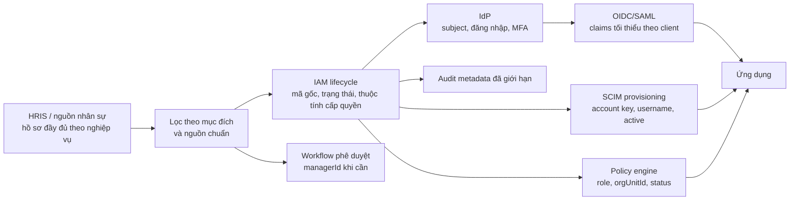

# Minimize identity attributes: Tối thiểu hóa thuộc tính danh tính trong IAM

> **Chương:** Privacy và identity  
> **Module:** `SECURITY_IDENTITY_ACCESS_MANAGEMENT_IDENTITY_LIFECYCLE`  
> **Trọng tâm:** Chỉ thu thập, chia sẻ, lưu giữ và sử dụng những thuộc tính danh tính cần thiết cho từng quyết định xác minh, tạo tài khoản, xác thực, cấp quyền, rà soát và thu hồi quyền trong vòng đời **Joiner–Mover–Leaver (JML)**.

## 1. Vấn đề: một hệ thống IAM cần biết bao nhiêu về một người?

Giả sử một nhân viên mới cần truy cập kho tài liệu nội bộ. Hệ thống có thể yêu cầu họ tên, email công việc, mã nhân viên, ngày sinh, địa chỉ nhà, số điện thoại cá nhân, phòng ban, vị trí, người quản lý và thông tin giấy tờ tùy thân. Nhưng để tạo tài khoản và cho đọc tài liệu của đúng phòng ban, thường chỉ cần:

- Một **mã chủ thể ổn định** để liên kết người dùng và tài khoản.
- Thông tin đủ để **cấp và xác thực tài khoản** theo yêu cầu của ứng dụng.
- Thuộc tính **vai trò/phòng ban hoặc nhóm quyền** cần cho quyết định truy cập.
- **Trạng thái hiệu lực** để ngừng truy cập khi người đó chuyển vai trò hoặc rời tổ chức.

Ngày sinh hoặc địa chỉ nhà không tự động có giá trị chỉ vì chúng nằm trong hồ sơ nhân sự. Việc gửi những trường đó tới mọi SaaS làm tăng diện tích rủi ro khi một ứng dụng bị xâm nhập, bị cấp quyền đọc quá rộng hoặc giữ dữ liệu lâu hơn cần thiết.

**Minimize identity attributes** là thực hành **giảm dữ liệu danh tính tới mức tối thiểu cần thiết cho một mục đích cụ thể**, ở cả bốn điểm: **thu thập**, **đưa ra quyết định**, **truyền cho bên nhận** và **lưu giữ**. Tối thiểu hóa không có nghĩa xóa mọi thuộc tính hoặc làm suy yếu bảo mật: hệ thống vẫn phải giữ các định danh, trạng thái, thông tin kiểm soát quyền và bằng chứng kiểm toán cần thiết.

Đây là một nguyên tắc áp dụng xuyên suốt nội dung module quản lý vòng đời danh tính: xác minh ban đầu, tạo tài khoản, liên kết IdP/SSO, provisioning qua SCIM, ủy quyền RBAC/ABAC, rà soát quyền và deprovisioning khi Joiner–Mover–Leaver thay đổi trạng thái.

### 1.1. “Identity” không đồng nghĩa “hồ sơ nhân sự”

Phân biệt ba lớp dữ liệu:

| Lớp | Mục tiêu | Ví dụ | Có nên đồng bộ sang mọi ứng dụng? |
|---|---|---|---|
| **Hồ sơ nguồn** | Quản lý quan hệ nhân sự/đối tác và các nghiệp vụ liên quan | Mã nhân sự, địa chỉ liên lạc, hợp đồng, người quản lý | Không; mỗi mục đích có phạm vi riêng |
| **Hồ sơ IAM tối thiểu** | Biết chủ thể nào, trạng thái nào, cần loại quyền nào | `personId`, `lifecycleState`, `orgUnitId`, ánh xạ tài khoản | Chỉ chia sẻ phần được ứng dụng đích cần |
| **Thuộc tính dành cho ứng dụng** | Hỗ trợ đăng nhập, phân quyền hoặc liên lạc ở ứng dụng cụ thể | `sub`, `userName`, `role`, `active` | Theo hợp đồng dữ liệu của từng ứng dụng |

Một thuộc tính có thể hợp lý tại HRIS nhưng dư thừa tại IdP; hợp lý tại IdP nhưng dư thừa trong ID token của ứng dụng; cần cho một quyết định ABAC nhưng không cần lưu lâu dài tại hệ thống đích.

## 2. Giá trị bảo mật và privacy của việc giảm thuộc tính

Mỗi trường dữ liệu tạo thêm một nghĩa vụ về bảo vệ, cập nhật, đồng ý hoặc căn cứ xử lý, phân quyền, kiểm toán, lưu giữ và xóa. Tối thiểu hóa giúp:

1. **Giảm tác động khi lộ dữ liệu:** một ứng dụng chỉ có subject ID giả danh và role sẽ làm lộ ít dữ liệu cá nhân hơn ứng dụng chứa toàn bộ hồ sơ nhân sự.
2. **Hạn chế liên kết hồ sơ không cần thiết:** nhiều hệ thống không nhất thiết phải biết cùng một số định danh toàn tổ chức.
3. **Giảm dữ liệu sai hoặc lỗi thời:** ít thuộc tính được sao chép hơn đồng nghĩa ít điểm cần cập nhật khi đổi tên, phòng ban hay người quản lý.
4. **Thu hẹp phạm vi quyền của ứng dụng:** một dịch vụ không có dữ liệu nhạy cảm sẽ không thể vô tình hiển thị dữ liệu đó qua API hoặc log.
5. **Làm rõ trách nhiệm:** mỗi trường được giữ có mục đích, nguồn chuẩn, chủ sở hữu, người nhận và thời hạn phù hợp.

Tuy vậy, **thiếu dữ liệu thiết yếu cũng gây rủi ro**. Ví dụ không giữ ánh xạ tài khoản khiến quá trình Leaver không tìm được tài khoản ở ứng dụng đích; loại bỏ trạng thái nhân sự khỏi policy có thể cho phép người đã nghỉ tiếp tục truy cập. Mục tiêu là **đủ dữ liệu để ra quyết định đúng và chứng minh việc thực thi**, không phải số lượng trường nhỏ nhất bằng mọi giá.

## 3. Xác định “cần thiết” bằng mục đích và quyết định

Đơn vị tối thiểu hóa tốt nhất là **một hoạt động cụ thể**, chẳng hạn “tạo tài khoản quản lý công việc”, “đánh giá quyền đọc hóa đơn” hoặc “khóa truy cập ngay khi hợp đồng kết thúc”. Tránh phê duyệt một gói thuộc tính chung cho tất cả ứng dụng chỉ vì “IAM cần quản lý người dùng”.

Với mỗi thuộc tính, cần trả lời:

1. **Mục đích là gì?** Quyết định hoặc thao tác nào không thể hoàn thành an toàn nếu thiếu trường này?
2. **Nguồn có thẩm quyền là đâu?** HRIS, IAM, IdP, chủ tài nguyên hay hệ thống nào chịu trách nhiệm tính đúng của giá trị?
3. **Ai cần nhận?** IAM trung tâm, IdP, policy decision point, một ứng dụng SCIM, người phê duyệt hay bộ phận audit?
4. **Cần giá trị gốc hay một kết luận suy ra?** Ứng dụng có cần ngày sinh chính xác hay chỉ cần xác nhận một điều kiện tuổi?
5. **Độ mới cần thiết tới đâu?** Đọc khi ra quyết định, lưu cache vài phút, hay đồng bộ trạng thái theo sự kiện?
6. **Khi nào ngừng cần?** Xác định điều kiện xóa, vô hiệu hóa, rút quyền truy cập, thời hạn lưu và ngoại lệ có căn cứ.

### 3.1. Data contract cho một thuộc tính

Một **attribute contract** có thể mô tả:

| Trường hợp | Mục đích được phép | Nguồn | Bên nhận | Điều kiện phát hành | Ngừng chia sẻ/lưu khi |
|---|---|---|---|---|---|
| `personId` | Liên kết danh tính với tài khoản | IAM | Provisioning service | Tạo/đối soát tài khoản | Theo chính sách quản lý ánh xạ và kiểm toán |
| `orgUnitId` | Tính nhóm quyền cơ sở | HRIS | IAM policy engine | Joiner/Mover và khi kiểm tra quyền | Thay đổi vai trò; xóa bản sao cũ |
| `managerId` | Điều phối phê duyệt truy cập | HRIS | Workflow phê duyệt | Có yêu cầu cần quản lý trực tiếp xét duyệt | Kết thúc workflow và thời hạn bằng chứng liên quan |
| `workEmail` | Gửi thông báo hoặc làm username nếu ứng dụng yêu cầu | HRIS/IdP | Ứng dụng cần email | Được phép và thật sự cần | Tài khoản ngừng hoạt động hoặc hết thời hạn nghiệp vụ |
| `employmentEndAt` | Xác định thời điểm kết thúc quyền | HRIS | IAM lifecycle engine | Có thay đổi trạng thái hợp đồng | Sau khi hoàn thành thu hồi và nghĩa vụ lưu phù hợp |
| `proofingStatus` | Biết đã hoàn thành bước xác minh | Dịch vụ xác minh | IAM/IdP theo nhu cầu | Cần chặn cấp quyền trước xác minh | Theo chu kỳ rà soát và lưu giữ đã quy định |

Không có danh sách trường tối thiểu phổ quát. Một ứng dụng xử lý thanh toán, hệ thống nhân sự và kho tài liệu có những nhu cầu hợp lệ khác nhau. Hợp đồng trên phải được phê duyệt riêng theo mục đích và triển khai thực tế.

### 3.2. Phân loại kết quả rà soát

- **Required:** bắt buộc để vận hành an toàn hoặc đáp ứng nghĩa vụ được xác định rõ.
- **Derived:** có thể thay dữ liệu gốc bằng vai trò, nhóm, nhãn hoặc một kết luận đã được xác minh.
- **On demand:** chỉ đọc tại thời điểm cần, không sao chép thành bản thường trú.
- **Conditional:** chỉ phát hành khi bật tính năng hoặc thỏa điều kiện nghiệp vụ tương ứng.
- **Unnecessary:** không có mục đích được chứng minh; bỏ khỏi schema và luồng đồng bộ.

Một trường “dễ dùng cho tương lai” chưa phải là lý do đủ để đưa vào hệ thống sản xuất ngay hôm nay.

## 4. Thiết kế luồng thuộc tính theo nguyên tắc có chọn lọc

Mỗi hệ thống nên chỉ xem được một lát cắt của identity mà nó cần:



Đặt ranh giới rõ giữa:

- **Source of truth:** nơi nguồn thông tin được quản lý và cập nhật.
- **Policy decision point (PDP):** nơi dùng những thuộc tính cần thiết để đánh giá quyền.
- **Provisioning connector:** nơi truyền một số trường để tạo/cập nhật account.
- **Token issuer:** nơi đưa claims phù hợp cho *một relying party* (ứng dụng sử dụng danh tính liên kết).
- **Audit store:** nơi lưu chứng cứ cần cho truy vết, không biến thành bản sao dữ liệu cá nhân hoàn chỉnh.

**Attribute release policy** là tập quy tắc xác định client hoặc service nào được nhận claim/field nào, trong điều kiện nào. Chính sách này cần được xét theo từng ứng dụng và các thay đổi phải có thể kiểm toán.

## 5. Tối thiểu hóa ở từng giai đoạn Joiner–Mover–Leaver

### 5.1. Joiner: chỉ đủ dữ liệu để xác minh, tạo tài khoản và cấp quyền cơ sở

Một nhân viên mới thường đi qua ba nhu cầu khác nhau:

| Công việc | Dữ liệu thực sự cần cân nhắc | Dữ liệu thường không cần gửi cho mọi đích |
|---|---|---|
| **Xác minh danh tính** | Bằng chứng theo mức bảo đảm yêu cầu, kết quả xác minh, thời điểm và nguồn tin cậy | Bản sao giấy tờ, ảnh sinh trắc hoặc thông tin xác minh thô |
| **Tạo identity/IdP account** | Khóa gốc, tên đăng nhập phù hợp, trạng thái, phương thức xác thực | Địa chỉ nhà, hồ sơ gia đình, lịch sử lương |
| **Cấp quyền ban đầu** | `orgUnitId`, `jobFunctionCode` hoặc role được duyệt, ngày bắt đầu, nhóm quyền | Toàn bộ mô tả hợp đồng hoặc hồ sơ tuyển dụng |
| **Tạo SaaS account** | `externalId`, `userName`, `active` và trường riêng mà SaaS thật sự cần | Tất cả thuộc tính HRIS chỉ vì connector có thể đồng bộ |

Trường hợp cần xác minh giấy tờ: ưu tiên để dịch vụ chuyên trách xử lý và trả về kết quả có nguồn gốc rõ ràng, ví dụ `proofingAssuranceLevel` và `verifiedAt`. Đừng gửi hình ảnh hoặc số giấy tờ tới ứng dụng quản lý công việc chỉ vì ứng dụng này yêu cầu người dùng đã xác minh.

**Lưu ý:** “Thay bằng kết quả xác minh” chỉ phù hợp nếu bên nhận tin cậy nguồn kết luận và yêu cầu pháp lý/nghiệp vụ cho phép. Một số nghiệp vụ chuyên ngành thật sự cần giữ bằng chứng gốc tại môi trường được kiểm soát.

### 5.2. Mover: cập nhật phần liên quan và thu hồi dữ liệu/quyền cũ

Nhân viên chuyển từ Engineering sang Finance:

1. HRIS cập nhật `orgUnitId` và `jobFunctionCode` với ngày hiệu lực.
2. IAM tính lại role, group và thuộc tính dùng cho chính sách.
3. Những ứng dụng cần quản trị quyền theo group chỉ nhận thay đổi membership; không nhất thiết nhận bộ phận, chức danh và người quản lý mới.
4. Thu hồi role, entitlement, bản sao thuộc tính hoặc claim cũ không còn phù hợp; làm mới cache/phiên khi chính sách yêu cầu.
5. Ghi nhận thay đổi và kết quả đối soát, tránh copy toàn bộ hồ sơ nhân sự vào audit trail.

Không nên giải quyết mọi cập nhật bằng cách “sync full profile” tới tất cả hệ thống. Truyền **delta** của các trường liên quan có thể giảm lan truyền dữ liệu, nhưng phải kết hợp cơ chế đối soát để sửa trạng thái sai lệch.

### 5.3. Leaver: cần đủ khóa thu hồi, không cần nhân bản lý do nghỉ việc

Để vô hiệu hóa và thu hồi quyền, lifecycle engine chủ yếu cần biết **identity nào**, **tài khoản/credential nào**, **thời điểm có hiệu lực**, **mức độ ưu tiên xử lý** và **kết quả ở từng đích**.

Lý do chấm dứt hợp đồng chi tiết, thông tin y tế hoặc nội dung xử lý kỷ luật không nên tự động xuất hiện trong ticket deprovisioning, SCIM payload hoặc log SaaS. Nếu cần phân nhánh khẩn cấp, có thể sử dụng mã tác nghiệp giới hạn như `deprovisionPriority=urgent` với phạm vi truy cập hẹp.

Ngừng cho phép đăng nhập không tương đương xóa dữ liệu cá nhân. Cần tách:

- **Deactivation / revocation:** chặn phiên, token, tài khoản và entitlement.
- **Retention:** giữ bằng chứng hoặc account mapping trong thời hạn có căn cứ.
- **Deletion / anonymization:** xử lý dữ liệu không còn cần thiết ở các bản sao và hệ thống đích theo chính sách.

Sự kiện Leaver vẫn cần một khóa định danh ổn định và danh sách ánh xạ tài khoản. Xóa chúng quá sớm có thể khiến hệ thống bỏ sót quyền truy cập tồn dư.

## 6. IdP, SSO và OIDC: phát hành claims theo nhu cầu từng client

**IdP (Identity Provider)** xác thực chủ thể; **SSO** cho phép sử dụng kết quả xác thực giữa các ứng dụng. Hệ thống liên kết danh tính không nên dùng một ID token “đầy đủ mọi trường người dùng” cho tất cả relying party.

### 6.1. Scope và claim

Trong **OpenID Connect (OIDC)**, scope `openid` được dùng cho yêu cầu xác thực OIDC. Các scope `profile`, `email`, `address`, `phone` yêu cầu những nhóm thông tin khác nhau; việc IdP trả các claim cụ thể phụ thuộc cấu hình, cơ chế yêu cầu và chính sách phát hành.

Ví dụ hai ứng dụng:

| Ứng dụng | Mục đích | Scope/claim phù hợp để cân nhắc |
|---|---|---|
| Kho tài liệu chỉ yêu cầu đăng nhập | Nhận biết chủ thể và áp quyền qua dịch vụ nội bộ | `openid`, `iss`, `sub` và các trường token bắt buộc |
| Ứng dụng gửi email thông báo | Nhận biết người dùng và gửi thông báo | `openid email` nếu thật sự phải biết email |
| Ứng dụng cần tên hiển thị | Giao diện cá nhân hóa | Claim tên được cho phép, thay vì toàn bộ `profile` nếu IdP hỗ trợ chọn claim |

Một yêu cầu đăng nhập khái niệm:

```http
GET /authorize?response_type=code
    &client_id=docs-app
    &scope=openid
    &redirect_uri=https%3A%2F%2Fdocs.example.invalid%2Fcallback
    &state=<random-state>
    &nonce=<random-nonce>
    &code_challenge=<pkce-challenge>
    &code_challenge_method=S256
```

Các giá trị trong ví dụ chỉ mang tính minh họa. Luồng triển khai thực tế phải tuân thủ yêu cầu bảo mật OIDC/OAuth và cơ chế bảo vệ client thích hợp; giảm claim không đồng nghĩa bỏ trường bắt buộc hoặc bước chống tấn công.

ID token hợp lệ vẫn cần các claim giao thức bắt buộc như `iss`, `sub`, `aud`, `exp` và `iat`; không thể “tối thiểu hóa” bằng cách loại chúng. Token nên có `aud` đúng dịch vụ nhận; không lấy token dành cho ứng dụng A gửi sang ứng dụng B.

### 6.2. Subject ID và tránh liên kết chéo không cần thiết

`sub` là định danh chủ thể trong phạm vi một `iss`. Nếu IdP hỗ trợ **pairwise subject identifier** của OIDC, các relying party thuộc sector khác nhau có thể nhận những giá trị `sub` khác nhau, giảm khả năng liên kết hành vi giữa các ứng dụng khi không cần thiết.

Lưu ý: pairwise subject được phân tách theo **sector identifier**, không nhất thiết mỗi client một giá trị duy nhất. IAM vẫn có thể giữ ánh xạ nội bộ an toàn để thực hiện Joiner–Mover–Leaver. Không nên dùng email, số điện thoại hoặc mã nhân viên làm ID token subject chỉ để dễ ghép log giữa các hệ thống.

Với SAML, cũng cân nhắc `NameID` ổn định và ít tiết lộ thông tin, nếu nhà cung cấp hỗ trợ; không mặc định email là khóa danh tính bất biến.

### 6.3. Không đặt dữ liệu “tiện dùng” trong token

Những điều cần tránh:

- Đưa ngày sinh, địa chỉ, số điện thoại cá nhân hay cấu trúc phòng ban đầy đủ vào token chỉ vì ứng dụng từng yêu cầu một lần.
- Đính kèm hàng trăm nhóm vào mọi token, dẫn tới lộ cấu trúc tổ chức, token lớn và quyền có thể lỗi thời.
- Đưa token hoặc claims vào URL, client-side analytics hay log truy cập.
- Cấp scope lâu dài như `offline_access` khi ứng dụng không có nhu cầu sử dụng refresh token dài hạn và chưa đáp ứng yêu cầu bảo vệ token.

Thay vào đó, dùng claim giới hạn cho mục đích của ứng dụng, endpoint kiểm soát quyền để đọc thêm khi cần, thời hạn token phù hợp và cơ chế cập nhật/thu hồi trạng thái truy cập.

## 7. SCIM: đồng bộ đúng những trường ứng dụng cần

**SCIM 2.0** định nghĩa resource User/Group và API chuẩn hóa để provision, cập nhật, vô hiệu hóa tài khoản. SCIM không quy định rằng ứng dụng phải nhận tất cả dữ liệu của HRIS.

Trong SCIM Core Schema, `userName` là thuộc tính User bắt buộc; `id` do service provider cấp; `externalId` thường là khóa liên kết do client cấp và là thuộc tính tùy chọn theo chuẩn. Một số ứng dụng yêu cầu các trường bổ sung theo connector hoặc schema riêng, cần được ghi rõ trong data contract.

Ví dụ payload tạo tài khoản gọn:

```http
POST /scim/v2/Users HTTP/1.1
Content-Type: application/scim+json
Authorization: Bearer <redacted-provisioning-token>

{
  "schemas": ["urn:ietf:params:scim:schemas:core:2.0:User"],
  "externalId": "p-8c12",
  "userName": "u-p8c12",
  "active": true
}
```

Ở đây `userName` là bí danh, không phải email cá nhân. Cách này chỉ dùng được nếu ứng dụng hỗ trợ. Có ứng dụng đòi email để gửi lời mời hoặc làm khóa account; khi đó email công việc có thể là trường cần thiết, nhưng không có nghĩa những ứng dụng khác cũng phải nhận.

Ứng dụng trả `id` do nó cấp, ví dụ `user-1024`. Dịch vụ provisioning lưu liên kết:

```text
personId=p-8c12
applicationId=task-app
tenantId=corp
externalId=p-8c12
scimId=user-1024
```

Bảng ánh xạ này cần được bảo vệ, nhưng là dữ liệu thiết yếu để cập nhật và thu hồi đúng tài khoản. Tránh sử dụng một trường `externalId` chung không có ranh giới tenant hoặc ứng dụng.

### 7.1. Mover: đồng bộ thay đổi theo nhóm thay vì hồ sơ

Nếu ứng dụng chỉ cần biết nhân viên có quyền `finance-reader` hay không, một phương án là IAM cập nhật thành viên nhóm SCIM; ứng dụng không cần nhìn thấy chính xác tên phòng ban, vị trí hay quản lý. Tuy nhiên, phải kiểm tra ứng dụng ánh xạ nhóm sang quyền ra sao và có thu hồi quyền khi nhóm bị gỡ hay không.

### 7.2. Leaver: gửi trạng thái thay vì lý do nhạy cảm

Ví dụ vô hiệu hóa User:

```http
PATCH /scim/v2/Users/user-1024 HTTP/1.1
Content-Type: application/scim+json
Authorization: Bearer <redacted-provisioning-token>

{
  "schemas": ["urn:ietf:params:scim:api:messages:2.0:PatchOp"],
  "Operations": [
    {"op": "replace", "path": "active", "value": false}
  ]
}
```

Payload này không cần đính kèm lý do thôi việc chi tiết. Sau đó IAM vẫn phải đối soát trạng thái thực tế và thu hồi các đường truy cập ngoài SCIM như phiên ứng dụng, khóa API hoặc local account khi thích hợp.

## 8. RBAC và ABAC: dùng thuộc tính tối thiểu để quyết định quyền

**RBAC (Role-Based Access Control)** cấp quyền qua vai trò; **ABAC (Attribute-Based Access Control)** ra quyết định dựa trên các thuộc tính chủ thể, tài nguyên, hành động và môi trường.

### 8.1. Chọn role hoặc nhóm khi đủ

Nếu ứng dụng chỉ cần biết “người này được đọc báo cáo tài chính không?”, có thể cấp một entitlement `finance-report-reader` thay vì cung cấp phòng ban, chức danh, cấp bậc, người quản lý và loại hợp đồng.

Ngược lại, ứng dụng dùng ABAC có thể thật sự cần `orgUnitId` vì tài liệu thuộc nhiều đơn vị và quyết định phụ thuộc đơn vị sở hữu. Điều quan trọng là **chỉ truyền thuộc tính mà policy đánh giá**, từ nguồn đáng tin cậy và với mức chi tiết đủ dùng.

| Yêu cầu truy cập | Có thể dùng | Thường không cần |
|---|---|---|
| Đọc kho tài liệu của phòng ban | `orgUnitId` hoặc `department-reader` | Địa chỉ nhà, số điện thoại |
| Truy cập môi trường production khi on-call | `onCallEligible=true` hoặc nhóm trực ca, trạng thái thiết bị | Lịch trực đầy đủ của cả tổ chức |
| Xét giới hạn phê duyệt hóa đơn | `approvalTier` hoặc `maxApprovalAmount` theo chính sách | Lương cá nhân, hồ sơ hợp đồng |
| Chỉ người đã hoàn thành đào tạo được vận hành máy | `trainingValid=true` và hạn hiệu lực | Toàn bộ bài thi và phiếu đánh giá |

### 8.2. Đưa kết luận thay cho dữ liệu gốc

Khi nghiệp vụ cần biết một điều kiện đã được thỏa mãn, có thể dùng **derived attribute**:

```text
Không cần cung cấp:
  dateOfBirth = 1992-04-17

Trong ứng dụng chỉ cần điều kiện độ tuổi:
  ageRequirementMet = true
  assertionIssuer = verified-attribute-service
  validUntil = 2026-12-31
```

Ví dụ chỉ minh họa kỹ thuật; lựa chọn bằng chứng và tính hợp lệ cần phù hợp nghiệp vụ, pháp luật và mô hình tin cậy. Một cờ boolean không đáng tin nếu hệ thống phát cờ không có căn cứ xác minh hoặc không thể kiểm tra thời hạn hiệu lực.

### 8.3. Chính sách kiểm tra quyền mẫu

```text
permit(subject, action, resource, env) khi:
    subject.lifecycleState == "active"
    AND action == "read"
    AND subject.orgUnitId == resource.ownerOrgUnitId
    AND env.deviceCompliant == true
```

Trong ví dụ này, PDP cần trạng thái hoạt động, mã đơn vị, chủ sở hữu tài nguyên và trạng thái thiết bị. Không cần tên đầy đủ, ngày sinh hoặc địa chỉ nhà. Thuộc tính có thể được lấy qua giao diện kiểm soát ở thời điểm quyết định, tránh đưa tất cả vào token lâu hạn.

Tối thiểu hóa cần đi cùng **độ mới** của thuộc tính. Giá trị `orgUnitId` từ trước khi mover chuyển phòng ban có thể cấp sai quyền. Thiết kế phải nêu rõ cache TTL, đồng bộ sự kiện, trường hợp nguồn không sẵn sàng và xử lý khi thuộc tính cần thiết bị thiếu.

## 9. Privacy-preserving techniques: không phải cách nào cũng thay thế minimization

| Kỹ thuật | Tác dụng chính | Hạn chế cần nhớ |
|---|---|---|
| **Loại bỏ trường** | Không xử lý dữ liệu không cần thiết | Phải biết mục đích và yêu cầu thực tế |
| **Tổng quát hóa** | Giảm độ chi tiết, ví dụ chỉ giữ khu vực thay vì địa chỉ | Vẫn có thể nhận diện khi kết hợp với trường khác |
| **Dẫn xuất / predicate** | Chuyển giá trị nhạy cảm thành điều kiện đã được kiểm tra | Cần tin cậy nguồn và theo dõi hết hạn |
| **Pseudonymization** | Thay định danh trực tiếp bằng mã giả có khả năng ánh xạ | Không mặc nhiên là ẩn danh; bảng ánh xạ rất nhạy cảm |
| **Tokenization** | Thay giá trị bằng token và giữ ánh xạ ở kho riêng | Hệ thống token vault phải có phân quyền và vòng đời |
| **Hashing** | Hỗ trợ đối chiếu trong một số bài toán | Hash của dữ liệu dễ đoán như email có thể bị dò; không tự loại bỏ khả năng nhận diện |
| **Attribute-on-demand** | Chỉ cung cấp thuộc tính khi cần | Cần kiểm soát truy cập, cache, availability và log |
| **Data retention policy** | Xóa hoặc giới hạn dữ liệu khi hết mục đích | Cần xử lý bản sao, cache, backup, log và bên thứ ba |

**Mã hóa** bảo vệ dữ liệu khi bị đọc trái phép, nhưng hệ thống nhận vẫn có thể giải mã để sử dụng; mã hóa không thay thế việc bỏ những trường không cần. **Pseudonymization** cũng không tự khiến dữ liệu hết là dữ liệu cá nhân.

Không nên tự xây thuật toán ẩn danh hoặc kết luận “an toàn tuyệt đối” chỉ vì đã bỏ tên. Các tổ hợp như bộ phận nhỏ, chức vụ hiếm và thời điểm hoạt động có thể tái nhận diện một cá nhân.

## 10. Danh tính phi con người: tối thiểu cả thuộc tính lẫn quyền

Service account, workload identity, pipeline và bot cần được quản lý trong IAM nhưng không cần hồ sơ cá nhân như người dùng tương tác.

Một service identity có thể cần:

```json
{
  "serviceIdentityId": "svc-reporting-prod",
  "ownerTeamId": "team-platform",
  "purposeCode": "nightly-report",
  "environment": "production",
  "allowedResourceIds": ["reporting-bucket"],
  "credentialType": "workload-federation",
  "reviewDueAt": "2027-01-31T00:00:00Z"
}
```

Nên dùng **owner team** khi phù hợp thay vì sao chép tên, email cá nhân của mọi người từng bảo trì dịch vụ vào nhiều registry. IAM vẫn cần khả năng tra cứu đầu mối chịu trách nhiệm, nhưng chi tiết liên hệ có thể được giải quyết qua một danh bạ nội bộ được kiểm soát.

Minimization ở đây có hai vế liên quan nhưng khác nhau:

- **Attribute minimization:** service identity chỉ chứa thông tin cần để quản lý, xác thực, rà soát và vận hành.
- **Least privilege:** chính service identity chỉ được cấp quyền thực sự cần trên đúng tài nguyên, môi trường, hành động và thời hạn.

Khi owner rời tổ chức, IAM cập nhật quan hệ ownership và rà soát secret/quyền dịch vụ; tránh gắn service account vào credential của người đã nghỉ. Không tự xóa workload đang vận hành chỉ vì người tạo ra nó đã rời công ty.

## 11. Log, audit và quan sát hệ thống cũng phải tối thiểu hóa

Kiểm toán IAM cần trả lời:

- Chủ thể nào được cấp hoặc thu hồi quyền nào?
- Sự kiện và chính sách nào gây ra quyết định?
- Ai hoặc cơ chế nào phê duyệt?
- Lệnh đã được gửi tới đích nào, kết quả xác minh ra sao?
- Có quyền tồn dư hoặc bước đối soát chưa hoàn thành không?

Những câu hỏi này thường không cần bản sao đầy đủ hồ sơ, giấy tờ xác minh, nội dung token hay payload SCIM nguyên trạng.

Ví dụ audit event đã giới hạn:

```json
{
  "eventId": "evt-3982",
  "correlationId": "jml-1142",
  "timestamp": "2026-11-23T08:45:00Z",
  "subjectId": "p-8c12",
  "sourceEventId": "hr-evt-774",
  "action": "account.deactivated",
  "targetApplicationId": "task-app",
  "policyVersion": "lifecycle-v3",
  "result": "confirmed"
}
```

Chỉ sử dụng opaque ID khi người điều tra có con đường tra cứu được ủy quyền. Log vẫn có thể được liên kết đến cá nhân và phải bảo vệ như dữ liệu có tính nhận diện nếu còn khả năng đối chiếu.

### 11.1. Những trường nên loại khỏi log mặc định

- Password, OTP, private key, access token, refresh token, provisioning bearer token.
- Toàn bộ OIDC ID token hoặc SAML assertion khi không có nhu cầu vận hành cụ thể.
- Bản scan giấy tờ, địa chỉ nhà, số điện thoại cá nhân, dữ liệu proofing thô.
- Payload HRIS đầy đủ và các trường không tham gia quyết định.
- Chuỗi lỗi trả về từ hệ thống đích có thể chứa mật khẩu, header xác thực hoặc PII.

Sử dụng **allowlist trường log** có hiệu quả hơn chỉ lọc một danh sách bí mật đã biết: khi schema nguồn có thêm trường mới, trường đó không vô tình được ghi vào log. Bảo vệ kho log bằng phân quyền, giới hạn thời hạn lưu và biện pháp chống sửa dữ liệu phù hợp.

## 12. Quản lý bản sao, cache và thời hạn lưu

Một attribute bị xóa khỏi payload provisioning không bảo đảm các bản sao đã tồn tại biến mất. Cần lập danh mục vị trí dữ liệu:

| Nơi lưu | Rủi ro | Biện pháp |
|---|---|---|
| HRIS / nguồn nghiệp vụ | Hồ sơ được dùng ngoài mục đích ban đầu | Tách API theo purpose, giới hạn vai trò |
| IAM identity store | Trở thành bản sao đầy đủ của HRIS | Chỉ nhập field cần thiết, quy định ownership |
| IdP / user directory | Tất cả relying party có thể đọc profile quá rộng | Claim release policy, phân quyền API |
| SCIM target / SaaS | Dữ liệu bị giữ sau khi không còn là người dùng | Data contract, quy trình xóa, rà soát hợp đồng |
| Token, session và cache | Claim cũ tiếp tục cấp quyền | TTL, invalidation và kiểm soát sự kiện quyền |
| Log, trace, event queue, dead-letter | Lộ PII trong payload debug hoặc lỗi | Redaction, giới hạn truy cập, retention theo loại |
| Data warehouse / analytics | Dữ liệu danh tính bị tái dùng để profiling | Aggregation, pseudonymization, purpose review |
| Backup / snapshot | Bản sao sống lâu hơn bản ghi vận hành | Retention/restore policy, xóa theo chu kỳ phù hợp |

Ví dụ quy tắc vòng đời với trường `managerId`: chỉ workflow phê duyệt cần trực tiếp; sau phê duyệt có thể giữ **ID người phê duyệt thực tế** và phiên bản policy trong bằng chứng kiểm toán, thay vì nhân bản mã quản lý hiện tại tới mọi ứng dụng. Nếu quản lý thay đổi, lịch sử phê duyệt phải vẫn phản ánh quyết định tại thời điểm đó.

Chính sách xóa phải xét nghĩa vụ lưu giữ, quy định pháp luật áp dụng, tranh chấp và yêu cầu điều tra. Không có TTL cố định phù hợp cho tất cả loại identity data; cần định nghĩa theo mục đích và lớp dữ liệu.

## 13. Thiết kế một “minimum attribute set” cho từng ứng dụng

### 13.1. Ca thực hành: ứng dụng đọc báo cáo

Yêu cầu: nhân viên có thể đăng nhập và đọc báo cáo của đơn vị mình; ứng dụng không gửi email, không xác minh giấy tờ và không tự phê duyệt quyền.

**Bản thiết kế ban đầu (quá rộng):**

```json
{
  "employeeNumber": "E-2026-0042",
  "fullName": "Tran Linh",
  "workEmail": "linh@example.invalid",
  "personalPhone": "+84-000-000-000",
  "dateOfBirth": "1992-04-17",
  "homeAddress": "example address",
  "departmentName": "Finance",
  "jobTitle": "Analyst",
  "managerName": "Example Manager",
  "orgUnitId": "finance",
  "entitlements": ["report-read"],
  "active": true
}
```

**Thiết kế tối thiểu có kiểm soát:**

```json
{
  "subject": "app-scoped-subject-761",
  "active": true,
  "entitlements": ["report-read"],
  "orgUnitId": "finance"
}
```

Trong phương án này, `orgUnitId` được giữ vì ứng dụng cần lọc báo cáo theo đơn vị; `entitlements` biểu thị quyền đã được IAM xét duyệt. Nếu policy engine bên ngoài có thể kiểm tra phạm vi dữ liệu mà không cần gửi `orgUnitId` tới ứng dụng, payload còn có thể thu hẹp hơn. Ngược lại, nếu ứng dụng thật sự gửi thông báo, có thể bổ sung email công việc theo mục đích ấy.

Điều kiện để phương án tối thiểu an toàn:

- Ứng dụng xác minh token/phiên hợp lệ, subject và audience; không tin cờ `active` từ đầu vào người dùng.
- `entitlements` và `orgUnitId` do nguồn đáng tin phát hành, có độ mới phù hợp.
- IAM giữ ánh xạ nội bộ từ subject theo ứng dụng về identity gốc để hỗ trợ mover/leaver.
- Bộ lọc phạm vi dữ liệu được thực thi ở backend hoặc policy layer, không chỉ ẩn nút trên giao diện.
- Có cơ chế thu hồi hoặc cập nhật khi người dùng đổi đơn vị/rời tổ chức.

### 13.2. Ví dụ attribute contract cho ứng dụng

```yaml
applicationId: reporting-app
purpose: "Đăng nhập và đọc báo cáo theo đơn vị"
identityLink:
  source: iam
  subjectKind: app-scoped-opaque-id
releasedAttributes:
  - name: active
    purpose: "Chỉ cho subject còn hiệu lực"
    source: iam-lifecycle
  - name: entitlements
    purpose: "Chứng minh quyền report-read"
    source: access-policy
  - name: orgUnitId
    purpose: "Giới hạn báo cáo theo đơn vị"
    source: hris-via-iam
unreleasedAttributes:
  - personalPhone
  - dateOfBirth
  - homeAddress
  - managerName
reviewTriggers:
  - role-change
  - application-feature-change
  - policy-change
  - periodical-access-review
```

YAML này minh họa cấu trúc hợp đồng nội bộ, không phải chuẩn cấu hình chung của SCIM/OIDC. Trong thực tế cần bổ sung phân quyền, điều kiện phát hành, độ mới, retention, chủ sở hữu hợp đồng và xử lý khi thiếu dữ liệu.

## 14. Đưa minimization vào vòng đời phát triển và vận hành

Một quy trình triển khai thực tế:

1. **Lập sơ đồ luồng:** từ HRIS/nguồn đối tác qua IAM, IdP, policy service, SCIM, SaaS, log và kho phân tích; xác định ranh giới tenant.
2. **Kiểm kê các field thực tế:** bao gồm field trong schema, claim của token, header, trace, queue, backup và tài liệu xuất báo cáo.
3. **Gắn mục đích cho từng field:** nếu không có consumer và quyết định cụ thể, đánh dấu đề xuất loại bỏ.
4. **Chọn cách biểu đạt ít tiết lộ hơn:** role, group, opaque ID, điều kiện boolean hoặc truy vấn on-demand nếu vẫn đủ chính xác.
5. **Giới hạn schema/claim theo bên nhận:** allowlist cho OIDC, SAML attribute release, SCIM mapping, log và API trả về.
6. **Đặt kiểm soát độ mới:** JML event, nguồn chuẩn, timeout, cache invalidation, reconciliation và phản ứng khi nguồn gián đoạn.
7. **Định nghĩa retention và deletion:** theo loại trường, mục đích, hệ thống nhận, bằng chứng kiểm toán và nghĩa vụ pháp lý.
8. **Kiểm thử với tình huống chuyển vai trò/nghỉ việc:** bảo đảm thuộc tính không cần thiết biến mất nhưng tài khoản, phiên và entitlement vẫn được thu hồi đầy đủ.
9. **Giám sát drift:** cảnh báo khi một SaaS bổ sung trường đồng bộ mới, token tăng claim, log chứa PII hoặc audit mất đủ chứng cứ.
10. **Rà soát lại khi tính năng thay đổi:** một trường từng cần có thể trở nên thừa; một mục đích mới phải được đánh giá riêng.

### 14.1. Ví dụ kiểm tra tự động attribute allowlist

Ứng dụng có thể kiểm tra payload provisioning trước khi gửi:

```python
ALLOWED_SCIM_FIELDS = {"schemas", "externalId", "userName", "active"}

def build_scim_user(identity):
    payload = {
        "schemas": ["urn:ietf:params:scim:schemas:core:2.0:User"],
        "externalId": identity.person_id,
        "userName": identity.app_username,
        "active": identity.is_active,
    }
    unexpected = set(payload) - ALLOWED_SCIM_FIELDS
    if unexpected:
        raise ValueError(f"Unexpected attributes: {sorted(unexpected)}")
    return payload
```

Đây là pseudocode Python mang tính minh họa. Hệ thống thực tế vẫn cần validation theo SCIM schema, xử lý lỗi/timeout, retry an toàn và xác thực connector. Ý tưởng chính là **chủ động chọn trường được phát hành**, để việc HRIS mở rộng schema không vô tình khiến mọi ứng dụng nhận thêm PII.

### 14.2. Những chỉ số có thể theo dõi

| Chỉ số | Diễn giải | Cách dùng |
|---|---|---|
| **Excess attributes per integration** | Số trường đang chia sẻ nhưng thiếu mục đích được phê duyệt | Ưu tiên loại bỏ theo mức độ nhạy cảm |
| **Sensitive claim exposure** | Số client nhận claim nhạy cảm | Rà soát nhu cầu và kiểm soát phát hành |
| **Attribute freshness** | Độ trễ giữa thay đổi nguồn và trạng thái dùng cho ủy quyền | Đánh giá rủi ro mover/leaver |
| **PII in logs incidents** | Sự kiện log/traces chứa dữ liệu không được phép | Sửa logging và quá trình redaction |
| **Retention exceptions** | Bản ghi vượt thời hạn xử lý đã định nhưng chưa có ngoại lệ | Dọn dữ liệu hoặc ghi nhận lý do hợp lệ |
| **Reconciliation gap** | Số đích còn dữ liệu/quyền lệch trạng thái mong muốn | Tập trung vào truy cập tồn dư |

Không nên lấy “số field càng ít” làm KPI duy nhất; nếu các trường cần thiết bị loại bỏ, tỷ lệ thất bại provisioning hoặc thu hồi quyền có thể tăng. Cần theo dõi đồng thời chất lượng IAM.

## 15. Những sai lầm thường gặp

**Đồng bộ toàn bộ user profile cho thuận tiện.** Cách này biến mỗi ứng dụng thành nơi giữ một phần hồ sơ nhân sự. Hãy bắt đầu từ chức năng của ứng dụng và trường tối thiểu được chứng minh.

**Coi mọi claim đã có trong IdP là được phép phát hành.** IdP lưu thông tin để phục vụ nhiều chức năng; quyền đọc của relying party phải được giới hạn riêng.

**Dùng email làm khóa liên kết lâu dài.** Email có thể đổi hoặc tái sử dụng. IAM cần identity key ổn định; ứng dụng có thể dùng opaque subject nếu hỗ trợ.

**Thay ngày sinh bằng một cờ nhưng không bảo đảm nguồn hoặc thời hạn.** Derived attribute vẫn phải có độ tin cậy, phạm vi và hiệu lực kiểm chứng được.

**Xóa account mapping quá sớm để giảm dữ liệu.** Nếu không còn biết tài khoản đích nào thuộc nhân viên vừa nghỉ, IAM khó đối soát hoặc thu hồi truy cập còn sót. Cần thời hạn lưu theo mục đích bảo mật và kiểm toán.

**Chỉ thu hẹp payload API mà quên log, cache và bản sao.** Một trường đã bỏ khỏi SCIM nhưng vẫn nằm trong trace hoặc data warehouse chưa đạt mục tiêu tối thiểu hóa toàn vòng đời.

**Giữ thuộc tính cũ của mover mãi để tránh làm gián đoạn.** Quyền/chứng cứ lịch sử có thể được giữ có kiểm soát; claim và entitlement dùng cho truy cập hiện tại cần phản ánh vai trò mới.

**Coi mã giả hoặc hash là dữ liệu ẩn danh.** Nếu còn liên kết ngược hoặc suy ra cá nhân, vẫn phải xem xét rủi ro nhận diện và các nghĩa vụ bảo vệ tương ứng.

**Bỏ luôn thông tin kiểm toán cần thiết.** Giảm dữ liệu không được khiến hệ thống không thể chứng minh ai đã cấp quyền, ai phê duyệt và quyền đã thu hồi ở đâu.

## 16. Bảng rà soát nhanh trước khi phát hành thuộc tính

| Câu hỏi kiểm tra | Dấu hiệu đạt |
|---|---|
| Mỗi thuộc tính có mục đích được nêu rõ? | Có consumer và quyết định cụ thể |
| Đã kiểm tra có thể dùng giá trị ít chi tiết hơn? | Có đánh giá role/group/derived attribute |
| Có khóa ổn định để quản lý JML? | Opaque ID và mapping được scope đúng |
| Nguồn và độ mới dữ liệu đã rõ? | Source of truth, event/version, TTL được mô tả |
| Token OIDC/SAML chỉ phát hành claim cần thiết? | Client-specific release policy |
| SCIM chỉ gửi field thực sự phục vụ account? | Mapping allowlist và thử nghiệm connector |
| RBAC/ABAC đủ dữ liệu để ra quyết định đúng? | Policy test cho joiner, mover, leaver |
| Log không chứa secret hoặc bản sao profile? | Logging allowlist, redaction, phân quyền |
| Service identity có owner và scope rõ ràng? | Không phụ thuộc credential cá nhân |
| Retention, deletion và đối soát đã được định nghĩa? | Có lịch và owner xử lý từng nơi lưu |

## 17. Kết luận

Tối thiểu hóa identity attributes là một **quyết định thiết kế theo mục đích và vòng đời**, không phải một thao tác xóa bớt cột dữ liệu ở cuối dự án. IAM cần một identity ổn định để quản lý đúng chủ thể, trạng thái JML và quyền; mỗi IdP, ứng dụng và policy engine chỉ cần phần dữ liệu thích hợp với nhiệm vụ của nó.

Với **Joiner**, thu thập đủ để xác minh và cấp quyền cơ sở. Với **Mover**, cập nhật thuộc tính cần thiết và loại bỏ quyền/claim cũ. Với **Leaver**, giữ đủ ánh xạ và chứng cứ để thu hồi truy cập triệt để, đồng thời ngừng chia sẻ và xử lý dữ liệu không còn cần. Ở mọi giai đoạn, giới hạn thông tin truyền qua **SSO/OIDC/SAML**, **SCIM**, **RBAC/ABAC** và **audit**, kể cả đối với tài khoản dịch vụ.

Một hệ thống làm tốt minimization phải trả lời được hai câu hỏi bằng bằng chứng: **“Vì sao hệ thống này cần thuộc tính đó?”** và **“Khi lý do ấy hết hiệu lực, dữ liệu cùng quyền liên quan được cập nhật hoặc thu hồi như thế nào?”**

### Tài liệu tham khảo

- [RFC 7643 — System for Cross-domain Identity Management: Core Schema](https://www.rfc-editor.org/rfc/rfc7643), mô tả thuộc tính User/Group, `id` và `externalId`.
- [RFC 7644 — System for Cross-domain Identity Management: Protocol](https://www.rfc-editor.org/rfc/rfc7644), mô tả API provisioning và PATCH.
- [OpenID Connect Core 1.0](https://openid.net/specs/openid-connect-core-1_0.html), bao gồm ID token, scopes, claims và pairwise subject identifiers.
- [NIST SP 800-63 Digital Identity Guidelines](https://pages.nist.gov/800-63-4/), hướng dẫn về xác minh danh tính, xác thực và federation theo mức bảo đảm.
