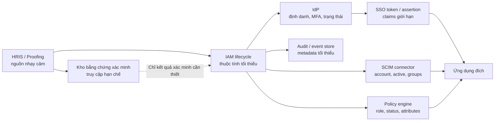

# Sensitive identity data: Nhận diện và bảo vệ dữ liệu danh tính nhạy cảm trong IAM

> **Chương:** Privacy và identity  
> **Module:** `SECURITY_IDENTITY_ACCESS_MANAGEMENT_IDENTITY_LIFECYCLE`  
> **Bối cảnh:** Quản lý vòng đời danh tính theo mô hình **Joiner–Mover–Leaver (JML)**, từ xác minh danh tính, tạo tài khoản, cấp quyền, thay đổi vai trò đến vô hiệu hóa và thu hồi quyền. Bài học liên hệ với **IdP, SSO, SCIM, RBAC/ABAC, tài khoản dịch vụ, kiểm toán** và giảm quyền truy cập tồn dư.

## 1. Sensitive identity data là gì?

**Sensitive identity data** là thông tin liên quan đến danh tính mà việc truy cập, sử dụng, chia sẻ, thay đổi hoặc mất kiểm soát có thể gây hậu quả đáng kể đối với cá nhân, tổ chức hoặc hệ thống. Trong IAM, dữ liệu này không chỉ gồm thông tin cá nhân nhạy cảm, mà còn gồm **thông tin xác thực, bí mật kỹ thuật, dữ liệu khôi phục tài khoản, hồ sơ xác minh danh tính và quan hệ quyền truy cập**.

Ví dụ: số giấy tờ định danh, ảnh chân dung dùng để xác minh, dữ liệu sinh trắc, token phiên, khóa riêng, recovery codes, lịch sử đăng nhập, vai trò quản trị đặc quyền và thông tin cho biết một người thuộc nhóm ứng cứu bảo mật.

Độ nhạy **phụ thuộc mục đích và ngữ cảnh**. Email công việc thường không thuộc nhóm dữ liệu cá nhân đặc biệt theo nhiều cách phân loại, nhưng có thể trở nên rất nhạy cảm khi được kết hợp với tên bệnh nhân, lịch sử truy cập hệ thống y tế hoặc vị trí của nhân viên làm nhiệm vụ bảo vệ. Một mã chủ thể ngẫu nhiên cũng có thể nhận diện cá nhân nếu hệ thống giữ bảng ánh xạ.

Phải phân biệt ba câu hỏi:

1. **Đây có phải dữ liệu cá nhân?** Có thể xác định trực tiếp hoặc gián tiếp một con người hay không?
2. **Mức độ nhạy cảm về privacy và tác động là bao nhiêu?** Nếu lộ, sai lệch hoặc bị lạm dụng, người liên quan có thể chịu hậu quả gì?
3. **Đây có phải bí mật bảo mật?** Nếu bị lộ, thông tin có thể trực tiếp giúp mạo danh, đăng nhập, phục hồi tài khoản hoặc vượt kiểm soát?

Ba câu hỏi có thể cho những câu trả lời khác nhau. Mật khẩu là **authentication secret** cần biện pháp kỹ thuật riêng; giấy tờ định danh là dữ liệu cá nhân có rủi ro mạo danh; danh sách quyền truy cập là metadata hệ thống có thể tiết lộ bề mặt tấn công. Không nên đặt tất cả vào một nhãn chung rồi áp cùng cách xử lý.

### 1.1. Sensitive data không đồng nghĩa chỉ với “PII”

| Loại dữ liệu | Ví dụ | Rủi ro nổi bật |
|---|---|---|
| **Định danh trực tiếp** | Số giấy tờ, số định danh, ảnh chân dung, địa chỉ liên hệ | Mạo danh, gian lận, xâm phạm đời tư |
| **Thuộc tính cá nhân nhạy cảm theo ngữ cảnh** | Dữ liệu sức khỏe, sinh trắc, thông tin liên quan đời sống riêng tư | Phân biệt đối xử, tổn hại cá nhân, mất quyền riêng tư |
| **Dữ liệu xác minh danh tính** | Ảnh giấy tờ, video liveness, kết quả đối chiếu, mức bảo đảm | Mạo danh và lộ bằng chứng khó thay đổi |
| **Bí mật xác thực** | Mật khẩu, TOTP seed, recovery code, private key | Chiếm quyền tài khoản hoặc tạo phiên trái phép |
| **Token và phiên** | Access token, refresh token, session cookie | Truy cập thay người dùng trong thời gian token còn hiệu lực |
| **Metadata IAM** | Nhóm đặc quyền, quyền quản trị, ánh xạ ứng dụng, lịch sử thu hồi | Lộ cấu trúc quyền, hỗ trợ leo thang đặc quyền |
| **Dữ liệu hoạt động** | IP, thiết bị, địa điểm đăng nhập, thời gian, lịch sử ứng dụng | Theo dõi thói quen, tái nhận diện, suy luận hành vi |
| **Dữ liệu phi con người** | API key, khóa máy, service account credential, certificate private key | Xâm nhập hệ thống, di chuyển ngang, lộ dữ liệu dịch vụ |

**Phân loại pháp lý** tùy khu vực tài phán và quy định áp dụng. Khung phân loại nội bộ phải bổ sung nghĩa vụ pháp lý tương ứng; không tự suy ra rằng mọi email hoặc mọi log đều thuộc cùng một danh mục “dữ liệu cá nhân nhạy cảm” của luật.

## 2. Vì sao dữ liệu IAM có tác động lớn khi bị lộ?

IAM kết nối nguồn nhân sự, IdP, ứng dụng SaaS, máy chủ nội bộ, công cụ quản trị, hệ thống phân quyền và audit. Do đó, chỉ một kho hoặc connector bị xâm nhập có thể làm lộ **quan hệ giữa con người, tài khoản và quyền hạn** trên nhiều hệ thống.

Các hậu quả cần phân tích:

- **Confidentiality:** tiết lộ thông tin cá nhân, bằng chứng xác minh, cấu trúc nhóm đặc quyền, credential hoặc lịch sử hoạt động.
- **Integrity:** sửa `orgUnitId`, `managerId`, `employmentStatus` hoặc `role` để cấp quyền không hợp lệ; thay account mapping để thu hồi nhầm người.
- **Availability:** xóa hoặc mã hóa hồ sơ danh tính, làm gián đoạn đăng nhập và quy trình Joiner–Mover–Leaver.
- **Authentication risk:** đánh cắp token, secret hoặc phương tiện phục hồi để chiếm quyền.
- **Authorization risk:** dùng thuộc tính đã bị sửa hoặc lỗi thời để vượt RBAC/ABAC.
- **Privacy risk:** liên kết dữ liệu từ các ứng dụng để suy ra danh tính, vị trí, hoạt động hoặc các thông tin cá nhân chưa được chủ thể chấp thuận cho mục đích đó.
- **Residual access risk:** do dữ liệu JML sai hoặc bị bỏ sót, tài khoản của người rời tổ chức vẫn có thể sử dụng được.

Không phải mọi trường hợp mất dữ liệu đều là đọc trái phép. Một sự kiện mover bị gán nhầm phòng ban có thể dẫn tới **quyết định cấp quyền sai**, ngay cả khi không có bản ghi nào bị lộ.

## 3. Phân loại dữ liệu danh tính theo mức rủi ro

Một chính sách nội bộ có thể chia mức theo **tác động**. Dưới đây là ví dụ để thiết kế kiểm soát, không phải phân loại pháp lý bắt buộc:

| Mức minh họa | Dữ liệu ví dụ | Kiểm soát thường cần |
|---|---|---|
| **Nội bộ** | Tên hiển thị trong danh bạ nội bộ, mã đơn vị công khai trong công ty | RBAC thông thường, giới hạn đối tượng nhận, retention |
| **Hạn chế** | Email công việc, số nhân viên, lịch sử nhóm quyền, địa chỉ IP | Least privilege, log truy cập, truyền tải bảo mật, giới hạn sao chép |
| **Nhạy cảm** | Bằng chứng xác minh, thông tin đời tư, thuộc tính có nguy cơ gây hại, lịch sử hoạt động chi tiết | Phân quyền chặt, mã hóa, phân tách môi trường, duyệt mục đích, audit truy cập |
| **Bí mật đặc biệt** | Refresh token, private key, recovery code, TOTP seed, secret của workload | Secret manager/HSM khi thích hợp, không log, phân quyền tối thiểu, xoay/thu hồi và giám sát |

**Nguyên tắc:** gán mức bảo vệ theo **giá trị và cách dùng**, không chỉ theo tên cột. `userId` có thể là mã ngẫu nhiên ít tiết lộ, nhưng khi đi cùng `group=global-admin` và thông tin đăng nhập hoạt động, bản ghi cho thấy mục tiêu có đặc quyền cao.

### 3.1. Rủi ro từ việc kết hợp nhiều trường

Một tập các trường tưởng như “ít nhạy cảm” có thể tăng khả năng tái nhận diện:

```text
orgUnitId = security-response
workLocation = site-3
shift = overnight
eventTimestamp = 2026-11-23T01:14:00Z
```

Khi kết hợp với danh sách phân ca hoặc log mạng, các thuộc tính này có thể suy ra người trực cụ thể. Vì vậy, đánh giá nhạy cảm phải xem xét **tập dữ liệu, đối tượng có quyền nhận và khả năng liên kết chéo**, không chỉ từng trường riêng lẻ.

### 3.2. Rủi ro theo vòng đời

| Giai đoạn | Điểm thường phát sinh dữ liệu nhạy cảm | Điều có thể sai |
|---|---|---|
| **Joiner** | Thu thập giấy tờ, proofing, đăng ký MFA, tạo tài khoản | Copy ảnh giấy tờ vào nhiều hệ thống; lộ recovery code |
| **Mover** | Thay department, manager, role, nhóm đặc quyền | Giữ quyền cũ; để lộ đơn vị nhạy cảm hoặc thông tin điều chuyển |
| **Leaver** | Xác nhận nghỉ việc, vô hiệu hóa account, chuyển sở hữu | Log chi tiết lý do nghỉ việc; để lại token/session và quyền ứng dụng |
| **Review/Audit** | Xuất danh sách tài khoản, quyền và thời điểm truy cập | Spreadsheet báo cáo chứa dữ liệu cá nhân quá rộng, chia sẻ sai |
| **Service lifecycle** | Tạo bot, phát khóa, chuyển owner, hủy workload | API key nằm trong repo/log; không thu hồi khi không còn dùng |

## 4. Chuỗi xử lý dữ liệu nhạy cảm: biết nơi nào giữ bản sao

Dữ liệu có thể đi qua nhiều thành phần trước khi quyết định truy cập được thực hiện:



Lập **data inventory** theo trường và dòng dữ liệu: ai tạo, nguồn nào có thẩm quyền, truyền qua giao thức nào, ứng dụng nào nhận, lưu bao lâu, bản sao nào nằm trong log/cache/queue và ai có quyền truy cập.

Một bảng ghi nhận dòng dữ liệu:

| Thuộc tính | Nguồn | Người nhận hợp lệ | Mục đích | Quy tắc |
|---|---|---|---|---|
| `personId` | IAM | Provisioning và reconciliation | Liên kết đúng tài khoản | Không tái sử dụng, scope theo tenant |
| `proofingStatus` | Dịch vụ proofing | IAM/IdP có nhu cầu | Xác nhận đã đáp ứng bước xác minh | Không gửi ảnh/tài liệu gốc |
| `orgUnitId` | HRIS | Policy engine | Tính quyền theo đơn vị | Cập nhật khi mover |
| `groupIds` | IAM/IdP | Ứng dụng cần group | Cấp quyền | Tránh tiết lộ nhóm ngoài phạm vi |
| `sessionId` | IdP/ứng dụng | Thành phần quản lý phiên | Kiểm soát phiên | Không đưa vào log thông thường |
| `terminationReasonDetail` | HRIS có thẩm quyền | Bên xử lý nghiệp vụ giới hạn | Hồ sơ nhân sự | Không đưa vào SCIM/log IAM nếu không cần |
| `servicePrivateKey` | Secret manager / HSM | Workload được cấp quyền | Xác thực máy | Không đưa vào identity profile hoặc ticket |

## 5. Privacy by design: chỉ xử lý đúng dữ liệu và mục đích

### 5.1. Data minimization và purpose limitation

Mỗi thành phần chỉ nhận những trường **thật sự cần cho nhiệm vụ**. Ví dụ ứng dụng quản lý công việc có thể cần mã tài khoản, tên hiển thị và trạng thái hoạt động; nó không cần bản sao giấy tờ định danh hoặc toàn bộ lịch sử công tác.

Phân biệt:

- **Thu thập:** tổ chức có lý do và căn cứ phù hợp để lấy dữ liệu ngay từ đầu không?
- **Sử dụng:** nghiệp vụ cụ thể nào cần trường đó?
- **Chia sẻ:** hệ thống nhận có cần giá trị thô hay chỉ một kết luận?
- **Lưu giữ:** sau sự kiện nào dữ liệu không còn cần hoặc cần được chuyển sang kho lưu hạn chế?
- **Xóa:** xóa ở hệ thống hoạt động có kèm cache, log, bản sao, backup và bên nhận theo chính sách không?

Chỉ thay tên trường trong API không đủ. Giả sử ứng dụng không được nhận ngày sinh, nó có thể chỉ nhận `ageRequirementMet=true` được phát hành bởi dịch vụ đáng tin cậy. Tuy nhiên, cờ này cũng có thể là dữ liệu cá nhân nếu gắn với một người; phải kiểm tra độ tin cậy, thời hạn hiệu lực và quyền sử dụng.

### 5.2. Biểu diễn ít tiết lộ hơn

| Nhu cầu | Dữ liệu thô có thể bị yêu cầu quá mức | Phương án ít tiết lộ hơn khi nghiệp vụ cho phép |
|---|---|---|
| Biết người dùng đã xác minh | Bản scan hộ chiếu, ảnh liveness | `identityVerified`, mức bảo đảm, nguồn và thời gian |
| Cấp quyền báo cáo | Mã nhân viên, chức danh, quản lý, hợp đồng | Nhóm `report-reader` hoặc role được phê duyệt |
| Định tuyến phê duyệt | Toàn bộ sơ đồ tổ chức | `approverId` cần thiết cho một workflow |
| Kiểm tra điều kiện tuổi | Ngày sinh đầy đủ | Khẳng định điều kiện tuổi với nguồn tin cậy |
| Xác định người thuộc nhóm khẩn cấp | Chi tiết nhiệm vụ cá nhân | Eligibility flag hoặc nhóm điều phối có scope |
| Liên kết SSO | Email hoặc số định danh xuyên hệ thống | Opaque subject/pairwise subject khi hỗ trợ |

Đừng dùng “ẩn danh” để mô tả pseudonymized IDs nếu vẫn có thể ánh xạ ngược qua IdP hoặc hệ thống IAM.

## 6. Bảo vệ dữ liệu xác minh danh tính trong Joiner

Ở giai đoạn **Joiner**, tổ chức có thể xác minh danh tính người dùng trước khi tạo account và cấp quyền. Dữ liệu proofing đôi khi gồm giấy tờ, chân dung, video hoặc dấu hiệu chống giả mạo. Đây là thời điểm cần thiết kế bảo vệ chặt từ đầu.

### 6.1. Tách nguồn bằng chứng và kết luận xác minh

Quy trình khái niệm:

1. Dịch vụ proofing nhận đúng loại bằng chứng theo mức bảo đảm cần thiết.
2. Dữ liệu thô chỉ được xử lý trong môi trường và thời hạn được cho phép, với phân quyền riêng.
3. Kết quả trả về IAM là trạng thái, mức bảo đảm, nguồn chứng thực, thời điểm và mã tham chiếu phù hợp.
4. IAM cấp hoặc từ chối account theo chính sách; IdP không nhất thiết cần bản sao chứng từ.
5. Hệ thống lưu bằng chứng kiểm toán quá trình xác minh ở mức cần thiết, giới hạn người có thể truy ngược.

Ví dụ kết quả rút gọn:

```json
{
  "personId": "p-61e4",
  "proofing": {
    "status": "verified",
    "assuranceProfile": "policy-level-2",
    "verifiedAt": "2026-11-23T02:00:00Z",
    "providerReference": "proof-8031"
  }
}
```

`assuranceProfile` trong ví dụ là mã nội bộ, không đại diện mặc định cho một mức chuẩn NIST cụ thể. Một kết luận xác minh phải có nguồn tin cậy và chính sách xác định mức bảo đảm phù hợp với rủi ro.

### 6.2. Xử lý bản scan giấy tờ và hình ảnh

Các kiểm soát thường cần:

- Kênh tải lên và truyền tải bảo mật; không đưa tài liệu vào URL hoặc query string.
- Kho lưu riêng, thời hạn lưu rõ, khóa mã hóa và phân quyền dựa trên nhiệm vụ.
- Tránh hiển thị toàn bộ số giấy tờ hoặc ảnh cho nhân viên hỗ trợ nếu họ chỉ cần trạng thái xử lý.
- Che hoặc không ghi dữ liệu nhận dạng trong log/tracing, thông báo lỗi, công cụ phân tích.
- Kiểm soát khả năng xuất hàng loạt, tìm kiếm, tải xuống và chia sẻ của người vận hành.
- Quy trình xóa, xử lý backup và xác nhận với bên cung cấp proofing.

**Không nên lưu lại bản scan** chỉ để hỗ trợ reset mật khẩu nếu đã có cách chứng minh quyền kiểm soát tài khoản an toàn và ít rủi ro hơn.

### 6.3. Biometrics là trường hợp đặc biệt

Dữ liệu sinh trắc liên quan đặc điểm cơ thể hoặc hành vi có thể khó thay đổi nếu bị xâm phạm. Cần phân biệt:

- **Biometric sample:** ảnh, âm thanh hoặc tín hiệu thu thập trong quá trình kiểm tra.
- **Biometric template:** biểu diễn đặc trưng phục vụ so khớp, vẫn có thể mang rủi ro riêng tư.
- **Proofing result:** kết luận về kiểm tra, đôi khi đủ cho quy trình IAM.

Trong các phương thức như **passkey/WebAuthn**, ứng dụng thường xác minh chữ ký mật mã bằng public key; nếu thiết bị dùng vân tay hoặc khuôn mặt để mở khóa local authenticator, ứng dụng không mặc nhiên nhận dữ liệu sinh trắc thô. Không yêu cầu upload ảnh vân tay chỉ vì muốn triển khai passkey.

## 7. Mật khẩu, MFA và recovery data: bí mật phải tách khỏi hồ sơ danh tính

Thuộc tính hồ sơ có thể được sao chép có chọn lọc; **authentication secrets** cần chế độ quản lý riêng.

| Loại | Cách quản lý đúng hướng | Tránh |
|---|---|---|
| Mật khẩu người dùng | Hash có salt và hàm băm mật khẩu chuyên dụng, ví dụ Argon2id theo cấu hình phù hợp | Lưu rõ, mã hóa đối xứng để có thể đọc lại, hash nhanh đơn giản |
| TOTP seed | Kho bí mật mã hóa, quyền đọc hẹp, quản lý reset và vòng đời | Lưu trong user profile/CSV export hoặc log |
| Recovery code | Sinh đủ entropy, giới hạn lần dùng; giữ verifier an toàn nếu chỉ cần kiểm tra | Hiện lại tất cả code cho nhân viên hỗ trợ |
| Access token / refresh token | Bảo vệ như bearer credential, kiểm soát audience, thời hạn, scope và thu hồi | Ghi vào log, local debug, URL, ticket |
| Session cookie | `Secure`, `HttpOnly` và cấu hình `SameSite` phù hợp; quản lý phiên | Chia sẻ giữa ứng dụng không có ranh giới tin cậy |
| Khóa riêng / API key | Secret manager, HSM hoặc cơ chế quản lý khóa phù hợp | Nhúng vào mã nguồn, tài liệu hoặc biến môi trường bị log |

Không được coi số điện thoại hoặc email cá nhân là bằng chứng mạnh duy nhất cho việc cấp lại quyền quản trị; recovery flow có thể bị tấn công social engineering, SIM swap hoặc chiếm mailbox. Thiết kế recovery phải dựa trên mô hình đe dọa và mức bảo đảm của account.

### 7.1. Vì sao hash email khác hash mật khẩu?

Hash một email bằng SHA-256 **không tự tạo ra ẩn danh**: địa chỉ email có không gian đoán được và có thể bị thử bằng dictionary. Ngược lại, lưu mật khẩu cần cơ chế băm mật khẩu chuyên dụng, salt độc lập, giới hạn brute-force và chính sách xác thực thích hợp. Hai bài toán khác nhau về mục đích và khả năng bị dò.

### 7.2. Không log dữ liệu phục hồi khi xử lý hỗ trợ

Một ticket hỗ trợ có thể ghi:

```json
{
  "requestId": "support-1844",
  "subjectId": "p-61e4",
  "action": "authenticator-reset-request",
  "verificationWorkflowId": "recovery-flow-23",
  "outcome": "approved"
}
```

Ticket không cần lưu mã OTP, mật khẩu cũ, secret khóa thiết bị hay toàn bộ câu trả lời bảo mật. Khi cần kiểm tra gian lận, nên dùng mã tham chiếu tới chứng cứ ở kho chuyên biệt có phân quyền.

## 8. IdP, SSO, OIDC và SAML: claims cũng là dữ liệu nhạy cảm

IdP có thể biết nhiều thuộc tính để quản lý xác thực, nhưng **relying party không đương nhiên được phép nhận mọi thông tin trong directory**.

### 8.1. Phát hành claims tối thiểu

Trong **OIDC**, `iss` và `sub` dùng để nhận diện subject trong phạm vi issuer; `aud` xác định đối tượng nhận token, cùng các claim giao thức bắt buộc khác. Những claim bổ sung như `email`, `name`, `phone_number`, `address` phải được đánh giá theo nhu cầu của ứng dụng.

Ví dụ hai client:

| Client | Nhu cầu | Claim có thể phù hợp |
|---|---|---|
| Portal nội bộ | Đăng nhập và hiện giao diện | ID token chuẩn, tên hiển thị nếu cần |
| Hệ thống báo cáo | Phân quyền theo nhóm được duyệt | Subject + entitlement hoặc cơ chế PDP, không cần địa chỉ |
| Ứng dụng thông báo | Gửi thông báo qua email công việc | Email công việc nếu thực sự phải biết |
| Ứng dụng tiếp nhận giấy tờ | Có nghiệp vụ xác minh chuyên biệt | Tập bằng chứng theo mục đích, lưu tại vùng chuyên biệt |

OIDC hỗ trợ **pairwise subject identifiers** theo sector identifier khi nhà cung cấp triển khai, giúp giảm khả năng liên kết chéo giữa các relying party khác sector. Pairwise subject không loại trừ việc IAM giữ ánh xạ nội bộ để phục vụ vòng đời; ánh xạ đó cũng cần được bảo vệ.

### 8.2. Token là chứng thư quyền mang dữ liệu

Một **JWT** có payload base64url có thể đọc được khi không mã hóa riêng; chữ ký của JWT bảo vệ tính toàn vẹn, **không biến payload thành bí mật**. Vì vậy, không đưa số giấy tờ, thông tin sức khỏe, TOTP seed hay dữ liệu nội bộ nhạy cảm vào JWT chỉ vì token đã ký.

Những nguyên tắc cơ bản:

- Đúng **audience** và scope; token dành cho ứng dụng A không được tự sử dụng tại ứng dụng B.
- Thời hạn hợp lý và giải pháp revocation/session management theo rủi ro.
- Claim đủ dùng để quyết định; tránh nhét toàn bộ group membership nếu không cần.
- Không ghi token vào URL, access log, telemetry hoặc công cụ phân tích.
- Nếu bắt buộc truyền thông tin cần giữ bí mật, đánh giá cơ chế bảo mật phù hợp (bao gồm mã hóa khi cần), giới hạn bên nhận và thời hạn tồn tại.

Trong **SAML**, assertion có thể chứa attribute statement và dữ liệu định danh; ký số bảo vệ toàn vẹn/xác thực nguồn, còn yêu cầu bảo mật nội dung phải đánh giá riêng. Không đồng nhất “assertion đã ký” với “mọi attribute đều được giấu”.

### 8.3. SSO không tự thu hồi mọi phiên

Khi Leaver bị disable trong IdP, một ứng dụng có local session còn sống có thể cho truy cập tới khi session hết hạn hoặc bị thu hồi. Việc ngừng cấp token mới **không đảm bảo** mọi access token đã phát hành đều vô hiệu ngay. Dữ liệu về phiên, token family và mapping ứng dụng có thể cần giữ có kiểm soát để thực hiện revocation.

## 9. SCIM: provision tài khoản mà không phát tán hồ sơ nhạy cảm

**SCIM 2.0** hỗ trợ tạo/cập nhật/vô hiệu hóa User và Group. Payload SCIM có thể chứa thuộc tính người dùng nhưng không cần giống hồ sơ HRIS.

Ví dụ tạo tài khoản tối thiểu:

```http
POST /scim/v2/Users HTTP/1.1
Content-Type: application/scim+json
Authorization: Bearer <redacted>

{
  "schemas": ["urn:ietf:params:scim:schemas:core:2.0:User"],
  "externalId": "p-61e4",
  "userName": "user-p61e4",
  "active": true
}
```

Ở SCIM, `userName` là thuộc tính User bắt buộc; `id` do provider cấp; `externalId` là thuộc tính liên kết do provisioning client có thể cung cấp. Tên đăng nhập dạng bí danh chỉ dùng nếu ứng dụng hỗ trợ; một số dịch vụ yêu cầu email công việc, cần ghi rõ trong data contract.

Không gửi số giấy tờ, ngày sinh, ảnh proofing hoặc lý do thôi việc vào SCIM extension tùy ý nếu ứng dụng không có mục đích hợp lệ. SCIM connector phải lưu ánh xạ account để xử lý **Mover/Leaver**, nhưng nên có phân quyền riêng và phạm vi tenant.

### 9.1. Mover: cập nhật quyền, giới hạn dữ liệu

Khi `orgUnitId` thay đổi:

1. IAM xác minh sự kiện từ nguồn có thẩm quyền và ngày hiệu lực.
2. Policy engine tính lại nhóm và quyền.
3. SCIM chỉ đồng bộ những field/group membership đích cần.
4. Kiểm tra ứng dụng đã gỡ quyền cũ; xử lý các quyền được cấp thủ công ngoài IAM.
5. Audit ghi mã sự kiện và kết quả, không sao chép toàn bộ hồ sơ thay đổi.

### 9.2. Leaver: trạng thái đủ để deprovision

```http
PATCH /scim/v2/Users/app-user-917 HTTP/1.1
Content-Type: application/scim+json
Authorization: Bearer <redacted>

{
  "schemas": ["urn:ietf:params:scim:api:messages:2.0:PatchOp"],
  "Operations": [
    {"op": "replace", "path": "active", "value": false}
  ]
}
```

Lệnh này không cần chứa chi tiết nghỉ việc. Sau đó phải kiểm tra ứng dụng thực sự vô hiệu hóa account, có phiên cũ hay đường truy cập khác không. Một phản hồi API thành công không chứng minh mọi credential đã bị thu hồi.

## 10. RBAC/ABAC: dữ liệu nhạy cảm ảnh hưởng tới quyết định quyền

**RBAC** dùng vai trò làm đầu vào phân quyền. **ABAC** dùng thuộc tính subject, tài nguyên, hành động và môi trường. Dữ liệu nhạy cảm có thể xuất hiện ở cả **thuộc tính để xét quyền** và **kết quả tiết lộ qua quyết định**.

Ví dụ:

```text
permit(subject, action, resource, environment) nếu:
    subject.lifecycleState == "active"
    AND subject.entitlements chứa "case-reviewer"
    AND resource.assignedOrgUnitId == subject.orgUnitId
    AND environment.deviceCompliant == true
```

Một ứng dụng xét duyệt hồ sơ chỉ cần biết subject có role phù hợp, đúng đơn vị và thiết bị đạt chuẩn; không nhất thiết phải biết hồ sơ sức khỏe hoặc ngày sinh của nhân viên.

### 10.1. Những vấn đề cần tránh

- **Phơi bày role nhạy cảm:** mọi ứng dụng biết ai thuộc nhóm `global-admin`, `fraud-investigation` hoặc `incident-response` dù không phục vụ mục đích.
- **Attribute poisoning:** client tự khai `isAdmin=true` hoặc gửi `orgUnitId` không được xác thực, khiến PDP tin dữ liệu không có nguồn chuẩn.
- **Stale attributes:** mover đã đổi đơn vị nhưng cache vẫn giữ phòng ban cũ, dẫn tới quyết định quyền sai.
- **Over-broad policy:** một nhóm quá rộng làm nhiều thành viên thấy dữ liệu không cần thiết.
- **Side-channel:** việc API trả lỗi khác nhau theo tài nguyên nhạy cảm có thể tiết lộ “người này thuộc nhóm đặc biệt” dù payload không trả thuộc tính.

### 10.2. Bảo vệ nguồn thuộc tính

Mỗi trường dùng để quyết định quyền cần có:

- Nguồn chuẩn và cơ chế xác thực tính toàn vẹn.
- Thời gian hiệu lực, độ mới hoặc TTL phù hợp với mức rủi ro.
- Danh sách hệ thống tiêu thụ và quyền đọc.
- Quy trình thay đổi, rollback có kiểm soát và đối soát.
- Audit quyết định ở mức đủ để giải thích *vì sao được cấp hoặc từ chối*, tránh ghi giá trị nhạy cảm không cần thiết.

Ví dụ với trạng thái đủ điều kiện tham gia công việc:

```text
subject.trainingValid = true
subject.trainingAssertionSource = "training-service"
subject.trainingValidUntil = 2027-02-01
```

Đối với một quyết định quyền, kết luận `trainingValid` có thể đủ; ứng dụng không cần bộ câu hỏi, điểm số từng bài hoặc thông tin đánh giá chi tiết.

## 11. Service accounts và workload identities cũng có dữ liệu nhạy cảm

Không chỉ danh tính con người mới phát sinh rủi ro. Một **service identity** có thể sở hữu quyền API rất lớn và chứa credential được dùng tự động.

Những thông tin cần quản lý:

| Nhóm | Ví dụ | Cách bảo vệ |
|---|---|---|
| Danh tính workload | `serviceIdentityId`, môi trường, loại workload | Registry được quản lý, không trùng và có owner |
| Ownership | `ownerTeamId`, người phê duyệt, lịch review | Quyền đọc phù hợp, chuyển giao khi owner rời |
| Policy và scope | Tài nguyên được truy cập, quyền ghi/đọc, ngày hết hạn | Least privilege, review và SoD |
| Bí mật truy cập | Private key, API token, client secret | Secret manager, không đưa vào hồ sơ và log |
| Chứng cứ vận hành | Lần sử dụng cuối, vòng đời rotation, thay đổi policy | Audit giới hạn, phát hiện không dùng hoặc bất thường |

Ưu tiên **workload identity federation**, managed identity hoặc credential ngắn hạn khi nền tảng hỗ trợ. Nếu dùng secret dài hạn, đặt chủ sở hữu, thời hạn, rotation, lưu trữ an toàn và quy trình revocation.

**Rời tổ chức của owner** là một sự kiện cần rà soát ownership và secret; không tự động xóa một workload đang phục vụ production chỉ vì người tạo ra đã nghỉ. Tuy nhiên, credential cá nhân được nhúng vào service cần được chuyển đổi và thu hồi.

### 11.1. Ví dụ bản ghi không chứa bí mật

```json
{
  "serviceIdentityId": "svc-billing-reports-prod",
  "ownerTeamId": "platform-ops",
  "purposeCode": "scheduled-reconciliation",
  "environment": "production",
  "credentialProvider": "managed-workload-identity",
  "allowedResources": ["report-store"],
  "reviewDueAt": "2027-01-31T00:00:00Z"
}
```

Registry không chứa private key, client secret hay token; các vật liệu này phải đi qua hệ thống quản lý bí mật tương ứng.

## 12. Kiểm soát kỹ thuật cho lưu trữ, truyền tải và truy cập

### 12.1. Data at rest

- Mã hóa dữ liệu nhạy cảm khi lưu trữ theo mức rủi ro, có quản lý vòng đời khóa và khả năng thu hồi quyền giải mã.
- Tách kho proofing và kho credential khỏi user directory thông thường.
- Dùng quyền ở mức bảng/trường/tài nguyên khi có nhu cầu; che dữ liệu trên giao diện theo vai trò.
- Theo dõi truy cập và export hàng loạt; không để backup, snapshot, bản xuất thử nghiệm thiếu kiểm soát.
- Tránh đưa dữ liệu nhạy cảm thực tế vào môi trường development, staging, test; dùng dữ liệu tổng hợp hoặc dữ liệu đã xử lý phù hợp.

**Encryption at rest** bảo vệ khi một bản sao lưu hoặc phương tiện lưu trữ bị lộ; nó không tự ngăn một dịch vụ đã có quyền giải mã truy vấn trái phép. Cần kết hợp IAM, audit, key management và giám sát.

### 12.2. Data in transit

- Sử dụng TLS và cấu hình xác thực endpoint thích hợp cho luồng HRIS → IAM → IdP/SCIM.
- Không truyền token trong URL hoặc hệ thống analytics.
- Giới hạn nội dung message queue, webhooks và dead-letter payload; không đẩy toàn bộ hồ sơ vào event bus chỉ vì thuận tiện.
- Bảo vệ backup transfer, tích hợp đối tác và các công cụ vận hành nhận dữ liệu.

### 12.3. Least privilege và separation of duties

Đặc quyền đọc dữ liệu proofing, quản lý MFA, cấp role và xem audit là các khả năng khác nhau. Tùy rủi ro, nên tách:

- Nhân viên helpdesk có thể **khởi tạo** quy trình khôi phục mà không cần xem recovery secret.
- Nhân viên IAM có thể quản lý account mapping mà không cần xem ảnh giấy tờ.
- Người phê duyệt quyền đặc biệt không được đơn phương tự phê duyệt nếu chính sách SoD cấm.
- Nhà vận hành audit có quyền tra cứu log theo phạm vi, không có quyền sửa hoặc xóa chứng cứ.
- Ứng dụng chỉ được lấy những thuộc tính cần, kể cả khi identity directory đang giữ nhiều trường khác.

### 12.4. Kiểm soát điểm xuất dữ liệu

Một **allowlist** schema rõ ràng an toàn hơn thao tác “serialize toàn bộ object rồi xóa vài field nhạy cảm”. Khi mô hình dữ liệu có cột mới, allowlist giúp trường đó chưa tự động bị phát hành.

```python
ALLOWED_SCIM_FIELDS = {"schemas", "externalId", "userName", "active"}

def to_scim_payload(source):
    candidate = {
        "schemas": ["urn:ietf:params:scim:schemas:core:2.0:User"],
        "externalId": source.person_id,
        "userName": source.app_username,
        "active": source.lifecycle_state == "active",
    }
    unexpected = set(candidate) - ALLOWED_SCIM_FIELDS
    if unexpected:
        raise ValueError("Unexpected SCIM fields")
    return candidate
```

Ví dụ là pseudocode cho ý tưởng kiểm soát field; triển khai thực tế còn cần xử lý validation theo schema, authentication connector, idempotency, retry, log và rate limit. Nếu ứng dụng bắt buộc thêm trường, phải cập nhật hợp đồng dữ liệu và quyền chia sẻ trước khi bổ sung.

## 13. Log, audit trail và các bản sao bí mật

Hệ thống IAM cần audit mạnh để trả lời ai đã cấp quyền, vì sao, lúc nào và kết quả thực thi ở từng đích. Tuy nhiên log không nên trở thành một bản sao đầy đủ của HRIS hoặc vault.

Ví dụ sự kiện audit có chọn lọc:

```json
{
  "eventId": "evt-9012",
  "correlationId": "jml-flow-415",
  "occurredAt": "2026-11-23T05:20:00Z",
  "actorId": "iam-lifecycle-service",
  "subjectId": "p-61e4",
  "action": "account.deactivated",
  "targetApplicationId": "docs-app",
  "sourceEventId": "hr-event-771",
  "policyVersion": "jml-policy-4",
  "outcome": "confirmed"
}
```

Log này đủ để tra cứu và ghép các bước vận hành khi có hệ thống ánh xạ được bảo vệ. Nó không cần email cá nhân, giấy tờ, lý do nghỉ chi tiết, bearer token hoặc full payload.

### 13.1. Các vị trí thường bị quên

| Vị trí | Dữ liệu dễ vô tình xuất hiện | Cách giảm rủi ro |
|---|---|---|
| HTTP access log | Authorization header, query chứa token | Cấm log secret, cấu hình redaction ở gateway |
| Application trace | Request/response body SCIM, thông tin người dùng | Allowlist trường quan sát, tắt body logging mặc định |
| Dead-letter queue | Event HRIS chứa dữ liệu đầy đủ | Giới hạn payload, TTL, ACL, mã tham chiếu |
| Error reporting | Exception message có header hoặc token | Sanitize error, giới hạn người nhận |
| Analytics / BI | Danh sách nhân sự và hoạt động từng người | Mục đích rõ, aggregation và phân quyền |
| Support ticket | Ảnh chụp màn hình chứng từ, OTP | Quy trình nộp chứng cứ an toàn, không chứa secret |
| Backup / export | Bản sao của directory hoặc proofing | Mã hóa, ACL, retention và khôi phục có kiểm soát |

Log bảo mật vẫn có thể là **dữ liệu cá nhân** dù chỉ chứa opaque subject ID. Nếu có bảng tra ngược hoặc kết hợp thời điểm, hành vi, IP, phải kiểm soát truy cập và thời hạn lưu phù hợp.

### 13.2. Bằng chứng cần đủ mà không tiết lộ quá mức

Một sự kiện thu hồi quyền nên liên kết được:

```text
sourceEventId
  -> identityId
  -> policyDecisionId
  -> targetAccountId
  -> deprovisionCommandId
  -> targetConfirmationId
  -> reconciliationResult
```

Chỉ ghi “gửi request thành công” không chứng minh ứng dụng đã tắt quyền. Ngược lại, lưu nguyên request/response chứa token và PII là không cần thiết trong đa số trường hợp. Thiết kế audit cần đạt **tính giải thích được** và **mức tiết lộ tối thiểu** đồng thời.

## 14. Retention, deletion và quyền riêng tư sau Leaver

Khi nhân viên rời tổ chức, nhu cầu vận hành account thay đổi nhưng không có nghĩa mọi dữ liệu phải được xóa ngay. Có thể vẫn cần chứng cứ cho kiểm toán, tranh chấp, quy định lưu giữ hoặc điều tra đã được cho phép.

Xem xét riêng từng loại:

| Dữ liệu | Xử lý sau Leaver cần đánh giá |
|---|---|
| Account và entitlement | Vô hiệu hóa, thu hồi, đối soát các ứng dụng |
| Session/token/credential | Thu hồi hoặc hết hạn theo cơ chế thực tế |
| Bằng chứng proofing | Xóa/hạn chế sau khi hết mục đích và nghĩa vụ lưu |
| Bản ghi identity gốc | Giữ tối thiểu để ngăn trùng/tái sử dụng và đối soát trong thời hạn cần thiết |
| Account mapping | Giữ đủ để xử lý deprovision và xác minh quyền không còn |
| Log audit | Lưu theo mục đích an toàn, thời hạn và kiểm soát truy cập phù hợp |
| Export, cache, backup | Chính sách xử lý bản sao và khôi phục phù hợp, tránh dữ liệu cũ quay lại |

Khi nhận yêu cầu truy cập, sửa hoặc xóa dữ liệu từ chủ thể, tổ chức phải xác minh người yêu cầu một cách phù hợp và đối chiếu nghĩa vụ pháp lý, chính sách lưu giữ, hợp đồng và các ngoại lệ được phép. Các quyền và thủ tục cụ thể **phụ thuộc khu vực pháp lý và ngữ cảnh**, không thể đưa một quy tắc xóa ngay cho tất cả hệ thống.

### 14.1. Xóa dữ liệu không có nghĩa xóa mọi bằng chứng

Ví dụ: có thể phải thu hồi quyền truy cập SaaS ngay khi Leaver, nhưng giữ một audit event nêu rõ thời điểm thu hồi và hệ thống đã xác nhận để chứng minh không còn truy cập. Bằng chứng đó phải được giới hạn mục đích và thời hạn, không chứa toàn bộ hồ sơ cá nhân.

### 14.2. Chống phục hồi dữ liệu đã lỗi thời

Khi restore backup, hệ thống có thể vô tình khôi phục user hoặc secret từng bị thu hồi. Cần quy trình **replay trạng thái lifecycle mới nhất, revoke các credential không còn hợp lệ và reconciliation với đích** sau khi phục hồi. Thiết kế backup/restore là một phần của privacy và IAM resilience.

## 15. Mô hình đe dọa cho sensitive identity data

Một số kịch bản và đối sách:

| Tình huống | Đường tấn công hoặc lỗi | Ảnh hưởng | Kiểm soát chính |
|---|---|---|---|
| Lộ refresh token | Token xuất hiện trong log hoặc thiết bị bị xâm nhập | Duy trì phiên trái phép | Không log, bảo vệ token, rotate/revoke, giám sát |
| Lộ ảnh giấy tờ | Quyền đọc storage quá rộng hoặc export không kiểm soát | Mạo danh, tổn hại privacy | Kho tách biệt, ACL, encryption, audit, retention |
| Sửa thuộc tính HRIS | Connector hoặc tài khoản quản trị bị chiếm | Cấp quyền sai cho subject | Xác thực nguồn, change approval, reconciliation |
| Tái dùng email cũ | Liên kết identity chỉ dựa vào email | Người mới nhận quyền/tài khoản cũ | Immutable subject, scoped mapping, rehire policy |
| Lộ tên nhóm đặc quyền | Tất cả client nhận mọi group qua token | Lộ cấu trúc mục tiêu quản trị | Client-specific claims, group filtering |
| Leaver còn local account | Chỉ disable SSO, không kiểm tra app | Quyền truy cập tồn dư | Deprovision nhiều đích, kiểm tra phiên/key, access review |
| Workload secret trong CI log | Biến môi trường bị in khi debug | Chiếm quyền workload | Secret masking, ephemeral identity, rotation |
| Helpdesk tự reset MFA | Chỉ dựa trên vài thông tin có thể tra cứu | Account takeover | Recovery policy, step-up, approval/SoD theo rủi ro |
| Trích xuất audit hàng loạt | Nhân viên có quyền xem quá rộng | Theo dõi cá nhân, rò rỉ metadata | Scoped access, monitoring, export control |

Thiết kế kiểm soát phải xét cả **kẻ tấn công bên ngoài**, **tài khoản nội bộ bị chiếm**, **sai sót của người vận hành** và **dịch vụ tích hợp nhận dữ liệu quá rộng**.

## 16. Phát hiện và ứng phó khi dữ liệu nhạy cảm bị lộ

Một sự cố identity data đòi hỏi kết hợp ứng phó an ninh và bảo vệ dữ liệu. Trình tự xử lý ở mức khái niệm:

1. **Xác định phạm vi:** loại dữ liệu bị ảnh hưởng, subject, tenant, hệ thống, mốc thời gian và đường xuất dữ liệu.
2. **Cô lập rủi ro đang diễn ra:** giới hạn quyền đọc, khóa credential bị lộ, ngừng luồng chia sẻ không an toàn.
3. **Thu hồi hoặc thay thế credential:** token, secret, session, certificate và khóa phải theo khả năng thu hồi thực tế.
4. **Bảo tồn chứng cứ an toàn:** bảo vệ log, giữ chuỗi truy vết, không phát tán thêm dữ liệu nhạy cảm qua email/ticket.
5. **Đánh giá tác động:** khả năng mạo danh, chiếm quyền, lộ thông tin cá nhân, hỏng dữ liệu authorization và quyền tồn dư.
6. **Xử lý nghĩa vụ thông báo:** theo quy trình tổ chức, luật và hợp đồng áp dụng; có thể cần thông báo người liên quan, cơ quan quản lý hoặc đối tác khi đủ điều kiện.
7. **Khắc phục nguyên nhân:** thu hẹp field release, ACL, secret management, retention, monitoring và đào tạo.
8. **Đối soát hậu sự cố:** xác nhận danh tính, account mapping, nhóm quyền, phiên và trạng thái JML đã trở lại kỳ vọng.

Không sử dụng một kênh chứa chính secret bị lộ để chia sẻ thông tin thu hồi. Nếu dữ liệu sinh trắc hoặc bằng chứng định danh bị lộ, không thể giả định “đổi mật khẩu” đã giải quyết toàn bộ tác động; cần đánh giá các biện pháp giảm gian lận và nghĩa vụ privacy tương ứng.

## 17. Thiết kế mẫu: hồ sơ IAM có phân vùng dữ liệu

Thay vì một đối tượng `User` có mọi trường, có thể thiết kế logic:

```text
CoreIdentity
  personId
  lifecycleState
  identityType

OrganizationalAttributes
  personId
  orgUnitId
  roleCode
  effectiveAt

IdpAccountMapping
  personId
  issuer
  subject
  tenantId

ApplicationAccountMapping
  personId
  applicationId
  tenantId
  targetAccountId
  active

ProofingReference
  personId
  proofingReferenceId
  proofingStatus
  assuranceProfile
  verifiedAt

Entitlement
  personId
  resourceId
  roleId
  grantSource
  approvedUntil

AuditEvent
  eventId
  subjectId
  action
  policyVersion
  targetId
  outcome
```

**Authentication secrets** không nằm trong các bảng hồ sơ này; chúng thuộc hệ thống xác thực hoặc kho bí mật chuyên trách. **Raw proofing evidence** cũng được phân vùng và chỉ có mã tham chiếu qua IAM khi đủ.

### 17.1. Minh họa chính sách đọc theo mục đích

```yaml
attributePolicy:
  field: proofingStatus
  source: proofing-service
  classification: sensitive
  allowedPurposes:
    - account-activation
    - step-up-eligibility
  allowedConsumers:
    - iam-lifecycle
    - identity-provider
  release:
    mode: derived-claim
    exposeRawEvidence: false
  audit:
    logValue: false
    logDecisionId: true
  retention:
    policyRef: proofing-evidence-policy
```

Đây là YAML minh họa cho một policy nội bộ, không phải format tiêu chuẩn của SCIM/OIDC. Việc thực thi cần tích hợp ở API, authorization layer và hệ thống quản lý dữ liệu.

### 17.2. Sự kiện mover an toàn

Giả sử nhân viên từ Support chuyển sang Security. Event nên truyền thuộc tính cần thay đổi và mã tham chiếu:

```json
{
  "eventId": "hr-evt-503",
  "subjectId": "p-61e4",
  "eventType": "role_changed",
  "effectiveAt": "2026-12-01T00:00:00Z",
  "changes": {
    "orgUnitId": "security",
    "roleCode": "security-analyst"
  },
  "sourceVersion": 19
}
```

Event không cần chứa ảnh giấy tờ, tài khoản ngân hàng, lịch sử bệnh án hoặc lý do điều chuyển. IAM tính lại quyền RBAC/ABAC, thu hồi nhóm Support hết hiệu lực và cấp quyền Security đã phê duyệt, đồng thời đối soát trạng thái các ứng dụng.

Nếu vai trò Security cho phép truy cập dữ liệu nhạy cảm, có thể yêu cầu step-up authentication, phê duyệt bổ sung và access review. Việc này **không tạo lý do để đồng bộ mọi thuộc tính nhạy cảm của nhân viên sang các ứng dụng Security**.

## 18. Kiểm thử tình huống nhạy cảm trong vòng đời IAM

| Tình huống kiểm thử | Kỳ vọng |
|---|---|
| Joiner chưa xác minh nhưng có mã nhân sự | Không tự cấp quyền yêu cầu proofing; không log bằng chứng thô |
| Thêm trường `nationalId` vào HRIS schema | Connector IdP/SCIM không tự phát hành trường chưa được cho phép |
| User đổi email hoặc tái tuyển dụng | Giữ/liên kết identity đúng chính sách, không nối nhầm account theo email |
| Mover đổi đơn vị và role | Quyền cũ bị thu hồi, claim/cache cập nhật, không lộ lý do điều chuyển |
| Leaver bị disable IdP | Hệ thống kiểm tra local session, token và SaaS account thay vì chỉ tin sự kiện IdP |
| App từ chối SCIM PATCH | Có retry/alert, ghi trạng thái đích chưa thu hồi và owner xử lý |
| Helpdesk reset MFA | Không có recovery secret trong ticket và log |
| Audit query theo mã subject | Chỉ người có quyền mới xem được; kết quả không lộ PII dư thừa |
| Sự cố lộ API key | Thu hồi secret, rà soát quyền workload và log sử dụng |
| Restore backup cũ | Không phục hồi quyền đã thu hồi hoặc credential hết hiệu lực |

Kiểm thử privacy không chỉ là tìm các trường bị lộ, mà còn xác minh **luồng cấp quyền/thu hồi vẫn đúng khi dữ liệu được giới hạn**. Ví dụ bỏ toàn bộ account mapping sẽ giảm số trường nhưng khiến không thể xác minh deprovision đầy đủ.

## 19. Những hiểu nhầm thường gặp

**“Sensitive identity data chỉ là số giấy tờ hoặc sinh trắc.”** Token, recovery credential, thông tin quyền quản trị và log hoạt động có thể nguy hiểm tương đương hoặc hơn trong nhiều kịch bản.

**“Mã hóa là đủ.”** Mã hóa không kiểm soát được một service có quyền giải mã và đang thu thập dữ liệu vượt mục đích. Cần minimization, access control, audit và retention.

**“JWT đã ký nên nội dung được giữ bí mật.”** Chữ ký xác thực tính toàn vẹn/nguồn, không che payload; dữ liệu nhạy cảm trong JWT có thể đọc được nếu người nhận có token.

**“ID ẩn tên là dữ liệu đã ẩn danh.”** Opaque subject hoặc pseudonym vẫn có thể liên kết về một người qua bảng ánh xạ và các metadata khác.

**“SCIM là kênh nội bộ an toàn nên cứ đồng bộ mọi field.”** Ứng dụng đích có quản trị, chính sách giữ dữ liệu, export và người đọc riêng; chỉ truyền thuộc tính cần thiết.

**“SSO đã disable thì chắc chắn hết quyền.”** Phiên còn sống, token đã cấp và local account có thể tiếp tục hoạt động; cần deprovision, revocation và reconciliation.

**“Không lưu gì mới đảm bảo privacy.”** IAM vẫn phải giữ ID, ánh xạ, trạng thái và chứng cứ đủ để thu hồi quyền, bảo vệ hệ thống và xử lý nghĩa vụ hợp lệ.

**“Service account không có dữ liệu cá nhân nên không cần bảo vệ.”** Credential và quyền của workload có thể mở đường tới dữ liệu nhạy cảm của toàn hệ thống.

**“Ẩn field ở giao diện là đã hạn chế truy cập.”** Backend, API, export, token, log, cache và storage vẫn có thể chứa dữ liệu; phải chặn tại nơi thực thi quyền.

## 20. Checklist trước khi đưa một identity attribute vào hệ thống

| Câu hỏi | Tiêu chí đạt |
|---|---|
| Trường này phục vụ mục đích nào? | Có tác vụ và người chịu trách nhiệm rõ |
| Đây là PII, dữ liệu nhạy cảm theo ngữ cảnh hay secret? | Đã phân loại theo tác động và pháp lý áp dụng |
| Có thể thay bằng kết luận ít tiết lộ hơn không? | Đã đánh giá derived attribute hoặc opaque ID |
| Nguồn có thẩm quyền là ai? | Biết ai được sửa và cách xác thực nguồn |
| Hệ thống nào phải nhận? | Có allowlist consumer, tenant và scope |
| Có đưa vào token, SCIM, log, cache không? | Đã rà soát từng kênh và loại bỏ field không cần |
| Thời hạn và độ mới là bao nhiêu? | Có TTL, hiệu lực, retention và xử lý stale data |
| Ai đọc, thay đổi hoặc export được? | Phân quyền ít nhất, kiểm toán, kiểm soát bulk export |
| Làm gì khi Joiner/Mover/Leaver? | Có xử lý update, revoke, reconciliation |
| Khi lộ dữ liệu phải làm gì? | Có phương án revoke/rotation, incident response và nghĩa vụ thông báo |
| Khi xóa hoặc restore backup thì sao? | Có chính sách xử lý bản sao và giữ trạng thái thu hồi |

## 21. Ghi nhớ

**Sensitive identity data** bao gồm cả dữ liệu cá nhân nhạy cảm, bằng chứng xác minh, thông tin xác thực, token, metadata quyền và credential của service identity. Rủi ro không chỉ là lộ thông tin: dữ liệu danh tính sai hoặc bị chỉnh sửa có thể khiến IAM **cấp nhầm quyền hoặc không thu hồi được quyền tồn dư**.

Một thiết kế IAM an toàn phân loại đúng dữ liệu theo ngữ cảnh; chỉ lấy trường cần thiết; tách kho bằng chứng/secret khỏi hồ sơ danh tính; giới hạn claim OIDC/SAML và field SCIM; dùng thuộc tính RBAC/ABAC từ nguồn tin cậy; bảo vệ log và backup; quản lý vòng đời credential; và chứng minh được các bước **Joiner–Mover–Leaver** đã thực thi ở mọi hệ thống đích.

Hai câu hỏi cần trả lời được cho từng field là: **“Ai thật sự cần biết thông tin này để làm gì?”** và **“Làm sao ngăn nó tiếp tục bị sử dụng, tiết lộ hoặc cấp quyền khi mục đích/quan hệ danh tính đã thay đổi?”**

### Tài liệu tham khảo

- IETF [RFC 7643 — SCIM Core Schema](https://www.rfc-editor.org/rfc/rfc7643), cấu trúc thuộc tính User/Group.
- IETF [RFC 7644 — SCIM Protocol](https://www.rfc-editor.org/rfc/rfc7644), cung cấp API provisioning và PATCH.
- [OpenID Connect Core 1.0](https://openid.net/specs/openid-connect-core-1_0.html), ID token, subject identifier và yêu cầu claims.
- [NIST Digital Identity Guidelines](https://pages.nist.gov/800-63-4/), hướng dẫn về proofing, authentication và federation.
- [OWASP Authentication Cheat Sheet](https://cheatsheetseries.owasp.org/cheatsheets/Authentication_Cheat_Sheet.html), bảo vệ luồng xác thực và phục hồi.
- [OWASP Logging Cheat Sheet](https://cheatsheetseries.owasp.org/cheatsheets/Logging_Cheat_Sheet.html), thiết kế log hữu ích mà hạn chế thông tin nhạy cảm.
