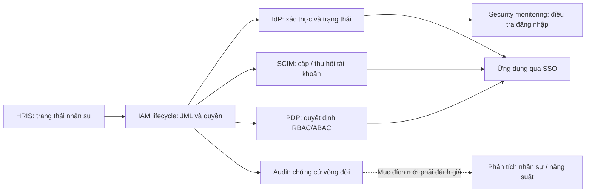
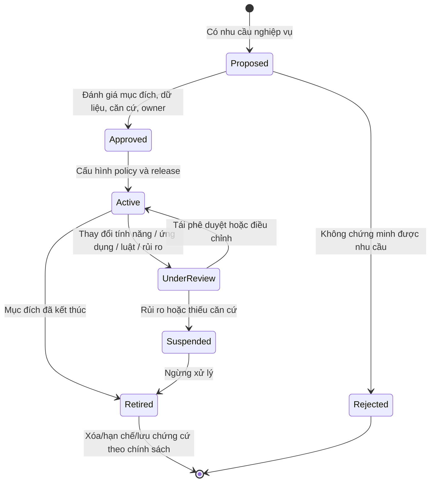

# Purpose limitation: Giới hạn mục đích xử lý dữ liệu danh tính trong IAM

> **Chương:** Privacy và identity  
> **Module:** `SECURITY_IDENTITY_ACCESS_MANAGEMENT_IDENTITY_LIFECYCLE`  
> **Mục tiêu:** Hiểu cách xác định, công bố, ghi nhận và thực thi mục đích xử lý dữ liệu danh tính trong vòng đời **Joiner–Mover–Leaver (JML)**; áp dụng với xác minh danh tính, IdP/SSO, provisioning qua SCIM, RBAC/ABAC, tài khoản dịch vụ, kiểm toán và thu hồi quyền truy cập tồn dư.

## 1. Purpose limitation là gì?

**Purpose limitation (giới hạn mục đích)** là nguyên tắc dữ liệu cá nhân chỉ được thu thập và xử lý cho những mục đích **cụ thể, rõ ràng, hợp lệ và đã được xác định**, đồng thời việc sử dụng dữ liệu về sau phải phù hợp với các mục đích đó hoặc có căn cứ phù hợp cho mục đích mới theo quy định áp dụng.

Trong IAM, hệ thống có thể biết một nhân viên là ai, đang thuộc đơn vị nào, có những tài khoản nào, đã đăng nhập khi nào và được cấp những quyền gì. Việc **có quyền truy cập kỹ thuật** tới những dữ liệu này không tự động đồng nghĩa với **được phép sử dụng chúng cho mọi mục đích**.

Ví dụ: nhật ký đăng nhập được thu thập để phát hiện truy cập bất thường và điều tra sự cố. Việc dùng chính nhật ký đó để chấm điểm năng suất làm việc của nhân viên là một mục đích khác, cần đánh giá riêng về tính phù hợp, căn cứ xử lý, thông báo, quyền truy cập và quy định liên quan.

Purpose limitation trả lời ba câu hỏi:

1. **Tại sao** tổ chức thu thập hoặc xử lý thuộc tính này?
2. **Ai, ở hệ thống nào** được dùng nó để thực hiện mục đích đã xác định?
3. **Khi mục đích kết thúc hoặc xuất hiện mục đích mới**, dữ liệu và quyền xử lý phải thay đổi ra sao?

Đây là nguyên tắc về *sử dụng dữ liệu đúng việc*, không chỉ về giữ ít dữ liệu.

### 1.1. Phân biệt với các nguyên tắc gần nhau

| Nguyên tắc | Câu hỏi trọng tâm | Ví dụ trong IAM |
|---|---|---|
| **Purpose limitation** | Dữ liệu được xử lý nhằm mục đích cụ thể nào? | Log MFA dùng để phát hiện rủi ro đăng nhập đã được xác định |
| **Data minimization** | Cần những trường nào, mức chi tiết nào cho mục đích đó? | Chỉ gửi `proofingStatus` thay cho ảnh giấy tờ khi đủ |
| **Storage limitation** | Cần giữ dữ liệu trong bao lâu cho mục đích đó? | Gỡ bản sao profile tại ứng dụng khi hết nhu cầu |
| **Access control / least privilege** | Ai có thể truy cập dữ liệu hay thực hiện hành động? | Helpdesk chỉ thấy trạng thái account, không xem hồ sơ proofing |
| **Transparency** | Chủ thể được cung cấp thông tin phù hợp về hoạt động xử lý? | Thông báo mục đích dùng dữ liệu truy cập và bên nhận |
| **Accuracy** | Dữ liệu có đúng và được cập nhật theo mục đích? | Thay `orgUnitId` khi nhân viên chuyển bộ phận |
| **Accountability** | Có giải thích và chứng minh được quyết định xử lý? | Lưu chủ sở hữu mục đích, quyết định phát hành và phiên bản policy |

Các nguyên tắc bổ trợ nhau. Việc gửi chỉ ba trường tới SaaS vẫn có thể vi phạm giới hạn mục đích nếu SaaS đem ba trường ấy phân tích hành vi ngoài mục đích đã thỏa thuận. Ngược lại, một mục đích hợp lệ không cho phép thu thập tùy ý tất cả thuộc tính có sẵn.

## 2. Vì sao purpose limitation đặc biệt quan trọng trong identity lifecycle?

IAM thường được tích hợp với **HRIS**, hệ thống quản lý đối tác, **Identity Provider (IdP)**, **Single Sign-On (SSO)**, **SCIM provisioning**, hệ thống quản lý quyền, ticket, log và kho phân tích. Những hệ thống này có mục đích khác nhau nhưng cùng chạm tới một danh tính.

Một dữ liệu có thể đi qua chuỗi:



Các đường đi liền biểu diễn mục đích vận hành đã được xác định trong ví dụ. Đường nét đứt minh họa **yêu cầu tái sử dụng dữ liệu cần đánh giá riêng**, không phải luồng được tự động phê duyệt.

Nếu không gắn mục đích vào từng luồng, tổ chức dễ gặp:

- **Function creep:** dữ liệu dần bị dùng cho nhiều việc khác với mục đích thu thập ban đầu.
- **Secondary use không được kiểm soát:** log bảo mật biến thành báo cáo đánh giá cá nhân.
- **Over-sharing:** app quản lý công việc nhận hồ sơ nhân sự đầy đủ chỉ vì connector sẵn có.
- **Purpose drift:** thay đổi chức năng sản phẩm nhưng không cập nhật lý do dùng claim hoặc retention.
- **Quyền truy cập tồn dư:** sau Mover/Leaver, dữ liệu và quyền cũ vẫn còn dù mục đích cấp quyền đã hết.
- **Thiếu khả năng giải thích:** không biết ứng dụng nào nhận thuộc tính, vì sao và đến khi nào.

## 3. Mục đích phải đủ cụ thể để kiểm soát được

Các nhãn như “cải thiện dịch vụ”, “vận hành hệ thống”, “phục vụ nghiệp vụ”, “bảo đảm an ninh” có thể quá rộng nếu không mô tả hành động và phạm vi cụ thể. Trong một hệ thống IAM, có thể dùng **purpose catalog** để chuẩn hóa những mục đích có thể kiểm soát.

| Purpose code minh họa | Mục đích được mô tả rõ | Hoạt động thuộc phạm vi |
|---|---|---|
| `identity-proofing` | Kiểm tra danh tính để kích hoạt account theo mức bảo đảm | Nhận kết quả xác minh, đánh giá điều kiện cấp account |
| `account-provisioning` | Tạo/cập nhật tài khoản khi có quan hệ hợp lệ với tổ chức | Gửi thuộc tính và nhóm tối thiểu qua SCIM |
| `authentication` | Xác thực, quản lý phiên và khôi phục quyền kiểm soát account | Xử lý passkey, MFA, session |
| `access-authorization` | Quyết định và thực thi quyền truy cập tài nguyên | Đánh giá RBAC/ABAC, điều kiện thiết bị và trạng thái |
| `access-review` | Rà soát quyền và phê duyệt ngoại lệ theo trách nhiệm | Hiển thị owner, entitlement và căn cứ cần thiết |
| `account-deprovisioning` | Thu hồi tài khoản, quyền, phiên và credential khi hết hiệu lực | Chặn đăng nhập, SCIM disable, rà soát đường truy cập |
| `security-monitoring` | Phát hiện, phân tích và ứng phó truy cập bất thường | Xử lý dấu hiệu rủi ro, thời điểm, nguồn truy cập |
| `audit-evidence` | Chứng minh quyết định và kết quả cấp/thu hồi quyền | Lưu sự kiện, policy version, trạng thái xác nhận |

Danh sách trên chỉ là **mã ví dụ để thiết kế nội bộ**. Mỗi mục đích vẫn cần owner, nhóm dữ liệu, bên nhận, cơ sở xử lý phù hợp, thời hạn, mức bảo vệ và cách đáp ứng quyền của chủ thể.

### 3.1. Mô tả mục đích theo hành động, không theo tên bộ phận

“Bộ phận IT được dùng dữ liệu nhân sự” chưa nói dữ liệu dùng để làm gì.

Mô tả rõ hơn:

> “Dịch vụ IAM sử dụng `personId`, `employmentState`, `effectiveAt` và `orgUnitId` do HRIS phát hành để tạo tài khoản, tính quyền cơ sở và thu hồi quyền truy cập trong vòng đời quan hệ làm việc.”

Mô tả này cho phép kiểm tra được **dữ liệu nào**, **nguồn nào**, **hoạt động nào**, **khi nào**, **ai chịu trách nhiệm**.

### 3.2. Mục đích và căn cứ xử lý là hai vấn đề khác nhau

Một mục đích cụ thể không tự tạo ra **căn cứ pháp lý** để xử lý dữ liệu. Tổ chức phải đánh giá cơ sở xử lý và nghĩa vụ áp dụng tùy loại dữ liệu, quan hệ giữa các bên, hợp đồng và khu vực pháp lý. “Consent” (sự đồng ý) **không phải** cơ sở mặc định hoặc luôn thích hợp cho mọi xử lý trong quan hệ lao động. Ngược lại, việc tổ chức có lợi ích bảo mật cũng không cho phép suy ra mọi hoạt động giám sát đều hợp lệ.

Nội dung này là hướng dẫn thiết kế hệ thống, không thay thế đánh giá pháp lý theo từng khu vực. Khi mở rộng mục đích hoặc xử lý dữ liệu nhạy cảm, cần người phụ trách privacy/pháp chế xem xét theo chính sách tổ chức.

## 4. Vòng đời của một purpose

Giống như account có Joiner–Mover–Leaver, một mục đích xử lý cũng cần được quản lý khi bắt đầu, thay đổi và kết thúc.



Các thay đổi nên kích hoạt đánh giá lại:

1. Thêm consumer hoặc bên nhận thứ ba.
2. Bổ sung field, claim, nhóm quyền hoặc độ chi tiết mới.
3. Đổi tính năng, mô hình xử lý hoặc đưa dữ liệu vào phân tích/AI.
4. Tăng thời hạn lưu, truy cập hoặc phạm vi tenant.
5. Dùng dữ liệu để đánh giá con người thay vì chỉ vận hành tài khoản.
6. Chuyển dữ liệu qua biên giới hoặc tới bên xử lý mới khi có nghĩa vụ liên quan.
7. Mục đích ban đầu không còn vì ứng dụng bị hủy hoặc workflow thay thế.

Không nên để một purpose code đã được tạo trở thành **giấy phép vĩnh viễn** cho mọi hoạt động sau này.

## 5. Gắn mục đích vào một attribute contract

Thay vì chỉ ghi “field này có được chia sẻ không?”, nên ghi “field này được chia sẻ **cho mục đích nào, tới consumer nào và trong điều kiện nào**?”.

| Thuộc tính | Nguồn có thẩm quyền | Purpose hợp lệ theo ví dụ | Consumer | Giới hạn |
|---|---|---|---|---|
| `personId` | IAM identity registry | `account-provisioning`, `account-deprovisioning`, `audit-evidence` | Provisioning worker, audit linkage | Opaque ID; scope theo tổ chức và tenant |
| `employmentState` | HRIS | `account-provisioning`, `access-authorization`, `account-deprovisioning` | IAM/PDP | Không mặc định gửi lý do nghỉ việc |
| `orgUnitId` | HRIS | `access-authorization` | IAM/PDP hoặc app cần phạm vi đơn vị | Chỉ phiên bản có hiệu lực, không gửi nguyên HRIS |
| `managerId` | HRIS | `access-review` | Workflow phê duyệt | Không phát hành tới toàn bộ SaaS |
| `proofingStatus` | Identity proofing provider | `identity-proofing` | IAM/IdP cần kết quả | Không kèm ảnh giấy tờ nếu không cần |
| `authenticatorMetadata` | IdP | `authentication`, `security-monitoring` | IdP, security service | Không tiết lộ seed/recovery secret |
| `loginEvent` | IdP | `security-monitoring`, `audit-evidence` | SOC, audit service được phép | Mục đích giám sát nhân sự cần đánh giá riêng |
| `targetAccountId` | Ứng dụng đích | `account-deprovisioning`, `audit-evidence` | IAM/reconciliation | Chỉ người và service có nhiệm vụ liên quan |

Một field có thể phục vụ **nhiều mục đích đã được xác định**, nhưng không được dùng cho bất kỳ mục đích nào chỉ vì đã tồn tại trong hệ thống.

### 5.1. Purpose record tối thiểu

```yaml
purposeId: account-deprovisioning
description: "Thu hồi account và quyền khi quan hệ danh tính hết hiệu lực"
ownerTeam: iam-platform
subjectTypes:
  - employee
  - contractor
allowedSources:
  - hris
  - iam-account-registry
allowedConsumers:
  - iam-lifecycle
  - approved-scim-connectors
allowedAttributes:
  - personId
  - lifecycleState
  - effectiveAt
  - targetAccountId
  - groupIds
disallowedExamples:
  - personalHealthDetails
  - terminationReasonDetail
retentionPolicyRef: jml-revocation-evidence
reviewTriggers:
  - new-target-application
  - field-contract-change
  - lifecycle-policy-change
```

Đây là định dạng **YAML minh họa**, không phải đặc tả của SCIM, OIDC hay một luật bảo vệ dữ liệu cụ thể. Trong triển khai thực tế phải liên kết thêm phiên bản, chủ sở hữu, căn cứ xử lý, phân loại dữ liệu, thời hạn lưu, quy trình phê duyệt và kiểm thử.

## 6. Joiner: mục đích xác minh khác mục đích tạo tài khoản

Khi một người gia nhập tổ chức, IAM thường phải xác nhận danh tính, tạo hồ sơ IdP, đăng ký MFA và cấp quyền cơ sở. Những công việc này **liên quan nhưng không có cùng mục đích dữ liệu**.

### 6.1. Identity proofing

Nếu quy trình cần kiểm tra giấy tờ hoặc so khớp chân dung, purpose `identity-proofing` phải nêu rõ:

- Mức bảo đảm danh tính cần đạt cho loại tài khoản.
- Loại bằng chứng cần, đơn vị thực hiện, thời hạn lưu và quyền truy cập.
- Dịch vụ nào được nhận kết quả xác minh.
- Khi nào không còn cần bằng chứng thô và cách xử lý bản sao.

IAM thông thường có thể nhận một khẳng định:

```json
{
  "personId": "person-42",
  "proofingStatus": "verified",
  "assurancePolicy": "workforce-standard",
  "verifiedAt": "2026-11-23T02:00:00Z",
  "evidenceReference": "proof-927"
}
```

Không có lý do tự động chuyển ảnh giấy tờ sang Jira, hệ thống quản lý kho mã nguồn hoặc ứng dụng đặt lịch. `evidenceReference` chỉ nên có thể tra cứu bởi những hệ thống được phép.

### 6.2. Tạo tài khoản và cấp quyền cơ sở

Với `account-provisioning`, IAM cần danh tính ổn định, trạng thái, ngày bắt đầu, thông tin đăng nhập thích hợp và vai trò/nhóm cần thiết. Việc thu thập các trường này phục vụ **tạo tài khoản và cấp đúng quyền**, không tự tạo quyền dùng dữ liệu để lập hồ sơ năng suất, bán hàng hay tiếp thị.

Ví dụ: `orgUnitId=engineering` được dùng để gán `engineering-reader`. Một ứng dụng chỉ hiểu entitlement có thể nhận tên nhóm thay cho phòng ban thực tế.

### 6.3. Thuộc tính phục vụ hỗ trợ có mục đích riêng

Helpdesk có thể cần biết “tài khoản đã kích hoạt chưa?” hoặc “yêu cầu onboarding thuộc người quản lý nào?”. Điều đó không yêu cầu helpdesk được xem toàn bộ giấy tờ proofing hay dữ liệu nhân sự. Hệ thống hỗ trợ nên nhận kết quả kiểm tra, trạng thái và người có trách nhiệm ở mức đủ cho yêu cầu.

## 7. Mover: mục đích cấp quyền cũ có thể đã kết thúc

Khi người dùng đổi vị trí hoặc phòng ban, tổ chức cần đánh giá lại quyền truy cập và luồng dữ liệu gắn với vai trò cũ.

Giả sử Linh chuyển từ đội Support sang đội Finance:

| Dữ liệu hoặc quyền | Trước Mover | Sau Mover |
|---|---|---|
| `orgUnitId` | `support` | `finance` từ ngày hiệu lực |
| Nhóm truy cập Support | Dùng để xử lý ticket | Thu hồi khi không còn mục đích |
| Nhóm `finance-reader` | Không có | Cấp nếu chính sách/phê duyệt cho phép |
| Dữ liệu khách hàng trong queue Support | Có thể truy cập phục vụ ticket | Ngừng truy cập, xử lý dữ liệu tải xuống/cached theo chính sách |
| Audit quyền cũ | Lưu có kiểm soát để chứng minh quyết định | Không sử dụng như quyền hiện tại |

Purpose limitation yêu cầu xem **tại sao quyền và dữ liệu còn cần**, không chỉ xem role mới là gì. Khi mục đích “xử lý ticket Support” không còn, việc giữ quyền đọc kho ticket vì “phục vụ công việc chung” phải được đánh giá lại.

Một quy trình Mover:

1. Nhận sự kiện nguồn có `personId`, thay đổi role/đơn vị và `effectiveAt`.
2. Tính quyền hiện tại và quyền kỳ vọng từ RBAC/ABAC.
3. Thu hồi entitlement, nhóm, session hoặc bản sao thuộc tính gắn với vai trò cũ khi không còn cần.
4. Cấp quyền mới theo policy và approval, lưu lý do cấp quyền mới.
5. Đối soát tài khoản đích, phát hiện quyền được cấp trực tiếp ngoài hệ thống IAM.
6. Giới hạn ngoại lệ bàn giao bằng phạm vi, người phê duyệt và ngày hết hiệu lực.

### 7.1. Thời gian bàn giao không có nghĩa giữ quyền vô hạn

Trong thời gian bàn giao, người dùng có thể cần đọc một số ticket Support cũ. Mục đích đó phải cụ thể: **đọc những ticket được phân công để hoàn thành bàn giao đến ngày xác định**. Quyền ngoại lệ cần có expiration và owner; không cấp lại toàn bộ vai trò Support vô thời hạn.

### 7.2. Dữ liệu quá khứ có thể giữ để kiểm toán, không để cấp quyền hiện tại

Lịch sử “Linh từng thuộc Support và đã phê duyệt ticket X” có thể cần cho audit. Nhưng policy engine quyết định truy cập **hiện tại** phải dùng trạng thái mới nhất có hiệu lực. Không để một bản snapshot lịch sử âm thầm trở thành nguồn thuộc tính hiện hành.

## 8. Leaver: thu hồi mục đích truy cập và quản lý dữ liệu còn lại

Khi nhân viên hoặc đối tác rời tổ chức, mục đích cho phép họ làm việc trên hệ thống kết thúc. IAM phải xử lý:

- Vô hiệu hóa đăng nhập IdP, revoke session/refresh token theo khả năng từng hệ thống.
- Ngừng hoặc hủy tài khoản ứng dụng qua SCIM, API hoặc runbook thủ công.
- Thu hồi nhóm RBAC, điều kiện ABAC, VPN, SSH key, local account và API credential cá nhân.
- Xác minh kết quả ở từng ứng dụng bằng reconciliation, tránh quyền truy cập tồn dư.
- Giải quyết ownership của dữ liệu, ticket, repository và service identity có phụ thuộc.

Tuy nhiên, **mục đích ngừng cho truy cập** khác với **mục đích giữ chứng cứ**. Có thể cần lưu `personId`, mapping account, quyết định phê duyệt, thời điểm deactivate và kết quả xác nhận để đáp ứng kiểm toán hoặc nghĩa vụ phù hợp. Không vì yêu cầu giữ chứng cứ mà cho phép tái sử dụng toàn bộ lịch sử nhân sự cho mục đích khác.

### 8.1. Không gửi lý do thôi việc chi tiết tới mọi đích

Để vô hiệu hóa account, SCIM connector thường chỉ cần **account ID** và trạng thái `active=false`. Thông tin thuộc hồ sơ nhân sự như lý do kỷ luật, thông tin y tế hoặc nội dung tranh chấp không nên tự động được sao chép vào ticket IT, webhook hoặc ứng dụng SaaS.

Nếu có ca xử lý khẩn cấp, hệ thống có thể nhận một nhãn tác nghiệp như `deprovisionPriority=urgent`, kèm phê duyệt và scope phù hợp, thay vì nội dung nhạy cảm chi tiết.

### 8.2. Khi người cũ quay lại

Tái tuyển dụng cần xác minh identity, quan hệ mới và quyền mới. Việc có account mapping hoặc dữ liệu lịch sử không tự cho phép **khôi phục mọi quyền, nhóm và quyền đọc dữ liệu cũ**. Purpose `account-provisioning` của lần mới cần được tính lại theo bối cảnh mới.

## 9. IdP/SSO: mục đích phát hành claim phải theo từng ứng dụng

IdP có thể giữ tên, email, role, trạng thái MFA, thông tin tổ chức và nhiều field khác. Một relying party chỉ được nhận những claim thực sự cần cho hoạt động đã xác định.

### 9.1. Ví dụ mapping mục đích theo client

| Relying party | Mục đích | Claim có thể cần | Thường không nên phát hành |
|---|---|---|---|
| Portal tài liệu | Xác thực và phân quyền đọc | `iss`, `sub`, thông tin giao thức bắt buộc, role có scope | Bản sao giấy tờ, lý do nghỉ việc |
| Ứng dụng nhắc lịch | Xác thực và gửi thông báo | Subject, email công việc khi thực sự cần | Quyền quản trị, dữ liệu proofing |
| Công cụ support | Xác thực và điều phối ticket | Subject, nhóm Support được duyệt | Tất cả nhóm nhạy cảm ngoài phạm vi |
| Công cụ rà soát quyền | Xác thực người phê duyệt | Subject, vai trò reviewer, assignment | Recovery secret, dữ liệu HR không liên quan |

Trong **OpenID Connect (OIDC)**, các scope như `profile`, `email`, `phone` và `address` liên quan các nhóm claim khác nhau; việc phát hành cụ thể còn phụ thuộc IdP và chính sách. Không yêu cầu scope `profile` chỉ vì client có thể sử dụng tên hiển thị.

ID token phải giữ các claim giao thức bắt buộc như `iss`, `sub`, `aud`, `exp` và `iat`; mục tiêu không phải xóa dữ liệu cần để xác minh token. Chữ ký JWT bảo vệ tính toàn vẹn và xác thực nguồn, **không che giấu payload** khỏi bên nắm token. Token phải có audience phù hợp và tránh bị gửi nhầm sang ứng dụng khác.

### 9.2. Subject theo ứng dụng

Nếu IdP hỗ trợ **pairwise subject identifier**, các ứng dụng thuộc sector khác nhau có thể có `sub` khác nhau, giảm khả năng liên kết chéo khi không có mục đích chính đáng. IAM vẫn giữ ánh xạ nội bộ được bảo vệ để đối soát và thu hồi account trong JML.

Email và tên hiển thị là thuộc tính hữu ích nhưng có thể thay đổi; không dùng chúng như khóa liên kết bất biến khi có subject ID phù hợp.

### 9.3. SAML và token claim cũng có purpose

Một SAML assertion được ký không đồng nghĩa mọi thuộc tính trong assertion đều bí mật. Cần giới hạn attribute statement theo service provider, chính sách liên kết danh tính và mục đích được phép, tránh gửi toàn bộ user directory.

SSO giải quyết liên kết xác thực; không thay thế provisioning và deprovisioning. Một ứng dụng còn phiên cục bộ sau khi IdP chặn đăng nhập có thể tiếp tục truy cập, nên purpose `account-deprovisioning` cần bao quát cả đường truy cập đó.

## 10. SCIM: provisioning không phải đồng bộ toàn bộ dữ liệu nhân sự

SCIM 2.0 hỗ trợ quản lý User và Group, tạo, cập nhật, vô hiệu hóa tài khoản. Một kết nối SCIM thường chỉ cần thuộc tính cho **tạo và vận hành account**, không mặc nhiên cần dữ liệu về mọi hoạt động hay quan hệ nhân sự.

Ví dụ:

```http
POST /scim/v2/Users HTTP/1.1
Content-Type: application/scim+json
Authorization: Bearer <redacted-provisioning-token>

{
  "schemas": ["urn:ietf:params:scim:schemas:core:2.0:User"],
  "externalId": "person-42",
  "userName": "user-42",
  "active": true
}
```

`userName` là thuộc tính User bắt buộc trong SCIM Core Schema; `id` do service provider cấp, còn `externalId` có thể được client dùng để liên kết tới identity nguồn. Một số ứng dụng thực tế yêu cầu email hoặc schema mở rộng. Tất cả trường bổ sung phải được ghi rõ **mục đích, consumer và cách xử lý**, thay vì dựa vào “SCIM có hỗ trợ field đó”.

### 10.1. Purpose-bound SCIM mapping

Một mapping có thể định nghĩa:

```yaml
applicationId: work-tasks
tenantId: corp
purposeId: account-provisioning
fields:
  externalId:
    source: iam.personId
    reason: "Liên kết tài khoản để update/revoke"
  userName:
    source: iam.workAlias
    reason: "Định danh đăng nhập theo yêu cầu ứng dụng"
  active:
    source: iam.lifecycleState
    reason: "Quản lý trạng thái account"
excluded:
  - nationalId
  - medicalInfo
  - terminationReasonDetail
```

Đây là tài liệu hợp đồng dữ liệu nội bộ, không phải định dạng chuẩn của SCIM. Tài liệu cần định nghĩa thêm nguồn chuẩn, thay đổi theo event, retention, bên nhận và xử lý khi thiếu field.

### 10.2. Bên nhận không được tự mở rộng mục đích

Ứng dụng SaaS có thể có điều khoản xử lý dữ liệu riêng, subprocessor, log và tính năng phân tích. Tổ chức cần xem xét cam kết về mục đích sử dụng, truy cập của nhà cung cấp, lưu giữ và xóa dữ liệu khi account bị deactivate. **Giới hạn field ở phía IAM** rất quan trọng, nhưng không thay thế thỏa thuận và kiểm soát bên nhận.

## 11. RBAC, ABAC và kiểm soát truy cập theo mục đích

**Role-Based Access Control (RBAC)** quyết định quyền qua role; **Attribute-Based Access Control (ABAC)** dùng thuộc tính subject, tài nguyên, hành động và môi trường. Có thể bổ sung **purpose** như một thuộc tính ngữ cảnh được kiểm soát khi cần giới hạn mục đích thao tác dữ liệu.

Ví dụ một công cụ hỗ trợ chỉ cho phép đọc thông tin liên hệ khách hàng khi có ticket đã được phân công:

```text
permit(subject, action, resource, context) khi:
    subject.lifecycleState == "active"
    AND subject.entitlements chứa "support-contact-read"
    AND action == "read"
    AND context.purpose == "customer-ticket-resolution"
    AND context.ticketId thuộc ticket đang được giao cho subject
    AND resource.customerId == context.ticketCustomerId
```

**Quan trọng:** `context.purpose` không được mặc định tin chỉ vì frontend gửi chuỗi này. Backend cần xác thực quan hệ giữa người dùng, ticket, resource, workflow, trạng thái và thời hạn. Nếu chỉ thêm một header `X-Purpose: support` rồi cho truy cập, người dùng có thể tự khai mục đích để vượt chính sách.

### 11.1. Purpose-Based Access Control

Tên gọi **Purpose-Based Access Control (PBAC)** thường được dùng cho mô hình đưa mục đích truy cập vào quyết định chính sách. Tùy kiến trúc, có thể triển khai như một phần ABAC với các thuộc tính:

| Thành phần | Ví dụ |
|---|---|
| Subject | `personId`, role, nhóm, lifecycle state |
| Action | `read`, `export`, `update`, `delete` |
| Resource | Phân loại dữ liệu, chủ sở hữu, tenant |
| Purpose | `account-provisioning`, `security-monitoring` |
| Context | Ticket, request ID, thời gian, approval, hệ thống gọi |
| Obligation | Che trường, cấm export, log quyết định, giới hạn retention |

Một role “IAM admin” không nên trở thành quyền dùng mọi dữ liệu cho mọi mục đích. Có thể tách quyền quản lý account khỏi quyền đọc hồ sơ proofing, và phân quyền xuất dữ liệu riêng.

### 11.2. Purpose không thay thế least privilege

Ngay cả khi mục đích được phép, chỉ cấp những thao tác và trường cần thiết. Ví dụ điều tra một sự cố đăng nhập có thể cho phép SOC đọc log thời gian và IP của subject liên quan, nhưng không tự động cho SOC tải toàn bộ hồ sơ lương của mọi nhân viên.

### 11.3. Thuộc tính phải có nguồn chuẩn và độ mới

Purpose `access-authorization` phụ thuộc dữ liệu chính xác. Nếu `orgUnitId` và `employmentState` bị cũ sau Mover/Leaver, PDP có thể tiếp tục cấp quyền cho mục đích đã hết. Cần nguồn có thẩm quyền, version, `effectiveAt`, TTL thích hợp, cách vô hiệu hóa cache và cơ chế fail-safe cho yêu cầu nhạy cảm.

## 12. Tái sử dụng dữ liệu: đánh giá mục đích thứ cấp

**Secondary use** là sử dụng dữ liệu đã có cho mục đích mới. Không phải mọi mục đích thứ cấp đều bị cấm; vấn đề là phải **đánh giá tính tương thích, căn cứ pháp lý và các biện pháp kiểm soát theo quy định áp dụng**, thay vì mặc định được dùng.

Ví dụ tình huống:

| Dữ liệu đã có | Mục đích ban đầu | Mục đích mới được đề xuất | Cần đánh giá |
|---|---|---|---|
| Log đăng nhập IdP | Xác thực, phát hiện bất thường | Chấm giờ làm việc từng người | Mức tương thích, thông báo, tính cần thiết, cơ sở xử lý, tác động lao động/privacy |
| Nhóm và quyền ứng dụng | Cấp/thu hồi quyền | Xếp hạng hiệu suất nhân viên | Mức suy diễn, sai lệch, căn cứ xử lý và quyền liên quan |
| Dữ liệu proofing | Xác minh danh tính | Huấn luyện mô hình nhận diện | Mục đích mới, mức nhạy cảm, điều kiện pháp lý và bảo vệ bổ sung |
| Audit JML | Chứng minh phê duyệt quyền | Phân tích điểm nghẽn quy trình ở mức tổng hợp | Có thể dùng số liệu tổng hợp nếu đủ bảo vệ và mục đích phù hợp |
| Thời điểm SCIM lỗi | Sửa provisioning | Đo độ tin cậy connector | Thường liên quan trực tiếp vận hành; vẫn giới hạn dữ liệu, quyền và retention |

### 12.1. Các câu hỏi khi xem xét compatibility

Các yếu tố cần phân tích theo luật và chính sách áp dụng có thể gồm:

1. **Mối liên hệ** giữa mục đích ban đầu và mục đích mới.
2. **Bối cảnh thu thập**, kỳ vọng hợp lý của chủ thể, quan hệ giữa các bên.
3. **Bản chất dữ liệu**, nhất là dữ liệu nhạy cảm, credential, lịch sử hành vi.
4. **Hệ quả đối với chủ thể**, ví dụ quyết định nhân sự, đánh giá cá nhân hoặc rủi ro phân biệt đối xử.
5. **Biện pháp bảo vệ**, như tổng hợp, giảm độ chi tiết, pseudonymization, hạn chế người nhận và thời hạn lưu.
6. **Căn cứ xử lý, thông báo và quyền của chủ thể** theo yêu cầu pháp lý cụ thể.

Một kết luận “mục đích mới tương thích” phải có trách nhiệm phê duyệt và bằng chứng. Không nên chỉ dựa vào quyết định của lập trình viên hoặc yêu cầu ad hoc trong một ticket.

### 12.2. Phân tích tổng hợp và thống kê

Ví dụ, nhóm IAM muốn đo **thời gian trung bình deprovisioning** theo ứng dụng. Có thể dùng các dấu thời gian sự kiện và application ID ở dạng tổng hợp, với ngưỡng bảo vệ chống nhận diện cá nhân khi cần. Nhóm không cần tải toàn bộ hồ sơ nhân sự, lý do nghỉ việc hoặc access token để tính chỉ số này.

Tuy nhiên, aggregation không tự đảm bảo vô danh nếu nhóm quá nhỏ hoặc có thể ghép với dữ liệu khác. Vẫn cần đánh giá mục đích, privacy và cách công bố kết quả.

## 13. Security monitoring và audit: mục đích chính đáng cần giới hạn rõ

IAM cần audit để chứng minh ai được cấp quyền nào, bằng chính sách gì, ai phê duyệt và có được thu hồi khi điều kiện thay đổi. Bên cạnh đó, hệ thống giám sát an ninh có thể xử lý IP, thiết bị, thời gian đăng nhập và sự kiện thất bại để phát hiện hành vi bất thường.

**Hai mục đích này có thể giao nhau nhưng không đồng nhất**:

- `security-monitoring` phục vụ phát hiện, cảnh báo và ứng phó rủi ro.
- `audit-evidence` phục vụ tái dựng quyết định và chứng minh kết quả thực thi.

Một audit event gọn:

```json
{
  "eventId": "evt-2082",
  "occurredAt": "2026-11-23T03:40:00Z",
  "subjectId": "person-42",
  "purposeId": "account-deprovisioning",
  "sourceEventId": "hr-evt-471",
  "policyVersion": "jml-v5",
  "action": "entitlement.revoked",
  "targetApplicationId": "docs-app",
  "outcome": "confirmed"
}
```

Log này không chứa refresh token, OTP, số giấy tờ hoặc nội dung nhân sự nhạy cảm. Định danh `subjectId` vẫn có thể là dữ liệu cá nhân do có thể liên kết ngược, vì vậy phải giới hạn quyền đọc, truy vấn, export và thời hạn lưu.

### 13.1. Security purpose không phải quyền giám sát vô hạn

Một công cụ quan sát hệ thống có thể hợp lệ khi đo tỷ lệ đăng nhập thất bại và cảnh báo tài khoản bị brute-force. Nếu dùng cùng công cụ để theo dõi chi tiết mọi hoạt động nhân viên cho mục đích ngoài an ninh, phải xem đó là yêu cầu xử lý mới.

Không nên gộp tất cả mục đích giám sát dưới từ “security” mà không phân biệt **điều tra sự cố, phát hiện rủi ro, tuân thủ kỹ thuật và phân tích hành vi nhân sự**.

### 13.2. Giữ bằng chứng mà không lưu nguyên dữ liệu nguồn

Audit có thể dùng mã tham chiếu `sourceEventId`, `policyDecisionId`, `approvalId`, `targetConfirmationId` và kết quả đối soát. Khi cần điều tra sâu, hệ thống tra cứu bằng chứng gốc qua quyền riêng thay vì nhân bản tất cả vào log vận hành.

## 14. Tài khoản dịch vụ: mục đích hoạt động không được mở rộng ngầm

Danh tính phi con người gồm service account, workload identity, bot, pipeline và integration. Chúng có **purpose** rõ ràng như “đọc kho báo cáo mỗi đêm” hoặc “đẩy artifact sang registry”, nhưng có thể tồn tại lâu sau khi dịch vụ thay đổi.

Một service identity record nên nêu:

```json
{
  "serviceIdentityId": "svc-report-export-prod",
  "ownerTeamId": "platform-team",
  "purposeId": "scheduled-report-export",
  "environment": "production",
  "allowedResources": ["report-storage"],
  "allowedActions": ["read", "write"],
  "reviewDueAt": "2027-02-01T00:00:00Z",
  "credentialMode": "managed-workload-identity"
}
```

Mục đích “xuất báo cáo theo lịch” không tự cho phép bot đọc dữ liệu nhân sự thô hoặc gọi API quản trị tài khoản.

- Credential phải được quản lý bằng cơ chế thích hợp, ưu tiên ngắn hạn/managed identity khi khả thi.
- Service account cần owner hoặc owner team có trách nhiệm rà soát.
- Quyền thực tế phải theo resource, action, môi trường và thời gian phù hợp mục đích.
- Khi mục đích kết thúc, thu hồi quyền và credential; khi chuyển owner, đánh giá lại quyền và secret.
- Không dùng credential cá nhân của nhân viên làm danh tính chính thức của workload.

**Purpose limitation** là lý do giữ tài khoản; **least privilege** là giới hạn quyền tài khoản được dùng. Cần áp dụng cả hai.

## 15. Ngăn purpose drift qua hợp đồng với đối tác và SaaS

Một ứng dụng đích có thể tiếp tục lưu dữ liệu dù IAM đã ngừng dùng nó. Vì vậy, purpose limitation cần bao gồm **bên nhận và vòng đời dữ liệu phía nhà cung cấp**.

Các điểm cần quy định và kiểm tra:

1. Mục đích dịch vụ được phép dùng thuộc tính do IAM gửi.
2. Danh mục dữ liệu và cơ chế đồng bộ, kể cả các extension tự định nghĩa của SCIM.
3. Quyền truy cập của nhà cung cấp, subprocessor và hỗ trợ kỹ thuật.
4. Thời hạn lưu, quy trình xử lý dữ liệu sau khi khóa/xóa tài khoản.
5. Export, backup, log, analytics và khả năng sử dụng dữ liệu cho tính năng phụ.
6. Cơ chế thay đổi mục đích, thêm bên nhận, thay đổi dịch vụ và thông báo.
7. Quy trình đáp ứng sự cố, yêu cầu của chủ thể và việc kiểm tra hoàn tất xóa.

Điểm quan trọng là **tách trạng thái tài khoản** (ví dụ `active=false`) khỏi **trạng thái xử lý dữ liệu** ở bên nhận. Một user bị vô hiệu hóa chưa có nghĩa bên cung cấp đã xóa mọi bản sao theo mục đích và thời hạn lưu áp dụng.

## 16. Cài đặt kiểm soát purpose ở API và lớp chính sách

Purpose phải được kiểm soát ở nơi phát hành hoặc sử dụng dữ liệu, không chỉ ghi trong tài liệu.

### 16.1. Chính sách theo purpose, consumer và field

Pseudocode:

```python
def authorize_attribute_release(request, policy, identity):
    # Các giá trị sau phải đến từ client/workflow đã xác thực.
    consumer = request.authenticated_client_id
    purpose = request.verified_purpose_id

    if purpose not in policy.active_purposes:
        return "deny"

    allowed = policy.allowed_fields(
        consumer_id=consumer,
        purpose_id=purpose,
        tenant_id=request.tenant_id,
    )

    if not request.requested_fields.issubset(allowed):
        return "deny"

    if not policy.purpose_preconditions_met(request, identity):
        return "deny"

    audit_decision(
        consumer=consumer,
        purpose_id=purpose,
        fields=sorted(request.requested_fields),
        decision="allow",
    )
    return "allow"
```

Đây là **pseudocode**, không phải một policy engine hoàn chỉnh. Trong hệ thống thật phải bổ sung xác thực nguồn, kiểm soát token audience và scope, nguồn thuộc tính, chống giả mạo purpose, phân quyền theo tài nguyên, thời gian hiệu lực, cách xử lý lỗi và hạn chế giá trị nhạy cảm trong audit.

### 16.2. Đừng tin mục đích do client tự khai

Một client không được phép gọi API với `purpose=security-monitoring` chỉ để nhận những field bị cấm cho purpose khác. Các lựa chọn:

- Ràng buộc client credential và service identity với purpose đã phê duyệt.
- Kiểm tra workflow ID, ticket ID, approval hoặc policy context trên server.
- Với truy cập nhạy cảm, kiểm tra lại điều kiện nghiệp vụ thay vì chỉ kiểm tra một claim.
- Theo dõi các yêu cầu purpose bất thường và hành vi export hàng loạt.
- Từ chối khi mục đích chưa được phê duyệt hoặc ngữ cảnh không thể kiểm chứng.

### 16.3. Purpose cũng phải xuất hiện trong observability một cách an toàn

Log có thể ghi mã mục đích và phiên bản policy, nhưng **không ghi toàn bộ thuộc tính nhạy cảm** được kiểm tra. Có thể dùng `correlationId` để ghép các quyết định trong một JML flow, với phân quyền truy vấn tách biệt.

### 16.4. Quyền kỹ thuật không bảo đảm tuân thủ tuyệt đối

Người nhận có thể sao chép dữ liệu hoặc thực hiện hành vi ngoài mục đích sau khi có quyền truy cập. Vì vậy còn cần quy trình quản trị, hợp đồng, kiểm toán, giám sát, đào tạo và xử lý vi phạm. Không nên khẳng định một header, policy engine hoặc token purpose đã “bảo đảm tuyệt đối” mọi hoạt động sử dụng đúng mục đích.

## 17. Retention và purpose expiry

Mỗi loại bản ghi phải có **quy tắc kết thúc mục đích**, dù thời hạn lưu cụ thể khác nhau theo luật, hợp đồng và nhu cầu hợp lệ.

| Loại dữ liệu | Khi nào mục đích vận hành thay đổi? | Cần xử lý |
|---|---|---|
| Hồ sơ Joiner đang chờ kích hoạt | Hủy onboarding hoặc tài khoản được kích hoạt | Giữ/xóa bằng chứng theo policy, ngừng chia sẻ trường không cần |
| Mapping account | Tài khoản đã deprovision và đối soát xong | Giữ tối thiểu trong thời hạn được xác định cho audit/khôi phục |
| Claim cache | Role/đơn vị thay đổi, token hết hiệu lực | Invalidate/làm mới theo mức rủi ro |
| Session/token | Logout, leaver, sự cố, hết hạn | Revoke hoặc để hết hạn có kiểm soát theo cơ chế áp dụng |
| Security events | Kết thúc cửa sổ cần phát hiện/điều tra | Xóa, tổng hợp hoặc lưu hạn chế nếu có nghĩa vụ |
| Audit evidence | Hết thời hạn kiểm toán và nghĩa vụ liên quan | Xóa/ẩn danh hoặc xử lý theo ngoại lệ được phê duyệt |
| Dữ liệu SaaS đích | Hết nhu cầu account hoặc kết thúc hợp đồng dịch vụ | Yêu cầu xử lý tại bên nhận và đối soát bản sao |

Purpose limitation và retention gắn với nhau nhưng không đồng nghĩa: một dữ liệu có thể phải **tiếp tục lưu có kiểm soát** để đáp ứng nghĩa vụ hợp lệ trong khi **không được tiếp tục sử dụng** cho mục đích vận hành đã kết thúc.

### 17.1. Legal hold và ngoại lệ lưu giữ

Nếu có nghĩa vụ lưu giữ dữ liệu cho tranh chấp hoặc điều tra phù hợp, cần ghi rõ:

- Ai phê duyệt và căn cứ của việc giữ.
- Phạm vi bản ghi, mục đích giữ, người được truy cập.
- Thời điểm hoặc điều kiện tái đánh giá.
- Những hoạt động sử dụng bị cấm trong thời gian giữ.

Một ngoại lệ retention không phải quyền tự động cấp lại account hoặc export dữ liệu cho mục đích khác.

### 17.2. Backup và restore

Backup có thể khôi phục lại một claim hoặc account đã bị thu hồi. Sau restore cần đối soát lifecycle state mới nhất, đẩy lại thay đổi deprovision và đảm bảo token/credential đã hết hiệu lực không thể tái sử dụng. Việc giữ backup phải có mục đích và vòng đời riêng.

## 18. Ví dụ xuyên suốt: một thuộc tính, nhiều mục đích

Giả sử thuộc tính `orgUnitId` của nhân viên Linh là `support` vào đầu tháng, sau đó chuyển sang `finance`.

| Hoạt động | Có thể dùng `orgUnitId`? | Lý do và giới hạn |
|---|---|---|
| Tính quyền đọc ticket Support khi còn làm Support | Có | `access-authorization`, dùng giá trị có hiệu lực |
| Tính lại quyền khi chuyển sang Finance | Có | `access-authorization` và JML, thu hồi quyền cũ |
| Báo cáo tổng hợp số lượng account theo đơn vị | Có thể | Mục đích vận hành/kiểm soát được xác định, dùng dữ liệu tổng hợp khi đủ |
| Hiển thị toàn bộ lịch sử chuyển phòng ban cho mọi SaaS | Không mặc định | SaaS cần chứng minh mục đích và quyền nhận |
| Đo năng suất từng người bằng lịch sử nhóm truy cập | Cần đánh giá riêng | Mục đích mới, tác động cá nhân, căn cứ, thông báo |
| Ghi chứng cứ rằng quyền Support đã bị thu hồi | Có | `audit-evidence`, giữ snapshot/decision ID tối thiểu có kiểm soát |

### 18.1. Bản ghi quyết định có truy vết purpose

```json
{
  "decisionId": "dec-182",
  "subjectId": "person-42",
  "purposeId": "access-authorization",
  "policyVersion": "rbac-abac-v6",
  "attributeSources": {
    "orgUnitId": "hris",
    "lifecycleState": "iam"
  },
  "effectiveAt": "2026-12-01T00:00:00Z",
  "requestedAction": "read",
  "resourceClass": "finance-report",
  "outcome": "permit"
}
```

Ở đây audit ghi nguồn thuộc tính và quyết định, không nhất thiết chứa tên, email hoặc toàn bộ giá trị của mọi trường. Hệ thống cần khả năng giải thích quyết định theo phân quyền khi điều tra. Nếu lưu snapshot giá trị để tái dựng quyết định, phải quản trị riêng mục đích và retention.

## 19. Kiểm thử: mục đích phải được thực thi trong thực tế

Kiểm thử cả quyết định **cho phép** và **từ chối**, tránh chỉ kiểm tra rằng có purpose code trong payload.

| Tình huống kiểm thử | Kỳ vọng |
|---|---|
| Client tài liệu yêu cầu thêm `nationalId` dù chỉ cần SSO | Bị từ chối phát hành claim |
| Helpdesk tra cứu trạng thái account trong ticket đã được giao | Chỉ nhận trạng thái cần thiết |
| Helpdesk đòi raw proofing evidence ngoài workflow | Từ chối hoặc yêu cầu workflow có quyền riêng |
| Connector SCIM xuất thêm trường do HRIS thêm cột mới | Allowlist chặn cho đến khi có phê duyệt |
| Mover đổi `orgUnitId` nhưng access cache còn dữ liệu cũ | Policy theo trạng thái mới, cache bị vô hiệu hóa theo thiết kế |
| Leaver còn phiên SaaS đang hoạt động | Deprovisioning và đối soát phát hiện vấn đề |
| Service identity hết mục đích nhưng vẫn giữ quyền ghi | Cảnh báo, review và thu hồi theo chính sách |
| Nhóm phân tích yêu cầu log đăng nhập để chấm công | Không được cấp theo purpose `security-monitoring`; yêu cầu đánh giá riêng |
| Consumer đổi purpose string trong request để lấy thêm field | Server xác minh purpose theo client/workflow; từ chối giả mạo |
| Báo cáo audit được export hàng loạt ngoài mục đích | Giới hạn quyền export, ghi audit, cảnh báo hành vi bất thường |
| Restore snapshot cũ sau khi user đã nghỉ | Không tái cấp quyền đã thu hồi |
| Purpose được đánh dấu `retired` | API từ chối sử dụng tiếp, dữ liệu được xử lý theo retention |

### 19.1. Tín hiệu giám sát nên theo dõi

- **Unapproved purpose usage:** số lần consumer yêu cầu purpose ngoài hợp đồng.
- **Purpose-field violations:** số yêu cầu phát hành field không nằm trong allowlist của purpose.
- **Overdue purpose reviews:** mục đích không được rà soát sau thay đổi tính năng hoặc khi đến hạn.
- **Unknown-purpose data flows:** luồng chưa có owner hoặc mục đích rõ.
- **Retention exceptions:** dữ liệu tiếp tục lưu sau khi mục đích kết thúc mà không có căn cứ lưu rõ.
- **Deprovisioning completeness:** đích đã xác nhận thu hồi so với tổng đích phải xử lý, phản ánh rủi ro tồn dư.

Các chỉ số nên phân nhóm theo độ nhạy và mức rủi ro; không nên chỉ đo số lượng purpose hoặc số field như một chỉ tiêu tuân thủ duy nhất.

## 20. Những hiểu nhầm thường gặp

**“Đã thu thập dữ liệu thì tổ chức có thể dùng lại khi cần.”** Mục đích mới cần đánh giá riêng, có thể phải bổ sung thông báo, căn cứ hoặc biện pháp bảo vệ theo quy định.

**“Đã giới hạn số field thì đương nhiên đúng mục đích.”** Một field duy nhất vẫn có thể bị dùng sai; minimization và purpose limitation là hai kiểm soát bổ trợ.

**“Security là mục đích đủ rộng để dùng mọi log.”** Cần mô tả rõ tác vụ phát hiện, điều tra, ứng phó, giới hạn người đọc, phạm vi dữ liệu và thời hạn.

**“RBAC cho phép đọc thì purpose mặc nhiên hợp lệ.”** Role có quyền kỹ thuật không đủ chứng minh mục đích truy cập; các hoạt động nhạy cảm cần kiểm tra ngữ cảnh nghiệp vụ.

**“Frontend gửi purpose code thì backend có thể tin.”** Purpose do client tự khai có thể bị giả mạo; phải ràng buộc với client identity, workflow và policy server-side.

**“SSO hoặc SCIM là kênh nội bộ nên không cần đánh giá bên nhận.”** Relying party, SaaS và bên xử lý có mục đích, retention, quyền export và trách nhiệm riêng.

**“Leaver phải xóa ngay mọi dữ liệu, kể cả bằng chứng.”** Có thể còn nghĩa vụ kiểm toán/lưu giữ; cần giới hạn mục đích sử dụng trong giai đoạn lưu thay vì cấp quyền truy cập cũ.

**“Một mục đích đã được phê duyệt thì tồn tại mãi.”** Thay đổi tính năng, ứng dụng, dữ liệu, luật hoặc chủ thể có thể làm purpose hết phù hợp và phải đánh giá lại.

**“Service account không liên quan privacy.”** Workload có thể đọc dữ liệu của con người; purpose và scope của service identity phải được quản trị như các đường truy cập khác.

## 21. Checklist thiết kế và rà soát purpose limitation

| Câu hỏi | Bằng chứng nên có |
|---|---|
| Mục đích đã cụ thể và hợp lệ chưa? | Purpose catalog, owner và mô tả hoạt động |
| Có căn cứ xử lý và nghĩa vụ privacy phù hợp không? | Kết quả đánh giá theo luật/chính sách áp dụng |
| Dữ liệu nào cần cho mục đích đó? | Attribute contract, nguồn có thẩm quyền |
| Ai được nhận? | Danh sách consumer/client/tenant được phê duyệt |
| Có thể dùng claim/derived attribute ít tiết lộ hơn? | Đánh giá minimization |
| Purpose có được xác thực tại nơi truy cập? | Policy backend, workflow context, audit decision |
| IdP/SSO có phát hành đúng claim? | Client-specific release policy và kiểm thử token |
| SCIM có đồng bộ đúng field? | Allowlist mapping và kiểm thử thay đổi schema |
| JML có làm quyền và luồng dữ liệu thay đổi? | Sự kiện Joiner/Mover/Leaver, đối soát đích |
| Mục đích thứ cấp được đánh giá chưa? | Compatibility review, quyết định phê duyệt |
| Có retention và quy trình kết thúc purpose? | Lịch lưu, xóa, legal hold, restore policy |
| Nhà cung cấp có cam kết xử lý đúng mục đích? | Hợp đồng, điều khoản xử lý, quy trình xóa/export |
| Có phát hiện drift và misuse không? | Cảnh báo, log allowlist, access review |

## 22. Ghi nhớ

**Purpose limitation** buộc hệ thống IAM giải thích **vì sao** mỗi trường danh tính được thu thập, sử dụng, chia sẻ và lưu giữ. Một identity có thể đi từ HRIS qua IdP, SSO, SCIM, RBAC/ABAC đến hàng chục ứng dụng, nhưng mỗi bên chỉ được sử dụng dữ liệu cho mục đích đã được xác định và được phép theo ngữ cảnh của mình.

Trong **Joiner**, xác minh danh tính và tạo tài khoản cần mục đích, loại dữ liệu và bên nhận riêng. Trong **Mover**, mục đích cấp quyền cũ có thể kết thúc, đòi hỏi cập nhật thuộc tính, nhóm, cache và entitlement. Trong **Leaver**, phải chặn truy cập và đối soát toàn bộ đường truy cập, đồng thời giữ những chứng cứ còn cần theo mục đích và nghĩa vụ phù hợp. Những nguyên tắc tương tự áp dụng cho **tài khoản dịch vụ, audit và security monitoring**.

Thiết kế tốt cần đồng thời quản trị **purpose catalog**, **attribute contract**, **policy phát hành dữ liệu**, **phê duyệt sử dụng thứ cấp**, **retention** và **kiểm tra thực thi**. Câu hỏi nên được đặt trước mọi tính năng mới là: *“Dữ liệu này được dùng để quyết định hoặc thực hiện việc gì, ai được nhận, căn cứ nào cho phép và khi mục đích hết thì điều gì sẽ bị thu hồi hoặc xóa?”*

### Tài liệu tham khảo

- [GDPR, Article 5(1)(b) — Purpose limitation](https://gdpr-info.eu/art-5-gdpr/): tham khảo cách một khuôn khổ pháp lý diễn đạt nguyên tắc giới hạn mục đích; phạm vi áp dụng phụ thuộc ngữ cảnh.
- [GDPR, Article 6(4) — Further processing](https://gdpr-info.eu/art-6-gdpr/): các yếu tố đánh giá khi xem xét một số hoạt động xử lý cho mục đích khác theo khuôn khổ này.
- [IETF RFC 7643 — SCIM Core Schema](https://www.rfc-editor.org/rfc/rfc7643) và [RFC 7644 — SCIM Protocol](https://www.rfc-editor.org/rfc/rfc7644): cấu trúc dữ liệu và thao tác account provisioning.
- [OpenID Connect Core 1.0](https://openid.net/specs/openid-connect-core-1_0.html): xác thực liên kết, claim và subject identifiers.
- [NIST Digital Identity Guidelines](https://pages.nist.gov/800-63-4/): khung tham chiếu cho proofing, authentication và federation.
- [OWASP Logging Cheat Sheet](https://cheatsheetseries.owasp.org/cheatsheets/Logging_Cheat_Sheet.html): ghi log phục vụ vận hành mà hạn chế dữ liệu nhạy cảm.
