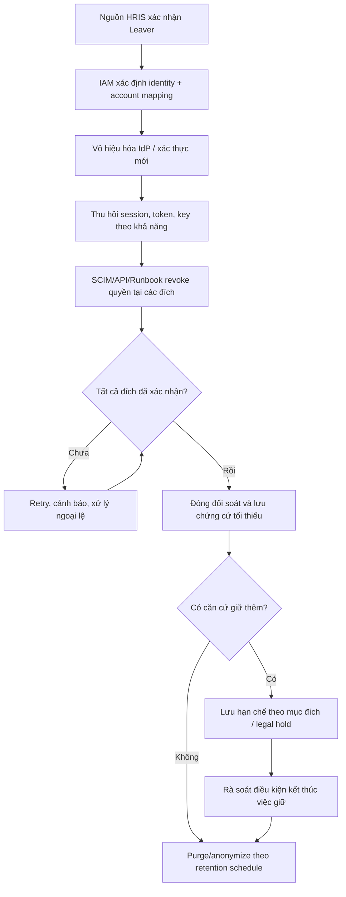
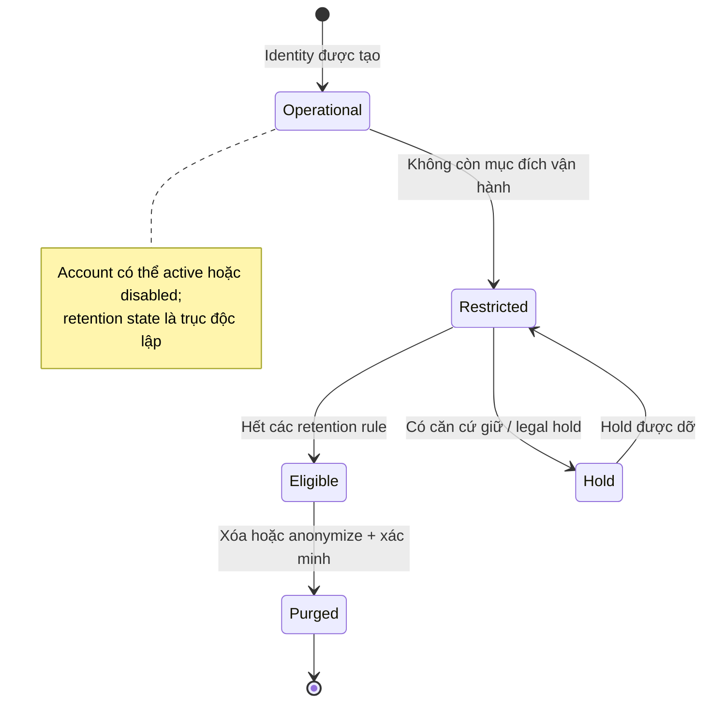
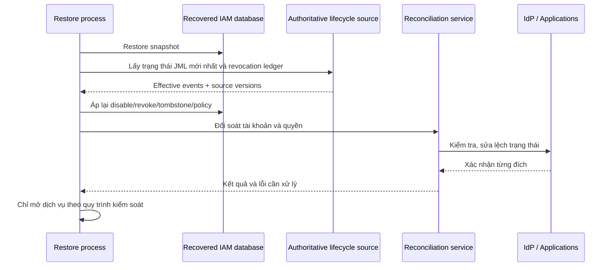

# Retention identity: Quản lý thời hạn lưu giữ dữ liệu danh tính trong IAM

> **Chương:** Privacy và identity  
> **Module:** `SECURITY_IDENTITY_ACCESS_MANAGEMENT_IDENTITY_LIFECYCLE`  
> **Phạm vi:** Lưu giữ, hạn chế sử dụng, lưu trữ có kiểm soát, xóa và đối soát dữ liệu danh tính trong vòng đời **Joiner–Mover–Leaver (JML)**. Nội dung kết nối HRIS, Identity Provider (IdP), Single Sign-On (SSO), SCIM, RBAC/ABAC, tài khoản dịch vụ, kiểm toán và nguy cơ truy cập tồn dư.

## 1. Retention identity là gì?

**Identity data retention** là tập chính sách và quy trình quy định **thông tin danh tính nào được giữ, ở đâu, cho mục đích gì, trong bao lâu, ai được sử dụng và điều gì xảy ra khi thời hạn hoặc mục đích lưu giữ kết thúc**.

Đối với IAM, dữ liệu danh tính không chỉ là hồ sơ của một người. Nó còn là ánh xạ từ danh tính gốc đến tài khoản ứng dụng, thông tin về nhóm/role/entitlement, phương tiện xác thực, dữ liệu xác minh danh tính, sự kiện Joiner–Mover–Leaver, log đăng nhập, bản ghi phê duyệt và bằng chứng một yêu cầu thu hồi đã được thực hiện.

Ví dụ, khi nhân viên nghỉ việc, ba hành động sau khác nhau:

- **Revoke/deactivate:** chặn đăng nhập, phiên, API token, SSH key, quyền trên ứng dụng.
- **Restrict/archive:** ngừng sử dụng hồ sơ để vận hành quyền thường ngày; giữ những bản ghi thực sự cần để đối soát hoặc chứng minh nghĩa vụ.
- **Delete/anonymize:** loại bỏ dữ liệu không còn cần thiết theo chính sách, kể cả bản sao ở hệ thống đích, cache và công cụ quan sát khi áp dụng.

Không nên suy ra rằng tài khoản bị vô hiệu hóa thì dữ liệu đã được xóa. Cũng không nên suy ra rằng một số bản ghi cần lưu cho kiểm toán thì người dùng cũ vẫn được phép đăng nhập.

### 1.1. Những nguyên tắc cần kết hợp

| Nguyên tắc | Câu hỏi cần trả lời trong IAM |
|---|---|
| **Purpose limitation** | Giữ dữ liệu để thực hiện mục đích cụ thể nào? |
| **Data minimization** | Trường nào và mức chi tiết nào là đủ cho mục đích đó? |
| **Storage limitation** | Khi nào mục đích lưu giữ kết thúc? |
| **Least privilege** | Ai được xem, sửa, xuất hoặc giải mã dữ liệu đã lưu? |
| **Accuracy/integrity** | Bản ghi có phản ánh đúng sự kiện và trạng thái ở thời điểm liên quan? |
| **Accountability** | Có bằng chứng về việc cấp, thay đổi, thu hồi và xóa dữ liệu? |
| **Security lifecycle** | Có chắc credential và quyền truy cập đã hết hiệu lực dù bản ghi còn lưu? |

**Điểm mấu chốt:** retention là vòng đời của **dữ liệu**; JML là vòng đời của **quan hệ danh tính và quyền truy cập**. Hai vòng đời liên quan nhưng có trạng thái và thời hạn khác nhau.

## 2. Định nghĩa đúng đối tượng cần lưu giữ

Hệ thống IAM thường tạo nhiều loại bản ghi với đặc tính retention khác nhau:

| Nhóm dữ liệu | Ví dụ | Giá trị nghiệp vụ/bảo mật | Câu hỏi retention |
|---|---|---|---|
| **Core identity** | `personId`, `identityType`, trạng thái vòng đời | Liên kết đúng một chủ thể, tránh cấp nhầm quyền | Giữ khóa bao lâu để đối soát, tái tuyển dụng hoặc phát hiện trùng? |
| **Thuộc tính tổ chức** | `orgUnitId`, `managerId`, loại quan hệ, ngày hiệu lực | Tính quyền RBAC/ABAC | Cần giá trị hiện tại, lịch sử hay chỉ kết quả quyết định? |
| **Identity proofing** | Kết quả xác minh, ảnh giấy tờ, bằng chứng liveness | Chứng minh đủ điều kiện cấp danh tính | Có thật sự cần giữ bằng chứng thô sau khi xác minh? |
| **IdP/SSO** | `issuer`, `subject`, phương thức MFA, session ID | Xác thực, liên kết SSO, thu hồi phiên | Giữ metadata để điều tra nhưng xóa credential như thế nào? |
| **Account mapping** | `applicationId`, `tenantId`, `scimId` | Tìm đúng account đích khi mover/leaver | Chỉ xóa sau khi xác nhận mọi đích đã xử lý? |
| **Entitlement** | Nhóm, role, permission, approval, `expiresAt` | Xác định và chứng minh quyền | Giữ lịch sử quyền bao lâu sau khi đã revoke? |
| **Audit/security events** | Login event, access review, policy decision, outcome | Điều tra, chứng minh tuân thủ và khôi phục | Thời hạn từng loại log có cần khác nhau? |
| **Service identity** | Workload ID, owner team, secret reference, lịch sử rotation | Quản lý hệ thống phi con người | Khi service nghỉ, cần giữ bản ghi nào mà không giữ secret? |
| **Dữ liệu xuất/bản sao** | CSV, backup, trace, dead-letter event, cache | Phục hồi, vận hành, phân tích | Có được bao phủ bởi retention policy chính không? |

Một bản ghi có thể liên quan nhiều mục đích. Ví dụ `personId` tồn tại trong HRIS, IdP và IAM audit, nhưng **mỗi bản sao có thể có thời hạn và quyền đọc khác nhau**. Không được áp một TTL duy nhất cho tất cả trường chỉ vì chúng đều thuộc “user data”.

### 2.1. Dữ liệu gốc, bản sao và tham chiếu

Cần phân biệt:

1. **Dữ liệu gốc có thẩm quyền:** ví dụ trạng thái việc làm ở HRIS.
2. **Dữ liệu đồng bộ:** ví dụ `orgUnitId` ở IdP hoặc SCIM target.
3. **Mã tham chiếu:** ví dụ `proofingReferenceId` thay cho ảnh giấy tờ.
4. **Dữ liệu suy ra:** ví dụ `accessEligible=true` hoặc nhóm `finance-reader`.
5. **Bằng chứng lịch sử:** kết quả quyết định policy tại thời điểm sự kiện.

Việc xóa một bản sao đồng bộ không nhất thiết yêu cầu xóa dữ liệu gốc còn mục đích hợp lệ; tuy nhiên cũng không cho phép bên nhận tiếp tục giữ bản sao không có căn cứ riêng.

## 3. Xây dựng retention schedule theo mục đích và điểm bắt đầu

Một **retention schedule** là bảng quy định đối tượng dữ liệu, mục đích, sự kiện kích hoạt, khoảng lưu, điều kiện xóa, người phụ trách và ngoại lệ.

Không có mốc cố định như “giữ mọi identity data trong 90 ngày” phù hợp cho tất cả tổ chức. Thời hạn phải được xác định từ nhu cầu nghiệp vụ, nghĩa vụ pháp lý/hợp đồng, rủi ro an ninh và phạm vi khu vực pháp lý.

### 3.1. Xác định retention trigger

| Dữ liệu | Sự kiện bắt đầu tính thời hạn có thể phù hợp |
|---|---|
| Đơn đăng ký Joiner bị hủy | Khi quyết định hủy được xác nhận |
| Bằng chứng xác minh danh tính | Khi hoàn tất xác minh, khi kết thúc quan hệ hoặc mốc khác theo căn cứ áp dụng |
| Thuộc tính của Mover đã lỗi thời | Khi giá trị mới có hiệu lực và không còn mục đích giữ bản sao cũ |
| Tài khoản đã deprovision | Khi từng ứng dụng xác nhận deactivate/delete và đối soát xong |
| Entitlement đã thu hồi | Khi quyền được thu hồi thực tế, hoặc khi kết thúc kỳ kiểm toán liên quan |
| Login/audit event | Từ thời điểm sự kiện hoặc mốc lưu giữ do chính sách quy định |
| Sự cố bảo mật | Khi đóng vụ việc hoặc kết thúc nghĩa vụ bảo tồn bằng chứng phù hợp |
| Service identity đã ngừng hoạt động | Khi hoàn tất thu hồi credential, chuyển owner/tài nguyên và đối soát |

Cần ghi rõ trường thời gian đại diện cho **sự kiện nghiệp vụ** hay **thời điểm hệ thống nhìn thấy sự kiện**.

Ví dụ:

```text
employmentEndAt = 2026-11-30T17:00:00+07:00   # thời điểm quan hệ kết thúc
eventReceivedAt = 2026-11-30T17:01:20+07:00    # thời điểm IAM nhận tin
deactivatedAt   = 2026-11-30T17:02:00+07:00    # IdP đã khóa
lastTargetConfirmedAt = 2026-12-01T08:00:00+07:00
```

Nếu chính sách giữ **bằng chứng hoàn tất deprovision** kể từ khi mọi ứng dụng xác nhận, mốc 17:00 ngày 30/11 chưa phải điểm bắt đầu phù hợp. Nếu chính sách lưu **log truy cập**, retention có thể tính từ thời điểm từng event phát sinh.

### 3.2. Trường tối thiểu của một retention rule

Một rule nên có:

- **`dataCategory`:** loại dữ liệu.
- **`purposeId`:** mục đích giữ và sử dụng được phép.
- **`sourceSystem` / `storageLocation`:** nơi quản lý.
- **`retentionTrigger`:** mốc kích hoạt.
- **`retentionPeriod`:** khoảng giữ, kèm căn cứ và phiên bản chính sách.
- **`classification`:** độ nhạy.
- **`allowedReaders`:** nhóm người hoặc dịch vụ được truy cập.
- **`endOfRetentionAction`:** delete, anonymize, archive có điều kiện hoặc chuyển sang trạng thái hạn chế.
- **`exceptionPolicy`:** legal hold, sự cố hoặc nghĩa vụ lưu bổ sung.
- **`owner`, `reviewedAt`:** người chịu trách nhiệm và lịch rà soát.
- **`downstreamHandling`:** cách xử lý bản sao, SaaS, backup và queue.

Rule cần giải thích **tại sao giữ** và **điều kiện nào chấm dứt việc giữ**. Một thời hạn nhưng thiếu mục đích không đủ để quản trị.

## 4. Bảng mẫu retention theo từng lớp danh tính

Bảng sau là **mẫu quyết định chính sách, không phải thời hạn pháp lý mặc định**. Các ô “thời hạn” được mô tả dưới dạng điều kiện thay vì gán một con số tùy tiện.

| Nhóm | Giữ để làm gì | Hạn chế sau khi hết hoạt động | Điều kiện xử lý cuối vòng đời |
|---|---|---|---|
| Identity core | Liên kết chủ thể, tránh nhầm khi deprovision/rehire | Khóa quyền tương tác; giảm trường hiện diện | Kết thúc nhu cầu liên kết và mọi nghĩa vụ giữ |
| Identity proofing result | Chứng minh đã xác minh theo chính sách | Chỉ người/dịch vụ được phép đọc trạng thái | Hết thời hạn chứng minh hoặc nghĩa vụ liên quan |
| Raw proofing evidence | Xác minh hoặc giải quyết sai lệch theo mục đích | Kho tách biệt, kiểm soát export | Xóa sớm nhất khi không còn lý do giữ |
| IdP account | Quản lý đăng nhập, phiên và trạng thái | Disable/lock, bỏ khỏi nhóm hoạt động | Hoàn tất thu hồi và retention cần thiết |
| SCIM account mapping | Tìm/đối soát tài khoản đích | Chỉ lifecycle service/audit được đọc | Các đích đã xác nhận, hết mục đích kiểm soát |
| Entitlement/approval | Chứng minh quyền nào tồn tại vào thời điểm nào | Không dùng làm quyền hiện tại | Hết thời hạn audit/giải quyết tranh chấp áp dụng |
| Session/token | Xác thực và quản lý phiên | Thu hồi hoặc hết hiệu lực; bảo vệ credential | Xóa credential và session data theo chính sách |
| Security event | Phát hiện/điều tra sự cố | Giới hạn phân tích ngoài mục đích | Hết thời gian phát hiện, điều tra và nghĩa vụ giữ |
| Service identity metadata | Quản lý owner, quyền và workload | Disable, chuyển owner khi cần | Không còn workload/tài nguyên liên quan và nghĩa vụ audit |
| Service secret | Xác thực workload | Rotate/revoke khi không còn cần | Hủy/tiêu hủy secret theo hệ thống quản lý bí mật |

**Ví dụ lựa chọn hợp lý:** ứng dụng quản lý công việc có thể xóa thuộc tính HRIS dư thừa ngay khi ngừng cần, nhưng dịch vụ IAM có thể giữ mapping tối thiểu trong một thời hạn đủ để kiểm chứng việc thu hồi account. Một hệ thống audit có thể giữ sự kiện `entitlement.revoked` mà không cần lưu ảnh giấy tờ hoặc token của chủ thể.

## 5. Retention trong Joiner: tạo account và xử lý onboarding dở dang

### 5.1. Joiner thành công

Quy trình Joiner thường gồm xác minh, tạo identity, đăng ký MFA, cấp nhóm quyền cơ sở và provision tài khoản. Đối với mỗi bước cần phân biệt dữ liệu:

- **Phải dùng khi triển khai:** `personId`, trạng thái quan hệ, vai trò/đơn vị cần tính quyền, ngày hiệu lực, mã yêu cầu.
- **Dữ liệu kết quả cần quản lý:** `issuer` + `sub` trong IdP; `id` và `externalId` của SCIM; các account mapping.
- **Bằng chứng xác minh:** mức bảo đảm hoặc `proofingStatus`, không mặc định gửi ảnh giấy tờ đến mọi đích.
- **Vật liệu xác thực:** MFA seed, recovery code, private key phải ở hệ thống chuyên trách, không nằm trong hồ sơ đồng bộ.
- **Bằng chứng cấp quyền:** chính sách, phiên bản, phê duyệt và kết quả từng ứng dụng.

Không nên giữ hồ sơ proofing thô vô hạn chỉ vì có một account đã được tạo. Đích nhận chỉ nên có những trường thực sự cần và thời hạn theo mục đích của chính đích đó.

### 5.2. Onboarding bị hủy hoặc không hoàn thành

Ví dụ người được tuyển dụng không bắt đầu làm việc. Hệ thống có thể đã tạo IdP identity, mời đăng ký MFA hoặc tạo tài khoản SaaS trước ngày bắt đầu.

Một luồng xử lý cần:

1. Đánh dấu onboarding bị hủy bằng sự kiện có nguồn xác thực.
2. Disable hoặc xóa account tạo trước, hủy lời mời, revoke credential phát sinh.
3. Kiểm tra ứng dụng đích đã xử lý, kể cả account local không dùng SSO.
4. Xử lý chứng cứ proofing, ticket và file tạm theo retention schedule riêng.
5. Giữ bằng chứng hủy ở mức cần để giải thích trạng thái tài khoản, không giữ toàn bộ hồ sơ tải lên mặc định.

Tình huống này cho thấy retention **không chỉ bắt đầu từ Leaver**. Dữ liệu có thể cần xử lý ngay khi một quy trình Joiner bị hủy.

## 6. Retention trong Mover: lịch sử khác trạng thái dùng để cấp quyền

Khi nhân viên chuyển vai trò, `orgUnitId`, `managerId` hoặc nhóm quyền có thể thay đổi. Một số trạng thái trước đây cần được giữ để giải thích quyết định cũ, nhưng không thể được sử dụng để cấp quyền hiện tại.

Ví dụ:

| Thuộc tính/quyền | Trước Mover | Sau Mover | Cách xử lý dữ liệu cũ |
|---|---|---|---|
| `orgUnitId` | `support` | `finance` | Policy dùng `finance`; lịch sử chỉ ở kho có mục đích hợp lệ |
| `managerId` | `person-12` | `person-85` | Workflow mới dùng người quản lý mới |
| `support-ticket-reader` | Đang hiệu lực | Không còn cần | Revoke; giữ sự kiện thu hồi thay cho quyền hoạt động |
| `finance-report-reader` | Không có | Cấp sau phê duyệt | Giữ bằng chứng phê duyệt/hiệu lực |
| Claim SSO/cache | Có thông tin Support | Phải phản ánh trạng thái mới | Làm mới hoặc vô hiệu hóa theo thiết kế |

Dữ liệu của Mover có ít nhất hai góc nhìn:

- **Current state:** phục vụ authorization tại thời điểm hiện tại.
- **Historical evidence:** phục vụ điều tra/quyết định đã diễn ra trong quá khứ.

Phải tách rõ đường sử dụng hai loại. Nếu policy engine vô tình lấy một snapshot cũ để tính quyền, retention đã tạo ra rủi ro **privilege accumulation** (tích lũy quyền).

### 6.1. Quyền ngoại lệ khi bàn giao

Một người chuyển bộ phận có thể cần đọc một số tài liệu cũ trong thời gian bàn giao. Ngoại lệ phải có phạm vi, owner, căn cứ, ngày hết hạn và điều kiện thu hồi.

**Hết thời hạn bàn giao** là sự kiện thu hồi quyền; bằng chứng lịch sử có thể được giữ theo quy tắc khác. Không coi quyền tạm thời là lý do giữ group membership vĩnh viễn.

## 7. Retention trong Leaver: bảo đảm thu hồi trước, xử lý dữ liệu theo chính sách

**Leaver** gồm chấm dứt quyền tương tác và làm sạch dữ liệu còn lại. Cần tách các bước vì hệ thống đích có trạng thái thực tế khác nhau.

### 7.1. Trình tự logic



Sơ đồ phản ánh trình tự logic; ở môi trường thực tế các thao tác có thể chạy song song theo mức khẩn cấp và phụ thuộc. **Không trì hoãn chặn truy cập chỉ vì đang chờ quyết định xóa dữ liệu.**

### 7.2. Deactivation, soft delete và hard delete

| Hành động | Tác động | Giới hạn |
|---|---|---|
| **Deactivation** | Ngăn một account hoạt động theo khả năng ứng dụng | Có thể vẫn còn session/key khác |
| **Soft delete** | Ẩn hoặc đánh dấu deleted nhưng giữ dữ liệu | Thường vẫn có PII, credential hoặc quyền cần thu hồi riêng |
| **Hard delete** | Loại bản ghi khỏi kho vận hành | Chưa chắc xóa backup, audit, export, SaaS khác |
| **Anonymization** | Loại khả năng nhận diện bằng kỹ thuật và tổ chức thích hợp | Khó chứng minh nếu còn linkable metadata |
| **Pseudonymization** | Thay định danh bằng mã có thể liên kết ngược | Vẫn có thể là dữ liệu cá nhân; cần retention và ACL |
| **Credential revocation** | Vô hiệu hóa secret/token/phiên theo hệ thống | Không phụ thuộc việc bản ghi hồ sơ đã xóa chưa |

**Cấm “khôi phục” quyền bằng cách restore hồ sơ:** nếu backup lưu trạng thái `active=true` từ trước Leaver, quy trình khôi phục phải đối soát lại trạng thái lifecycle mới nhất trước khi hệ thống phục vụ truy cập.

### 7.3. Tại sao cần giữ account mapping sau khi disable?

Khi IdP đã khóa tài khoản, IAM vẫn có thể phải tìm các account ở:

- Ứng dụng SCIM.
- Công cụ dùng local account.
- Kho mã nguồn hoặc môi trường cloud có tài khoản quản trị.
- VPN, SSH, secrets và hệ thống kiểm soát thiết bị.
- Các tenant SaaS hoặc tổ chức đối tác được liên kết.

Nếu xóa `personId → applicationAccountId` quá sớm, không thể xác định đường truy cập nào còn tồn dư. Giữ **mapping tối thiểu và có thời hạn** có thể là yêu cầu bảo mật; giữ chi tiết hồ sơ nhân sự đầy đủ không phải hệ quả tất yếu.

### 7.4. Rehire: dữ liệu lịch sử không phải quyền hiện tại

Người quay lại có thể có mã nhân sự mới hoặc email đã đổi. Rehire cần xác minh danh tính theo quy trình, ghép/không ghép identity theo chính sách và **tính quyền từ quan hệ mới**. Không khôi phục mọi quyền cũ chỉ vì account mapping hoặc lịch sử entitlements vẫn còn.

## 8. Phân biệt nơi giữ dữ liệu trong IdP, SSO và provisioning

### 8.1. IdP và authenticator

IdP quản lý account, `issuer` + `subject`, thông tin xác thực, MFA và phiên. Retention của từng thành phần khác nhau:

- Identity subject có thể cần giữ để tránh nhầm chủ thể và phục vụ audit.
- Metadata phương thức MFA có thể giữ có giới hạn để điều tra hoặc quản lý thiết bị.
- Refresh token, recovery code hoặc secret phải bị thu hồi/hủy theo vòng đời credential.
- Login history có retention riêng cho `security-monitoring`.
- ID token đã phát hành có `exp`, nhưng **việc tài khoản bị disable không bảo đảm token đã phát hành vô hiệu tức thời**.

SSO giải quyết xác thực liên kết, **không** tự xử lý đầy đủ retention của ứng dụng đích.

### 8.2. OIDC/SAML: hạn chế claim và bản sao

Các ứng dụng có thể nhận claims như `sub`, `email`, `name` hoặc role. Thời gian tồn tại của **token** khác thời gian ứng dụng lưu **hồ sơ cục bộ** được tạo từ token.

Trong OIDC, dùng cặp `iss` + `sub` để nhận diện trong phạm vi issuer; email có thể đổi hoặc bị tái sử dụng. Khi IdP dùng pairwise subject identifier, mỗi sector có thể nhận subject khác nhau nhằm giảm liên kết chéo không cần thiết.

Đối với một claim nhạy cảm, cần trả lời:

1. Bên nhận có thật sự cần claim này?
2. Bên nhận lưu claim hay chỉ sử dụng khi quyết định?
3. Token, log, cache và database đích có thời hạn ra sao?
4. Nếu claim đổi hoặc người dùng rời tổ chức, làm sao làm mới hoặc xóa bản sao?

JWT được ký để xác minh tính toàn vẹn, **không tự che nội dung payload**. Không đưa giấy tờ định danh, recovery secret hoặc thông tin đời tư vào token chỉ vì lưu trữ token có TTL ngắn.

### 8.3. SCIM và account ở SaaS

Ví dụ vô hiệu hóa User bằng SCIM 2.0:

```http
PATCH /scim/v2/Users/app-user-172 HTTP/1.1
Content-Type: application/scim+json
Authorization: Bearer <redacted>

{
  "schemas": ["urn:ietf:params:scim:api:messages:2.0:PatchOp"],
  "Operations": [
    { "op": "replace", "path": "active", "value": false }
  ]
}
```

`active=false` thường dùng để deactivate theo ngữ nghĩa SCIM, nhưng từng provider có thể có hành vi, khả năng hỗ trợ và cơ chế quản lý session khác nhau. Sau khi nhận thành công cần kiểm tra trạng thái thực tế, group/role trực tiếp, API token và chính sách giữ dữ liệu của ứng dụng.

Trong SCIM, `id` là mã do service provider cấp; `externalId` có thể do provisioning client cung cấp. IAM phải giữ ánh xạ có scope theo `applicationId`/`tenantId` để revoke đúng. Việc xóa bản ghi tại SaaS phải xem xét hành vi API, thỏa thuận xử lý dữ liệu và nghĩa vụ của vendor; **deactivate User không đồng nghĩa SaaS đã xóa hồ sơ và backup**.

## 9. RBAC/ABAC: retention của entitlement và dữ liệu ra quyết định

**RBAC** dùng role và nhóm; **ABAC** dùng thuộc tính chủ thể, tài nguyên, hành động và môi trường. Nếu quyền phụ thuộc `orgUnitId`, `lifecycleState`, `deviceCompliant` hoặc `approvalTier`, dữ liệu đó phải có độ mới phù hợp.

Một access decision đơn giản:

```text
permit nếu:
    subject.lifecycleState == "active"
    AND subject.orgUnitId == resource.ownerOrgUnitId
    AND action == "read"
    AND environment.deviceCompliant == true
```

Khi Leaver, giá trị `active` phải chuyển về false hoặc policy phải chặn tương đương, dù audit vẫn giữ sự kiện người đó **từng** thuộc đơn vị X.

### 9.1. Quyền hiện tại và bằng chứng lịch sử

| Dữ liệu | Dùng để ra quyết định hiện tại? | Có thể dùng cho kiểm toán? |
|---|---|---|
| Role/group đang hoạt động | Có | Có, với snapshot hoặc event khi cần |
| Role đã thu hồi | Không | Có, chứng minh giai đoạn đã được cấp |
| Thuộc tính HRIS phiên bản cũ | Không | Có, giải thích quyết định quá khứ |
| Entitlement exception đã hết hạn | Không | Có, chứng minh quá trình phê duyệt và thu hồi |
| Policy version đã thay thế | Không để ra quyết định mới | Có, tái dựng chính sách tại thời điểm cũ |

Không được để **retention vì audit** trở thành **nguồn quyền sống**. Kiến trúc nên tách kho current entitlement với lịch sử event, giới hạn consumer và khả năng đọc.

### 9.2. Thời hạn của quyền khác thời hạn của dữ liệu

Quyền `prod-admin` có thể hết hạn ở `expiresAt`, nhưng bản ghi phê duyệt cấp quyền có thể cần lưu thêm. Khi đến hạn, hệ thống phải thu hồi quyền trước; chỉ sau đó xử lý retention của bản ghi.

Nếu giữ quyền mà không có expiry hoặc owner, có thể tạo **residual access**. Nếu xóa bản ghi cấp quyền quá sớm, có thể mất khả năng điều tra ai đã phê duyệt. Thiết kế phải giải quyết cả hai.

## 10. Dữ liệu xác minh nhạy cảm và credentials

### 10.1. Raw proofing evidence

Ảnh giấy tờ, dữ liệu liveness, biometric sample/template có thể nhạy cảm và khó thay đổi khi lộ. Nên cân nhắc tách:

- **Kho proofing:** chỉ nhận dữ liệu cần theo mức bảo đảm và giữ có kiểm soát.
- **IAM lifecycle:** nhận `proofingStatus`, `verifiedAt`, mã tham chiếu và mức bảo đảm đủ dùng.
- **Ứng dụng đích:** thường chỉ biết account đã đủ điều kiện, không nhận bằng chứng thô.

Khi purpose xác minh đã hoàn tất, cần kiểm tra còn nghĩa vụ hay mục đích hợp lệ nào để giữ bản gốc không. Nếu không có, lên lịch xóa và xử lý bản sao theo chính sách. Giữ `proofingStatus` trong IAM không có nghĩa tiếp tục giữ ảnh giấy tờ ở mọi nơi.

### 10.2. Authentication secrets không phải “hồ sơ lưu trữ”

Mật khẩu, passkey private key, TOTP seed, API token, refresh token, recovery code và service secret phải có vòng đời credential riêng.

- Mật khẩu người dùng nên được lưu dưới dạng verifier bằng cơ chế password hashing phù hợp, không lưu giá trị rõ.
- Private key của passkey thường ở authenticator của người dùng; dịch vụ giữ public-key credential và metadata cần thiết.
- Recovery codes hoặc TOTP seed không được xuất sang hồ sơ IAM/SCIM hay log.
- Khi account kết thúc, revoke/hủy phương tiện xác thực theo khả năng hệ thống; không giữ token còn khả năng sử dụng chỉ vì cần log.
- Khi có nghĩa vụ điều tra, lưu **mã sự kiện, hash/identifier an toàn hoặc metadata cần thiết**, không giữ plaintext secret.

Một policy có thể giữ bản ghi “credential X bị thu hồi lúc T” sau khi vật liệu credential đã bị xóa. Hai mục đích không nên bị gộp.

## 11. Retention của tài khoản dịch vụ và danh tính phi con người

Service account, workload identity, bot và pipeline không có vòng đời nhân sự trực tiếp, nhưng vẫn cần quản lý **mục đích**, **owner**, **ngày đánh giá**, **quyền** và **credential**.

Ví dụ:

```json
{
  "serviceIdentityId": "svc-billing-report-prod",
  "ownerTeamId": "platform-ops",
  "purposeId": "nightly-billing-reconciliation",
  "environment": "production",
  "resourceScope": ["billing-report-store"],
  "credentialMode": "workload-federation",
  "reviewDueAt": "2027-01-31T00:00:00Z"
}
```

Khi một service ngừng hoạt động:

1. Kiểm tra phụ thuộc giữa workload, job, API, secret và tài nguyên.
2. Ngừng phát hành credential mới; revoke key, token/certificate phù hợp.
3. Thu hồi IAM role, policy, SaaS access và quyền kho dữ liệu.
4. Đối soát các thành phần sản xuất để không gây hỏng dịch vụ liên quan.
5. Giữ bằng chứng về chủ sở hữu, quyền và quyết định thu hồi trong thời hạn có căn cứ.
6. Xóa registry entry, secret references và bản sao không còn mục đích.

Khi owner là nhân viên rời công ty, cần **chuyển trách nhiệm và rà soát quyền**, không tự xóa một service production đang được dùng. Ngược lại, không được giữ một API key cá nhân của người đã nghỉ làm credential lâu dài cho workload.

## 12. Thiết kế trạng thái dữ liệu và retention hold

Một bản ghi danh tính có thể có trạng thái vòng đời như `pending`, `active`, `suspended`, `deactivated`; trong khi retention có trạng thái `operational`, `restricted`, `eligible-for-purge` hoặc `purged`.



Ví dụ account có thể đã `deactivated` nhưng record retention còn `restricted` để xử lý deprovision. Không nên đưa mọi trường vào cùng một enum với ý nghĩa mơ hồ như `deleted=false`.

### 12.1. Legal hold và retention exception

**Legal hold** hoặc các ngoại lệ lưu có căn cứ là lý do tạm ngưng xóa đối với **phạm vi dữ liệu cụ thể**. Cần ghi:

- Ai yêu cầu và ai phê duyệt.
- Mục đích/căn cứ và loại bản ghi thuộc phạm vi giữ.
- Thời điểm bắt đầu, điều kiện rà soát và cách dỡ hold.
- Nhóm người được xem và hạn chế việc sử dụng.
- Bằng chứng cập nhật/lift hold và tác động đến lịch purge.

Không sử dụng “legal hold” như nhãn mặc định không thời hạn cho toàn bộ kho danh tính. **Hold giữ dữ liệu, không giữ quyền đăng nhập**; credential bị thu hồi vẫn phải vô hiệu.

### 12.2. Xử lý nhiều quy tắc cùng áp dụng

Một bản ghi có thể chịu nhiều retention obligation. Ví dụ một audit event phục vụ cả điều tra sự cố và kiểm toán định kỳ. Khi xác định eligibility:

- Không xóa khi một nghĩa vụ giữ hợp lệ vẫn đang có hiệu lực.
- Không cho một purpose đã kết thúc tiếp tục truy cập bản ghi chỉ vì purpose khác còn cần giữ.
- Giới hạn quyền theo **mục đích còn hiệu lực**.
- Khi mọi căn cứ giữ kết thúc, thực hiện xử lý cuối vòng đời theo policy.

Cần có cách đánh giá xung đột giữa chính sách xóa và nghĩa vụ giữ qua owner/privacy/legal thay vì tự chọn mốc ngắn nhất hoặc dài nhất một cách máy móc.

## 13. Retention policy as code: minh họa dữ liệu cấu hình

Một thiết kế có thể quản lý retention rules bằng cấu hình được review, version và triển khai qua pipeline kiểm soát.

```yaml
policyId: iam-identity-retention
version: "2026-11-example"
records:
  - category: application-account-mapping
    purposeIds:
      - account-deprovisioning
      - audit-evidence
    trigger: all-targets-confirmed-deprovisioned
    retentionPeriodRef: iam-mapping-schedule
    allowedReaders:
      - lifecycle-service
      - authorized-audit
    onExpiry: purge
    holdPolicy: scoped-hold-check
    downstream:
      - scim-target
      - reconciliation-store

  - category: raw-identity-proofing-evidence
    purposeIds:
      - identity-proofing
    trigger: proofing-process-completed
    retentionPeriodRef: proofing-evidence-schedule
    allowedReaders:
      - proofing-review-team
    onExpiry: secure-delete
    holdPolicy: scoped-hold-check

  - category: entitlement-decision-evidence
    purposeIds:
      - audit-evidence
      - security-investigation
    trigger: entitlement-decision-recorded
    retentionPeriodRef: access-decision-schedule
    allowedReaders:
      - authorized-audit
      - security-investigation
    onExpiry: purge-or-anonymize
    holdPolicy: scoped-hold-check
```

Đây là **YAML minh họa** cho tài liệu thiết kế nội bộ, không phải schema chuẩn và không ấn định thời hạn pháp lý cụ thể. Trong thực tế phải gắn `retentionPeriodRef` với các quy tắc đã được phê duyệt, định nghĩa cách tính thời gian và phạm vi điều chỉnh theo khu vực pháp lý.

### 13.1. Đầu vào tối thiểu cho bộ máy đánh giá retention

```json
{
  "recordId": "account-map-581",
  "category": "application-account-mapping",
  "subjectId": "person-42",
  "purposeIds": ["account-deprovisioning", "audit-evidence"],
  "triggerEventId": "jml-778",
  "triggerAt": "2026-12-01T04:30:00Z",
  "policyVersion": "2026-11-example",
  "holdIds": [],
  "targetAccountId": "app-user-918",
  "targetConfirmationId": "confirm-667"
}
```

`targetConfirmationId` quan trọng vì nó thể hiện thời điểm đích đã xác nhận deprovision, không chỉ thời điểm đã gửi yêu cầu. Nếu thiếu xác nhận, bản ghi cần nằm trong **hàng đợi xử lý sai lệch**, không được âm thầm xóa rồi đóng ticket.

## 14. Ví dụ logic xử lý retention an toàn

Pseudo-Java minh họa cách kiểm tra điều kiện trước khi một record đủ điều kiện purge:

```java
enum RetentionDecision {
    KEEP_ACTIVE_PURPOSE,
    KEEP_LEGAL_HOLD,
    KEEP_PENDING_RECONCILIATION,
    KEEP_UNTIL_DEADLINE,
    ELIGIBLE_FOR_PURGE
}

RetentionDecision evaluate(
        IdentityRecord record,
        RetentionPolicy policy,
        Instant now) {

    if (policy.hasActiveHold(record.id())) {
        return RetentionDecision.KEEP_LEGAL_HOLD;
    }
    if (policy.hasOtherActiveRetentionPurpose(record.id())) {
        return RetentionDecision.KEEP_ACTIVE_PURPOSE;
    }
    if (record.isAccountMapping()
            && !record.allTargetsConfirmedDeprovisioned()) {
        return RetentionDecision.KEEP_PENDING_RECONCILIATION;
    }

    Instant deadline = policy.calculateDeadline(record);
    if (deadline == null || now.isBefore(deadline)) {
        return RetentionDecision.KEEP_UNTIL_DEADLINE;
    }
    return RetentionDecision.ELIGIBLE_FOR_PURGE;
}
```

Đây là **pseudocode để diễn giải điều kiện**, không phải Java chạy độc lập hoặc thuật toán bảo đảm đúng luật. Một hệ thống thực tế cần:

- Xác thực nguồn sự kiện, policy version và phạm vi tenant.
- Áp kiểm tra policy tại **thời điểm thực thi purge**, không chỉ lúc đưa job vào queue.
- Xử lý giao dịch đồng thời khi có hold mới hoặc event muộn.
- Phân biệt bản ghi account mapping đang vướng sự cố với bằng chứng audit đã có đầy đủ.
- Thực thi delete/anonymization ở tất cả storage và ghi nhận kết quả.
- Hỗ trợ retry/idempotency, thất bại từng phần, reconciliation và giám sát.

Không nên dùng job “DELETE WHERE createdAt < now - N days” trực tiếp trên toàn bộ IAM database vì `createdAt` chưa chắc là mốc phù hợp, và job có thể xóa mapping cần cho sự cố leaver chưa giải quyết.

### 14.1. Tách eligibility và thực thi purge

Có thể dùng hai pha:

1. **Evaluate:** xác định record nào đủ điều kiện, ghi policy version, căn cứ, deadline, hold và trạng thái các đích.
2. **Execute:** kiểm tra lại điều kiện, xóa/ẩn danh theo kế hoạch từng hệ thống, đối soát và ghi kết quả.

Tách hai pha giúp kiểm soát thay đổi policy, tránh race condition và hỗ trợ review đối với dữ liệu rủi ro cao. Nếu purge thất bại ở một hệ thống, không đánh dấu toàn bộ hoạt động là hoàn tất.

## 15. Deletion, pseudonymization và anonymization

### 15.1. Delete không phải lúc nào cũng xóa ngay mọi bản sao

Có thể có dữ liệu tại:

- Database vận hành.
- IdP directory và SaaS target.
- Data warehouse và bản xuất CSV.
- Cache, search index, event stream và dead-letter queue.
- Log, trace, monitoring.
- Backup, snapshot hoặc archive.
- Hệ thống của nhà cung cấp proofing và các bên xử lý khác.

Chính sách phải xác định khả năng xóa hoặc ngừng sử dụng ở từng nơi. Với backup không thể chỉnh từng bản ghi ngay, cần quy trình **retention/expiry, kiểm soát restore và áp lại trạng thái xóa** phù hợp.

### 15.2. Pseudonymization chưa phải anonymization

```text
personId = person-42
pseudonym = ref-9c81
lookup: ref-9c81 -> person-42
```

Nếu còn bảng tra ngược hoặc có thể nhận diện qua kết hợp dữ liệu khác, bản ghi vẫn có khả năng liên kết về cá nhân. Pseudonymization giảm rủi ro nhưng không phải chứng cứ dữ liệu đã vô danh.

Không nên gọi dữ liệu là **anonymous** chỉ vì đã xóa họ tên hoặc băm email. Khi thiết kế anonymization cần đánh giá khả năng tái nhận diện, tập dữ liệu còn lại, dữ liệu liên kết khác và mục đích sử dụng.

### 15.3. Tombstone và ngăn tái tạo nhầm identity

Đôi khi tổ chức cần một record tối thiểu ghi rằng subject/account đã bị xóa hoặc vô hiệu, để tránh:

- Event provisioning cũ tạo lại account.
- Tái sử dụng ID đã bị thu hồi.
- Backup restore làm sống lại quyền.
- Reconciliation xem dữ liệu cũ là trạng thái mong muốn.

Một **tombstone** có thể chứa opaque key, mốc hiệu lực, số phiên bản và mã quyết định phù hợp, nhưng vẫn phải có purpose, giới hạn truy cập và retention. Không tự giữ tombstone vĩnh viễn nếu không có căn cứ.

### 15.4. Cryptographic erasure

Một số kiến trúc mã hóa phân vùng dữ liệu với khóa riêng, có thể dùng hủy khóa để làm dữ liệu khó thể khôi phục. Khả năng này phụ thuộc thiết kế key management, bản sao khóa, backup, cách mã hóa và threat model. **Không coi xóa một key là bằng chứng đủ về việc xóa mọi bản sao dữ liệu** khi vẫn còn plaintext export, token, log hoặc khóa dự phòng.

## 16. Backup, restore và chống “hồi sinh” quyền

Khôi phục hệ thống từ snapshot cũ đặc biệt nguy hiểm trong IAM:

- HRIS đã đánh dấu nhân viên nghỉ nhưng bản sao IAM cũ còn `active=true`.
- SCIM mapping cũ chứa account từng được tạo.
- Token/secret đã bị revoke nhưng backup chứa vật liệu hoặc trạng thái cũ.
- Nhóm quyền trước Mover được khôi phục.

### 16.1. Restore an toàn ở mức khái niệm



Các bước có thể thay đổi theo kiến trúc, nhưng nguyên tắc là **trạng thái được khôi phục phải được đối chiếu với nguồn vòng đời và các quyết định thu hồi mới nhất trước khi cho phép quyền có tác động**.

### 16.2. Deletion ledger có kiểm soát

Một **deletion/revocation ledger** giữ các sự kiện đã xóa hoặc thu hồi đủ để phát hiện việc khôi phục sai. Ledger cũng là dữ liệu có thể liên quan đến cá nhân và phải có quyền truy cập, mục đích và retention riêng. Không đưa PII/secret vào ledger khi mã tham chiếu và thông tin hiệu lực đã đủ.

## 17. Audit và chứng minh việc thực thi retention

Bằng chứng cần trả lời:

- **Ai/điều gì** kích hoạt xóa hoặc giữ?
- **Record nào**, nguồn nào, tenant nào bị tác động?
- **Policy version** và mục đích nào được áp dụng?
- **Điều kiện, deadline và hold** đã được kiểm tra ra sao?
- **Hệ thống nào** đã xác nhận xóa/ẩn danh; hệ thống nào còn lỗi?
- **Thời điểm** quyết định và thực thi là khi nào?
- **Ai phê duyệt** ngoại lệ, khi nào hết hiệu lực?

Ví dụ audit sự kiện purge có giới hạn:

```json
{
  "operationId": "purge-9401",
  "eventType": "identity-data.purge-confirmed",
  "recordCategory": "application-account-mapping",
  "subjectRef": "person-42",
  "targetStore": "iam-mapping-archive",
  "triggerEventId": "jml-778",
  "policyVersion": "2026-11-example",
  "decisionId": "retention-decision-71",
  "confirmedAt": "2027-01-06T03:10:00Z",
  "outcome": "success"
}
```

Đây là dữ liệu minh họa, không ấn định thời hạn hợp lệ nào cho `application-account-mapping`. Audit event cũng cần retention của chính nó và chỉ nên chứa metadata cần thiết, không nhúng bản ghi đã bị xóa vào log.

### 17.1. Audit trail và sự kiện xóa không mâu thuẫn

Việc giữ “đã xóa record X vào thời điểm T theo policy V” có thể phục vụ trách nhiệm giải trình, trong khi dữ liệu chi tiết trong record X đã bị xóa. Tuy nhiên, event audit vẫn có thể nhận diện một người; phải bảo vệ và lưu trong thời hạn có căn cứ.

### 17.2. Không để log trở thành kho PII thứ hai

Tránh:

- Ghi nguyên SCIM body hoặc HRIS event chứa thông tin nhạy cảm.
- Ghi access token, refresh token, TOTP seed, private key.
- Ghi giấy tờ định danh vào error message.
- Lưu toàn bộ profile “để tiện debug” trong telemetry.
- Cho phép export audit hàng loạt không cần phê duyệt.

Dùng allowlist thuộc tính cho log, redaction và phân quyền tra cứu, kèm cơ chế điều tra có kiểm soát.

## 18. Quyền của chủ thể dữ liệu và legal/contractual obligations

Các quyền như truy cập, sửa, xóa hoặc hạn chế xử lý dữ liệu có thể được áp dụng khác nhau tùy luật, khu vực, vai trò của tổ chức và loại bản ghi. Một yêu cầu xóa phải được xử lý theo **quy trình xác minh người yêu cầu, phân loại dữ liệu, căn cứ xử lý và các nghĩa vụ lưu giữ liên quan**.

Một workflow có thể gồm:

1. Nhận yêu cầu và xác minh thẩm quyền của người yêu cầu ở mức phù hợp.
2. Tìm bản ghi theo identity mapping có phân quyền, không dùng một email duy nhất làm khóa.
3. Phân loại bản ghi hoạt động, audit, security event, bằng chứng xác minh, bản sao SaaS.
4. Kiểm tra căn cứ lưu giữ, mục đích còn tồn tại, hold và ngoại lệ hợp lệ.
5. Xử lý xóa/sửa/hạn chế theo từng hệ thống và thời hạn áp dụng.
6. Ghi kết quả ở mức tối thiểu, thông báo theo quy trình phù hợp.
7. Kiểm tra backup, vendor và dữ liệu phát sinh muộn.

**Không nên tuyên bố mọi log bảo mật đều phải xóa ngay theo yêu cầu**, cũng không nên mặc định mọi log được miễn mọi yêu cầu xóa. Cần đánh giá quy định áp dụng và mục đích thực tế.

## 19. Hợp đồng và trách nhiệm của bên thứ ba

Khi HRIS, IdP, cloud, proofing provider hoặc SaaS lưu identity data, tổ chức phải biết **ai chịu trách nhiệm chính**, ai là bên xử lý, các dữ liệu được phép giữ, retention và khả năng xóa ở đích.

Một hợp đồng hoặc checklist kỹ thuật nên xem xét:

| Hạng mục | Câu hỏi cho bên nhận |
|---|---|
| **Purpose** | Bên nhận dùng attribute vào chức năng nào? Có tái sử dụng cho analytics/marketing không? |
| **Storage** | Dữ liệu lưu tại đâu, bản sao và subprocessor nào liên quan? |
| **Deprovision** | `active=false` chỉ chặn login hay còn vô hiệu session, API key? |
| **Deletion** | Có API xóa account/profile và dữ liệu phát sinh không? |
| **Retention** | Khi hết hợp đồng hoặc account bị xóa, dữ liệu giữ bao lâu theo thỏa thuận? |
| **Backup** | Backup có chu kỳ hết hạn và biện pháp khi restore? |
| **Audit** | Có bằng chứng xóa/disable và xử lý lỗi? |
| **Security** | Hạn chế export, ACL, mã hóa, kiểm soát support access? |
| **Requests** | Hỗ trợ yêu cầu chủ thể dữ liệu và sự cố bảo mật ra sao? |

Một đích chỉ hỗ trợ deactivate mà không có API delete cần được đưa vào thiết kế retention theo thực tế nhà cung cấp. Không giả lập trạng thái “đã xóa toàn bộ” chỉ dựa trên HTTP 200 của lệnh disable.

## 20. Quan sát vận hành và chỉ số nên theo dõi

| Chỉ số | Cách hiểu | Rủi ro khi tăng bất thường |
|---|---|---|
| **Overdue retention records** | Số bản ghi vượt deadline mà chưa có lý do giữ hợp lệ | Dữ liệu tồn dư, vận hành purge lỗi |
| **Pending deprovision confirmations** | Số account đích chưa xác nhận thu hồi | Truy cập tồn dư |
| **Orphaned accounts** | Account không ánh xạ được identity/owner hợp lệ | Không quản được JML |
| **Stale attribute copies** | Bản sao thuộc tính không theo kịp nguồn | Authorization sai khi Mover/Leaver |
| **Open retention holds** | Hold còn hoạt động, có owner và ngày review | Hold bị lãng quên làm dữ liệu lưu lâu |
| **Purge job error rate** | Tỷ lệ xóa/ẩn danh thất bại tại từng store | Xóa không đồng bộ, audit lệch |
| **Restored revoked access findings** | Trường hợp restore tạo lại quyền đã thu hồi | Nguy cơ security nghiêm trọng |
| **Downstream deletion acknowledgements** | Số đích đã xác nhận xử lý theo yêu cầu | Sai lệch giữa IAM và SaaS |
| **Sensitive-data-in-logs findings** | Bản ghi log chứa dữ liệu/secret không được phép | Lộ PII/credential do quan sát hệ thống |

Một hệ thống có “100% purge hoàn thành” nhưng còn account SaaS hoạt động hoặc còn secret trong log là chưa đạt mục tiêu tổng thể. Cần theo dõi cả **retention compliance** và **deprovisioning completeness**.

## 21. Tình huống xuyên suốt: từ Joiner tới xóa theo chính sách

Giả sử **Minh** gia nhập công ty, sau đó đổi bộ phận và nghỉ việc. Các thời gian trong bảng chỉ dùng để minh họa thứ tự nghiệp vụ, **không phải thời hạn lưu bắt buộc**.

| Thời điểm | Sự kiện | Hành động truy cập | Hành động retention |
|---|---|---|---|
| 01/11/2026 | Joiner được xác minh và tạo account | IdP tạo subject; SaaS provision qua SCIM | Chỉ giữ kết quả proofing/ánh xạ cần thiết; bằng chứng thô theo lịch riêng |
| 15/11/2026 | Mover từ Engineering sang Finance | Recalculate RBAC/ABAC; revoke quyền Engineering không còn cần | Snapshot quyền cũ ở audit, không làm nguồn quyền hiện tại |
| 30/11/2026 | Leaver có hiệu lực | Chặn IdP; revoke session/token/key; disable các đích | Account mapping chuyển sang phạm vi xử lý deprovision và audit |
| 01/12/2026 | SaaS cuối cùng xác nhận disable | Đối soát không còn account hoạt động hoặc quyền truy cập | Ghi `lastTargetConfirmedAt`; bắt đầu/tiếp tục các retention trigger liên quan |
| Sau đó | Các mục đích lưu đến hạn | Không khôi phục account cũ | Kiểm tra hold, nghĩa vụ còn hiệu lực, purge/anonymize và ghi confirmation |

Có thể có một ngoại lệ đang mở: một SaaS chưa phản hồi. Lúc này IAM phải tiếp tục xử lý truy cập tồn dư, không xóa account mapping dẫn tới mất khả năng kiểm tra. Nếu có legal hold cho một số audit events, chỉ phạm vi đó tiếp tục được giữ; chứng từ khác hết mục đích vẫn cần được đánh giá riêng.

### 21.1. Rehire sau khi dữ liệu đã thu hẹp

Nếu Minh quay lại, hệ thống dùng quy trình xác minh và liên kết identity phù hợp. Nếu cần tra cứu tombstone hoặc lịch sử mapping, quyền truy cập tới dữ liệu đó phải được kiểm soát và có mục đích cụ thể. Quyền đã thu hồi ở lần làm việc trước **không tự động sống lại**.

## 22. Các anti-pattern cần tránh

**“Leaver thì DELETE mọi bảng ngay.”** Xóa toàn bộ ánh xạ trước khi xác nhận các ứng dụng có thể khiến tài khoản tồn dư không còn tìm được. Cần ưu tiên chặn truy cập, đối soát và xử lý retention theo loại dữ liệu.

**“Chỉ cần disable IdP là đã xóa dữ liệu.”** SCIM user, local account, token, SaaS profile, log và backup vẫn có thể tồn tại. Cần một quy trình riêng cho deprovision, session revocation và deletion.

**“Để an toàn, giữ toàn bộ hồ sơ vĩnh viễn.”** Lưu không thời hạn làm tăng tác động khi lộ dữ liệu và không bảo đảm purpose limitation; cần retention schedule, owner và ngoại lệ rõ ràng.

**“Chỉ nhìn createdAt để xóa.”** Nhiều bản ghi có mốc tính khác nhau: nhận sự kiện, đóng workflow, xác nhận đích, hết quyền hoặc đóng điều tra.

**“Pseudonymization đồng nghĩa dữ liệu vô danh.”** Khả năng liên kết qua key, thời gian, nhóm hoặc log vẫn có thể nhận diện cá nhân.

**“Audit phải lưu toàn bộ request/response.”** Chỉ cần đủ metadata tái dựng quyết định và trạng thái; không biến audit thành kho token hoặc giấy tờ.

**“Đã xóa database hiện tại nên xóa hoàn tất.”** Backup, search, queue, data warehouse và bên thứ ba có thể còn bản sao. Phải định nghĩa và kiểm tra phạm vi thực thi.

**“Legal hold giữ lại mọi quyền.”** Hold chỉ là điều kiện giữ **dữ liệu**, không phải cấp quyền đăng nhập hay cho tiếp tục dùng dữ liệu cho mục đích cũ.

**“Restore snapshot không ảnh hưởng JML.”** Snapshot cũ có thể chứa active state/role/secret đã bị thu hồi. Cần replay và đối soát trạng thái mới nhất.

**“Retention là việc của compliance, không liên quan kỹ thuật.”** Thực thi retention đòi hỏi schema, event timestamps, policy engine, workflow, API, access control, backup, monitoring và reconciliation.

## 23. Checklist thiết kế retention identity

| Câu hỏi kiểm tra | Bằng chứng nên có |
|---|---|
| Đã phân loại các loại identity data? | Inventory theo nguồn, store, tenant, consumer |
| Mỗi loại có mục đích giữ rõ ràng? | Retention schedule và purpose ID |
| Có nguồn thời gian và trigger xác định? | `effectiveAt`, `confirmedAt`, event ID, policy version |
| Có tách quyền truy cập khỏi trạng thái lưu dữ liệu? | Lifecycle state và retention state độc lập |
| Đã hạn chế field nhạy cảm? | Attribute contract, allowlist, masked logging |
| Có quy trình với Joiner bị hủy? | Thu hồi account, credential, tài liệu tạm |
| Có quy trình Mover xóa quyền/claim cũ? | RBAC/ABAC reconciliation và cache invalidation |
| Leaver có đối soát từng đích? | Xác nhận disable/revoke theo account/tenant |
| Có xử lý session và service secrets? | Revocation/rotation logs, owner handoff |
| Có bảo vệ lịch sử audit khỏi việc dùng cấp quyền? | Phân tách current state và historical store |
| Có legal hold/exception với scope/owner? | Mã yêu cầu, phạm vi, review và release |
| Có tiêu chí eligibility trước purge? | Policy decision và xác minh điều kiện |
| Đã bao phủ SaaS, queue, backup, warehouse? | Data flow map và confirmation per store |
| Có cơ chế chống resurrect sau restore? | Revocation ledger, replay events, reconciliation |
| Có đo lỗi purge và dữ liệu tồn dư? | Dashboard + alert + owner xử lý |
| Có bằng chứng xóa nhưng không lộ PII? | Audit event giới hạn và retention riêng |
| Có xét yêu cầu chủ thể dữ liệu? | Quy trình xác minh, phân loại, xử lý theo luật áp dụng |
| Chính sách được rà soát khi thay đổi hệ thống? | Version, owner, approval, migration plan |

## 24. Ghi nhớ

**Retention identity** là kiểm soát vòng đời dữ liệu danh tính từ khi thu thập đến khi hết mục đích, với thời hạn và hành động cuối phù hợp cho từng lớp dữ liệu. Không nên dùng một quy tắc xóa chung cho hồ sơ HRIS, proofing, IdP, SSO, SCIM mapping, entitlement, audit, secret và dữ liệu dịch vụ.

Trong **Joiner**, chỉ giữ bằng chứng và thuộc tính cần cho xác minh, cấp tài khoản và kiểm toán. Trong **Mover**, quyền và claim cũ phải hết hiệu lực dù lịch sử vẫn được lưu có kiểm soát. Trong **Leaver**, phải nhanh chóng chặn và thu hồi toàn bộ đường truy cập, đối soát các đích, rồi xử lý dữ liệu còn lại theo mục đích, nghĩa vụ giữ và lịch purge. Đối với tài khoản dịch vụ, luôn quản lý ownership, credential và quyền song song với retention record.

Một thiết kế vững trả lời được bốn câu hỏi cho từng record: **“Giữ để làm gì?”**, **“Giữ đến khi nào?”**, **“Ai được phép dùng trong thời gian giữ?”** và **“Làm sao chứng minh đã thu hồi quyền và xử lý dữ liệu ở mọi nơi liên quan?”**

### Tài liệu tham khảo

- [GDPR, Article 5](https://gdpr-info.eu/art-5-gdpr/) — tham khảo cách một khung pháp lý diễn đạt *storage limitation*, *purpose limitation* và *data minimization*; phạm vi áp dụng cần được xác định riêng.
- [GDPR, Article 17](https://gdpr-info.eu/art-17-gdpr/) — tham khảo quyền xóa và các điều kiện/ngoại lệ trong khuôn khổ tương ứng.
- [IETF RFC 7643 — SCIM Core Schema](https://www.rfc-editor.org/rfc/rfc7643) — định nghĩa thuộc tính User, Group, `id` và `externalId`.
- [IETF RFC 7644 — SCIM Protocol](https://www.rfc-editor.org/rfc/rfc7644) — quản lý tài nguyên, PATCH, update và delete theo khả năng triển khai.
- [OpenID Connect Core 1.0](https://openid.net/specs/openid-connect-core-1_0.html) — ID token, subject identifier, claims và federation.
- [NIST Digital Identity Guidelines](https://pages.nist.gov/800-63-4/) — hướng dẫn về identity proofing, authentication và federation.
- [OWASP Logging Cheat Sheet](https://cheatsheetseries.owasp.org/cheatsheets/Logging_Cheat_Sheet.html) — thiết kế audit/log mà giảm dữ liệu nhạy cảm.

