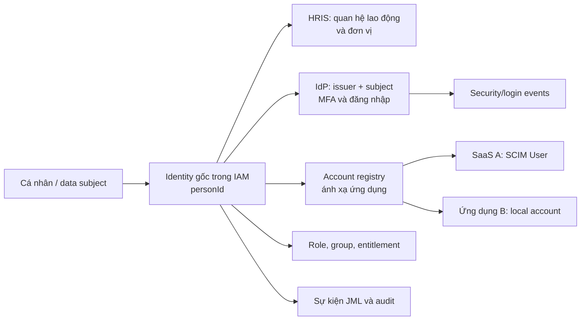
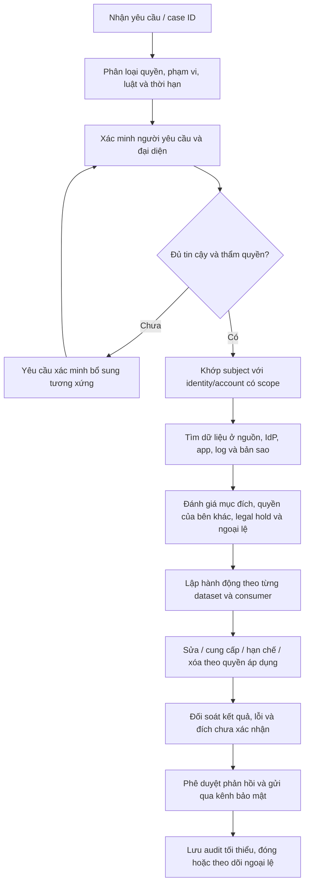
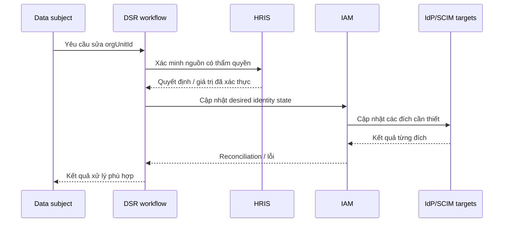

# Identity data subject: Chủ thể dữ liệu trong vòng đời danh tính IAM

> **Chương:** Privacy và identity  
> **Module:** `SECURITY_IDENTITY_ACCESS_MANAGEMENT_IDENTITY_LIFECYCLE`  
> **Mục tiêu:** Hiểu **data subject** là ai, họ liên hệ với dữ liệu danh tính và tài khoản như thế nào, và cách tổ chức tiếp nhận, xác minh, xử lý các yêu cầu liên quan đến dữ liệu cá nhân xuyên suốt **Joiner–Mover–Leaver (JML)**. Bài học kết nối IdP, SSO, SCIM, RBAC/ABAC, tài khoản dịch vụ, kiểm toán, giảm quyền truy cập tồn dư và bảo vệ quyền riêng tư.

## 1. Identity data subject là ai?

Trong các khuôn khổ bảo vệ dữ liệu cá nhân, **data subject (chủ thể dữ liệu)** thường là **cá nhân mà dữ liệu cá nhân liên quan đến**. Cách định nghĩa và phạm vi quyền cụ thể phụ thuộc pháp luật áp dụng. Trong IAM, có thể là nhân viên, ứng viên, nhà thầu, đối tác cá nhân, khách hàng hoặc người dùng cuối.

Hãy phân biệt ba thực thể:

- **Con người / data subject:** người thực mà dữ liệu nói đến, chẳng hạn một nhân viên tên An.
- **Digital identity:** tập định danh và thuộc tính hệ thống dùng để đại diện cho An trong một miền quản lý.
- **Account:** tài khoản cụ thể mà An dùng ở một IdP, ứng dụng SaaS hoặc hệ thống nội bộ.

**Một người có thể có nhiều digital identities và nhiều accounts.** Một account có thể bị khóa, đổi tên hoặc xóa mà người đó vẫn là data subject của các bản ghi lịch sử còn liên quan đến họ.

Ví dụ: An có `personId=p-1207` trong hệ thống IAM, `iss` + `sub` ở IdP, một tài khoản SCIM trong ứng dụng quản lý công việc và một tài khoản quản trị riêng. Khi An nghỉ việc, các account cần bị vô hiệu hóa hoặc thu hồi quyền. Nhưng một số audit events ghi việc cấp/thu hồi quyền vẫn có thể là dữ liệu cá nhân liên quan đến An, cần quản lý theo mục đích và thời hạn lưu hợp lệ.

### 1.1. Data subject, requester và account owner không phải lúc nào cũng là một

| Khái niệm | Ý nghĩa | Ví dụ |
|---|---|---|
| **Data subject** | Cá nhân mà dữ liệu liên quan đến | An, người đã nghỉ việc |
| **Requester** | Người gửi yêu cầu về dữ liệu | An hoặc người đại diện được ủy quyền |
| **Account principal** | Chủ thể kỹ thuật trong phiên/API | `sub` trong OIDC, service principal |
| **Identity owner** | Đơn vị vận hành hoặc quản lý hồ sơ IAM | IAM platform hoặc HRIS theo trường dữ liệu |
| **Data controller / bên quyết định mục đích và phương tiện** | Chủ thể tổ chức quyết định tại sao và cách xử lý theo khuôn khổ áp dụng | Công ty quản lý nhân sự |
| **Data processor / bên xử lý theo chỉ dẫn** | Bên xử lý dữ liệu thay mặt bên quyết định theo khuôn khổ áp dụng | Nhà cung cấp SaaS hoặc proofing trong vai trò thích hợp |

Tên vai trò pháp lý và trách nhiệm có thể khác giữa các khu vực tài phán; không nên mặc định mọi SaaS đều là processor cho mọi hoạt động. Điều quan trọng là có **chủ sở hữu trách nhiệm** trả lời yêu cầu, xác định đúng bên nhận dữ liệu và phối hợp xử lý.

### 1.2. Danh tính phi con người có phải data subject không?

Service account, workload identity, bot, CI pipeline và máy chủ **không phải con người**; theo nhiều khung bảo vệ dữ liệu cá nhân, chúng không phải data subject. Tuy vậy, registry của service identity có thể chứa tên hoặc email của **owner là con người**; những trường ấy vẫn có thể là dữ liệu cá nhân của owner.

Không áp dụng máy móc quyền của một người cho một service account. Đồng thời, không bỏ qua privacy chỉ vì một log được gắn với workload: log có thể chứa `actorPersonId`, `approvedBy` hoặc dữ liệu người dùng do workload xử lý.

## 2. Data subject là đối tượng dữ liệu, không chỉ là khóa trong bảng `users`

Một cá nhân có thể xuất hiện trong nhiều bản ghi:



Yêu cầu truy cập hoặc sửa dữ liệu của data subject có thể liên quan nhiều hệ thống, kể cả hệ thống đã ngừng hoạt động hoặc tài khoản hiện không đăng nhập được.

### 2.1. Chọn khóa định danh để tìm đúng dữ liệu

| Định danh | Phạm vi | Cảnh báo |
|---|---|---|
| `personId` | Khóa nội bộ trong miền IAM | Giữ ổn định, có chính sách tái tuyển dụng và không tái sử dụng |
| `employeeNumber` | Mã trong HRIS | Có thể thay đổi hoặc tái cấp theo quy tắc nghiệp vụ |
| `iss` + `sub` | Một subject trong OIDC issuer | Không dùng `sub` đơn lẻ qua nhiều issuer |
| SAML `NameID` | Định danh federation theo định dạng và cấu hình | Có thể khác theo service provider |
| SCIM `id` | Resource ID do một service provider cấp | Không dùng như ID toàn tổ chức |
| SCIM `externalId` | Giá trị do provisioning client cấp | Phải scope theo ứng dụng và tenant |
| Email, số điện thoại | Thuộc tính liên hệ/đăng nhập | Có thể đổi, bị tái sử dụng hoặc thuộc nhiều người qua thời gian |

Một yêu cầu được gửi từ `an@example.invalid` **không đủ** để kết luận mọi bản ghi từng dùng địa chỉ email đó đều thuộc An. Cần kết hợp identity gốc, thời gian hiệu lực, nguồn dữ liệu và bằng chứng liên kết được kiểm chứng.

### 2.2. Định danh giả và dữ liệu đã xóa tên

Đổi `personId` thành mã ngẫu nhiên hoặc hash không tự biến bản ghi thành dữ liệu ẩn danh. Nếu tổ chức còn bảng ánh xạ, hoặc có thể nhận diện An bằng nhóm, vị trí, thời gian và các nguồn khác, bản ghi vẫn có thể là dữ liệu cá nhân theo ngữ cảnh áp dụng.

Đối với `pairwise subject identifier` của OIDC, các relying party thuộc sector khác nhau có thể nhận `sub` khác nhau. IAM vẫn cần cơ chế ánh xạ có bảo vệ để phục vụ JML và những yêu cầu hợp lệ liên quan tới data subject.

## 3. Những lớp dữ liệu liên quan đến một data subject

Khi thực hiện tìm kiếm hoặc phân loại, không chỉ tra bảng profile:

| Nhóm | Ví dụ | Thường có tại | Cần chú ý |
|---|---|---|---|
| Hồ sơ gốc | `personId`, mã nhân sự, ngày bắt đầu, bộ phận | HRIS, IAM | Nguồn có thẩm quyền, lịch sử thay đổi |
| Kết quả proofing | `verifiedAt`, mức bảo đảm, tham chiếu bằng chứng | Dịch vụ xác minh | Bằng chứng thô và trạng thái kết quả có thời hạn khác nhau |
| Hồ sơ IdP | `iss`, `sub`, user status, phương thức MFA | IdP | Không xuất secrets hoặc dữ liệu phục hồi |
| Tài khoản đích | `scimId`, `externalId`, `active`, local ID | SaaS, account registry | Bao gồm tenant và account đã deactivate |
| Entitlement | Nhóm, role, policy, grant/revoke | IAM, ứng dụng | Phân biệt hiện tại với lịch sử |
| Sự kiện hoạt động | Login time, IP, device, failures | IdP, SIEM, log | Có thể chứa dữ liệu của người khác |
| Kiểm toán | Người phê duyệt, policy version, mục đích, outcome | IAM audit/ITSM | Giữ đủ chứng cứ nhưng hạn chế bản sao nhạy cảm |
| Metadata dịch vụ | Owner của bot, người phê duyệt secret | Service registry | Dữ liệu cá nhân nằm trong record phi con người |
| Bản sao | Cache, queue, export, backup, data warehouse | Nhiều hệ thống | Có thể không được tìm thấy bởi truy vấn profile |

Không phải mọi trường trong bảng chứa `personId` đều thuộc về một người duy nhất. Ví dụ `approvedBy` là dữ liệu về **người phê duyệt**, còn `subjectId` liên hệ tới **người được cấp quyền**. Một audit record có thể liên quan nhiều data subjects, nên phản hồi phải xem xét quyền và thông tin của **các bên thứ ba**.

## 4. Những quyền và yêu cầu mà tổ chức có thể cần xử lý

Các quyền cụ thể, thời hạn phản hồi, ngoại lệ và cơ sở xử lý phụ thuộc khu vực pháp lý, loại dữ liệu, vai trò của tổ chức và tình huống. Bảng sau là bản đồ **những nhóm quyền phổ biến**, không khẳng định mọi người có tất cả quyền này trong mọi trường hợp.

| Loại yêu cầu | Điều người yêu cầu muốn | Ví dụ gắn với IAM |
|---|---|---|
| **Được thông tin / minh bạch** | Biết dữ liệu nào được xử lý, mục đích, bên nhận, thời hạn | Vì sao IdP giữ login events và SCIM gửi email tới SaaS? |
| **Truy cập và nhận bản sao** | Biết hoặc nhận thông tin về dữ liệu liên quan đến mình | Xem thuộc tính danh tính, tài khoản, lịch sử quyền thuộc phạm vi được phép |
| **Đính chính** | Sửa dữ liệu không đúng, bổ sung thông tin thiếu | Sai `orgUnitId` hoặc tên, ảnh hưởng quyền ứng dụng |
| **Xóa dữ liệu** | Yêu cầu xóa khi điều kiện pháp lý áp dụng được đáp ứng | Xóa bằng chứng proofing đã hết mục đích, dữ liệu ở SaaS |
| **Hạn chế xử lý** | Tạm giới hạn cách dùng dữ liệu trong hoàn cảnh thích hợp | Ngừng dùng thuộc tính đang tranh chấp để ra quyết định ngoài phạm vi cho phép |
| **Phản đối xử lý** | Phản đối một hoạt động xử lý theo điều kiện pháp lý | Dùng login events cho phân tích hành vi ngoài mục đích ban đầu |
| **Rút lại đồng ý** | Rút consent đối với xử lý dựa trên consent nếu áp dụng | Ngừng chia sẻ thuộc tính phục vụ tính năng tự nguyện |
| **Di chuyển dữ liệu** | Nhận hoặc chuyển một số dữ liệu ở định dạng phù hợp theo điều kiện luật | Xuất thông tin tài khoản được quyền nhận, không xuất toàn bộ cấu trúc IAM nội bộ |
| **Quyết định tự động / khiếu nại** | Nhận thông tin, thực hiện quyền liên quan quyết định tự động theo luật | Yêu cầu xem xét cơ chế từ chối account dựa trên policy khi thuộc phạm vi bảo vệ |
| **Yêu cầu qua đại diện** | Người được ủy quyền hoặc đại diện hợp lệ thay mặt | Đại diện gửi yêu cầu của nhân viên đã nghỉ |

Không coi **xóa account**, **xóa mọi dữ liệu cá nhân** và **rút quyền đăng nhập** là một hành động. Chúng có phạm vi khác nhau và có thể được yêu cầu theo các căn cứ riêng.

## 5. Các bên chịu trách nhiệm trong một quy trình data subject request

Một yêu cầu liên quan IAM thường cần nhiều chủ sở hữu dữ liệu:

| Bên | Trách nhiệm thường gặp |
|---|---|
| **Privacy/DSR owner** | Tiếp nhận, xác định phạm vi pháp lý, thời hạn, phê duyệt phản hồi |
| **IAM lifecycle team** | Ánh xạ subject với các account, trạng thái JML và quyền |
| **HRIS owner** | Xác nhận thông tin lao động và nguồn có thẩm quyền của thuộc tính |
| **IdP/security team** | Quản lý phương thức xác minh, đăng nhập, session và security events |
| **Application owner** | Tìm dữ liệu tại ứng dụng, thực hiện sửa/xóa/hạn chế |
| **Legal/compliance** | Đánh giá ngoại lệ, nghĩa vụ lưu giữ, tranh chấp, yêu cầu pháp luật |
| **Data processor/vendor** | Xử lý theo vai trò, hợp đồng và quy trình đã thỏa thuận |
| **Audit operator** | Lưu bằng chứng tối thiểu, giám sát tính toàn vẹn của quy trình |

Tách **quyền xem thông tin** khỏi **quyền quyết định yêu cầu có hợp lệ hay không**. Nhân viên hỗ trợ có thể theo dõi trạng thái ticket nhưng không cần xem ảnh giấy tờ, credential hoặc nội dung audit nhạy cảm.

### 5.1. Một data subject request có thể có nhiều kết quả

Một yêu cầu xóa có thể dẫn đến:

- Xóa một số bản sao không còn cần.
- Sửa dữ liệu sai ở nguồn có thẩm quyền và đẩy cập nhật tới đích.
- Hạn chế xử lý bản ghi đang cần lưu cho nghĩa vụ hợp lệ.
- Từ chối hoặc giới hạn một phần yêu cầu khi có căn cứ áp dụng.
- Cung cấp lý do và quy trình phản hồi/kháng nghị theo yêu cầu pháp lý.

Không thiết kế hệ thống như thể chỉ có hai trạng thái `deleted=true` hoặc `request_denied=true` cho toàn bộ dữ liệu của một người.

## 6. Vòng đời xử lý yêu cầu của data subject

Một quy trình tổng thể:



Một yêu cầu không nên được đánh dấu “đã xử lý xong” chỉ vì đã gửi lệnh tới SaaS. Cần biết **bên nhận đã xác nhận gì**, có đích thất bại không và phần nào đã được giới hạn hoặc giữ lại hợp lệ.

### 6.1. Các trường có thể quản lý cho DSR case

```yaml
caseId: dsr-case-2081
requestType: access
receivedAt: "2026-11-23T08:00:00Z"
requesterType: data-subject
subjectRef: person-1207
verification:
  status: verified
  methodRef: proofing-workflow-37
scope:
  - iam-identity
  - idp-account
  - application-accounts
  - authorized-audit-evidence
decision:
  status: in-review
  policyVersion: dsr-policy-v2
destinations:
  - hris
  - identity-provider
  - scim-targets
retentionPolicyRef: dsr-case-retention
```

Cấu trúc minh họa là **hợp đồng workflow nội bộ**, không phải chuẩn yêu cầu pháp lý. Trong thực tế phải quản lý căn cứ, thời hạn, đường tiếp nhận, phạm vi, ủy quyền, kết quả từng hệ thống và cách xử lý ngoại lệ. Tránh lưu ảnh giấy tờ hoặc bí mật xác thực trong ticket nếu chỉ cần mã tham chiếu tới bước xác minh.

## 7. Xác minh người gửi yêu cầu mà không thu thêm dữ liệu quá mức

Việc phản hồi sai người có thể tạo ra **một sự cố lộ dữ liệu mới**. Tuy nhiên, yêu cầu mọi người gửi lại giấy tờ tùy thân trong mọi trường hợp cũng làm tăng thu thập dữ liệu và rủi ro.

Áp dụng xác minh **tương xứng với rủi ro và dữ liệu sẽ phát hành**:

1. Kiểm tra có thể dùng phiên đăng nhập bảo mật hiện tại, MFA và quan hệ account đã xác thực hay không.
2. Nếu data subject không còn account hoặc không thể sử dụng phương thức đó, cung cấp kênh xác minh thay thế phù hợp.
3. Xác minh **quyền đại diện**, quan hệ pháp lý và phạm vi ủy quyền nếu người gửi không phải chủ thể.
4. Giới hạn bằng chứng chỉ cho mục đích xác minh DSR; không phát tán sang ứng dụng đích.
5. Ghi **mã workflow, kết quả và thời điểm xác minh**, thay cho ảnh hoặc secret nếu đủ.
6. Thiết kế phương án chống social engineering và account takeover đối với yêu cầu tải dữ liệu nhạy cảm.

Không tin email người gửi hoặc số điện thoại đơn lẻ là bằng chứng tuyệt đối. Email có thể được tái sử dụng; mailbox có thể bị chiếm; số điện thoại có thể được chuyển chủ hoặc bị tấn công SIM swap.

### 7.1. Leaver không còn SSO vẫn có quyền yêu cầu khi luật áp dụng

Sau khi Leaver, IdP có thể đã disable account. **Không yêu cầu đăng nhập bằng chính tài khoản đã bị khóa** như điều kiện duy nhất để thực hiện quyền dữ liệu. Thiết kế một kênh tiếp nhận và xác minh ngoài SSO, có kiểm soát gian lận và bảo vệ dữ liệu.

Đồng thời, việc cho người cũ gửi yêu cầu **không đồng nghĩa mở lại tài khoản nội bộ** hoặc cấp quyền vào HRIS, IdP hay audit store.

### 7.2. Đại diện, người giám hộ và bên liên quan

Tùy khuôn khổ áp dụng, yêu cầu có thể đến từ người đại diện, người giám hộ hoặc cơ quan có thẩm quyền. Không suy diễn rằng người quản lý trực tiếp, người thân hoặc người từng sở hữu account đều tự động được phép nhận dữ liệu của subject. Cần kiểm tra văn bản và phạm vi quyền liên quan, giới hạn bản sao dữ liệu cấp cho đại diện.

## 8. Tìm dữ liệu về đúng subject qua nhiều hệ thống

Thách thức lớn của DSR là **identity resolution**: tìm đúng các record của một cá nhân mà không gộp nhầm người có tên/email giống nhau.

### 8.1. Subject-to-account graph

Một thiết kế bảng ánh xạ tối thiểu:

```text
PersonIdentity(personId, lifecycleState, sourceRef)
IdpLink(personId, issuer, subject, tenantId, validFrom, validTo)
AppAccount(personId, applicationId, tenantId, accountId, externalId, active)
EntitlementHistory(personId, resourceId, entitlementId, validFrom, validTo)
RequestCase(caseId, subjectId, requestType, verificationRef, state)
RequestTarget(caseId, targetSystemId, status, evidenceRef)
```

Điểm cần kiểm soát:

- `personId` không tái sử dụng trong miền quản lý đã xác định.
- `sub` chỉ xác định trong phạm vi `iss`; ID ứng dụng phải gắn `applicationId` và `tenantId`.
- Mapping giữ **thời gian hiệu lực** để phân biệt chủ cũ và chủ mới của email/username.
- Một cá nhân có nhiều account, bao gồm account đặc quyền; cần chính sách liên kết có kiểm chứng.
- Service identity có thể có owner là một người, nhưng không tự gộp dữ liệu service với dữ liệu cá nhân của owner.
- Không dùng việc “cùng email” làm bằng chứng duy nhất để nối dữ liệu từ các tenant khác nhau.

### 8.2. Xử lý identity match không chắc chắn

Nếu hai bản ghi có dấu hiệu thuộc cùng người nhưng chưa đủ bằng chứng, phải đánh dấu **matching exception** để người có thẩm quyền xác minh. Đừng tự gộp dữ liệu rồi gửi bản sao của người khác cho requester.

Ví dụ tình huống nhạy cảm:

| Tình huống | Cách xử lý |
|---|---|
| Một email trước đây thuộc người A, hiện thuộc B | Dùng account ownership theo thời gian và identity gốc |
| Người tái tuyển dụng có mã HRIS mới | Theo chính sách rehire, xác minh trước khi nối lịch sử |
| Một nhân viên có tài khoản admin riêng | Kiểm tra ánh xạ account đặc quyền với personId |
| Một user tồn tại tại hai tenant SaaS | Scope mapping theo tenant, không dùng cùng ID chung một cách mù quáng |
| Log chỉ có IP chia sẻ | Không tự xác nhận IP là dữ liệu riêng của một người |
| Dữ liệu đã được ẩn danh thực sự | Đánh giá còn khả năng nhận diện hay không trước khi xử lý theo subject |

### 8.3. Bao phủ dữ liệu ngoài bảng account

Cần tìm cả log, cache, queue, data warehouse, bản xuất CSV và dữ liệu do vendor giữ, trong phạm vi tổ chức có trách nhiệm và khả năng truy xuất hợp lệ. Tuy nhiên, không nên thu thập dữ liệu mới ngoài mục đích chỉ để xây một kho DSR toàn năng; có thể dùng **federated search** và truy vấn theo nhu cầu.

## 9. Quyền truy cập dữ liệu: tạo bản phản hồi an toàn

Khi một yêu cầu truy cập hợp lệ, không đơn giản chạy `SELECT * FROM users WHERE email = ...`. Cần xác định phạm vi, quyền đối với từng loại record và các ngoại lệ liên quan.

### 9.1. Dữ liệu có thể cần đánh giá để cung cấp

- Thuộc tính danh tính mà tổ chức xử lý và thông tin về mục đích, bên nhận, loại dữ liệu, thời hạn.
- Danh sách tài khoản/ứng dụng liên kết nếu nằm trong phạm vi quyền và không làm lộ bí mật bảo mật cần được bảo vệ.
- Thông tin về những sự kiện hoặc quyết định liên quan trực tiếp tới data subject theo phạm vi luật áp dụng.
- Nguồn dữ liệu, cách thức chỉnh sửa và đầu mối xử lý khi phù hợp.
- Thông tin liên quan đến việc ra quyết định tự động nếu thuộc phạm vi quyền.

### 9.2. Dữ liệu phải được bảo vệ hoặc xem xét hạn chế

- Password hash, recovery code, TOTP seed, private key, access/refresh token.
- Secret của workload hoặc credential dùng chung.
- Dữ liệu cá nhân của người khác trong cùng ticket, log hoặc bản ghi phê duyệt.
- Thông tin điều tra bảo mật, cơ chế phát hiện gian lận hoặc bí mật kinh doanh thuộc căn cứ hạn chế hợp lệ.
- Nội dung dữ liệu không thật sự liên quan đến người yêu cầu.

Không thể mặc định loại tất cả security logs khỏi yêu cầu, nhưng cũng không thể tự động xuất toàn bộ SIEM. Việc áp dụng ngoại lệ phải theo luật, phạm vi, mức rủi ro và quyết định có thể giải thích.

### 9.3. Phản hồi có kiểm soát theo trường

Ví dụ record nội bộ:

```json
{
  "subjectId": "p-1207",
  "applicationId": "repository-hosting",
  "accountId": "usr-881",
  "entitlements": ["repo-read"],
  "approvalActorId": "p-3001",
  "securityNotes": "internal-detection-rule",
  "tokenReference": "secret-vault-ref-88"
}
```

Một bản phản hồi phù hợp có thể chỉ nêu account liên quan, quyền thuộc phạm vi được phép, thời điểm và thông tin về hoạt động xử lý. `approvalActorId` liên quan người khác và các trường `securityNotes`/`tokenReference` cần đánh giá, che hoặc loại theo quyết định hợp lệ. Không có một quy tắc redaction duy nhất phù hợp mọi trường hợp.

### 9.4. Kênh gửi và định dạng

Bản xuất phải được gửi qua kênh bảo mật phù hợp, chỉ người đã xác minh được truy cập; có thể dùng thời hạn truy cập, xác thực bổ sung và audit lần tải xuống. Không gửi toàn bộ dữ liệu trong email thông thường nếu độ nhạy cao hoặc kênh không phù hợp.

Nếu làm file CSV/JSON, cần phòng **CSV formula injection**, kiểm soát encoding, xử lý chuỗi do người dùng nhập và giảm metadata không cần thiết. Mỗi file xuất cũng là bản sao cần retention và xóa theo quy định.

## 10. Đính chính dữ liệu: sửa tại nguồn có thẩm quyền và lan truyền thay đổi

Một data subject có thể phát hiện tên sai, nhầm bộ phận, ngày bắt đầu hoặc trạng thái tài khoản. Đính chính phải gắn với **data ownership**, không sửa tại mỗi ứng dụng theo cách tùy tiện.

Ví dụ:



Không để một form DSR cho phép tự khai `department=finance` và đẩy vào policy engine ngay, vì đây là thuộc tính ảnh hưởng quyền truy cập. Cần HRIS hoặc nguồn có thẩm quyền xác nhận.

### 10.1. Sửa dữ liệu và giữ lịch sử

Nếu thuộc tính trước đây sai, có thể cần lưu bằng chứng **đã chỉnh sửa** để giải thích các quyết định IAM đã diễn ra. Điều này khác với việc tiếp tục dùng giá trị sai để phân quyền.

Hệ thống nên phân biệt:

- **Current authoritative value:** dùng cho quyết định mới.
- **Correction event:** ai sửa, thời điểm, căn cứ hoặc mã yêu cầu.
- **Historical decision evidence:** giá trị hoặc tham chiếu đủ để giải thích quyết định đã từng xảy ra, có kiểm soát.
- **Downstream state:** xác nhận IdP, SCIM, SaaS đã cập nhật hoặc còn lỗi.

### 10.2. Mover và việc sửa lỗi có thể cùng xảy ra

Khi người dùng chuyển phòng ban, source event có `effectiveAt` và version. Một yêu cầu đính chính đến sau có thể tranh chấp trạng thái ở một thời điểm quá khứ. Không lấy “sự kiện đến cuối cùng” làm dữ liệu chuẩn nếu chưa xét thời gian hiệu lực, nguồn và phiên bản.

## 11. Yêu cầu xóa dữ liệu: khác với vô hiệu hóa account

**Erasure/deletion request** phải được xét theo điều kiện của khung pháp lý và nghĩa vụ áp dụng. Không phải mọi dữ liệu đều xóa ngay, cũng không phải mọi record có căn cứ giữ đều được tiếp tục sử dụng tự do.

Một mô hình xử lý theo từng nhóm:

| Nhóm | Hành động cần đánh giá |
|---|---|
| Dữ liệu proofing thô | Xóa khi không còn mục đích/căn cứ giữ; xác nhận bản sao |
| HRIS đang hoạt động | Kiểm tra nghĩa vụ quản lý nhân sự hoặc hợp đồng còn áp dụng |
| IdP profile | Disable/xóa account khi thích hợp; quản lý session, authenticator riêng |
| SCIM SaaS profile | Xem API deactivate/delete và chính sách lưu dữ liệu của vendor |
| Account mapping | Có thể giữ tối thiểu để xác minh deprovision, ngăn nối nhầm identity |
| Entitlement history | Thu hồi quyền hiện tại; giữ bằng chứng lịch sử khi có căn cứ |
| Audit/security events | Xét nhu cầu điều tra, nghĩa vụ giữ, quyền của các bên |
| Export, cache, backup | Xử lý theo chính sách vòng đời bản sao và khả năng restore |

### 11.1. Cảnh báo về xóa mapping quá sớm

Trong Leaver, xóa `personId → applicationAccountId` trước khi đối soát có thể làm mất khả năng tìm những account vẫn hoạt động. Cần **chặn truy cập trước**, xử lý các tài khoản đích và lưu ánh xạ có kiểm soát cho tới khi kết thúc mục đích deprovision và những nghĩa vụ còn hiệu lực.

### 11.2. “Hủy account” không phải “xóa toàn bộ dữ liệu”

Ở SCIM, thay `active=false` thường là thao tác vô hiệu hóa tài khoản; nó không bảo đảm provider xóa profile, session, data warehouse hay backup. Khi xóa được phê duyệt, workflow phải xác định chính xác **deactivate, delete, anonymize, restrict** có nghĩa gì tại từng hệ thống.

### 11.3. Legal hold và căn cứ giữ dữ liệu

Một record có thể thuộc phạm vi lưu giữ cho tranh chấp, kiểm toán hoặc nghĩa vụ khác. Cần quản lý exception/hold với phạm vi, người phê duyệt, mốc rà soát, quyền đọc và lý do phù hợp. Hold có thể hạn chế xóa **bản ghi cụ thể**; không tự cho phép khôi phục đăng nhập hoặc sử dụng dữ liệu cho mục đích cũ đã hết.

## 12. Hạn chế xử lý, phản đối và rút lại đồng ý

Các loại yêu cầu này không hoàn toàn tương đương:

- **Restriction:** hạn chế một số hoạt động xử lý trong điều kiện áp dụng; bản ghi có thể tiếp tục được lưu có kiểm soát.
- **Objection:** người liên quan phản đối xử lý theo điều kiện và căn cứ nhất định.
- **Withdrawal of consent:** rút sự đồng ý đối với hoạt động dựa trên consent nếu luật/chính sách áp dụng.

Trong IAM, phân biệt các **purpose**:

| Purpose | Ví dụ | Gợi ý thiết kế |
|---|---|---|
| `account-provisioning` | Tạo account phục vụ quan hệ hợp lệ | Kiểm tra căn cứ riêng; không giả định dựa trên consent |
| `authentication` | Xác thực phiên và MFA | Dữ liệu tối thiểu để bảo vệ account |
| `access-authorization` | Đánh giá nhóm và thuộc tính quyền | Chặn khi identity không hợp lệ |
| `security-monitoring` | Phát hiện đăng nhập bất thường | Có mục đích, retention, quyền truy cập riêng |
| `optional-profile-personalization` | Ảnh đại diện/tùy chọn tự nguyện | Có thể ngừng hoặc rút theo cơ chế phù hợp |
| `audit-evidence` | Chứng minh cấp/thu hồi quyền | Xét nghĩa vụ giữ và giới hạn sử dụng |

Nếu rút đồng ý cho một tính năng tùy chọn, không đồng nghĩa phải tắt mọi kiểm soát bảo mật của account. Ngược lại, không được viện dẫn “security” một cách quá rộng để tiếp tục dùng dữ liệu cho một tính năng không còn mục đích được phép.

### 12.1. Purpose-based enforcement

Một policy có thể bao gồm:

```text
allow_read_attribute khi:
    consumer đã xác thực
    AND requestedPurpose thuộc purpose được duyệt của consumer
    AND attribute thuộc allowlist của purpose đó
    AND subject/tenant/resource thuộc phạm vi yêu cầu
    AND không có hạn chế xử lý cản trở hành động này
```

Giá trị `requestedPurpose` do frontend gửi **không được tự tin cậy**. Cần gắn với client identity, workflow, case ID và ngữ cảnh được server xác minh.

## 13. Quyền di chuyển dữ liệu: tách dữ liệu cá nhân khỏi bí mật hệ thống

Một số khuôn khổ cho phép nhận hoặc truyền một số loại dữ liệu ở định dạng có cấu trúc và máy đọc được trong các điều kiện nhất định. **Phạm vi dữ liệu được cung cấp không đồng nghĩa xuất toàn bộ database IAM**.

Cần xem xét:

- Dữ liệu nào do subject cung cấp hoặc thuộc phạm vi quyền di chuyển được áp dụng?
- Dữ liệu suy ra như risk score, quyền quản trị hoặc mô hình phát hiện gian lận có thuộc phạm vi không?
- Có dữ liệu người khác trong ticket, nhóm hoặc audit record không?
- Bên nhận có được xác minh, kênh truyền có an toàn, có lưu bản sao không?
- Export có chứa credential, secret, internal system topology hoặc thông tin bảo mật cần bảo vệ không?

Ví dụ một bản export profile có thể gồm các trường người dùng được phép nhận; **không** chứa private key của hệ thống, refresh token, toàn bộ chính sách RBAC hay thông tin riêng tư của đồng nghiệp.

Không hứa rằng mọi dữ liệu IAM đều phải được xuất dưới dạng di chuyển theo bất kỳ khuôn khổ nào. Cần xác định phạm vi, ngoại lệ, định dạng và căn cứ cụ thể.

## 14. Quyết định tự động, ABAC và quyền được giải thích khi áp dụng

IAM có thể tự động quyết định:

- Joiner đủ điều kiện tạo account hay chưa.
- Nhân viên thuộc nhóm quyền cơ sở nào.
- Có cho truy cập tài nguyên khi thiết bị không đạt chuẩn không.
- Có ngừng phiên vì rủi ro đăng nhập cao không.
- Mover/Leaver phải thu hồi những entitlement nào.

Không phải mọi quyết định IAM tự động đều thuộc nhóm quyết định tự động có hệ quả pháp lý đáng kể theo mọi luật. Nhưng các quyết định ảnh hưởng thực chất tới một người nên có **nguồn thuộc tính rõ, policy version, cơ chế khiếu nại/xem xét phù hợp và audit**.

Ví dụ policy:

```text
permit(subject, action, resource, context) khi:
    subject.lifecycleState == "active"
    AND "finance-reader" trong subject.entitlements
    AND subject.orgUnitId == resource.ownerOrgUnitId
    AND context.deviceCompliant == true
```

Nếu `orgUnitId` sai do nguồn HRIS cập nhật nhầm, người dùng cần đường yêu cầu đính chính có kiểm soát. Không nên mở quyền bằng cách cho user sửa `orgUnitId` ở frontend; phải chỉnh tại nguồn và tái tính policy.

### 14.1. Bằng chứng quyết định

```json
{
  "decisionId": "authz-7701",
  "subjectRef": "p-1207",
  "policyVersion": "finance-access-v3",
  "sourceVersions": {
    "orgUnitId": 18,
    "lifecycleState": 9
  },
  "action": "report.read",
  "result": "deny",
  "reasonCode": "unit_mismatch",
  "occurredAt": "2026-11-23T09:00:00Z"
}
```

Bản ghi này giữ đủ metadata để truy vết một quyết định mà không phải lưu toàn bộ dữ liệu cá nhân trong policy engine. Mức thông tin được tiết lộ cho data subject phải được đánh giá riêng với việc lưu audit nội bộ.

## 15. Joiner: quyền của data subject bắt đầu trước khi account hoạt động

**Joiner** có thể xuất hiện từ giai đoạn ứng viên hoặc đối tác chưa được cấp IdP account. Dữ liệu có thể được thu thập để tuyển dụng, xác minh, onboarding, lập hợp đồng hoặc cấp quyền ban đầu; mỗi mục đích có scope và retention riêng.

Một thiết kế tốt cần:

1. Xác định nguồn và mục đích cho từng nhóm thuộc tính.
2. Thông tin phù hợp cho người được thu thập dữ liệu theo luật áp dụng.
3. Tránh nhân bản ảnh giấy tờ và dữ liệu proofing sang nhiều ứng dụng.
4. Cho phép phát hiện và sửa lỗi identity trước khi tạo quyền đặc biệt.
5. Có kênh tiếp nhận yêu cầu dữ liệu ngay cả khi chưa tạo account.
6. Xử lý onboarding bị hủy: revoke invitation, tài khoản tạo trước và dữ liệu tạm.
7. Đối soát SaaS/IdP để tránh account không có người quản lý sau onboarding thất bại.

### 15.1. Proofing và dữ liệu nhạy cảm

Dịch vụ xác minh có thể cần tài liệu gốc; IdP/IAM thường chỉ cần kết quả, thời điểm, nguồn và mức bảo đảm phù hợp. Nếu data subject yêu cầu truy cập hoặc xóa bằng chứng proofing, workflow phải chuyển đúng nhà lưu trữ có thẩm quyền và xét thời hạn/nghĩa vụ lưu.

Không gửi bằng chứng thô cho helpdesk chỉ để helpdesk biết “verified hay chưa”. Khi cần xác minh requester DSR, nên tái sử dụng một phương thức xác minh an toàn, tương xứng mà không tạo thêm bản sao giấy tờ ngoài mục đích.

## 16. Mover: data subject có thể yêu cầu sửa sai ảnh hưởng quyền

**Mover** thay đổi vai trò, phòng ban, quản lý, địa điểm hoặc loại quan hệ. Một thuộc tính lỗi thời có thể tiếp tục điều khiển RBAC/ABAC và gây cấp nhầm hoặc từ chối quyền.

Ví dụ An chuyển từ Support sang Finance:

| Hạng mục | Trước Mover | Sau Mover | Điều phải kiểm tra |
|---|---|---|---|
| `orgUnitId` | `support` | `finance` | Nguồn HRIS, `effectiveAt` và version |
| Role mặc định | `support-reader` | `finance-reader` nếu đủ điều kiện | Thu hồi quyền cũ, cấp quyền mới có policy |
| Group IdP/SCIM | Nhóm Support | Nhóm Finance cần thiết | Cập nhật ứng dụng và session/cache |
| Dữ liệu lịch sử | Event đã cấp quyền Support | Lưu có kiểm soát | Không dùng như quyền hiện tại |
| DSR đính chính | Yêu cầu sửa dữ liệu vai trò | Xác minh từ nguồn có thẩm quyền | Tránh người dùng tự sửa thuộc tính đặc quyền |

Một yêu cầu sửa dữ liệu có thể đến cùng lúc HRIS gửi sự kiện mover. Cần xử lý **thời gian hiệu lực, source version và idempotency**; không để bản cập nhật cũ ghi đè trạng thái mới.

### 16.1. Quyền truy cập tồn dư và quyền riêng tư

Giữ quyền Support sau khi chuyển Finance không chỉ là vi phạm least privilege mà còn cho phép tiếp tục xem dữ liệu khách hàng ngoài mục đích công việc mới. Mover phải xử lý cả **quyền** và **dữ liệu/claim được chia sẻ** tới ứng dụng cũ.

## 17. Leaver: ngừng đăng nhập nhưng vẫn xử lý quyền dữ liệu phù hợp

Khi Leaver, IAM cần xử lý **quyền truy cập của người rời tổ chức** và **quyền đối với dữ liệu liên quan đến người đó** theo hai luồng riêng.

### 17.1. Luồng bảo mật JML

- Nhận sự kiện kết thúc quan hệ từ nguồn có thẩm quyền.
- Vô hiệu hóa account IdP, chặn đăng nhập mới.
- Thu hồi refresh token/session hoặc áp kiểm soát thực tế với token còn hiệu lực.
- Disable/deprovision tài khoản tại ứng dụng qua SCIM/API/runbook.
- Thu hồi group, role, VPN, SSH key, secret và quyền trực tiếp.
- Đối soát mọi đích để phát hiện account hoặc entitlement còn hoạt động.
- Giữ bằng chứng thu hồi ở mức cần thiết theo retention schedule.

### 17.2. Luồng data subject request sau khi nghỉ

- Tiếp nhận yêu cầu bằng kênh không phụ thuộc account đã khóa.
- Xác minh requester và xác định phạm vi dữ liệu.
- Dùng mapping lịch sử với quyền giới hạn để tìm đúng các account đã deactivate.
- Đánh giá yêu cầu truy cập/sửa/xóa theo dữ liệu và căn cứ từng hệ thống.
- Giới hạn người được xem hồ sơ HRIS, lý do nghỉ việc và bằng chứng audit.
- Không tự khôi phục SSO hoặc cấp quyền ứng dụng để người cũ “tự tải dữ liệu”.

**Deactivation không tự đồng nghĩa xóa dữ liệu.** Đồng thời, việc giữ audit sau khi nghỉ không tự cho phép dùng dữ liệu cho mục đích phân tích khác.

### 17.3. Tái tuyển dụng

Khi người cũ quay lại, tổ chức phải xác minh identity và quan hệ mới. Bản ghi lịch sử có thể giúp ngăn trùng nhưng không được dùng để khôi phục toàn bộ entitlement cũ. Một yêu cầu dữ liệu từ thời kỳ làm việc trước phải được đánh giá theo phạm vi và trách nhiệm đang áp dụng.

## 18. IdP, SSO, OIDC/SAML và data subject rights

IdP giữ nhiều thuộc tính; relying party nhận các claims cần thiết. DSR cần biết **dữ liệu đã phát hành cho ai** và **bản sao nào ứng dụng còn giữ**.

### 18.1. OIDC subject và claims

Trong OIDC, `iss` và `sub` xác định subject trong phạm vi issuer; ID token còn có những claim bắt buộc như `aud`, `exp`, `iat`. Claim tùy chọn như email, tên, số điện thoại hoặc nhóm phải có mục đích phát hành riêng.

Các yêu cầu DSR liên quan OIDC thường gồm:

- Sửa `name`/`email` tại nguồn và đồng bộ tới relying party cần biết.
- Xác định nơi dùng claims để tạo profile cục bộ.
- Làm mới cache/session khi thuộc tính ảnh hưởng quyền thay đổi.
- Không cho rằng xóa IdP account sẽ tự xóa mọi profile ở ứng dụng.
- Không đưa token, secret và dữ liệu riêng tư của các client khác vào bản xuất.

### 18.2. SAML

SAML `NameID` và attribute statement cần được giải thích trong phạm vi federation configuration. Một assertion được ký bảo vệ tính toàn vẹn; nó không tự che nội dung. Khi sửa hoặc ngừng chia sẻ thuộc tính, cần xem lại attribute release policy của service provider và dữ liệu mà ứng dụng đã lưu.

### 18.3. DSR không đồng nghĩa quyền tự sửa claims

Các trường như `isAdmin`, `groups`, `lifecycleState` hoặc `clearance` thường được dùng cho authorization. Data subject có thể yêu cầu xem xét hoặc đính chính thông tin sai theo quyền áp dụng, nhưng **không tự có quyền gán role quản trị** bằng cách gửi một yêu cầu sửa hồ sơ.

## 19. SCIM và hệ thống đích: thực thi yêu cầu theo từng ứng dụng

SCIM 2.0 hỗ trợ tạo, đọc, cập nhật, PATCH và xóa resource tùy triển khai. IAM cần phân biệt **mong muốn** và **trạng thái thực tế** ở từng đích.

Ví dụ cập nhật một thuộc tính theo yêu cầu đính chính đã được xác minh:

```http
PATCH /scim/v2/Users/app-user-402 HTTP/1.1
Content-Type: application/scim+json
Authorization: Bearer <redacted>

{
  "schemas": ["urn:ietf:params:scim:api:messages:2.0:PatchOp"],
  "Operations": [
    {
      "op": "replace",
      "path": "name.givenName",
      "value": "An"
    }
  ]
}
```

Trước khi gọi API phải xác định đây là **ứng dụng đúng tenant và đúng account**, field có trong schema và connector hỗ trợ, thay đổi đã được nguồn có thẩm quyền duyệt, và không sửa thuộc tính dùng để cấp quyền theo yêu cầu chưa được xác thực.

### 19.1. SCIM deactivate khi Leaver

```http
PATCH /scim/v2/Users/app-user-402 HTTP/1.1
Content-Type: application/scim+json
Authorization: Bearer <redacted>

{
  "schemas": ["urn:ietf:params:scim:api:messages:2.0:PatchOp"],
  "Operations": [
    {
      "op": "replace",
      "path": "active",
      "value": false
    }
  ]
}
```

Lệnh này vô hiệu hóa theo cơ chế provider; **không phải lệnh xóa toàn bộ dữ liệu cá nhân**. Khi có yêu cầu erasure hợp lệ, cần thêm quy trình theo API/khả năng của vendor và retention contract, với xác nhận riêng.

### 19.2. Reconciliation sau yêu cầu dữ liệu

Một hệ thống có thể chấp nhận PATCH nhưng chưa đồng bộ quyền hoặc lưu profile bản cũ trong cache. Cần:

- Xác nhận kết quả cập nhật ở resource đích.
- Kiểm tra nhóm/quyền trực tiếp nếu liên quan.
- Quản lý retry, rate limit và lỗi không hỗ trợ field.
- Ghi proof-of-completion theo từng consumer.
- Nêu rõ phần chưa hoàn tất trong báo cáo nội bộ và phản hồi theo quy trình phù hợp.

## 20. RBAC/ABAC, least privilege và quyền truy cập vào hồ sơ DSR

DSR workflow thường cần truy cập dữ liệu có độ nhạy cao. Cần một lớp chính sách riêng để ngăn người xử lý yêu cầu đọc quá mức.

| Vai trò | Hành động có thể được cấp theo nhiệm vụ | Giới hạn |
|---|---|---|
| Intake agent | Nhận case, xem tình trạng và mốc xử lý | Không xem credential hoặc giấy tờ gốc |
| Verification operator | Kiểm tra kết quả xác minh requester | Chỉ dữ liệu proofing cần thiết |
| Application custodian | Tìm và thực hiện hành động ở đích do mình quản lý | Chỉ account/tenant trong case được giao |
| Privacy reviewer | Quyết định phạm vi phản hồi, ngoại lệ, redaction | Không tự có quyền quản trị mọi hệ thống |
| Security investigator | Xem security events theo vụ việc được phép | Không dùng cho mục đích ngoài điều tra |
| Audit reviewer | Kiểm tra quyết định và kết quả hành động | Không sửa log hoặc mở lại account |

ABAC có thể kết hợp `caseId`, `purposeId`, `subjectId`, `tenantId`, phân loại record, quyền reviewer, hiệu lực phân công và trạng thái case.

Pseudocode:

```text
permit(operator, action, record, case) khi:
    operator.lifecycleState == "active"
    AND case.status thuộc {"verified", "approved"}
    AND operator.assignedCases chứa case.caseId
    AND record.tenantId == case.tenantId
    AND record.subjectId thuộc case.verifiedSubjectScope
    AND action được phép theo purpose + classification
```

Không tin `caseId` hoặc `purposeId` từ frontend khi không kiểm tra quan hệ và quyền ở backend. Dùng audit để phát hiện việc xuất hàng loạt hoặc xem dữ liệu của subject không thuộc case.

## 21. Sensitive identity data và thông tin của người thứ ba

Một hồ sơ của một người có thể chứa dữ liệu của nhiều người:

- Trong ticket, dữ liệu về khách hàng và nhân viên support.
- Trong audit, `subjectId` là người nhận quyền và `approvedBy` là người phê duyệt.
- Trong HRIS, `managerId` chỉ người quản lý khác.
- Trong group chat hoặc security event, có thể có danh tính đồng nghiệp.

Không nên xuất nguyên record khi một phần chứa dữ liệu riêng tư của người khác. Cần **field-level review**, redaction hoặc bản tóm tắt phù hợp theo quyền và luật áp dụng.

### 21.1. Bảo vệ dữ liệu proofing, credential và recovery

Các vật liệu sau cần kiểm soát riêng:

| Dữ liệu | Cách xử lý gợi ý |
|---|---|
| Bản scan giấy tờ | Kho chuyên biệt; kiểm tra nhu cầu cấp bản sao và kênh an toàn |
| Sinh trắc/liveness | Chỉ sử dụng trong phạm vi được phép; không copy vào ticket |
| TOTP seed/recovery code | Không trả trong bản xuất dữ liệu thông thường |
| Private key của workload | Không cung cấp vì đây là credential hệ thống |
| Access/refresh token | Thu hồi/bảo vệ; không ghi vào log DSR |
| Security investigation note | Đánh giá phạm vi được tiết lộ và các ngoại lệ hợp lệ |
| Role/group nhạy cảm | Đánh giá cách giải thích quyền mà không lộ bí mật vận hành hoặc người khác |

Một thông tin đã được pseudonymize vẫn có thể là dữ liệu cá nhân nếu còn khả năng liên kết ngược. Encryption cũng không thay thế việc xét quyền tiết lộ.

### 21.2. Dữ liệu của service owner

Ví dụ service registry có:

```json
{
  "serviceIdentityId": "svc-report-prod",
  "ownerTeamId": "platform-team",
  "ownerPersonId": "p-1207",
  "createdByPersonId": "p-0911",
  "credentialReference": "secret-manager-ref-31"
}
```

`ownerPersonId` và `createdByPersonId` liên quan tới các cá nhân khác nhau. Nếu An yêu cầu dữ liệu về mình, workflow cần xem An gắn với trường nào, nhưng không được trả secret của service hoặc dữ liệu của các owner khác chỉ vì record chứa tên An.

Khi owner Leaver, chuyển ownership và rà soát secret; không tự xóa workload production còn phục vụ nghiệp vụ. Tác động JML với service account và quyền dữ liệu của cá nhân cần được xử lý riêng.

## 22. Retention, legal hold và bản sao của DSR case

**DSR case cũng tạo dữ liệu cá nhân mới:** thông tin requester, bằng chứng xác minh, phạm vi yêu cầu, bản xuất, nội dung phản hồi và audit hành động. Cần retention schedule riêng.

### 22.1. Những bản ghi cần tách

| Bản ghi | Mục đích có thể phù hợp | Rủi ro nếu lưu quá mức |
|---|---|---|
| DSR case metadata | Theo dõi và chứng minh đã xử lý yêu cầu | Lộ loại yêu cầu, thông tin liên hệ |
| Identity verification reference | Chứng minh đã xác minh requester | Lộ giấy tờ nếu nhúng raw evidence |
| Export package | Cung cấp dữ liệu cho requester | Bản sao tập trung rất nhiều PII |
| Decision record | Giải thích cho phép/hạn chế/từ chối một phần | Có thể chứa dữ liệu nhạy cảm hoặc pháp lý |
| Target confirmation | Xác minh sửa/xóa ở từng ứng dụng | Liên kết danh tính và hệ thống |
| Audit trail | Chống sửa, chứng minh trách nhiệm | Nếu lưu toàn bộ request/response sẽ tạo kho thứ hai |

Các gói xuất dữ liệu cần thời hạn truy cập, cơ chế hủy sau khi hết mục đích và quyền tải phù hợp. Không dùng chính export package làm nguồn dữ liệu dài hạn cho IAM.

### 22.2. Legal hold không mở lại quyền

Một số record có thể phải giữ phục vụ tranh chấp/điều tra hợp lệ. Cần quản lý hold có phạm vi, owner, căn cứ và review. **Hold giữ bằng chứng**, không cấp lại tài khoản, không cho phép credential đã bị revoke hoạt động và không tự cho dùng dữ liệu cho mục đích mới.

### 22.3. Backup, delete và restore

Nếu xóa một record khỏi database nhưng backup cũ còn dữ liệu, phải có chính sách xử lý backup, giới hạn restore và quy trình áp lại các quyết định xóa/thu hồi. Khi restore IAM, cần lấy JML state mới nhất, revocation ledger và kết quả DSR deletion để không tạo lại quyền cũ.

**Tombstone** hoặc deletion ledger có thể giúp ngăn một sự kiện provisioning cũ tạo lại account, nhưng ledger cũng cần mục đích, phạm vi dữ liệu và retention riêng; không mặc định lưu vô hạn.

## 23. Thiết kế kiến trúc DSR orchestration không phá IAM lifecycle

Một kiến trúc thực tế có thể gồm:

```mermaid
flowchart TD
    PORTAL["DSR intake / secure channel"] --> WF["DSR workflow + deadlines"]
    WF --> PROOF["Verification / delegated authority"]
    PROOF --> GRAPH["Subject-resolution service"]
    GRAPH --> MAP["IAM identity & account mappings"]
    GRAPH --> HR["HRIS"]
    GRAPH --> IDP["IdP / SSO logs"]
    GRAPH --> APP["SCIM + application adapters"]
    GRAPH --> AUD["Audit / security records"]
    WF --> POLICY["Policy, privacy, legal/retention review"]
    POLICY --> TASKS["Scoped target actions"]
    TASKS --> HR
    TASKS --> IDP
    TASKS --> APP
    TASKS --> AUD
    TASKS --> REC["Target confirmations / reconciliation"]
    REC --> WF
    WF --> RESPONSE["Reviewed secure response"]
    WF --> CASEAUD["DSR audit with minimal metadata"]
```



Các thành phần nên hỗ trợ:

- **Idempotency:** xử lý lại cùng hành động không tạo bản sao hoặc thay đổi lặp nguy hiểm.
- **Source versions và `effectiveAt`:** không ghi đè mover/leaver mới bằng yêu cầu sửa cũ.
- **Per-target status:** biết chính xác ứng dụng nào thành công, thất bại hoặc không hỗ trợ.
- **Scoped authorization:** mỗi adapter chỉ thao tác trên đúng tenant/account.
- **Outbox/retry:** tránh mất cập nhật khi database và API bên ngoài không cùng giao dịch.
- **Privacy review:** quyết định chỉ gửi từng trường, kết quả và lý do hạn chế khi cần.
- **Retention-safe evidence:** ghi metadata, không lưu plaintext token hoặc bằng chứng proofing quá mức.

### 23.1. Pseudocode xử lý một yêu cầu đính chính

```java
void processCorrection(DataSubjectRequest request) {
    if (!request.isVerified() || !request.hasValidAuthority()) {
        throw new SecurityException("Requester not verified");
    }

    SubjectIdentity subject = resolver.resolveScopedSubject(request);
    CorrectionDecision decision = privacyPolicy.reviewCorrection(
            request, subject);

    if (!decision.isApproved()) {
        recordRestrictedDecision(request.id(), decision.reasonCode());
        return;
    }

    AuthoritativeSource source =
            sourceRegistry.forAttribute(request.attributeName());

    source.applyVerifiedCorrection(
            subject.id(),
            request.proposedValue(),
            request.requestId());

    outbox.enqueueAttributeChange(
            subject.id(),
            request.attributeName(),
            source.currentVersion(subject.id()));

    auditMinimalDecision(request.id(), subject.id(), decision.id());
}
```

Đoạn trên là **pseudocode**: không phải Java độc lập chạy được ngay. Triển khai thực tế cần chống request giả mạo, kiểm tra source-specific proof, concurrency, transaction/outbox, policy cho từng loại thuộc tính, retry, đối soát và kiểm soát quyền export.

### 23.2. Không đánh đồng “đã gửi” với “đã hoàn tất”

Giả sử IAM gọi SCIM PATCH và nhận HTTP 200. Còn cần xác minh:

- Đây có đúng target user và tenant?
- Thay đổi có phản ánh ở resource đích không?
- Có local account/role trực tiếp chưa được cập nhật?
- Phiên và cache có còn giá trị cũ ảnh hưởng quyền không?
- Các bản sao ở analytics, export hoặc vendor có quy trình riêng không?

Bằng chứng phải thể hiện **confirmed / pending / failed / exempted-with-basis** ở mức từng target, thay vì một cờ `completed=true` cho toàn bộ yêu cầu.

## 24. Tình huống xuyên suốt: An yêu cầu dữ liệu sau khi chuyển vai trò và nghỉ việc

Giả sử An có `personId=p-1207`, bắt đầu ở Engineering, chuyển sang Finance rồi nghỉ việc. Sau khi nghỉ, An yêu cầu **truy cập thông tin danh tính và sửa một dữ liệu tổ chức sai**.

| Giai đoạn | Dữ liệu và trạng thái | Điều DSR phải làm |
|---|---|---|
| **Joiner** | HRIS tạo `personId`; IdP cấp `iss`/`sub`; SaaS có `scimId` | Truy vấn được những account thuộc An, không lộ proofing evidence khi không cần |
| **Mover** | `orgUnitId` đổi sang Finance; role Engineering bị thu hồi | Phân biệt trạng thái hiện tại với lịch sử; xác minh giá trị bị khiếu nại tại HRIS |
| **Leaver** | IdP disable; token/session, SaaS, VPN được xử lý | Tiếp nhận DSR bằng kênh ngoài SSO; không kích hoạt lại account |
| **Access request** | An muốn bản sao dữ liệu liên quan | Xác minh requester; tập hợp dữ liệu đủ phạm vi; loại secret và xem xét thông tin bên thứ ba |
| **Correction request** | Một event lịch sử gắn sai mã phòng ban | Sửa nguồn/bằng chứng theo quyết định phù hợp; không sửa âm thầm event bất biến |
| **Retention review** | Audit còn nghĩa vụ giữ, SaaS không còn cần profile | Hạn chế bản ghi audit theo policy; xử lý xóa/hạn chế đích có thể xóa |
| **Closure** | Một app xác nhận xóa, app khác pending | Ghi kết quả từng đích, tiếp tục theo dõi ngoại lệ, phản hồi đúng phạm vi |

### 24.1. Vì sao không dùng email để tìm mọi bản ghi?

Giả sử email An từng dùng được cấp lại sau khi An nghỉ. Nếu DSR workflow chỉ tìm theo email, nó có thể nhận dữ liệu của người đang dùng email mới. `personId`, `issuer` + `subject`, ánh xạ account và thời gian hiệu lực là nền tảng để truy xuất chính xác.

### 24.2. Vì sao không mở lại account để tải dữ liệu?

Mở lại SSO có thể khôi phục quyền hoặc làm sống phiên cũ, trái quy trình Leaver. Một **secure export** theo case đã xác minh sẽ bảo vệ quyền dữ liệu mà không làm tăng truy cập tồn dư.

## 25. Kiểm thử workflow data subject trong IAM

| Tình huống | Kết quả kỳ vọng |
|---|---|
| Requester chỉ biết email nhân viên cũ | Không xuất dữ liệu khi chưa xác minh đầy đủ |
| Data subject đã Leaver và IdP disable | Có luồng xác minh an toàn ngoài SSO |
| Đại diện gửi yêu cầu không có bằng chứng quyền | Không cung cấp dữ liệu; yêu cầu chứng cứ phù hợp |
| Một email được tái sử dụng | Không gộp account của hai người khác nhau |
| Subject có hai tài khoản quản trị và một tài khoản thường | Mapping có kiểm chứng, không bỏ sót hoặc tiết lộ nhầm |
| Record audit chứa subject và approver | Xem xét, redaction quyền của người thứ ba |
| Yêu cầu đính chính `orgUnitId` | Phải được nguồn có thẩm quyền xác nhận |
| Mover và correction event đến ngược thứ tự | Không ghi đè trạng thái mới bằng event cũ |
| Yêu cầu xóa đến trong lúc deprovision còn lỗi | Không xóa mapping khiến mất khả năng thu hồi |
| SaaS chỉ hỗ trợ `active=false` | Không tuyên bố đã xóa mọi dữ liệu ở SaaS |
| SCIM PATCH timeout nhưng target đã cập nhật | Retry/idempotency, reconciliation tránh thao tác sai |
| DSR export chứa chuỗi bắt đầu bằng `=` | Khi xuất CSV, xử lý chống formula injection |
| Token hoặc private key nằm trong export dự kiến | Bị chặn hoặc thay bằng metadata phù hợp |
| Service account có `ownerPersonId` liên quan subject | Không xuất secret của workload hoặc người khác |
| Legal hold đang hoạt động | Chỉ phạm vi bản ghi bị giữ; không mở lại quyền |
| Khôi phục snapshot trước Leaver | Reapply revocation/deletion, không hồi sinh account |
| Vendor chậm xác nhận xử lý | Theo dõi per-target, báo ngoại lệ theo quy trình |
| Case đã đóng và export hết hạn | Xóa/khóa bản xuất theo retention schedule, audit tối thiểu |
| Operator mở case ngoài phân công | RBAC/ABAC từ chối, ghi dấu hiệu truy cập sai |
| Data subject yêu cầu quyền không có trong luật áp dụng | Đánh giá, giải thích phạm vi theo quy trình; không đoán |
 
### 25.1. Chỉ số vận hành có thể theo dõi

- **Request classification accuracy:** tỷ lệ yêu cầu được phân loại đúng scope, quyền và nguồn xử lý.
- **Verification failure/mismatch:** số trường hợp xác minh hoặc identity matching không đủ tin cậy.
- **Discovery coverage:** tỷ lệ hệ thống thuộc phạm vi đã được tìm kiếm hoặc đánh giá.
- **Per-target completion:** tỷ lệ đích đã xác nhận sửa/xóa/hạn chế.
- **Correction propagation latency:** thời gian từ nguồn đã sửa tới các ứng dụng cần cập nhật.
- **Overdue cases:** yêu cầu vượt mốc theo chính sách/law được xác định rõ.
- **Unauthorized export attempts:** hành vi cố lấy bản xuất hoặc dữ liệu ngoài case được giao.
- **Residual access after Leaver:** account/token/quyền còn hoạt động sau thời điểm phải thu hồi.
- **Retention exceptions:** hồ sơ/bản xuất còn lưu sau hạn cần xử lý nhưng có hoặc thiếu căn cứ.

Không lấy “số case đóng nhanh” làm KPI duy nhất. Đóng nhanh nhưng gửi sai người, xóa thiếu hoặc bỏ sót account là thất bại lớn về privacy và bảo mật.

## 26. Những hiểu nhầm thường gặp

**“Data subject là tài khoản trong IdP.”** Data subject là cá nhân; một người có thể có nhiều identity/account. Tài khoản bị xóa không làm cá nhân biến mất khỏi log và audit.

**“Chỉ dữ liệu do người dùng trực tiếp nhập mới liên quan họ.”** Dữ liệu do tổ chức tạo ra như entitlement, login events hoặc đánh giá policy cũng có thể là dữ liệu cá nhân liên quan đến họ, tùy ngữ cảnh và luật.

**“Ai giữ đúng email đều là chủ dữ liệu lịch sử.”** Email có thể đổi/tái sử dụng. Phải xác minh identity và thời gian ánh xạ.

**“Leaver không đăng nhập được thì không thể gửi yêu cầu.”** Cần kênh xử lý phù hợp ngoài IdP khi account đã disable.

**“Yêu cầu truy cập đồng nghĩa tải toàn bộ database, log và secrets.”** Phải đánh giá phạm vi, quyền và ngoại lệ, bảo vệ dữ liệu người khác, bí mật bảo mật và hệ thống.

**“Yêu cầu sửa profile cho phép tự sửa role và `isAdmin`.”** Thuộc tính dùng cho authorization phải được nguồn có thẩm quyền xác nhận.

**“Xóa SCIM User hoặc đặt `active=false` là đã xóa tất cả dữ liệu.”** Mỗi đích có cơ chế account, profile, phiên, log và backup riêng.

**“Muốn privacy tốt thì xóa ngay mọi mapping sau Leaver.”** Xóa quá sớm khiến không thể tìm và thu hồi các tài khoản còn tồn dư.

**“Audit được miễn mọi quyền dữ liệu.”** Bằng chứng có thể phải lưu theo căn cứ riêng, nhưng vẫn cần kiểm soát phạm vi, purpose, thời hạn và xử lý quyền phù hợp.

**“Service account không liên quan data subject.”** Workload không phải cá nhân, nhưng metadata owner, approver và dữ liệu nó xử lý có thể liên quan người thật.

**“Có purpose ID trên request là đã kiểm soát mục đích.”** Purpose phải được xác thực cùng client, workflow, resource và các quy tắc backend.

**“Một yêu cầu đã được gửi tới SaaS là đã hoàn tất.”** Phải có kết quả thực tế, xử lý lỗi, đối soát và xác nhận theo từng target.

## 27. Checklist thiết kế Identity data subject workflow

| Câu hỏi | Bằng chứng mong đợi |
|---|---|
| Định nghĩa subject theo cá nhân và scope? | Identity model phân biệt person, IdP principal và app account |
| Có kênh tiếp nhận trước Joiner và sau Leaver? | DSR intake ngoài tài khoản hoạt động khi cần |
| Có xác minh requester tương xứng? | Verification workflow, kết quả và log giới hạn |
| Có xử lý đại diện hợp lệ? | Authorization và phạm vi ủy quyền |
| Có mapping xuyên IdP/SCIM/SaaS đúng tenant? | `iss`/`sub`, `applicationId`, `tenantId`, lịch sử hiệu lực |
| Có xử lý email tái sử dụng và rehire? | Identity resolution policy, matching exceptions |
| Có phân loại quyền theo luật và bối cảnh? | Case decision, jurisdiction, legal/privacy review |
| Có danh mục nguồn/đích và bản sao? | Data inventory và target owner |
| Có bảo vệ thông tin của người thứ ba? | Field-level redaction và review |
| Có tách credential và proofing raw evidence? | Vault, restricted proofing store, export policy |
| Có sửa tại nguồn có thẩm quyền? | HRIS/IdP/ứng dụng owner approval và version |
| Có chống source event đến trễ? | `effectiveAt`, source version, idempotency |
| Có phân biệt deactivation và erasure? | Target-specific action/confirmation |
| Có kiểm tra legal hold và retention? | Scope, reason, owner, review/expiry |
| Có ngăn Leaver quyền tồn dư? | IdP/session/SCIM/local-account reconciliation |
| Có kiểm soát người xử lý case? | RBAC/ABAC + purpose/case-based authorization |
| Có kiểm thử export an toàn? | Secret exclusion, third-party review, secure channel |
| Có kiểm tra SaaS/bên thứ ba? | DPA/contract, khả năng xóa và xác nhận |
| Có quản lý bản sao/backup/restore? | Retention plan, revocation ledger và restore checks |
| Có audit đủ mà không lưu quá mức? | Decision ID, policy version, target outcome, retention |
| Có theo dõi yêu cầu chưa xử lý xong? | Per-target status, exception owner, cảnh báo |
| Có rà soát khi policy/ứng dụng thay đổi? | Version, approval, test cases và chủ sở hữu |

## 28. Ghi nhớ

**Data subject là con người mà dữ liệu danh tính liên quan đến**, không phải chỉ một `User` trong IdP hay một tài khoản SCIM. IAM giữ vai trò quan trọng vì nó liên kết hồ sơ nguồn, đăng nhập, ứng dụng, nhóm quyền, sự kiện và chứng cứ kiểm toán về đúng chủ thể qua nhiều giai đoạn.

Trong **Joiner**, tổ chức cần minh bạch mục đích, giới hạn dữ liệu và có cách xử lý yêu cầu ngay cả trước khi cấp account. Trong **Mover**, dữ liệu sai hoặc cũ phải được sửa ở nguồn và đồng bộ tới RBAC/ABAC mà không tiếp tục cấp quyền cũ. Trong **Leaver**, account và credential phải bị thu hồi, nhưng chủ thể vẫn có thể có quyền dữ liệu cần được xử lý qua kênh xác minh phù hợp; những bản ghi còn lưu phải có mục đích và thời hạn riêng.

Một quy trình DSR đáng tin cậy phải giải quyết đồng thời **đúng người, đúng dữ liệu, đúng quyền, đúng đích và đúng trạng thái thực tế**. Nó phải bảo vệ secrets và dữ liệu của bên thứ ba, kiểm soát việc sử dụng lại, ghi đủ bằng chứng và không tạo ra quyền truy cập tồn dư trong quá trình đáp ứng yêu cầu.

### Tài liệu tham khảo

- [GDPR, Article 4 — Definitions](https://gdpr-info.eu/art-4-gdpr/) và [Article 12 — Transparent information and communication](https://gdpr-info.eu/art-12-gdpr/): ví dụ cách một khuôn khổ pháp lý định nghĩa chủ thể và tổ chức đáp ứng yêu cầu.
- [GDPR, Article 15 — Right of access](https://gdpr-info.eu/art-15-gdpr/), [Article 16 — Rectification](https://gdpr-info.eu/art-16-gdpr/), [Article 17 — Erasure](https://gdpr-info.eu/art-17-gdpr/), [Article 18 — Restriction](https://gdpr-info.eu/art-18-gdpr/), [Article 20 — Portability](https://gdpr-info.eu/art-20-gdpr/), [Article 21 — Objection](https://gdpr-info.eu/art-21-gdpr/) và [Article 22 — Automated decision-making](https://gdpr-info.eu/art-22-gdpr/): tham khảo các loại quyền; phạm vi áp dụng và ngoại lệ phải được xem xét theo luật thực tế.
- [IETF RFC 7643 — SCIM Core Schema](https://www.rfc-editor.org/rfc/rfc7643) và [RFC 7644 — SCIM Protocol](https://www.rfc-editor.org/rfc/rfc7644): thuộc tính User/Group và thao tác provisioning.
- [OpenID Connect Core 1.0](https://openid.net/specs/openid-connect-core-1_0.html): ID token, `iss`/`sub`, claims và pairwise subject.
- [NIST Digital Identity Guidelines](https://pages.nist.gov/800-63-4/): nguyên tắc proofing, authentication và federation.
- [OWASP Authorization Cheat Sheet](https://cheatsheetseries.owasp.org/cheatsheets/Authorization_Cheat_Sheet.html) và [OWASP Logging Cheat Sheet](https://cheatsheetseries.owasp.org/cheatsheets/Logging_Cheat_Sheet.html): kiểm soát quyền truy cập và ghi log.
