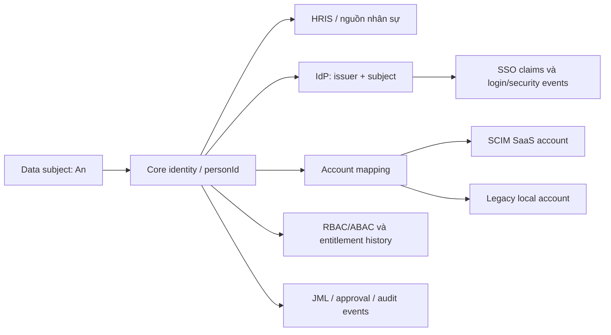
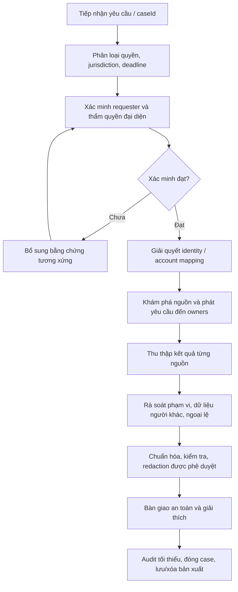
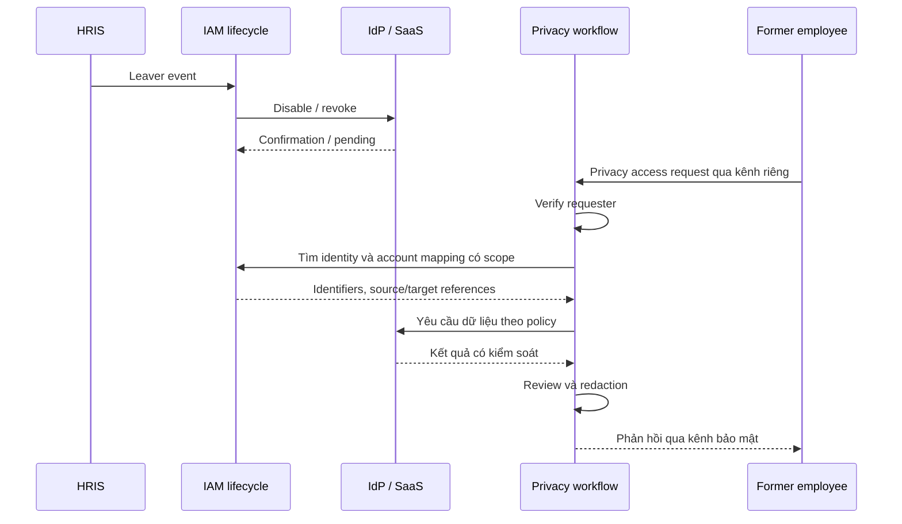
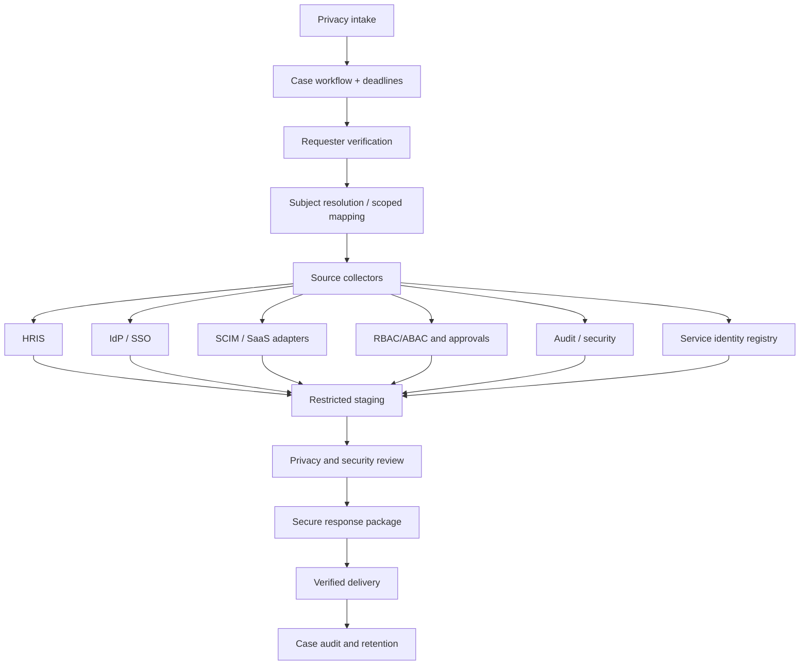

# Privacy access request: Xử lý yêu cầu truy cập dữ liệu cá nhân trong IAM

> **Chương:** Privacy và identity  
> **Module:** `SECURITY_IDENTITY_ACCESS_MANAGEMENT_IDENTITY_LIFECYCLE`  
> **Phạm vi:** Tiếp nhận, xác minh, tìm kiếm, rà soát và cung cấp dữ liệu danh tính liên quan đến một cá nhân theo yêu cầu truy cập dữ liệu cá nhân (*privacy access request*). Bài học đặt yêu cầu này trong vòng đời **Joiner–Mover–Leaver (JML)** và mối liên hệ với IdP, SSO, SCIM, RBAC/ABAC, tài khoản dịch vụ, kiểm toán, bảo vệ dữ liệu và thu hồi quyền tồn dư.

## 1. Privacy access request là gì?

**Privacy access request** là yêu cầu của một cá nhân, hoặc đại diện có thẩm quyền theo quy định áp dụng, nhằm được biết và/hoặc nhận thông tin về **dữ liệu cá nhân liên quan đến mình** mà một tổ chức đang xử lý. Trong nhiều quy trình, đây là một loại **data subject access request (DSAR/SAR)**.

Yêu cầu có thể bao gồm việc xác nhận có xử lý dữ liệu hay không, các loại dữ liệu liên quan, bản sao hoặc thông tin được quyền nhận, mục đích xử lý, bên nhận, nguồn dữ liệu và các thông tin liên quan khác theo pháp luật áp dụng. **Phạm vi, ngoại lệ, thời hạn phản hồi và hình thức đáp ứng khác nhau theo khu vực pháp lý và quan hệ xử lý**; không có một mẫu trả lời bắt buộc chung cho mọi quốc gia.

Ví dụ: sau khi chuyển bộ phận, nhân viên An muốn biết bộ phận mới đang sử dụng những thuộc tính nào để tính quyền truy cập, ứng dụng nào nhận email công việc và những lịch sử đăng nhập nào vẫn được lưu. Yêu cầu ấy liên quan tới dữ liệu cá nhân được xử lý trong IAM.

Điểm khó là dữ liệu không nằm ở một bảng duy nhất. Nó có thể hiện diện tại HRIS, Identity Provider (IdP), các ứng dụng dùng SSO, hệ thống provisioning qua SCIM, bảng entitlement RBAC/ABAC, log xác thực, công cụ kiểm toán, kho dữ liệu phân tích và bản sao của bên cung cấp.

### 1.1. Vì sao chủ đề này cần một quy trình riêng?

Yêu cầu truy cập dữ liệu phải đáp ứng đồng thời bốn điều kiện:

1. **Đúng người:** xác minh requester hoặc người đại diện và liên kết họ với subject cần tra cứu.
2. **Đúng phạm vi:** xác định những dữ liệu và thông tin mà requester có quyền nhận, không bỏ sót nguồn phù hợp.
3. **Đúng ranh giới bảo mật:** bảo vệ bí mật xác thực, dữ liệu người thứ ba, thông tin điều tra và các giới hạn tiết lộ hợp lệ.
4. **Đúng cách bàn giao:** cung cấp thông tin chính xác, có thể hiểu và qua kênh an toàn, với bằng chứng xử lý và thời hạn phù hợp.

Một quy trình làm tốt ba điều đầu nhưng gửi bản xuất qua email bị cấu hình sai vẫn có thể gây rò rỉ dữ liệu. Một quy trình bảo mật tốt nhưng chỉ tìm theo email hiện tại cũng có thể bỏ sót hoặc trộn nhầm dữ liệu lịch sử.

## 2. Phân biệt privacy access request và IAM access request

Cụm từ **access request** trong IAM thường có nghĩa **xin quyền truy cập tài nguyên**, trong khi privacy access request nói về **quyền của cá nhân đối với dữ liệu liên quan tới mình**.

| Tiêu chí | IAM access request | Privacy access request |
|---|---|---|
| Câu hỏi chính | “Tôi có được phép dùng hệ thống hoặc dữ liệu này để làm việc không?” | “Tổ chức đang xử lý thông tin nào về tôi và tôi có quyền nhận thông tin gì?” |
| Mục tiêu | Cấp hoặc điều chỉnh entitlement | Xác định, rà soát và cung cấp dữ liệu/thông tin được quyền nhận |
| Đầu vào | Role, tài nguyên, tác vụ, owner, phê duyệt | Người yêu cầu, subject scope, loại thông tin, căn cứ và phạm vi |
| Quyết định | RBAC/ABAC, SoD, least privilege | Quy định về quyền dữ liệu, xác minh requester, privacy review và ngoại lệ áp dụng |
| Kết quả | Grant, deny, revoke hoặc time-bound access | Phản hồi, bản sao/giải thích phù hợp, quyết định giới hạn một phần, bằng chứng đã xử lý |
| Rủi ro | Cấp thừa quyền hoặc giữ quyền tồn dư | Gửi nhầm người, bỏ sót dữ liệu, tiết lộ bên thứ ba hoặc secret |
| Chủ sở hữu quy trình | IAM/IT, tài nguyên và người phê duyệt | Privacy/DSR owner phối hợp IAM, HRIS, security và ứng dụng |

**Tình huống:** An đã nghỉ việc và không còn SSO. An gửi privacy access request. Tổ chức có thể cần trả lời qua một kênh xác minh an toàn **mà không cấp lại tài khoản công ty hoặc role cũ**. Việc một người được nhận bản sao dữ liệu theo quyền áp dụng không tạo ra quyền truy cập trực tiếp vào cơ sở dữ liệu IAM.

### 2.1. Ba hành động không được đánh đồng

- **Cấp quyền truy cập ứng dụng:** thay đổi quyền kỹ thuật của account.
- **Tra cứu dữ liệu để xử lý DSAR:** nhân viên hoặc dịch vụ được phân công tìm dữ liệu theo một case, trong phạm vi được phép.
- **Cung cấp kết quả cho data subject:** trả thông tin hoặc bản sao đã được kiểm tra về phạm vi, ngoại lệ và thông tin của người khác.

Ba hành động cần **chính sách và audit riêng**; một yêu cầu được phê duyệt ở hành động cuối không nên tự động mở quyền ở hai hành động đầu.

## 3. Data subject là người, account chỉ là biểu diễn kỹ thuật

**Data subject** là cá nhân mà dữ liệu cá nhân liên quan tới, trong phạm vi định nghĩa của luật áp dụng. Người này có thể có nhiều digital identities hoặc account: tài khoản HRIS, hồ sơ IdP, account ứng dụng, account đặc quyền, thông tin trong audit và các bản ghi do dịch vụ tạo.



Một người có thể có **hai account đặc quyền** và một account thường. Ngược lại, hai người có thể dùng **cùng một địa chỉ email ở những thời điểm khác nhau**. Vì vậy, yêu cầu phải được liên kết đến **đúng con người** rồi mở rộng theo các ánh xạ được xác minh, thay vì chạy tìm kiếm toàn cục bằng email.

### 3.1. Những định danh nên hiểu đúng

| Thuộc tính | Nguồn/phạm vi | Ý nghĩa đối với truy tìm dữ liệu |
|---|---|---|
| `personId` | Miền IAM nội bộ | Khóa gốc ổn định nếu tổ chức thiết kế như vậy |
| `employeeNumber` | HRIS | Có thể thay đổi, cấp lại hoặc khác khi tái tuyển dụng |
| OIDC `iss` + `sub` | Một IdP issuer | Cặp định danh liên kết; không dùng `sub` đơn lẻ xuyên issuer |
| SAML `NameID` | Federation theo cấu hình | Đánh giá định dạng và tính ổn định theo service provider |
| SCIM `id` | Do ứng dụng/server SCIM cấp | Khóa của resource trong một dịch vụ |
| SCIM `externalId` | Do provisioning client gán | Ánh xạ record của ứng dụng về nguồn, cần scope ứng dụng/tenant |
| Email / `userName` | Thuộc tính liên lạc hoặc đăng nhập | Có thể đổi, trùng hoặc được tái sử dụng |
| `serviceIdentityId` | Miền workload/service | Không phải data subject, nhưng metadata owner có thể liên quan người thật |

Nếu cùng `sub` được trả từ hai issuer khác nhau, không được mặc định chúng cùng chỉ một người. Khi dùng ID pairwise của OIDC, các sector khác nhau có thể nhận subject ID khác nhau; hệ thống IAM phải quản lý ánh xạ nội bộ có quyền truy cập hạn chế.

## 4. Yêu cầu truy cập có thể bao gồm những loại thông tin nào?

Một yêu cầu không chỉ là xuất cột `name` và `email`. Tùy phạm vi quyền áp dụng, phải đánh giá cả dữ liệu nhận được, dữ liệu phát sinh khi vận hành, thông tin do bên thứ ba cung cấp và bản ghi lịch sử.

| Nhóm | Ví dụ trong IAM | Nguồn cần khảo sát |
|---|---|---|
| Hồ sơ danh tính | Tên, email, `personId`, trạng thái account | HRIS, IAM registry, IdP |
| Thuộc tính phục vụ phân quyền | Bộ phận, vai trò, nhóm, thời điểm hiệu lực | HRIS, PDP, RBAC/ABAC store |
| Tài khoản ứng dụng | Account ID, SaaS profile, `active`, nhóm đích | SCIM target, local directory |
| Kết quả xác minh | Trạng thái proofing, mức bảo đảm, thời điểm | Proofing provider, IdP |
| Lịch sử quyền | Yêu cầu cấp quyền, phê duyệt, thu hồi | ITSM, entitlement history, audit |
| Hoạt động đăng nhập | Thời điểm, IP, thiết bị, sự kiện thất bại | IdP logs, SIEM, app logs |
| Dữ liệu suy ra hoặc quan sát | Risk signals, kết quả policy, sự kiện security | Policy engine, fraud/security tools |
| Thông tin xử lý | Mục đích, loại bên nhận, thời hạn dự kiến, nguồn | Data inventory, privacy notices, hợp đồng |
| Dữ liệu từ vendor | Thuộc tính ứng dụng lưu, sự kiện, trạng thái | SaaS/provider theo hợp đồng và phạm vi trách nhiệm |

Điều được quyền cung cấp và ngoại lệ cần được xét **theo từng loại thông tin**. Ví dụ không thể mặc định mọi security event đều được miễn cung cấp, cũng không thể mặc định data subject được nhận toàn bộ chi tiết cơ chế phát hiện gian lận hoặc thông tin riêng tư của đồng nghiệp.

### 4.1. Personal data khác với security secret

Mật khẩu, refresh token, recovery code, API secret và private key có thể liên quan một account nhưng việc tiết lộ nguyên giá trị có thể dẫn tới chiếm quyền. Quy trình cần phân loại và đánh giá **căn cứ giữ bí mật/giới hạn tiết lộ phù hợp**, không tự xuất tất cả token bằng lệnh truy vấn database.

Khi cần mô tả phương thức xác thực, có thể trả thông tin phù hợp như “account có đăng ký passkey” hoặc “MFA được bật”, tùy phạm vi pháp lý, mà không cung cấp vật liệu khóa hoặc secret.

### 4.2. Dữ liệu đã ẩn tên vẫn có thể liên quan đến cá nhân

Một mã giả `subject-8e2c` hoặc IP/time pattern vẫn có thể liên kết về An. Việc pseudonymize không mặc nhiên khiến dữ liệu nằm ngoài phạm vi quyền dữ liệu cá nhân. Ngược lại, dữ liệu đã được **ẩn danh thực sự** theo tiêu chuẩn áp dụng có thể không còn liên kết tới một người; cần đánh giá khả năng tái nhận diện và các nguồn liên kết sẵn có.

## 5. Phạm vi quyền, trách nhiệm và thời hạn phải được xác định từ đầu

**Privacy access request không có quy tắc toàn cầu duy nhất.** Các quyền và nghĩa vụ có thể thay đổi theo nơi cư trú, nơi xử lý, vai trò của tổ chức, loại quan hệ (nhân viên, khách hàng, nhà thầu), mục đích xử lý và phạm vi pháp luật điều chỉnh.

Khi tiếp nhận, nên ghi nhận:

1. **Đối tượng yêu cầu:** cá nhân, đại diện được ủy quyền hay cơ quan có thẩm quyền.
2. **Nội dung yêu cầu:** truy cập, giải thích xử lý, bản sao dữ liệu, hoặc kèm quyền đính chính/xóa.
3. **Pháp lý/chính sách áp dụng:** quy tắc về quyền, ngoại lệ, thời hạn, cách xác minh và giao tiếp.
4. **Vai trò tổ chức:** đơn vị quyết định mục đích/phương tiện hay đơn vị xử lý theo chỉ dẫn.
5. **Dữ liệu và hệ thống thuộc phạm vi:** HRIS, IdP, SaaS, audit, service metadata và bên nhận.
6. **Thời điểm tiếp nhận và mốc xử lý:** theo quy định thực tế, có cơ chế gia hạn/thông báo nếu được phép.
7. **Chủ sở hữu case:** người điều phối, người duyệt và bên vận hành theo từng hệ thống.

Không nên hard-code một thời hạn như “30 ngày cho mọi yêu cầu” vào toàn bộ hệ thống: phải dựa trên quy định áp dụng. Một số khuôn khổ, ví dụ GDPR, có quy định cụ thể về giao tiếp và thời hạn; hệ thống nội bộ nên quản lý bằng **policy có thể cấu hình theo phạm vi**.

### 5.1. Khi yêu cầu quá rộng hoặc thiếu thông tin

Không tự động kết luận một yêu cầu là vô hiệu chỉ vì người dùng nói “cho tôi xem mọi dữ liệu đang có về tôi”. Người xử lý có thể cần làm rõ phạm vi theo quy định thích hợp, đồng thời triển khai tìm kiếm hợp lý dựa trên những dữ liệu và hệ thống đã biết.

Người xử lý cũng không nên buộc requester phải biết tên bảng, account ID, tên phần mềm hoặc mã nguồn để thực hiện yêu cầu. Tổ chức là bên biết hệ thống của mình.

## 6. Quy trình xử lý end-to-end



Các bước có thể chạy song song giữa nhiều hệ thống, nhưng **quyết định phản hồi** phải dựa trên các kết quả đã thu thập và trạng thái xử lý thực tế. Với hệ thống không phản hồi hoặc bên nhận chưa xác nhận, cần workflow theo dõi ngoại lệ và phản hồi theo nghĩa vụ áp dụng.

### 6.1. State machine cho một case

```text
RECEIVED
  -> CLASSIFIED
  -> VERIFICATION_PENDING
  -> VERIFIED
  -> DISCOVERY_IN_PROGRESS
  -> REVIEW_IN_PROGRESS
  -> RESPONSE_APPROVED
  -> DELIVERED
  -> CLOSED

Nhánh: NEEDS_INFORMATION, PARTIAL_RESULT, ON_HOLD,
       EXCEPTION_REVIEW, DELIVERY_FAILED, REOPENED
```

Không chỉ có một cờ `completed=true`. Có thể **hoàn tất một phần** trong khi một vendor đang điều tra, hoặc có quyết định giữ lại một phần dữ liệu có căn cứ; trạng thái phải phản ánh chính xác điều đang xảy ra.

## 7. Tiếp nhận yêu cầu: bảo mật ngay từ bước đầu

Các kênh tiếp nhận có thể gồm cổng privacy, form nội bộ, email chuyên trách hoặc hỗ trợ khách hàng. Khi có yêu cầu được gửi tới đầu mối không chuyên, cần cơ chế chuyển tiếp an toàn đến người phụ trách.

Một case nên có tối thiểu:

```yaml
caseId: par-2026-0142
type: privacy-access
receivedAt: "2026-11-23T08:00:00Z"
requester:
  kind: data-subject
  verificationStatus: pending
subjectReference: null
jurisdictionPolicyRef: privacy-policy-scope-a
status: received
requestedScope:
  - identity-attributes
  - linked-accounts
  - authentication-events
assignedOwnerTeam: privacy-operations
```

Đây là cấu trúc nội bộ minh họa; **không phải mẫu pháp lý chuẩn**. Trong thực tế nên có lịch sử trao đổi, deadline, loại bằng chứng, quy tắc bảo vệ dữ liệu, người xử lý và tham chiếu chính sách.

### 7.1. Tránh thu thập quá mức ở form tiếp nhận

Không yêu cầu mọi requester phải tải ảnh giấy tờ, ảnh mặt trước/sau hoặc ngày sinh nếu có phương thức xác minh tương xứng khác. Không đặt trường bắt buộc “mật khẩu tài khoản công ty” hoặc “mã OTP” vào form DSR.

Form có thể ban đầu chỉ cần cách liên hệ an toàn, mô tả yêu cầu và phương thức xác minh sẽ dùng sau đó. Dữ liệu chứng minh quyền đại diện phải có purpose và retention riêng.

### 7.2. Chống lộ thông tin qua phản hồi ban đầu

Hệ thống tiếp nhận không nên công khai rằng email X có account ở dịch vụ Y trước khi xác minh requester, vì đó có thể là hành vi **account enumeration**. Trả thông điệp tiếp nhận trung tính và chỉ tiết lộ chi tiết về subject sau bước xác minh phù hợp.

## 8. Xác minh requester: mạnh vừa đủ, không tạo kho chứng từ mới

Quy trình cần xác minh quyền kiểm soát danh tính của requester tương xứng với độ nhạy của dữ liệu sắp cấp.

| Tình huống | Biện pháp cần đánh giá | Rủi ro |
|---|---|---|
| Nhân viên đang có phiên IdP hợp lệ | Phiên + step-up MFA cho bản xuất nhạy cảm | Session hijack hoặc chia sẻ thiết bị |
| Leaver đã mất SSO | Kênh ngoài công ty với xác minh thay thế được duyệt | Không thể dùng IdP cũ |
| Khách hàng không còn email đăng ký | Quy trình khôi phục/xác minh không phụ thuộc email cũ | Email tái sử dụng hoặc mailbox bị chiếm |
| Đại diện hợp lệ | Xác minh danh tính và phạm vi ủy quyền | Gửi dữ liệu vượt quyền đại diện |
| Dữ liệu đặc biệt nhạy cảm | Tăng mức xác minh, kênh cung cấp được bảo vệ | Rò rỉ diện rộng nếu sai người |

**Không dùng riêng việc người gửi kiểm soát một email để suy ra họ sở hữu mọi lịch sử gắn với email ấy.** Một địa chỉ có thể được chuyển chủ. Cũng không yêu cầu xác minh bằng một tài khoản đã bị chính tổ chức vô hiệu hóa trong quy trình Leaver.

### 8.1. Lưu kết quả xác minh có kiểm soát

Một metadata record có thể là:

```json
{
  "caseId": "par-2026-0142",
  "verification": {
    "status": "verified",
    "workflowRef": "verify-508",
    "verifiedAt": "2026-11-23T09:10:00Z",
    "assurancePolicyRef": "privacy-access-standard"
  }
}
```

Không cần lưu mã OTP, passkey private key hoặc bản scan giấy tờ trong case nếu nguồn xác minh có thể cung cấp **kết quả đáng tin và bằng chứng tham chiếu**. Nếu bắt buộc giữ chứng cứ, phải có kho, ACL, thời hạn và mục đích riêng.

## 9. Identity resolution: ghép đúng subject trước khi tìm dữ liệu

Một hệ thống IAM cần duy trì ánh xạ có kiểm soát giữa người thật, danh tính IdP và tài khoản ứng dụng.

```text
CoreIdentity(personId, lifecycleState, sourceRef)
IdpIdentity(personId, issuer, subject, tenantId, validFrom, validTo)
AppAccount(personId, applicationId, tenantId, externalId, scimId, active)
PrivilegedAccount(personId, accountId, systemId, validFrom, validTo)
EntitlementHistory(personId, resourceId, roleId, validFrom, validTo)
PrivacyRequest(caseId, requesterVerificationRef, personId, scope)
```

Những nguyên tắc quan trọng:

- Dùng khóa nội bộ **ổn định và không tái sử dụng** theo chính sách để ngăn lẫn người.
- Scope mọi `scimId` theo ứng dụng và tenant; SCIM ID không phải ID toàn cục.
- Scope OIDC subject theo issuer; SAML `NameID` theo miền federation phù hợp.
- Ghi thời điểm hiệu lực khi email, username, số nhân viên hoặc account ownership thay đổi.
- Đánh dấu **uncertain match** để kiểm tra thủ công; không tự gộp hai cá nhân chỉ vì giống tên.
- Tách account của con người với workload do người đó sở hữu; không giả định owner có quyền nhận toàn bộ dữ liệu/secret của workload.

### 9.1. Ví dụ email tái sử dụng

An dùng `an@example.invalid` trong hai năm, sau đó nghỉ việc. Một nhân viên khác được cấp lại cùng alias. Nếu privacy access request chỉ tìm `email='an@example.invalid'`, bản xuất có thể lẫn dữ liệu của người mới.

Quy trình đúng cần dùng `personId` và lịch sử account mapping có `validFrom`/`validTo`; kiểm tra liên kết với IdP subject và nguồn HRIS ở từng giai đoạn.

### 9.2. Ví dụ tái tuyển dụng

Người cũ quay lại với employee number mới. Tổ chức phải xác minh danh tính, chính sách nối hồ sơ và các mốc hoạt động. Không được lấy tất cả dữ liệu lịch sử của bất kỳ record trùng tên nào, và **không khôi phục quyền cũ** chỉ vì trong kho DSR tìm thấy entitlement history.

## 10. Lập phạm vi hệ thống và yêu cầu truy tìm theo nguồn

Một data inventory giúp biết **tìm ở đâu và ai chịu trách nhiệm**:

| Nguồn | Dữ liệu có thể liên quan | Owner/kiểm soát |
|---|---|---|
| HRIS | Thuộc tính nhân sự, trạng thái và lịch sử quan hệ | HRIS/data owner |
| IAM identity registry | Core ID, account mappings, lifecycle events | IAM team |
| IdP | SSO subject, phương thức xác thực, trạng thái | Identity/security team |
| SCIM provisioning log | Thay đổi User, Group, trạng thái đích | IAM/integration owner |
| SaaS application | Profile, local account, role trực tiếp, activity | Application owner/vendor |
| Policy engine | Role evaluation, attribute-based access decision | Authorization owner |
| ITSM/access workflow | Yêu cầu cấp quyền, phê duyệt, ngoại lệ | Workflow owner |
| Security/audit platform | Sự kiện xác thực, rủi ro, sự cố | SOC/audit owner |
| Data warehouse/export | Bản sao dùng thống kê hoặc vận hành | Analytics owner |
| Proofing provider | Bằng chứng và trạng thái xác minh | Proofing service owner |
| Service registry | Owner, creator, approval liên quan cá nhân | Platform team |
| Backup/archives | Bản sao thời điểm cũ | Storage/DR owner |

**Không có nghĩa** phải tập trung mọi dữ liệu vào một hồ sơ DSR vĩnh viễn. Có thể dùng truy vấn liên thông được xác thực, chỉ lấy kết quả thực sự cần để rà soát và phản hồi.

### 10.1. “Có dữ liệu ở đâu?” và “được phép tiết lộ gì?” là hai việc khác nhau

Giai đoạn **discovery** nên bao phủ nguồn nằm trong phạm vi trách nhiệm của tổ chức. Giai đoạn **disclosure review** mới xác định thông tin nào được cung cấp, che hoặc hạn chế theo quy định. Nếu chỉ tìm những bảng đã biết là “dễ xuất”, có thể bỏ sót dữ liệu cá nhân tại audit hoặc hệ thống đích.

## 11. Thu thập từ IdP, SSO, OIDC và SAML

**IdP** có thể lưu thông tin chủ thể, yếu tố xác thực, login history và dữ liệu phát hành tới ứng dụng. **SSO** cho phép liên kết đăng nhập, không đồng nghĩa mọi ứng dụng dùng cùng bản ghi profile.

### 11.1. OIDC subject và claims

Trong OpenID Connect, định danh subject được hiểu theo `iss` + `sub`. Một ID token chuẩn chứa các trường giao thức như `iss`, `sub`, `aud`, `exp`, `iat`; claims khác có thể gồm tên, email hoặc thuộc tính hồ sơ theo chính sách.

Khi xử lý privacy access request:

1. Tìm đúng IdP subject cho người đã xác minh.
2. Xác định những **thuộc tính được IdP xử lý** trong phạm vi.
3. Xác định relying parties đã được phát hành loại claim nào theo cấu hình, log hoặc hồ sơ chứng cứ phù hợp; không hứa có lịch sử mọi token nếu hệ thống không lưu.
4. Xem xét thông tin login/session liên quan.
5. Tách thông tin có thể giải thích/cung cấp khỏi material như session secret hoặc recovery code.
6. Kiểm tra ứng dụng đích có giữ **bản sao local** từ claims hay không.

### 11.2. JWT ký số không giấu payload

Một JWT có chữ ký bảo vệ tính toàn vẹn và nguồn phát hành; payload thường có thể đọc được khi không mã hóa riêng. Nếu token hoặc debug trace chứa email, nhóm đặc quyền, IP hay identifier, các bản sao đó cần được khảo sát trong data inventory. Không đưa access token nguyên trạng vào bản phản hồi, vì có thể gây lộ bearer credential.

### 11.3. SAML và tên định danh

SAML `NameID` có format và tính ổn định phụ thuộc cấu hình. Một assertion có thể chứa attribute statement về người dùng. Đừng chỉ tìm OIDC `sub` rồi kết luận không có dữ liệu khi một ứng dụng cũ dùng SAML hoặc local account.

## 12. Thu thập từ SCIM và SaaS: account data không đồng nghĩa đầy đủ dữ liệu cá nhân

**System for Cross-domain Identity Management (SCIM) 2.0** hỗ trợ quản lý User và Group. `id` của resource do server cấp; `externalId` do provisioning client có thể cung cấp; `userName` là thuộc tính bắt buộc của User trong core schema.

Một record minh họa từ hệ thống đích:

```json
{
  "id": "app-user-218",
  "externalId": "p-1207",
  "userName": "an@example.invalid",
  "active": false,
  "groups": [
    {"value": "grp-read", "display": "report-reader"}
  ]
}
```

Không kết luận tất cả giá trị này là hồ sơ cá nhân được phép tiết lộ nguyên trạng: `groups` có thể chứa thông tin vận hành nhạy cảm hoặc liên quan người khác, và lịch sử quyền có thể nằm ngoài schema User.

### 12.1. Ba lớp dữ liệu cần khảo sát ở SaaS

1. **Provisioned profile:** trường SCIM đồng bộ từ IAM/IdP.
2. **Application-generated data:** thời điểm truy cập, hành động, cấu hình, lịch sử thay đổi của subject.
3. **Locally-managed access:** quyền trực tiếp, nhóm tại app, API token hoặc local account không theo provisioning tập trung.

Đặc biệt với Leaver, một ứng dụng có thể giữ dữ liệu sau khi `active=false`, còn app khác đã xóa profile nhưng vẫn giữ audit. Cần quy tắc truy vấn và phản hồi theo từng bên nhận, không suy đoán dựa trên lệnh deactivate.

### 12.2. Bên cung cấp và hợp đồng xử lý

Khi dùng vendor, xác định vai trò và trách nhiệm của tổ chức/bên xử lý theo pháp lý và hợp đồng. Cần biết:

- Bên nào tiếp nhận và trả lời yêu cầu.
- Vendor có API hoặc kênh yêu cầu truy xuất dữ liệu không.
- Có dữ liệu do vendor tự tạo hoặc subprocessor giữ không.
- Vendor có thể xác nhận tìm kiếm đầy đủ và phản hồi ở mức nào.
- Cách xử lý giới hạn, từ chối hợp lệ, lỗi và thời hạn đáp ứng.

Không tự ghi “không có dữ liệu tại app X” nếu app chưa xác nhận hoặc chỉ mới trả lời rằng SCIM User đã bị disable.

## 13. RBAC/ABAC: phân quyền người xử lý và dữ liệu dùng để quyết định

Có **hai phạm vi authorization khác nhau** trong privacy access request:

- Quyền truy cập **hệ thống IAM của operator** để tìm dữ liệu theo case.
- Dữ liệu **role/attribute/decision** liên quan tới data subject có thể nằm trong phạm vi yêu cầu.

**RBAC (Role-Based Access Control)** giúp cấp quyền theo vai trò như `privacy-intake`, `privacy-reviewer`, `system-custodian`. **ABAC (Attribute-Based Access Control)** bổ sung case ID, tenant, assigned owner, phân loại record, purpose, trạng thái requester verification và time-bound scope.

Ví dụ chính sách kiểm soát truy vấn nội bộ:

```text
permit(operator, action, record, case) khi:
    operator.lifecycleState == "active"
    AND operator.assignedCases chứa case.caseId
    AND case.verificationStatus == "verified"
    AND record.tenantId thuộc case.authorizedTenantScope
    AND record.subjectRef thuộc case.verifiedSubjectScope
    AND action thuộc permissionsFor(operator.role, record.classification)
    AND requestedPurpose == "privacy-access-response"
```

`requestedPurpose` phải được backend ràng buộc với client/case/workflow đáng tin. Không tin một request header do người dùng tự đặt để vượt qua privacy policy.

### 13.1. Quyền cấp cho operator nên giới hạn theo thời gian

Khi case được đóng, operator không nên tiếp tục có quyền tự do tra cứu subject đã xử lý. Dùng **temporary access**, case assignment, approval, audit truy vấn và kiểm soát bulk export khi dữ liệu nhạy cảm.

### 13.2. Quyền của subject không phải quyền tự sửa role

Trong quá trình trả thông tin, có thể phát hiện subject từng có role `finance-reader` hoặc bị từ chối do `orgUnitId`. Việc requester có quyền nhận thông tin nào đó **không cho phép họ tự đặt `isAdmin=true`** hoặc thay quyền hiện tại; yêu cầu sửa dữ liệu hoặc khiếu nại quyết định cần workflow riêng với nguồn có thẩm quyền.

## 14. Joiner: quyền truy cập dữ liệu có thể phát sinh trước ngày có account

Ở giai đoạn **Joiner**, tổ chức có thể xử lý thông tin của ứng viên/nhà thầu trước khi IdP account được tạo. Những bản ghi như chứng cứ xác minh, thông tin liên hệ, hồ sơ onboarding hoặc account đã pre-provision cũng cần được xem xét khi có yêu cầu hợp lệ.

Các tình huống thường gặp:

- Ứng viên đã cung cấp dữ liệu nhưng việc tuyển dụng không thành.
- Nhân viên mới chưa kích hoạt SSO nhưng muốn biết dữ liệu đang được chia sẻ với SaaS.
- Joiner được tạo nhầm hai identity records.
- Một proofing service đã giữ bản scan giấy tờ; IAM chỉ có `proofingStatus`.
- Tài khoản thử nghiệm đã được tạo trước ngày bắt đầu, sau đó onboarding bị hủy.

Privacy access request cần tìm theo **subject identity và nguồn dữ liệu có thẩm quyền**, không phụ thuộc điều kiện “đã từng đăng nhập SSO”.

### 14.1. Onboarding thất bại không làm dữ liệu tự biến mất

Nếu account bị hủy sau một tuần, HRIS, IdP invitation, SCIM target và log có thể vẫn giữ thông tin. Phạm vi DSAR cần xét cả bản ghi đã deactivate và dữ liệu xử lý trước khi quan hệ chính thức bắt đầu.

## 15. Mover: thay đổi thuộc tính nhưng không xóa lịch sử hợp lệ

Khi nhân viên chuyển vai trò, những thuộc tính như `orgUnitId`, `managerId` hoặc group membership thay đổi. Yêu cầu truy cập phải phân biệt:

| Thành phần | Trạng thái hiện tại | Dữ liệu lịch sử |
|---|---|---|
| `orgUnitId` | Dùng để tính quyền theo vai trò mới | Có thể giữ record cũ phục vụ audit theo chính sách |
| SSO claim | Phản ánh trạng thái sau Mover, theo cơ chế làm mới | Token cũ có thể còn trong log nếu đã được lưu hợp lệ |
| Nhóm SCIM | Thành viên nhóm mới | Event thêm/gỡ nhóm nếu app hoặc IAM lưu |
| Entitlement | Chỉ những quyền còn hợp lệ | Bằng chứng vì sao đã cấp hoặc thu hồi quyền |
| Approval | Người phê duyệt theo workflow hiện hành | Ai đã phê duyệt quyết định cũ |

Privacy access request có thể cần **lịch sử được quyền xem** chứ không chỉ giá trị hiện tại. Tuy nhiên, giữ lịch sử để trả lời không có nghĩa policy engine được dùng thuộc tính cũ để cấp quyền mới.

### 15.1. Yêu cầu phát hiện lỗi dữ liệu

Nếu An phát hiện audit cho thấy `orgUnitId` sai, quy trình có thể phát sinh **rectification request** riêng. Bộ phận IAM phải kiểm tra nguồn HRIS, `effectiveAt`, source version và quyết định quyền. Đừng sửa ngầm log bất biến để “đồng bộ” mọi thứ với trạng thái hiện tại; cần cơ chế correction event và phân biệt dữ liệu lịch sử với dữ liệu bị nhập sai.

## 16. Leaver: tiếp nhận yêu cầu khi quyền đăng nhập đã bị thu hồi

**Leaver** là điểm giao nhau quan trọng giữa privacy và security. Khi quan hệ làm việc kết thúc:

- IdP có thể khóa account và chặn xác thực mới.
- Session/refresh token/API credential cần được thu hồi theo hệ thống.
- SaaS có thể deactivate qua SCIM hoặc quy trình riêng.
- Account mapping và audit có thể được giữ có kiểm soát để chứng minh thu hồi và xử lý nghĩa vụ.
- Chủ thể vẫn có thể liên quan tới dữ liệu lịch sử còn được tổ chức lưu.

Do đó, **một cựu nhân viên có thể cần kênh xác minh ngoài SSO** để gửi privacy access request, tùy phạm vi quyền. Không mở lại tài khoản và role cũ chỉ để họ tự tải dữ liệu: việc này tạo nguy cơ **residual access**.

### 16.1. Tách xử lý access request khỏi deprovision



Hai luồng có thể tồn tại đồng thời. Đích chưa xác nhận thu hồi cần tiếp tục được theo dõi bởi IAM; yêu cầu privacy không nên khiến các credential đã revoked được kích hoạt lại.

### 16.2. Rehire và email cũ

Nếu người nghỉ được tái tuyển dụng hoặc email được cấp lại, phải dùng lịch sử person/account mapping đã xác minh. Việc có quyền nhận dữ liệu từ một giai đoạn cũ không tự động cấp quyền xem dữ liệu của lần làm việc mới nếu subject identity hoặc phạm vi pháp lý khác.

## 17. Bảo vệ dữ liệu của bên thứ ba trong bản phản hồi

Một bản ghi IAM có thể chứa nhiều data subjects:

```json
{
  "requestId": "access-grant-482",
  "subjectId": "p-1207",
  "requestedRole": "repository-reader",
  "approvedByPersonId": "p-8760",
  "managerComment": "Approval reviewed with team",
  "systemOwnerId": "p-3301",
  "outcome": "granted"
}
```

Ở đây dữ liệu liên quan tới người được cấp quyền, người phê duyệt và chủ hệ thống. Không phải toàn bộ record mặc nhiên được cung cấp nguyên trạng cho một requester; cần xem xét quyền của những người khác, nghĩa vụ bảo mật và các quy định áp dụng.

### 17.1. Quy tắc rà soát theo field

| Trường hợp | Cách đánh giá |
|---|---|
| `subjectId` của requester | Liên quan trực tiếp, xem phạm vi cung cấp |
| `approvedByPersonId` | Dữ liệu người thứ ba; xem có cần tiết lộ và căn cứ phù hợp |
| Comment chứa tên đồng nghiệp | Xem xét ngữ cảnh, redaction hoặc cách mô tả |
| Log có nhiều account/IP chia sẻ | Không gán mọi hoạt động cho requester |
| Role nhạy cảm | Có thể liên quan subject nhưng cũng tiết lộ cấu trúc hệ thống |
| Mã secret hoặc token | Bảo vệ credential, không xuất giá trị thô một cách máy móc |
| Dữ liệu proofing của người khác trong một hồ sơ | Tách hoặc che theo quyền và quy định |

Redaction cần **có lý do và được review**. Không dùng bộ lọc “xóa mọi trường có hậu tố Id” vì có thể khiến phản hồi không chính xác hoặc không đầy đủ; cũng không xuất nguyên log chưa kiểm tra.

### 17.2. Dữ liệu liên quan nhiều người

Một ticket hỗ trợ khách hàng có thể nói về nhân viên support, khách hàng, người phê duyệt và chủ tài khoản. Khi xác định thông tin liên quan requester, phải xét **ngữ cảnh và quyền của các bên**, không chỉ tìm chuỗi tên.

## 18. Privacy review: đầy đủ, chính xác, dễ hiểu và bảo mật

Sau discovery, mỗi record cần được xem xét:

1. Có thực sự liên quan tới data subject đã xác minh?
2. Có thuộc **hệ thống, thời kỳ, mục đích** và phạm vi yêu cầu không?
3. Có ngoại lệ hoặc hạn chế được phép áp dụng không?
4. Có thông tin của người thứ ba hoặc bí mật bảo mật phải bảo vệ không?
5. Dữ liệu có lỗi thời, thiếu ngữ cảnh hoặc cần giải thích nguồn không?
6. Có nguồn trùng khiến cùng một record bị xuất lặp nhiều lần không?
7. Có thông tin về mục đích/bên nhận/retention cần giải thích ngoài bản sao raw data không?

Một phản hồi tốt không chỉ gồm JSON khổng lồ khó đọc. Có thể dùng **phần giải thích bằng ngôn ngữ dễ hiểu** cùng bảng hoặc bản xuất có cấu trúc khi cần.

### 18.1. Nguồn gốc dữ liệu và nhãn thời gian

Nếu một ứng dụng giữ dữ liệu `department=engineering` nhưng nguồn hiện tại ghi `finance`, cần xem đó là dữ liệu lịch sử, cache cũ hay lỗi đồng bộ. Khi cung cấp thông tin phù hợp, nên phân biệt:

- **Giá trị tại thời điểm ghi nhận.**
- **Giá trị có hiệu lực hiện tại.**
- **Nguồn của giá trị.**
- **Ngày cập nhật gần nhất.**
- **Trạng thái xác thực/đối soát.**

Giữ sự khác biệt này giúp subject hiểu dữ liệu và có căn cứ gửi yêu cầu đính chính nếu cần.

### 18.2. Không cung cấp dữ liệu đoán định

Nếu connector không hỗ trợ truy xuất log hoặc vendor chưa trả lời, không tự tạo ra một danh sách “ước lượng”. Ghi rõ hệ thống nào đã kiểm tra, hệ thống nào còn chờ và hành động tiếp theo theo quy trình thực tế.

## 19. Xuất dữ liệu an toàn và cung cấp cho requester

Đầu ra có thể là một bản giải thích, tập tin có cấu trúc, dữ liệu trong cổng bảo mật hoặc kết hợp các hình thức theo quy định áp dụng.

### 19.1. Nguyên tắc xuất dữ liệu

- Chỉ người đã xác minh và được phép mới nhận bản xuất.
- Giới hạn dữ liệu theo quyết định review, redaction và purpose.
- Dùng **kênh bảo mật**, kiểm soát người nhận, thời hạn truy cập và xác thực bổ sung khi thích hợp.
- Không dùng URL đoán được hoặc token tải xuống quá dài hạn.
- Cấu hình **không index**, không thu thập nội dung bản xuất vào analytics, logs hoặc email thông thường.
- Có cơ chế hết hạn và xử lý bản sao export sau khi giao thành công.
- Ghi lại thời điểm giao/nhận được phép, nhưng không log toàn bộ nội dung bản xuất.

### 19.2. Phòng CSV formula injection

Nếu dữ liệu người dùng nhập được xuất CSV và mở bằng phần mềm bảng tính, ô bắt đầu bằng ký tự công thức có thể bị diễn giải thành lệnh/công thức khi mở. Cần dùng cách xuất và escaping đã kiểm thử cho ứng dụng đích; không tự cho rằng thêm dấu ngoặc kép CSV là đủ để vô hiệu hóa mọi công thức.

Đối với JSON, cần kiểm tra encoding, loại bỏ nội dung ngoài phạm vi và tránh chứa access token hoặc secret tham chiếu có thể sử dụng trực tiếp.

### 19.3. Kiểm tra trước giao

Một bước kiểm tra bản xuất nên xác nhận:

| Kiểm tra | Mục tiêu |
|---|---|
| Case và subject IDs khớp | Không gửi dữ liệu của người khác |
| Đúng tenant/ứng dụng | Không trộn dữ liệu liên tổ chức |
| Redaction đã được duyệt | Bảo vệ thông tin bên thứ ba và secret |
| Không có bearer token/password/recovery code | Giảm rủi ro account takeover |
| File mở được, encoding đúng | Đảm bảo phản hồi có thể sử dụng |
| Kênh và người nhận đã xác minh | Ngăn gửi nhầm |
| Thời hạn truy cập hợp lý | Hạn chế tồn tại bản sao nhạy cảm |
| Audit bản giao có metadata đủ | Chứng minh xử lý mà không sao chép raw data |

## 20. Logging, audit và bằng chứng xử lý privacy access request

Một case phải có lịch sử đủ để biết **đã xử lý những gì**, nhưng bản thân audit không nên trở thành kho thông tin nhạy cảm thứ hai.

Ví dụ event:

```json
{
  "eventId": "par-event-818",
  "caseId": "par-2026-0142",
  "action": "target-data-reviewed",
  "subjectRef": "p-1207",
  "targetSystemId": "idp-main",
  "operatorRole": "privacy-reviewer",
  "policyVersion": "privacy-response-v4",
  "decisionRef": "review-528",
  "outcome": "approved-for-response",
  "occurredAt": "2026-11-23T10:15:00Z"
}
```

Không cần gắn tất cả hồ sơ HRIS, passport photo, raw session log hay token vào event này.

### 20.1. Bằng chứng nên có theo từng đích

- `targetSystemId` và owner.
- Trạng thái tìm kiếm: `pending`, `found`, `no-match`, `not-accessible`, `failed`.
- Thời điểm, phương thức, phạm vi subject/tenant của truy vấn.
- Quyết định review và lý do giới hạn nếu được phép lưu.
- Phiên bản policy và người phê duyệt.
- Reference đến bản phản hồi đã được bảo vệ.
- Retry/error và người chịu trách nhiệm nếu chưa hoàn thành.

### 20.2. Retention của case và bản xuất

DSAR tạo dữ liệu cá nhân mới: thông tin requester, phương thức xác minh, lịch sử trao đổi, bản xuất, lý do giới hạn và audit. Cần xác định retention riêng theo mục đích, luật và chính sách. Bản xuất tập trung có thể đặc biệt nhạy cảm vì gom dữ liệu từ nhiều hệ thống; không giữ vĩnh viễn “để tiện hỗ trợ”.

## 21. Xử lý những trường hợp khó

### 21.1. Có legal hold hoặc nghĩa vụ bảo tồn chứng cứ

Một record có thể đang được giữ để phục vụ kiểm toán, tranh chấp hoặc điều tra phù hợp. **Việc được giữ** không tự quyết định record có được cung cấp nguyên trạng hay không. Cần xem xét riêng quyền truy cập, ngoại lệ, thông tin của người khác và việc tiết lộ có ảnh hưởng hoạt động được bảo vệ hay không.

### 21.2. Dữ liệu của security monitoring

Log IdP hoặc SIEM có thể chứa IP, thời điểm, thiết bị và kết quả đăng nhập liên quan subject. Phải xét phạm vi quyền tiếp cận và hạn chế hợp lệ. Không mặc định toàn bộ security logs không phải dữ liệu cá nhân; cũng không xuất toàn bộ rule phát hiện, token hoặc bí mật điều tra.

### 21.3. Dữ liệu trong backup

Backup có thể giữ bản sao cũ mà database vận hành đã xóa. Chính sách xử lý quyền truy cập đối với dữ liệu backup phụ thuộc khả năng truy xuất, trách nhiệm và nghĩa vụ áp dụng. Cần có quy trình review và xử lý khi phục hồi, tránh xóa/thu hồi đã hoàn tất bị đảo ngược.

### 21.4. Dữ liệu trong service account

Service identity không phải cá nhân, nhưng record có thể ghi:

```json
{
  "serviceIdentityId": "svc-report-prod",
  "ownerPersonId": "p-1207",
  "approvedByPersonId": "p-9901",
  "credentialRef": "vault/service/report-prod"
}
```

Nếu An là `ownerPersonId`, metadata owner có thể liên quan An. Nhưng bản xuất không nên kèm secret workload hoặc toàn bộ dữ liệu riêng tư của người phê duyệt. Đối chiếu owner và người tạo qua source có thẩm quyền.

### 21.5. Một email chỉ định nhiều cá nhân

Khi mailbox dùng chung hoặc email được cấp lại, tìm kiếm theo email có thể thu thập dữ liệu của người khác. Dừng export tự động, kiểm tra identity mapping và phạm vi thời gian.

### 21.6. Requester gửi nhiều yêu cầu trùng nhau

Cần phát hiện case liên quan và tránh trùng export nguy hiểm, đồng thời áp xử lý quyền và thời hạn theo quy định. Không tự từ chối yêu cầu chỉ vì “đã hỏi trước đó” nếu tình trạng dữ liệu hoặc quyền yêu cầu đã thay đổi.

## 22. Thiết kế hệ thống điều phối privacy access request



**Restricted staging** chỉ là vùng làm việc tạm có mã hóa và phân quyền phù hợp, không phải hồ sơ tổng hợp vĩnh viễn. Các source collectors chỉ nên trả đúng dữ liệu trong phạm vi tìm kiếm đã được chứng thực.

### 22.1. Các ranh giới tin cậy

1. **Giữa requester và intake:** không tin claim danh tính do requester tự khai.
2. **Giữa workflow và source collectors:** mỗi connector có credential và scope riêng; không dùng super-admin token chung khi tránh được.
3. **Giữa collectors và staging:** không tự nhận raw log/credential ngoài phạm vi.
4. **Giữa staging và reviewer:** RBAC/ABAC giới hạn dữ liệu/field theo case.
5. **Giữa reviewer và export:** chỉ dữ liệu đã được quyết định mới vào bản phản hồi.
6. **Giữa export và người nhận:** xác thực, kênh truyền, token truy cập có hạn và audit.
7. **Sau khi hoàn thành:** áp retention và xóa vùng staging/export theo policy.

### 22.2. Tính nhất quán và xử lý lỗi

Hệ thống cần hỗ trợ **idempotency**, retry, phân quyền theo tenant, version source, correlation ID và trạng thái từng đích. API của hai vendor không nằm trong cùng một transaction; một phần thành công và một phần thất bại phải được ghi nhận rõ.

Không tự biến kết quả “không tìm thấy” thành “đích đã xác nhận không có dữ liệu” nếu connector bị lỗi hoặc thiếu quyền đọc.

## 23. Ví dụ hợp đồng kết quả từ một source collector

```json
{
  "caseId": "par-2026-0142",
  "sourceSystem": "idp-main",
  "scope": {
    "tenantId": "company-a",
    "subjectId": "issuer-a:subject-902"
  },
  "collectionStatus": "succeeded",
  "collectedAt": "2026-11-23T10:30:00Z",
  "datasetRefs": [
    {
      "datasetId": "idp-profile",
      "category": "identity-profile",
      "recordCount": 1
    },
    {
      "datasetId": "idp-auth-events",
      "category": "authentication-events",
      "recordCount": 16
    }
  ],
  "requiresReview": true,
  "errors": []
}
```

Contract này chỉ mô tả **metadata của lần thu thập**; không đính kèm secret hoặc dữ liệu thô vào message status. Dữ liệu gốc đặt trong storage tạm được bảo vệ, có reference và retention phù hợp.

### 23.1. Pseudocode kiểm tra phạm vi collector

```java
CollectionResult collectForPrivacyAccess(
        PrivacyCase request,
        SourceConnector connector) {

    if (!request.isVerified()) {
        throw new SecurityException("Requester not verified");
    }
    if (!request.hasApprovedScopeFor(connector.sourceId())) {
        throw new SecurityException("Source outside approved scope");
    }

    SubjectLink link = subjectResolver.resolveFor(
            request.verifiedPersonId(),
            connector.sourceId(),
            request.tenantScope());

    if (!link.isVerified()) {
        return CollectionResult.needsManualResolution();
    }

    CollectionResult result = connector.collectScopedRecords(
            link,
            request.collectionPolicyVersion(),
            request.caseId());

    auditCollectionMetadata(request.caseId(), connector.sourceId(), result);
    return result;
}
```

Đây là **pseudocode Java**, không phải đoạn mã đầy đủ có thể chạy. Triển khai thực tế còn cần kiểm soát token/service identity, điều kiện pháp lý, bảo vệ người thứ ba, rate limit, timeout, schema, exception handling, encryption, chống replay, log an toàn và kiểm soát vùng staging. Collector **không được tự quyết định dữ liệu cuối cùng được tiết lộ** nếu chưa qua privacy review.

## 24. Tình huống thực tế: privacy request sau Mover và Leaver

Giả sử An làm Engineering, chuyển sang Finance rồi nghỉ việc. An yêu cầu biết các account liên kết và thông tin IAM vẫn được lưu.

| Bước | Hoạt động | Kết quả cần xác minh |
|---|---|---|
| 1 | Nhận yêu cầu từ An qua kênh ngoài SSO | Ghi case ID và chính sách thời hạn |
| 2 | Xác minh requester | Liên kết được với đúng `personId`, không dựa vào email đơn lẻ |
| 3 | Dò HRIS và identity registry | Tìm giai đoạn Engineering, Finance, Leaver |
| 4 | Dò IdP/SSO | Tìm subject, hồ sơ, login events liên quan theo phạm vi |
| 5 | Dò SaaS qua account mapping | Tìm user đã deactivate và dữ liệu app còn giữ |
| 6 | Dò entitlement/audit | Phân biệt quyền hiện tại và sự kiện quyền cũ |
| 7 | Review dữ liệu người khác, secret và ngoại lệ | Không gửi OTP, token, thông tin riêng của người phê duyệt |
| 8 | Chuẩn hóa phản hồi | Giải thích dữ liệu, nguồn, mục đích, bên nhận khi thuộc phạm vi |
| 9 | Bàn giao qua kênh xác minh | Không kích hoạt lại account, giới hạn thời hạn tải |
| 10 | Đóng và lưu chứng cứ tối thiểu | Bản xuất/temporary staging được xử lý theo retention |

**Lưu ý:** Nếu một SaaS còn tài khoản hoạt động của An sau Leaver, đó là **sự cố deprovisioning cần IAM xử lý**. Privacy access request có thể giúp phát hiện sai lệch, nhưng không được thay thế runbook thu hồi quyền.

### 24.1. Trường hợp phát hiện dữ liệu sai

Giả sử An thấy role Finance được ghi hoạt động trước ngày chuyển bộ phận. Kết quả privacy access request có thể cho An biết có vấn đề, nhưng **yêu cầu đính chính** cần được chuyển sang quy trình đánh giá nguồn HRIS/policy/audit. Không sửa trực tiếp entitlement history bất biến theo một email trao đổi.

### 24.2. Trường hợp bản xuất có data của manager

Nếu một approval record ghi nội dung riêng của người quản lý, reviewer cần quyết định cung cấp, che hoặc giải thích ở mức nào theo căn cứ áp dụng. Không tự quyết toàn bộ audit record là dữ liệu duy nhất của An.

## 25. Kiểm thử workflow trước khi triển khai

| Tình huống | Kết quả kỳ vọng |
|---|---|
| Requester chưa xác minh nhưng biết email | Không tiết lộ sự tồn tại/chi tiết account |
| Leaver không còn SSO | Có phương thức xác minh ngoài IdP an toàn |
| Đại diện thiếu quyền hợp lệ | Không phát hành dữ liệu; có luồng bổ sung thẩm quyền |
| Email đã được tái sử dụng | Không trộn subject cũ và người mới |
| Một người có nhiều account/tenant | Tìm đúng account được liên kết có xác minh |
| OIDC `sub` trùng nhưng issuer khác | Không coi là cùng identity |
| Subject có pairwise IDs ở nhiều client | Đối chiếu mapping hợp lệ, không suy đoán bằng email |
| SaaS chỉ trả SCIM User | Không tuyên bố bao phủ mọi app-generated data |
| App trả timeout khi thu thập | Trạng thái failed/pending, không coi là không có dữ liệu |
| Audit record có approver và subject | Review dữ liệu người thứ ba |
| Export có refresh token hoặc secret | Chặn/redact theo quyết định chính sách |
| Export CSV chứa chuỗi bắt đầu bằng `=` | Chống formula injection |
| Operator thử đọc case không được phân công | RBAC/ABAC từ chối và ghi audit |
| Operator đổi purpose string ở client | Backend kiểm tra case/consumer, không tin giá trị tự khai |
| Mover có giá trị HRIS mới | Phân biệt current và historical attributes |
| Leaver có account đích còn active | Báo IAM xử lý quyền tồn dư, không cấp lại SSO |
| Legal hold trên một số record | Đánh giá quyền tiết lộ riêng với quyền giữ |
| Backup chứa bản ghi cũ | Áp quy trình retention/restore và không hồi sinh quyền |
| Vendor chưa xác nhận | Có trạng thái và owner theo dõi từng đích |
| Trùng hai request liên tiếp | Quản lý case liên quan, không bỏ qua quyền hợp lệ |
| File phản hồi hết thời hạn | Không còn tải được, audit metadata còn theo policy |
| Dữ liệu owner của service identity | Không xuất secret workload hoặc dữ liệu người khác |

### 25.1. Chỉ số vận hành

- **Verified request ratio:** tỷ lệ requester được xác minh đủ để xử lý.
- **Identity matching exceptions:** số trường hợp thiếu chắc chắn khi nối người và account.
- **Discovery coverage:** tỷ lệ nguồn thuộc scope được tra cứu có kết quả hợp lệ.
- **Per-target success rate:** tỷ lệ collector phản hồi đầy đủ theo hợp đồng.
- **Pending vendor responses:** số đích chưa xác nhận hoặc đang có lỗi.
- **Third-party redaction review:** lượng bản ghi cần xét quyền người khác.
- **Secure delivery success:** tỷ lệ bàn giao đến đúng người nhận qua kênh được duyệt.
- **Overdue requests:** yêu cầu vượt mốc theo policy luật áp dụng.
- **Residual access discovered:** phát hiện account/quyền còn hoạt động sau Leaver.
- **Temporary export retention violations:** bản xuất/staging chưa được xử lý sau khi hết mục đích.

Các chỉ số phải gắn với rủi ro và chất lượng kết quả. “Đóng case nhanh” không phải bằng chứng đáp ứng đúng nếu bản xuất bỏ sót dữ liệu hoặc gửi nhầm người.

## 26. Những hiểu nhầm cần tránh

**“Privacy access request là xin role để vào hệ thống.”** Đây là quy trình xem xét quyền liên quan dữ liệu cá nhân; không tự động cấp quyền đăng nhập, database hoặc hệ thống nội bộ.

**“Cứ có email người gửi là đủ xác minh.”** Email có thể bị chiếm hoặc được tái sử dụng; dữ liệu cần được liên kết với chủ thể đã xác minh.

**“Data subject đã nghỉ việc thì không còn quyền gì.”** Quyền đối với dữ liệu có thể vẫn được áp dụng theo pháp luật và hoàn cảnh dù IdP account đã bị disable.

**“Đã disable IdP nên ứng dụng không giữ dữ liệu nữa.”** SSO, provisioning, local account, activity log, backup và dữ liệu vendor có vòng đời riêng.

**“Chỉ export user profile là xong.”** Audit, entitlements, login events, app-generated data và bản sao có thể thuộc phạm vi cần tìm kiếm hoặc đánh giá.

**“Tất cả dữ liệu trong một log về subject đều được xuất nguyên trạng.”** Log có thể chứa thông tin người khác, secrets hoặc dữ liệu thuộc phạm vi hạn chế hợp lệ.

**“JWT ký số nên có thể gửi raw token trong bản xuất.”** JWT có thể đọc payload và bearer token có khả năng truy cập; phải bảo vệ credential.

**“Bỏ email là record đã ẩn danh.”** Mã giả, event time và quyền có thể vẫn liên kết tới cá nhân.

**“Quyền truy cập dữ liệu cho phép người dùng tự chỉnh role.”** Yêu cầu đính chính khác việc tự cấp entitlement; cần nguồn có thẩm quyền và policy.

**“SCIM PATCH trả 200 chứng minh đã tìm hoặc xóa toàn bộ dữ liệu.”** PATCH user chỉ xử lý resource theo API; SaaS có thể giữ nhiều dữ liệu khác.

**“Có legal hold thì được từ chối toàn bộ privacy request.”** Phải đánh giá phạm vi, quyền và ngoại lệ cụ thể; lưu giữ và tiết lộ là hai quyết định khác nhau.

**“Gửi yêu cầu tới vendor là có thể đóng case.”** Kết quả phải phản ánh tình trạng thực tế, lỗi và ngoại lệ theo mỗi nguồn.

**“Lưu bản xuất mãi để lần sau khỏi tìm lại.”** Bản xuất tổng hợp làm tăng rủi ro và cần retention riêng theo purpose.

## 27. Checklist triển khai privacy access request trong IAM

| Câu hỏi kiểm tra | Bằng chứng nên có |
|---|---|
| Có phân biệt IAM access request và privacy access request? | Tài liệu intake và workflow riêng |
| Đã xác định đúng luật/phạm vi quyền/thời hạn? | Case classification và policy version |
| Có kênh tiếp nhận cho người trước Joiner và sau Leaver? | Secure intake ngoài SSO khi cần |
| Đã xác minh requester và đại diện? | Verification workflow và kết quả |
| Có khóa identity ổn định và mapping theo thời gian? | `personId`, `iss`/`sub`, app ID + tenant |
| Có xử lý email tái sử dụng/rehire? | Matching exceptions và quy trình xác minh |
| Có data inventory đầy đủ cho scope? | Danh sách source, owner và vendor |
| Có phân biệt raw data, generated data và audit? | Collector contracts và review rules |
| Có kiểm soát quyền của operator theo case/purpose? | RBAC/ABAC, access expiry, audit |
| Có phân biệt current state với lịch sử Mover? | Source version, `effectiveAt` và label |
| Có kiểm tra account tồn dư ở Leaver? | IAM reconciliation riêng |
| Có kiểm tra dữ liệu bên thứ ba? | Field-level review/redaction decision |
| Có xử lý secrets và thông tin security? | Export allowlist và chính sách bảo vệ |
| Có cung cấp ngữ cảnh dễ hiểu? | Response template kèm nguồn và giải thích |
| Có giới hạn xuất dữ liệu và kênh bàn giao? | Secure download, auth, expiry |
| Có chống lỗi CSV/JSON và nhầm recipient? | Output validation và recipient check |
| Có per-target status, retry và lỗi? | Collector confirmations và owner xử lý |
| Có quản lý vendor response? | Hợp đồng, kênh xử lý, scope |
| Có retention cho staging/export và case? | Retention schedule, delete confirmation |
| Có audit đủ mà không lưu lại raw data quá mức? | Decision ID, policy, target, time, outcome |
| Có kiểm thử legal hold và privacy exceptions? | Review workflow và lý do quyết định |
| Có kiểm thử restore và dữ liệu đã deprovision? | Revocation ledger và reconciliation |
| Có review khi hệ thống hoặc luật thay đổi? | Policy version, owner, approval, tests |

## 28. Ghi nhớ

**Privacy access request** là quy trình đáp ứng yêu cầu của một cá nhân được biết hoặc nhận thông tin về dữ liệu cá nhân liên quan đến mình theo các quyền và điều kiện áp dụng. Trong IAM, việc đáp ứng đòi hỏi **tìm đúng người, bao phủ đúng nguồn và cung cấp đúng phạm vi** mà vẫn bảo vệ quyền của người khác và dữ liệu bảo mật.

Với **Joiner**, dữ liệu có thể xuất hiện trước khi account hoạt động. Với **Mover**, cần phân biệt thuộc tính hiện tại, quyền mới và lịch sử cũ. Với **Leaver**, account và credential phải được thu hồi nhưng yêu cầu quyền dữ liệu vẫn có thể được xử lý qua kênh ngoài SSO. Các nguồn **IdP/SSO, SCIM, RBAC/ABAC, audit, SaaS và service identity** phải có cơ chế truy vấn, review, xác nhận và retention tương ứng.

Nguyên tắc thực hành là **không biến một privacy access request thành quyền truy cập trực tiếp vào hệ thống nội bộ**. Tổ chức phải điều phối việc tìm kiếm có scope, kiểm tra dữ liệu, bảo vệ thông tin người thứ ba, bàn giao an toàn và ghi nhận kết quả thực tế; đồng thời tiếp tục thu hồi mọi quyền truy cập tồn dư nếu được phát hiện.

### Tài liệu tham khảo

- [GDPR, Article 12 — Transparent information and communication](https://gdpr-info.eu/art-12-gdpr/) và [Article 15 — Right of access](https://gdpr-info.eu/art-15-gdpr/): ví dụ về quyền truy cập dữ liệu và cách phản hồi trong một khuôn khổ pháp lý cụ thể; kiểm tra phạm vi áp dụng và ngoại lệ.
- [GDPR, Article 4 — Definitions](https://gdpr-info.eu/art-4-gdpr/): khái niệm data subject, controller và processor theo khuôn khổ này.
- [IETF RFC 7643 — SCIM Core Schema](https://www.rfc-editor.org/rfc/rfc7643) và [RFC 7644 — SCIM Protocol](https://www.rfc-editor.org/rfc/rfc7644): thuộc tính User/Group và API provisioning.
- [OpenID Connect Core 1.0](https://openid.net/specs/openid-connect-core-1_0.html): định danh `iss`/`sub`, claims, pairwise subject và cơ chế federation.
- [NIST Digital Identity Guidelines](https://pages.nist.gov/800-63-4/): khung tham chiếu về identity proofing, authentication và federation.
- [OWASP Authorization Cheat Sheet](https://cheatsheetseries.owasp.org/cheatsheets/Authorization_Cheat_Sheet.html), [OWASP Logging Cheat Sheet](https://cheatsheetseries.owasp.org/cheatsheets/Logging_Cheat_Sheet.html): kiểm soát quyền truy cập và giảm dữ liệu nhạy cảm trong log.
