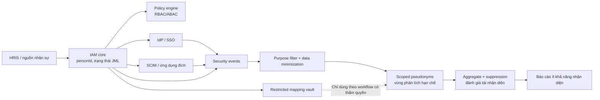
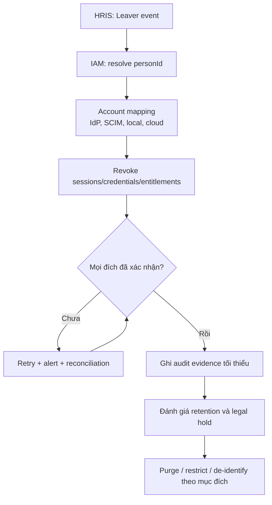

# Ẩn danh định danh: Bảo vệ khả năng nhận diện trong vòng đời IAM

> **Chương:** Privacy và identity  
> **Module:** `SECURITY_IDENTITY_ACCESS_MANAGEMENT_IDENTITY_LIFECYCLE`  
> **Bối cảnh:** Quản lý vòng đời danh tính theo **Joiner–Mover–Leaver (JML)**, từ xác minh, tạo tài khoản và cấp quyền đến rà soát, thay đổi vai trò và thu hồi. Nội dung liên kết **IdP, SSO, SCIM, RBAC/ABAC, tài khoản dịch vụ, kiểm toán và giảm quyền truy cập tồn dư**.  
> **Thông điệp chính:** Có thể giảm khả năng nhận diện người dùng ở các luồng không cần danh tính thật, nhưng IAM vẫn phải duy trì **liên kết được bảo vệ** khi cần xác thực, phân quyền và deprovision đúng chủ thể.

## 1. Vì sao IAM cần quan tâm đến ẩn danh định danh?

Hệ thống Identity and Access Management (IAM) thường nắm một bản đồ chi tiết về con người và tài nguyên họ truy cập:

- Ai là nhân viên, nhà thầu hoặc đối tác.
- Họ có mã danh tính, tài khoản IdP và tài khoản ứng dụng nào.
- Thuộc tính `orgUnitId`, vai trò và nhóm quyền nào đang điều khiển RBAC/ABAC.
- Họ đã đăng nhập khi nào, ở thiết bị nào, có bị yêu cầu MFA hay không.
- Quyền nào được cấp hoặc thu hồi trong vòng đời Joiner–Mover–Leaver.
- Ai sở hữu service account, API key hoặc workload identity.

Nếu mọi hệ thống phân tích, báo cáo, kiểm thử và hỗ trợ đều thấy tên thật, email, số nhân sự cùng lịch sử quyền chi tiết, phạm vi thông tin có thể bị lộ sẽ tăng rất nhanh. **Ẩn danh hoặc giảm khả năng nhận diện** là cách làm cho dữ liệu phục vụ đúng mục đích mà không trao quá nhiều thông tin cá nhân cho người nhận.

Nhưng có một nghịch lý: IAM cần biết **đúng người** để khóa **đúng tài khoản**. Nếu xóa không thể phục hồi mọi liên kết từ danh tính gốc tới tài khoản đích trước khi xử lý Leaver, hệ thống có thể để sót quyền truy cập. Vì thế, mục tiêu không phải “mọi định danh đều vô danh”, mà là **chọn mức định danh thấp nhất vẫn đủ an toàn cho mỗi tác vụ**.

### 1.1. Kết quả học tập

Sau bài này, người học có thể:

1. Phân biệt **ẩn danh (anonymization)**, **mã giả hóa (pseudonymization)**, che dữ liệu, tokenization và mã hóa.
2. Nhận diện rủi ro **tái nhận diện (re-identification)** từ tổ hợp định danh, thuộc tính và log.
3. Thiết kế **opaque ID**, định danh theo phạm vi ứng dụng và ánh xạ có kiểm soát trong IdP/SSO/SCIM.
4. Quyết định khi nào nên dùng dữ liệu tổng hợp/ẩn danh và khi nào IAM cần giữ subject mapping.
5. Xử lý dữ liệu cho Joiner–Mover–Leaver, RBAC/ABAC, audit, service identities và yêu cầu quyền dữ liệu.
6. Xây dựng quy trình phát hành tập dữ liệu đã xử lý với kiểm thử rủi ro và retention.

## 2. Định nghĩa: ẩn danh thực sự khác mã giả hóa

**Ẩn danh (anonymization)** nhằm làm cho thông tin không còn liên quan tới một cá nhân **được nhận diện hoặc có thể nhận diện bằng các phương tiện có khả năng được sử dụng một cách hợp lý trong ngữ cảnh áp dụng**. Đây là đánh giá rủi ro dựa trên tập dữ liệu, môi trường, người nhận và nguồn bổ sung, không chỉ là đổi tên cột.

**Mã giả hóa (pseudonymization)** thay hoặc tách thông tin nhận diện trực tiếp để dữ liệu không còn gắn ngay với một người **nếu thiếu thông tin bổ sung**, trong khi vẫn có khả năng liên kết ngược nếu có bảng ánh xạ, bí mật hoặc nguồn phù hợp.

Ví dụ:

```text
Dữ liệu gốc:
  personId: P-1048
  name: Nguyen An
  workEmail: an@example.invalid
  orgUnitId: finance
  lastLoginAt: 2026-11-23T02:08:00Z

Mã giả hóa:
  subjectKey: ux-73ac92
  orgUnitId: finance
  lastLoginAt: 2026-11-23T02:08:00Z

Dữ liệu thống kê ít liên kết hơn:
  month: 2026-11
  orgGroup: business-functions
  activeUsers: 236
```

Bản thứ hai **chưa được coi là ẩn danh**: IAM có thể còn bảng `ux-73ac92 → P-1048`, và tổ hợp phòng ban/thời gian cũng có thể tái nhận diện. Bản thống kê thứ ba giảm đáng kể chi tiết cá nhân, nhưng vẫn cần xem có nhóm nhỏ, phép truy vấn bổ sung hoặc nguồn ngoài cho phép suy ra cá nhân hay không.

### 2.1. Các khái niệm không nên đánh đồng

| Kỹ thuật | Bản chất | Có khả năng liên kết về người? | Phù hợp cho |
|---|---|---|---|
| **Data minimization** | Bỏ trường hoặc bản ghi không cần | Có thể còn | Mọi luồng IAM |
| **Masking/redaction** | Che một phần giá trị khi hiển thị hoặc xuất | Có thể còn ở nguồn | UI helpdesk, bản xuất giới hạn |
| **Pseudonymization** | Dùng mã giả thay định danh trực tiếp | Thường có, nếu còn mapping hoặc cách đối chiếu | Phân tích cần liên kết sự kiện trong phạm vi |
| **Tokenization** | Thay giá trị bằng token, ánh xạ nằm trong vault | Có qua vault | Tách dữ liệu nhạy cảm khỏi consumer |
| **Encryption** | Bảo vệ dữ liệu bằng khóa mật mã | Có khi được giải mã | Lưu trữ/truyền tải bảo mật |
| **Hashing** | Biến đổi một chiều theo hàm băm | Vẫn có thể suy đoán hoặc đối chiếu | Kiểm tra tính toàn vẹn, một số kiểu liên kết có kiểm soát |
| **Aggregation/generalization** | Gom nhiều record hoặc giảm độ chi tiết | Giảm, nhưng còn rủi ro suy luận | Báo cáo xu hướng và chỉ số |
| **Anonymization** | Giảm rủi ro nhận diện tới ngưỡng phù hợp ngữ cảnh | Không nên còn khả năng nhận diện hợp lý theo đánh giá | Dataset/báo cáo không cần theo dõi cá nhân |

**Kết luận:** dữ liệu đã mã hóa, đã băm hoặc đã thay tên **không mặc nhiên vô danh**. Dữ liệu `personId` đổi thành `user-5839` vẫn là thông tin có thể liên kết nếu ứng dụng còn bảng ghép.

### 2.2. Một số phân loại pháp lý phụ thuộc khu vực

Trong GDPR, khái niệm **personal data** và **pseudonymisation** được mô tả ở Điều 4; Recital 26 nêu việc xem xét khả năng nhận diện dựa trên các phương tiện có khả năng được dùng hợp lý. Dữ liệu được pseudonymize vẫn có thể là dữ liệu cá nhân. Các khuôn khổ khác có khái niệm và ngưỡng đánh giá riêng.

Không nên tuyên bố “dữ liệu chắc chắn nằm ngoài mọi luật privacy” chỉ vì một script bỏ cột email. Khi phát hành dữ liệu thật, cần đánh giá theo quy định và chính sách đang áp dụng, có owner chịu trách nhiệm.

## 3. Xác định mục đích trước khi chọn kỹ thuật

Ẩn danh có ý nghĩa khi phù hợp **mục đích xử lý**. Một số nghiệp vụ buộc phải xác định chính xác chủ thể; các nghiệp vụ khác chỉ cần thống kê.

| Nghiệp vụ IAM | Có cần biết một người cụ thể không? | Thiết kế phù hợp |
|---|---|---|
| Tạo account Joiner tại IdP | Có | Identity gốc và account mapping được bảo vệ |
| Thu hồi quyền khi Leaver | Có | Khóa chủ thể ổn định và mapping tới mọi đích |
| Ra quyết định truy cập thời gian thực | Thường cần chủ thể/thuộc tính được xác thực | Opaque ID + role/ABAC tối thiểu |
| Gửi token đăng nhập cho SaaS | Cần nhận diện trong phạm vi ứng dụng | Subject ID theo issuer/sector, claim tối thiểu |
| Đếm số nhân viên có MFA theo tháng | Không cần tên từng người trong báo cáo | Aggregate theo tháng với kiểm soát nhóm nhỏ |
| Phân tích độ trễ SCIM theo ứng dụng | Có thể cần correlation ID trong pipeline, không cần PII ở báo cáo | Mã sự kiện/ứng dụng và thống kê |
| Điều tra account takeover | Cần truy vết có quyền | Mã giả trong log thường ngày, re-identification có phê duyệt |
| Rà soát quyền của một người | Có | Danh tính chính xác, scope theo reviewer và kỳ rà soát |
| Xuất dữ liệu mẫu để kiểm thử | Không nên dùng hồ sơ thật nếu tránh được | Dữ liệu tổng hợp/synthetic hoặc đã xử lý phù hợp |
| Kiểm toán xác nhận đã revoke | Cần ghép được sự kiện với subject và đích | Opaque link + audit mapping có kiểm soát |

Một bảng analytics có thể hợp lý khi chứa số lượng account còn hoạt động theo nhóm quyền. Ngược lại, không thể dùng số liệu tổng hợp để quyết định **chính xác** tài khoản SaaS nào phải disable lúc một người nghỉ việc.

## 4. Mô hình đe dọa: ai có thể tái nhận diện?

Ẩn danh không phải câu hỏi chỉ dành cho thuật toán; cần xác định **đối thủ, nguồn dữ liệu và kênh kết hợp**.

### 4.1. Đối thủ có thể là ai?

- Nhân viên phân tích chỉ được xem báo cáo nhưng lại biết lịch trực hoặc danh sách phòng ban.
- Một SaaS nhận cùng email hoặc mã nhân viên ở nhiều ứng dụng.
- Người có quyền truy cập log và bản xuất dữ liệu nhưng không có quyền vào HRIS.
- Đối tượng bên ngoài có dữ liệu công khai về tên, chức vụ và sự kiện.
- Dịch vụ hoặc tài khoản nội bộ bị chiếm có thể truy vấn nhiều nguồn.
- Người vận hành có khả năng xuất hàng loạt hoặc xem bảng ánh xạ mã giả.

### 4.2. Những kiểu tấn công thường gặp

| Kỹ thuật | Ví dụ | Vì sao nguy hiểm |
|---|---|---|
| **Direct lookup** | Tập dữ liệu vẫn có email hoặc số nhân viên | Nhận diện ngay |
| **Linkage attack** | Ghép giờ đăng nhập với lịch trực công khai | Mã giả không che được người dùng |
| **Singling out** | Chỉ có một quản trị viên làm việc đêm ở một site | Một record riêng biệt có thể bị nhận diện |
| **Inference attack** | Từ kết quả truy vấn nhóm nhỏ suy ra người đã nghỉ | Không cần tên trong bảng |
| **Dictionary attack** | Băm email bằng SHA-256 rồi thử danh sách email | Hash dễ đoán không tạo ẩn danh |
| **Differencing attack** | So hai báo cáo trước/sau khi một người gia nhập | Suy ra dữ liệu đóng góp của cá nhân |
| **Re-identification via mapping** | Lộ kho `pseudonym → personId` | Mất ranh giới giữa analytics và IAM |
| **Cross-service correlation** | Hai ứng dụng nhận cùng global subject và timestamp | Dễ dựng hồ sơ hành vi xuyên dịch vụ |

Một báo cáo chỉ có ba cột `orgUnit`, `month`, `count` vẫn có thể tiết lộ cá nhân nếu `count=1` và người ngoài biết thành viên duy nhất của nhóm.

### 4.3. Rủi ro thay đổi theo thời gian

Hôm nay một bảng có thể khó nhận diện, nhưng ngày mai xuất hiện dữ liệu công khai, truy vấn mới, tập dữ liệu bổ sung hoặc một bên nhận có nhiều quyền hơn. Vì vậy, **đánh giá tái nhận diện cần được rà soát khi tập dữ liệu, người nhận hoặc mục đích thay đổi**; không chỉ kiểm tra một lần lúc xuất file.

## 5. Bắt đầu từ giảm dữ liệu, không bắt đầu bằng thuật toán

Trước khi sử dụng hashing, HMAC hoặc tokenization, hỏi liệu nghiệp vụ có thể **không xử lý trường đó** hay không.

Ví dụ tính tỷ lệ nhân viên bật MFA theo tháng:

- Không cần họ tên và email.
- Không cần địa chỉ nhà hoặc ảnh giấy tờ.
- Có thể không cần chi tiết từng lần đăng nhập.
- Có thể cần một subject ID tạm **trong pipeline được bảo vệ** để tránh đếm trùng.
- Báo cáo cuối có thể chỉ cần `month`, `orgGroup`, `eligibleUsers` và `mfaEnrolledUsers`.

**Data minimization** thường giảm rủi ro tốt hơn cố bảo vệ một tập dữ liệu quá rộng bằng một lớp mã hóa rồi cho mọi bên đọc.

### 5.1. Quy tắc quyết định ba tầng

1. **Không giữ** trường không cần.
2. Nếu cần liên kết nghiệp vụ nhưng không cần danh tính thật ở bên nhận, **mã giả hóa có scope** và giữ bảng ánh xạ ở vùng bảo vệ.
3. Nếu không cần liên kết cá nhân và đủ điều kiện, **tổng hợp/ẩn danh** với đánh giá rủi ro trước khi phát hành.

Tầng thứ ba không thể áp dụng máy móc cho workflow thu hồi quyền hoặc DSAR cần xác định đúng người.

## 6. Phân tách hệ thống vận hành và sản phẩm dữ liệu

Một cách thiết kế an toàn là tách dữ liệu **identity operations** khỏi dữ liệu **analytics/observability**:



Quy tắc luồng:

- **IAM core:** giữ danh tính thật hoặc khóa gốc ổn định ở môi trường đủ bảo vệ để thực hiện JML.
- **IdP/SCIM:** chỉ truyền thuộc tính cần cho xác thực và tạo tài khoản.
- **Mapping vault:** giữ liên kết nhạy cảm, có RBAC/ABAC, audit và mục đích cụ thể.
- **Analytics:** không tự nhận toàn bộ bản sao HRIS hoặc account mapping.
- **Báo cáo:** ưu tiên thống kê hoặc mô hình giảm liên kết khi mục đích không đòi xác định người.

Không nên cho công cụ dashboard truy vấn trực tiếp mapping vault chỉ vì đã đổi tên trường subject ID trong bảng phân tích.

## 7. Kỹ thuật xóa và giảm độ chi tiết (suppression, generalization)

### 7.1. Suppression: bỏ trường hoặc record

Loại bỏ `fullName`, `workEmail`, `nationalId`, IP chi tiết hoặc sự kiện hiếm khi chúng không cần cho báo cáo. Có thể cần bỏ **cả record hoặc nhóm** nếu một tổ hợp thông tin vẫn nhận diện được người.

### 7.2. Generalization: thay giá trị cụ thể bằng giá trị rộng hơn

| Chi tiết cao | Mức tổng quát hơn |
|---|---|
| Thời điểm đăng nhập từng giây | Ngày, tuần hoặc tháng |
| IP công cộng cụ thể | Vùng mạng hoặc nhóm mạng phù hợp |
| Địa điểm chính xác | Khu vực hoặc cụm địa điểm |
| Chức danh rất hiếm | Nhóm nghề nghiệp rộng |
| Phòng ban chỉ có một người | Khối chức năng rộng hơn |
| Thời lượng chính xác | Khoảng thời lượng |
| Ngày sinh đầy đủ | Nhóm tuổi, nếu thực sự cần |

Tổng quát hóa làm giảm độ chính xác. Nếu dashboard vận hành cần phát hiện incident vào từng phút, không nên áp dụng phép gom tháng cho chính hệ thống phát hiện; có thể giữ dữ liệu chi tiết trong vùng SOC có quyền hạn và chỉ đưa thống kê ra báo cáo rộng.

### 7.3. Aggregation: số liệu thay cho record cá nhân

```text
Không nên phát hành mặc định:
  personId=P-1048, role=admin, lastLogin=2026-11-23T02:08:00Z

Báo cáo phù hợp hơn khi mục đích chỉ là xu hướng:
  month=2026-11, authMethod=passkey, signIns=2842
```

Vẫn cần kiểm soát các ô hiếm, kết hợp bộ lọc và truy vấn lặp. Một báo cáo tổng hợp **không tự động bảo đảm ẩn danh**.

## 8. Mã giả hóa bằng opaque identifier

**Opaque ID** là mã không chứa thông tin có ý nghĩa trực tiếp về người, chẳng hạn `p-8b4f` hoặc một UUID được tạo đúng cách. Opaque ID tốt thường:

- Không mã hóa email, ngày sinh, mã nhân viên hoặc chức danh vào chuỗi.
- Có phạm vi duy nhất được xác định, tránh tái sử dụng nhầm.
- Không cho phép bên nhận suy ra dữ liệu cá nhân qua cấu trúc ID.
- Không được dùng làm credential hoặc bằng chứng xác thực.
- Có chính sách ánh xạ và xử lý khi identity bị hợp nhất, tách hoặc kết thúc.
- Có **scope theo tenant/ứng dụng** khi phục vụ bên nhận ngoài ranh giới tin cậy.

Một opaque ID giúp **giảm tiết lộ trực tiếp**, nhưng nó vẫn là dữ liệu có thể liên kết nếu bên nhận có thể theo dõi các hành động của cùng mã qua thời gian.

### 8.1. Mã toàn tổ chức và mã theo ứng dụng

| Cách cấp mã | Lợi ích | Rủi ro |
|---|---|---|
| Một `personId` toàn tổ chức | Đơn giản hóa account mapping và JML | Dễ liên kết chéo nếu chia sẻ tới mọi SaaS |
| Mã riêng theo ứng dụng | Giảm cross-service correlation | Cần mapping vault để deprovision đúng người |
| Mã riêng theo phiên/ngày | Khó theo dõi dài hạn ở bên nhận | Không phù hợp nếu ứng dụng cần subject ổn định |
| Mã chỉ dùng cho báo cáo tổng hợp | Hỗ trợ chống đếm trùng trong pipeline | Nếu tồn tại lâu và xuất ra ngoài vẫn có thể bị liên kết |

**Khuyến nghị kiến trúc:** giữ khóa nội bộ ổn định ở IAM, nhưng **không mặc định phát hành khóa ấy tới mọi consumer**. Ứng dụng có thể nhận một alias riêng khi tương thích với chức năng đăng nhập và provisioning.

## 9. Tokenization: tách mã công khai khỏi kho ánh xạ

**Tokenization** thay giá trị nhạy cảm bằng token; bảng ánh xạ hoặc vault nằm ở vùng riêng. Đối với IAM, có thể dùng:

```text
IAM core:
  personId=P-1048

Mapping vault:
  tenant=corp, consumer=analytics-a, token=ta-9bd2 -> personId=P-1048
  tenant=corp, consumer=app-b, token=tb-74c1 -> personId=P-1048

Consumer analytics-a:
  subjectToken=ta-9bd2

Application app-b:
  subjectToken=tb-74c1
```

Một bên nhận biết `ta-9bd2` không nên tự suy ra `tb-74c1` hay `P-1048`. Tuy nhiên, mapping vault vẫn có thể tái nhận diện; dữ liệu là **pseudonymized**, chưa phải ẩn danh.

### 9.1. Bảo vệ mapping vault

- Chỉ cấp quyền đọc/tra ngược theo purpose và workflow.
- Scope khóa ánh xạ theo tenant, ứng dụng và thời hạn.
- Mã hóa dữ liệu, quản lý khóa và quản lý secret độc lập khi phù hợp.
- Audit mọi hành động re-identification, đặc biệt export hàng loạt.
- Áp chính sách SoD hoặc phê duyệt bổ sung cho dữ liệu nhạy cảm.
- Có cơ chế xử lý khi ID bị thay đổi, rehire hoặc account đã xóa.
- Có retention: không giữ ánh xạ vô hạn chỉ vì “có thể cần sau này”.

Tách mapping vault khỏi analytics **làm giảm rủi ro**, không tự loại bỏ khả năng suy đoán từ timestamp, tổ hợp nhóm hoặc thông tin ngoài.

## 10. Hash email và mã nhân viên: sai lầm rất phổ biến

Ví dụ không nên xem là ẩn danh:

```text
email = "an@example.invalid"
anonymous_id = SHA256(email)
```

Email có không gian giá trị dễ đoán; người nhận có thể băm danh sách email để tìm mã tương ứng. Mã nhân viên, số điện thoại và các trường có cấu trúc cũng dễ bị thử.

**Salt không tự giải quyết mọi tình huống:** hash với một salt công khai vẫn cho phép thử dictionary; hash với salt bí mật/khóa mang thêm các vấn đề quản lý secret và giới hạn liên kết. Cần chọn kỹ thuật theo mục đích.

### 10.1. Khi cần mã giả xác định bằng HMAC

Nếu pipeline cần cùng một subject có cùng mã **trong phạm vi một consumer**, có thể dùng **HMAC** với khóa bí mật được quản lý an toàn trên một **opaque internal ID** thay vì dữ liệu dễ đoán. Cần ràng buộc mã theo tenant/consumer/purpose.

```java
import java.nio.charset.StandardCharsets;
import java.util.Base64;
import javax.crypto.Mac;
import javax.crypto.SecretKey;

public final class ScopedPseudonym {
    private ScopedPseudonym() {}

    // Key được lấy từ KMS/secret manager, không hard-code.
    public static String derive(
            SecretKey hmacKey,
            String tenantId,
            String consumerId,
            String personId) throws Exception {

        // Thành phần được xác thực từ cấu hình, không tin từ frontend.
        String message = String.join("|",
                "iam-pseudo-v1",
                tenantId,
                consumerId,
                personId);

        Mac mac = Mac.getInstance("HmacSHA256");
        mac.init(hmacKey);
        byte[] digest = mac.doFinal(message.getBytes(StandardCharsets.UTF_8));

        return Base64.getUrlEncoder()
                .withoutPadding()
                .encodeToString(digest);
    }
}
```

Đây là **minh họa kỹ thuật cho pseudonymization**, không phải công thức bảo đảm dữ liệu vô danh hoặc một giải pháp production hoàn chỉnh.

Điều kiện khi triển khai thật:

1. `personId` phải là mã nội bộ ổn định, không tái sử dụng và được xác minh.
2. Khóa HMAC có entropy cao, quản lý qua KMS/secret manager; không đặt trong code, CI log hoặc data export.
3. Xây dựng encoding có cấu trúc, tránh trường hợp hai tổ hợp đầu vào tạo cùng chuỗi ghép do chứa ký tự phân cách; ví dụ length-prefix hoặc encode từng field theo định dạng có schema.
4. `tenantId` và `consumerId` phải do backend xác định, không cho client tự chọn scope để truy vấn toàn hệ thống.
5. Cần policy rotation/key version; đổi khóa có thể làm thay đổi tất cả mã, ảnh hưởng liên kết lịch sử.
6. Không dùng giá trị HMAC như password, access token, session ID hoặc quyền truy cập.
7. Không suy ra “đã ẩn danh” vì hệ thống có khóa và identity gốc vẫn có thể tái tạo mã, còn dữ liệu phân tích có thể bị liên kết.

Kỹ thuật này thích hợp khi muốn **ổn định trong một phạm vi**, nhưng không muốn phát hành global person ID.

### 10.2. Trường hợp muốn tránh liên kết dài hạn

Nếu không cần theo dõi người theo thời gian, **không nên tạo stable pseudonym ngay từ đầu**. Có thể tổng hợp trực tiếp trong vùng được kiểm soát và phát hành số liệu sau ngưỡng kiểm tra. Mã giả ổn định lâu năm có thể tạo một hồ sơ hành vi kéo dài dù không có tên thật.

## 11. IdP, SSO và OIDC: pairwise subject không đồng nghĩa ẩn danh

Trong **OpenID Connect (OIDC)**, `sub` là định danh chủ thể trong phạm vi issuer (`iss`). Một ID token thông thường còn chứa các claim bắt buộc như `aud`, `exp`, `iat`; những claim bổ sung như email/tên/nhóm tùy nhu cầu và chính sách phát hành.

### 11.1. Public và pairwise subject

- **Public subject:** cùng một `sub` có thể được dùng với các relying party trong cấu hình tương ứng.
- **Pairwise subject:** một subject có thể có những `sub` khác nhau giữa các **sector identifier** khác nhau, giúp giảm cross-service correlation.
- **Không mặc định một client có một `sub` riêng:** trong OIDC, ranh giới pairwise gắn với **sector**; các client cùng sector có thể có cùng subject identifier.

Đối với hệ thống IAM, pairwise subject có lợi khi các ứng dụng không cần ghép hồ sơ trực tiếp. Nhưng IdP vẫn có thể biết quan hệ giữa các mã; một relying party cũng có thể tái nhận diện từ email, tên, IP hoặc metadata. Đây là **giảm khả năng liên kết**, không bảo đảm ẩn danh.

### 11.2. Ví dụ phát hành claim có giới hạn

Ứng dụng chỉ cần xác thực một nhân viên để đọc kho tài liệu có thể yêu cầu scope `openid` và nhận token hợp lệ. Nếu không cần gửi email hoặc số điện thoại, không nên tự cấp scope/claim mở rộng.

```json
{
  "iss": "https://idp.example.invalid",
  "sub": "pairwise-subject-for-sector-a",
  "aud": "docs-app",
  "iat": 1795400000,
  "exp": 1795400600
}
```

Ví dụ chỉ minh họa cấu trúc; token thật phải đáp ứng yêu cầu giao thức, luồng, ký số, nonce và các điều kiện bảo mật liên quan. **Không được bỏ các claim bắt buộc để “ẩn danh hơn”.**

### 11.3. SAML và NameID

Với **SAML**, có thể cân nhắc `NameID` dạng persistent/ít tiết lộ nếu IdP và service provider hỗ trợ. Tránh mặc định dùng email làm identifier vĩnh viễn khi không cần. Cần bảo đảm định danh đủ ổn định để phục vụ account linking và deprovision, đồng thời giới hạn attribute statement theo service provider.

**SSO không bảo đảm xóa các bản sao danh tính:** ứng dụng có thể giữ profile local, session, audit và analytics ngay cả khi IdP đã thay subject hoặc disable account.

## 12. SCIM provisioning: ẩn danh đến đâu mà vẫn thu hồi được account?

**SCIM 2.0** hỗ trợ quản lý User/Group. Theo SCIM Core Schema, `id` là mã do service provider cấp, `userName` là thuộc tính bắt buộc của User, còn `externalId` là trường tùy chọn do provisioning client có thể cung cấp để liên kết tài khoản.

Ví dụ ứng dụng chấp nhận username không phải email:

```http
POST /scim/v2/Users HTTP/1.1
Content-Type: application/scim+json
Authorization: Bearer <redacted>

{
  "schemas": ["urn:ietf:params:scim:schemas:core:2.0:User"],
  "externalId": "app-a-opaque-731",
  "userName": "u-a731",
  "active": true
}
```

`externalId` ở ví dụ là **alias theo ứng dụng**, không phải global employee number. Cách làm chỉ khả thi khi ứng dụng đích chấp nhận mapping và username này. Nhiều SaaS thực tế yêu cầu email công việc để đăng nhập hoặc giao tiếp; khi đó cần ghi rõ data contract và mục đích.

### 12.1. Ánh xạ cần giữ ở IAM

```text
personId=P-1048
tenantId=corp
applicationId=app-a
externalId=app-a-opaque-731
scimId=server-user-508
lifecycleState=active
```

Bên nhận có thể không biết tên thật nếu chức năng cho phép, nhưng provisioning service phải biết account nào thuộc `P-1048` để cập nhật khi Mover hoặc vô hiệu hóa khi Leaver.

### 12.2. Leaver: không xóa liên kết trước khi revoke

```http
PATCH /scim/v2/Users/server-user-508 HTTP/1.1
Content-Type: application/scim+json
Authorization: Bearer <redacted>

{
  "schemas": ["urn:ietf:params:scim:api:messages:2.0:PatchOp"],
  "Operations": [
    {"op": "replace", "path": "active", "value": false}
  ]
}
```

Lệnh trên thường dùng để disable resource nhưng không tự bảo đảm session, token, local account và dữ liệu đã được xóa. Cần **xác nhận tại đích**, đối soát rồi mới xử lý retention của ánh xạ và dữ liệu không còn cần.

Đừng “ẩn danh” bằng cách xóa tất cả identity mappings ngay khi có sự kiện Leaver: một hệ thống đích lỗi có thể vẫn giữ account hoạt động mà IAM không còn biết nó thuộc ai.

## 13. RBAC và ABAC: giảm tiết lộ thuộc tính mà vẫn giữ quyết định đúng

**RBAC** sử dụng vai trò/nhóm quyền, **ABAC** xét thuộc tính chủ thể, tài nguyên, hành động và môi trường. Ẩn danh hóa sai chỗ có thể làm hệ thống cấp nhầm quyền hoặc không thể giải thích kết quả.

Ví dụ policy:

```text
permit(subject, action, resource, env) khi:
    subject.lifecycleState == "active"
    AND subject.orgUnitId == resource.ownerOrgUnitId
    AND action == "read"
    AND env.deviceCompliant == true
```

PDP cần thuộc tính `lifecycleState`, `orgUnitId` và trạng thái thiết bị đáng tin. Nó **không nhất thiết cần** tên thật, email cá nhân, ngày sinh hay giấy tờ tùy thân.

### 13.1. Entitlement thay cho toàn bộ hồ sơ

Nếu ứng dụng chỉ cần biết người dùng có quyền xem báo cáo tài chính không, có thể gửi một entitlement như `finance-report-reader` thay vì `orgUnitId`, chức danh, cấp bậc, người quản lý và loại hợp đồng.

Nhưng group hoặc role cũng có thể nhạy cảm: `security-incident-response` hay `privileged-admin` có thể tiết lộ vai trò của một người. Cần phát hành **chỉ nhóm cần cho ứng dụng** và tránh đặt tất cả group membership vào mọi token.

### 13.2. Dùng kết luận thay vì dữ liệu thô

Ví dụ:

```text
Không cần phát hành:
  dateOfBirth = 1994-05-02

Nếu ứng dụng chỉ cần một điều kiện và nguồn đáng tin:
  ageRequirementMet = true
  assertionIssuer = approved-attribute-service
  validUntil = 2027-01-01
```

Một assertion boolean vẫn có thể liên quan tới con người và cần phân quyền, độ mới, nguồn tin cậy. Nó **không tự bảo đảm anonimity**, nhưng giảm dữ liệu thô bị chia sẻ.

### 13.3. Mover và dữ liệu lỗi thời

Khi người dùng chuyển đơn vị, `orgUnitId` hoặc entitlement cũ phải được cập nhật và cache/token xử lý theo rủi ro. Không giữ một bản pseudonymized snapshot cũ làm nguồn quyền hiện tại chỉ vì nó “không có tên”.

## 14. Joiner: thu thập ít và không lan truyền bằng chứng xác minh

Giai đoạn **Joiner** thường cần xác minh danh tính trước khi cấp account. Dịch vụ proofing có thể xử lý giấy tờ, ảnh hoặc liveness; IAM và ứng dụng thường chỉ cần **kết quả đủ tin cậy**.

| Bước | Nên xử lý | Không mặc định chia sẻ |
|---|---|---|
| Identity proofing | Bằng chứng trong kho chuyên trách, kiểm tra theo mức bảo đảm | Ảnh giấy tờ tới mọi SaaS |
| Tạo core identity | `personId` ổn định, trạng thái JML | Số giấy tờ làm global username |
| Cấp IdP account | Subject ID, thông tin đăng nhập cần thiết | Toàn bộ hồ sơ HRIS |
| Provision SaaS | App-scoped mapping và trường ứng dụng bắt buộc | Ngày sinh, địa chỉ, reason code nhân sự |
| Cấp RBAC/ABAC | Vai trò/thuộc tính từ nguồn chuẩn | Những thuộc tính cá nhân không tham gia policy |
| Ghi audit | Mã sự kiện, quyết định và kết quả | Credential, raw proofing payload |

Ẩn danh không có nghĩa bỏ bước xác minh danh tính. Mục tiêu là **chứng minh đủ điều kiện mà không truyền bằng chứng gốc ra nơi không cần**.

### 14.1. Onboarding bị hủy

Nếu người được tuyển không nhận việc nhưng một SaaS đã tạo account, IAM phải dùng liên kết đang có để thu hồi account và xóa/giới hạn dữ liệu theo retention. Không xóa mapping quá sớm rồi giả định “không còn ai biết account đó”.

## 15. Mover: thay role mà không tạo hồ sơ liên kết không cần thiết

Khi người dùng chuyển từ Support sang Finance:

1. HRIS phát sự kiện đáng tin về `orgUnitId`, role và ngày hiệu lực.
2. IAM xác định lại policy và tập entitlement kỳ vọng.
3. Gỡ role/nhóm không còn mục đích; cấp quyền mới qua phê duyệt khi cần.
4. Chỉ gửi thay đổi liên quan tới từng app; không sync toàn bộ lịch sử HRIS.
5. Làm mới những token/cache có claim ảnh hưởng quyền.
6. Giữ audit evidence theo mục đích, không phát tán thông tin điều chuyển ra mọi SaaS.

**Ẩn danh hoặc mã giả hóa bản ghi phân tích** không loại nghĩa vụ bảo vệ thuộc tính thay đổi. Ví dụ bảng phân tích mang `subjectToken` cố định vẫn có thể cho biết một người đã chuyển từ nhóm nhạy cảm sang nhóm khác; cần phân quyền và giới hạn báo cáo.

### 15.1. Quyền ngoại lệ bàn giao

Nếu người chuyển bộ phận cần đọc một số tài liệu cũ, quyền ngoại lệ phải theo purpose, phạm vi và hạn hết rõ ràng. Đừng dùng pseudonymization để che việc một quyền không cần thiết vẫn còn hoạt động.

## 16. Leaver: ẩn danh phải đi sau việc thu hồi và đối soát cần thiết

**Leaver** đòi hỏi khả năng xác định chính xác mọi đường truy cập của người rời tổ chức:



Khi account đã bị disable và tất cả đích xác nhận, dữ liệu có thể được xử lý tiếp tùy loại:

- **Credential**: vô hiệu hóa, rotation hoặc hủy; không giữ secret dùng được để làm bằng chứng.
- **Account mapping**: giữ tối thiểu trong thời hạn có căn cứ để hỗ trợ audit/khôi phục và chống tái kích hoạt.
- **Lịch sử quyền**: giữ event cần chứng minh phê duyệt và thu hồi, không làm quyền hiện tại.
- **Analytics**: nếu chỉ cần thống kê tổng thể, giảm khả năng liên kết hoặc tổng hợp khi phù hợp.
- **Raw proofing evidence**: xử lý theo purpose, retention, nghĩa vụ hoặc ngoại lệ riêng.
- **SaaS/backup**: xác minh bản sao và khả năng xóa theo hợp đồng/thiết kế, không đồng nhất với `active=false`.

### 16.1. Rehire và tombstone

Nếu người cũ quay lại, cần quy trình xác minh và tính quyền từ quan hệ mới. Một **tombstone/revocation ledger** tối thiểu có thể giúp không tái sử dụng nhầm ID hoặc restore lại quyền đã bị thu hồi. Ledger vẫn có khả năng liên kết đến người, nên cần purpose, phân quyền và retention riêng.

### 16.2. Ẩn danh không tương đương deprovisioning

Một tài khoản SaaS có thể đã đổi tên hiển thị thành mã `anonymous-user` nhưng **vẫn đăng nhập được**. Đây là thất bại bảo mật. Cần thu hồi session, token, role, secret, local account và kiểm tra thực tế, không chỉ đổi dữ liệu profile.

## 17. Audit và security monitoring: pseudonymization có ích nhưng không phá truy vết

Audit IAM cần chứng minh:

- Ai được cấp hoặc thu hồi quyền.
- Policy và approval nào điều khiển quyết định.
- Lệnh đã gửi tới ứng dụng nào.
- Hệ thống đích đã xác nhận hay còn lỗi.
- Có quyền truy cập tồn dư không.
- Ai có quyền tra cứu và vì sao phải tái nhận diện.

Một event dùng opaque subject reference:

```json
{
  "eventId": "evt-7351",
  "occurredAt": "2026-11-23T04:20:00Z",
  "subjectRef": "pseudonym-a-18f3",
  "action": "entitlement.revoked",
  "targetApplicationId": "docs-app",
  "policyVersion": "jml-v4",
  "sourceEventId": "hr-evt-199",
  "outcome": "confirmed"
}
```

Dữ liệu này **không chắc đã ẩn danh**: hệ thống audit hoặc IAM có thể có ánh xạ `subjectRef`. Tuy nhiên, nó tránh để tên/email xuất hiện tại mọi giao diện vận hành và log.

### 17.1. Chia tầng khả năng truy cập

| Nhóm | Dữ liệu thấy theo nhu cầu | Có được tái nhận diện? |
|---|---|---|
| Dashboard vận hành tổng hợp | Chỉ số, nhóm đủ lớn, xu hướng | Thường không cần |
| Platform operator | Event ID, connector, lỗi, mã chủ thể giả | Chỉ workflow được phê duyệt |
| SOC investigator | Chuỗi sự kiện có scope theo incident | Có thể theo phê duyệt, purpose và audit |
| Access reviewer | Identity/quyền trong phạm vi đánh giá | Có, chỉ các subject được giao |
| DSR/privacy reviewer | Data subject đã xác minh và dữ liệu được phép | Có, theo case và scope |
| Bên nhận báo cáo bên ngoài | Thống kê đã đánh giá rủi ro nhận diện | Không cấp mapping vault |

Một quyền truy cập có mức “read logs” không nên mặc định bao gồm quyền đọc mọi bảng ánh xạ. Cần giám sát hành vi tái nhận diện và truy vấn bulk.

### 17.2. Kênh bị quên: logs, traces, queues

Ngay cả khi đã mã giả hóa trong database phân tích, dữ liệu gốc có thể xuất hiện trong:

- HTTP access log, header, query string, tracing span.
- Dead-letter queue chứa nguyên HRIS/SCIM payload.
- Crash dump hoặc error report.
- Export CSV của helpdesk.
- BI dashboard cache và search index.
- Backup hoặc snapshot trước khi xử lý.

Sử dụng **allowlist logging**, secret redaction, retention, phân quyền và quy trình làm sạch bản sao. Không log access/refresh token, OTP, TOTP seed hoặc private key.

## 18. Service accounts và workload identities: không phải data subject nhưng vẫn có PII

Service identity tự nó không phải cá nhân; tuy nhiên registry của nó có thể chứa người chịu trách nhiệm:

```json
{
  "serviceIdentityId": "svc-billing-prod",
  "ownerTeamId": "finance-platform",
  "ownerPersonId": "P-1048",
  "approvedByPersonId": "P-0307",
  "credentialRef": "vault/workload/svc-billing-prod",
  "purposeId": "monthly-billing"
}
```

Một báo cáo inventory không nhất thiết cần phát hành `ownerPersonId` cho toàn tổ chức. Có thể trả `ownerTeamId`, trạng thái review và một kênh liên hệ nội bộ có phân quyền.

### 18.1. Không được “ẩn danh” credential để giảm rủi ro

Đổi tên API key hoặc thay tên người sở hữu không làm private key bớt sử dụng được. Bảo vệ workload cần:

- Managed identity/workload federation hoặc credential ngắn hạn khi nền tảng hỗ trợ.
- Secret manager/HSM theo yêu cầu và vòng đời rotation.
- Scope quyền theo resource, action, môi trường.
- Owner team và kỳ access review.
- Thu hồi credential và quyền khi service hết mục đích.
- Chuyển owner khi người quản lý Leaver, không phụ thuộc credential cá nhân.

Sau khi service nghỉ, giữ metadata audit tối thiểu theo retention; xóa secret thật và quyền đã hết hiệu lực thay vì chỉ thay định danh hiển thị.

## 19. Data subject access request và dữ liệu mã giả

**Yêu cầu truy cập dữ liệu cá nhân (DSAR)** có thể bao gồm dữ liệu đã pseudonymize nếu tổ chức còn khả năng liên kết với data subject và quyền áp dụng cho loại dữ liệu đó. Không được tự loại một record khỏi phạm vi tìm kiếm chỉ vì email đã bị thay bằng mã giả.

Ví dụ:

```text
Privacy case: subject = P-1048
IAM mapping: P-1048 -> analyticsToken ta-9bd2
Analytics store: ta-9bd2 -> access events / statistics
```

Nếu tổ chức có ánh xạ, workflow có thể cần khảo sát dữ liệu liên quan theo scope hợp lệ. Tuy nhiên, không tự cấp cho requester **toàn bộ mapping vault, secret HMAC hoặc dữ liệu người khác**. Cần review quyền, ngoại lệ, thông tin bên thứ ba và kênh cung cấp an toàn.

### 19.1. Re-identification có mục đích và quyền hạn

Một thao tác tái nhận diện có thể chính đáng khi:

- Điều tra sự cố account takeover.
- Xử lý yêu cầu từ data subject đã được xác minh.
- Rà soát quyền khi Mover/Leaver.
- Kiểm toán việc đã thu hồi đúng tài khoản.
- Khắc phục sai lệch identity matching.

Điều kiện thường cần: **case ID, purpose ID, operator được phân công, phạm vi subject/tenant, thời hạn quyền, audit và policy review**. Không cho phép bất kỳ analyst nào gọi một endpoint `revealRealIdentity(token)` không kiểm tra quyền.

### 19.2. Khi dữ liệu đã ẩn danh đúng nghĩa

Nếu một dataset thực sự không còn khả năng liên kết tới cá nhân theo đánh giá áp dụng, có thể không tồn tại cơ chế tìm một record của riêng người đó. Tổ chức cần minh bạch về thiết kế và giữ bằng chứng phương pháp đánh giá, không bịa ra khả năng truy xuất cá nhân từ dữ liệu đã được ẩn danh.

## 20. Ẩn danh dữ liệu cho analytics: quy trình phát hành

Một pipeline phù hợp có thể gồm bảy bước:

1. **Xác định mục đích:** báo cáo gì, có cần đếm người duy nhất, có cần theo thời gian không?
2. **Kiểm kê dữ liệu:** nguồn HRIS, IdP, SCIM, audit, nhóm, thời điểm, IP, thiết bị.
3. **Giảm trường ở nguồn:** chỉ trích xuất trường cần, có scope/tenant và dữ liệu được phép.
4. **Biến đổi trong vùng hạn chế:** tính nhóm, pseudonymization khi cần, loại PII trực tiếp.
5. **Giảm độ chi tiết/đối chiếu rủi ro:** generalization, aggregation, small-group suppression và kiểm tra truy vấn kết hợp.
6. **Review phát hành:** chủ sở hữu dữ liệu, privacy/security xét khả năng tái nhận diện và hợp đồng người nhận.
7. **Vận hành và hết hạn:** kiểm soát export, log, retention, quyền tái sử dụng và rà soát drift.

### 20.1. Ví dụ dataset MFA

Dataset thô trong vùng IAM an toàn:

```text
personId,orgUnitId,month,mfaEnrolled
P-1048,finance,2026-11,true
P-2081,finance,2026-11,true
P-3007,security-response,2026-11,false
...
```

Báo cáo rộng hơn:

```text
month,orgGroup,eligibleUsers,mfaUsers
2026-11,business-functions,236,229
2026-11,engineering-groups,481,470
```

Để tạo báo cáo, có thể cần xử lý `personId` tạm trong vùng được bảo vệ để deduplicate và loại người không đủ điều kiện. **Báo cáo cuối không cần chứa personId hoặc pseudonym**. Nếu nhóm quá nhỏ, gộp theo đơn vị lớn hơn hoặc ẩn ô. Ngưỡng số lượng phải được đánh giá theo dataset và người nhận, không áp một số “ma thuật” rồi tự nhận đã ẩn danh.

### 20.2. Quy trình xuất dữ liệu an toàn

Không chỉ xử lý bảng chính. Kiểm tra tên file, tiêu đề, chú thích, metadata, cache, screenshot dashboard, link tải, logging và quyền downstream. Một bảng đã tổng hợp nhưng đính kèm CSV nguồn có thể làm mất toàn bộ lợi ích.

## 21. K-anonymity, l-diversity, t-closeness: hiểu đúng giới hạn

Đây là các khái niệm thường được nhắc đến khi đánh giá **khả năng nhận diện và tiết lộ thuộc tính** trong dataset dạng bảng:

- **k-anonymity:** mỗi tổ hợp giá trị của một tập thuộc tính có nguy cơ dùng để liên kết (*quasi-identifiers*) xuất hiện ở ít nhất `k` record theo cách định nghĩa của mô hình.
- **l-diversity:** tìm cách giảm rủi ro tiết lộ một thuộc tính nhạy cảm khi mọi record trong nhóm có cùng giá trị.
- **t-closeness:** xét sự gần nhau giữa phân phối thuộc tính nhạy cảm của nhóm và phân phối tổng thể theo một khoảng cách được chọn.

Ví dụ:

| Nhóm nghề | Tháng | Số người | Rủi ro |
|---|---|---:|---|
| Security response | 2026-11 | 1 | Dễ singling out |
| Engineering | 2026-11 | 75 | Ít riêng biệt hơn, nhưng vẫn có rủi ro phụ |
| Business functions | 2026-11 | 236 | Cần xét truy vấn tổ hợp và dữ liệu ngoài |

**Đạt một giá trị k không tự bảo đảm ẩn danh**. Những mô hình này có giả định, không ngăn mọi linkage, differencing hoặc inference attack; một dataset có thể vẫn làm lộ thuộc tính nhạy cảm dù mỗi nhóm có nhiều thành viên. Phải đánh giá theo người nhận, tập dữ liệu liên quan và cơ chế truy vấn thực tế.

## 22. Differential privacy: cách tiếp cận cho thống kê, không phải subject ID

**Differential privacy (DP)** là một nhóm cơ chế và tiêu chí bảo đảm được mô tả toán học, thường nhằm giới hạn tác động của việc có hay không có một cá nhân trong dữ liệu đến đầu ra thống kê. DP có thể hữu ích cho báo cáo IAM tổng hợp, đặc biệt khi có nhiều truy vấn.

Một cách hiểu đơn giản: thêm nhiễu được thiết kế theo một **privacy budget**, độ nhạy truy vấn và cơ chế chọn để giảm khả năng suy luận đóng góp của cá nhân.

Lưu ý:

- DP **không** thay thế xác thực, RBAC/ABAC, thu hồi quyền hoặc encryption.
- Không dùng kết quả thống kê có nhiễu để quyết định một user cụ thể có được cấp quyền hay bị khóa.
- Nhiều truy vấn tiêu tốn budget; hệ thống cần quản lý composition, query policy và người được phép.
- Dữ liệu nhóm nhỏ hoặc dashboard lọc tự do đòi hỏi thiết kế cẩn trọng.
- Công bố “có thêm nhiễu” không đồng nghĩa đã áp dụng DP đúng định nghĩa.
- Có đánh đổi giữa độ riêng tư và độ chính xác; owner phải xác định mục đích chấp nhận sai số.

Ví dụ báo cáo “tỷ lệ bật MFA theo tháng” có thể phù hợp để cân nhắc các kỹ thuật thống kê riêng tư. Nhưng runbook Leaver cần **danh sách chính xác tài khoản chưa thu hồi**, không thể dùng số có nhiễu.

## 23. Dữ liệu kiểm thử, staging và sandbox: ưu tiên dữ liệu tổng hợp

Một lỗi thường gặp là sao chép production identity database vào staging rồi “đổi tên người dùng” nhưng giữ email, quyền, timestamp, session token và account mapping nguyên trạng.

**Dữ liệu tổng hợp (synthetic data)** được tạo có kiểm soát có thể cung cấp tình huống đủ để kiểm thử:

- Joiner với tên và ID giả.
- Mover chuyển phòng ban, cập nhật nhóm và cache.
- Leaver có account SCIM chưa xác nhận disable.
- Rehire dùng email mới hoặc trùng alias.
- Hai người có tên giống nhau nhưng personId khác.
- Service identity có owner chuyển vai trò.
- Event đến trễ, duplicate, out-of-order.
- Nhóm rất nhỏ để thử phát hiện nguy cơ tái nhận diện.

### 23.1. Synthetic không tự chứng minh vô danh

Nếu một mô hình sinh dữ liệu **ghi nhớ hoặc tái tạo record thật**, synthetic data vẫn có thể làm lộ thông tin. Không dùng mô hình sinh từ dữ liệu nhạy cảm mà không có đánh giá rủi ro, hợp đồng xử lý và kỹ thuật bảo vệ phù hợp.

### 23.2. Điều không được chuyển từ production

Không copy plaintext token, MFA seed, recovery code, API key, private key, session cookie hoặc credential vẫn hoạt động. Không giữ liên kết đến tài nguyên production trong dữ liệu kiểm thử nếu có thể dẫn đến thao tác thật.

Tập dữ liệu kiểm thử phải có định danh không trùng với không gian production và endpoint không thể vô tình provision hoặc revoke account thật.

## 24. Retention và xóa bản sao đã mã giả

Thay tên `personId` không làm dữ liệu tự hết nghĩa vụ lưu giữ. Một pseudonymized dataset cần retention theo mục đích, kiểm soát access và quy trình xóa.

| Nơi giữ | Rủi ro | Biện pháp |
|---|---|---|
| IAM core | Liên kết đầy đủ người và tài khoản | Least privilege, mã hóa, integrity, JML |
| Mapping vault | Có thể tái nhận diện nhiều record | Scope, audit re-identification, key management |
| Data warehouse | Mã giả ổn định tạo hồ sơ hành vi | Giảm thuộc tính, retention, giới hạn query |
| BI export | Bị chia sẻ ngoài phạm vi dự kiến | Access control, expiry, small-group review |
| Log và queue | Chứa dữ liệu gốc trước khi biến đổi | Allowlist, scrub, TTL, review |
| SaaS | Giữ profile hoặc analytics sau deactivate | Contract, deletion workflow, confirmations |
| Backup | Có bản gốc và mapping cũ | Retention, restore policy, revoke replay |
| Secret manager | Lưu tokenization/HMAC key | Rotation, ACL, break-glass có audit |

### 24.1. Khi xóa ánh xạ

Nếu purge mapping là hợp lệ, phải kiểm tra trước:

1. Các account đích đã thu hồi và được đối soát đủ.
2. Có nghĩa vụ audit, điều tra, retention exception hoặc legal hold nào còn áp dụng không?
3. Có khả năng khôi phục/rehire làm nối nhầm danh tính không?
4. Data warehouse còn bản pseudonymized và có khả năng nhận diện bằng nguồn khác không?
5. Backup/restore có cơ chế ngăn “hồi sinh” quyền hoặc ánh xạ đã xóa không?
6. Có bằng chứng xóa nhưng không giữ raw record trong audit log không?

Xóa mapping có thể giảm khả năng re-identification qua chính ánh xạ đó, nhưng **không tự bảo đảm dataset còn lại đã ẩn danh** nếu nó có quasi-identifiers hoặc các bảng liên kết khác.

## 25. Kiểm tra trước khi công bố “dữ liệu đã được ẩn danh”

Một **release gate** nên có ít nhất:

| Câu hỏi | Bằng chứng |
|---|---|
| Mục đích và người nhận cụ thể là gì? | Purpose/data contract, owner |
| Tập dữ liệu có cần record-level ID không? | Phân tích sự cần thiết và cách thay bằng aggregate |
| Dữ liệu nào đã loại bỏ? | Field allowlist và lineage |
| Có định danh trực tiếp còn sót? | Schema/content kiểm tra phù hợp |
| Có quasi-identifiers có thể ghép? | Re-identification risk assessment |
| Có nhóm quá nhỏ/đặc biệt? | Grouping, suppression, query tests |
| Người nhận có dữ liệu ngoài để liên kết? | Threat model và quyền của recipient |
| Có mapping vault/key/correlation ID còn tồn tại? | Danh mục nơi lưu và quyền truy cập |
| Thuật toán có tính quyết định xuyên thời gian? | Scope, key version, correlation review |
| Có thể suy ra từ nhiều bản xuất khác nhau? | Differencing/query composition review |
| Mục đích có thay đổi hoặc thêm consumer không? | Re-review trigger |
| Có retention, vendor, backup và deletion plan? | Lifecycle policy và xác nhận xử lý |
| Có phê duyệt phát hành? | Privacy/security/data owner decision |

**Không nên đặt nhãn “anonymous” chỉ dựa trên kết quả chạy script.** Nếu chưa đánh giá đủ, dùng mô tả chính xác hơn như “đã loại bỏ định danh trực tiếp”, “pseudonymized” hoặc “aggregated” và tiếp tục bảo vệ theo mức rủi ro.

## 26. Đo lường chất lượng và rủi ro

| Chỉ số | Mục đích quan sát |
|---|---|
| **Direct identifier exposure** | Số dataset/consumer còn nhận tên, email, mã nhân viên không cần thiết |
| **Global subject exposure** | Số ứng dụng nhận cùng một ID toàn tổ chức |
| **Pseudonym mapping access** | Số lượt tra ngược mã giả; đặc biệt bulk access |
| **Small cohort count** | Số ô báo cáo có quy mô quá nhỏ theo policy |
| **Cross-release linkage findings** | Trường hợp nhiều bản xuất cho phép suy luận thông tin cá nhân |
| **Sensitive fields in logs** | Bản ghi có PII/secret không được phép |
| **Stale pseudonym retention** | Dataset đã hết mục đích nhưng còn được giữ |
| **Subject resolution accuracy** | Khả năng nối đúng identity/account khi JML/DSAR |
| **Leaver deprovision confirmation** | Tỷ lệ ứng dụng xác nhận thu hồi thực tế |
| **Restore resurrection findings** | Trường hợp quyền đã revoke xuất hiện lại sau restore |

Không tối ưu “tỷ lệ record được mã giả hóa” mà bỏ qua **tính đúng của thu hồi quyền** hoặc mức độ tái nhận diện. Các chỉ số phải được xem đồng thời với an ninh và tính toàn vẹn identity graph.

## 27. Tình huống thực hành: báo cáo IAM privacy mà không mất khả năng thu hồi

Giả sử công ty có ba nhu cầu:

- **SOC:** điều tra một tài khoản nghi bị chiếm.
- **IAM:** khóa account khi Leaver.
- **Management dashboard:** biết tỷ lệ MFA và thời gian deprovision theo tháng.

Một thiết kế thiếu kiểm soát cho cả ba bên đọc cùng bảng chứa `personId`, email, full login history, nhóm quyền và secret references.

Một thiết kế tốt hơn:

| Nhu cầu | Dữ liệu chính | Định danh và quyền |
|---|---|---|
| SOC điều tra sự cố được duyệt | Event, thiết bị, thời gian, subject reference | Mã giả có thể tra ngược khi có incident ID/approval |
| IAM Leaver | Identity gốc, account mapping, trạng thái đích | Quyền hạn chế để revoke đúng, đối soát đầy đủ |
| Dashboard quản lý | Số liệu theo tháng, nhóm đủ lớn, trạng thái completion | Không cần tên hoặc stable per-person ID trong đầu ra |
| Privacy/DSAR | Dữ liệu về người đã xác minh theo phạm vi quyền | Subject mapping được tra cứu theo case, không export vault |
| Vendor SaaS | Field provisioning tối thiểu | Alias theo ứng dụng khi hỗ trợ |

### 27.1. Bài thực hành nhỏ

**Đề bài:** chọn trường nên xuất cho dashboard đo tỷ lệ bật MFA.

Dataset nguồn:

```json
{
  "personId": "P-1048",
  "workEmail": "an@example.invalid",
  "orgUnitId": "finance",
  "location": "site-3",
  "mfaEnrolled": true,
  "lastLoginAt": "2026-11-23T02:08:00Z",
  "lifecycleState": "active"
}
```

**Gợi ý lời giải:**

1. Lọc subject đủ điều kiện từ nguồn IAM được bảo vệ, dùng `lifecycleState` để loại trạng thái không phù hợp.
2. Đếm unique subject trong pipeline, không xuất `personId`.
3. Nhóm theo tháng và nhóm tổ chức đủ rộng; chỉ giữ `eligibleUsers`, `mfaEnrolledUsers`.
4. Xét việc nhóm quá nhỏ; tổng quát hóa hoặc suppression khi cần.
5. Đánh giá nguy cơ suy luận khi so sánh nhiều kỳ và bộ lọc.
6. Giới hạn người nhận, export, retention và tái sử dụng số liệu.

**Câu hỏi nâng cao:** nếu có đúng một người trong nhóm `security-response` và người đó chưa bật MFA, tại sao chỉ bỏ email vẫn chưa đủ? Vì nhóm kích thước một kết hợp bối cảnh bên ngoài có thể tiết lộ thuộc tính của cá nhân.

### 27.2. Bài thực hành Leaver

**Đề bài:** một account ở SaaS đã được thay username thành `anonymous-17` nhưng vẫn `active=true` sau ngày nghỉ.

**Kết luận đúng:** chưa hoàn thành deprovision. IAM phải xác định đúng account bằng mapping được bảo vệ, disable/revoke các đường truy cập, xác nhận tại đích, xử lý session/secret và cập nhật audit. Thay tên hiển thị không phải là kiểm soát quyền truy cập.

## 28. Những anti-pattern thường gặp

**“Xóa cột tên là dữ liệu ẩn danh.”** Email trong log, role hiếm hoặc thời gian đăng nhập vẫn có thể nhận diện người.

**“Hash email SHA-256 là an toàn.”** Email dễ thử bằng dictionary; nếu cùng hash xuất hiện khắp hệ thống còn tạo ID liên kết chéo.

**“Mã giả giống nhau càng nhiều hệ thống càng tiện.”** Global pseudonym đơn giản hóa phân tích nhưng tăng khả năng dựng hồ sơ xuyên ứng dụng.

**“Đã mã hóa là dữ liệu không còn cá nhân.”** Bên có khóa vẫn giải mã; cần mục đích, quyền đọc, minimization và retention.

**“Pairwise subject làm người dùng vô danh.”** Pairwise giảm liên kết giữa sector, nhưng IdP vẫn quản lý identity và ứng dụng có thể có claim/metadata nhận diện.

**“Đổi tên người thành anonymous thì hết quyền truy cập.”** Account, token và secret vẫn có thể hoạt động. Deprovision là quy trình riêng.

**“Xóa mọi ánh xạ để bảo vệ privacy ngay khi Leaver.”** Có thể mất khả năng tìm account tồn dư hoặc xác minh thu hồi; cần xử lý theo thứ tự và retention.

**“Ẩn danh luôn cả audit ngay lúc ghi sự kiện.”** Nếu không còn truy vết theo subject, điều tra và trách nhiệm giải trình có thể bị phá vỡ. Phân tầng quyền và giữ liên kết có kiểm soát khi cần.

**“Một ngưỡng k nào đó bảo đảm tuyệt đối.”** Mô hình k-anonymity có giả định và không ngăn mọi tấn công suy luận hoặc kết hợp nhiều bản xuất.

**“Có noise là differential privacy.”** Cần cơ chế DP đúng định nghĩa, sensitivity, privacy budget và quản lý composition.

**“Nhóm phân tích chỉ nhận dữ liệu pseudonymized nên không cần kiểm soát.”** Dữ liệu vẫn có thể liên kết về người; cần RBAC/ABAC, purpose và retention.

**“Service account không chứa PII.”** Owner, người phê duyệt hoặc dữ liệu mà workload truy cập có thể liên quan cá nhân.

**“Bản xuất vô danh được phép dùng cho mọi mục đích về sau.”** Thay đổi mục đích, người nhận hoặc dữ liệu có thể làm rủi ro tái nhận diện khác đi; vẫn cần quản trị và đánh giá lại khi phù hợp.

## 29. Checklist thiết kế ẩn danh định danh

| Câu hỏi | Điều kiện cần đạt |
|---|---|
| Đã phân biệt identity thật và account ở ứng dụng? | Identity graph, nguồn và scope rõ |
| Có purpose và data contract cho người nhận? | Mục đích, loại trường, owner, retention |
| Có thể không phát hành trường không cần? | Attribute allowlist trước biến đổi |
| Đã phân biệt anonymous và pseudonymous? | Mô tả kỹ thuật và assessment có căn cứ |
| Có threat model về tái nhận diện? | Linkage, singling out, inference, differencing |
| Có kiểm tra nhóm nhỏ và nhiều bản xuất? | Suppression/generalization và query tests |
| Có tránh hash trực tiếp email/định danh dễ đoán? | Kiểm tra thuật toán, mã nguồn đầu vào |
| Có giới hạn mã theo recipient/tenant khi phù hợp? | Scope, định danh không tái sử dụng |
| Có vault/key management và audit tái nhận diện? | ACL, KMS, rotation/version |
| IdP/SSO có release claim theo client? | OIDC/SAML mapping, audience/scope |
| SCIM có account mapping đủ để revoke? | `externalId`, `id`, tenant, app linkage |
| RBAC/ABAC có dữ liệu nguồn đáng tin? | Source authority, freshness, effectiveAt |
| Mover có ngừng quyền/claim cũ? | Reconciliation và cache invalidation |
| Leaver có chặn mọi đường truy cập trước purge? | IdP, app, token, secret, local account checks |
| Audit có đủ chứng cứ mà giảm PII? | Event IDs, policy versions, outcomes |
| Service identity có owner và credential riêng? | Không lệ thuộc secret cá nhân |
| DSAR có truy tìm được dữ liệu mã giả liên quan? | Scoped re-identification workflow |
| Đã xem log, queue, export và backup? | Data flow inventory và xử lý bản sao |
| Test/staging không copy credential production? | Synthetic/sanitized dataset và isolation |
| Có release gate và tài liệu đánh giá? | Privacy/security approval |
| Có retention và review khi dữ liệu/người nhận đổi? | Rule, owner, trigger và log |
| Có đo cả privacy lẫn tính đúng IAM? | Metrics tái nhận diện và residual access |

## 30. Ghi nhớ

**Ẩn danh định danh** là một nhóm phương pháp để giảm khả năng liên kết dữ liệu với một người, không phải thao tác đổi tên tài khoản. Trong IAM, cần phân biệt rõ **dữ liệu ẩn danh thật sự**, **dữ liệu đã mã giả hóa** và **dữ liệu chỉ được che khi hiển thị**. Một opaque subject ID, hash email hoặc pairwise subject có thể giúp giảm tiết lộ, nhưng không tự loại bỏ khả năng tái nhận diện.

Vòng đời **Joiner–Mover–Leaver** đặt ra giới hạn quan trọng: IAM cần liên kết đáng tin để xác minh, tạo account, tính RBAC/ABAC, cập nhật SCIM, thu hồi phiên/credential và chứng minh deprovision. Những liên kết này phải được bảo vệ và chỉ chia sẻ theo mục đích, thay vì xóa tùy tiện hoặc phát tán rộng rãi.

Với phân tích và báo cáo, hãy ưu tiên **giảm dữ liệu, tổng quát hóa, tổng hợp, kiểm tra nhóm nhỏ và đánh giá tái nhận diện**. Với audit và điều tra, có thể sử dụng mã giả có scope kết hợp cơ chế tra ngược được phê duyệt. Với service identity, phải bảo vệ credential và metadata owner, không nhầm việc đổi định danh với việc thu hồi quyền.

Câu hỏi chốt trước khi phát hành bất kỳ identity dataset nào: **“Ai thực sự cần xác định một người, mức chi tiết nào là đủ, ai có thể liên kết ngược và liệu việc bảo vệ privacy này có làm mất khả năng cấp hoặc thu hồi quyền đúng người hay không?”**

### Tài liệu tham khảo

- [GDPR — Article 4: Definitions](https://gdpr-info.eu/art-4-gdpr/), đặc biệt khái niệm dữ liệu cá nhân và pseudonymisation; [Recital 26](https://gdpr-info.eu/recitals/no-26/) về khả năng nhận diện, lưu ý phạm vi áp dụng theo khu vực pháp lý.
- [NIST SP 800-188 — De-Identifying Government Datasets](https://csrc.nist.gov/pubs/sp/800/188/final): khung tham chiếu về kỹ thuật de-identification, đánh giá rủi ro và phát hành dữ liệu.
- [OpenID Connect Core 1.0](https://openid.net/specs/openid-connect-core-1_0.html): subject identifier, claims, scopes và pairwise subject.
- [IETF RFC 7643 — SCIM Core Schema](https://www.rfc-editor.org/rfc/rfc7643) và [RFC 7644 — SCIM Protocol](https://www.rfc-editor.org/rfc/rfc7644): User/Group schema và thao tác provisioning.
- [NIST Digital Identity Guidelines](https://pages.nist.gov/800-63-4/): proofing, authentication và identity federation.
- [OWASP Logging Cheat Sheet](https://cheatsheetseries.owasp.org/cheatsheets/Logging_Cheat_Sheet.html): bảo vệ dữ liệu nhạy cảm trong log và audit.
