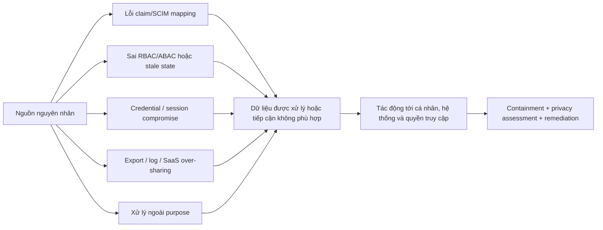
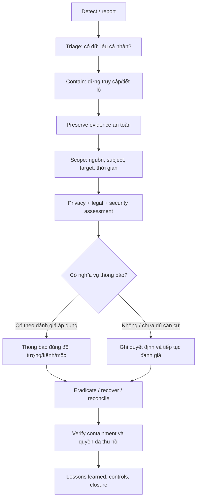
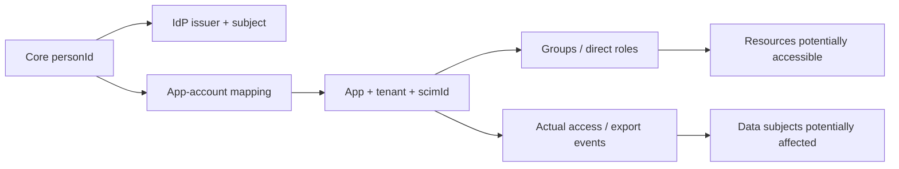
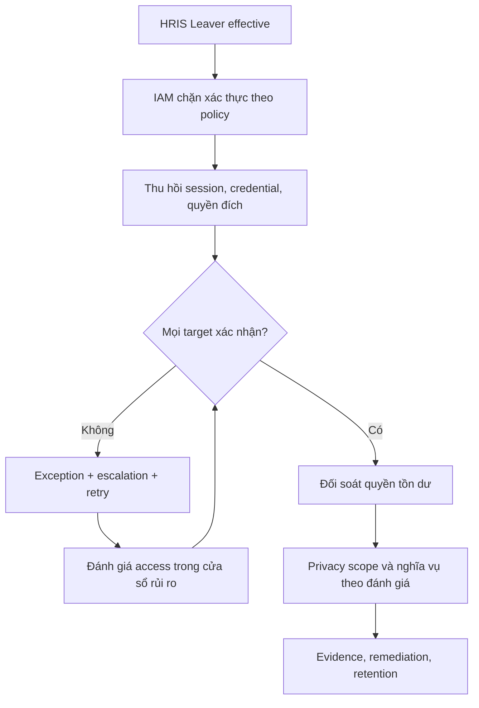

# Privacy incident: Nhận diện, ứng phó và khắc phục sự cố quyền riêng tư trong IAM

> **Chương:** Privacy và identity  
> **Module:** `SECURITY_IDENTITY_ACCESS_MANAGEMENT_IDENTITY_LIFECYCLE`  
> **Bối cảnh:** Quản lý vòng đời danh tính theo mô hình **Joiner–Mover–Leaver (JML)**: xác minh danh tính, tạo tài khoản, cấp quyền, thay đổi vai trò, rà soát và thu hồi quyền. Bài học liên kết **IdP, SSO, SCIM, RBAC/ABAC, tài khoản dịch vụ, kiểm toán** và mục tiêu giảm **quyền truy cập tồn dư**.  
> **Trọng tâm:** Khi dữ liệu danh tính bị xử lý sai, lộ, mất, chỉnh sửa trái phép hoặc bị truy cập ngoài mục đích, tổ chức cần vừa **chặn rủi ro đang diễn ra** vừa **xác định tác động tới cá nhân và nghĩa vụ xử lý theo bối cảnh pháp lý**.

## 1. Privacy incident là gì?

**Privacy incident (sự cố quyền riêng tư)** là một sự kiện hoặc chuỗi sự kiện có thể gây ra việc xử lý dữ liệu cá nhân trái với chính sách, mục đích đã được xác định, quyền truy cập được phép hoặc nghĩa vụ bảo vệ dữ liệu áp dụng. Trong IAM, sự cố thường liên quan đến **danh tính, thuộc tính, tài khoản, quyền, phiên, token, bằng chứng xác minh hoặc nhật ký hoạt động**.

Ví dụ:

- SCIM connector gửi nhầm trường `nationalId` tới một SaaS không có mục đích nhận.
- Nhân viên chuyển từ Support sang Finance nhưng còn quyền đọc ticket khách hàng cũ.
- IdP hoặc ứng dụng log nguyên `Authorization` header chứa bearer token.
- Helpdesk gửi hồ sơ xác minh của người A cho người B.
- Một Leaver vẫn còn local account hoặc API key dùng được và truy cập dữ liệu.
- File danh sách account/role được xuất ra kho chia sẻ công khai.
- Một đơn vị dùng login logs để đánh giá cá nhân ngoài mục đích và quyền xử lý đã xác định.
- Kẻ tấn công chiếm account quản trị để tải các thuộc tính danh tính.

Không phải mọi dấu hiệu đều chứng minh dữ liệu đã bị lộ. Một cảnh báo truy cập bất thường cần được điều tra để xác nhận **có dữ liệu cá nhân không, đã xảy ra điều gì, ai bị ảnh hưởng và còn rủi ro gì**.

### 1.1. Phân biệt các khái niệm quan trọng

| Khái niệm | Bản chất | Ví dụ |
|---|---|---|
| **Security incident** | Sự kiện ảnh hưởng hoặc đe dọa an toàn hệ thống/thông tin | Tài khoản quản trị bị chiếm, malware trên máy chủ IdP |
| **Privacy incident** | Sự kiện có thể vi phạm nguyên tắc hoặc nghĩa vụ xử lý dữ liệu cá nhân | Dùng lịch sử đăng nhập vào mục đích giám sát không được phê duyệt |
| **Personal data breach** | Một loại sự cố vi phạm an toàn dẫn tới hủy, mất, thay đổi, tiết lộ hoặc truy cập trái phép/bất hợp pháp dữ liệu cá nhân theo định nghĩa pháp lý liên quan | Sao chép trái phép danh sách nhân sự, sửa hồ sơ dẫn tới cấp sai quyền |
| **Policy violation** | Hành vi trái quy định nội bộ; cần đánh giá có tác động tới dữ liệu hoặc quyền riêng tư không | Dùng tài khoản chia sẻ ngoài quy trình |
| **Near miss** | Kiểm soát ngăn được sự cố trước khi có hậu quả được xác nhận | Bộ lọc chặn SCIM payload chứa trường bị cấm |
| **Confirmed incident** | Có đủ bằng chứng để xác nhận một dạng sự cố | Log và đích xác nhận file chứa PII đã bị gửi sai người |

Các khái niệm có thể **giao nhau nhưng không đồng nhất**. Một outage IdP gây gián đoạn đăng nhập là sự cố an ninh/sẵn sàng, nhưng chưa chắc là vi phạm dữ liệu cá nhân. Ngược lại, việc tái sử dụng dữ liệu đăng nhập ngoài mục đích cho phép có thể là privacy incident dù không có hacker.

Không kết luận mọi privacy incident đều phải thông báo cơ quan quản lý hoặc mọi sự cố đều là personal data breach theo một luật cụ thể; việc phân loại và nghĩa vụ thông báo phải do bên có trách nhiệm đánh giá theo **quy định áp dụng**.

### 1.2. Vì sao IAM là điểm nhạy cảm?

IAM nối **con người → định danh số → tài khoản → quyền truy cập → dữ liệu**. Một lỗi ở lớp này có thể:

1. Làm lộ dữ liệu cá nhân trực tiếp như email, số giấy tờ, ảnh proofing.
2. Làm sai quyết định RBAC/ABAC, mở truy cập tới dữ liệu người khác.
3. Duy trì phiên hoặc credential khi quan hệ làm việc đã chấm dứt.
4. Phát tán thuộc tính quá mức qua IdP, SSO hoặc SCIM.
5. Làm mất khả năng truy vết, khiến tổ chức không biết ai có quyền và dữ liệu nào đã bị xử lý.

## 2. Những loại dữ liệu cần xem xét khi xảy ra sự cố

| Nhóm dữ liệu IAM | Ví dụ | Rủi ro nổi bật |
|---|---|---|
| **Core identity** | `personId`, email, tên, trạng thái quan hệ | Mạo danh, nhầm người, liên kết dữ liệu |
| **Identity proofing** | Ảnh giấy tờ, kết quả xác minh, liveness | Gian lận danh tính, tổn hại privacy |
| **Authentication data** | Password verifier, TOTP seed, recovery code | Chiếm account; khó phục hồi khi secret lộ |
| **Session/token** | Access token, refresh token, session cookie | Truy cập với quyền của chủ thể khi còn hiệu lực |
| **Account mapping** | `iss`/`sub`, SCIM `id`/`externalId`, local account | Lộ sơ đồ danh tính, khó deprovision đúng |
| **Authorization data** | Role, group, entitlement, ABAC attribute | Leo thang đặc quyền, lộ nhóm nhạy cảm |
| **Activity/audit data** | IP, login time, access decisions, approver | Theo dõi hoạt động, suy luận hành vi |
| **JML events** | Ngày gia nhập, chuyển đơn vị, ngày nghỉ | Lộ thông tin nhân sự, sai vòng đời quyền |
| **Non-human identity** | API key, private key, workload owner | Xâm nhập dịch vụ và dữ liệu mà dịch vụ truy cập |
| **Exports/bản sao** | CSV, ticket, log, backup, data warehouse | Phạm vi lộ rộng, khó khống chế bản sao |

Độ nhạy phụ thuộc **ngữ cảnh**. `personId` chỉ là mã giả trong một ứng dụng nhưng vẫn có thể là dữ liệu cá nhân nếu IAM giữ bảng ánh xạ; group `security-incident-response` có thể tiết lộ vai trò nhạy cảm dù không chứa số giấy tờ.

Khi triage, phải kiểm tra cả **dữ liệu có khả năng dẫn tới truy cập tiếp theo**. Ví dụ log chứa refresh token vừa là dữ liệu liên quan danh tính, vừa là đường để kẻ tấn công tiếp tục đọc dữ liệu cá nhân khác.

## 3. Mô hình nguyên nhân và hậu quả

Privacy incident có thể xuất phát từ **kẻ tấn công**, **cấu hình sai**, **lỗi đồng bộ**, **quy trình không đủ kiểm soát**, hoặc **người có quyền nhưng dùng dữ liệu sai mục đích**.



**Phân biệt nguyên nhân gốc với triệu chứng:** “Một Leaver còn truy cập SaaS” là biểu hiện. Nguyên nhân có thể là SCIM connector không retry, account không có mapping, quyền được cấp thủ công, refresh token còn hiệu lực hoặc hệ thống đích bỏ qua `active=false`.

### 3.1. Tác động không chỉ là mất tính bí mật

| Chiều tác động | Ví dụ |
|---|---|
| **Confidentiality** | Bảng ánh xạ danh tính và quyền bị tải xuống trái phép |
| **Integrity** | `employmentState` hoặc `orgUnitId` bị sửa làm cấp sai quyền |
| **Availability** | Xóa nhầm tài khoản khiến chủ thể không thể dùng dịch vụ thiết yếu |
| **Purpose limitation** | Log bảo mật được tái sử dụng để xếp hạng nhân viên |
| **Accuracy** | Một người bị ghép nhầm với identity khác và nhận sai kết quả xác minh |
| **Retention** | Bằng chứng proofing được giữ sau thời hạn/mục đích phù hợp |
| **Data subject rights** | Xuất thông tin của người A trong phản hồi DSAR cho người B |
| **Residual access** | Nhân viên rời tổ chức còn local account, VPN hoặc token |

Sửa lỗi kỹ thuật chưa chắc giải quyết xong tác động privacy. Ví dụ sau khi gỡ quyền sai, cần biết **quyền đã được sử dụng để đọc dữ liệu nào** và **ai có thể vẫn giữ bản sao**.

## 4. Phân loại sự cố: bằng chứng và rủi ro, không chỉ số lượng bản ghi

Một ma trận triage có thể xem xét:

1. **Loại dữ liệu:** secret, bằng chứng proofing, thông tin cá nhân, audit, ID giả.
2. **Mức nhạy cảm và hậu quả:** mạo danh, gian lận, tổn hại danh tiếng, phân biệt đối xử, lộ thông tin mật.
3. **Cơ chế sự cố:** truy cập, tiết lộ, mất, thay đổi, hủy, dùng sai mục đích.
4. **Khả năng khai thác:** token còn hiệu lực hay không, dữ liệu đã công khai hay chỉ tới một bên nhận được xác thực.
5. **Đối tượng và phạm vi:** ai bị ảnh hưởng, tài khoản/tenant/ứng dụng nào; số lượng chắc chắn hay chưa biết.
6. **Khả năng khống chế:** bên nhận có xác nhận xóa/thu hồi không, có bản sao và export khác không.
7. **Tính toàn vẹn và hệ quả quyền:** dữ liệu sai có làm cấp quyền trái phép hoặc chặn người hợp lệ không.
8. **Bối cảnh pháp lý/hợp đồng:** loại chủ thể, khu vực, trách nhiệm controller/processor, nghĩa vụ thông báo.
9. **Bằng chứng còn thiếu:** phần nào mới là giả thuyết hoặc chỉ báo cảnh báo.

### 4.1. Ma trận mức độ ưu tiên nội bộ tham khảo

| Ưu tiên ví dụ | Dấu hiệu | Hành động ban đầu |
|---|---|---|
| **Critical** | Credential đặc quyền còn sử dụng được; có khả năng tiếp tục truy cập dữ liệu quy mô lớn | Cô lập đường truy cập ngay, kích hoạt đội ứng cứu và quản lý có thẩm quyền |
| **High** | Xác nhận dữ liệu định danh nhạy cảm bị tiết lộ cho bên không được phép; Leaver đã truy cập dữ liệu | Ngăn lộ tiếp, thu hồi, khoanh vùng người bị ảnh hưởng, privacy/legal assessment |
| **Medium** | Phát hiện over-sharing hạn chế phạm vi, chưa rõ có bên nhận hay sử dụng hay không | Dừng luồng, giữ chứng cứ và điều tra nhanh |
| **Low / Near miss** | DLP/schema allowlist chặn payload không hợp lệ trước khi rời hệ thống | Ghi nhận, đánh giá lỗi, vá và kiểm thử lại |

Đây là **nhãn vận hành minh họa**, không phải ngưỡng bắt buộc. Một bản ghi duy nhất chứa recovery secret của quản trị viên có thể rủi ro hơn hàng nghìn mã được tổng hợp khó nhận diện. Không dựa duy nhất vào `affectedCount` để xếp mức độ.

## 5. Vòng đời ứng phó: phát hiện đến đóng và phòng tái diễn



Trong thực tế, các bước diễn ra **song song và lặp**. Không đợi hoàn tất phân loại pháp lý mới thu hồi token đang bị lạm dụng. Ngược lại, không hủy mất chứng cứ quan trọng khi cô lập hệ thống. Ưu tiên đồng thời **ngăn tác hại tiếp diễn** và **giữ bằng chứng đủ, an toàn, hợp pháp**.

### 5.1. Những mốc thời gian cần ghi riêng

```text
occurredAt        = thời điểm sự kiện bắt đầu (có thể chỉ ước lượng)
firstObservedAt   = dấu hiệu đầu tiên có trong telemetry
detectedAt        = thời điểm hệ thống/nhân sự phát hiện
reportedAt        = thời điểm báo cho nhóm ứng cứu
confirmedAt       = thời điểm kết luận ban đầu được xác nhận
containedAt       = thời điểm khống chế được đường rủi ro
notifiedAt        = thời điểm thông báo thực tế nếu cần
recoveredAt       = thời điểm dịch vụ/quyền trở lại trạng thái mong muốn
closedAt          = thời điểm hoàn tất phê duyệt đóng
```

**Đừng đánh đồng `detectedAt` với `occurredAt`.** Một SCIM connector có thể làm lộ thuộc tính từ nhiều tháng trước nhưng chỉ hôm nay mới được phát hiện. Mốc tính nghĩa vụ pháp lý cụ thể phải theo định nghĩa và luật áp dụng, không tự lấy `createdAt` của ticket.

## 6. Ai có trách nhiệm trong một privacy incident?

| Vai trò | Trách nhiệm điển hình |
|---|---|
| **Incident commander** | Điều phối, ưu tiên containment, quyết định leo thang, cập nhật trạng thái |
| **Security/SOC** | Điều tra truy cập, credential, phiên, network, endpoint và telemetry |
| **IAM/IdP owner** | Chặn xác thực, thu hồi token, sửa account mapping và quyền |
| **HRIS/identity source owner** | Xác nhận sự kiện Joiner/Mover/Leaver và trạng thái nguồn |
| **Application/SCIM owner** | Xác nhận xử lý từng tài khoản đích và local access |
| **Privacy/DPO hoặc đầu mối bảo vệ dữ liệu** | Đánh giá loại dữ liệu, tác động tới chủ thể, mục đích và quyền |
| **Legal/compliance** | Xác định nghĩa vụ pháp lý, hợp đồng, phạm vi thông báo và ngoại lệ |
| **Vendor/processor liaison** | Liên hệ IdP, cloud, SaaS, proofing provider và theo dõi cam kết |
| **Communications/support** | Chuẩn bị thông báo đã được phê duyệt, hỗ trợ người bị ảnh hưởng |
| **Audit/evidence custodian** | Bảo toàn tính toàn vẹn, kiểm soát truy cập và thời hạn chứng cứ |

**Một người có thể kiêm nhiều vai trò** tại tổ chức nhỏ, nhưng cần rõ **ai chịu trách nhiệm phê duyệt quyết định**. Nhóm kỹ thuật không nên tự kết luận nghĩa vụ thông báo dựa trên cảm tính; ngược lại, nhóm privacy cần thông tin kỹ thuật đáng tin về phạm vi truy cập.

## 7. Phát hiện sự cố từ tín hiệu IAM

Nguồn cảnh báo có thể gồm IdP logs, SCIM audit, HRIS event stream, SIEM, CASB/DLP, dữ liệu SaaS, ticket, access review, thiết bị, secret manager và phản ánh của người bị ảnh hưởng.

| Tín hiệu | Suy đoán ban đầu | Kiểm tra cần thực hiện |
|---|---|---|
| Leaver vẫn có `active=true` ở app đích | Quyền truy cập tồn dư | Account mapping, local user, phiên, API token và lịch sử access |
| Sau Mover, entitlement mới cấp mà entitlement cũ còn | Privilege accumulation | Desired vs actual access, policy/version và quyền trực tiếp |
| IdP xuất claim mới chứa `dateOfBirth` | Over-sharing | Client nào nhận, token/log đã tạo, payload có bị giữ |
| SCIM payload chứa trường `nationalId` | Data leakage | Mapping change, delivery logs, consumer và bản sao |
| Token xuất hiện ở access log | Credential exposure | Phạm vi log, token validity, nơi sao chép và quyền của token |
| Nhiều tải xuống identity exports | Khả năng lạm dụng | Actor, mục đích, scope, volume, destination |
| IdP account bị reset MFA bất thường | Account takeover | Recovery workflow, session, thiết bị, địa chỉ truy cập |
| Service API key xuất hiện trong repository | Workload compromise | Secret còn hiệu lực, scope và dữ liệu đã truy cập |
| DSR export gửi sai recipient | Unauthorized disclosure | File nào, thời điểm, người nhận và có tải chưa |
| Số bản ghi trong analytics vượt data contract | Function creep | Nguồn, purpose, field và retention |
| Thời điểm xóa account nhưng backup restore làm active lại | Resurrected access | Revocation ledger, source state và đối soát sau restore |

**Cảnh báo ≠ bằng chứng xâm phạm.** Ví dụ login từ một IP mới có thể hợp lệ; phải liên kết thêm device posture, xác thực, bất thường hành vi và trạng thái tài khoản. Nhưng sự không chắc chắn không nên cản việc bảo vệ khẩn cấp một credential chắc chắn đã lộ.

### 7.1. Phát hiện bằng reconciliation chủ động

Thay vì chờ người dùng báo, IAM nên so sánh:

- **Nguồn HRIS:** ai đang là active/mover/leaver.
- **Desired IAM state:** account/role/group theo policy mới nhất.
- **Actual target state:** tài khoản, group, token, local access ở từng đích.
- **Exceptions:** quyền tạm, quyền được cấp thủ công, service account, lịch bàn giao.
- **Evidence:** đã có xác nhận ở đích chưa.

Reconciliation phát hiện **sai lệch có thể gây privacy incident trước khi có bằng chứng dữ liệu đã bị đọc**. Sai lệch phải được xử lý theo rủi ro và lưu lại quyết định triage.

## 8. Triage ban đầu: câu hỏi phải trả lời ngay

Khi nhận cảnh báo hoặc báo cáo, trước tiên ghi nhận:

1. **Hành vi hoặc hệ thống nào có vấn đề?** Ví dụ SCIM mapping, group, IdP credential, file export.
2. **Dữ liệu cá nhân nào có thể liên quan?** Phân loại và mức nhạy cảm sơ bộ.
3. **Ai có thể bị ảnh hưởng?** Subject, tổ chức/tenant, nhóm người, bản ghi giao dịch.
4. **Rủi ro có đang tiếp diễn không?** Token còn hiệu lực, URL public, app đang sync thêm dữ liệu.
5. **Đường truy cập nào phải khóa trước?** Account, session, secret, endpoint, connector hoặc chia sẻ file.
6. **Bằng chứng ở đâu?** Event ID, source version, logs, provider confirmation, request ID.
7. **Ai được gọi vào?** Incident commander, privacy, legal, owners, vendor.
8. **Điều gì đã biết/chưa biết?** Không điền giả định làm sự thật.

Một bản ghi triage nên phân biệt rõ `confirmed`, `suspected`, `unknown`. Không ép người vận hành điền số cá nhân bị ảnh hưởng nếu chưa có cơ sở; có thể dùng khoảng có giải thích và cập nhật khi điều tra.

### 8.1. Mẫu incident intake nội bộ

```yaml
incidentId: priv-2026-0149
type: suspected-privacy-incident
detectedAt: "2026-11-23T08:15:00Z"
reporter:
  channel: automated-reconciliation
ownerTeam: security-incident-response
summary: "Ứng dụng đích vẫn cho phép Leaver truy cập sau ngày hiệu lực"
systems:
  - hris
  - iam-lifecycle
  - saas-tasks
dataCategories:
  - account-identity
  - application-access-history
status: investigating
evidenceRefs:
  - ev-9023
privacyAssessment:
  status: pending
  affectedPersons: unknown
  notificationDecision: not-yet-assessed
```

Đây là **định dạng minh họa cho quy trình nội bộ**. Không phải schema chuẩn của SCIM hoặc biểu mẫu khai báo pháp lý. Không đưa plaintext token, toàn bộ HRIS event hoặc hồ sơ nạn nhân vào ticket nếu một mã tham chiếu đã đủ.

## 9. Cô lập sự cố mà không phá chứng cứ

**Containment** nhằm ngăn việc tiết lộ hoặc truy cập trái phép tiếp diễn. Biện pháp phụ thuộc mức rủi ro và tác động khả dụng:

- Revoke credential/token bị lộ, chặn session hoặc vô hiệu hóa account bị chiếm.
- Tắt field mapping hoặc tạm dừng SCIM connector gửi sai dữ liệu.
- Thu hồi quyền chia sẻ hoặc public link của file export.
- Giảm quyền RBAC/ABAC, chặn quyền trực tiếp trên app đích.
- Cô lập workload bị xâm nhập hoặc đổi secret của nó.
- Chặn truy vấn bulk export không phù hợp và tăng giám sát.
- Ngăn người vận hành dùng bản báo cáo/lưu trữ sai mục đích.
- Có phương án duy trì nghiệp vụ và rollback kiểm soát cho thay đổi ảnh hưởng nhiều user.

### 9.1. Ưu tiên theo đường tấn công

Nếu token còn hiệu lực, **đừng chờ forensic image mới revoke** trừ khi đội ứng cứu có phương án cụ thể bảo vệ đường truy cập. Có thể giữ metadata cần thiết như token ID/jti, issuer, scope, thời điểm cấp, key version và các event liên quan trước hoặc đồng thời thu hồi, nhưng **không sao chép thêm bearer secret vào ticket**.

Nếu SCIM connector phát tán dữ liệu nhạy cảm, nên **dừng luồng phát hành sai trước**, sau đó xác định nơi đã nhận và biện pháp xử lý các bản sao. Chỉ xóa một trường ở source HRIS mà không thay connector mapping có thể không đủ.

### 9.2. Khi cắt kết nối có thể gây tác động lớn

Tắt cả IdP production có thể khiến mọi nhân viên không đăng nhập được. Cần đánh giá phương án ít gây gián đoạn hơn như vô hiệu credential cụ thể, khóa client, chặn scope, revoke session, khóa route hoặc thu hồi quyền trên tài nguyên nhạy cảm. Nếu nguy cơ nghiêm trọng, incident commander vẫn có thể chọn hành động khẩn cấp theo runbook.

**Cô lập không đồng nghĩa xóa dữ liệu:** để phục vụ điều tra và nghĩa vụ báo cáo, phải giữ chứng cứ có kiểm soát, nhưng không giữ credential còn tác dụng ngoài cần thiết.

## 10. Giữ chứng cứ: toàn vẹn, truy vết và giới hạn privacy

Chứng cứ của một privacy incident cũng có thể chứa dữ liệu cá nhân rất nhạy cảm. Mục tiêu là **đủ để chứng minh sự kiện**, không tạo thêm một bản sao không kiểm soát.

Các thành phần cần lưu:

- Incident ID, case ID, người quyết định, thời điểm và lý do thay đổi.
- Event ID, `correlationId`, source event/version và hệ thống phát sinh.
- Account mapping có scope: `personId`, `iss` + `sub`, `applicationId`, `tenantId`, SCIM `id`.
- Quyết định policy và phiên bản RBAC/ABAC, entitlement trước/sau theo phạm vi.
- Audit access, export/download event, thời điểm và đường truy cập nếu có.
- Kết quả lệnh revoke/disable và **xác nhận từ hệ thống đích**.
- Kết luận phân loại dữ liệu/tác động, giả định chưa xác minh và các mốc cập nhật.

### 10.1. Chain of custody

Nếu cần giữ file/snapshot làm chứng cứ:

1. Ghi nguồn, người thu thập, thời gian, phương pháp và phạm vi.
2. Ghi hash kiểm tra tính toàn vẹn của bản sao khi phù hợp.
3. Mã hóa, hạn chế người truy cập và lưu riêng khỏi ticket thông thường.
4. Tách vùng điều tra khỏi các hệ thống vẫn vận hành.
5. Ghi mọi lần xem, chuyển, xuất hoặc thay đổi bản sao.
6. Có retention, legal hold và quy trình dỡ hold/xử lý cuối cùng.

Không gửi toàn bộ log chứa token qua email nhóm; dùng mã tham chiếu tới evidence store được phân quyền. **Hash kiểm tra tính toàn vẹn không khiến bản ghi chứa PII trở thành vô danh**.

### 10.2. Cảnh báo về log retention

Nếu xóa log quá sớm có thể không thể xác minh dữ liệu nào bị truy cập. Nhưng giữ mọi log vô thời hạn cũng tăng rủi ro. Áp retention theo mục đích và nghĩa vụ; nếu cần legal hold, giới hạn **đúng phạm vi** chứ không bật hold cho toàn bộ dữ liệu danh tính không có căn cứ.

## 11. Truy nguyên danh tính và phạm vi dữ liệu bị ảnh hưởng

Một trong những bài toán khó nhất là xác định **ai thực sự bị ảnh hưởng** khi account và identifier có nhiều dạng.

Ví dụ:

```text
HRIS:
  personId=P-1048
  lifecycleState=leaver
  effectiveAt=2026-11-22T17:00:00+07:00

IdP:
  issuer=https://idp.example.invalid
  subject=opaque-sub-24

SaaS:
  applicationId=tasks-app
  tenantId=corp
  scimId=app-user-508
  active=true
```

Một lỗi có thể liên quan `P-1048`, nhưng phạm vi tác động còn phụ thuộc account đích đã **xem tài nguyên nào** hoặc có quyền truy cập dữ liệu của bao nhiêu người.

### 11.1. Identity graph phải có scope



Phân biệt:
 
- **Được phép truy cập về mặt kỹ thuật** (potential exposure).
- **Có bằng chứng đã truy cập** (observed access).
- **Có bằng chứng tải/chia sẻ dữ liệu** (confirmed disclosure).
- **Chưa thể xác định do log/coverage thiếu** (unknown exposure).

Không kết luận “không có lộ dữ liệu” chỉ vì không thấy event trong một hệ thống không ghi log đọc dữ liệu. Cần mô tả giới hạn telemetry và đánh giá rủi ro phù hợp.

### 11.2. Không nối danh tính chỉ bằng email

Email và username có thể thay đổi, được tái sử dụng hoặc dùng chung. OIDC `sub` chỉ mang ý nghĩa trong phạm vi `iss`; SCIM `id` trong phạm vi nhà cung cấp, `externalId` do client gán và cần scope theo ứng dụng/tenant. Nhầm mapping có thể khiến điều tra ảnh hưởng sai người hoặc gửi nhầm thông báo.

## 12. Privacy incident trong Joiner

Giai đoạn **Joiner** thường thu thập nhiều thuộc tính và bằng chứng xác minh. Một lỗi mapping, workflow hoặc cấu hình có thể làm dữ liệu được phát hành quá mức ngay khi account vừa được tạo.

### 12.1. Các tình huống điển hình

| Tình huống | Rủi ro | Hướng ứng phó |
|---|---|---|
| Proofing API trả ảnh giấy tờ trong log | Lộ dữ liệu đặc biệt nhạy cảm | Dừng log payload, xác định mọi nơi đã sao chép, giới hạn truy cập |
| Nhầm hồ sơ A sang subject B | Mạo danh/cấp nhầm quyền | Tạm chặn account liên quan, xác minh nguồn, sửa identity mapping |
| Cấp nhóm quản trị mặc định cho mọi Joiner | Truy cập thừa | Thu hồi nhóm, đánh giá dữ liệu đã truy cập, kiểm thử role mapping |
| Onboarding bị hủy nhưng pre-provisioned account còn hoạt động | Orphan account | Disable/revoke, đối soát ứng dụng, xử lý dữ liệu tạm |
| SCIM gửi ngày sinh/giấy tờ tới app không cần | Over-sharing | Ngừng field release, liên hệ provider về bản sao, rà soát hợp đồng |

### 12.2. Tách proofing evidence khỏi IAM profile

Dịch vụ proofing có thể cần ảnh giấy tờ hoặc kết quả liveness. Nhưng trong nhiều hệ thống, IAM chỉ cần **kết luận xác minh, mức bảo đảm, thời điểm và mã tham chiếu**. Khi điều tra, không xuất raw proofing evidence cho toàn bộ đội vận hành nếu họ chỉ cần biết kết quả và owner xử lý.

### 12.3. Kiểm tra các account chưa từng hoạt động

Người chưa nhận việc hoặc onboarding bị dừng vẫn có thể có IdP account, invitation, thiết bị, app profile và dữ liệu trong log. Phạm vi sự cố không chỉ bao gồm người đã đăng nhập thành công.

## 13. Privacy incident trong Mover

**Mover** thay đổi quan hệ tổ chức, vai trò hoặc quyền. Lỗi phổ biến là cấp quyền mới nhưng không thu hồi quyền cũ, hoặc policy engine vẫn sử dụng thuộc tính đã lỗi thời.

Ví dụ:

- Trước Mover: `orgUnitId=support`, role `support-ticket-reader`.
- Sau Mover: `orgUnitId=finance`, role `finance-report-reader` nếu đủ điều kiện.
- Lỗi: claim/cache hoặc local SaaS role vẫn chứa `support-ticket-reader`.

Một người có thể tiếp tục đọc hồ sơ khách hàng dù mục đích công việc mới không còn yêu cầu. Đây vừa là vấn đề **least privilege** vừa có thể trở thành **privacy incident** nếu việc đọc hoặc khả năng truy cập trái phép tới dữ liệu cá nhân là đáng kể.

### 13.1. Runbook Mover

1. Xác nhận sự kiện HRIS, `effectiveAt`, source version và người có thẩm quyền.
2. Tính **desired state** từ RBAC/ABAC.
3. Truy vấn **actual state** tại IdP, ứng dụng, nhóm/role trực tiếp và cache.
4. Chặn quyền cũ không hợp lệ; xử lý ngoại lệ bàn giao với owner và expiry.
5. Điều tra access/download events trong cửa sổ sai lệch.
6. Xác định data subjects có thể bị ảnh hưởng từ tài nguyên đã truy cập.
7. Ghi đầy đủ xác nhận revoke và privacy assessment.
8. Sửa đồng bộ, policy, sự kiện đến trễ hoặc manual grant là nguyên nhân gốc.

**Không sửa hồ sơ lịch sử theo cách xóa dấu vết sai phạm.** Có thể cần correction event cho nguồn sai, trong khi audit vẫn giữ dấu vết quyết định cũ theo mục đích và retention được phép.

## 14. Privacy incident trong Leaver

**Leaver** có rủi ro đặc biệt vì quan hệ cho phép truy cập đã kết thúc nhưng tài khoản, phiên hoặc credential có thể còn tồn tại.

| Đường truy cập | Cần kiểm tra |
|---|---|
| IdP/SSO | Account disabled? Session/refresh token còn hợp lệ? |
| SCIM SaaS | `active=false` được đích áp dụng? Group/direct role đã thu hồi? |
| Local/legacy account | Có account ngoài SSO không? |
| Cloud/VPN/SSH | Access key, SSH key, VPN session và quyền đặc quyền? |
| API token/PAT | Token cá nhân tại repository, CI/CD, công cụ quản trị? |
| Shared/workload credentials | Có secret cá nhân bị dùng cho bot không? |
| Thiết bị | Session cache, local credentials và offline data? |
| Backup/restore | Có khả năng account đã revoke được khôi phục active? |

### 14.1. Quy trình xử lý Leaver sai lệch



Không đánh dấu hoàn thành chỉ vì gửi SCIM PATCH thành công. Một provider có thể trả HTTP 2xx nhưng còn local session, API key hoặc role cấp trực tiếp. Cần trạng thái thực tế và bằng chứng xác nhận theo từng đích.

### 14.2. Khi đã có access sau ngày nghỉ

Cần kiểm tra:
 
- Account có phải của đúng Leaver không?
- Session/token được cấp trước hay sau mốc kết thúc?
- Truy cập do tự động đồng bộ hay thao tác thực tế?
- Resource nào, loại dữ liệu gì, chủ thể nào liên quan?
- Có download/export hay chuyển ra ngoài không?
- Có vendor hoặc thiết bị giữ bản sao không?

Khi chưa biết dữ liệu có bị đọc hay không, phải ghi rõ **chưa xác định**, không suy ra chắc chắn “không có ảnh hưởng”.

### 14.3. Khôi phục và tái tuyển dụng

Restore backup cũ có thể làm `active=true` hoặc phục hồi group đã bị thu hồi. Sau restore cần đối soát nguồn JML mới nhất, áp lại revocation ledger và kiểm tra ứng dụng đích trước khi cho hệ thống cấp quyền. Rehire phải tính quyền từ quan hệ mới, không tự hồi sinh toàn bộ role cũ.

## 15. IdP, SSO, OIDC và SAML trong sự cố tiết lộ dữ liệu

### 15.1. Claim over-sharing

IdP biết nhiều thuộc tính nhưng relying party chỉ nên nhận claim cần theo client. Một thay đổi cấu hình có thể làm ID token hoặc SAML assertion chứa `nationalId`, `dateOfBirth`, `groups` hoặc thuộc tính nhạy cảm khác.

Điều tra cần hỏi:

1. Client/service provider nào nhận claim?
2. Số token/assertion và thời gian phát hành có xác định được không?
3. Bên nhận có lưu, log, gửi tiếp hoặc dùng claim không?
4. Có claim khác cho phép tái nhận diện hoặc suy luận người khác không?
5. Đã loại field khỏi release policy và cache như thế nào?
6. Phía bên nhận có xác nhận xử lý các bản sao nếu cần không?

**JWT được ký không tự mã hóa payload**; bên nắm token có thể đọc những claim không được bảo vệ bằng cơ chế bảo mật nội dung riêng. SAML assertion đã ký cũng không đồng nghĩa mọi attribute đều bí mật.

### 15.2. Token hoặc session compromise

Với bearer access/refresh token hoặc session cookie bị lộ:

- Xác định issuer, audience, scope, expiry, token family hoặc session ID khi có.
- Chặn/revoke theo cơ chế IdP và resource server, rotate secret cần thiết.
- Đánh giá refresh token reuse, active sessions và sự kiện bất thường.
- Nếu token là JWT stateless, **disable account không luôn thu hồi token đã phát hành ngay**; cần tính tới thời hạn, enforcement của resource server và cơ chế revocation/denylist phù hợp.
- Rà soát dữ liệu đã truy cập và downstream effects.
- Không ghi plaintext token vào biên bản hoặc ticket.

### 15.3. SSO không đồng nhất vòng đời SaaS

Kể cả sau khi IdP chặn xác thực, ứng dụng có thể còn **local session** hoặc account đăng nhập khác. Do đó, remediation phải bao phủ provisioning/deprovisioning và kiểm soát của app, không chỉ thay cấu hình SSO.

## 16. SCIM và sự cố provisioning sai

SCIM quản lý User/Group qua API. Lỗi có thể là:
 
- Tạo account của người A dưới email/`externalId` của người B.
- Bật `active=true` cho Leaver từ event cũ đến trễ.
- Gửi toàn bộ HRIS profile thay vì tập trường app cần.
- Thêm nhóm mới nhưng không gỡ nhóm cũ khi Mover.
- Connector retry thiếu idempotency tạo duplicate accounts.
- Đích trả thành công nhưng không áp dụng đúng trạng thái hoặc quyền.

### 16.1. Ví dụ lệnh khóa người dùng

```http
PATCH /scim/v2/Users/app-user-508 HTTP/1.1
Content-Type: application/scim+json
Authorization: Bearer <redacted>

{
  "schemas": ["urn:ietf:params:scim:api:messages:2.0:PatchOp"],
  "Operations": [
    {"op": "replace", "path": "active", "value": false}
  ]
}
```

`active=false` trong SCIM thường biểu diễn deactivation; nhà cung cấp có thể có semantics và cách xử lý session khác nhau. **Không dùng SCIM PATCH như bằng chứng dữ liệu cá nhân đã bị xóa**.

### 16.2. Khôi phục đúng trạng thái bằng nguồn có thẩm quyền

Một pipeline tốt lưu:
 
- `sourceEventId` và `sourceVersion`.
- `effectiveAt` của thay đổi.
- `personId` liên kết tới `applicationId`/`tenantId`/`targetAccountId`.
- `policyVersion` dùng để tính desired entitlements.
- Confirmation/error của từng đích.

Khi sự cố do event đến ngược thứ tự, không đơn giản “replay toàn bộ request cũ”. Cần kiểm tra **trạng thái nguồn có hiệu lực mới nhất** và idempotency, tránh tái cấp quyền đã thu hồi.

## 17. RBAC/ABAC: khi dữ liệu sai biến thành quyền sai

**RBAC** dựa trên role; **ABAC** dựa trên thuộc tính subject, resource, action và environment. Nếu nguồn thuộc tính bị sửa hoặc cũ, policy engine có thể đưa ra quyết định sai.

Ví dụ policy:

```text
permit(subject, action, resource, environment) khi:
    subject.lifecycleState == "active"
    AND subject.orgUnitId == resource.ownerOrgUnitId
    AND "case-reviewer" trong subject.entitlements
    AND environment.deviceCompliant == true
```

Nếu `orgUnitId` bị gán sai hoặc `lifecycleState` chưa được cập nhật khi Leaver, người không còn đủ điều kiện có thể đọc dữ liệu. Việc chỉ sửa UI display name không khôi phục tính đúng của policy decision.

### 17.1. Kiểm tra sau khi phát hiện quyền sai

| Câu hỏi | Bằng chứng |
|---|---|
| Thuộc tính nào sai? | HRIS source event, policy input và version |
| Sai từ khi nào? | `effectiveAt`, cache TTL, target applied time |
| Những quyết định nào đã bị ảnh hưởng? | Access decision IDs, resource/action |
| Quyền có được dùng không? | App access logs và export events |
| Dữ liệu ai có thể bị xem? | Resource mapping và data classification |
| Quyền đã bị gỡ ở mọi đích chưa? | Reconciliation và confirmation |
| Có ngoại lệ được phê duyệt không? | Approval, owner, expiry và SoD |

Phải phân biệt **quyền tiềm năng** và **lịch sử truy cập được quan sát**; cả hai đều quan trọng để đánh giá rủi ro.

### 17.2. Tránh sửa trực tiếp dữ liệu người dùng

Nếu người dùng báo `isAdmin=true` bị gán sai, không cho họ tự sửa claim này. Phải xử lý tại nguồn có thẩm quyền, sửa policy hoặc membership thực tế, sau đó đối soát. Giữ dấu vết đã sửa mà không tiếp tục dùng thuộc tính lỗi thời để cấp quyền.

## 18. Service identities và sự cố credential phi con người

Một service account không phải data subject, nhưng có thể truy cập dữ liệu của nhiều cá nhân. Secret bị lộ hoặc role quá rộng có thể tạo privacy incident nghiêm trọng.

### 18.1. Đường tấn công thường gặp

- API key trong repository, build log hoặc ticket.
- Service principal được gắn quyền `read-all-users` không cần thiết.
- Workload dùng credential cá nhân của người đã nghỉ việc.
- Client secret tồn tại sau khi integration bị hủy.
- Workload federation policy tin sai issuer/audience/subject.
- Owner chuyển bộ phận nhưng secret và scope không được rà soát.

### 18.2. Runbook cho workload

1. Xác định `serviceIdentityId`, owner team, môi trường và resource scope.
2. Đánh giá khả năng còn đang sử dụng secret, token hoặc certificate.
3. Revoke/rotate hoặc thay bằng managed/workload identity thích hợp.
4. Thu hẹp policy quyền và chặn truy cập dữ liệu không cần.
5. Điều tra lịch sử use/export, account mà workload đã thao tác.
6. Nếu credential được dùng bởi production, phối hợp recovery để tránh đứt dịch vụ ngoài kế hoạch.
7. Giữ metadata sự kiện, không sao chép plaintext secret.
8. Kiểm tra hệ thống đích và hậu quả đối với dữ liệu cá nhân.

Không “khắc phục” bằng cách chỉ đổi tên service account hoặc ẩn email owner; bí mật và quyền phải thật sự bị vô hiệu nếu đã lộ hoặc không còn cần.

## 19. Dữ liệu nhạy cảm: mức độ thiệt hại và cách giảm rủi ro

Một số loại thông tin gây rủi ro đặc biệt:
 
| Loại | Đặc điểm | Hành động cần cân nhắc |
|---|---|---|
| Ảnh giấy tờ/định danh | Có thể hỗ trợ mạo danh, khó thay thế | Thu hồi bản sao, giới hạn truy cập, đánh giá nguy cơ gian lận |
| Sinh trắc/liveness | Có thể khó thay đổi khi lộ | Điều tra loại sample/template, bảo vệ chuyên biệt |
| Recovery code/TOTP seed | Có thể giúp chiếm tài khoản | Thu hồi/đăng ký lại authenticator theo workflow an toàn |
| Refresh token | Có thể duy trì phiên | Revoke token family và kiểm tra reuse |
| Private key/service secret | Có thể mở rộng quyền truy cập | Rotation/revocation, điều tra workload action |
| Role đặc quyền và danh sách quản trị | Cho biết bề mặt tấn công | Giới hạn chia sẻ, rà soát account target |
| Login history/IP/location | Có thể tiết lộ hành vi và vị trí | Giảm trường, hạn chế mục đích và người đọc |
| Hồ sơ nhân sự nhạy cảm | Có thể gây tổn hại cá nhân | Hạn chế access, đánh giá thông báo và hỗ trợ phù hợp |

**Đổi mật khẩu không giải quyết mọi loại lộ dữ liệu**. Nếu tài liệu proofing hoặc dữ liệu sinh trắc bị lộ, không thể “thu hồi” đặc điểm sinh trắc như một bearer token. Cần đánh giá kỹ các biện pháp giảm tác động lâu dài và trách nhiệm hỗ trợ chủ thể.

## 20. Tác động tới quyền của data subject và privacy access requests

Một privacy incident có thể dẫn đến yêu cầu truy cập, đính chính, xóa, hạn chế xử lý hoặc các quyền khác tùy pháp luật áp dụng. IAM cần hỗ trợ nhưng **không biến một privacy request thành quyền đăng nhập lại hệ thống**.

Ví dụ: một Leaver nghi tài khoản cũ bị sử dụng có thể yêu cầu thông tin liên quan. Workflow phải:

1. Xác minh requester bằng kênh phù hợp ngoài SSO nếu tài khoản đã disable.
2. Liên kết đúng `personId`, IdP `iss`/`sub` và account mapping.
3. Tìm dữ liệu trong phạm vi quyền và nghĩa vụ phù hợp.
4. Xem xét thông tin của người thứ ba, security secrets và ngoại lệ.
5. Cung cấp thông tin qua kênh bảo mật sau review.
6. Ghi bằng chứng xử lý với retention riêng.

Nếu sự cố là **gửi nhầm DSAR export**, ưu tiên vô hiệu hóa download link, liên hệ người nhận, xác định có download hay chia sẻ không, đánh giá phạm vi và thông báo theo quy định. Không thu thập thêm chứng từ người bị ảnh hưởng vào ticket nếu không cần.

### 20.1. Không làm mất bằng chứng khi có yêu cầu xóa

Một số record có thể thuộc legal hold hoặc nghĩa vụ lưu giữ phù hợp. Yêu cầu xóa dữ liệu và yêu cầu giữ chứng cứ phải được đánh giá song song theo phạm vi cụ thể; không dùng legal hold để giữ mọi dữ liệu vĩnh viễn hoặc cấp lại quyền truy cập cũ.

## 21. Bên thứ ba, nhà cung cấp và xử lý xuyên hệ thống

Trong nhiều sự cố, dữ liệu đã tới IdP vendor, SaaS, cloud storage, dịch vụ proofing hoặc subprocessor. Tổ chức cần xác định **vai trò của từng bên và trách nhiệm hợp đồng/pháp lý**, không giả định chỉ hệ thống nguồn mới có dữ liệu.

### 21.1. Câu hỏi gửi vendor

- Hệ thống nào, tenant nào, loại dữ liệu nào đã nhận hoặc xử lý?
- Luồng sai bắt đầu/kết thúc khi nào; có log/backup/export không?
- Ai hoặc dịch vụ nào có quyền truy cập, có sự kiện tải/chuyển dữ liệu không?
- Vendor đã cô lập credential, file chia sẻ hoặc account chưa?
- Có thể xóa/hạn chế bản sao theo policy và căn cứ giữ không?
- Có subprocessor hoặc vùng lưu trữ khác cần điều tra không?
- Khi nào có thể cung cấp bằng chứng xác nhận và những hạn chế telemetry?
- Ai chịu trách nhiệm thông báo cho ai, theo điều khoản và quy định nào?

Không tuyên bố đã “xóa sạch SaaS” khi chỉ nhận phản hồi `active=false`. Cũng không coi một email vendor nói “đã xử lý” là đủ nếu sự cố còn liên quan session/key hoặc bản sao chưa được kiểm chứng.

### 21.2. Dữ liệu và jurisdiction

Nếu dữ liệu liên quan nhiều khu vực, nghĩa vụ bảo vệ, lưu giữ, thông báo và chuyển dữ liệu có thể khác nhau. Cần lập **bản đồ data subjects, hệ thống, bên nhận và khu vực liên quan** cùng legal/privacy owner. Không tự áp thời hạn của một luật cho mọi người hoặc mọi hệ thống.

## 22. Nghĩa vụ thông báo: quyết định dựa trên luật và dữ liệu thực tế

Một privacy incident **không tự động** đồng nghĩa phải gửi thông báo công khai. Các chế độ pháp lý có thể yêu cầu thông báo cơ quan quản lý, chủ thể dữ liệu, đối tác hoặc bên khác dựa trên loại sự cố, rủi ro, ngưỡng và thời hạn cụ thể.

**Không nên hard-code một con số giờ/ngày áp cho mọi incident.** Với một số khuôn khổ, ví dụ GDPR, quy tắc thông báo có các điều kiện, ngoại lệ và mốc riêng; pháp luật và nghĩa vụ hợp đồng áp dụng tại nơi khác có thể khác.

### 22.1. Tài liệu phục vụ quyết định thông báo

| Dữ liệu quyết định | Nội dung |
|---|---|
| Incident classification | Privacy incident, personal data breach hoặc chưa xác định |
| Data categories | Loại dữ liệu, độ nhạy, khả năng tái nhận diện |
| Affected scope | Nhóm và số lượng/ước lượng có căn cứ |
| Incident timeline | Khi xảy ra, phát hiện, xác nhận, cô lập |
| Exposure and consequences | Đã truy cập/tiết lộ gì, khả năng tổn hại |
| Mitigations | Token revoked, access disabled, bản sao được xử lý |
| Legal assessment | Phạm vi luật, vai trò controller/processor, ngưỡng thông báo |
| Notification plan | Bên nhận, nội dung, kênh, hạn và người phê duyệt |
| Remaining unknowns | Những thông tin chưa thể xác nhận và cách cập nhật |
| Follow-up | Hỗ trợ người bị ảnh hưởng, rà soát phát sinh sau thông báo |

### 22.2. Nguyên tắc truyền thông

- Cụ thể về thông tin **đã xác minh**; tách giả thuyết và phần đang điều tra.
- Tránh tiết lộ thêm dữ liệu cá nhân hoặc thông tin nhạy cảm của người khác.
- Giải thích các biện pháp giảm rủi ro người nhận nên thực hiện khi thích hợp.
- Có đầu mối hỗ trợ và cách nhận cập nhật.
- Phối hợp thông điệp giữa security, privacy, legal, vendor và communications.
- Không đưa credential hoặc full incident evidence vào email/thông báo.

Việc một nhà cung cấp đã thông báo không bảo đảm tổ chức đã hoàn tất mọi nghĩa vụ của mình; trách nhiệm phải được kiểm tra theo vai trò và hợp đồng.

## 23. Khôi phục, remediation và xác minh không còn quyền tồn dư

Khắc phục có thể gồm:

1. **Fix nguyên nhân:** policy, schema allowlist, secret handling, connector, workflow hoặc nguồn HRIS.
2. **Revoke sai lệch:** credential, session, entitlement, group, account, sharing link.
3. **Reconcile từng đích:** so actual state với desired state.
4. **Giảm bản sao dữ liệu:** vendor/source/cache/log/export theo mục đích và khả năng hợp lệ.
5. **Kiểm thử tái phát:** Mover, Leaver, SCIM retry, token expired, role trực tiếp, restore.
6. **Rà soát đặc quyền:** least privilege, SoD, service identity owners.
7. **Theo dõi hậu sự cố:** truy cập bất thường, token reuse, exposure mới, bên thứ ba chưa xác nhận.
8. **Đóng đúng thẩm quyền:** security và privacy/legal (khi liên quan) ký nhận phần việc tương ứng.

### 23.1. Desired state và actual state

```text
desired:
  subject: P-1048
  lifecycleState: leaver
  idpEnabled: false
  targetAppActive: false
  directAdminRoles: []

actual (trước remediation):
  idpEnabled: false
  targetAppActive: true
  directAdminRoles: ["report-reader"]

actual (sau remediation và xác nhận):
  idpEnabled: false
  targetAppActive: false
  directAdminRoles: []
```

Giữ riêng các bằng chứng như `targetConfirmationId` hoặc `reconciliationRunId`. Không dùng mỗi trạng thái IAM local để khẳng định một SaaS đã thay đổi thật.

### 23.2. Khi việc khắc phục có thể gây lộ dữ liệu thêm

Gửi nguyên payload chứa PII cho nhiều nhóm “để debug” có thể làm sự cố lan rộng. Chỉ chia sẻ **mã tham chiếu, field cần thiết và các kết quả đã giới hạn**, giữ raw evidence ở kho có quyền phù hợp.

## 24. Retention, legal hold và phục hồi backup sau sự cố

Một incident tạo thêm dữ liệu: ticket, danh sách subject bị ảnh hưởng, bản export điều tra, bản chụp cấu hình, log, email vendor, quyết định thông báo và chứng cứ thu hồi. Tất cả cần có **mục đích, thời hạn và quyền truy cập**.

| Loại bản ghi | Mục đích | Lưu ý |
|---|---|---|
| Incident metadata | Điều phối, kiểm toán và học kinh nghiệm | Không đính full PII nếu chỉ cần reference |
| Forensic evidence | Tái dựng sự kiện và chứng minh phạm vi | Khóa truy cập, chain of custody, hold khi hợp lệ |
| Account mapping | Thu hồi và xác minh các đích | Không xóa trước khi deprovision xong |
| Credential đã lộ | Không nên giữ vật liệu dùng được | Revoke/rotate; chỉ giữ metadata và bằng chứng thích hợp |
| Notification records | Chứng minh quyết định/kênh thông báo | Scope dữ liệu, retention riêng |
| Vendor confirmations | Đối soát kết quả xử lý ở bên nhận | Ghi đích, thời gian, giới hạn và tình trạng thực tế |
| Temporary exports | Phân tích/tra cứu có thời hạn | Xóa/hạn chế sau khi hết mục đích |
| Backup/archives | Khôi phục dịch vụ | Không được phục hồi quyền đã thu hồi |

### 24.1. Chống hồi sinh quyền sau restore

Sau khi restore snapshot, cần:
 
- Lấy trạng thái JML mới nhất từ nguồn có thẩm quyền.
- Áp lại các revocations và tombstone/deletion events còn hiệu lực.
- Kiểm tra token/secret cũ có thể hoạt động lại không.
- Đối soát account/role ở IdP và các ứng dụng đích.
- Chỉ đưa chức năng truy cập nhạy cảm vào hoạt động khi kiểm soát trạng thái đã đạt.
- Ghi đầy đủ phát hiện bất thường để điều tra.

**Restore thành công về kỹ thuật không đồng nghĩa khôi phục đúng trạng thái bảo mật/privacy.**

## 25. Thiết kế incident event và các điểm kiểm soát kỹ thuật

### 25.1. Hợp đồng sự kiện tối thiểu

```json
{
  "incidentId": "priv-2026-0149",
  "eventId": "ev-9023",
  "eventType": "deprovision.target-state-mismatch",
  "detectedAt": "2026-11-23T08:15:00Z",
  "sourceEventId": "hr-leaver-271",
  "subjectRef": "P-1048",
  "applicationId": "tasks-app",
  "tenantId": "corp",
  "targetAccountRef": "app-user-508",
  "desiredState": "inactive",
  "observedState": "active",
  "policyVersion": "jml-v5",
  "confidence": "verified-target-read",
  "privacyImpactStatus": "under-assessment",
  "evidenceRefs": ["ev-9023"]
}
```

Đây là **schema minh họa** cho observability nội bộ; `subjectRef` vẫn có thể là dữ liệu cá nhân và phải hạn chế người nhận. Không thêm email, token hoặc lý do nghỉ việc chi tiết chỉ để làm event “dễ đọc”.

### 25.2. Pseudocode kiểm soát sai lệch Leaver

```java
enum IncidentSignal {
    NO_MISMATCH,
    TARGET_NOT_CONFIRMED,
    RESIDUAL_ACCESS_DETECTED,
    SOURCE_STATE_UNCERTAIN
}

IncidentSignal assessLeaverState(
        IdentityLifecycleRecord source,
        TargetAccountState target,
        Instant now) {

    if (!source.isAuthoritative()
            || !source.hasConfirmedEffectiveState()) {
        return IncidentSignal.SOURCE_STATE_UNCERTAIN;
    }

    if (!source.isLeaverEffectiveAt(now)) {
        return IncidentSignal.NO_MISMATCH;
    }

    if (!target.hasFreshConfirmedRead()) {
        return IncidentSignal.TARGET_NOT_CONFIRMED;
    }

    if (target.isActive()
            || target.hasUnexpiredDirectPrivilege()
            || target.hasKnownUsableCredential()) {
        return IncidentSignal.RESIDUAL_ACCESS_DETECTED;
    }

    return IncidentSignal.NO_MISMATCH;
}
```

Đoạn mã là **pseudocode Java**, không phải thư viện chạy độc lập. Nó không thể kết luận “không có sự cố privacy” chỉ từ việc account không active; còn phải điều tra dữ liệu có bị truy cập trước khi revoke hay không. Thực tế cần xác thực nguồn HRIS, xử lý sự kiện đến muộn, độ mới của đích, partial failures, backoff, cache, local session và ranh giới tenant.

### 25.3. Từ cảnh báo kỹ thuật đến privacy assessment

```text
Residual access signal
  -> verify target and source
  -> initiate containment
  -> collect access/export scope
  -> map affected personal data categories and subjects
  -> privacy/legal decision
  -> remediation + notifications if required
  -> verify + audit + post-incident review
```

**Signal không tự động là kết luận breach.** Kỹ thuật phát hiện cung cấp bằng chứng để người có trách nhiệm phân loại và quyết định theo luật.

## 26. Kịch bản thực hành: Leaver còn truy cập SaaS

Giả sử một nhân viên kết thúc quan hệ vào **22/11/2026**, nhưng sáng **23/11/2026** reconciliation phát hiện `tasks-app` vẫn báo `active=true`. Thời gian này chỉ là ví dụ luyện tập.

### 26.1. Diễn biến có thể xảy ra

| Bước | Sự kiện | Câu hỏi và hành động |
|---|---|---|
| 1 | HRIS gửi Leaver `effectiveAt` | IAM đã nhận và xử lý phiên bản event nào? |
| 2 | IAM khóa IdP nhưng SCIM connector lỗi | Có retry, alert và owner được gọi không? |
| 3 | SaaS vẫn active | Có local session hoặc API token còn hiệu lực không? |
| 4 | Reconciliation phát hiện mismatch | Cô lập bằng account disable/role revoke theo runbook |
| 5 | Audit đích ghi một số sự kiện | Sự kiện đó là automation hay user access? Dữ liệu nào liên quan? |
| 6 | Privacy và legal đánh giá | Có xác nhận truy cập dữ liệu cá nhân ngoài mục đích không? Nghĩa vụ gì? |
| 7 | Connector được sửa | Kiểm thử late event, retry, idempotency và direct grants |
| 8 | Target xác nhận inactive | Reconcile mọi đường truy cập; giữ chứng cứ tối thiểu |
| 9 | Theo dõi và đóng | Cập nhật KPI, postmortem, biện pháp phòng ngừa |

**Bài học:** `active=true` là **dấu hiệu quyền tồn dư**, chưa đủ để suy ra một số lượng cụ thể người bị lộ dữ liệu. Phải phân biệt khả năng truy cập với sự kiện đã đọc và giới hạn log.

### 26.2. Câu hỏi cho người học

1. Tại sao khóa IdP mà không thu hồi local SaaS session là chưa đủ?
2. Nếu SCIM trả HTTP 200 nhưng SaaS vẫn active, cần bằng chứng nào?
3. Nếu không có read logs, mô tả khả năng tác động thế nào cho trung thực?
4. Nếu account mapping đã bị xóa trước khi reconciliation, đội ứng cứu gặp khó khăn gì?
5. Privacy team cần dữ liệu gì để đánh giá thông báo, và dữ liệu nào không nên nhúng vào ticket?

**Gợi ý:** ưu tiên chặn đường truy cập thực tế, thu thập nguồn/target evidence, đánh giá loại dữ liệu và khả năng sử dụng; không khẳng định “không lộ” khi thiếu log và không khẳng định “chắc chắn lộ” chỉ từ trạng thái active.

## 27. Kịch bản thực hành: claim nhạy cảm bị phát hành tới SaaS

Một bản cập nhật IdP thêm `dateOfBirth` vào ID token cho ứng dụng `docs-app`, dù ứng dụng chỉ cần subject và quyền đọc tài liệu.

### 27.1. Các bước xử lý

1. Xác nhận cấu hình phát hành claim, lịch thay đổi và client được tác động.
2. Ngừng phát hành claim không cần và kiểm tra mọi client dùng cùng policy.
3. Xác định giai đoạn token có claim, đối tượng token, nơi token có thể bị log/lưu.
4. Liên hệ ứng dụng/provider về khả năng lưu ID token hoặc sao chép claim vào profile.
5. Kiểm tra có truy cập trái phép hoặc sử dụng ngoài mục đích không.
6. Phân loại ảnh hưởng quyền riêng tư, đối tượng, pháp lý/hợp đồng và quyết định thông báo theo luật.
7. Kiểm thử **client-specific claims** và regression test chống over-sharing.
8. Theo dõi bản sao và retention, không tin “token hết hạn” là mọi dữ liệu đã biến mất.

### 27.2. Không nhầm “token expired” với “data deleted”

JWT có `exp` có nghĩa token hết thời hạn hợp lệ theo cơ chế kiểm tra, **không có nghĩa bản sao payload bị tự động xóa** khỏi log, cache hoặc hệ thống phân tích. Vấn đề privacy của việc phát hành sai claim có thể tiếp tục tồn tại sau khi token không còn dùng để xác thực.

## 28. Kịch bản thực hành: API key workload bị công khai

Một pipeline build vô tình ghi API key của service identity có quyền đọc hồ sơ khách hàng vào log mà nhiều nhân viên có thể xem.

Các câu hỏi cần xử lý:

- Key có còn hoạt động không, scope nào, có thể dùng từ đâu?
- Ai có quyền xem log và đã có download/copy hay chưa?
- Có dấu hiệu API được dùng bất thường trong thời gian lộ không?
- Dữ liệu khách hàng nào có thể bị truy cập?
- Có các bản sao log ở SIEM, archive, CI artifact, ticket hoặc vendor không?
- Workload có cách chuyển sang managed identity hoặc secret ngắn hạn không?

**Ứng phó:** revoke/rotate key, chặn quyền không cần, điều tra hành vi sử dụng, giới hạn/xử lý log chứa secret theo chính sách, rà soát dữ liệu cá nhân có thể bị ảnh hưởng và áp các biện pháp privacy/legal thích hợp. Không chỉ xóa dòng log đã phát hiện rồi kết luận mọi rủi ro đã chấm dứt.

## 29. Kiểm thử và diễn tập privacy incident trong IAM

| Trường hợp diễn tập | Kết quả mong đợi |
|---|---|
| SCIM connector đưa thêm field HRIS mới chưa được duyệt | Allowlist chặn; nếu đã gửi thì có incident/impact workflow |
| Joiner nhận nhầm `global-admin` | Grant bị gỡ, kiểm tra access logs, sửa policy |
| Mover đổi đơn vị nhưng quyền cũ còn | Detect mismatch, revoke, đánh giá dữ liệu đã truy cập |
| Leaver có local account ngoài SSO | Reconciliation phát hiện và xử lý |
| Token lộ trong log | Revoke/rotate, trace bản sao, loại secret khỏi telemetry |
| JWT đã hết hạn nhưng token payload nằm trong BI | Vẫn đánh giá data exposure và retention |
| SCIM PATCH 2xx nhưng target vẫn active | Không đánh dấu complete, retry/escalate |
| Source event đến muộn khiến account bật lại | Source version và effective state chặn hồi sinh quyền |
| DR restore snapshot trước Leaver | Reapply revocations và reconcile trước mở quyền |
| DSR export gửi nhầm email | Ngừng link, xác định download, đánh giá thông báo |
| Lộ ảnh proofing trong support ticket | Giới hạn truy cập, điều tra mọi bản sao |
| SaaS vendor chưa xác nhận xóa | Tracking rõ trạng thái pending, không kết luận hoàn tất |
| Audit event chứa email + token | Redact, bảo vệ chứng cứ, điều tra token misuse |
| Service identity dùng PAT cá nhân | Đổi sang identity phù hợp, revoke PAT, kiểm tra access |
| Security triage chỉ thấy một mã subject giả | Có workflow tra ngược được phê duyệt để tìm subject thật |
| Incident có nhiều affected tenants | Không gộp nhầm account/đối tượng liên tenant |
| Người vận hành mở chứng cứ ngoài case | RBAC/ABAC từ chối, audit truy cập |
| Có legal hold phạm vi hẹp | Giữ đúng bản ghi, không khôi phục quyền |
| Thiếu read logs tại app đích | Ghi giới hạn bằng chứng, không đoán “chưa ai truy cập” |
| Incident bị đóng nhưng quyền tồn dư quay lại | Giám sát hậu sự cố phát hiện và reopen |

### 29.1. Kết quả một cuộc diễn tập phải kiểm tra

- Vai trò và số liên lạc escalation có hoạt động không?
- Cô lập quyền thực tế có thành công ở **từng** đích không?
- Có thể tìm từ subject → account → resource → affected data không?
- Timeline có phân biệt detected/occurred/contained không?
- Bằng chứng có được bảo vệ mà không nhân bản PII quá mức không?
- Người có thẩm quyền đánh giá privacy/legal nhận đủ thông tin không?
- Quyết định thông báo có được ghi cùng căn cứ không?
- Có thể chứng minh remediation và ngăn tái diễn không?

## 30. Chỉ số vận hành và cách diễn giải

| Chỉ số | Ý nghĩa | Cảnh báo khi tăng |
|---|---|---|
| **Time to detect** | Thời gian từ sự kiện ước lượng tới lúc phát hiện | Sự cố tồn tại lâu trước khi được biết |
| **Time to contain** | Từ phát hiện tới khi chặn đường lộ/truy cập chính | Token/role/link tồn dư lâu |
| **Time to revoke per target** | Thời gian thực tế đến xác nhận thu hồi ở đích | SaaS/connector chậm hoặc thiếu kiểm soát |
| **Unconfirmed deprovision count** | Số đích chưa xác nhận Leaver | Rủi ro quyền tồn dư |
| **Over-shared attribute findings** | Phát hiện claim/SCIM field ngoài data contract | Mở rộng thu thập không kiểm soát |
| **Credential exposure findings** | Token/key/secret xuất hiện ở vị trí không được phép | Nguy cơ account/workload takeover |
| **Re-identification access** | Lượt tra ngược mã giả qua mapping vault | Có thể cần điều tra lạm dụng |
| **Pending vendor confirmations** | Bên nhận chưa xác nhận phạm vi/xóa/khóa | Khó khống chế bản sao |
| **Investigation blind spots** | Hệ thống không đủ log truy cập/quyền | Khó đánh giá tác động trung thực |
| **Repeat incident rate** | Sự cố cùng root cause tái diễn | Remediation chưa hiệu quả |
| **Privacy decisions pending** | Incident thiếu kết luận nghĩa vụ theo policy | Escalation/coordination chưa đủ |
| **Post-restore access regressions** | Quyền revoked xuất hiện lại sau restore | Thiếu revocation replay/reconciliation |

**Không đánh giá hiệu quả chỉ bằng số incident được đóng.** Một case đóng nhanh nhưng chưa thu hồi credential hoặc chưa xử lý vendor là chưa đáp ứng mục tiêu; cần xem **kết quả tại đích, tác động tới cá nhân và khả năng phòng lặp lại**.

## 31. Các anti-pattern thường gặp

**“Sự cố privacy chỉ xảy ra khi hacker lấy dữ liệu.”** Cấu hình chia sẻ quá mức, sử dụng sai mục đích hoặc cấp nhầm quyền cũng có thể tạo sự cố.

**“Có cảnh báo thì mặc định đã breach.”** Phải điều tra bằng chứng và dùng định nghĩa pháp lý thích hợp; near miss khác confirmed exposure.

**“Đã khóa IdP nên mọi đường truy cập kết thúc.”** SaaS local session, PAT, API key và account trực tiếp có thể vẫn hoạt động.

**“SCIM trả 200 là đã thu hồi xong.”** Cần kiểm tra trạng thái target và quyền/session liên quan.

**“Chỉ cần xóa file đang lộ, không cần điều tra bản sao.”** File có thể nằm trong cache, log, email, backup hoặc vendor export.

**“JWT đã ký là payload bí mật.”** Chữ ký không mã hóa; claims có thể bị lộ ở mọi nơi token xuất hiện.

**“Log không ghi ai đọc tức là không ai đọc.”** Không có evidence có thể phản ánh telemetry thiếu; cần nêu giới hạn điều tra.

**“Dữ liệu đã băm/ẩn tên chắc chắn vô danh.”** Opaque ID, role hiếm và thời gian vẫn có thể liên kết người.

**“Giữ mọi evidence mãi để an toàn.”** Evidence có PII/secret và cần retention, ACL, legal hold đúng phạm vi.

**“Không được revoke token vì sẽ mất chứng cứ.”** Có thể giữ metadata an toàn; ưu tiên ngăn lạm dụng đang diễn ra.

**“Đổi password luôn giải quyết hết tác động.”** Ảnh giấy tờ, sinh trắc và bản sao dữ liệu đã lộ không biến mất khi đổi mật khẩu.

**“Privacy team không cần biết kỹ thuật.”** Nghĩa vụ thông báo và đánh giá tác động cần thông tin kỹ thuật về dữ liệu, đường truy cập, phạm vi và khoảng thời gian.

**“Kỹ thuật tự quyết định chắc chắn không cần thông báo.”** Cần người có trách nhiệm pháp lý/privacy phê duyệt theo quy định áp dụng.

**“Restore thành công là hệ thống an toàn.”** Backup cũ có thể khôi phục quyền đã thu hồi, token và account mapping lỗi thời.

**“Service account không phải người nên không liên quan privacy.”** Workload có thể truy cập dữ liệu cá nhân và metadata owner của con người.

## 32. Checklist ứng phó privacy incident trong IAM

| Câu hỏi kiểm tra | Bằng chứng hoặc hành động |
|---|---|
| Đã gắn incident ID, owner và mức độ ưu tiên? | Intake record và escalation |
| Có phân biệt tín hiệu, giả thuyết và kết luận? | `confirmed`/`suspected`/`unknown` |
| Đã xác định các loại dữ liệu cá nhân? | Data classification và purpose |
| Có đường rủi ro nào đang tiếp diễn? | Token, account, group, file sharing, connector |
| Có containment phù hợp không? | Revoke, disable, field release stop |
| Có giữ chứng cứ mà không mở rộng lộ dữ liệu? | Evidence store, hash, ACL, chain of custody |
| Có timeline đúng mốc? | `occurredAt`, `detectedAt`, `containedAt` |
| Có nối đúng person và account? | `personId`, `iss`/`sub`, app/tenant/SCIM IDs |
| Có bao phủ local account và quyền trực tiếp? | Actual state reconciliation |
| Có kiểm tra Joiner proofing/over-sharing? | Data contracts, source and target evidence |
| Có kiểm tra Mover stale claims/roles? | Source version, effectiveAt, cache/role checks |
| Có kiểm tra Leaver session/PAT/SSH/API key? | Revocation confirmation per system |
| Có điều tra liệu dữ liệu đã bị truy cập? | Read/export logs hoặc ghi rõ giới hạn |
| Có đánh giá người bị ảnh hưởng và tác động? | Data subject mapping và risk analysis |
| Có yêu cầu vendor xác nhận bản sao/containment? | Per-target evidence, contract owner |
| Có đánh giá nghĩa vụ thông báo theo phạm vi luật? | Privacy/legal decision record |
| Có thông báo khi cần qua kênh được phê duyệt? | Notification record, owner và nội dung |
| Có xử lý dữ liệu nhạy cảm và recovery phù hợp? | Secret rotation/revoke, fraud-risk mitigation |
| Có giữ đúng phạm vi legal hold? | Scope, owner, review and expiry |
| Có sửa nguyên nhân và kiểm thử regression? | Policy/connector fix và tests |
| Có xác nhận desired = actual ở mọi đích? | Reconciliation confirmations |
| Có ngăn hồi sinh quyền sau restore? | Revocation ledger và restore drills |
| Có xóa/hạn chế bản sao điều tra hết mục đích? | Retention/deletion plan |
| Có giám sát sau khắc phục? | Access/credential/export alerts |
| Có review postmortem và cập nhật runbook? | Root cause, action owner và due date |

## 33. Ghi nhớ

**Privacy incident trong IAM** không chỉ là sự kiện rò rỉ file. Nó có thể phát sinh khi dữ liệu danh tính bị phát hành quá mức, sai mục đích, gắn sai người, bị truy cập bằng token/credential bị chiếm, hoặc khi **RBAC/ABAC, IdP/SSO, SCIM** không cập nhật đúng vòng đời **Joiner–Mover–Leaver**.

Ứng phó hiệu quả phải phân biệt **cảnh báo, sự cố được xác nhận và personal data breach theo định nghĩa áp dụng**; song song thực hiện **containment, giữ chứng cứ an toàn, truy nguyên subject/đích/dữ liệu, đánh giá tác động privacy, xác định nghĩa vụ thông báo, khắc phục và đối soát**. Đừng khẳng định không có lộ dữ liệu khi thiếu telemetry, và cũng đừng coi khả năng truy cập là bằng chứng chắc chắn có data exfiltration.

Một thiết kế IAM có trách nhiệm cần biết **người nào đã có quyền gì, tại sao được cấp, quyền còn hoạt động ở đâu và ai xác nhận đã thu hồi**. Với dữ liệu nhạy cảm, service identities và những bản sao ở vendor/log/backup, tổ chức cần kiểm soát vòng đời riêng để sự cố không tiếp tục lan rộng trong lúc điều tra.

Câu hỏi cuối cùng trước khi đóng case: **“Đã chặn mọi đường rủi ro thực tế, xác minh tác động tới cá nhân, xử lý nghĩa vụ liên quan và có bằng chứng hệ thống không tái diễn lỗi khi Joiner, Mover, Leaver hoặc restore chưa?”**

### Tài liệu tham khảo

- [NIST SP 800-61 Rev. 3 — Incident Response Recommendations and Considerations for Cybersecurity Risk Management](https://csrc.nist.gov/pubs/sp/800/61/r3/final): tham khảo tổ chức năng lực ứng phó, phát hiện, quản lý và cải tiến.
- [NIST Digital Identity Guidelines](https://pages.nist.gov/800-63-4/): identity proofing, authentication và federation.
- [IETF RFC 7643 — SCIM Core Schema](https://www.rfc-editor.org/rfc/rfc7643) và [RFC 7644 — SCIM Protocol](https://www.rfc-editor.org/rfc/rfc7644): quản lý User, Group và thao tác provisioning/deprovisioning.
- [OpenID Connect Core 1.0](https://openid.net/specs/openid-connect-core-1_0.html): subject identifiers, ID token và claims.
- [GDPR Article 4 — Definitions](https://gdpr-info.eu/art-4-gdpr/), [Article 33 — Notification of a personal data breach to the supervisory authority](https://gdpr-info.eu/art-33-gdpr/), [Article 34 — Communication of a personal data breach to the data subject](https://gdpr-info.eu/art-34-gdpr/): ví dụ về phân loại và nghĩa vụ thông báo trong một khuôn khổ pháp lý; **không mặc định áp dụng cho mọi sự cố/khu vực**.
- [OWASP Logging Cheat Sheet](https://cheatsheetseries.owasp.org/cheatsheets/Logging_Cheat_Sheet.html) và [OWASP Authorization Cheat Sheet](https://cheatsheetseries.owasp.org/cheatsheets/Authorization_Cheat_Sheet.html): bảo vệ log, giám sát và giới hạn quyền.
