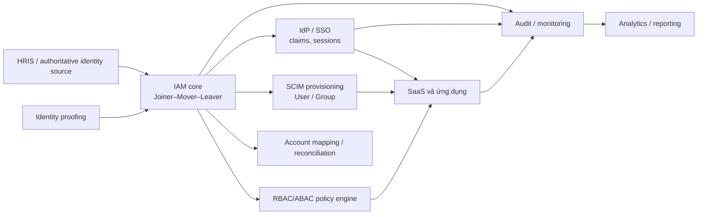
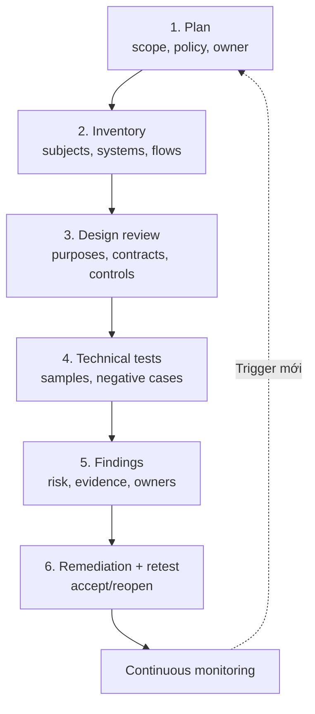
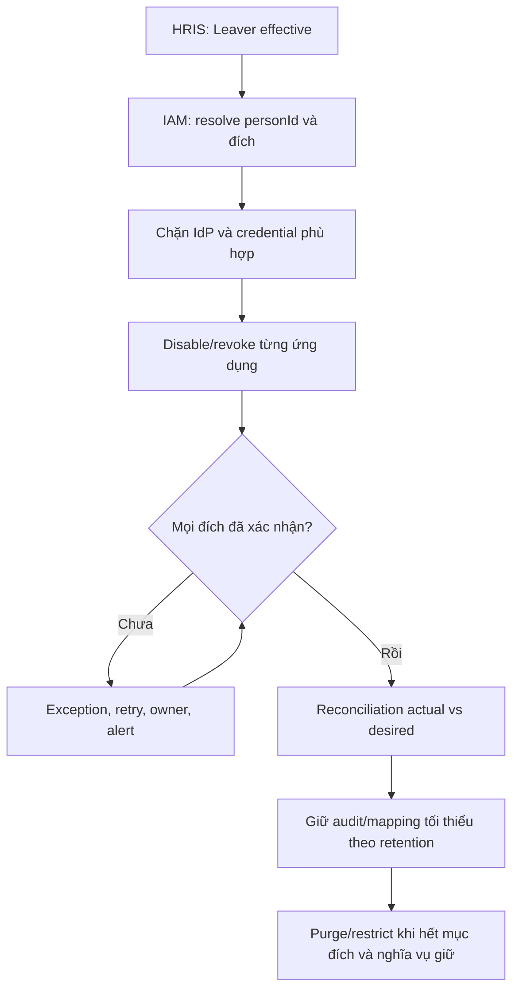
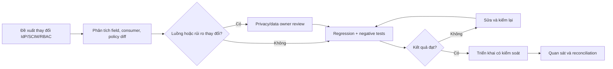

# Rà soát privacy IAM: Kiểm tra quyền riêng tư trong quản lý vòng đời danh tính

> **Chương:** Privacy và identity  
> **Module:** `SECURITY_IDENTITY_ACCESS_MANAGEMENT_IDENTITY_LIFECYCLE`  
> **Bối cảnh:** Quản lý vòng đời danh tính theo mô hình **Joiner–Mover–Leaver (JML)**, từ xác minh, tạo tài khoản và cấp quyền đến rà soát, thu hồi khi thay đổi vai trò. Bài học gắn với **Identity Provider (IdP), SSO, SCIM, RBAC/ABAC, tài khoản dịch vụ, kiểm toán** và việc giảm **quyền truy cập tồn dư**.  
> **Mục tiêu:** Biết lập kế hoạch, thực hiện và chứng minh một cuộc **rà soát privacy IAM** dựa trên dữ liệu và bằng chứng kỹ thuật, nhận diện sai lệch, đánh giá rủi ro và xác minh hành động khắc phục.

## 1. Rà soát privacy IAM là gì?

**Rà soát privacy IAM** là hoạt động có tổ chức nhằm đánh giá liệu dữ liệu danh tính cá nhân có được **thu thập, chia sẻ, sử dụng, bảo vệ, lưu giữ và xử lý khi hết mục đích** theo chính sách, hợp đồng và nghĩa vụ áp dụng hay không. Đối tượng rà soát không chỉ là hồ sơ người dùng, mà còn gồm **đường đi của dữ liệu danh tính** và **quyền truy cập** có thể làm lộ hoặc khiến dữ liệu bị sử dụng sai.

Một cuộc rà soát điển hình cần trả lời:

1. Hệ thống xử lý **những loại identity data nào**, của những nhóm chủ thể nào và để làm gì?
2. Dữ liệu đến từ đâu, ứng dụng nào nhận, ai được xem và có được dùng cho mục đích khác không?
3. Quy trình Joiner–Mover–Leaver có **tạo, sửa và thu hồi** đúng quyền, đúng thời điểm, đúng tài khoản không?
4. IdP, token SSO, SCIM và policy RBAC/ABAC có truyền hoặc sử dụng **nhiều thuộc tính hơn cần thiết** không?
5. Log, bản xuất, tài khoản dịch vụ, hệ thống đích và backup có giữ dữ liệu/credential quá mức không?
6. Có bằng chứng kiểm tra và xác nhận khắc phục từng sai lệch không?
7. Khi phát hiện sự cố hoặc yêu cầu quyền dữ liệu, tổ chức có đủ khả năng **tìm đúng người và xử lý đúng phạm vi** không?

Ví dụ: một ứng dụng quản lý công việc cần mã tài khoản và tên hiển thị. Nếu connector SCIM truyền thêm ngày sinh, số giấy tờ hoặc lý do nghỉ việc, đây là phát hiện cần đánh giá ngay cả khi chưa có dấu hiệu hacker truy cập. Một review chỉ kiểm tra “SSO hoạt động” sẽ bỏ sót rủi ro ấy.

### 1.1. Privacy review khác những hoạt động gần nhau

| Hoạt động | Câu hỏi chính | Giao điểm với IAM |
|---|---|---|
| **Access certification / access review** | Người này hiện có những quyền nào, còn cần không? | Kiểm tra quyền thừa và truy cập tồn dư |
| **Security assessment** | Có lỗ hổng, sai cấu hình hoặc đường tấn công nào? | Credential, token, policy, session, audit |
| **Privacy IAM review** | Dữ liệu danh tính có được xử lý đúng mục đích, người nhận, phạm vi, retention và quyền cá nhân không? | Toàn bộ JML, IdP, provisioning, log và bản sao |
| **DPIA / đánh giá tác động bảo vệ dữ liệu** | Hoạt động xử lý dự kiến tạo rủi ro gì, có biện pháp nào? | Có thể cần trước thay đổi lớn, tùy luật áp dụng |
| **Compliance audit** | Có đáp ứng các yêu cầu/chứng cứ theo khuôn khổ cụ thể? | Dùng nhiều bằng chứng từ privacy review |
| **Incident response** | Khi rủi ro xảy ra, làm sao cô lập và khắc phục? | Review phát hiện khoảng trống, cung cấp đầu vào ứng phó |

Một cuộc access review thành công **chưa chứng minh** việc đồng bộ thuộc tính đã tối thiểu. Một hệ thống mã hóa dữ liệu tốt **chưa chứng minh** dữ liệu được dùng đúng mục đích. Cần kết hợp các phép kiểm tra có phạm vi riêng.

### 1.2. Đầu ra mong đợi

Sau review, người chịu trách nhiệm phải có:

- Bản đồ dữ liệu và consumer theo loại danh tính, ứng dụng, tenant.
- Danh mục mục đích và hợp đồng thuộc tính được duyệt.
- Kết quả kiểm tra có **bằng chứng quan sát được**.
- Danh sách phát hiện theo mức rủi ro, owner, thời hạn và hướng khắc phục.
- Xác nhận các thay đổi đã được thực thi tại nguồn và hệ thống đích.
- Các rủi ro còn lại được ghi rõ và người có thẩm quyền quyết định.
- Lịch tái kiểm tra hoặc trigger khi hệ thống, luồng dữ liệu hay pháp lý thay đổi.

Review không được coi là hoàn tất chỉ vì một bảng checklist được đánh dấu toàn bộ “Yes”.

## 2. Xác định ranh giới: dữ liệu danh tính nào thuộc phạm vi?

Trong IAM, dữ liệu về một cá nhân tồn tại trên nhiều miền kỹ thuật. Một `personId` tại identity registry có thể liên kết tới account IdP, một tài khoản SAML, một SCIM User, tài khoản quản trị riêng, quyền cloud, lịch sử MFA và nhiều audit events.



Mỗi mũi tên là một **luồng cần kiểm tra**: nguồn, dữ liệu, bên nhận, purpose, giao thức, quyền, độ mới, log và retention. Một sơ đồ chỉ nêu tên hệ thống mà không có **danh sách field và mục đích** chưa đủ cho privacy review.

### 2.1. Phân loại dữ liệu để rà soát

| Loại | Ví dụ | Rủi ro cần kiểm |
|---|---|---|
| Core identity | `personId`, tên, email, lifecycle state | Đúng người, không tái sử dụng ID, giới hạn bản sao |
| Organizational attributes | `orgUnitId`, `managerId`, loại quan hệ | Nguồn chuẩn, độ mới, quyền sử dụng |
| Identity proofing | Bằng chứng, kết quả xác minh, mức bảo đảm | Có cần bản gốc không, ai xem, lưu bao lâu |
| Authentication | Password verifier, MFA enrollment, recovery metadata | Không lộ secret, reset có kiểm soát |
| SSO/federation | OIDC claims, SAML attributes, `iss` + `sub` | Client-specific release, tránh liên kết chéo không cần |
| SCIM | `id`, `externalId`, `userName`, `active`, groups | Thuộc tính đồng bộ vừa đủ, đúng tenant/đích |
| Entitlements | Roles, groups, privileges, approval | Quyền quá rộng, quyền tồn dư, tính đúng của RBAC/ABAC |
| Access activity | Login time, IP, device, session state | Theo dõi cá nhân, retention, mục đích giám sát |
| Security/audit evidence | Decision, source version, outcome | Đủ truy vết nhưng không tạo kho PII thứ hai |
| Service identities | Workload ID, owner person, client secret reference | Owner là cá nhân, secret và quyền workload |
| Derived/analytics | MFA KPI, risk signal, score, pseudonym | Tái nhận diện, purpose drift, dữ liệu suy ra |
| Copies | Cache, CSV, queue, backup, vendor export | Dữ liệu sót, quyền truy cập, không tuân retention |

**Dữ liệu cá nhân không chỉ là tên/email.** Một opaque subject ID, IP kết hợp thời gian hoặc danh sách entitlement có thể liên kết đến người thật nếu tổ chức hoặc bên nhận có phương tiện ánh xạ.

### 2.2. Nhóm data subjects

Kiểm tra ít nhất những nhóm thuộc phạm vi thực tế:

- Nhân viên chính thức, thử việc, ứng viên hoặc Joiner chưa có account.
- Nhà thầu, thực tập sinh, nhân viên đối tác, người dùng được mời.
- Người đã chuyển vai trò, nghỉ việc, tái tuyển dụng.
- Chủ sở hữu và người phê duyệt tài khoản dịch vụ.
- Người liên quan trong log/approval: manager, reviewer, operator, khách hàng.

Không chỉ lấy mẫu “nhân viên active” vì rủi ro lớn có thể nằm ở **Joiner bị hủy** hoặc **Leaver còn tài khoản**.

## 3. Căn cứ và tiêu chí review phải được định nghĩa rõ

Một privacy review không nên xuất phát từ câu “chúng ta tuân thủ GDPR hay chưa?” rồi áp ngẫu nhiên các checklist. Cần định nghĩa:

1. **Mục đích review:** cải thiện kiểm soát JML, chuẩn bị ra mắt SSO, đánh giá SaaS mới, rà soát định kỳ hoặc xử lý phát hiện.
2. **Đơn vị chịu trách nhiệm:** tổ chức nào quyết định mục đích/phương tiện xử lý, hệ thống nào là processor/vendor theo ngữ cảnh áp dụng.
3. **Khu vực pháp lý và hợp đồng:** luật, quy định, chính sách hoặc tiêu chuẩn nào thực sự có liên quan.
4. **Nhóm subject và loại dữ liệu:** phạm vi xem xét cụ thể.
5. **Dữ liệu cần bảo vệ đặc biệt:** proofing, sinh trắc, thông tin riêng tư, token, vai trò đặc quyền.
6. **Bằng chứng chấp nhận:** cấu hình, record, event, log, kết quả đối soát, confirmation ở đích.
7. **Giới hạn của review:** hệ thống chưa kết nối, log không lưu, vendor chưa phản hồi.

Các quyền dữ liệu cá nhân, nghĩa vụ thông báo, thời hạn lưu và yêu cầu DPIA **không giống nhau ở mọi khu vực**. Đội kỹ thuật cung cấp bằng chứng, còn người phụ trách privacy/pháp chế xác định và phê duyệt đánh giá theo quy định thực sự áp dụng. Bài học này cung cấp phương pháp kỹ thuật, không thay thế tư vấn pháp lý.

### 3.1. Phân biệt hai loại đánh giá

- **Design review:** thiết kế có chính sách field release, quyền, retention và runbook đúng chưa?
- **Operating effectiveness review:** chính sách đó có **được áp dụng ngoài thực tế** và có chứng cứ không?

Ví dụ một tài liệu ghi “Leaver phải thu hồi quyền trong thời gian nội bộ yêu cầu” là bằng chứng thiết kế. Nhưng phải đọc **thời điểm HRIS event, IdP disable và xác nhận từng SaaS** mới đánh giá được vận hành thực tế.

## 4. Thời điểm và trigger rà soát

Có thể tổ chức **định kỳ** kết hợp **theo sự kiện**. Không gán một chu kỳ tuyệt đối cho mọi dữ liệu; chọn lịch theo độ nhạy, thay đổi kỹ thuật và nghĩa vụ áp dụng.

| Trigger | Nguy cơ mới | Việc cần rà soát |
|---|---|---|
| Thêm IdP/SaaS/SCIM connector | Bên nhận và bản sao dữ liệu mới | Data contract, field mapping, retention, vendor |
| Đổi schema HRIS hoặc custom attribute | Trường mới tự động được đồng bộ | Allowlist, mục đích, dữ liệu nhạy cảm |
| Thêm OIDC/SAML client | Claim/NameID có thể bị chia sẻ rộng | Client-specific release, scope, issuer/sector |
| Thay policy RBAC/ABAC | Quyền mới hoặc mở rộng | Nguồn thuộc tính, least privilege, SoD |
| Nâng cấp recovery/MFA | Proofing/recovery data mới | Secret lifecycle, helpdesk, log |
| Thay đổi quy trình JML | Event/hiệu lực/thu hồi có thể lệch | Joiner hủy, Mover, Leaver, rehire |
| Sự cố hoặc near miss | Kiểm soát không đủ | Root cause, replay và verification |
| Vendor thay hợp đồng/subprocessor | Mục đích, vùng lưu, bên nhận đổi | Transfer, retention, xử lý yêu cầu |
| Triển khai analytics/AI | Tái sử dụng log/identity profile | Purpose limitation, anonymization, access |
| Restore backup hoặc đổi DR | Khả năng hồi sinh quyền | Revocation replay và reconciliation |
| Lỗi DSAR hoặc yêu cầu xóa | Identity resolution và nguồn dữ liệu thiếu | Discovery, scope, retention, export |
| Đến hạn access/retention review | Quyền và dữ liệu có thể không còn cần | Access certification, deletion schedule |

**Nguyên tắc:** thêm một trường vào HRIS không nên tự động làm mọi SaaS nhận trường đó. Mọi thay đổi về data flow phải có điểm kiểm tra trước phát hành.

## 5. Chuẩn bị kế hoạch và quyền hạn của đoàn rà soát

Một nhóm thực hiện có thể gồm IAM engineer, IdP owner, HRIS owner, application/SaaS owner, SOC, privacy, legal/compliance và audit. Tùy quy mô, một người có thể kiêm vai trò nhưng phải tách rõ:

| Vai trò | Trách nhiệm |
|---|---|
| Review lead | Scope, lịch, phương pháp, kiểm soát bằng chứng |
| IAM/JML engineer | Desired/actual identity state, account mapping, event |
| IdP/SSO owner | Claims, federation, MFA, sessions, recovery |
| SCIM/application owner | Target fields, accounts, group membership, local access |
| Privacy owner | Purpose, subject rights, data categories, impact |
| Legal/compliance | Điều kiện pháp lý và ngoại lệ áp dụng |
| SOC/audit | Log, incident evidence, privileged monitoring |
| Service owner | Workload identities, secret, owner handoff |
| Remediation owner | Khắc phục, xác nhận và đưa vào vận hành |

### 5.1. Giới hạn quyền của chính người review

Một cuộc review quyền riêng tư **không nên tạo thêm sự cố quyền riêng tư**:

- Dùng account riêng và truy cập theo scope/ticket/case khi kiểm tra.
- Ưu tiên bản đọc có lọc, mã tham chiếu và thống kê; tránh full database export.
- Không lấy plaintext token, recovery code, private key hoặc proofing document khi không thật sự cần.
- Tách quyền xem cấu hình khỏi quyền thay đổi policy production.
- Giới hạn nơi lưu evidence, thời hạn giữ và người có quyền export.
- Ghi audit cho hành động đọc dữ liệu nhạy cảm của reviewer.
- Khi cần dữ liệu thật để tái hiện, có phê duyệt và kiểm soát tương xứng.

Dữ liệu audit của reviewer cũng có thể là dữ liệu cá nhân; nó cần mục đích, quyền xem và retention riêng.

## 6. Phương pháp sáu pha: từ phạm vi tới đóng phát hiện



### Pha 1: Plan

Chốt hệ thống, nhóm identity, kỳ kiểm tra, căn cứ áp dụng, tiêu chí PASS/FAIL, quyền truy cập và các giới hạn. Ví dụ mục tiêu: kiểm tra liệu tất cả Leaver thuộc ba tenant trong kỳ đã được disable ở IdP và ứng dụng bắt buộc hay chưa.

### Pha 2: Inventory

Lấy danh mục hệ thống và luồng dữ liệu: HRIS → IAM → IdP/SCIM → SaaS, cùng các nhánh log, data warehouse, vault, backup. Ghi ai quản lý, loại dữ liệu, purpose, retention và bên nhận.

### Pha 3: Review thiết kế

Kiểm tra policy, hồ sơ phê duyệt, data contract, client claim mappings, schema allowlist, quy trình DSAR, runbook sự cố, retention schedule và quan hệ vendor.

### Pha 4: Technical tests

Thực hiện query chỉ đọc, xem cấu hình thật, so sánh desired/actual state và chạy **case dương, âm, lỗi, out-of-order** trong môi trường phù hợp. Không khẳng định PASS nếu chỉ thấy quy định trên giấy.

### Pha 5: Findings

Ghi mỗi phát hiện với **điều kiện quan sát**, **tiêu chí không đạt**, **rủi ro**, **scope**, **evidence reference**, **owner**, **biện pháp giảm tạm** và **phương án sửa**.

### Pha 6: Retest và theo dõi

Sau khi sửa policy, connector hoặc quy trình, kiểm thử lại ở nguồn và đích; xác nhận không làm hỏng JML. Phát hiện còn rủi ro phải có người phê duyệt và ngày xem lại nếu được chấp nhận.

## 7. Lập data inventory có thể dùng để kiểm tra

Mỗi luồng dữ liệu nên được mô tả cụ thể:

| Trường | Câu hỏi cần trả lời |
|---|---|
| `dataFlowId` | Luồng nào? Có version/owner không? |
| `sourceSystem` | Hệ thống nào tạo và có thẩm quyền đối với field? |
| `destinationSystem` | Ai nhận dữ liệu, thuộc tenant và vùng tin cậy nào? |
| `subjectTypes` | Nhân viên, contractor, customer hay service owner? |
| `fields` | Tên field, loại dữ liệu, phân loại nhạy cảm? |
| `purposeId` | Được xử lý để làm gì, đã được duyệt chưa? |
| `protocol` | OIDC, SAML, SCIM, API, event bus hoặc export? |
| `accessPolicy` | Ai đọc/sửa/xuất được; quyền service là gì? |
| `retentionPolicyRef` | Điểm bắt đầu giữ, thời hạn, xóa và backup? |
| `downstreamProcessors` | Bên nhận có chuyển tiếp hoặc tạo bản sao không? |
| `auditAndIncidentOwner` | Ai kiểm tra, phát hiện và phản hồi sự cố? |
| `reviewedAt` | Khi nào kiểm tra gần nhất, trigger tái review? |

### 7.1. Data contract minh họa

```yaml
dataFlowId: hris-to-iam-provisioning-v2
ownerTeam: identity-platform
sourceSystem: workforce-hris
destinationSystem: iam-lifecycle
purposeId: account-provisioning
subjectTypes:
  - employee
  - contractor
fields:
  - name: personId
    reason: "Liên kết danh tính ổn định"
  - name: lifecycleState
    reason: "Xác định account có còn đủ điều kiện"
  - name: effectiveAt
    reason: "Áp đúng thời điểm JML"
  - name: orgUnitId
    reason: "Tính quyền cơ sở theo policy"
excludedByDefault:
  - personalHealthDetails
  - identityDocumentImage
  - terminationReasonDetail
downstreamPolicyRef: iam-attribute-release
retentionPolicyRef: iam-lifecycle-records
reviewTriggers:
  - source-schema-change
  - new-application
  - new-purpose
```

Đây là **ví dụ schema nội bộ**, không phải format chuẩn của SCIM hay OIDC. Thời hạn lưu, căn cứ xử lý, phân loại nhạy cảm và quyền của chủ thể phải được liên kết tới chính sách thực tế.

### 7.2. Bằng chứng của một flow

Không chỉ lưu tài liệu mapping. Kiểm tra payload **đã được giới hạn/redact** hoặc log schema của một event thật trong môi trường phù hợp; so sánh các trường thực tế với allowlist. Nếu một trường mới không được cho phép, luồng phải không tự phát hành trường ấy.

## 8. Rà soát mục đích và tính cần thiết của từng field

Ba câu hỏi quan trọng:

1. **Thu thập để làm gì?** Có mục đích cụ thể và owner không?
2. **Consumer có thật sự cần giá trị thô không?** Có thể thay bằng kết quả xác minh hoặc entitlement không?
3. **Khi mục đích hết, dữ liệu và quyền xử lý thay đổi ra sao?**

| Dữ liệu gốc | Mục đích có thể hợp lệ | Dạng chia sẻ ít tiết lộ hơn khi đủ |
|---|---|---|
| Ảnh giấy tờ | Proofing | `identityVerified` + mức bảo đảm và tham chiếu |
| Ngày sinh | Kiểm tra điều kiện tuổi | `ageRequirementMet=true` từ nguồn tin cậy |
| Chi tiết tổ chức | Cấp quyền app | Entitlement theo ứng dụng |
| Thông tin quản lý | Định tuyến duyệt | `approverId` cần cho workflow |
| Lịch sử đăng nhập chi tiết | Phát hiện bất thường | Thống kê tổng hợp khi chỉ báo cáo |
| Lý do nghỉ việc | Hồ sơ HRIS chuyên trách | `lifecycleState=leaver` hoặc mức ưu tiên tác nghiệp |
| Mọi group của người dùng | Phân quyền theo app | Chỉ group/claim thuộc client cụ thể |

**Derived attribute** vẫn có thể là dữ liệu cá nhân nếu liên kết được với một người. Ví dụ `identityVerified=true` không phải “ẩn danh”, chỉ là **giảm mức tiết lộ**.

### 8.1. Kiểm tra sử dụng thứ cấp

Nếu security logs ban đầu dùng để phát hiện truy cập trái phép nhưng một bộ phận muốn dùng để đánh giá năng suất nhân viên, review cần ghi đây là **mục đích mới**. Không tự hợp thức hóa vì “đã có log”. Cần privacy/legal assessment về mục đích, căn cứ, tính tương thích, thông báo và tác động theo quy định áp dụng.

## 9. Rà soát Joiner: từ proofing tới cấp quyền ban đầu

**Joiner** bắt đầu có thể từ lúc một người chưa có IdP account. Quy trình có thể chứa dữ liệu nhạy cảm hơn các giai đoạn sau vì phải xác minh danh tính.

### 9.1. Điểm kiểm soát

| Control | Cách kiểm tra | Bằng chứng |
|---|---|---|
| Nguồn danh tính chuẩn | `personId` xuất phát từ nguồn đã duyệt? | Source event, version, mapping |
| Proofing phù hợp rủi ro | Dữ liệu thô có nằm ở kho riêng và chỉ cấp kết luận cần thiết? | Attribute contract, ACL, retention |
| Chặn account trùng | Có cách phát hiện identity match không chắc chắn? | Joiner exception case |
| Minimal provisioning | App chỉ nhận field cần thiết? | SCIM payload/schema allowlist |
| Quyền mặc định | Có nhóm quá rộng hoặc admin grant mặc định không? | RBAC policy, generated entitlement |
| MFA/recovery | Helpdesk có thể xem secret hoặc reset thiếu xác minh không? | Workflow, permission test |
| Pre-provisioning | Nếu Joiner hủy, invitation/account có bị thu hồi không? | Cancel event, target confirmation |
| Audit | Có link decision → target result không? | Correlation ID, outcome |

### 9.2. Kiểm thử âm quan trọng

- Nhân sự chưa xác minh nhưng request tạo quyền đặc biệt: **từ chối** theo policy.
- HRIS thêm field `nationalId`: **không xuất tự động** sang SaaS.
- Joiner có email đã từng được dùng: **không nối nhầm** identity cũ.
- Onboarding hủy: **không còn active account/credential** ở đích sau khi xử lý.
- Client yêu cầu bản scan proofing không có mục đích: **không được cấp**.

Chỉ test “Joiner bình thường tạo account thành công” là chưa đủ cho privacy.

## 10. Rà soát Mover: thay đổi vai trò phải thu hồi quyền cũ

Khi nhân viên đổi phòng ban hoặc vai trò, rủi ro nổi bật là **privilege accumulation** và dữ liệu phân quyền lỗi thời.

Ví dụ nhân viên chuyển từ Support sang Finance:

| Thành phần | Trạng thái trước | Kỳ vọng sau Mover |
|---|---|---|
| `orgUnitId` | `support` | `finance` đúng `effectiveAt` |
| Nhóm Support | Đang hoạt động | Thu hồi nếu không còn mục đích |
| Nhóm Finance | Không có | Cấp theo policy và approval |
| SSO claim | Có role Support | Làm mới/giới hạn khi policy thay đổi |
| SaaS local role | Có thể được cấp trực tiếp | Được rà soát, không để sót |
| Lịch sử quyền | Ghi nhận role đã từng có | Giữ có kiểm soát, không làm quyền hiện tại |

### 10.1. Test cần làm

1. Lấy source event có version và ngày hiệu lực.
2. Tính **desired entitlements** từ role/ABAC policy hiện hành.
3. Đọc **actual entitlements** tại IdP, SaaS, cloud và quyền trực tiếp.
4. So sánh theo từng tài nguyên, không chỉ group ID.
5. Xử lý cache/token có claim cũ theo yêu cầu rủi ro.
6. Kiểm tra quyền ngoại lệ bàn giao có owner, scope và expiry.
7. Xác nhận ứng dụng không tiếp tục nhận thuộc tính tổ chức không cần.
8. Kiểm tra bằng chứng các quyền cũ đã được thu hồi.

**Phát hiện mẫu:** hệ thống đã gỡ nhóm Support ở IdP nhưng SaaS còn local role `support-data-viewer`. Đây là dấu hiệu quyền tồn dư có thể tạo privacy risk, dù báo cáo IdP hiển thị đúng.

## 11. Rà soát Leaver: thu hồi, đối soát và dữ liệu còn lại

**Leaver** là phép thử quan trọng về tính đúng của IAM lifecycle. Một người có thể bị disable ở IdP nhưng vẫn còn API token, local account hoặc phiên ứng dụng.

### 11.1. Những đường truy cập cần bao phủ

- IdP/SSO và session/refresh token.
- Ứng dụng SCIM User/Group, quyền được cấp trực tiếp, local session.
- VPN, SSH key, cloud role, repository PAT, secrets.
- Tài khoản quản trị riêng của cùng người.
- SaaS tenant phụ hoặc ứng dụng chưa có SCIM.
- Thiết bị và dữ liệu offline theo chính sách tổ chức.
- Service account dùng credential cá nhân của Leaver.
- Account được khôi phục từ backup sau khi đã revoke.



### 11.2. Cách đánh giá

Không đánh dấu PASS chỉ vì đã gửi SCIM PATCH hoặc đã đặt `active=false` tại một điểm. Xác nhận **trạng thái đích**, session/credential và quyền trực tiếp theo khả năng hệ thống.

Nếu target không hỗ trợ đọc lại trạng thái hoặc không có log, ghi **limitation/unknown** và biện pháp bù; không biến “thiếu bằng chứng” thành “đã xác nhận”.

### 11.3. Review dữ liệu còn lại

Sau deprovision, hỏi:

- Mapping nào phải giữ để ngăn account bị tái kích hoạt hoặc để audit?
- Bằng chứng proofing thô còn purpose không?
- Log và app profile giữ bao lâu theo quy định và hợp đồng?
- Tài khoản đã disable nhưng SaaS còn lưu bản sao nào?
- Có quy trình ngăn backup restore làm sống quyền cũ?
- Có kênh privacy access request cho cựu nhân viên mà không mở lại SSO không?

**Thu hồi quyền** và **xóa dữ liệu** là hai mục tiêu độc lập; cần chứng minh cả hai theo thời điểm và phạm vi thích hợp.

## 12. Rà soát IdP, OIDC và SAML: giảm claim và liên kết chéo

IdP giữ nhiều thuộc tính, nhưng relying party không mặc nhiên có quyền nhận tất cả.

### 12.1. OIDC: ma trận client–claim

| Client ví dụ | Nhu cầu | Claim được đánh giá |
|---|---|---|
| Internal docs | Xác thực và quyền đọc tài liệu | Claims giao thức bắt buộc và quyền có scope |
| Notification app | Gửi email công việc | Subject và email khi cần |
| Access review portal | Xác nhận reviewer | Subject, reviewer role, assignment |
| Proofing service | Quy trình xác minh chuyên biệt | Trường theo hợp đồng riêng, không phát tán sang mọi client |

Khi review, xem:

- `iss`, `sub`, `aud`, `exp`, `iat` và các yêu cầu giao thức/luồng có đúng không?
- Phát hành `email`, `name`, `groups`, `phone_number`, `address` có dựa trên nhu cầu từng client không?
- Có đưa giấy tờ, sinh trắc, recovery code, thông tin đời tư vào JWT không?
- Audience và scope có ngăn dùng token ở ứng dụng khác không?
- Session, refresh token và revocation có phù hợp rủi ro không?
- Có ghi token vào URL, gateway log, telemetry, ticket không?

**JWT đã ký không bảo mật nội dung payload theo nghĩa mã hóa.** Không cho rằng token chứa PII được giữ kín chỉ vì signature hợp lệ.

### 12.2. Pairwise subject và SAML NameID

Nếu có nhu cầu giảm liên kết dữ liệu xuyên ứng dụng, xem xét subject identifier có scope. Trong OIDC, **pairwise subject identifier theo sector** giảm khả năng đối chiếu chéo; nó **không làm người dùng ẩn danh**, vì IdP vẫn biết mapping và relying party có thể nhận thông tin khác.

Với SAML, kiểm tra `NameID`, attribute statement, mã nhận diện theo Service Provider và quyền lưu local profile. Một SAML assertion đã ký không tự đảm bảo mọi attribute được mã hóa.

### 12.3. Thử thay đổi thuộc tính

Khi Mover đổi `orgUnitId` hoặc Leaver bị disable, app có còn dùng phiên/local claim cũ không? Review phải xem đường đồng bộ/session thực tế, không chỉ cấu hình token TTL.

## 13. Rà soát SCIM: thuộc tính nào thực sự tới ứng dụng?

SCIM 2.0 cung cấp User/Group schema và protocol tạo, sửa, vô hiệu hóa. Trong SCIM:

- `id` là mã resource do service provider cấp.
- `externalId` có thể do client cung cấp làm khóa liên kết.
- `userName` là thuộc tính User bắt buộc trong Core Schema.
- `active` được dùng phổ biến để biểu diễn trạng thái account.

### 13.1. Ví dụ payload tối thiểu

```http
POST /scim/v2/Users HTTP/1.1
Content-Type: application/scim+json
Authorization: Bearer <redacted>

{
  "schemas": ["urn:ietf:params:scim:schemas:core:2.0:User"],
  "externalId": "p-418",
  "userName": "user-p418",
  "active": true
}
```

Ví dụ chỉ phù hợp nếu ứng dụng chấp nhận username dạng alias. Một số ứng dụng yêu cầu email hoặc thuộc tính khác; yêu cầu đó cần được ghi rõ trong data contract, không mở mapping toàn bộ HRIS theo mặc định.

### 13.2. Bộ kiểm tra SCIM

| Kiểm tra | Pass khi |
|---|---|
| Field allowlist | Chỉ field đã duyệt được gửi |
| Tenant and account mapping | Một source identity trỏ đúng target account, không nhầm tenant |
| Group scope | Chỉ nhóm cần cho app, không lộ toàn bộ directory |
| Authentication secret | Không log provisioning bearer token |
| Mover update | Thêm và **gỡ** group/quyền đúng |
| Leaver deactivation | Target xác nhận trạng thái và đường truy cập liên quan |
| Retry/idempotency | Không tạo duplicate accounts hoặc bật lại account cũ |
| Out-of-order events | Source version/effective state chặn event cũ ghi đè |
| Logging | Không ghi nguyên payload PII nếu không cần |
| Vendor retention | Có kế hoạch giữ/xóa bản sao bên nhận |

**Phép thử âm:** thêm cột mới vào HRIS, rồi xác nhận SCIM payload **không thay đổi** cho đến khi hợp đồng dữ liệu được duyệt cập nhật.

## 14. Rà soát RBAC/ABAC và quyền đặc quyền dưới góc privacy

Kiểm tra quyền đọc dữ liệu cá nhân, thay đổi identity attributes và **xuất dữ liệu** ở mọi lớp:

| Lớp | Câu hỏi |
|---|---|
| HRIS/IAM database | Ai được đọc hồ sơ, role, lịch sử và export? |
| IdP admin | Ai có thể thay MFA, recovery, claim, account status? |
| Provisioning service | Có quyền ghi tất cả ứng dụng hay theo scope? |
| SaaS app | Local admin hoặc direct grant có vượt policy IAM không? |
| Policy decision point | Thuộc tính có nguồn có thẩm quyền và còn hiệu lực không? |
| Helpdesk | Có đọc được proofing raw data/recovery secret không? |
| Audit/SIEM | Có ai được query hành vi của mọi nhân viên không? |
| Data warehouse | Có truy cập hồ sơ cá nhân ngoài mục đích báo cáo không? |

### 14.1. ABAC dùng dữ liệu chính xác và tối thiểu

```text
permit(subject, action, resource, context) nếu:
    subject.lifecycleState == "active"
    AND subject.entitlements chứa "case-reviewer"
    AND subject.orgUnitId == resource.ownerOrgUnitId
    AND context.deviceCompliant == true
```

Policy này không nhất thiết cần số giấy tờ, ngày sinh hoặc toàn bộ hồ sơ nhân sự. Nhưng `lifecycleState` và `orgUnitId` phải từ nguồn tin cậy và được cập nhật kịp thời.

### 14.2. Thử quyền âm và SoD

- Người dùng thường có thể đọc bảng proofing evidence không?
- Helpdesk có thể tự reset MFA và tự phê duyệt cho admin account không?
- Reviewer có thể duyệt yêu cầu do chính mình tạo nếu policy cấm không?
- Operator có thể mở dữ liệu của tenant khác bằng cách sửa `tenantId` không?
- API có kiểm tra quyền backend hay chỉ ẩn nút giao diện?
- Một client có thể giả `purposeId=security-monitoring` để lấy nhiều field hơn không?
- Break-glass access có owner, expiry, lý do và audit không?

Purpose trong request **không được tin chỉ vì client tự khai**. Cần ràng buộc với workload/client identity và ngữ cảnh workflow được xác minh.

## 15. Rà soát tài khoản dịch vụ và non-human identities

Service account và workload identity không phải con người, nhưng có thể xử lý lượng lớn dữ liệu cá nhân và có metadata owner là con người.

| Đối tượng | Điểm kiểm tra |
|---|---|
| Service identity registry | `serviceIdentityId`, purpose, owner team, environment |
| Owner person | Khi owner là Leaver/Mover, có chuyển trách nhiệm không? |
| API key/client secret | Có còn hiệu lực ngoài thời hạn cần, có bị log/repo lộ không? |
| Workload federation | Issuer/audience/subject trust có quá rộng không? |
| Entitlement | Có quyền `read-all-users` hoặc `global-admin` ngoài purpose không? |
| Secret rotation | Có quy trình và test thu hồi key cũ không? |
| Expiry/review | Có định kỳ rà soát owner, resource, policy? |
| Decommission | Ngừng credential, quyền và xử lý metadata/bản sao thế nào? |

### 15.1. Một service registry record phù hợp

```json
{
  "serviceIdentityId": "svc-report-prod",
  "ownerTeamId": "platform-operations",
  "purposeId": "scheduled-access-report",
  "environment": "production",
  "allowedResources": ["access-report-store"],
  "credentialMode": "managed-workload-identity",
  "reviewDueAt": "2027-01-31T00:00:00Z"
}
```

Không có private key trong registry. Nếu cần lưu secret, dùng hệ thống chuyên trách với kiểm soát truy cập, rotation và audit. Đổi tên service account không làm giảm hiệu lực của credential đã lộ.

### 15.2. Test liên hệ với Leaver

Nếu người tạo bot nghỉ việc, **không tự động xóa bot production** khi còn phụ thuộc nghiệp vụ; phải chuyển owner, rà soát secret và loại mọi PAT cá nhân khỏi workflow. Một service account không có owner sau nghỉ việc là phát hiện cần xử lý.

## 16. Rà soát proofing, MFA và account recovery

Giai đoạn xác minh và khôi phục tài khoản xử lý dữ liệu có khả năng gây hại cao nếu lộ.

### 16.1. Proofing

Kiểm tra:
 
- Có cần thu bằng chứng thô theo mức bảo đảm và mục đích không?
- Bản gốc nằm ở kho nào, ai có quyền đọc và export?
- IAM/IdP có chỉ nhận `proofingStatus`, `verifiedAt`, mức bảo đảm và reference khi đủ không?
- Ảnh giấy tờ, liveness sample hoặc biometric template có bị sao chép vào log/ticket không?
- Có retention, deletion, backup và hợp đồng với bên proofing không?

Một proofing result có thể đủ để kích hoạt account; **mọi SaaS không cần bản scan giấy tờ**.

### 16.2. MFA và credential recovery

| Thành phần | Rủi ro cần rà soát |
|---|---|
| Password | Có lưu dưới dạng password verifier an toàn thay vì plaintext không? |
| TOTP seed | Có ở kho bảo vệ, bị log/export hoặc người hỗ trợ đọc được không? |
| Recovery code | Có đủ bảo vệ, giới hạn lần dùng và không hiện lại tùy tiện không? |
| Passkey/WebAuthn | Ứng dụng có chỉ giữ public-key credential/metadata cần thiết không? |
| Helpdesk reset | Có xác minh requester và kiểm soát social engineering không? |
| Session | Logout, Leaver, incident có invalidate theo cơ chế đúng không? |
| Secret store | Có truy cập theo scope, audit và lifecycle không? |

Đừng yêu cầu người dùng tải ảnh vân tay lên ứng dụng chỉ để “bật passkey”: thiết bị có thể xác thực người dùng cục bộ và ứng dụng xác minh chữ ký mật mã mà không nhận sinh trắc thô.

## 17. Rà soát log, audit, observability và export

IAM cần audit để trả lời ai cấp quyền, khi nào, theo policy nào và đã thu hồi ra sao. Nhưng log có thể trở thành một **bản sao dữ liệu cá nhân không kiểm soát**.

### 17.1. Audit event tối thiểu

```json
{
  "eventId": "evt-7724",
  "correlationId": "jml-588",
  "occurredAt": "2026-11-23T03:20:00Z",
  "subjectRef": "p-418",
  "actorRef": "iam-lifecycle-service",
  "action": "account.deactivated",
  "targetApplicationId": "tasks-app",
  "policyVersion": "jml-policy-v5",
  "outcome": "confirmed",
  "targetConfirmationId": "confirm-881"
}
```

Event này phục vụ truy vết nhưng không cần chứa giấy tờ, lý do nghỉ việc chi tiết, OTP hoặc bearer token. `subjectRef` vẫn có thể là dữ liệu cá nhân vì có mapping nội bộ.

### 17.2. Nơi thường bỏ sót

- Reverse proxy access logs và authorization headers.
- Distributed tracing ghi nguyên HTTP request/response body.
- Application error messages, debug dumps và crash reports.
- Dead-letter queues chứa HRIS event hoặc SCIM payload.
- Dashboard BI, CSV export, file đính kèm ticket và screenshot.
- Backup/snapshot của log.
- Dịch vụ third-party observability nhận dữ liệu ngoài contract.

### 17.3. Các phép thử

1. Thực hiện một request thử dùng token giả và kiểm tra token có bị ghi vào log hay không.
2. Gây lỗi validation SCIM, kiểm tra error log chỉ có mã field và request ID.
3. Kiểm tra ai được truy vấn log theo subject/time range và export hàng loạt.
4. Kiểm tra retention của log hoạt động, log an ninh và audit theo **purpose riêng**.
5. Kiểm tra việc tra ngược pseudonym trong log có case/approval/audit không.
6. Kiểm tra báo cáo tổng hợp có tiết lộ nhóm kích thước một không.

Không đưa credential sản xuất thật vào bài test log; dùng giá trị không sử dụng được và môi trường có kiểm soát.

## 18. Rà soát retention, deletion và chống khôi phục quyền

**Retention review** khác với kiểm tra account active. Khi một người rời tổ chức, tổ chức có thể phải thu hồi account ngay nhưng giữ một số audit evidence hợp lệ; ngược lại, không được giữ raw proofing evidence vô hạn chỉ vì audit vẫn cần một mã kết quả.

### 18.1. Bảng retention cần có

| Record | Trigger có thể dùng | Kết thúc |
|---|---|---|
| Proofing evidence | Hoàn tất/hủy quy trình xác minh | Xóa hoặc giữ hạn chế theo quy định thực tế |
| SCIM account mapping | Hoàn tất xác nhận deprovision ở mọi đích | Giữ tối thiểu rồi xử lý theo schedule |
| Current entitlement | Role đổi, expiry, Leaver | Thu hồi khỏi policy thực thi |
| Historical entitlement | Quyết định đã kết thúc | Giữ evidence theo mục đích và deadline |
| Login/security events | Thời điểm event hoặc mốc theo policy | Xóa/tổng hợp/hạn chế khi hết mục đích |
| Session/credential | Logout, expiry, revoke, incident | Vô hiệu và xóa vật liệu không cần |
| Service registry | Workload bị decommission | Đóng owner/secret/rights, giữ chứng cứ có hạn |
| DSAR export | Bản phản hồi đã bàn giao | Hủy hoặc hết hạn download theo policy |
| Backups | Mốc snapshot/backup schedule | Hết hạn và kiểm soát restore |
| Incident evidence | Đóng vụ việc hoặc nghĩa vụ giữ liên quan | Scoped hold và xử lý khi được phép |

Không tự gán thời hạn pháp lý cố định cho tất cả cột; phải có **policy owner và căn cứ**. Một record có thể chịu nhiều nghĩa vụ giữ; cần giải quyết xung đột qua privacy/legal owner.

### 18.2. Legal hold

Review kiểm tra legal hold có:
 
- Phạm vi dữ liệu cụ thể, lý do và người phê duyệt.
- Thời điểm bắt đầu, mốc review và điều kiện dỡ hold.
- Giới hạn quyền truy cập trong thời gian giữ.
- Không dùng dữ liệu cho mục đích đã hết chỉ vì đang được giữ.
- Không khôi phục quyền đăng nhập hoặc credential do hold.

### 18.3. Backup và restore

Một bản restore cũ có thể làm sống `active=true`, group hoặc credential đã bị thu hồi. Trong buổi review cần **diễn tập hoặc xem evidence diễn tập**:

1. Restore vào vùng cách ly khi phù hợp.
2. Lấy source JML state và revocation ledger mới nhất.
3. Áp lại các sự kiện thu hồi/xóa còn hiệu lực.
4. Đối soát IdP và ứng dụng đích.
5. Xác nhận không có quyền revoked hồi sinh trước khi đưa hệ thống phục vụ truy cập.

Một backup được mã hóa tốt không thay thế việc kiểm soát trạng thái quyền sau khi phục hồi.

## 19. Rà soát pseudonymization, ẩn danh và dữ liệu phân tích

**Mã giả hóa** không đồng nghĩa **ẩn danh**. Opaque ID, pairwise subject hoặc hash email vẫn có thể liên kết với người thật qua mapping, thời gian, role hiếm hoặc nguồn ngoài.

### 19.1. Review một dashboard IAM

Ví dụ dashboard chỉ cần tỷ lệ MFA theo tháng. Cần hỏi:

- Có cần mang `personId` ra khỏi vùng tính toán không?
- Có thể xuất `month`, `orgGroup`, `eligibleUsers`, `mfaUsers` thay cho record từng người không?
- Nhóm quá nhỏ có thể tiết lộ một người không?
- Bộ lọc và nhiều bản xuất có cho phép phép trừ để suy ra cá nhân không?
- Có bản CSV, cache hoặc tracing chứa raw identity data không?
- Ai được export và dữ liệu có được tái sử dụng cho mục đích khác không?

### 19.2. Hash không làm email vô danh

`SHA256(email)` dễ bị đối chiếu theo dictionary do email có thể đoán. HMAC với khóa bí mật và scope có thể hỗ trợ **mã giả hóa** tốt hơn trong một số workflow, nhưng **không bảo đảm ẩn danh** và cần quản lý khóa, purpose, khả năng liên kết và retention.

Nếu chỉ cần số liệu tổng hợp, tốt hơn là không xuất mã người dùng ngay từ đầu.

## 20. Rà soát quyền của data subject và DSAR

Một cuộc review cần kiểm tra tổ chức có thể thực hiện yêu cầu liên quan đến dữ liệu một người theo **điều kiện luật áp dụng**, kể cả khi người đó chưa được cấp account hoặc đã Leaver.

### 20.1. Bản đồ quyền và khả năng xử lý

| Yêu cầu thường gặp | Kiểm tra IAM |
|---|---|
| Truy cập dữ liệu | Có identity resolution theo `personId` và account mappings? |
| Đính chính | Có biết nguồn HRIS/IdP nào có thẩm quyền? |
| Xóa | Có phân biệt deactivate, delete, archive, retain theo nghĩa vụ? |
| Hạn chế xử lý | Có ngăn dùng tiếp field cho purpose bị hạn chế? |
| Rút đồng ý khi áp dụng | Có tắt luồng tùy chọn mà không làm mất kiểm soát bắt buộc? |
| Được thông tin | Có danh sách mục đích, bên nhận, retention? |
| Yêu cầu qua đại diện | Có kiểm tra thẩm quyền đại diện? |
| Sau Leaver | Có kênh ngoài SSO và xác minh tương xứng? |

### 20.2. Kiểm tra chống tiết lộ sai người

Không tìm dữ liệu chỉ bằng email. Dùng identity graph có scope theo `iss`/`sub`, `applicationId`/`tenantId` và mốc thời gian. Review một tình huống **email đã được tái sử dụng** để chắc rằng bản xuất không trộn hai người.

Bản phản hồi cần được rà soát thông tin người thứ ba, secret và các ngoại lệ hợp lệ. Không gửi thẳng toàn bộ log hoặc bảng RBAC chỉ vì một user có yêu cầu truy cập.

### 20.3. DSAR workflow cũng sinh dữ liệu

Thông tin người yêu cầu, bằng chứng xác minh, gói export và audit case cần retention riêng. Một gói export tổng hợp từ nhiều hệ thống có độ nhạy cao; cần kênh tải có xác thực, thời hạn truy cập và hạn chế lưu trữ.

## 21. Rà soát privacy incident readiness

Privacy review không chờ tới khi có sự cố. Cần kiểm tra khả năng:
 
- Phát hiện over-sharing từ IdP claim hoặc SCIM.
- Cảnh báo quyền Leaver còn hiệu lực sau thời điểm phải thu hồi.
- Phát hiện token hoặc secret bị ghi vào log/repository.
- Xác định loại dữ liệu, subject và các đích có thể ảnh hưởng.
- Cô lập account/token/connector/file sharing.
- Giữ chứng cứ an toàn và truy vết thời điểm.
- Phối hợp security, privacy, legal và nhà cung cấp.
- Đánh giá nghĩa vụ thông báo theo luật/hợp đồng thực tế.
- Phục hồi quyền đúng trạng thái sau remediation/restore.

### 21.1. Phân biệt incident và personal data breach

Không phải mọi cảnh báo IAM đều xác nhận dữ liệu cá nhân đã bị lộ. Nhưng một người có quyền truy cập tồn dư cần được điều tra vì có thể dẫn tới exposure. Review runbook phải phân biệt:

- `suspected`: có tín hiệu bất thường.
- `confirmed technical failure`: xác nhận lỗi quyền/provisioning.
- `observed access`: có bằng chứng truy cập tài nguyên.
- `confirmed disclosure`: có bằng chứng lộ dữ liệu theo phân loại.
- `unknown impact`: không đủ telemetry để khẳng định.

Nghĩa vụ thông báo phải được xác định theo quy định áp dụng và rủi ro thực tế; **không tự áp một SLA pháp lý cho mọi khu vực**.

## 22. Rà soát vendor, SaaS và bên xử lý dữ liệu

Một SaaS có thể giữ profile, session, logs, analytics, backup và quyền local sau khi IAM đặt `active=false`.

| Câu hỏi với vendor | Bằng chứng cần |
|---|---|
| Vendor nhận field nào, để làm gì? | Data contract, SCIM/OIDC/SAML mapping |
| Có subprocessor hoặc bên nhận khác? | Hợp đồng và công bố kỹ thuật |
| Có xử lý dữ liệu ngoài mục đích dịch vụ? | Terms, data processing documentation |
| Dữ liệu giữ ở đâu và bao lâu? | Retention/deletion policy |
| Disable account có revoke session/API key không? | API behavior và test |
| Có API xóa/profile export không? | Tài liệu và kết quả thử có kiểm soát |
| Có thông tin owner của yêu cầu privacy? | Escalation contacts |
| Khi xảy ra sự cố, vendor thông báo theo cơ chế nào? | Incident response agreement |
| Xử lý backup và yêu cầu xóa ra sao? | Procedure, exception/confirmation |
| Có khả năng audit access của support/vendor? | Report/quyền và log phù hợp |

**Không mặc định** mọi vendor luôn là processor hoặc mọi thông tin tại SaaS thuộc cùng một chế độ pháp lý. Vai trò, trách nhiệm và mục đích có thể khác theo sản phẩm và thỏa thuận.

## 23. Lấy mẫu kiểm tra: đủ đại diện cho rủi ro

Không nhất thiết xuất toàn bộ danh sách nhân sự để review. Một phương pháp lấy mẫu có thể kết hợp:

- **Risk-based:** tài khoản đặc quyền, app chứa dữ liệu nhạy cảm, connector mới, đơn vị có turnover cao.
- **Event-based:** một số Joiner, Mover, Leaver, rehire, contractor hết hạn và Joiner hủy.
- **Random sampling:** chọn mẫu ngẫu nhiên trong phạm vi hợp lệ để phát hiện lỗi không dự đoán trước.
- **Exception sampling:** trường hợp SCIM failed/retried, role granted manually, account orphan.
- **Boundary testing:** tenant khác, role hiếm, group nhỏ, account bị đổi email.
- **Negative testing:** field không được phép, purpose giả, user đã disable, source event đến trễ.

### 23.1. Mẫu thực thi cho Leaver

Với mỗi Leaver mẫu, thu thập **metadata tối thiểu**:

| Dữ liệu | Mục đích kiểm tra |
|---|---|
| `personId` (hoặc ref được bảo vệ) | Liên kết account |
| `effectiveAt` và source event version | Mốc và trạng thái chuẩn |
| `targetApplicationId`, `targetAccountId` | Những đích phải xử lý |
| `commandIssuedAt` | IAM đã gửi gì khi nào |
| `targetConfirmedAt` và trạng thái thực | Đã thu hồi thực tế chưa |
| `sessionRevocationStatus` | Có đường phiên/credential tồn dư không |
| `exceptionId` | Có lỗi hoặc ngoại lệ hợp lệ không |
| `reviewEvidenceRef` | Truy vết kiểm thử mà không lưu hồ sơ thừa |

Khi thiếu xác nhận ở đích, đánh dấu **pending/unknown**, không gán PASS hoặc FAIL theo suy đoán. Nếu đã xác nhận quyền vẫn hoạt động, đây là finding cần xử lý và có thể kích hoạt triage sự cố theo rủi ro.

### 23.2. Chú ý thiên lệch mẫu

Một sample nhỏ không thể chứng minh toàn bộ production luôn tuân thủ. Khi rủi ro cao hoặc kết quả có dấu hiệu lỗi hệ thống, cần mở rộng mẫu hoặc dùng kiểm tra tự động toàn bộ **metadata có giới hạn**, không tự kéo full PII.

## 24. Kiểm soát tự động: phép kiểm tra cụ thể

Các kiểm tra có thể được triển khai ở pipeline CI/CD, reconciliation job, cấu hình IdP, kiểm soát API và monitoring.

### 24.1. Các invariant cần kiểm tra

- Không consumer nào nhận thuộc tính ngoài allowlist theo purpose.
- Không Leaver đã có hiệu lực nào còn target account active vượt điều kiện vận hành được duyệt.
- Mover không còn nhóm cũ ngoài ngoại lệ được phê duyệt, có expiry.
- Không service identity không owner tồn tại lâu ngoài quy tắc review.
- Không log chứa credential/secret không được phép.
- Không DSAR export được tải bởi requester chưa được xác minh.
- Không dữ liệu vượt retention deadline mà không có căn cứ giữ.
- Không tài khoản thuộc tenant A được nối với subject thuộc tenant B.
- Không quá trình restore làm active lại account đã revoked.

### 24.2. Java pseudocode: phát hiện quyền Leaver tồn dư

```java
enum ReviewOutcome {
    PASS,
    FAIL_RESIDUAL_ACCESS,
    INCONCLUSIVE_SOURCE,
    INCONCLUSIVE_TARGET
}

ReviewOutcome reviewLeaver(
        LifecycleEvent event,
        TargetAccountSnapshot target,
        Instant now) {

    if (!event.isFromAuthoritativeSource()
            || !event.hasVerifiedVersion()) {
        return ReviewOutcome.INCONCLUSIVE_SOURCE;
    }

    if (!event.isLeaverEffectiveAt(now)) {
        // Case này chưa đủ điều kiện cho kiểm tra "đã Leaver".
        return ReviewOutcome.INCONCLUSIVE_SOURCE;
    }

    if (!target.isFreshConfirmedSnapshot()) {
        return ReviewOutcome.INCONCLUSIVE_TARGET;
    }

    if (target.isActive()
            || target.hasUsableCredential()
            || target.hasUnexpectedDirectRole()) {
        return ReviewOutcome.FAIL_RESIDUAL_ACCESS;
    }

    return ReviewOutcome.PASS;
}
```

Đây là **pseudocode** diễn giải kết quả kiểm tra, không phải Java tự chạy. Thực tế phải xử lý source event đến trễ, thời gian đồng bộ được chính sách xác định, đa tenant, session ngoài IdP, credential không quan sát được, retry, công cụ phê duyệt ngoại lệ và quyền đọc metadata.

**ReviewOutcome.PASS không có nghĩa “dữ liệu đã xóa” hoặc “không hề có privacy incident”**; nó chỉ nói case được kiểm tra không có quyền tồn dư **theo các đích và bằng chứng được quan sát**.

### 24.3. Kiểm tra field release bằng allowlist

```java
Set<String> allowedFields = Set.of(
        "schemas", "externalId", "userName", "active");

Set<String> actualFields = payload.keySet();

if (!allowedFields.containsAll(actualFields)) {
    throw new IllegalArgumentException(
            "Unapproved SCIM fields detected");
}
```

Ví dụ tập trung vào **field-level allowlist** ở object cấp cao. Trong hệ thống thực cần kiểm tra **nested attributes, SCIM extensions, schema version, giá trị field và nhóm**; không thể chỉ so tên khóa top-level rồi tuyên bố an toàn.

## 25. Review tại CI/CD và quy trình thay đổi

Một privacy guardrail có thể tích hợp vào change management:



Trigger bắt buộc review bổ sung có thể là:

- Field nhạy cảm mới trong HRIS hoặc directory.
- App/client mới nhận nhiều claims hơn.
- Scope permission của service identity mở rộng.
- Thêm mục đích analytics sử dụng login logs.
- Gia hạn retention hoặc thay nhà cung cấp.
- Thay nguồn chuẩn của `lifecycleState` hoặc `orgUnitId`.
- Thay quy trình deprovision, recovery hoặc access review.

“Không thay đổi code ứng dụng” chưa chắc là “không thay đổi privacy”: một cấu hình IdP mới có thể làm dữ liệu chảy sang nhiều hệ thống.

## 26. Chấm rủi ro phát hiện và ưu tiên xử lý

Một mô hình đơn giản để **ưu tiên nội bộ** là đánh giá:

- **Impact:** loại dữ liệu, độ nhạy, số subject, khả năng tổn hại, quyền đặc quyền, hệ thống trọng yếu.
- **Likelihood/exposure:** đường truy cập đang mở, tần suất, bên nhận, kiểm soát sẵn có.
- **Persistence:** token còn dùng được, dữ liệu còn bản sao, thời gian tồn tại, khó thu hồi.
- **Detectability/evidence:** có đủ log/đối soát không, hay gần như không biết phạm vi tác động.
- **Regulatory/contractual implications:** yêu cầu đánh giá hoặc thông báo theo điều kiện áp dụng.

### 26.1. Ma trận minh họa

| Finding | Impact dự kiến | Tính khẩn cấp | Lý do |
|---|---|---|---|
| Refresh token đặc quyền lộ trong log | Rất cao | Xử lý ngay theo runbook | Có khả năng tiếp tục truy cập |
| Leaver còn quyền đọc dữ liệu khách hàng | Cao | Xử lý khẩn và đánh giá sự cố | Quyền không còn mục đích và có thể bị sử dụng |
| App nhận ngày sinh không cần thiết | Tùy phạm vi, có thể cao | Dừng over-sharing và điều tra | Dữ liệu tới bên nhận không cần |
| Báo cáo nhóm nhỏ có thể tái nhận diện | Trung bình–cao tùy bối cảnh | Giới hạn công bố, sửa phép tổng hợp | Nguy cơ suy luận dữ liệu cá nhân |
| Retention policy thiếu owner | Tăng theo dữ liệu và thời gian | Gán owner và rà soát thời hạn | Không thể giải thích vì sao còn lưu |
| Access review không ghi target confirmation | Tùy quy mô | Bổ sung evidence và kiểm thử | Chưa chứng minh đã revoke |

Đây là **ví dụ phân loại**, không phải kết luận cho hệ thống thực tế. Không tự coi số lượng account ít là rủi ro thấp nếu đối tượng có quyền đặc biệt hoặc dữ liệu rất nhạy cảm.

### 26.2. Ghi risk acceptance

Nếu chưa thể sửa ngay, phải ghi: mô tả rủi ro, lý do chưa sửa, biện pháp bù, owner, ngày review và người có thẩm quyền chấp thuận. Chấp thuận rủi ro kỹ thuật **không xóa bỏ nghĩa vụ pháp lý**; nếu cần, privacy/legal owner phải đánh giá riêng.

## 27. Ghi finding: từ quan sát đến remediation có thể xác minh

Một finding tốt nên gồm các trường:

```yaml
findingId: IAM-PRIV-024
title: "SCIM connector phát hành trường không có purpose"
reviewScope:
  source: workforce-hris
  target: tasks-app
  tenant: corp
criterion: "approved-attribute-contract-v3"
observed:
  field: "dateOfBirth"
  evidenceRef: "evidence-817"
  discoveryStatus: confirmed
risk:
  dataCategory: "personal-attribute"
  assessmentStatus: privacy-review-required
temporaryContainment:
  action: "disable-unapproved-attribute-mapping"
  ownerTeam: iam-platform
remediation:
  action: "enforce-allowlist-and-regression-test"
  ownerTeam: iam-platform
  dueDate: "2026-12-15"
verification:
  target: "no-unapproved-field-in-scim-payload"
  requiredEvidence:
    - schema-diff
    - target-observation
    - negative-test
status: remediation-in-progress
```

Đây là **finding minh họa**, không phải kết quả kiểm tra của một hệ thống cụ thể. Không đưa họ tên, số giấy tờ hay raw token vào report để chứng minh vấn đề nếu mã tham chiếu và redacted evidence đủ.

### 27.1. Các tiêu chí đóng finding

| Loại finding | Chứng cứ đóng |
|---|---|
| Field over-sharing | Mapping đã sửa, payload test và đích không còn nhận field ngoài scope |
| Leaver residual access | Target state, credential/session checks, reconciliation |
| Mover stale permission | Quyền cũ bị gỡ, ngoại lệ hợp lệ đã có expiry |
| Weak recovery flow | Test xác minh/approval; không reset được bằng thông tin dễ đoán |
| Uncontrolled audit export | Scope RBAC/ABAC, export policy và test từ chối |
| Retention quá hạn | Bản ghi đã được xử lý hoặc căn cứ giữ hợp lệ, xác nhận từng store |
| Vendor gap | Hợp đồng/quy trình/confirmation được cập nhật và kiểm tra |
| Re-identification risk | Dataset đã giảm chi tiết, test nhóm nhỏ và approval phát hành |

**Chỉ sửa policy trên giấy không đủ:** phải kiểm tra thực tế với nguồn và đích theo phạm vi có thể quan sát.

## 28. Mẫu báo cáo kết quả review

Một báo cáo có thể có cấu trúc:

```text
Review ID:
Module/service:
Period and scope:
Applicable policy set:
Subject types:
Systems/tenants:
Data categories:
Review owners:
Evidence collection method:
Sample selection:
Controls tested:
  - design assessment
  - operating effectiveness
  - negative cases
Findings:
  - confirmed
  - pending evidence
  - not applicable with reason
  - remediation in progress
Risk and impact summary:
Critical open issues and containment:
Vendor dependencies:
Retention / DSAR / incident gaps:
Limitations and blind spots:
Remediation owners and target dates:
Retest evidence:
Residual risk and approvals:
Next review triggers:
```

Báo cáo nên giải thích **phạm vi không được đánh giá** và mức tin cậy. Ví dụ “SaaS A không cung cấp read audit” là một **giới hạn**, không phải kết quả PASS cho câu hỏi “không ai truy cập dữ liệu”.

## 29. Chỉ số giám sát sau review

| Metric | Câu hỏi giúp trả lời |
|---|---|
| **JML reconciliation coverage** | Bao nhiêu hệ thống đích được đối soát với nguồn? |
| **Leaver residual access count** | Còn bao nhiêu account/credential không hợp lệ được xác nhận? |
| **Deprovision confirmation latency** | Bao lâu để từng đích xác nhận thu hồi? |
| **Mover privilege accumulation findings** | Quyền cũ nào không bị gỡ hoặc thiếu expiry? |
| **Unapproved attribute releases** | Claim/SCIM field nào vượt contract? |
| **Privileged review overdue** | Tài khoản admin/service nào chưa được rà soát đúng lịch? |
| **Secrets in logs** | Có thông tin xác thực bị ghi ở nơi không được phép? |
| **Retention overdue without basis** | Có dữ liệu còn lưu quá deadline mà thiếu căn cứ? |
| **DSAR identity-matching exceptions** | Có nguy cơ ghép sai người hoặc bỏ sót account không? |
| **Vendor pending confirmations** | Bên nhận nào chưa xác nhận deactivate/delete/correction? |
| **Re-identification access events** | Ai tra ngược mã giả, theo case/purpose nào? |
| **Post-restore revoked access regressions** | Có quyền đã thu hồi bị phục hồi không? |
| **Open high-risk privacy findings** | Tồn đọng gì và owner xử lý là ai? |

**Giải thích số liệu theo bối cảnh.** Ít findings không chắc tốt nếu ít hệ thống được kiểm tra; tăng số phát hiện có thể phản ánh giám sát tốt hơn. Theo dõi cả **coverage, chất lượng bằng chứng và hiệu quả khắc phục**.

## 30. Bài thực hành: review một chuỗi JML và SaaS

Giả sử tổ chức dùng HRIS, IdP trung tâm, một SaaS có SCIM và một ứng dụng cũ có local account.

### 30.1. Bộ dữ liệu giả định

- **Joiner A:** tài khoản được tạo đúng, nhưng SCIM gửi thêm `dateOfBirth`.
- **Mover B:** chuyển Support → Finance; IdP gỡ nhóm Support nhưng SaaS còn direct grant `support-reader`.
- **Leaver C:** IdP đã khóa; SaaS SCIM báo `active=false` nhưng legacy app còn local account active.
- **Service D:** bot đồng bộ báo cáo có `ownerPersonId` là người đã nghỉ; vẫn dùng PAT cá nhân.
- **Analytics E:** dashboard MFA theo phòng ban có một nhóm chỉ một người.

### 30.2. Kế hoạch review

| Trường hợp | Điều cần chứng minh | Phát hiện có thể nêu |
|---|---|---|
| A | Field mapping đúng purpose, schema allowlist | Over-sharing thông tin cá nhân |
| B | Desired = actual quyền sau Mover | Privilege accumulation ở SaaS |
| C | Deprovision bao phủ cả local account | Residual access sau Leaver |
| D | Workload có owner, credential chính thức | Secret và ownership không được quản lý |
| E | Báo cáo không làm lộ thông tin cá nhân qua nhóm nhỏ | Re-identification risk |

### 30.3. Cách xử lý mẫu

**A:** dừng phát hành `dateOfBirth`, hỏi ứng dụng về bản sao, sửa allowlist, kiểm thử schema thay đổi.

**B:** gỡ direct grant, kiểm tra access trong giai đoạn sai lệch, bổ sung reconciliation đọc từ SaaS và expiry cho exception bàn giao.

**C:** vô hiệu local account, thu hồi session/credential, kiểm tra log và lưu target confirmation; không tuyên bố deprovision hoàn tất chỉ theo IdP.

**D:** chuyển owner về nhóm phù hợp, revoke PAT cá nhân, sử dụng managed/workload identity khi nền tảng cho phép, giới hạn tài nguyên và review secret.

**E:** gộp nhóm, suppression hoặc điều chỉnh cách công bố; đánh giá nguy cơ differencing giữa nhiều kỳ, giới hạn export.

### 30.4. Câu hỏi tự kiểm tra

1. Vì sao xóa email nhưng vẫn giữ `dateOfBirth` và timestamp có thể chưa đủ để bảo vệ privacy?
2. Một SCIM PATCH trả thành công có chứng minh user không thể đăng nhập bằng local session không?
3. Tại sao `support-reader` còn trong SaaS dù IdP đã gỡ nhóm vẫn là finding?
4. Có nên xóa account mapping ngay sau khi HRIS gửi Leaver để “giảm PII” không?
5. Dùng email thay `personId` khi một người được tái tuyển dụng gây lỗi gì?
6. Với service D, vì sao đổi tên bot không khắc phục được PAT cá nhân còn hoạt động?
7. Khi thiếu log truy cập, review nên ghi “không có dữ liệu bị xem” hay “chưa xác định được”?
8. Ai cần phê duyệt việc dùng login logs cho mục đích đánh giá năng suất?

Gợi ý: bắt đầu từ **dòng dữ liệu thực tế, nguồn có thẩm quyền, purpose và bằng chứng ở đích**; không thay kết luận điều tra bằng phỏng đoán.

## 31. Những anti-pattern khi rà soát privacy IAM

**“Đã có access review thì không cần privacy review.”** Access review tập trung quyền; nó không tự kiểm tra purpose, field mapping, bản sao và retention.

**“Check compliance bằng ảnh chụp policy rồi đánh dấu PASS.”** Cần kiểm tra hiệu lực vận hành, đặc biệt sai lệch tại SaaS và local accounts.

**“Chỉ review người active.”** Leaver, contractor hết hạn, Joiner hủy và rehire có nguy cơ quyền tồn dư và ghép nhầm danh tính.

**“Có SSO là app không giữ dữ liệu.”** Local profile, session, SCIM mapping, log và backup có vòng đời riêng.

**“Gửi càng nhiều field càng giúp ứng dụng hoạt động.”** Dữ liệu ngoài mục đích mở rộng privacy risk và phạm vi lộ khi có sự cố.

**“JWT ký số nên không cần xem claims.”** Signature không che payload; claim phải theo audience/consumer và dữ liệu tối thiểu.

**“SCIM `active=false` đồng nghĩa đã xóa mọi dữ liệu.”** Deactivation khác deletion, còn quyền, phiên, log và bản sao.

**“Có chức danh và role thì đương nhiên là dữ liệu công khai.”** Nhóm đặc quyền và thông tin tổ chức có thể giúp tái nhận diện hoặc bị lạm dụng.

**“Hash email là đã ẩn danh.”** Hash có thể bị dò; mã giả vẫn liên kết tới người nếu còn mapping.

**“Log càng đầy đủ càng tốt.”** Full request/response có thể chứa token, giấy tờ hoặc PII không cần cho audit.

**“Có legal hold là giữ mọi hồ sơ vĩnh viễn.”** Hold phải có phạm vi, căn cứ, owner và review; giữ dữ liệu không đồng nghĩa giữ quyền.

**“Hệ thống báo không thấy quyền thì chắc chắn đã revoke.”** Khi dữ liệu đích stale hoặc không đủ permission để đọc, phải ghi thiếu chứng cứ.

**“Review xong khi gửi danh sách findings.”** Cần remediation, retest, owner và bằng chứng đóng hoặc ghi nhận rủi ro tồn dư.

**“Privacy review có quyền đọc tất cả vì mục đích kiểm toán.”** Bản thân việc kiểm tra phải tuân least privilege, purpose và retention.

## 32. Checklist tổng hợp trước khi ký kết quả rà soát

| Câu hỏi | Bằng chứng kiểm tra |
|---|---|
| Có phạm vi, mục đích, legal/policy owner? | Review charter và criteria |
| Có inventory identity data theo subject, source, target? | Data flow map, data contract |
| Có phân loại proofing, PII, credential, audit? | Classification và ACL |
| Có field allowlist và purpose limitation? | Schema diff, release config |
| Joiner có proofing tối thiểu và tạo account đúng người? | Source event, approval, SCIM target |
| Joiner hủy có revoke invitation/account? | Cancellation test và confirmation |
| Mover có thu hồi quyền/claim cũ? | Desired/actual diff, cache checks |
| Quyền bàn giao có owner/expiry? | Exception/approval record |
| Leaver có phủ IdP, SaaS, local, cloud, PAT? | Target inventory và reconciliation |
| Có xác nhận thực tế từng đích? | Confirmation IDs, snapshot freshness |
| Có xử lý restore và ngăn account hồi sinh? | DR test, revocation ledger |
| OIDC/SAML release claims đúng client và sector? | Client matrix, token/assertion review |
| JWT, token và secret không bị log? | Negative logging tests |
| SCIM chỉ truyền field đúng schema/purpose? | Payload allowlist, field diff |
| RBAC/ABAC dùng thuộc tính đúng nguồn, đúng phiên bản? | Policy test, source version |
| Có SoD/least privilege và giới hạn admin export? | Negative tests, access logs |
| Service accounts có owner và secret lifecycle? | Registry, key rotation, policy |
| Proofing raw evidence có kho/retention riêng? | ACL, lifecycle policy |
| Audit đủ giải thích nhưng không sao chép PII thừa? | Sample logs và retention |
| Analytics có đánh giá tái nhận diện? | Small-group and release review |
| DSAR có identity resolution và kênh Leaver? | Request case tests |
| Có quy trình privacy incident và notification review? | Runbook, exercise evidence |
| Vendor/SaaS có xử lý dữ liệu sau deactivate? | Contract và confirmation |
| Có legal hold scope và deletion schedule? | Hold register, purge evidence |
| Có ghi hạn chế và blind spots? | Review report, evidence gaps |
| Finding có owner, risk, deadline và cách retest? | Remediation tracking |
| Có xác nhận remediation bằng trạng thái thật? | Readback/target checks |
| Có review access và retention của reviewer evidence? | Scoped access, cleanup |
| Có trigger review lại khi app/field/purpose đổi? | Change management gate |

## 33. Ghi nhớ

**Rà soát privacy IAM** là phép kiểm tra có bằng chứng về cách **dữ liệu danh tính và quyền truy cập** được quản lý trên toàn bộ chuỗi hệ thống: HRIS, proofing, IAM core, **IdP/SSO, SCIM, RBAC/ABAC, ứng dụng đích, tài khoản dịch vụ, log, analytics và backup**. Mục tiêu không chỉ là chứng minh policy tồn tại, mà xác minh **chính sách được thực thi đúng và có thể đối soát**.

Trong **Joiner**, xem dữ liệu có được thu thập và chia sẻ tối thiểu, account có đúng chủ thể và quyền có phù hợp không. Trong **Mover**, kiểm tra quyền cũ, claim lỗi thời và ngoại lệ bàn giao. Trong **Leaver**, kiểm tra mọi đường truy cập, target confirmation và cách giữ/xóa dữ liệu sau khi quyền đã thu hồi.

Một cuộc review đáng tin cậy kết hợp **inventory, purpose và attribute contract, kỹ thuật kiểm thử dương/âm, sampling dựa trên rủi ro, phát hiện có evidence, remediation có owner, và retest tại đích**. Những câu trả lời “không biết” phải được ghi như khoảng trống cần xử lý, không được biến thành PASS.

Câu hỏi cuối khi ký báo cáo là: **“Ta có chứng minh được đúng người có đúng quyền, chỉ đúng dữ liệu cần thiết được chia sẻ và lưu giữ, mọi quyền không còn hợp lệ đã bị thu hồi, và các rủi ro còn lại đều có người chịu trách nhiệm hay chưa?”**

### Tài liệu tham khảo

- [NIST Privacy Framework](https://www.nist.gov/privacy-framework) — cách tiếp cận quản trị rủi ro quyền riêng tư và kiểm soát.
- [NIST Digital Identity Guidelines](https://pages.nist.gov/800-63-4/) — identity proofing, authentication, federation.
- [NIST SP 800-53 Rev. 5](https://csrc.nist.gov/pubs/sp/800/53/r5/upd1/final) — danh mục kiểm soát bảo mật và quyền riêng tư, cần chọn lọc theo hệ thống áp dụng.
- [IETF RFC 7643 — SCIM Core Schema](https://www.rfc-editor.org/rfc/rfc7643) và [RFC 7644 — SCIM Protocol](https://www.rfc-editor.org/rfc/rfc7644) — dữ liệu User/Group và provisioning/deprovisioning.
- [OpenID Connect Core 1.0](https://openid.net/specs/openid-connect-core-1_0.html) — ID token, subject, claims và federation.
- [GDPR, Article 5](https://gdpr-info.eu/art-5-gdpr/) — ví dụ một khuôn khổ pháp lý diễn đạt mục đích, tối thiểu dữ liệu, storage limitation và accountability; cần kiểm tra phạm vi luật áp dụng.
- [OWASP Authorization Cheat Sheet](https://cheatsheetseries.owasp.org/cheatsheets/Authorization_Cheat_Sheet.html) và [OWASP Logging Cheat Sheet](https://cheatsheetseries.owasp.org/cheatsheets/Logging_Cheat_Sheet.html) — nguyên tắc kiểm soát quyền truy cập và log an toàn.
