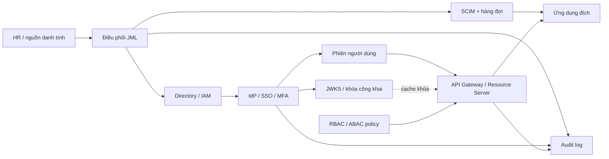
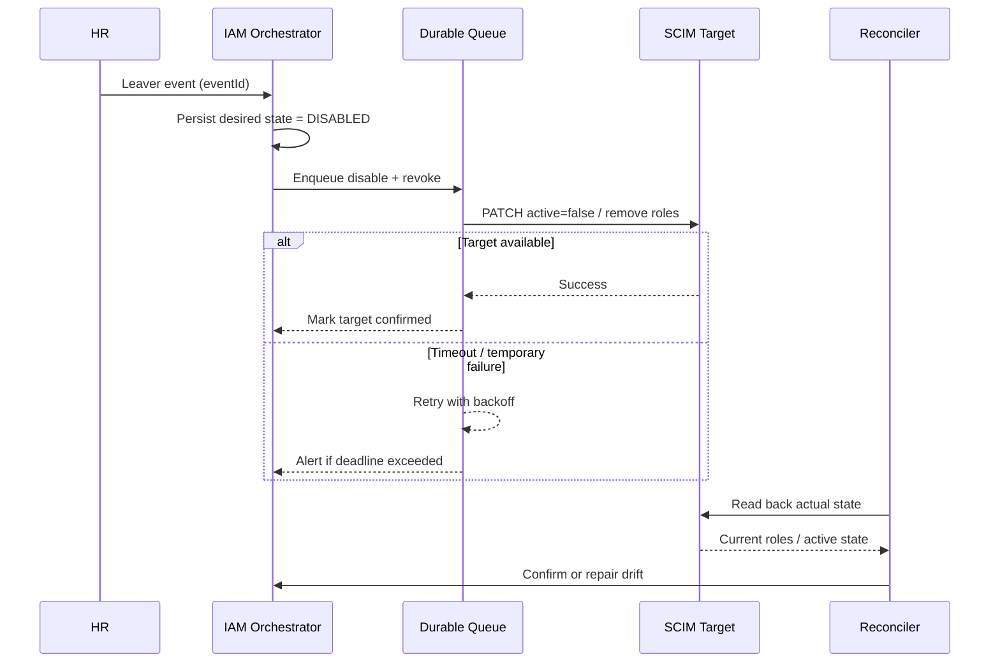

# Availability của IAM

## 1. Tại sao độ sẵn sàng của IAM là vấn đề đặc biệt?

**Identity and Access Management (IAM)** quản lý danh tính và quyền truy cập trong suốt vòng đời **Joiner – Mover – Leaver**: một người hoặc workload gia nhập hệ thống, thay đổi vai trò, rồi rời khỏi hệ thống. IAM thường kết nối hệ thống nhân sự (HR), kho danh tính, **Identity Provider (IdP)**, **Single Sign-On (SSO)**, giao thức **SCIM** và các ứng dụng thực thi quyền theo **RBAC/ABAC**.

Nếu IAM không sẵn sàng, tác động không dừng ở màn hình đăng nhập:

- Nhân viên mới có thể không nhận được tài khoản hay quyền cần thiết để bắt đầu làm việc (**Joiner**).
- Người chuyển bộ phận có thể không được cấp quyền mới hoặc còn giữ quyền cũ quá lâu (**Mover**).
- Tài khoản của người nghỉ việc có thể chưa bị vô hiệu hóa ở các hệ thống đích (**Leaver**).
- Người dùng hiện hữu có thể tiếp tục làm việc hoặc bị gián đoạn tùy cách ứng dụng quản lý phiên, xác thực access token và lấy chính sách.
- Ứng dụng và tài khoản dịch vụ có thể không lấy được token mới, dẫn đến lỗi hàng loạt giữa các dịch vụ.
- Người vận hành có thể mất đường truy cập để xử lý chính sự cố IAM.

**Availability của IAM** là khả năng những chức năng danh tính và kiểm soát truy cập thiết yếu đáp ứng đúng yêu cầu trong thời gian cam kết, kể cả khi thành phần phụ thuộc bị lỗi. Chữ *đúng* rất quan trọng: một hệ thống cho phép tất cả truy cập khi IdP gặp sự cố có thể trông như vẫn hoạt động, nhưng đã đánh mất bảo mật.

Mục tiêu là **duy trì tính sẵn sàng trong giới hạn chính sách an toàn**. Không nên đánh đổi việc xác minh danh tính hoặc thu hồi quyền bằng một cơ chế bỏ qua kiểm tra không kiểm soát.

### Sau bài học, bạn có thể

1. Phân biệt availability của đăng nhập, xác thực API, quản lý phiên, cấp quyền và thu hồi quyền.
2. Chỉ ra điểm lỗi đơn trong chuỗi HR → IAM → IdP/SSO → SCIM → ứng dụng.
3. Thiết kế dự phòng, giám sát, khôi phục và vận hành IAM theo SLO, RTO, RPO.
4. Giải thích khi nào dùng cache, xác thực token cục bộ, hàng đợi và *break-glass* mà vẫn giới hạn rủi ro.
5. Xây dựng kịch bản kiểm thử sự cố và đánh giá quyền truy cập tồn dư sau khôi phục.

## 2. Phân tách các mặt phẳng và chức năng IAM

Không nên gộp mọi hoạt động IAM thành một chỉ số “IdP đang sống”. Các luồng có điều kiện sẵn sàng khác nhau:

| Chức năng | Ví dụ thao tác | Phụ thuộc phổ biến | Khi gián đoạn |
|---|---|---|---|
| **Đăng nhập tương tác** | SSO qua OIDC/SAML, MFA, passwordless | DNS, IdP, directory, MFA, HSM/KMS, trình duyệt | Người dùng mới không tạo được phiên |
| **Làm mới phiên/token** | OAuth 2.0 refresh token, session renewal | Authorization Server, kho phiên/token | Phiên hiện có có thể hết hạn và không gia hạn được |
| **Xác thực request API** | Kiểm tra chữ ký JWT, issuer, audience, expiry | API gateway/resource server, JWKS được cache hoặc introspection | JWT đã biết khóa có thể còn xác minh được; token cần introspection có thể lỗi |
| **Quyết định cấp quyền** | RBAC role, ABAC attribute/policy | Policy Engine, dữ liệu vai trò/thuộc tính | Quyết định mới có thể không thực hiện được hoặc dựa trên dữ liệu cũ |
| **Provisioning** | SCIM tạo/sửa/khóa người dùng, cấp nhóm | HR, event bus, SCIM client/server | Thay đổi danh tính bị trì hoãn |
| **Vô hiệu hóa/thu hồi** | Disable account, xóa nhóm, revoke token/session | IdP, directory, ứng dụng đích, cơ chế revocation | Có nguy cơ **quyền truy cập tồn dư** |
| **Danh tính máy** | Workload identity, service account, lấy credential | Token issuer, KMS/HSM, nền tảng workload | Dịch vụ không thể thiết lập phiên hoặc xoay vòng credential |
| **Kiểm toán và ứng cứu** | Ghi audit log, truy cập quản trị khẩn cấp | Log pipeline, SIEM, PAM, kênh vận hành | Khó phát hiện hoặc xử lý hành vi bất thường |

Một thiết kế có thể đạt availability cao cho **request API đã đăng nhập** nhưng availability thấp cho **đăng nhập mới**. Cần đo riêng từng luồng thay vì dùng một health check chung.

### 2.1 Control plane và data plane

Có thể hình dung IAM thành hai phần:

- **Control plane**: quản lý tài khoản, xác lập vai trò và chính sách, phát hành hoặc thu hồi token, cung cấp khóa công khai, điều phối provisioning.
- **Data plane**: gateway, ứng dụng và dịch vụ thực thi kiểm tra token, phiên và quyền truy cập trên từng request.

Một resource server xác minh chữ ký JWT bằng khóa công khai đã cache có thể xử lý request trong khi IdP tạm ngừng hoạt động. Tuy nhiên, điều này **không** bảo đảm đăng nhập mới, làm mới token hoặc thu hồi token tức thời vẫn hoạt động. Khi policy hoặc attribute cần truy vấn trực tuyến, data plane có thể tiếp tục phụ thuộc control plane.

### 2.2 Mô hình phụ thuộc



Sơ đồ mô tả luồng logic, không quy định mọi thành phần phải là một dịch vụ riêng. Đường nét đứt cho biết việc dùng khóa công khai được cache có thể giảm phụ thuộc trực tiếp vào IdP trên từng API request.

## 3. Những sự cố thực tế cần phân biệt

### 3.1 IdP ngừng đáp ứng

Người dùng đang mở phiên ứng dụng **có thể** tiếp tục truy cập cho đến khi session hoặc access token hết hạn, tùy kiến trúc. Người dùng chưa đăng nhập thường không thể khởi tạo luồng SSO; làm mới token cũng có thể thất bại.

Không thể kết luận “IdP down thì mọi API down” hoặc “IdP down nhưng API luôn sống”. Câu trả lời phụ thuộc vào:

- API xác thực JWT **cục bộ** hay gọi **introspection** cho mỗi token?
- Khóa công khai phù hợp đã có trong cache hay request gặp `kid` chưa biết?
- Gateway có phải truy vấn policy engine hoặc session store trực tuyến không?
- Access token, phiên ứng dụng và cache hết hạn lúc nào?
- Hệ thống có cần kiểm tra trạng thái tài khoản vừa bị khóa hoặc sự kiện thu hồi không?

### 3.2 Một vùng hạ tầng hoặc database lỗi

Nhiều replica của IdP trong cùng một availability zone, cùng một database, cùng một Redis hoặc cùng một KMS **vẫn có thể là một điểm lỗi chung**. Phải vẽ đầy đủ dependency chain, bao gồm DNS, certificate, time synchronization, mail/SMS/push MFA và thành phần chống bot.

### 3.3 Đồng bộ vai trò và SCIM bị chậm

SCIM hoặc event bus gặp lỗi có thể làm ứng dụng đích giữ nhóm/quyền cũ, dù IdP đã cập nhật. Với **Leaver**, đây là lỗi bảo mật có thời hạn ảnh hưởng; với **Joiner**, chủ yếu là lỗi khả dụng; với **Mover**, có thể xảy ra cả hai.

### 3.4 Kênh kiểm toán hoặc vận hành mất kết nối

Ứng dụng vẫn phục vụ request nhưng không ghi nhận được sự kiện có thể khiến cuộc điều tra sau đó không đầy đủ. Với thao tác nhạy cảm, cần xác định trước chính sách khi audit sink lỗi: chặn thao tác, ghi vào bộ đệm bền vững có giới hạn, hay chuyển sang kênh ghi thay thế. Không nên lặng lẽ bỏ audit.

## 4. Đo availability đúng với hành vi người dùng

### 4.1 Định nghĩa SLI và SLO theo luồng

**SLI (Service Level Indicator)** là số đo quan sát được. **SLO (Service Level Objective)** là mục tiêu cho số đo đó trong một khoảng thời gian.

Ví dụ cho 30 ngày:

| Luồng | SLI gợi ý | SLO minh họa |
|---|---|---|
| Đăng nhập SSO | Tỷ lệ giao dịch đăng nhập hợp lệ hoàn tất trong ngưỡng thời gian đặt ra | ≥ 99,95% |
| Xác thực API | Tỷ lệ request có token hợp lệ được xử lý trong ngưỡng độ trễ | ≥ 99,99% |
| Provisioning Joiner | Tỷ lệ sự kiện hợp lệ được đồng bộ đến hệ thống đích trong 5 phút | ≥ 99,9% |
| Thu hồi quyền Leaver | Tỷ lệ yêu cầu hợp lệ được thực thi tại các điểm kiểm soát trong hạn bảo mật quy định | Mục tiêu riêng, nghiêm ngặt |
| Audit | Tỷ lệ sự kiện bảo mật quan trọng được lưu bền vững, kiểm tra được | Mục tiêu riêng |

Các số trên chỉ là **ví dụ để thiết kế**, không phải chuẩn bắt buộc. SLO phải dựa trên mức độ quan trọng, trải nghiệm người dùng, năng lực hệ thống và nghĩa vụ pháp lý của tổ chức.

Khi tính SLI đăng nhập, hãy phân loại rõ:

- Sai mật khẩu, người dùng bị khóa hợp lệ hoặc từ chối MFA đúng chính sách: **không phải lỗi availability của dịch vụ**.
- IdP trả 5xx, timeout, vòng redirect không kết thúc, MFA provider mất kết nối: thường là **lỗi availability**.
- Đăng nhập bị chặn vì chính sách bảo mật có hiệu lực: cần báo cáo riêng là quyết định an ninh, không gộp vô điều kiện vào lỗi hệ thống.

Một phép đo cơ bản:

\[
\text{Availability SLI} = \frac{\text{số giao dịch hợp lệ thành công}}{\text{tổng giao dịch hợp lệ được đo}} \times 100\%
\]

Ví dụ, SLO **99,95% trong tháng 30 ngày** tương đương một *error budget* khoảng **21,6 phút**, nếu đo theo thời gian và giả sử phân bổ đồng đều. Với SLI dựa trên số request, error budget được tính theo số giao dịch; không thể tự động đổi sang phút khi lưu lượng biến động mạnh.

### 4.2 Đo cả độ trễ và tính đúng đắn

Các số đo nên có: tỷ lệ thành công của login/token issuance/refresh, p95–p99 latency, token validation failure theo nguyên nhân, tỷ lệ lỗi JWKS fetch, SCIM queue lag, số event retry/dead-letter, thời gian disable account đến khi ứng dụng đích hết quyền, số phiên vẫn còn hợp lệ sau leaver, độ trễ audit pipeline và tỷ lệ break-glass activation.

Sự cố IAM có thể không gây lỗi HTTP 5xx ngay lập tức. Ví dụ, hàng đợi SCIM tăng từ 20 lên 20.000 sự kiện, trong khi ứng dụng hiện hữu vẫn trả HTTP 200. Vì vậy cần cảnh báo theo **backlog và độ tuổi sự kiện**, đặc biệt với thao tác thu hồi.

### 4.3 RTO, RPO và giới hạn nhất quán

- **RTO (Recovery Time Objective)**: thời gian tối đa mục tiêu để khôi phục một chức năng sau sự cố.
- **RPO (Recovery Point Objective)**: mức mất dữ liệu tối đa có thể chấp nhận, tính theo thời gian dữ liệu.
- **MTTD / MTTR**: thời gian phát hiện và thời gian khôi phục trung bình, dùng để đánh giá năng lực vận hành.

Không thể chỉ tuyên bố “RPO = 0” nhờ có hai region. Phải xác minh cách nhân bản dữ liệu tài khoản, khóa, phiên, policy và nhật ký; độ trễ replication, xung đột ghi và failover có thể làm mất hoặc làm lùi trạng thái thu hồi quyền.

## 5. Các nguyên tắc thiết kế tăng độ sẵn sàng

### 5.1 Loại bỏ điểm lỗi đơn theo chuỗi phụ thuộc

Thiết kế thường bao gồm:

1. IdP chạy nhiều instance trên nhiều failure domain; load balancer loại bỏ instance không khỏe.
2. Database/directory có replication, backup và quy trình failover đã kiểm thử.
3. DNS, certificate, key service, MFA và network path có phương án dự phòng phù hợp.
4. Trạng thái quan trọng như khóa ký, client registration, policy và cấu hình realm/tenant được quản lý nhất quán.
5. Capacity headroom và rate limiting để chịu được login surge khi hệ thống phục hồi hoặc nhân viên đồng loạt phải đăng nhập lại.

**Multi-region** có thể vận hành *active-passive* hoặc *active-active*. Active-active đòi hỏi giải quyết nghiêm túc consistency, routing, xung đột ghi, phiên và vòng đời khóa. Với một hệ thống chưa đáp ứng các điều kiện đó, active-passive có diễn tập thường xuyên có thể ít rủi ro hơn.

Khi failover IdP, cần bảo đảm issuer/metadata, redirect URI, state/nonce của OIDC, SAML metadata, cấu hình client, chứng thư, khóa và endpoint JWKS vẫn nhất quán với hợp đồng mà ứng dụng đang tin cậy. Không tùy tiện đổi `iss` hoặc chấp nhận thêm một issuer chưa được phê duyệt chỉ để vượt qua sự cố.

### 5.2 Không gọi IdP trên mọi API request nếu kiến trúc cho phép

Với **JWT access token** có chữ ký hợp lệ, resource server thường có thể xác thực cục bộ:

- Kiểm tra chữ ký qua JWKS đáng tin cậy.
- Kiểm tra `iss`, `aud`, `exp`, `nbf` cùng clock skew hữu hạn.
- Kiểm tra scope, role hoặc policy cần thiết cho endpoint.
- Xử lý `kid` chưa biết bằng cơ chế tải lại khóa có giới hạn, không bỏ qua kiểm tra chữ ký.

Điều này giúp request API không phụ thuộc vào một round trip đến IdP, nhưng có đánh đổi: token đã cấp có thể vẫn hợp lệ đến lúc hết hạn nếu không có cơ chế revocation đủ nhanh. Đặc biệt với Leaver, cần cân nhắc access token ngắn hạn, thu hồi phiên, denylist/revocation events hoặc cơ chế kiểm tra trạng thái tài khoản theo mức độ rủi ro.

Nếu dùng **opaque token** và introspection, hãy thiết kế tính sẵn sàng cho endpoint introspection và chính sách cache có thời hạn hữu hạn. Không cache vô hạn kết quả “active”.

### 5.3 Tách phụ thuộc khởi động khỏi xác thực thời gian chạy

Ví dụ tham khảo với **Spring Security OAuth2 Resource Server**:

```yaml
spring:
  security:
    oauth2:
      resourceserver:
        jwt:
          issuer-uri: https://id.example.com/realms/engineering
          jwk-set-uri: https://id.example.com/realms/engineering/protocol/openid-connect/certs
```

Với cấu hình phù hợp trong Spring Security, cung cấp cả `issuer-uri` và `jwk-set-uri` cho phép xác định trực tiếp nơi lấy khóa và tránh việc phải khám phá metadata IdP để khởi động. `issuer-uri` vẫn là ràng buộc xác minh issuer. Ví dụ URL chỉ là minh họa, phải thay bằng IdP thực tế.

**Giới hạn:** Một process mới chưa có khóa trong cache vẫn cần lấy JWKS; IdP hoặc endpoint khóa mất kết nối có thể khiến nó không thể xác thực token. Key rotation, TTL và hành vi cache phụ thuộc phiên bản/thành phần triển khai. Muốn vượt qua sự cố kéo dài, cần giải pháp phân phối JWKS khả dụng và được kiểm soát, kiểm thử đúng implementation đang chạy. Không hardcode khóa hoặc tắt xác thực chữ ký.

### 5.4 Tính sẵn sàng không được phá vỡ ranh giới bảo mật

Khi hệ thống kiểm tra quyền gặp lỗi, nên phân biệt hai khái niệm:

- **Fail closed**: từ chối hành động nếu không thể xác minh điều kiện bảo mật bắt buộc; ưu tiên cho thay đổi quyền nhạy cảm và các quyết định chưa đủ dữ kiện.
- **Degraded mode có kiểm soát**: tiếp tục một tập hợp thao tác đã xác thực, đã được phê duyệt trước, giới hạn thời gian và quyền, dựa trên dữ liệu cache còn hiệu lực.

Không dùng “fail open” nghĩa là tự động cấp quyền quản trị, bỏ qua MFA, cho phép token hết hạn hoặc chấp nhận mọi scope. Hệ thống có thể hiển thị trạng thái chỉ đọc, trì hoãn thao tác nhạy cảm hoặc hướng dẫn đăng nhập lại khi IdP phục hồi.

## 6. Availability theo Joiner – Mover – Leaver

### 6.1 Joiner: tạo tài khoản có thể thử lại an toàn

Luồng ví dụ: HR phát sự kiện nhận việc → IAM xác minh thuộc tính và định danh → tạo tài khoản IdP → áp dụng nhóm/role mặc định → SCIM provision đến ứng dụng.

Để bảo đảm availability:

- Mỗi sự kiện mang định danh ổn định, có **idempotency key** để retry không tạo trùng người dùng.
- Tách tiếp nhận event khỏi từng hệ thống đích bằng hàng đợi bền vững; lỗi một ứng dụng không làm mất toàn bộ yêu cầu.
- Phân loại lỗi có thể retry (timeout, 429, 503) và lỗi cần xử lý thủ công (mapping sai, thiếu thuộc tính bắt buộc).
- Theo dõi trạng thái từng đích: pending, succeeded, retrying, failed; đối soát đến khi hoàn tất.
- Chỉ công bố “đã cấp đầy đủ quyền” khi đã xác minh trạng thái tại các hệ thống đích cần thiết.

### 6.2 Mover: tránh tích lũy quyền khi một bước lỗi

Người chuyển từ bộ phận Tài chính sang Vận hành cần bỏ role cũ và nhận role mới. Nếu thực hiện “cấp mới thành công, thu hồi cũ thất bại”, người đó có thể giữ cả hai bộ quyền.

Thiết kế nên coi thay đổi quyền là một **workflow có kiểm soát**: ghi lại trạng thái mong muốn, ưu tiên các thao tác giảm đặc quyền theo chính sách, retry và đối soát đến khi tất cả hệ thống đích hội tụ. Nếu không thể thay đổi atomically trên nhiều ứng dụng, phải có bước phát hiện và xử lý trạng thái chuyển tiếp.

### 6.3 Leaver: tiêu chí bảo mật thường chặt hơn tiêu chí tiện dụng

Khi người dùng rời tổ chức, mục tiêu là vô hiệu hóa khả năng đăng nhập mới, ngăn làm mới token, hủy phiên khi được hỗ trợ, thu hồi nhóm/role và quyền ở các ứng dụng liên quan, xử lý credential do người dùng quản lý và xác minh không còn access tồn dư.

Một thứ tự xử lý có thể là:

1. Ghi sự kiện nghỉ việc vào kho có độ bền cao và đánh dấu cần xử lý khẩn.
2. Disable danh tính trung tâm và chặn đường lấy session/token mới.
3. Phát lệnh revoke session/token và thu hồi quyền xuống từng ứng dụng/SCIM target.
4. Đối soát kết quả theo từng đích; retry, alert và escalation khi vượt ngưỡng.
5. Kiểm tra token và session tồn dư theo cơ chế từng ứng dụng; lưu bằng chứng kiểm toán.

**Disable account ở IdP không nhất thiết hủy ngay JWT đã phát hành**. Nếu API chỉ kiểm chữ ký và hạn token, JWT có thể tiếp tục được chấp nhận đến `exp`. Thiết kế phải xác định và kiểm chứng *maximum residual access window* theo rủi ro của tài nguyên.

### 6.4 Tài khoản dịch vụ và workload identity

Service account cũng có vòng đời: tạo, thay đổi scope, xoay credential và thu hồi. Một secret hết hạn khi KMS hoặc token endpoint đang lỗi có thể khiến nhiều service ngừng giao tiếp. Dùng credential ngắn hạn hoặc workload identity với đường phát hành dự phòng và điều kiện gia hạn được kiểm thử; tránh chia sẻ tài khoản dịch vụ giữa nhiều ứng dụng. Khi tài khoản dịch vụ bị compromise, khả năng thu hồi nhanh vẫn phải ưu tiên hơn duy trì các kết nối không đáng tin cậy.

## 7. Mẫu kiến trúc cho IAM chịu lỗi

### 7.1 Tách luồng đồng bộ và bất đồng bộ

- **Đồng bộ khi cần kết quả ngay**: login, token issuance, quyết định cho phép truy cập tài nguyên nhạy cảm.
- **Bất đồng bộ khi chấp nhận được độ trễ có giới hạn**: SCIM provisioning, cập nhật nhóm, đối soát, gửi thông báo, xuất báo cáo.

Luồng bất đồng bộ cần **at-least-once delivery**, consumer idempotent, retry với exponential backoff và jitter, dead-letter queue, replay có kiểm soát, bảng trạng thái đích và cơ chế reconcile định kỳ. Hàng đợi bền vững tăng độ chịu lỗi, nhưng không bảo đảm mọi thay đổi được áp dụng tức thời.



Đối với Leaver, đường disable trung tâm nên ưu tiên thực hiện ngay; queue dùng để lan truyền và đối soát ở các đích. Nếu hệ thống đích vẫn chấp nhận credential đã cấp riêng, việc vô hiệu hóa tại IdP không thay thế được thao tác thu hồi tại chính hệ thống đó.

### 7.2 Bảo vệ các phụ thuộc yếu

Áp dụng timeout hợp lý, circuit breaker, giới hạn số lần retry và bulkhead cho những cuộc gọi ra IdP, directory, SCIM và policy engine. Không retry vô hạn một request login đang chờ; việc nhân bản retry có thể làm IdP đang quá tải sụp nhanh hơn.

Khi downstream trả `429 Too Many Requests`, tuân thủ `Retry-After` nếu có và dùng backoff. Với các lệnh thay đổi quyền, chỉ retry tự động nếu đảm bảo idempotency hoặc có thể kiểm tra trạng thái sau lỗi không rõ kết quả.

### 7.3 Khóa ký, certificate và clock

Khóa ký token và certificate SAML/OIDC ảnh hưởng trực tiếp đến availability. Cần:

- Công bố khóa mới trước khi dùng để ký nếu hợp đồng và sản phẩm IdP hỗ trợ; giữ khóa cũ trong thời gian chấp nhận token cũ, rồi rút đúng kế hoạch.
- Theo dõi thời hạn certificate, `kid` lạ, tỷ lệ lỗi signature và độ trễ phân phối JWKS.
- Giữ đồng bộ thời gian đáng tin cậy; clock skew quá lớn làm token bị từ chối hoặc mở rộng cửa sổ chấp nhận sai.
- Bảo vệ private key trong cơ chế quản lý khóa phù hợp, có backup/recovery được xác minh mà không làm lộ khóa.

Không phát hành token có hạn dài chỉ để giảm phụ thuộc vào IdP. Cần cân bằng thời hạn token, khả năng refresh và tốc độ thu hồi.

## 8. Break-glass và khôi phục truy cập quản trị

**Break-glass access** là đường truy cập khẩn cấp đã phê duyệt, dùng khi IAM/PAM/SSO chính gặp sự cố. Đây là một biện pháp khôi phục có rủi ro cao, nên có:

1. Số lượng tài khoản khẩn cấp tối thiểu và quyền được xác định rõ.
2. Xác thực mạnh độc lập với thành phần đang cần cứu; credential lưu an toàn và kiểm tra được khả năng sử dụng.
3. Cơ chế kích hoạt có người phê duyệt/phân vai khi tình huống cho phép, thời gian sử dụng ngắn và quy trình bàn giao.
4. Log, cảnh báo khi sử dụng, giám sát phiên/quản trị và rà soát sau sự cố.
5. Xoay credential, thu hồi phiên và kiểm tra thay đổi ngay sau khi đóng tình huống.

Đường break-glass phải được **diễn tập**. Nếu xác thực khẩn cấp vẫn phụ thuộc cùng IdP, directory hoặc thiết bị MFA đang lỗi thì nó chưa giải quyết được bài toán availability. Không dùng một tài khoản admin chia sẻ vĩnh viễn không kiểm toán như phương án dự phòng.

## 9. Ví dụ thiết kế: hệ thống nhân sự và API nội bộ

Giả sử một tổ chức có:

- Nhân viên đăng nhập qua OIDC SSO với MFA.
- API nội bộ nhận **access token dạng JWT** và xác thực tại gateway.
- IAM nhận sự kiện Joiner–Mover–Leaver từ HR, đẩy thay đổi đến các SaaS qua SCIM.
- Một số API nhạy cảm yêu cầu policy/attribute mới nhất.

### 9.1 Chia cấp độ phục vụ khi sự cố xảy ra

| Trạng thái | Đăng nhập mới | API đã có token hợp lệ | Thay đổi quyền / Leaver | Thao tác đặc quyền |
|---|---|---|---|---|
| Bình thường | Hoạt động | Hoạt động | Xử lý + đối soát | Qua policy và MFA |
| IdP tạm gián đoạn | Có thể thất bại | Có thể tiếp tục nếu tự kiểm JWT, khóa còn hợp lệ và không phụ thuộc kiểm tra online | Nhận sự kiện bền vững; thực hiện những bước khả dụng, cảnh báo điểm chưa hoàn tất | Từ chối nếu thiếu kiểm tra bắt buộc; dùng break-glass đúng quy trình khi cần |
| SCIM target gián đoạn | Không nhất thiết ảnh hưởng | Không nhất thiết ảnh hưởng | Queue/retry/reconcile; cảnh báo vượt deadline, nhất là Leaver | Không tự mở rộng quyền |
| Policy engine không khả dụng | Có thể vẫn login | Chỉ cho phép theo chính sách degraded đã được phê duyệt, nếu có | Trì hoãn thao tác không thể xác minh | Fail closed |
| Khóa JWKS cần refresh nhưng endpoint lỗi | Có thể thất bại | Token có `kid` chưa biết không được xác minh | Tiếp tục lưu yêu cầu thay đổi và escalation | Không bypass signature |

Ở đây **“có thể tiếp tục”** là khả năng kỹ thuật theo kiến trúc đã thử nghiệm, không phải cam kết mặc định của mọi IdP hoặc thư viện.

### 9.2 Đặt hợp đồng phục hồi rõ ràng

Ví dụ hợp đồng nội bộ:

- Login SLO: 99,95% theo 30 ngày; RTO sau mất một region: 30 phút.
- API request với access token hợp lệ: SLO 99,99%; gateway không gọi IdP mỗi request.
- SCIM Joiner: 95% hoàn tất trong 5 phút, số còn lại có cảnh báo và owner xử lý.
- Leaver: mỗi hệ thống đích có deadline thu hồi riêng; các đích chưa xác minh phải hiển thị trên dashboard, có escalation bắt buộc.
- Break-glass: diễn tập theo chu kỳ, cảnh báo đến đội an ninh ngay khi kích hoạt.

Từng mục tiêu cần kiểm tra tính khả thi bằng kiến trúc và dữ liệu đo thực tế; không lấy những con số minh họa này áp vào production một cách máy móc.

## 10. Quan sát, cảnh báo và runbook

### 10.1 Dashboard tối thiểu

Theo dõi đồng thời:

- Tỷ lệ thành công và p95/p99 thời gian của OIDC authorization/token endpoint; tỷ lệ lỗi MFA và refresh token.
- Tỷ lệ lỗi xác minh token, chia theo `expired`, `invalid_signature`, `unknown_kid`, `issuer_mismatch`, lỗi fetch JWKS.
- Sức khỏe IdP, database, directory, KMS/HSM, DNS, certificate và đường kết nối liên vùng.
- Hàng đợi provisioning: số lượng, **oldest event age**, retries, dead-letter, số Leaver quá hạn và drift giữa desired/actual state.
- Tỷ lệ thay đổi role/attribute thành công, độ trễ policy distribution và quyền tồn dư được phát hiện.
- Sự kiện break-glass, thao tác admin, độ trễ/độ bền audit log.

Giữ correlation ID và event ID xuyên suốt HR → IAM → SCIM → ứng dụng, nhưng không ghi access token, mật khẩu, secret, private key hoặc thông tin nhạy cảm không cần thiết vào log.

### 10.2 Runbook mẫu cho outage của IdP

1. **Xác minh phạm vi**: login mới, refresh, token validation, policy evaluation và provisioning bị ảnh hưởng ở đâu? Đối chiếu synthetic checks và request thực.
2. **Khoanh vùng lỗi**: kiểm tra DNS/TLS, IdP, directory, MFA, database, JWKS, key service, network, sự thay đổi cấu hình gần nhất.
3. **Ổn định hệ thống**: ngăn retry storm, giảm tải có kiểm soát, dùng replica/region dự phòng sau khi xác nhận trạng thái đồng bộ.
4. **Bảo vệ ranh giới**: không cho qua token không xác minh được; xác định deadline Leaver và quyền nhạy cảm có thể bị ảnh hưởng.
5. **Khôi phục**: failover hoặc rollback theo runbook, xác nhận issuer, khóa, session và policy còn đúng; kiểm tra khả năng login mới và API đang hoạt động.
6. **Đối soát sau sự cố**: replay queue, rà soát failed provisioning, event Leaver, revocation, audit gap và mọi thao tác break-glass.
7. **Ghi nhận**: đo MTTD/MTTR, cập nhật SLO và kiểm thử lại kịch bản gây lỗi.

Việc IdP đã trả HTTP 200 trở lại **không** có nghĩa sự cố kết thúc: các sự kiện offboarding bị kẹt, policy cũ và log bị thiếu vẫn cần xử lý.

## 11. Kiểm thử khả năng chịu lỗi trước khi có sự cố

Nên tổ chức game day hoặc chaos test trong môi trường phù hợp, với dữ liệu và quyền thử nghiệm an toàn:

| Tình huống | Hành vi mong đợi | Bằng chứng cần thu |
|---|---|---|
| Dừng một instance IdP | Load balancer chuyển lưu lượng, login tiếp tục trong SLO | Login success rate, latency, failover time |
| Mất cả region IdP | Chuyển vùng theo RTO, metadata/keys/issuer nhất quán | Sự kiện failover, RTO thực tế, giao dịch E2E |
| JWKS endpoint lỗi | Token có khóa cache hợp lệ được xử lý theo chính sách; token không xác minh được bị từ chối | `kid`, cache age, validation errors |
| SCIM target trả 503/429 | Event vào retry, không mất event, không tạo user/role trùng | Event ID, retry, DLQ, reconciliation |
| Leaver khi SCIM đang lỗi | Disable trung tâm được thực hiện nếu khả dụng; target lỗi bị đánh dấu và escalation | Thời gian tồn dư, trạng thái từng target |
| Xoay khóa ký token | Token mới xác minh được, token cũ được xử lý theo vòng đời khóa đã thiết kế | `kid` trước/sau, JWKS, tỉ lệ signature failure |
| Policy engine hoặc directory lỗi | Quyết định quyền theo degraded policy đã phê duyệt; đặc quyền chưa xác minh bị từ chối | Quyết định allow/deny, audit trail |
| Mất kênh audit | Hành vi đúng theo chính sách hệ thống và không mất dấu sự kiện quan trọng không chấp nhận được | Log buffer, sink recovery, event count |
| Đăng nhập quản trị SSO lỗi | Break-glass được kích hoạt bằng đường độc lập và được kiểm toán | Ai kích hoạt, thời gian, lệnh đã chạy, revocation sau đó |

Từ mỗi thử nghiệm, đo **cả availability lẫn security correctness**. Một bài test “thành công” vì mọi request đều trả 200 nhưng policy bị bỏ qua là thất bại.

## 12. Sai lầm phổ biến

**“Có hai IdP instance là high availability.”** Nếu cả hai dùng chung một database, một zone, một key service hoặc một DNS lỗi thì vẫn có single point of failure. Cần kiểm kê theo từng failure domain.

**“JWT offline validation giải quyết hoàn toàn IdP outage.”** Nó chỉ giảm phụ thuộc khi xác thực các token có khóa và dữ liệu phù hợp. Login mới, refresh, revocation và policy động vẫn có thể ảnh hưởng.

**“Cache quyền càng lâu càng tốt.”** Cache dài tăng availability ngắn hạn nhưng kéo dài khả năng dùng quyền cũ, đặc biệt khi Mover hoặc Leaver. Cần TTL rõ ràng, invalidation/revocation và phân loại tài nguyên.

**“SCIM trả 202/200 là hoàn tất vòng đời.”** Phản hồi API không thay thế kiểm tra trạng thái thực tế ở hệ thống đích, nhất là khi workflow gồm nhiều bước.

**“Cho phép truy cập tạm thời khi không kiểm tra được.”** Với thao tác nhạy cảm, điều này có thể thành lỗ hổng truy cập. Degraded mode chỉ hợp lệ khi được thiết kế trước và có ranh giới cụ thể.

**“Failover thành công là xong.”** Cần đối soát queue, trạng thái tài khoản, phiên, role, log và quyền tồn dư sau phục hồi.

## 13. Checklist thiết kế và câu hỏi ôn tập

### Checklist

- [ ] Đã phân biệt SLO đăng nhập mới, refresh, xác thực API, provisioning, revocation và audit?
- [ ] Đã liệt kê mọi phụ thuộc, đặc biệt database, directory, MFA, JWKS/KMS, DNS và policy engine?
- [ ] Đã kiểm thử mất instance/zone/region và xác nhận RTO/RPO bằng kết quả thực?
- [ ] Đã thiết kế cache token/policy có TTL và chiến lược xử lý quyền bị thu hồi?
- [ ] Đã có retry idempotent, dead-letter queue, đối soát và cảnh báo độ tuổi event?
- [ ] Đã đặt deadline thu hồi theo từng target và đo residual access của Leaver?
- [ ] Đã có đường break-glass độc lập, ít quyền, được kiểm toán và diễn tập?
- [ ] Đã xác minh cơ chế rotation khóa, certificate, backup và khôi phục dữ liệu?
- [ ] Đã rà soát event tồn đọng và quyền sai sau mọi lần failover?

### Bài tập tình huống

**Tình huống A.** IdP ngừng hoạt động 12 phút. API vẫn chấp nhận JWT đã phát hành trong 15 phút; nhân viên nghỉ việc từ phút thứ 2. Hãy xác định những cách người đó có thể còn truy cập sau khi tài khoản IdP bị disable, và đề xuất biện pháp giảm cửa sổ tồn dư mà không phụ thuộc vào việc gọi IdP cho mọi request.

*Gợi ý:* Xem xét thời hạn access token, refresh token, ứng dụng dùng opaque token, session ứng dụng, sự kiện thu hồi, API nhạy cảm và thời gian hội tụ của policy.

**Tình huống B.** HR gửi cùng một sự kiện Joiner ba lần vì mất ACK, đồng thời SaaS target đang trả 429. Hãy thiết kế event ID, idempotency, retry/backoff, trạng thái từng đích và reconciliation để người dùng chỉ được tạo một lần mà cuối cùng vẫn nhận đủ quyền.

**Tình huống C.** Hai region IdP đang chạy active-active; sau sự cố replication, region A nhận disable account, region B tiếp tục cho login. Hãy nêu invariant cần giữ, lựa chọn consistency/failover có thể chấp nhận và cách kiểm chứng sau khôi phục.

### Điều cần ghi nhớ

Availability của IAM là năng lực duy trì **đúng chức năng danh tính và kiểm soát quyền** khi phụ thuộc gặp lỗi. Thiết kế tốt không dừng ở multi-replica IdP: nó bao gồm kiểm soát token và phiên, sự nhất quán của policy, độ bền của Joiner–Mover–Leaver, revocation có thể xác minh, vận hành break-glass và kiểm thử phục hồi xuyên suốt hệ thống.
