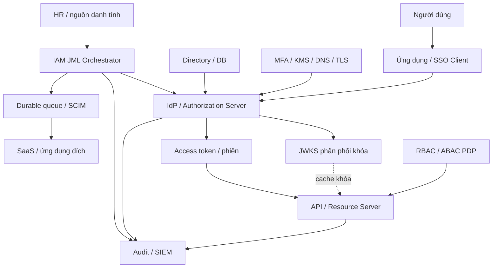
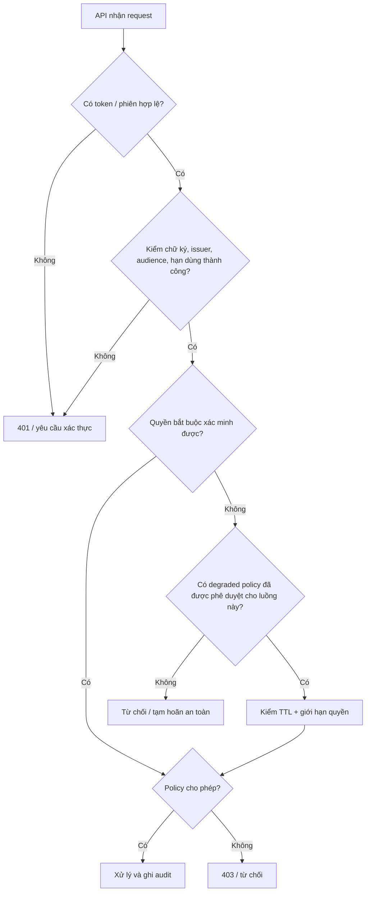

# Identity Provider Outage: Nhận diện, ứng phó và phục hồi khi IdP gián đoạn

## 1. Bối cảnh: một sự cố IdP tác động xa hơn màn hình đăng nhập

**Identity Provider (IdP)** là hệ thống xác minh danh tính và cung cấp kết quả xác thực cho ứng dụng. Trong doanh nghiệp, IdP thường là trung tâm của **Single Sign-On (SSO)** qua OpenID Connect (OIDC) hoặc SAML, tích hợp **Multi-Factor Authentication (MFA)**, thư mục người dùng và cơ chế cấp phiên/token. Tùy kiến trúc, IdP còn liên kết với IAM orchestration, **SCIM provisioning**, chính sách **RBAC/ABAC**, tài khoản dịch vụ và hệ thống kiểm toán.

Một **Identity provider outage** xảy ra khi một hoặc nhiều chức năng phụ thuộc IdP không thể hoàn tất đúng cách trong thời gian yêu cầu. Outage có thể là mất toàn bộ dịch vụ, lỗi một region, endpoint `/token` trả 503, MFA không gửi được challenge, metadata OIDC/SAML không truy xuất được, hoặc khóa xác thực mới chưa được phân phối tới các ứng dụng.

Ví dụ: 09:00, một cụm IdP gặp lỗi kết nối database:

- Nhân viên **chưa đăng nhập** không thể hoàn tất SSO.
- Người đã đăng nhập **có thể tiếp tục** gọi một API xác minh JWT cục bộ nếu token và khóa công khai còn hợp lệ.
- Người dùng muốn refresh access token có thể thất bại.
- Một ứng dụng dùng **token introspection** trên từng request có thể ngừng phục vụ dù người dùng đã có token.
- Sự kiện **Joiner** có thể chưa tạo tài khoản mới; sự kiện **Mover** chưa cập nhật quyền; yêu cầu **Leaver** có nguy cơ không vô hiệu hóa đầy đủ các phiên và hệ thống đích.
- Dịch vụ lấy token từ IdP bằng **client credentials** có thể dừng sau khi token cũ hết hạn.

Vì vậy, không thể đánh giá sự cố chỉ bằng câu hỏi “IdP có trả HTTP 200 không?”. Cần biết **luồng nào bị ảnh hưởng, trạng thái quyền nào còn đúng và bao lâu mới phục hồi**.

### Mục tiêu học tập

Sau bài học, bạn có thể:

1. Nhận diện outage của IdP và phân biệt sự cố đăng nhập, cấp token, kiểm tra token, quản trị danh tính và provisioning.
2. Đánh giá ứng dụng nào tiếp tục phục vụ được khi IdP mất kết nối, thay vì mặc định mọi phiên đều chết hoặc mọi phiên đều an toàn.
3. Thiết kế phương án giảm phụ thuộc đồng bộ, failover, cache có giới hạn, revocation và truy cập quản trị khẩn cấp.
4. Vận hành runbook ứng cứu theo trình tự phát hiện → khoanh vùng → giảm tác động → khôi phục → đối soát.
5. Kiểm tra tác động lên vòng đời **Joiner–Mover–Leaver (JML)** và giảm **quyền truy cập tồn dư** sau sự cố.

## 2. Nhận biết đúng các vai trò và ranh giới của IdP

### 2.1 IdP không đồng nghĩa với mọi thành phần IAM

Trong một triển khai thực tế, một sản phẩm có thể gộp nhiều vai trò; tuy nhiên, về mặt kiến trúc nên phân biệt:

| Thành phần | Vai trò chính | Sự cố liên quan |
|---|---|---|
| **IdP / SSO** | Xác thực người dùng, điều phối liên kết đăng nhập | Không đăng nhập mới được, SSO redirect lỗi |
| **Authorization Server** | Phát hành access token, refresh token và client tokens | API không nhận token mới; workload bị ảnh hưởng khi hết token |
| **Directory / identity store** | Lưu tài khoản, thuộc tính, trạng thái khóa | Đăng nhập hoặc cập nhật danh tính lỗi nếu IdP phụ thuộc trực tiếp |
| **MFA provider** | Xác thực yếu tố bổ sung | Đăng nhập bị treo hoặc từ chối nếu MFA là bước bắt buộc |
| **Resource server / API gateway** | Kiểm token và thực thi quyền truy cập | Có thể tiếp tục hoặc dừng tùy xác thực cục bộ/introspection |
| **Policy Decision Point (PDP)** | Đánh giá policy, role, attribute | Quyết định quyền động không khả dụng hoặc dùng policy lỗi thời |
| **IAM orchestrator / SCIM client** | Lan truyền thay đổi tài khoản/nhóm theo JML | Provisioning và thu hồi ở ứng dụng đích bị chậm |
| **Audit / SIEM / PAM** | Theo dõi, cảnh báo, hỗ trợ quản trị đặc quyền | Giảm khả năng phát hiện và ứng cứu |

**IdP outage** là một sự kiện vận hành; **IAM outage** là tác động theo chức năng nghiệp vụ. Hai khái niệm có quan hệ nhưng không nhất thiết trùng nhau.

### 2.2 Sơ đồ phụ thuộc



Sơ đồ mô tả phụ thuộc logic. Tùy hệ thống, cùng một cluster có thể chạy IdP và authorization server; JWKS có thể được cung cấp bởi chính IdP hoặc hạ tầng phân phối tin cậy riêng. Phải xác minh đường phụ thuộc thực tế trước khi thiết kế dự phòng.

## 3. Outage có những dạng nào?

| Phạm vi hỏng | Triệu chứng quan sát | Câu hỏi chẩn đoán |
|---|---|---|
| **Toàn cụm IdP** | Login mới, refresh, phát hành token đồng loạt timeout/5xx | Load balancer, DB, storage, DNS, mạng có vấn đề chung không? |
| **Một zone hoặc region** | Chỉ một nhóm người dùng/endpoint lỗi; traffic dồn sang nơi còn sống | Route, replication và session continuity hoạt động ra sao? |
| **MFA phụ thuộc bên ngoài** | Đăng nhập tới bước challenge rồi dừng | Password/primary auth có khỏe nhưng kênh MFA lỗi không? |
| **Token endpoint** | `/authorize` có thể chạy nhưng code exchange/refresh thất bại | Lỗi riêng `/token`, client authentication hoặc signing service? |
| **JWKS / key rotation** | `unknown_kid` hoặc `invalid_signature` tăng đột ngột | Khóa mới đã xuất bản, cache đã làm mới, issuer đúng chưa? |
| **Metadata/certificate** | OIDC discovery hoặc SAML federation hỏng | Certificate hết hạn, metadata đổi, URL issuer/ACS/redirect sai? |
| **Directory / policy store** | Một nhóm người dùng không đăng nhập; thuộc tính/quyền sai | Read replica lag, kết nối LDAP/DB, version policy có lệch? |
| **Quá tải / rate limit** | 429, p99 latency tăng, retry storm | Có login surge, bot traffic hoặc client retry không kiểm soát? |
| **Sự cố logic / cấu hình** | Nhiều hệ thống cùng từ chối token mới dù hạ tầng khỏe | Thay đổi `iss`, `aud`, signing algorithm hoặc cấu hình client? |
| **Sự cố bảo mật** | IdP phải cô lập vì nghi bị xâm nhập | Có cần dừng issuer, xoay khóa và điều tra thay vì failover ngay? |

Đối với **partial outage**, chỉ một số tenant, client, realm, region, trình duyệt hoặc phương thức xác thực bị ảnh hưởng. Các health check đơn giản có thể bỏ sót. Ví dụ, `GET /health` trả 200 nhưng login thực tế thất bại do MFA hoặc database.

## 4. Điều gì thực sự xảy ra với phiên và token?

### 4.1 Phân biệt phiên IdP, phiên ứng dụng và access token

Các trạng thái sau có thời hạn và cơ chế kiểm tra khác nhau:

- **Phiên đăng nhập SSO tại IdP**: giúp người dùng đăng nhập các ứng dụng liên kết khi IdP hoạt động. IdP down thường làm mất khả năng tạo hoặc kiểm tra phiên SSO mới.
- **Phiên cục bộ tại ứng dụng**: ứng dụng có thể duy trì session cookie riêng sau khi nhận kết quả từ IdP. Nếu session store cục bộ còn khỏe, phiên này có thể tiếp tục hoạt động.
- **Access token**: dùng gọi API; có thể là JWT tự xác minh hoặc opaque token cần introspection, tùy thiết kế.
- **Refresh token**: dùng xin access token mới, thường đòi authorization server đang hoạt động; có thể bị từ chối nếu phiên bị thu hồi.
- **SAML assertion**: thông điệp xác thực có chữ ký được tạo tại thời điểm SSO; sau khi Service Provider thiết lập phiên riêng, request sau đó có thể không cần gọi lại IdP cho đến khi phiên/reauthentication hết hạn.

Mệnh đề “người dùng vẫn đăng nhập được” phải chỉ rõ nghĩa: người đó **đang có phiên ứng dụng còn hiệu lực**, hay họ **thực hiện được một giao dịch SSO mới**?

### 4.2 Ma trận hành vi khi IdP bị ngắt mạng

| Tình huống | Khả năng tiếp tục | Điều kiện và giới hạn |
|---|---|---|
| OIDC login mới | Thường không | Luồng `/authorize`, `/token` hoặc xác thực MFA có thể cần IdP trực tuyến |
| OIDC app đã có session riêng | Có thể | Session store, logic authorization và giới hạn thời hạn còn hoạt động |
| API kiểm JWT cục bộ | Có thể | Chữ ký, `iss`, `aud`, `exp`, `nbf` và quyền hợp lệ; có khóa cần thiết |
| API dùng opaque token introspection mỗi request | Thường bị ảnh hưởng | Cần endpoint introspection; cache nếu có phải có TTL và chính sách rõ |
| API cần PDP/attribute trực tuyến | Có thể bị ảnh hưởng | Nếu policy engine không khả dụng thì xử lý theo chiến lược đã phê duyệt |
| Refresh token | Thường không | Authorization server phải tiếp nhận yêu cầu refresh |
| M2M client credentials mới | Thường không | Workload không thể xin token mới khi token endpoint hỏng |
| SAML Service Provider đã có session | Có thể | Session cục bộ vẫn còn; không yêu cầu SAML assertion mới |
| SSO logout liên kết | Có thể không hoàn tất | Back-channel/front-channel logout tùy IdP và ứng dụng |

**Không có cơ chế cache nào được phép biến token sai chữ ký, sai audience hoặc hết hạn thành hợp lệ.** Cache giúp hệ thống tìm được dữ liệu đã được tin cậy trong một thời hạn; cache không thay thế việc chứng minh một request có quyền truy cập.

### 4.3 Ví dụ dòng thời gian

Giả sử:

- 10:00: một JWT access token được phát hành, `exp=10:15`.
- 10:02: IdP mất kết nối toàn phần.
- 10:05: resource server vẫn có khóa JWKS và kiểm JWT cục bộ.
- 10:08: HR ghi nhận người dùng nghỉ việc nhưng yêu cầu disable tại IdP chưa thể hoàn tất.
- 10:15: token cũ hết hạn; refresh không thực hiện được khi IdP vẫn lỗi.

Từ 10:08 đến tối đa 10:15, người dùng **có thể** còn truy cập API nếu token vẫn hợp lệ và không có cơ chế chặn độc lập nào. Cửa sổ tối đa này chỉ tính cho token cụ thể; phiên ứng dụng, token khác, credential SaaS riêng và clock skew có thể tạo cửa sổ tồn dư khác. Phải đo trạng thái của **từng hệ thống thực thi quyền**, không suy từ mỗi trạng thái IdP.

## 5. Lựa chọn an toàn trong degraded mode

**Degraded mode** là chế độ cung cấp một phần chức năng được xác định trước khi phụ thuộc trọng yếu bị lỗi. Nó phải có phạm vi, điều kiện bắt đầu/kết thúc, TTL và cơ chế ghi nhận rõ ràng.

| Yêu cầu | Hướng xử lý thường phù hợp | Điều cần tránh |
|---|---|---|
| Xem dữ liệu ít nhạy cảm bằng JWT hợp lệ đã có | Cho xử lý nếu kiểm token và quyền tại API vẫn đầy đủ | Chấp nhận token hết hạn hoặc `kid` chưa biết |
| Phê duyệt chuyển tiền / thay đổi role admin | Từ chối hoặc đưa vào hàng đợi yêu cầu nếu thiếu kiểm tra bắt buộc | Bỏ qua MFA, bước phê duyệt hoặc PDP |
| Tạo tài khoản Joiner | Ghi nhận yêu cầu bền vững, xử lý sau khi IdP phục hồi | Tự tạo tài khoản local không gắn danh tính chuẩn |
| Thu hồi quyền Leaver | Vô hiệu hóa qua đường còn hoạt động, ưu tiên hệ thống đích và cảnh báo; reconcile | Chỉ ghi “đã thu hồi” vì message đã enqueue |
| M2M token mới không phát hành được | Hạn chế chức năng hoặc dùng cơ chế dự phòng đã phê duyệt, có ràng buộc chặt | Dùng secret chia sẻ vĩnh viễn để thay token |
| Người quản trị không đăng nhập được | Kích hoạt đường break-glass độc lập đã diễn tập | Tắt MFA toàn tenant hoặc cấp quyền admin hàng loạt |

### 5.1 Fail closed và chế độ chỉ đọc

**Fail closed** nghĩa là từ chối khi không thể xác minh một điều kiện an toàn bắt buộc. Một API yêu cầu thông tin vai trò hiện hành từ PDP nhưng không truy xuất được PDP có thể từ chối thao tác ghi đặc quyền, trong khi vẫn cho phép một số thao tác đọc dựa trên token hợp lệ và policy đã xác minh, nếu điều đó đã được thiết kế và phê duyệt.

Nguyên tắc: **Không mở thêm quyền do IdP hỏng**. Cần tách quyết định về khả dụng (có thể phục vụ request không?) khỏi quyết định về cấp quyền (request đó có được phép không?).

### 5.2 Cache phải có tuổi thọ và giới hạn rủi ro

Phân loại cache theo mục đích:

1. **Cache JWKS**: lưu khóa công khai để xác minh chữ ký; phải xử lý key rotation và khóa bị thu hồi.
2. **Cache introspection**: lưu tạm kết quả token active; làm tăng nguy cơ tiếp tục chấp nhận token đã bị revoke trong TTL.
3. **Cache policy/attribute**: dùng quyết định cũ khi control plane không khả dụng, tạo khả năng role hoặc thuộc tính vừa thay đổi chưa được áp dụng.
4. **Application session store**: tiếp tục phiên cục bộ; phải xem xét timeout, logout, forced reauthentication.

Một chiến lược thực tế là đặt **TTL ngắn hơn cho quyết định có độ nhạy cao**, nhận revocation events độc lập khi có thể, và chỉ cho một số luồng đọc có yêu cầu thấp dùng dữ liệu cache. TTL nào phù hợp phải được kiểm thử trên sản phẩm và phù hợp yêu cầu thu hồi quyền của tổ chức.

## 6. Giảm phụ thuộc của API vào IdP trong thời gian chạy

### 6.1 Xác minh JWT tại resource server

Với JWT có chữ ký, API có thể kiểm tra cục bộ mà không introspect mọi request. Cần đầy đủ:

- Kiểm chữ ký bằng thuật toán được cho phép và khóa từ nguồn tin cậy; xử lý `kid` đúng cách.
- Đối chiếu chính xác `iss` (issuer) và `aud` (audience) theo API được bảo vệ.
- Kiểm `exp`, `nbf`, và các ràng buộc thời gian liên quan với clock skew nhỏ, có kiểm soát.
- Kiểm scope, role và các điều kiện ABAC bắt buộc; dữ liệu từ claim có thể đã cũ so với nguồn chuẩn.
- Chống nhầm lẫn các loại token: chỉ chấp nhận access token đúng định dạng, issuer, audience và chính sách của API.
- Lập chiến lược refresh cache khóa công khai; không ngầm chấp nhận `kid` lạ khi JWKS endpoint không khả dụng.

Ví dụ cấu hình **Spring Security OAuth2 Resource Server** cho JWT:

```yaml
spring:
  security:
    oauth2:
      resourceserver:
        jwt:
          issuer-uri: https://id.example.org/realms/workforce
          jwk-set-uri: https://id.example.org/realms/workforce/protocol/openid-connect/certs
```

Khai báo rõ `jwk-set-uri` có thể giúp ứng dụng biết endpoint khóa ngay khi khởi động mà không phải gọi discovery metadata trong bước khởi tạo; `issuer-uri` vẫn ràng buộc issuer. **Điều này không bảo đảm xử lý token mới khi JWKS không truy xuất được**: cache ban đầu, TTL, refresh và validation còn tùy phiên bản thư viện và cấu hình thực tế. Phải kiểm thử phiên bản đang triển khai, đặc biệt khi quay vòng khóa.

Ngoài validate JWT, ứng dụng vẫn phải áp dụng authorization riêng cho endpoint. Một JWT hợp lệ về mặt chữ ký không tự động cho phép mọi API.

### 6.2 Mô hình quyết định khi outage



Biểu đồ là **mô hình quyết định**, không phải code hoàn chỉnh. Nếu không thể kiểm token, không đi sang degraded policy để bỏ qua xác thực. Nếu client chưa có token, ứng dụng vẫn cần luồng cấp token hợp lệ.

### 6.3 Lưu ý cho OIDC, SAML và các ứng dụng cũ

**OIDC:** kiểm tra authorization code, state/nonce và redirect URI trong luồng đăng nhập; không triển khai một “login bypass” khi `/authorize` lỗi. Nếu ứng dụng có phiên riêng, phải tuân thủ timeout và khả năng thu hồi phiên đó.

**SAML:** Service Provider chỉ chấp nhận assertion đúng chữ ký, đúng đối tượng nhận (recipient/audience), còn hiệu lực và chống replay. Khi IdP lỗi, assertion mới không xuất hiện; phiên SP hiện hữu có thể dùng tiếp theo chính sách đã thiết kế. Không kéo dài thời hạn assertion hoặc bỏ kiểm chữ ký để phục hồi login.

**Ứng dụng cũ:** nếu phụ thuộc vào IdP trực tuyến cho mọi request hoặc gọi directory theo từng màn hình, hãy đo thực tế trước khi nói rằng việc cache token ở gateway đã đủ. Có thể cần cải tiến session architecture, circuit breaker hoặc một lộ trình thay thế giao thức, nhưng phải giữ nguyên các bảo đảm xác thực.

## 7. Thiết kế failover cho IdP

### 7.1 Dự phòng theo failure domain, không chỉ theo số instance

Một IdP high availability thực tế phải xét:

- Nhiều instance trên các host/zone độc lập.
- Database, directory, cache phiên và transaction state; RPO/RTO cùng consistency của chúng.
- DNS, load balancer, TLS certificate, reverse proxy, NAT và outbound network.
- KMS/HSM, signing key, OIDC discovery, JWKS, SAML metadata và session encryption key.
- MFA, email/SMS/push channel, clock/time sync và các provider liên kết ngoài.
- Cấu hình client, redirect URI, realm/tenant, group mappings, policy và admin permissions.

Hai instance IdP dùng chung một database đơn lẻ có thể vẫn thất bại cùng lúc. Hai region nhưng chỉ có một signing key service cũng không có tính độc lập như mong muốn.

### 7.2 Active-passive và active-active

| Kiểu triển khai | Ưu điểm | Rủi ro cần giải |
|---|---|---|
| **Active-passive** | Đường chuyển vùng rõ ràng; ít xung đột ghi hơn | RTO chuyển vùng, độ mới dữ liệu, cấu hình và khóa tại site dự phòng |
| **Active-active** | Phân tải và có thể tiếp tục phục vụ khi mất một vùng | Replication/consistency, phân vùng mạng, xung đột session và thao tác disable account |

Phải bảo đảm **issuer được ứng dụng tin cậy** và metadata/khóa/claim tương thích khi đổi tuyến. Thay `iss` bằng hostname mới mà client không tin sẽ khiến token bị từ chối. Ngược lại, tự động thêm một issuer chưa kiểm soát để “cứu login” sẽ mở rộng bề mặt tin cậy.

Không coi DNS failover là đủ: TTL resolver, kết nối cũ, cookie domain, session continuity, certificate và discovery caching đều ảnh hưởng. Cần kiểm thử end-to-end từ browser và từ API client.

### 7.3 Failover dữ liệu có ý nghĩa bảo mật

Với IAM, trạng thái **disabled**, revoked session, revoked refresh token và role removal phải được kiểm tra đặc biệt. Ví dụ:

1. Region A nhận `disable user U` và trả thành công.
2. Replication sang region B chậm.
3. Region A lỗi, router đưa traffic sang B.
4. Region B vẫn nhìn thấy `U.active=true` và cho đăng nhập.

Đây là một lỗi bảo mật do **stale identity state**, dù availability của login có vẻ cao. Cần định nghĩa invariant: *khi việc disable đã được xác nhận hoàn tất theo hợp đồng, đường failover không được cấp quyền dựa trên trạng thái cũ hơn mà vượt ngưỡng chấp nhận*. Các biện pháp có thể gồm đồng bộ trạng thái thu hồi ưu tiên, kiểm tra watermark/version trước failover, fencing nơi ghi cũ, hạn chế login trên vùng thiếu dữ liệu và reconciliation tức thời sau chuyển vùng. Tính khả thi tùy hệ quản trị và topology.

### 7.4 Key rotation và khả năng dùng JWKS

Quay vòng khóa cần được diễn tập cùng outage:

1. Phân phối khóa công khai mới cho các verifier trước khi IdP bắt đầu ký bằng khóa mới, nếu sản phẩm và quy trình cho phép.
2. Duy trì khóa công khai cũ đủ lâu để xác minh token chưa hết hạn theo chính sách.
3. Đo lỗi `unknown_kid` hoặc `invalid_signature` sau chuyển khóa.
4. Thu hồi khóa khi bị lộ theo quy trình ứng cứu riêng; sự cố compromise có thể yêu cầu vô hiệu hóa token ngay, không tiếp tục chấp nhận chỉ vì availability.

Không sao chép private signing key một cách không kiểm soát giữa các vùng. Cơ chế quản lý khóa, quyền truy xuất và backup phải được phê duyệt, kiểm toán và thử khôi phục.

## 8. Vòng đời danh tính trong lúc IdP gián đoạn

IdP outage có tác động không đối xứng lên **Joiner–Mover–Leaver**:

### 8.1 Joiner: thiếu quyền gây gián đoạn công việc

Một nhân viên mới cần được xác minh identity, tạo tài khoản IdP, áp group/role và provision tới ứng dụng đích. Khi IdP down, nên **ghi nhận yêu cầu vào kho/hàng đợi bền vững**, báo rõ tiến độ `PENDING_IDP` và retry idempotent khi dịch vụ phục hồi.

Không tạo user dự phòng cục bộ ở từng SaaS một cách tự phát rồi bỏ qua mapping tới danh tính chuẩn. Cách đó dễ gây duplicate account, thiếu kiểm toán và khó thu hồi về sau.

### 8.2 Mover: trạng thái quyền có thể lệch giữa các đích

Người chuyển từ nhóm A sang nhóm B cần bỏ quyền cũ và cấp quyền mới. Nếu role removal chưa tới SaaS target nhưng thêm role B đã thành công, người dùng có thể nắm đồng thời hai nhóm quyền.

IAM orchestrator nên lưu **desired state**, ghi audit cho từng transition, và đối soát **actual state** từ ứng dụng đích. Với quyền nhạy cảm, có thể cần ưu tiên thu hồi quyền cũ hoặc chặn tác vụ đặc quyền trong thời gian trạng thái chưa hội tụ.

### 8.3 Leaver: cần ưu tiên thu hồi và ghi nhận sai lệch

Một sự kiện Leaver nên được xử lý ngay trên những đường còn hoạt động:

1. Ghi sự kiện nghỉ việc và thời điểm hiệu lực vào kho bền vững, với event ID duy nhất.
2. Gửi `disable` đến IdP nếu endpoint còn khả dụng; nếu lỗi thì ghi `PENDING_CRITICAL` và cảnh báo.
3. Gửi lệnh revoke session/token, remove group/role và disable đến từng target qua đường đã phê duyệt; không chờ tất cả target đồng bộ mới thử xử lý đích độc lập.
4. Kiểm tra kết quả thực tại target; ghi rõ đã xác nhận, retry, thất bại hay chưa thể truy cập.
5. Sau IdP recovery, replay/reconcile toàn bộ những yêu cầu chưa hoàn tất, xác minh cửa sổ **residual access** của từng đích.

**IdP disable không đồng nghĩa mọi JWT, application session và credential khác đã bị thu hồi tức thời.** Điều này càng quan trọng nếu API xác minh JWT offline hoặc SaaS có session độc lập.

Ví dụ một record theo dõi workflow (giá trị minh họa):

```json
{
  "eventId": "hr-leaver-20261123-0087",
  "subjectId": "user-0087",
  "desiredState": "DISABLED",
  "effectiveAt": "2026-11-23T09:00:00Z",
  "targets": {
    "central-idp": "PENDING_CRITICAL",
    "payroll-saas": "CONFIRMED_DISABLED",
    "crm-saas": "RETRYING"
  }
}
```

Record này không phải schema SCIM tiêu chuẩn. Nó minh họa **theo dõi yêu cầu theo từng đích**. Production cần bảo vệ PII, tích hợp event integrity, retention và audit phù hợp.

### 8.4 Service account và workload identity

Luồng `client_credentials` của OAuth 2.0 hoặc phát hành token cho workload cũng có thể phụ thuộc authorization server/IdP. Dịch vụ đang có token vẫn chạy đến khi token hết hạn, còn việc lấy token mới có thể thất bại. Dùng đa vùng cho issuer, preflight key distribution và retry có giới hạn nếu phù hợp; không tăng thời hạn credential vô hạn hoặc hardcode shared secret như đường cứu trợ.

Với workload identity federation, cần biết chính xác issuer và trust chain nào đang được dùng; một workload không nhất thiết phụ thuộc IdP workforce. Đánh giá theo topology thật, không gộp tất cả tài khoản máy vào một nhóm.

## 9. Runbook xử lý Identity Provider outage

Runbook cần có người phụ trách, quyền kích hoạt failover, đường liên lạc ngoài SSO chính, kho credential khẩn cấp và điều kiện để tuyên bố phục hồi. Sau đây là khung thực hành.

### Giai đoạn A — Phát hiện và xác nhận (T0)

1. Xem **synthetic login** cho OIDC và SAML từ nhiều region/tenant; đối chiếu `/authorize`, `/token`, refresh, MFA và JWKS.
2. Kiểm tỷ lệ lỗi, timeout, 429/5xx, p95/p99 latency, thay đổi DNS/TLS, signing key và cấu hình gần đây.
3. Phân biệt lỗi IdP với lỗi một ứng dụng: nhiều client cùng lỗi login nhưng một API JWT vẫn khỏe là dấu hiệu khác với resource server lỗi riêng.
4. Xác định tenant, user cohort, application, region, người dùng mới/hiện hữu và dịch vụ máy bị ảnh hưởng.
5. Phân loại sự cố: hạ tầng, cấu hình, provider phụ thuộc hay nghi compromise. Nếu nghi mất an toàn khóa hoặc tài khoản quản trị, chuyển sang quy trình ứng cứu an ninh phù hợp.

### Giai đoạn B — Ổn định và giảm thiểu tác động

1. Kích hoạt điều phối sự cố (incident commander, operator, security contact), dùng kênh liên lạc không phụ thuộc SSO đang lỗi.
2. Giảm retry storm, giới hạn login retries và ngăn thay đổi cấu hình ngoài quy trình ứng cứu.
3. Cho phép **chỉ những luồng đã được thiết kế để hoạt động offline** tiếp tục, với JWT/session hợp lệ và quyền vẫn kiểm chứng được.
4. Ghi bền vững JML events, phân loại Leaver là ưu tiên, cảnh báo quyền có thể tồn dư.
5. Nếu cần quyền admin, sử dụng **break-glass** đã được cấp và diễn tập, có log và phê duyệt theo quy trình.
6. Chọn failover/rollback theo bằng chứng dữ liệu, khóa và cấu hình; kiểm tra tính mới của trạng thái disable trước khi chuyển traffic.

### Giai đoạn C — Khôi phục dịch vụ

1. Khôi phục health của IdP và các phụ thuộc (DB, directory, MFA, network, KMS).
2. Kiểm thử OIDC authorization-code flow và SAML SSO thực tế, **không** chỉ ping health endpoint.
3. Kiểm issuer, client redirect, cert, JWKS, session, token refresh, MFA, policy và logout/revocation.
4. Tăng traffic theo từng bước; quan sát load, login success, token error và hàng đợi.
5. Hoàn tất các tác vụ provisioning/revocation từ backlog bằng retry idempotent; xác minh từng target.

### Giai đoạn D — Đối soát và kết thúc incident

1. Đối chiếu toàn bộ JML events phát sinh trong khoảng outage với trạng thái thực tế ở IdP và từng ứng dụng đích.
2. Ưu tiên xác minh tất cả Leaver, privileged role changes, break-glass sessions, token/credential revocations.
3. Kiểm tra khoảng thiếu trong audit log và khôi phục từ buffer hoặc nguồn độc lập nếu có.
4. Thu hồi quyền khẩn cấp, xoay credential đã dùng theo chính sách, xác minh không còn session/role trái phép.
5. Ghi timeline, MTTD, MTTR, RTO thực tế, mức vượt SLO/error budget, root cause và hành động phòng ngừa.

**Không đóng incident chỉ vì trang login đã hoạt động lại.** Nếu còn sự kiện Leaver chưa áp dụng, quyền cũ hoặc audit chưa được đối soát, tác động bảo mật vẫn tồn tại.

## 10. Giám sát và cảnh báo để phát hiện sớm

Đo các chỉ số theo **luồng chức năng**, không chỉ theo tài nguyên host:

| Tín hiệu | Ý nghĩa | Hành động gợi ý |
|---|---|---|
| Synthetic OIDC/SAML login failure | Trải nghiệm đăng nhập thực tế thất bại | Báo on-call, phân tích authorize/token/MFA |
| `/token` 5xx, timeout, p99 | Không cấp token được | Kiểm authorization server, DB, signing service |
| Refresh failure tăng | Người dùng có thể bị thoát phiên theo thời gian | Theo dõi ảnh hưởng theo token TTL/app session |
| JWKS fetch errors, unknown `kid` | API có thể không xác minh được token mới | Kiểm key rotation/metadata/cache |
| API JWT validation errors | Có thể do clock, issuer, audience, khóa hoặc tấn công | Phân tách nguyên nhân, không bỏ qua kiểm tra |
| Introspection timeout | Resource server phụ thuộc IdP trực tuyến | Kiểm circuit breaker, TTL và phạm vi ảnh hưởng |
| SCIM backlog / oldest event age | JML bị trì hoãn | Ưu tiên xử lý Leaver, retry và đối soát |
| Leaver residual access age | Quyền nghỉ việc còn tồn tại | Escalation bảo mật theo deadline |
| Break-glass activation | Truy cập đặc quyền khẩn cấp | Cảnh báo Security ngay, lưu bằng chứng |
| Audit pipeline delivery lag | Mất quan sát an ninh hoặc log đến chậm | Khôi phục sink, xác định event gap |

### 10.1 SLI/SLO, RTO/RPO riêng cho IdP

Các chỉ tiêu cần xác định trước:

- **Login availability SLI** = tỷ lệ giao dịch login hợp lệ hoàn tất thành công và trong ngưỡng latency.
- **Token issuance availability SLI** = tỷ lệ yêu cầu token hợp lệ được xử lý thành công; tách authorization code, refresh, client credentials.
- **Provisioning latency** = độ trễ từ event được chấp nhận đến khi target xác nhận trạng thái mong muốn.
- **Revocation latency** = thời gian từ thời điểm cần khóa đến khi các enforcement point xác nhận chặn truy cập.
- **RTO** = thời gian mục tiêu khôi phục chức năng; **RPO** = mức mất dữ liệu mục tiêu có thể chấp nhận.

Ví dụ SLO login 99,95% trong 30 ngày tương đương **21,6 phút error budget theo thời gian**, khi dùng cách đo thời gian với lưu lượng phân bố phù hợp. Nếu SLI đếm request, error budget phải tính bằng số giao dịch. Các con số chỉ minh họa, không phải tiêu chuẩn chung cho mọi tổ chức.

Theo dõi **security correctness** bên cạnh availability: một luồng login bất ngờ cho phép bỏ MFA có thể báo thành công nhưng vi phạm yêu cầu an toàn.

## 11. Break-glass: đường truy cập quản trị khi SSO không dùng được

Break-glass là cơ chế khôi phục truy cập đặc quyền được phê duyệt cho tình huống khẩn cấp. Một thiết kế tốt cần:

- Ít tài khoản nhất có thể, phạm vi quyền có định nghĩa, không dùng cho vận hành thường ngày.
- Đường xác thực **độc lập với thành phần đang lỗi**, xác thực mạnh và lưu credential an toàn.
- Quy trình kích hoạt, phê duyệt (khi khả thi), time box, log và cảnh báo ngay khi sử dụng.
- Khả năng kiểm toán mọi thay đổi được thực hiện, thu hồi phiên và xoay credential sau sự cố.
- Diễn tập định kỳ, nhất là lúc mất MFA, directory hoặc chính IdP.

Một tài khoản admin “dự phòng” nhưng vẫn cần liên hệ IdP đang outage để xác minh thì không phải đường break-glass hiệu quả. Ngược lại, tài khoản admin chung, mật khẩu cố định và không có audit lại tạo rủi ro lớn.

## 12. Diễn tập outage: các kịch bản cần có bằng chứng

| Thử nghiệm | Điều cần xác nhận | Dữ liệu thu thập |
|---|---|---|
| Dừng một IdP instance | Login tiếp tục qua instance còn khỏe trong SLO | Tỷ lệ login, latency, health transitions |
| Mất một region IdP | Failover theo RTO với issuer, key và session phù hợp | Thời gian failover, login end-to-end, policy version |
| Chặn `/token` | Login/refresh/client credentials lỗi đúng dự kiến; API cũ phân hóa theo cách xác minh | Token endpoint errors, API acceptance timeline |
| Chặn JWKS khi cache đang có khóa | Token cũ được xác minh theo chính sách; `kid` lạ bị từ chối | Cache age, `unknown_kid` logs |
| Xoay signing key khi network lỗi | Không tự động bỏ signature validation | `kid` mới/cũ, tỉ lệ validate fail |
| MFA provider outage | Từ chối/giảm chức năng theo phương án đã phê duyệt | Login traces, policy decision, cảnh báo |
| Directory lag khi failover | Disable account không biến thành active | Trạng thái user ở hai vùng, replication watermark |
| SCIM target lỗi khi Leaver | Disable các đường còn khỏe; target lỗi được retry/escalate | Target states, residual access window |
| Đứt đường audit | Xử lý theo chính sách; biết chính xác có log gap hay không | Event counts, buffer durability |
| Break-glass activation | Có quyền khẩn cấp qua đường độc lập và log đầy đủ | Người kích hoạt, lệnh thực hiện, cleanup |

Điểm kết thúc diễn tập không chỉ là “người dùng đăng nhập lại được”, mà còn là “không có quyền sai hoặc thu hồi bị bỏ quên sau khi phục hồi”.

### Ví dụ tiêu chí nghiệm thu

Một bài thử nghiệm failover có thể đặt tiêu chí:

1. Synthetic login vượt qua luồng OIDC thực tế sau chuyển vùng, trong RTO đã định.
2. JWT do region mới phát hành có issuer/audience đúng, resource server xác minh được; token sai chữ ký vẫn bị từ chối.
3. Không có tài khoản vừa disable được mở lại do replica cũ.
4. Mọi event Leaver trong khoảng thử đều có target-level confirmation hoặc escalation đã ghi nhận.
5. Break-glass audit và thay đổi cấu hình có thể truy vết; không còn quyền khẩn cấp sau khi kết thúc.

## 13. Những cách xử lý sai thường gặp

**“IdP down thì tắt xác thực của API.”** Khi bỏ kiểm tra signature, issuer hay audience, API có thể chấp nhận token giả mạo. Cần giữ nguyên ranh giới xác thực và có phương án degraded mode được phê duyệt trước.

**“JWT offline nghĩa là Leaver đã bị chặn.”** JWT được ký hợp lệ vẫn có thể tồn tại đến `exp`; cần giới hạn thời hạn token, revocation/invalidation phù hợp và đo residual access tại từng API.

**“Có hai region là tự động an toàn.”** Replication lag có thể làm user bị disable trở lại active trên vùng dự phòng. Phải kiểm tra consistency và version của trạng thái có ý nghĩa bảo mật.

**“Sao chép token hoặc secret để cứu hệ thống.”** Chuyển token qua log/chat, hardcode secret hoặc dùng shared account thường tạo sự cố mới. Cần đường phục hồi credential được thiết kế, kiểm toán và giới hạn.

**“MFA provider lỗi thì bỏ MFA toàn hệ thống.”** Có thể phá vỡ chính sách và mở đường tấn công tài khoản. Chỉ dùng phương án dự phòng được phê duyệt riêng cho từng nhóm rủi ro.

**“Ứng dụng trả 200 là đã phục hồi.”** Queue SCIM bị nghẽn, role mismatch và audit gap có thể tồn tại lâu sau khi HTTP health xanh.

**“Chỉ cần khởi động lại IdP.”** Restart có thể xóa triệu chứng nhưng che mất nguyên nhân do DB, KMS, DNS, certificate, thay đổi key hoặc tấn công; cần điều tra và giữ bằng chứng.

## 14. Checklist vận hành trước, trong và sau outage

### Trước sự cố

- [ ] Vẽ chuỗi phụ thuộc OIDC/SAML, directory, MFA, DB, KMS, JWKS, DNS, SCIM và policy.
- [ ] Phân loại login mới, session cũ, API JWT/opaque, M2M và JML theo tác động của IdP outage.
- [ ] Đặt SLO, RTO/RPO và deadline revocation theo hệ thống/độ nhạy.
- [ ] Diễn tập failover, key rotation, signing service failure và consistency của trạng thái disable.
- [ ] Có hàng đợi bền vững/idempotency/reconciliation cho JML, cảnh báo riêng cho Leaver.
- [ ] Có runbook, người phụ trách, kênh liên lạc và đường break-glass độc lập.

### Trong sự cố

- [ ] Xác minh phạm vi bằng synthetic login và telemetry end-to-end.
- [ ] Giữ kiểm tra xác thực, authorization và audit đúng yêu cầu; giới hạn degraded mode.
- [ ] Tránh retry storm; phân loại upstream failure, 429 và cấu hình lỗi.
- [ ] Ghi các yêu cầu JML vào durable store, đánh dấu những Leaver chưa xác nhận.
- [ ] Nếu failover, kiểm tra issuer/keys, session, policy và tính mới của revoked/disabled state.

### Sau sự cố

- [ ] Kiểm thử login mới, refresh, client credentials, JWT validation và SAML.
- [ ] Đối soát toàn bộ Joiner–Mover–Leaver tới từng target và xử lý event tồn.
- [ ] Kiểm tra residual access, phiên đặc quyền, credential và audit gap.
- [ ] Thu hồi break-glass, ghi sự cố, xác minh RTO/RPO/SLO và cập nhật runbook.

## 15. Câu hỏi tự kiểm tra

**Câu 1.** Tại sao API dùng JWT có thể tiếp tục hoạt động khi IdP outage, trong khi API gọi introspection mỗi request lại gặp lỗi? Trong trường hợp nào API JWT cũng phải từ chối?

*Gợi ý:* Cân nhắc JWKS cache, `kid` lạ, `iss`/`aud`/`exp`, quyền động và revocation.

**Câu 2.** Một nhân viên bị disable lúc 11:05 khi IdP region A gặp sự cố, nhưng region B chưa nhận replication và vẫn cho đăng nhập. Hãy mô tả rủi ro và điều kiện cần kiểm tra trước khi failover.

*Gợi ý:* Trạng thái xác nhận disable, replication watermark, thứ tự sự kiện, fencing và kiểm thử security invariant.

**Câu 3.** Trong outage 20 phút, HR phát 15 sự kiện Joiner, 4 sự kiện Mover và 2 sự kiện Leaver. SCIM client ghi nhận thành công ở một SaaS nhưng không ở hai SaaS khác. Runbook cần ghi gì, ưu tiên thứ tự nào và khi nào có thể tuyên bố hoàn tất xử lý vòng đời?

*Gợi ý:* Desired/actual state theo target, idempotent retry, deadline thu hồi, residual access và kiểm toán.

**Câu 4.** Một nhóm muốn giảm login outage bằng cách bỏ MFA khi provider lỗi. Bạn sẽ yêu cầu bằng chứng và giải pháp thay thế nào để vừa cải thiện độ sẵn sàng vừa giữ an toàn?

*Gợi ý:* MFA dự phòng độc lập, phạm vi truy cập, nhãn rủi ro, break-glass, giám sát và diễn tập.

## 16. Kết luận

**Identity provider outage** là phép thử đồng thời cho kiến trúc SSO, token, policy và năng lực quản lý vòng đời danh tính. Hệ thống chịu lỗi tốt phải trả lời được ba câu hỏi: **ai còn xác thực được, quyền nào còn hiệu lực và trạng thái thu hồi được áp dụng đến đâu**. Hãy chuẩn bị ranh giới degraded mode, xác minh token đúng chuẩn, failover có kiểm soát trạng thái danh tính, break-glass được diễn tập và đối soát toàn bộ Joiner–Mover–Leaver sau phục hồi. Độ sẵn sàng thực sự của IAM là khả năng duy trì chức năng **đúng và an toàn**, không đơn thuần đưa trang đăng nhập trở lại hoạt động.
