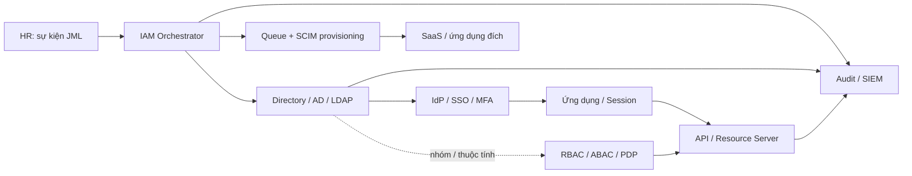
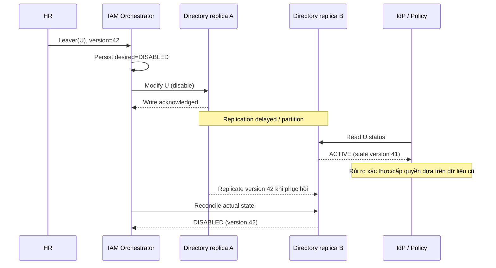

# Directory outage: Ứng phó khi kho danh tính không khả dụng

## 1. Directory là gì và tại sao outage ảnh hưởng toàn bộ IAM?

Trong quản lý danh tính và truy cập (**Identity and Access Management – IAM**), **directory** là dịch vụ lưu trữ, tra cứu và trong nhiều kiến trúc còn xác thực thông tin danh tính: tài khoản, định danh ổn định, nhóm, thuộc tính, trạng thái kích hoạt/khóa và quan hệ tổ chức. Một số triển khai phổ biến:

- **Active Directory Domain Services (AD DS)**: directory dùng trong môi trường Windows, cung cấp LDAP, Kerberos, domain controller (DC), chính sách và dịch vụ liên quan.
- **OpenLDAP hoặc directory LDAP khác**: lưu đối tượng và thuộc tính, đáp ứng các thao tác LDAP như search/bind/modify.
- **Managed directory** trên hạ tầng đám mây: cung cấp chức năng directory với cơ chế độ sẵn sàng, backup, giới hạn vận hành và SLA tùy nhà cung cấp.
- **Identity store nội bộ của một IdP**: một số IdP lưu danh tính ngay trong database của mình; chúng không nhất thiết phụ thuộc LDAP/AD ở mỗi lần đăng nhập.

**Directory outage** là tình huống directory không thể trả lời đáng tin cậy các thao tác cần thiết trong thời gian cam kết. Đó có thể là mất kết nối hoàn toàn, chỉ mất quyền ghi, search quá chậm, một domain controller ngừng hoạt động, lỗi DNS discovery, replication bị đình trệ hoặc dữ liệu giữa các replica không nhất quán.

Trong mô hình vòng đời **Joiner – Mover – Leaver (JML)**, directory thường nằm trên đường đi từ xác minh danh tính đến quản lý tài khoản và quyền:

1. **Joiner**: tạo danh tính, tạo account, đặt trạng thái và group ban đầu, đồng bộ vào IdP/ứng dụng.
2. **Mover**: cập nhật bộ phận, vai trò, membership, thuộc tính phục vụ **RBAC/ABAC**.
3. **Leaver**: disable account, xóa group/role, chặn đăng nhập và phối hợp thu hồi phiên/token/credential trên các hệ thống khác.

Outage của directory có thể chặn cả ba luồng. Tuy nhiên, mức ảnh hưởng phải được kiểm chứng ở từng ứng dụng: không phải IdP nào cũng gọi LDAP trực tuyến cho mọi đăng nhập, và không phải API nào cũng cần đọc directory trên mỗi request.

### Mục tiêu học tập

Sau bài này, bạn có thể:

1. Phân biệt **directory outage**, **IdP outage** và lỗi **provisioning/SCIM**.
2. Chỉ ra ảnh hưởng của lỗi search, bind, modify, replication và DNS/Kerberos theo từng luồng xác thực và phân quyền.
3. Thiết kế replica, failover, cache, queue và reconciliation với giới hạn bảo mật rõ ràng.
4. Đặt ưu tiên cho Leaver và quyền đặc quyền khi dữ liệu danh tính không nhất quán.
5. Thực hiện chẩn đoán, khôi phục và kiểm thử mà không đánh đổi bảo mật lấy availability.

## 2. Directory, IdP, nguồn HR và ứng dụng là những lớp khác nhau

**HR system** thường là nguồn chuẩn cho quan hệ nhân sự (ai gia nhập, chuyển vai trò hay nghỉ việc). **Directory** có thể là nguồn chuẩn cho trạng thái tài khoản và membership trong domain. **IdP** xác thực người dùng và phát thông tin xác thực cho ứng dụng. **SCIM** lan truyền account/group sang hệ thống đích. **Resource server** thực thi quyền trên request. Ranh giới cụ thể tùy tổ chức; không mặc định một hệ thống là nguồn chuẩn cho mọi thuộc tính.



Sơ đồ là một kiến trúc ví dụ. Trong thực tế, ứng dụng có thể truy cập directory trực tiếp, IdP có thể dùng kho danh tính nội bộ, và SCIM có thể đồng bộ từ hoặc đến directory. Khi incident xảy ra, cần vẽ **đường phụ thuộc thật** thay vì cho rằng mọi mũi tên đều bắt buộc.

### Các thao tác directory có yêu cầu availability khác nhau

| Thao tác | Ví dụ | Nếu không thực hiện được |
|---|---|---|
| **Search / read** | Tra user theo ID, lấy membership/attribute | Không tra được account hoặc policy dùng dữ liệu cũ |
| **Bind / authentication** | LDAP bind với danh tính người dùng | Đăng nhập có thể thất bại nếu phụ thuộc bind trực tiếp |
| **Write / modify** | Tạo account, đổi group, disable user | JML bị đình trệ dù các lần search vẫn thành công |
| **Replication** | Truyền thay đổi giữa DC/replica/region | Có thể đọc trạng thái cũ hoặc đảo ngược hiệu lực disable |
| **Directory discovery** | DNS SRV, site-aware DC selection | Client không tìm được máy chủ dù một số DC vẫn khỏe |
| **Kerberos / KDC** | Xin ticket cho đăng nhập domain | Có thể ảnh hưởng Windows logon, service auth và SSO Kerberos |
| **Group/attribute synchronization** | Đồng bộ membership sang IdP, SaaS hoặc PDP | RBAC/ABAC có thể phân quyền theo thông tin cũ |

**Read availability** và **write availability** phải đo riêng. Một directory trả search 200 ms bình thường vẫn có thể bị kẹt ghi, dẫn đến các yêu cầu Leaver không được áp dụng.

## 3. Những dạng Directory outage thường gặp

### 3.1 Mất một domain controller hoặc LDAP node

Client có thể chuyển sang replica khác nếu discovery, connection pool, chứng thư và cấu hình cho phép. Nếu client hardcode một hostname/IP đơn lẻ, mất một máy chủ có thể thành outage dù cả cluster vẫn khỏe.

Trong AD DS, domain controller cung cấp nhiều dịch vụ hơn LDAP. Cần quan sát DNS, Kerberos, Netlogon, Global Catalog (nếu dùng), các dependency về replication và thời gian hệ thống.

### 3.2 Mất cả availability zone/region hoặc đường mạng

Nhiều replica ở cùng zone, cùng switch, cùng storage, cùng service account vận hành hoặc cùng hạ tầng DNS vẫn có điểm lỗi chung. Kết nối giữa các khu vực có thể bị partition: mỗi bên phục vụ được một phần request nhưng trạng thái danh tính không đồng bộ.

### 3.3 Directory vẫn đọc được nhưng không ghi được

Ví dụ backend storage chuyển sang read-only hoặc leader viết không sẵn sàng. Lookup group vẫn hoạt động, đăng nhập hiện hữu có thể không bị ảnh hưởng, nhưng **disable Leaver**, đổi role hoặc cập nhật thuộc tính lại lỗi. Đây thường là tình huống khó phát hiện nếu health check chỉ chạy search đơn giản.

### 3.4 Replication lag hoặc dữ liệu sai lệch

DC A nhận lệnh disable, DC B chưa nhận; client được chuyển sang B và nhìn thấy `enabled=true`. Với thuộc tính phục vụ ABAC hoặc nhóm quyền nhạy cảm, việc đọc replica chậm có thể gây **stale authorization**. Cần đo lag, version và độ hội tụ, thay vì chỉ đếm số node còn sống.

### 3.5 DNS, certificate, TLS hoặc time synchronization lỗi

Directory có thể khỏe nhưng client không tìm được endpoint vì DNS SRV sai/hết hạn, TLS handshake lỗi do chứng thư, firewall chặn cổng, hoặc đồng hồ lệch làm Kerberos từ chối ticket. Không nên kết luận “database down” khi mới thấy timeout ở IdP.

### 3.6 Thay đổi schema, ACL, mật khẩu bind account hoặc chính sách

Một thay đổi cấu hình sai có thể khiến service bind không còn quyền search, filter không tìm thấy user, hoặc thao tác modify nhận lỗi phân quyền. Đây là **lỗi logic của dịch vụ directory**: thêm replica không nhất thiết khắc phục được. Cần nhật ký thay đổi và quy trình rollback được kiểm thử.

### 3.7 Directory bị nghi xâm nhập

Nếu nghi có tài khoản quản trị hoặc dữ liệu directory bị thay đổi trái phép, việc khôi phục availability ngay bằng cách bỏ kiểm tra hoặc chuyển sang replica chưa tin cậy có thể mở rộng tác động. Cần phối hợp Security/Incident Response để xác định hệ thống sạch và giới hạn đường xác thực trong khi điều tra.

## 4. Tác động cụ thể lên xác thực và quyền truy cập

### 4.1 Đăng nhập qua LDAP bind

Một ứng dụng hoặc IdP có thể xác thực bằng cách tìm user, rồi thực hiện LDAP bind với thông tin đăng nhập do người dùng cung cấp qua kết nối bảo mật. Nếu directory không đáp ứng, đăng nhập mới thường thất bại. Nếu user bị sai mật khẩu, đó là từ chối hợp lệ; cần phân biệt với timeout hoặc lỗi directory.

Các lỗi thường thấy:

- **Timeout / unavailable**: không tạo được kết nối hoặc không nhận được phản hồi.
- **Invalid credentials**: bind bị từ chối; có thể do mật khẩu sai, user bị khóa, cấu hình bind account lỗi hoặc các trạng thái cụ thể của sản phẩm.
- **No such object**: base DN/filter không phù hợp hoặc đối tượng chưa hiện trên replica.
- **Insufficient access rights**: service account không có quyền đọc/ghi cần thiết.

Không nên tự động đổi một lỗi “directory unavailable” thành “mật khẩu sai”; điều này gây khó chẩn đoán và có thể thúc đẩy người dùng thử lại liên tục.

### 4.2 Đăng nhập Kerberos / AD DS

Trong môi trường Active Directory, **Key Distribution Center (KDC)** trên domain controller phát hành Kerberos tickets. Outage có thể ảnh hưởng đăng nhập domain, lấy ticket mới và xác thực dịch vụ. Một số **ticket còn hiệu lực** hoặc credential cache có thể giúp một số tác vụ tiếp tục, tùy thiết bị, chính sách, server và luồng thực tế.

Cần phân biệt:

1. Có thể đăng nhập vào máy với **cached interactive credentials** trong điều kiện chính sách cho phép.
2. Có thể lấy **Kerberos TGT/service ticket mới** từ DC.
3. Có thể truy cập tài nguyên mạng đòi ticket, nhóm mới hoặc authorization check hiện hành.

Ba điều đó không tương đương. Cached logon của máy trạm không chứng minh rằng quyền mới hoặc việc disable tài khoản đã được thực thi ở các dịch vụ mạng.

### 4.3 SSO qua OIDC/SAML

Nếu IdP cần directory cho **mỗi lần xác thực**, sự cố directory có thể kéo theo login outage. Nếu IdP có kho danh tính riêng, đồng bộ theo đợt hoặc phiên SSO đang còn, tác động có thể nhỏ hơn. Cần kiểm tra:

- IdP truy vấn directory lúc login, lúc cấp token mới, lúc refresh hay chỉ trong provisioning?
- User status/group được lấy từ directory trực tuyến hay từ bản sao nội bộ?
- Group claims được đóng vào token lúc phát hành hay được query sau này?
- Ứng dụng đã có phiên riêng hay buộc reauthentication mỗi request?

**Không suy từ availability của IdP health endpoint ra tính đúng đắn của danh tính.** Login có thể trả thành công nhưng group/attribute đã cũ.

### 4.4 API có access token JWT hoặc opaque token

API xác minh JWT cục bộ qua chữ ký, `iss`, `aud`, `exp` và scope có thể tiếp tục chạy khi directory không khả dụng, nếu không cần query directory/PDP trực tuyến. Nhưng token được cấp trước khi Mover/Leaver xảy ra có thể chứa quyền cũ.

API dùng opaque token introspection hay policy engine cần directory theo mỗi request có thể thất bại. Cache introspection/group/attribute làm giảm phụ thuộc đồng bộ nhưng tăng độ trễ áp dụng thay đổi quyền. Với request nhạy cảm, cần quy định **fail closed** khi không thể xác minh trạng thái bắt buộc.

### 4.5 SCIM và dữ liệu các ứng dụng đích

SCIM không bắt buộc directory là thành phần runtime của mọi giao dịch. Một client có thể vẫn gửi lệnh tới SaaS khi directory down nếu IAM orchestration có trạng thái mong muốn và thông tin xác thực độc lập. Ngược lại, nếu SCIM job cần đọc group/attribute từ directory mới chạy được, sẽ có backlog.

Không nên gộp lỗi **directory replication**, **IdP sync** và **SCIM propagation** thành một đồng hồ: mỗi chặng có độ trễ, retry và bằng chứng hoàn thành riêng.

## 5. Mô hình tác động theo Joiner – Mover – Leaver

### 5.1 Joiner: không tạo được danh tính/tài khoản

Luồng ví dụ:

```text
HR xác nhận nhân viên mới
  -> IAM chuẩn hóa employeeId và thuộc tính
  -> directory tạo account / đặt group
  -> IdP cho phép xác thực
  -> SCIM cấp user và quyền ở SaaS
  -> đối soát kết quả từng đích
```

Nếu directory không cho ghi, IAM cần **lưu event vào kho bền vững** và ghi rõ trạng thái `PENDING_DIRECTORY`. Worker có thể retry có giới hạn khi directory khôi phục; phải dùng định danh ổn định/idempotency để tránh tạo trùng user sau timeout mà không biết lệnh trước đã thành công hay chưa.

**Nguyên tắc:** chỉ báo “đã tạo tài khoản” sau khi đã xác minh đối tượng thực sự tồn tại với ID và thuộc tính đúng. Không tạo account tạm thiếu liên kết tới HR/source of truth chỉ để bỏ qua outage.

### 5.2 Mover: lệch nhóm/thuộc tính tạo rủi ro quyền dư

Ví dụ nhân viên từ **Finance** chuyển sang **Support**:

- Nhóm `finance-approver` phải bị thu hồi theo thời điểm hiệu lực.
- Nhóm `support-agent` có thể được cấp sau kiểm tra điều kiện.
- Thuộc tính `department` dùng cho ABAC cần cập nhật.
- IdP/group sync/SCIM target phải hội tụ về trạng thái mới.

Nếu chỉ một replica nhận role removal nhưng replica khác vẫn trả membership cũ, một policy engine có thể tiếp tục cho phép tài nguyên Finance. Nếu ứng dụng SaaS đã có phiên độc lập, tình trạng quyền dư còn có thể tồn tại ngoài directory.

Vì vậy hệ thống cần theo dõi **desired state vs actual state**, version sự kiện và trạng thái xác nhận của từng enforcement point. Với vai trò đặc quyền, có thể tạm chặn giao dịch rủi ro khi membership chưa nhất quán, theo chính sách đã phê duyệt.

### 5.3 Leaver: bài toán quan trọng nhất của directory outage

Khi nhân viên nghỉ việc, **không thể chỉ chờ directory phục hồi rồi mới nghĩ đến thu hồi quyền**. Một phương án xử lý an toàn tùy kiến trúc có thể gồm:

1. Ghi bền vững event Leaver cùng thời điểm hiệu lực, chủ thể ổn định và deadline cho từng hệ thống.
2. Gửi disable account vào directory nếu còn đường ghi khả dụng; đọc lại từ đường phù hợp để xác nhận.
3. Song song kích hoạt thu hồi ở IdP, session, refresh token, SaaS và hệ thống quản trị nếu các đường đó **thực sự độc lập** với directory đang lỗi.
4. Ghi trạng thái đích `CONFIRMED_DISABLED`, `PENDING`, `RETRYING` hoặc `ESCALATED`; không gán “completed” chỉ vì hàng đợi đã nhận message.
5. Nếu một đích không xác nhận trong deadline bảo mật, chuyển xử lý khẩn cấp theo owner và quy trình sự cố.
6. Sau recovery, đối soát danh tính, membership, credential, session/token và audit; đo **residual access window** thực tế.

Nếu các ứng dụng vẫn chấp nhận JWT cũ hoặc phiên cục bộ, disable account trong directory **không tự động hủy các bằng chứng truy cập đó**. Cần thiết kế cơ chế revocation theo hệ thống: token TTL ngắn, session invalidation, event-driven denylist, kiểm tra trạng thái tài khoản đối với tài nguyên nhạy cảm hoặc giới hạn degraded mode.

### 5.4 Service account, bind account và workload identity

Tài khoản dịch vụ có thể là đối tượng trong directory, tài khoản bind dùng để tra cứu LDAP hoặc một workload identity độc lập. Hãy phân biệt rõ:

- **Bind account** bị khóa/hết hạn secret: mọi ứng dụng dùng account này để tra cứu directory có thể cùng thất bại, kể cả khi directory còn khỏe.
- **Service account dạng domain**: có thể phụ thuộc AD/Kerberos cho ticket mới và điều kiện quyền.
- **Workload identity không dùng directory**: có thể không bị ảnh hưởng bởi directory outage.

Để giảm blast radius, dùng danh tính riêng theo ứng dụng, quyền tối thiểu, xoay secret có kiểm soát, monitor expiration và dự phòng theo đúng cơ chế sản phẩm. Không chia sẻ một tài khoản bind quyền cao cho mọi hệ thống.

## 6. Khác nhau giữa lỗi ghi, đọc, replication và phân quyền

Giả sử ở thời điểm `T1`, IAM muốn vô hiệu hóa người dùng `U`. Có ba đại lượng cần theo dõi:

- **Desired state**: IAM đã ghi nhận `U.disabled=true` theo quyết định nhân sự.
- **Committed directory state**: một điểm ghi đã xác nhận thay đổi, theo mức bảo đảm của directory.
- **Enforced state**: các dịch vụ nhận quyết định truy cập đã thấy trạng thái mới và chặn user.

Ba trạng thái không nhất thiết đổi đồng thời. Chẳng hạn:



Đây là ví dụ logic để hiểu rủi ro, không mô tả chính xác định dạng replication/version của một sản phẩm cụ thể. Đừng giả định mọi directory hỗ trợ read-after-write trên replica khác, transaction xuyên region hoặc cùng thứ tự toàn cục cho mọi object.

### Invariant bảo mật cần bảo vệ

Đối với tài khoản vừa bị disable:

> Khi hệ thống đã thông báo thu hồi hoàn tất theo hợp đồng, mọi điểm thực thi quyền nằm trong phạm vi cam kết phải từ chối phiên và quyền không còn hợp lệ trong deadline đã quy định.

Muốn giữ invariant này khi partition/failover, cần có cơ chế thích hợp như **chọn đường đọc đủ mới**, kiểm tra replication watermark, fencing nguồn ghi cũ, tạm từ chối các thao tác nhạy cảm nếu replica chưa hội tụ, và reconciliation sau chuyển vùng. Cách triển khai tùy AD DS, LDAP server và các hệ thống đứng sau.

## 7. Thiết kế directory có khả năng chịu lỗi

### 7.1 Replica theo failure domain

Không chỉ tăng số node. Cần xét:

| Lớp phụ thuộc | Ví dụ lỗi | Cách giảm tác động |
|---|---|---|
| Node/VM | DC hoặc LDAP process chết | Nhiều instance độc lập, health checking |
| Zone/site | Mất toàn zone hoặc mạng nội bộ | Replica ở failure domain khác, đường mạng dự phòng |
| Storage/database | Disk I/O lỗi, storage readonly | Giám sát storage, backup, failover phù hợp |
| DNS/discovery | Sai SRV record, client giữ DC cũ | DNS dự phòng, client discovery đúng, TTL và cache được kiểm thử |
| TLS/certificate | Cert hết hạn, chain không tin cậy | Lifecycle cert, alert trước hạn, kiểm thử mTLS/LDAPS |
| Clock/Kerberos | Skew lớn, KDC không khả dụng | Time sync đáng tin cậy và kiểm tra ticket issuance |
| Service credential | Bind account bị khóa hoặc đổi mật khẩu | Account riêng, secret rotation, cảnh báo, recovery runbook |
| Replication | Stale group/disabled flag | Đo lag, convergence, đối soát và giới hạn failover |

Đối với **AD DS**, thiết kế nhiều DC, site/subnet và DNS đúng topology; kiểm tra nhu cầu Global Catalog và khả năng xử lý vai trò đặc biệt (nếu có). Đối với **LDAP khác**, xem rõ cơ chế multi-master/single-writer, leader election, đồng bộ replication và xử lý xung đột. Một mẫu không áp dụng mặc định cho mọi sản phẩm.

### 7.2 Kết nối client và failover

Client có thể dùng service discovery hoặc danh sách endpoint đáng tin cậy, với connection pool biết làm mới kết nối bị lỗi. Khi chuyển máy chủ, cần giữ:

- **TLS verification** cho hostname/certificate, không tắt xác minh chứng thư.
- Authentication/bind đúng account và quyền; không dùng account admin làm fallback mặc định.
- Timeout ngắn hợp lý, retry có **exponential backoff + jitter** và giới hạn tổng số lần thử.
- Circuit breaker, capacity control và dashboard để tránh retry storm.
- Tách lỗi network, lỗi credential và lỗi authorization; không coi mọi kết nối thất bại là cần chuyển sang một account khác.

Nếu client ghi dữ liệu, phải xác nhận semantics khi retry: lệnh trước có thể đã thực thi dù client timeout trước khi nhận response. Đọc lại trạng thái rồi mới quyết định retry để tránh tạo duplicate hoặc cập nhật sai.

### 7.3 Read replica và cache

Replica/caching hữu ích cho search/read nhưng tồn tại chi phí nhất quán:

- Dữ liệu tên hiển thị hoặc thuộc tính ít nhạy cảm có thể chịu được TTL dài hơn.
- Group quyền truy cập và trạng thái account phải có deadline đồng bộ rõ ràng.
- Với quyền đặc quyền, có thể yêu cầu source đủ mới hoặc fail closed khi không xác minh được.
- Invalidation/revocation event cần được theo dõi đến khi áp dụng, không chỉ phát ra.

**Không cache kết quả “user enabled” vô thời hạn.** Cache bị stale đúng thời điểm Leaver có thể biến sự cố directory thành cửa sổ truy cập trái phép.

### 7.4 Chế độ dự phòng và break-glass

Nếu admin SSO hoặc tài khoản domain đều phụ thuộc directory hỏng, đội vận hành có thể mất quyền sửa hệ thống. Cần đường **break-glass** độc lập với thành phần dự kiến lỗi, có MFA mạnh phù hợp, phạm vi quyền nhỏ, credential lưu an toàn, giám sát và diễn tập. Không sử dụng tài khoản chung quyền cao không kiểm toán.

Sự độc lập phải được **kiểm thử thực tế**. Một tài khoản dự phòng vẫn phải bind vào cùng directory mất kết nối sẽ không giúp phục hồi.

## 8. Failover an toàn khi dữ liệu danh tính chưa đồng bộ

Đề xuất một quy trình theo điều kiện:

1. **Xác định nguồn ghi hiện tại** và những replica còn khỏe, có thể truy xuất.
2. **Chứng minh dữ liệu quan trọng còn mới**: account disable, group removal, privileged role change, service credential revocation.
3. **Kiểm tra consistency/fencing** để không có hai bên tiếp nhận các thay đổi mâu thuẫn trong tình huống split brain.
4. **Chọn tập thao tác được phục vụ**: có thể mở lại read/search ở phạm vi ít nhạy cảm trước; giữ các thao tác đặc quyền ở trạng thái hạn chế nếu chưa chắc chắn.
5. **Chuyển client theo đường được hỗ trợ** và xác nhận DNS/discovery, TLS, bind, search, write, Kerberos và IdP login.
6. **Reconcile** trên toàn bộ replica và hệ thống đích trước khi đóng incident.

### Active-active không đồng nghĩa với nhất quán tức thời

Một hệ thống có nhiều replica nhận ghi vẫn phải giải quyết:

- Xung đột thuộc tính hoặc group membership khi thay đổi đồng thời.
- Thứ tự sự kiện khi một replica nhận `disable` và replica khác nhận `enable`.
- Lỗi cũ tái xuất sau khi partition được nối lại.
- Việc application đọc replica gần nhất nhưng chậm replication.

Đối với những trạng thái có ý nghĩa bảo mật như **disabled user**, phải định nghĩa chủ sở hữu ghi và quy tắc giải quyết xung đột trước sự cố. Một thao tác “last write wins” không được kiểm soát có thể tái kích hoạt tài khoản đã thu hồi.

### Khôi phục từ backup

Backup là lớp phòng thủ cuối khi directory bị mất dữ liệu hoặc hỏng logic. Quy trình restore phải theo hướng dẫn riêng của sản phẩm và topology, bảo đảm:

- Biết rõ phạm vi phục hồi (node, object, domain, forest/cluster).
- Biết trạng thái cần bảo tồn sau thời điểm backup, đặc biệt các sự kiện disable/remove privilege.
- Kiểm tra replication sau restore trước khi cho workload nhạy cảm tiếp tục.
- Có journal/audit của JML để replay đúng thứ tự/phiên bản khi cần.
- Không làm mất hoặc tự tái kích hoạt account Leaver do sử dụng snapshot cũ.

Với AD DS, **authoritative/non-authoritative restore** và tình huống forest recovery có quy tắc riêng. Không tự chạy lệnh restore/replication chưa được thiết kế và diễn tập trong runbook.

## 9. Chẩn đoán khi directory bị báo lỗi

### 9.1 Xác định lỗi ở tầng nào

Lập thứ tự kiểm tra từ bên ngoài vào trong:

1. **Ảnh hưởng người dùng**: login SSO, đăng nhập domain, truy cập ứng dụng, SCIM và quyền bị lỗi ở đâu?
2. **Tên và đường mạng**: DNS resolve/SRV, đường route, firewall, proxy, mất site/region.
3. **TLS và kết nối**: endpoint LDAPS/StartTLS, certificate/chain, socket timeout, connection pool.
4. **Directory protocol**: bind thành công không? Search đúng base/filter? Modify được không? KDC trả ticket mới không?
5. **Dữ liệu**: user có tồn tại, `disabled`/group có đúng, replica nào đang trả lời, replication lag bao nhiêu?
6. **Tích hợp**: IdP có dùng directory trực tuyến hay sync nội bộ? SCIM/policy engine có backlog không?
7. **Thay đổi gần đây**: schema, ACL, bind secret, certificate, DNS, group policy, firewall, deployment.

### 9.2 Dấu hiệu và cách diễn giải

| Dấu hiệu | Có thể do | Kiểm tra bổ sung |
|---|---|---|
| TCP timeout đến LDAP server | Network, service down, firewall, endpoint sai | DNS, route, port, health của node |
| TLS handshake fail | Cert/hostname/chain/phiên bản TLS | Certificate và trust store ở client |
| LDAP bind invalid credentials | Mật khẩu sai, account lock, bind account bị đổi/khóa | Đối chiếu thử nghiệm với account kiểm thử và audit |
| Search trả 0 kết quả | Filter/base DN sai, replica lag, object bị di chuyển/xóa | Thử trên nguồn đủ mới và so sánh DN |
| Search thành công, Modify thất bại | ACL, read-only node, backend write, constraint | Result code, audit, trạng thái writer |
| Một DC báo user active, DC khác disabled | Replication lag, conflict hoặc stale read | Replication health, timestamp/version hợp lệ |
| Kerberos failure nhưng LDAP search tốt | KDC, DNS, time skew, SPN | Nhật ký KDC, DNS/time và flow Kerberos |
| IdP login lỗi nhưng directory search tốt | MFA, IdP config, client mapping, auth policy | Theo dõi trace của IdP qua các bước |

Đừng ghi lại mật khẩu của người dùng hoặc secret của service account để tiện debug. Hãy dùng **test identity** có quyền tối thiểu và correlation ID, và bảo vệ dữ liệu cá nhân trong log.

### 9.3 Lệnh kiểm tra đọc an toàn (ví dụ)

Trên máy có công cụ phù hợp, có thể kiểm tra DNS SRV cho AD:

```bash
# Miền dưới đây chỉ là dữ liệu ví dụ.
dig SRV _ldap._tcp.example.org
dig SRV _kerberos._tcp.example.org
```

Một truy vấn LDAP chỉ đọc, qua LDAPS và yêu cầu nhập mật khẩu tương tác:

```bash
ldapsearch -x \
  -H ldaps://directory.example.org \
  -D "uid=iam-observer,ou=svc,dc=example,dc=org" -W \
  -b "ou=people,dc=example,dc=org" \
  "(uid=test-user-001)" dn
```

**Chú ý:** DN/base/filter trên chỉ minh họa. `-x` dùng simple bind; phải xác minh TLS và certificate đúng chuẩn. Tùy sản phẩm, DN của service account và thuộc tính để tìm user có thể khác. Không thử bằng tài khoản người dùng thật hoặc tài khoản admin rộng quyền khi không cần thiết.

Với môi trường Windows/AD DS, đội vận hành có thể sử dụng công cụ chẩn đoán:

```powershell
# Ví dụ chỉ đọc: xác định DC và tổng quan replication.
nltest /dsgetdc:example.org
repadmin /replsummary
dcdiag /q
```

Cần quyền và công cụ phù hợp. Kết quả của `repadmin`/`dcdiag` phải được diễn giải theo domain/site topology; không dùng lệnh can thiệp replication trong lúc chưa xác định nguồn lỗi. Không chạy những lệnh trên hệ thống không được phép truy cập.

## 10. Runbook xử lý Directory outage

### Giai đoạn A — Phát hiện, phân loại (T0)

1. Nhận cảnh báo từ synthetic bind/search, thao tác write canary an toàn nếu có, IdP login, Kerberos, replication và JML backlog.
2. Phân loại **read unavailable**, **write unavailable**, **replication stale**, **site partition**, **security compromise**.
3. Xác định scope: một node, một site, một tenant/domain, tất cả DC, một service account hay một nhóm ứng dụng.
4. Xác định luồng thiết yếu: login mới, API/SSO phiên cũ, Joiner, Mover, Leaver, tài khoản dịch vụ và admin.
5. Chỉ định incident commander, directory operator và security owner; dùng kênh liên lạc không phụ thuộc chính directory bị lỗi.

### Giai đoạn B — Giảm thiểu tác động

1. Hạn chế retry storm tại IdP/ứng dụng, đặt timeout và backoff; tránh làm cạn connection pool.
2. Cho phép những request **đã được xác thực và ủy quyền** theo degraded policy duyệt trước; không tự “bypass LDAP login”.
3. Ghi bền vững mọi event JML; ưu tiên **Leaver và privileged role removal**.
4. Nếu cần failover, xác minh replica, DNS/TLS/Kerberos và **độ mới của trạng thái disable/role**.
5. Nếu có nghi compromise, phối hợp an ninh trước khi khởi động lại, restore hoặc đổi tuyến có thể phá bằng chứng.
6. Khi cần quản trị, dùng break-glass được quản lý và kiểm toán.

### Giai đoạn C — Khôi phục

1. Khôi phục hạ tầng lỗi (network, DNS, TLS, storage, node, directory writer, KDC) theo runbook sản phẩm.
2. Kiểm tra cả **search/read** và **create/modify** bằng đối tượng thử nghiệm có vòng đời rõ ràng, trong môi trường được cho phép.
3. Xác nhận replication có hội tụ, user disabled và group membership mới không bị đảo ngược.
4. Kiểm tra login OIDC/SAML, Kerberos, LDAP bind, client credentials tùy dependency, API và chính sách nhạy cảm.
5. Điều tiết backlog JML: retry idempotent, đối soát theo event ID, tránh đẩy đồng loạt quá tải directory vừa phục hồi.

### Giai đoạn D — Bảo đảm dữ liệu và đóng sự cố

1. Đọc lại trạng thái thực tế của mọi Leaver và Mover liên quan, qua các replica và hệ thống đích được quy định.
2. Xác minh IdP đã chặn login mới, token/session/credential tồn dư được xử lý theo giới hạn bảo mật.
3. Đối chiếu group/attribute và SCIM đối với từng Joiner/Mover; xử lý duplicate và sai lệch.
4. Rà soát audit gap, break-glass, credential đã dùng và quyền tạm.
5. Ghi RTO/RPO thực tế, MTTD/MTTR, root cause, độ trễ replication, thời gian tồn dư quyền, hành động phòng ngừa.

Chỉ công bố kết thúc hoàn toàn khi **luồng người dùng đã phục hồi và trạng thái bảo mật/JML đã được kiểm chứng**.

## 11. Giám sát và SLO cần có

### 11.1 Không dùng một chỉ số “LDAP up”

| Luồng | SLI gợi ý | Vì sao quan trọng |
|---|---|---|
| Directory read | Tỷ lệ search/bind hợp lệ hoàn tất trong ngưỡng thời gian | Login và tra cứu attribute phụ thuộc kết quả đọc |
| Directory write | Tỷ lệ tạo/sửa/disable user được xác nhận trong ngưỡng | Trạng thái JML có thể bị kẹt dù read vẫn ổn |
| Replication | Tuổi lớn nhất của update chưa hội tụ tại replica cần phục vụ | Giảm rủi ro đọc role/disabled flag cũ |
| OIDC/SAML end-to-end | Tỷ lệ login thực tế hoàn tất đúng thời gian và chính sách | Đo trải nghiệm thực chứ không chỉ process health |
| Kerberos/KDC | Tỷ lệ ticket issuance mới thành công, phân nhóm lỗi | Đánh giá xác thực domain thực tế |
| Leaver | Thời gian từ effective time đến khi từng enforcement point xác nhận disable | Đo quyền truy cập tồn dư |
| SCIM/Provisioning | Tuổi sự kiện lớn nhất, backlog, retry và DLQ | Nhận diện thay đổi danh tính chưa lan truyền |
| Security correctness | Số quyết định truy cập dùng stale data vượt giới hạn, audit gap | Tránh “availability cao nhưng cấp quyền sai” |

Tách các lỗi hợp lệ như sai mật khẩu, user bị khóa đúng chính sách hoặc policy từ chối có chủ đích khỏi lỗi hệ thống. Cùng lúc cần báo riêng tỷ lệ bị từ chối do **dữ liệu cũ hoặc control plane không khả dụng**.

### 11.2 Ví dụ mục tiêu đo lường

Các số sau chỉ để minh họa cách đặt mục tiêu:

- Search SLO: ≥ 99,95% giao dịch hợp lệ dưới 500 ms trong 30 ngày.
- Write/disable SLO: ≥ 99,9% yêu cầu hợp lệ được xác nhận trong 60 giây, nếu hệ thống thực tế hỗ trợ.
- Directory replication: cảnh báo nếu nhóm thuộc tính bảo mật quan trọng chưa hội tụ trong deadline đặt trước.
- Leaver residual access: mỗi hệ thống đích có deadline thu hồi và owner escalation riêng.
- RTO site failover: mục tiêu 30 phút, RPO giới hạn theo phân loại thay đổi danh tính.

Không thể tuyên bố **RPO = 0** chỉ vì nhiều DC cùng tồn tại; phải dựa trên cơ chế commit/replication và bài kiểm thử mất vùng thật.

### 11.3 Cảnh báo theo triệu chứng trước khi outage toàn phần

Quan sát connection errors, pool exhaustion, p95/p99 search/bind, write error, DNS discovery, TLS/cert expiration, clock drift, replication backlog, oldest JML event, `disabled` state mismatch giữa các điểm đọc và tỷ lệ lỗi login liên quan directory. Tạo cảnh báo ưu tiên cao khi có **Leaver quá hạn hoặc quyền đặc quyền chưa được thu hồi**, kể cả khi dashboard máy chủ vẫn xanh.

## 12. Game day: kiểm thử chịu lỗi và bảo mật

Mỗi bài kiểm thử cần có **failure injection có kiểm soát**, mục tiêu bảo mật/availability, người chịu trách nhiệm, điều kiện dừng, rollback và bằng chứng. Dùng môi trường thử hoặc tài khoản thử nghiệm được ủy quyền.

| Kịch bản | Kết quả mong đợi | Bằng chứng |
|---|---|---|
| Tắt một LDAP node/DC | Client chọn được endpoint còn khỏe; không bypass TLS | Kết nối, failover time, login/search success |
| Chặn DNS SRV hoặc đổi IP giả lập | Client phát hiện lỗi đúng và khôi phục khi DNS đúng lại | DNS trace, endpoint selected |
| Chặn bind account của IdP | Phân loại lỗi credential khác network; cảnh báo | Bind result code, IdP logs |
| Chỉ chặn thao tác ghi | Login có thể tiếp tục; Joiner/Mover/Leaver được queue, cảnh báo đúng | Write SLI, JML status, audit |
| Tăng replication delay | Không cấp quyền nhạy cảm dựa trên membership stale ngoài giới hạn | Replica state, policy decision |
| Disable user trước failover | User không được tái kích hoạt do replica cũ | State readback và login denial |
| Mất KDC nhưng LDAP còn khỏe | Xác định đúng các luồng Kerberos lỗi và phiên cũ còn gì | Ticket tests, client traces |
| Directory outage khi một Leaver phát sinh | Những đường revoke độc lập tiếp tục; target lỗi có escalation | Target confirmation, residual window |
| Khôi phục snapshot directory cũ trong sandbox | Reconcile các lệnh revoke xảy ra sau snapshot | Event journal, account state |
| Break-glass trong lúc SSO/domain lỗi | Đường quản trị khẩn cấp hoạt động độc lập và được log | Session log, alert, cleanup |

### Ví dụ tiêu chí nghiệm thu cho kịch bản replication lag

1. Ghi event disable người dùng thử vào kho IAM; nhận version và thời điểm hiệu lực.
2. Tạo điều kiện để một replica chưa nhận cập nhật.
3. Gửi request login hoặc truy cập tài nguyên được bảo vệ từ đường đọc replica đó.
4. Xác minh hệ thống hành xử đúng chính sách: từ chối/tạm hoãn các thao tác yêu cầu trạng thái mới nhất; không dùng một response stale làm bằng chứng user vẫn có quyền.
5. Khi replication khôi phục, xác minh mọi replica và SaaS target đã hội tụ; ghi thời gian **effective revocation**.

Thử nghiệm này phải có kết quả về **tính đúng đắn của quyền**, không chỉ tỷ lệ request HTTP 200.

## 13. Những anti-pattern dễ gặp

**Chỉ dùng một LDAP endpoint hardcode.** Khi node đó lỗi, toàn bộ ứng dụng lỗi dù replica khác còn sống. Cần cơ chế discovery/failover phù hợp và kiểm thử đường kết nối.

**Đọc replica gần nhất cho mọi quyết định nhạy cảm.** Replica chậm có thể trả user active hoặc membership cũ. Cần giới hạn freshness, phân loại quyết định và cơ chế từ chối an toàn khi cần.

**Đánh đồng search khỏe với directory khỏe.** Search có thể thành công trong khi write/disable bị chặn. Health và SLO phải đo riêng chức năng.

**Tạm cho tất cả user qua login vì LDAP timeout.** Điều này phá authentication. Duy trì phiên hoặc cache chỉ trong giới hạn token và chính sách đã được xác minh trước.

**Tăng TTL group cache không giới hạn.** Cache dài giảm tải nhưng làm kéo dài quyền cũ sau Mover/Leaver. TTL phải đi cùng yêu cầu revocation và cơ chế invalidation.

**Khôi phục backup xong là xong.** Snapshot có thể thiếu sự kiện HR, role removal hoặc disable xảy ra sau thời điểm backup. Bắt buộc replay/reconcile và kiểm tra không tái cấp quyền.

**Retry đồng loạt sau outage.** Hàng nghìn client cùng reconnect có thể gây thundering herd, khiến directory vừa lên lại sập tiếp. Dùng backoff, jitter, rate limiting và warm-up có kiểm soát.

**Dùng account bind chung có quyền quá rộng.** Một secret hết hạn hoặc bị khóa gây lỗi diện rộng, trong khi việc khôi phục bằng account admin chia sẻ tạo rủi ro bảo mật. Cần phân quyền tối thiểu và tách failure domain theo ứng dụng.

**Chỉ xem user bị disable trong directory.** JWT, session ứng dụng, Kerberos ticket hoặc SaaS credential có thể tiếp tục sống. Phải xác minh tại các enforcement point.

## 14. Checklist triển khai thực tế

### Kiến trúc

- [ ] Xác định directory nào là nguồn chuẩn của account, group, attribute và trạng thái khóa.
- [ ] Vẽ dependency từ HR → IAM → directory → IdP/SSO → ứng dụng/SCIM và từ directory đến PDP.
- [ ] Có nhiều replica/zone, DNS/discovery, TLS và KDC/Global Catalog theo topology cần thiết.
- [ ] Biết chính xác đường read, write và replication; không nhầm replica chỉ đọc với writer.
- [ ] Có backup được kiểm thử và journal để phục hồi thay đổi JML sau snapshot.

### Bảo mật

- [ ] JWT/session/cached group được giới hạn TTL, có chiến lược revocation.
- [ ] Các quyết định đặc quyền xử lý đúng khi trạng thái directory chưa đủ mới.
- [ ] Disable Leaver có target-level confirmation và escalation theo deadline.
- [ ] Tài khoản bind/service được phân quyền tối thiểu, secret rotation và monitoring.
- [ ] Break-glass độc lập với directory/SSO có thể gặp lỗi và được diễn tập.

### Vận hành

- [ ] Dashboard đo search, bind, write, replication, Kerberos, login, provisioning và residual access.
- [ ] Có synthetic checks và tài khoản thử nghiệm phù hợp, không ghi secret vào log.
- [ ] Runbook khoanh vùng DNS/TLS/network/ACL/config khác lỗi data hoặc replication.
- [ ] Tập dượt node/site failover, partition, stale reads, restore và backlog replay.
- [ ] Sau recovery, đối soát Leaver/Mover, session/token, group/SCIM và audit trước khi đóng incident.

## 15. Bài tập tình huống và câu hỏi ôn tập

### Tình huống A — LDAP search vẫn khỏe, disable thất bại

10:00, health check search trả kết quả bình thường. 10:03, HR gửi sự kiện Leaver khẩn cấp. Lệnh modify directory bị lỗi do backend read-only; IdP vẫn có phiên SSO cũ và một SaaS dùng session riêng.

**Yêu cầu:** xác định cách phát hiện write outage, những thao tác revoke có thể thực hiện độc lập, cách đánh dấu trạng thái theo từng đích và tiêu chí đóng incident.

*Gợi ý:* Tách read/write SLI, desired/committed/enforced state, durable queue, escalation Leaver và residual access.

### Tình huống B — Replication trễ sau failover

Directory replica A ghi nhận user U đã disable. Trước khi cập nhật đến replica B, zone A ngừng hoạt động; IdP chuyển truy vấn sang B và thấy U vẫn enabled.

**Yêu cầu:** nêu invariant cần bảo vệ, cách đánh giá dữ liệu đủ mới, lựa chọn degraded mode cho thao tác nhạy cảm và quy trình reconciliation khi zone A trở lại.

*Gợi ý:* Version/watermark, fencing, đích thực thi quyền và cách tránh hồi sinh account.

### Tình huống C — Một bind account làm lỗi nhiều ứng dụng

Một tài khoản service chung dùng cho năm ứng dụng tra cứu LDAP bị khóa sau khi mật khẩu xoay nhưng chỉ một phần ứng dụng cập nhật. Nhiều client ghi lỗi `invalid credentials` rồi retry liên tục.

**Yêu cầu:** đề xuất cách khoanh vùng, kiểm tra lỗi không lộ secret, khôi phục cấu hình an toàn và cải tiến phòng ngừa.

*Gợi ý:* Tách service identity, secret rotation có staging, cảnh báo, retry limit và quyền tối thiểu.

### Tình huống D — Cached logon và quyền truy cập mạng

Nhân viên đã từng đăng nhập vào laptop Windows có thể đăng nhập cục bộ khi máy không liên hệ được DC. Người đó vừa bị thu hồi quyền truy cập tài nguyên kế toán.

**Yêu cầu:** giải thích tại sao đăng nhập cục bộ thành công không có nghĩa vẫn được truy cập tài nguyên mạng; xác định những đường thực thi quyền cần kiểm tra.

*Gợi ý:* Cached interactive logon, Kerberos ticket, application session, tài nguyên cần authorization hiện hành và revocation.

## 16. Điều cần ghi nhớ

**Directory outage** không chỉ làm chậm tra cứu người dùng. Nó có thể ngăn xác thực, thay đổi account, cấp quyền mới và đặc biệt là **thu hồi quyền đúng hạn**. Việc directory còn đọc được chưa bảo đảm đang ghi và replication an toàn. Để duy trì khả năng phục hồi trong IAM, phải theo dõi riêng luồng read/write/replication, thiết kế failover có kiểm soát độ mới dữ liệu, duy trì event JML bền vững, ưu tiên Leaver, kiểm chứng quyền tại từng ứng dụng đích và đối soát toàn bộ trạng thái sau khi khôi phục.
