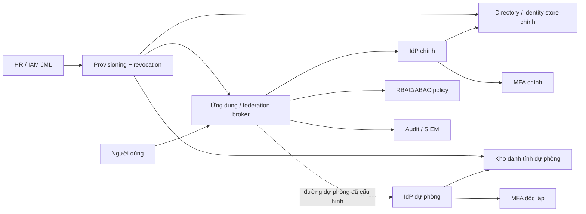
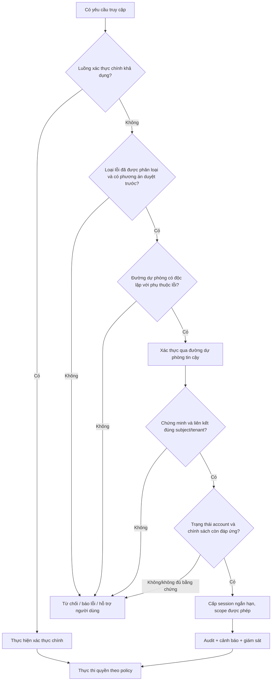

# Fallback authentication trong IAM: Đăng nhập dự phòng có kiểm soát

## 1. Fallback authentication là gì?

**Fallback authentication** (xác thực dự phòng) là tập hợp phương án đã được thiết kế, cấu hình và kiểm thử trước để người dùng hoặc workload có thể chứng minh danh tính bằng một con đường khác khi phương thức xác thực chính không khả dụng. Mục tiêu là duy trì khả năng truy cập **trong phạm vi quyền đã được phê duyệt**, kể cả khi **Identity Provider (IdP)**, SSO, một yếu tố MFA, directory hoặc đường mạng gặp sự cố.

Trong quản lý vòng đời danh tính (**Identity and Access Management – IAM**), fallback phải gắn với toàn bộ chu trình **Joiner – Mover – Leaver**. Một phương án dự phòng giúp người mới vào làm đăng nhập được nhưng không chặn người đã nghỉ việc thì chưa đạt yêu cầu. Nó cũng phải tương thích với việc quản lý nhóm và quyền theo **RBAC/ABAC**, đồng bộ **SCIM**, các tài khoản dịch vụ, kiểm toán và giới hạn **quyền truy cập tồn dư**.

Ví dụ: nhân viên dùng SSO qua OIDC, với passkey là phương thức xác thực chính. Khi thiết bị chứa passkey bị mất, tổ chức có thể cho phép dùng khóa bảo mật thứ hai đã đăng ký trước. Đây là **fallback của phương thức xác thực**. Nhưng nếu toàn bộ IdP ngừng hoạt động, việc đổi sang khóa thứ hai trên **cùng IdP** không giải quyết được lỗi dịch vụ. Khi đó chỉ một đường xác thực thay thế thực sự độc lập, đã thiết lập lòng tin trước, mới có thể giúp truy cập.

Ba khái niệm cần phân biệt:

| Khái niệm | Câu hỏi giải quyết | Ví dụ |
|---|---|---|
| **Authentication fallback** | Làm cách nào chứng minh danh tính khi phương thức hoặc dịch vụ chính lỗi? | Khóa bảo mật dự phòng; nhà cung cấp danh tính thứ hai đã liên kết |
| **Session continuity** | Người dùng đã chứng minh danh tính có thể tiếp tục phiên hợp lệ bao lâu? | Session ứng dụng còn hiệu lực; API kiểm JWT có chữ ký cục bộ |
| **Degraded authorization** | Khi không lấy được quyền mới nhất, thao tác nào có thể tiếp tục an toàn? | Cho phép một tập thao tác đọc hạn chế theo chính sách đã phê duyệt |

**Không được coi “bỏ qua mật khẩu/MFA/kiểm token” là fallback authentication.** Đó là loại bỏ kiểm soát. Fallback hợp lệ vẫn phải xác thực một chủ thể, giới hạn quyền, có thời hạn và có dấu vết kiểm toán.

### Kết quả cần đạt sau bài học

1. Nhận diện điểm lỗi và chọn đúng loại fallback cho IdP, MFA, directory, liên kết SSO hoặc thiết bị.
2. Đặt tiêu chí xác minh danh tính và bảo đảm tài khoản dự phòng ánh xạ về **cùng một danh tính chuẩn**.
3. Xác định ranh giới quyền, phiên, token và điều kiện fail-closed.
4. Thiết kế enrolment, kích hoạt, giám sát, thu hồi và kết thúc chế độ dự phòng.
5. Kiểm thử tình huống Joiner/Mover/Leaver, quản trị khẩn cấp và workload identity.

## 2. Tại sao cần xác định đúng thành phần đang lỗi?

Phương án thay thế hiệu quả khi nó **không đi qua đúng phụ thuộc đang hỏng**.

| Sự cố chính | Phương án có thể hữu ích | Phương án thường không giải quyết được |
|---|---|---|
| Người dùng mất điện thoại MFA, IdP vẫn khỏe | Passkey/khóa bảo mật dự phòng đã đăng ký, phương thức MFA khác theo chính sách, recovery flow | Tắt MFA toàn tổ chức |
| Một kênh SMS/push MFA bị lỗi | MFA yếu tố khác độc lập với kênh đó | Gửi lại vô hạn qua cùng nhà cung cấp |
| IdP primary outage toàn phần | IdP dự phòng/federation route đã cấu hình và kiểm thử độc lập; một số tài khoản ứng cứu cục bộ | Đổi phương thức MFA nhưng vẫn phải truy cập IdP lỗi |
| Directory không truy vấn được | Identity store bản sao đã đồng bộ, cơ chế dự phòng có trạng thái đủ mới; session hợp lệ có thể tiếp tục | LDAP bind sang cùng directory qua hostname khác không có backend độc lập |
| Đường kết nối đến IdP từ một vùng lỗi | Route mạng hoặc endpoint/region thay thế đáng tin cậy | Tăng thời hạn JWT vô hạn |
| SAML/OIDC trust hoặc chứng thư sai | Khôi phục metadata/key/config đã phê duyệt, đường federation dự phòng được thiết lập từ trước | Tắt kiểm chữ ký hoặc chấp nhận mọi issuer |
| Thiết bị của nhân viên offline | Cached device logon theo policy, dữ liệu offline có bảo vệ | Coi cached device logon là quyền truy cập mọi dịch vụ mạng |
| Token endpoint không phát hành token máy | Issuer/workload trust dự phòng được định nghĩa trước; cho phép token cũ hợp lệ đến hạn | Hardcode shared secret dài hạn trong mã |

Đôi khi fallback tốt nhất là **giữ chức năng đã xác thực đang hoạt động**, đồng thời ngừng những thao tác chưa thể xác thực. Chẳng hạn, khi IdP outage, API có thể tiếp tục nhận access token JWT hợp lệ đến thời điểm hết hạn nếu đang kiểm chữ ký độc lập và không bắt buộc tra cứu quyền trực tuyến. Khả năng này **không tạo được phiên đăng nhập mới** và **không bảo đảm thu hồi tức thời token của Leaver**.

### Sơ đồ phụ thuộc cần nhận diện



Sơ đồ chỉ là ví dụ một hệ thống có hai đường xác thực. Nếu IdP dự phòng dùng cùng directory, cùng MFA gateway, cùng khóa và cùng database với IdP chính, đó có thể vẫn là **một miền lỗi**. Federation broker cũng có thể trở thành điểm lỗi đơn nếu không được dự phòng.

## 3. Ranh giới bảo mật bất biến khi dùng fallback

Dù ở đường chính hay đường phụ, hệ thống cần giữ một số **security invariants**:

1. **Danh tính phải được chứng minh** bằng phương thức đã phê duyệt; không chấp nhận định danh tự khai không được kiểm chứng.
2. **Danh tính được liên kết chính xác** đến một internal subject ổn định, đúng tenant và không trùng với người khác.
3. **Account state được tôn trọng**: người bị disable, hết hợp đồng hoặc bị thu hồi không được tự quay lại chỉ vì đường dự phòng có dữ liệu cũ.
4. **Quyền tối thiểu**: fallback không tự tăng role, scope hay quyền hành chính so với tài khoản chuẩn.
5. **Authentication assurance** của đường dự phòng phải phù hợp với rủi ro hành động; hệ thống phải biết phương thức đã dùng.
6. **Phiên có giới hạn thời gian và ngữ cảnh**; có thể thu hồi, rà soát và yêu cầu xác thực lại khi đường chính hồi phục.
7. **Mọi kích hoạt và hành động quan trọng có audit**. Nếu đường ghi log lỗi, áp dụng chính sách trước đó cho thao tác nhạy cảm; không im lặng bỏ qua.

Điểm then chốt: **authentication success không có nghĩa authorization success**. Fallback có thể chứng minh “đây là nhân viên A” mà vẫn không đủ bằng chứng rằng nhân viên A đang sở hữu quyền phê duyệt tài chính.

### Ma trận quyền theo mức rủi ro

| Tình trạng | Đọc dữ liệu ít nhạy cảm | Thay đổi dữ liệu nghiệp vụ | Cấp role admin / thanh toán / truy xuất bí mật |
|---|---|---|---|
| Đường chính khỏe, xác thực đúng | Theo policy thông thường | Theo policy + điều kiện cần thiết | Yêu cầu mức bảo đảm và phê duyệt đầy đủ |
| MFA chính lỗi, yếu tố dự phòng đạt cùng mức bảo đảm | Có thể theo policy | Có thể theo policy | Có thể yêu cầu step-up độc lập hoặc tạm dừng |
| IdP outage, session/JWT còn hợp lệ | Có thể tiếp tục trong hạn và policy cho phép | Chỉ khi quyền bắt buộc xác minh được | Thường cần từ chối hoặc quy trình đặc biệt |
| IdP dự phòng xác thực được nhưng dữ liệu Leaver/role chưa đủ mới | Chỉ phạm vi đã được duyệt cho stale-data | Hạn chế hoặc tạm dừng | Fail closed |
| Không xác minh được chữ ký/token/chủ thể | Từ chối | Từ chối | Từ chối |

Ma trận là ví dụ về cách phân loại. Chính sách thực tế cần phê duyệt theo loại tài sản, yêu cầu pháp lý và mục tiêu kinh doanh. Không có quy tắc chung rằng mọi hành động đọc đều ít nhạy cảm.

## 4. Các chiến lược fallback có thể triển khai

### 4.1 Phương thức MFA dự phòng cho cùng tài khoản

Đây là tình huống thông dụng nhất khi **IdP còn hoạt động** nhưng một yếu tố xác thực không còn dùng được.

Các lựa chọn, tùy hệ thống hỗ trợ và mức bảo đảm mong muốn:

- **Passkey hoặc khóa bảo mật FIDO2/WebAuthn thứ hai** đăng ký trước.
- **Authenticator TOTP thứ hai** được đăng ký đúng chính sách, tránh phụ thuộc cùng thiết bị mất.
- **Phương thức MFA thay thế** dùng một kênh độc lập; cần đánh giá khả năng chống phishing và khôi phục.
- **Recovery code dùng một lần**, phát hành an toàn trước sự cố, bảo vệ như credential và thu hồi/đổi mới sau khi sử dụng.
- **Identity recovery qua helpdesk** với xác minh danh tính nhiều bước, phân quyền phê duyệt và log chi tiết khi không còn yếu tố nào.

Nếu dùng SMS/voice làm phương thức thay thế, cần đánh giá rủi ro SIM swap, phishing và khả năng cung cấp theo khu vực. Không tự giả định mọi phương thức MFA có cùng mức độ mạnh. FIDO2/WebAuthn có thể hỗ trợ chống phishing trong điều kiện triển khai phù hợp; fallback sang phương thức yếu hơn có thể hạ mức bảo đảm tổng thể.

**Lưu ý:** Passkey hay security key chỉ là phương thức/chứng cứ. Nếu backend IdP cần tiếp nhận WebAuthn challenge/verification đang outage, đổi thiết bị vẫn không giúp đăng nhập; phải có đường xác minh độc lập mới giải quyết được IdP outage.

### 4.2 IdP thứ hai hoặc federation failover

Một tổ chức có thể chuẩn bị sẵn một IdP hoặc một route federation thay thế. Đây là lựa chọn phức tạp vì cần kiểm soát:

1. **Trust configuration**: application đã biết chính xác issuer, endpoint, signing keys/metadata và client registration của đường thay thế.
2. **Account linking**: danh tính từ hai IdP ánh xạ về cùng user nội bộ bằng quy trình kiểm chứng; không dựa riêng vào email tự khai.
3. **Lifecycle synchronization**: khóa/disable, group removal, risk flag và quyền thu hồi phải đi đến cả hai đường.
4. **Assurance**: phương thức xác thực, MFA và chính sách thiết bị tại đường dự phòng đáp ứng yêu cầu.
5. **Operational independence**: DNS, directory, MFA, network, certificate, key management và môi trường quản trị không đồng hỏng theo cùng một sự cố.
6. **Failover và failback**: xác định khi nào chuyển, khi nào trở lại, cách vô hiệu hóa phiên/token của đường dự phòng và đối soát sự kiện.

Với **OIDC**, `iss` là thành phần của ranh giới tin cậy: token do IdP dự phòng phát hành phải được kiểm qua issuer và khóa đã đăng ký. Không tự chấp nhận bất kỳ `iss` nào chỉ vì endpoint chính lỗi. Với **SAML**, Service Provider phải tin cậy metadata/certificate của IdP dự phòng và kiểm audience, recipient, thời gian hiệu lực cùng chống replay.

Không phải ứng dụng nào cũng hỗ trợ nhiều IdP hoặc chuyển đổi issuer trong cùng một đường đăng nhập. Có thể cần federation broker, nhưng broker phải có HA và giữ được identity binding đáng tin cậy.

### 4.3 Cục bộ hóa đăng nhập cho một số hệ thống được phép

Một số hệ thống vận hành có thể giữ cơ chế **local emergency accounts** với credential đã provision an toàn, MFA và quyền hạn tách biệt. Chỉ nên sử dụng khi có mục tiêu cụ thể và cơ chế kiểm toán. Local account làm tăng một vòng đời danh tính mới: cần owner, chính sách xoay credential, kiểm tra nhân sự nghỉ việc và khả năng thu hồi.

Tránh phương án “nếu không liên hệ được SSO, tự tạo mật khẩu local cho mọi nhân viên”. Cách đó tạo bề mặt tấn công, khiến tài khoản phân tán và thường thiếu đồng bộ Leaver.

### 4.4 Giữ phiên hiện có thay vì buộc người dùng đăng nhập lại

Nếu ứng dụng có session đã xác thực hợp lệ, nó có thể tiếp tục hoạt động đến hạn theo chính sách. Resource server kiểm JWT cục bộ cũng có thể không phụ thuộc IdP trên từng request. Đây là biện pháp **duy trì phiên**, không phải fallback tạo danh tính mới.

Không thay đổi `exp` hoặc chấp nhận token hết hạn để kéo dài availability. Nếu token cần refresh qua IdP, refresh vẫn có thể thất bại. Khi policy cần dữ liệu realtime, một số thao tác có thể buộc dừng theo fail-closed.

### 4.5 Cached device logon và môi trường offline

Trong một số môi trường máy trạm, người dùng từng đăng nhập có thể mở thiết bị bằng thông tin xác thực được cache theo chính sách. Điều đó có thể hỗ trợ làm việc offline trên dữ liệu cục bộ được bảo vệ, nhưng **không tự chứng minh quyền truy cập mạng hoặc ứng dụng**. Ví dụ, cached interactive logon của Windows không bảo đảm lấy được Kerberos ticket mới hoặc truy cập tài nguyên đã bị thu hồi.

Với thiết bị lưu dữ liệu offline, cần mã hóa, khóa màn hình, thời hạn truy cập, bảo vệ dữ liệu nhạy cảm, điều kiện đồng bộ sau khi online trở lại và xử lý trường hợp chủ thiết bị đã Leaver. Đừng dùng trạng thái “thiết bị mở được” làm bằng chứng tài khoản doanh nghiệp vẫn active.

### 4.6 Break-glass cho quản trị hệ thống

**Break-glass** là đường truy cập đặc quyền khi IdP, PAM hoặc SSO chính không còn hoạt động. Đây là một dạng fallback đặc biệt, chỉ dành cho nhu cầu ứng cứu đã xác định. Nó phải có:

- Số tài khoản tối thiểu, phạm vi quyền chặt và owner rõ ràng.
- Mạnh về xác thực, độc lập với thành phần đang được phục hồi.
- Quy trình lấy credential/ủy quyền được ghi lại, có time box, session logging và cảnh báo ngay.
- Kiểm tra điều kiện thực thi tại tài nguyên đích, không mặc định mọi admin được toàn quyền.
- Rà soát mọi thay đổi, thu hồi phiên và xoay credential sau incident.

Một tài khoản break-glass vẫn cần MFA provider đã outage không đáp ứng được mục tiêu dự phòng. Ngược lại, một tài khoản admin có mật khẩu chia sẻ vô thời hạn và không audit là điểm yếu bảo mật mới.

## 5. Chứng minh hai đường đăng nhập thuộc về cùng một người

Khi có nhiều đường xác thực, rủi ro lớn là **account confusion** hoặc **account takeover** do liên kết danh tính sai.

Không nên dùng mỗi địa chỉ email để tự động nối tài khoản. Email có thể được đổi, tái sử dụng, có alias, hoặc không mang ý nghĩa duy nhất giữa các tenant. Thay vào đó cần một **identity binding** được thiết lập qua nguồn danh tính đáng tin cậy.

Ví dụ một bản ghi ánh xạ logic:

```json
{
  "internalSubjectId": "person-8f24",
  "tenantId": "enterprise-a",
  "authIdentities": [
    { "issuer": "https://id-primary.example.org", "subject": "u-0192" },
    { "issuer": "https://id-backup.example.org", "subject": "b-4318" }
  ],
  "lifecycleState": "ACTIVE",
  "bindingVersion": 17
}
```

Đây là cấu trúc **minh họa**, không phải schema OAuth/OIDC/SCIM chuẩn. Cặp `(issuer, subject)` chỉ có ý nghĩa khi issuer đã được tin cậy và các claim của token được xác minh. Bản ghi ánh xạ cần được bảo vệ khỏi sửa trái phép, có lịch sử thay đổi và có quy trình xử lý hợp nhất/tách danh tính.

### 5.1 Gắn fallback vào nguồn nhân sự và trạng thái IAM

Một tập invariant nên được thiết lập:

- **Joiner**: chỉ mở đường fallback sau khi xác minh nhân sự và enrollment đúng chủ thể. Người mới chưa được provision lên IdP dự phòng phải được thông báo trạng thái pending.
- **Mover**: khi thay đổi role/department, đường fallback phải mất những quyền cũ theo deadline quy định, không giữ cache role vô hạn.
- **Leaver**: disable/terminate phải chặn cả đường chính, đường dự phòng, local accounts và các credential còn liên quan.
- **External/third-party identity**: dự phòng phải tôn trọng ngày hết hạn hợp đồng, sponsor và phạm vi ứng dụng của tài khoản bên ngoài.
- **Service accounts**: owner/rotation/expiry và quyền trên từng issuer phải đồng bộ với trạng thái vòng đời máy.

Nếu đường dự phòng đang thiếu bản ghi Leaver hoặc trạng thái quyền quá cũ, cần có biện pháp chặn các hành động có rủi ro. Việc login thành công từ IdP thứ hai không đủ để tự suy ra quyền mới nhất.

### 5.2 Quyền trong token thay đổi theo thời gian

Một token đã phát hành có thể chứa `groups`, `roles` hoặc `scope` cũ. Fallback phải tôn trọng thời hạn token và chính sách revocation; đặc biệt khi Mover hoặc Leaver, có thể cần:

- Token lifetime phù hợp với rủi ro.
- Sự kiện invalidate session/revoke credential đến những enforcement point liên quan.
- Nguồn policy đủ mới hoặc cache có TTL hữu hạn cho tài nguyên ít rủi ro.
- Kiểm tra độc lập đối với thao tác nhạy cảm; từ chối khi không có bằng chứng cần thiết.
- Đối soát quyền tồn dư sau khi primary phục hồi.

Không tăng TTL token chỉ để che đi outage của authorization server nếu việc đó vượt yêu cầu thu hồi quyền.

## 6. Thiết kế luồng quyết định fallback

Một hệ thống nên **quyết định trước** các trường hợp được chuyển phương thức, thay vì bật một công tắc “ignore authentication” giữa incident.



Lưu ý: diagram minh họa trình tự, không phải engine authorization. Ở request sau đăng nhập, API vẫn phải xác minh token và quyền theo chính sách. Từ chối do không đủ dữ kiện nên được ghi nhận và xử lý, chứ không tự xem là sai mật khẩu.

### Policy minh họa cho đội thiết kế

```yaml
# Ví dụ tài liệu chính sách, KHÔNG phải cấu hình để nạp trực tiếp vào IdP.
fallbackPolicy:
  id: workforce-fallback-v1
  requirePreEnrolledIdentity: true
  requireTrustedIssuer: true
  requireActiveLifecycleState: true
  requireFreshRevocationDataForPrivilegedActions: true
  sessionMaxMinutes: 30
  allowedOperations:
    - read-approved-operations
  blockedOperations:
    - manage-roles
    - create-api-keys
    - approve-sensitive-payments
  audit:
    signalActivation: true
    recordIssuerAndMethod: true
    alertSecurity: true
```

Những khóa trong ví dụ do bài học tự định nghĩa nhằm giúp thảo luận yêu cầu; không phải tên thuộc tính tiêu chuẩn của hệ thống IAM. Tùy môi trường, có thể bổ sung device posture, network zone, approver, policy version, effective deadline và risk score.

## 7. Fallback của phương thức MFA: thiết kế trước sự cố

### 7.1 Enrollment có kiểm chứng

Người dùng nên đăng ký yếu tố dự phòng khi tài khoản và phương thức chính còn ở trạng thái tin cậy. Chẳng hạn, sau khi xác thực mạnh, họ đăng ký thêm một security key. Hệ thống cần lưu owner, trạng thái credential, metadata cần thiết, thời điểm thêm/xóa và kiểm toán.

Đăng ký thiết bị thứ hai không có nghĩa bảo mật đạt được nếu cả hai khóa cùng nằm trong một chiếc túi dễ mất hoặc nếu helpdesk có thể thay thế khóa mà không cần xác minh danh tính.

### 7.2 Mất yếu tố xác thực và quy trình khôi phục

Một luồng tham khảo:

1. Người dùng yêu cầu recovery qua kênh chính thức.
2. Hệ thống xác định mức độ rủi ro của tài khoản và hành động được yêu cầu.
3. Xác minh danh tính bằng bằng chứng độc lập theo quy trình đã phê duyệt; không dùng duy nhất email/số điện thoại do người yêu cầu vừa khai.
4. Có phê duyệt hoặc kiểm tra bổ sung với tài khoản đặc quyền.
5. Cấp một đường khôi phục **giới hạn mục đích**, chỉ để đăng ký yếu tố mới hoặc thực hiện thao tác đã được cho phép.
6. Hủy yếu tố cũ khi có chỉ báo bị mất/lộ, thông báo cho chủ tài khoản qua kênh tin cậy và ghi log.
7. Rà soát các phiên/credential trong khoảng thời gian nghi ngờ và khôi phục mức bảo đảm bình thường.

Không xem recovery flow là một lối đi vĩnh viễn. Bản thân support process là điểm bị social engineering nhắm tới; nên có separation of duties cho tài khoản nhạy cảm.

### 7.3 Recovery code cần được bảo vệ

Nếu triển khai recovery code, nên phát hành qua phiên đã xác thực mạnh, yêu cầu lưu ngoài băng phù hợp, chỉ cho dùng một lần, lưu dạng verifier không lộ mã gốc khi có thể, giới hạn thử sai và thu hồi khi sử dụng hoặc nghi lộ. Cách dùng recovery code có thể hạ mức assurance của phiên; hãy giới hạn quyền nếu cần và yêu cầu thiết lập lại MFA mạnh.

## 8. Fallback SSO/OIDC/SAML và phiên ứng dụng

### 8.1 OIDC có nhiều issuer

OIDC phụ thuộc các thành phần như authorization endpoint, token endpoint, client registration, redirect URI, public signing keys và metadata. Một ứng dụng dùng issuer phụ phải:

- Xác minh token theo **issuer phụ cụ thể**, không dùng kiểm tra wildcard hoặc bỏ đối chiếu issuer.
- Kiểm `aud`, `exp`, `nbf`, signature, thuật toán được chấp nhận và `nonce`/`state` tại bước cần thiết.
- Giữ đúng ràng buộc redirect, PKCE và client authentication trong luồng OAuth/OIDC được sử dụng.
- Không nhầm `sub` của issuer phụ với `sub` của issuer chính nếu chưa có identity binding đáng tin cậy.
- Xác định audience và scope API nào tin cậy token từ từng issuer; không mặc định mọi API đều hỗ trợ.
- Có chiến lược cấp và thu hồi session sau khi chuyển về issuer chính.

Nếu thiết kế dùng **federation broker** làm issuer duy nhất trước các ứng dụng, broker phải có khả năng routing sang nhiều nguồn xác thực, kiểm soát identity mapping và **có HA riêng**. Trường hợp broker hỏng, nguồn xác thực dự phòng có thể vẫn không đến được ứng dụng.

### 8.2 SAML có IdP dự phòng

Service Provider phải được cấu hình tin cậy metadata/chứng thư tương ứng, kiểm chữ ký, audience/recipient, thời hạn, tính duy nhất của assertion và replay. SAML NameID có thể không ổn định/duy nhất giữa hai IdP; phải ánh xạ chủ thể đúng. Không đổi `NameID` thành email không xác minh và coi đó là cùng tài khoản.

### 8.3 Phiên đang sống khi IdP hỏng

Để giảm số người bị ảnh hưởng khi IdP outage, cần hiểu:

- Session cookie ứng dụng có được quản lý cục bộ hay cần kiểm trực tuyến tại IdP?
- Refresh token có phụ thuộc authorization server đang lỗi không?
- API kiểm JWT trực tiếp qua JWKS cache hay gọi introspection?
- Session logout/revocation có được lan truyền đến ứng dụng không?
- Chính sách có buộc step-up cho một số endpoint không?

Với JWT, xác minh cục bộ giúp tránh gọi IdP mỗi request nhưng vẫn có giới hạn về thời điểm revoke có hiệu lực. Với opaque token, kết quả introspection được cache có thể làm giảm lỗi mạng nhưng phải có TTL, điều kiện dùng và cơ chế invalidation phù hợp.

## 9. Tài khoản dịch vụ và workload identity khi đường phát hành token lỗi

Các hệ thống thường có luồng **machine-to-machine (M2M)** sử dụng client credentials, workload identity federation hoặc token từ một issuer nền tảng. Fallback phải được đánh giá riêng với đăng nhập nhân viên:

- Một service đang có access token hợp lệ có thể tiếp tục cho đến khi `exp`; request lấy token mới có thể thất bại khi issuer lỗi.
- Một số workload có thể dùng issuer dự phòng hoặc cơ chế federation đã đăng ký trước, nhưng phải bảo đảm trust audience/scope và binding cùng workload chính xác.
- Không chia sẻ một API key cố định cho toàn bộ dịch vụ để “thay OAuth” trong sự cố.
- Secret/certificate dự phòng phải có owner, expiry/rotation, audit và đường thu hồi.
- Nếu workload bị compromise, security incident có thể yêu cầu vô hiệu hóa khẩn cấp; **không** duy trì credential bị nghi lộ chỉ để giữ uptime.

Ví dụ hệ thống đặt chỗ có dịch vụ thanh toán dùng client credentials. Trong 15 phút token endpoint outage, dịch vụ có thể tiếp tục xử lý các request đã được token hóa hợp lệ theo TTL, nhưng không nên tự tạo token giả, dùng mật khẩu tài khoản nhân viên hoặc gán tất cả quyền cho một secret dự phòng. Nếu issuer thứ hai được cho phép, resource server phải xác minh issuer thứ hai đúng cách và chỉ chấp nhận scope cần thiết.

## 10. Fallback ảnh hưởng đến Joiner – Mover – Leaver thế nào?

### 10.1 Joiner

Một nhân viên mới chỉ nên dùng fallback khi identity proofing, account lifecycle state và enrollment liên quan đã hoàn tất. Nếu primary IdP đang lỗi trước khi tài khoản được provision ở backup IdP, IAM cần ghi yêu cầu vào hàng đợi bền vững và báo `PENDING_FALLBACK_ENROLLMENT`. Không tạo “user tạm” thiếu kết nối với hồ sơ HR.

Đường dự phòng phải nhận đúng department/role khởi tạo và nguyên tắc least privilege. Nếu không có dữ liệu chứng minh quyền, có thể cấp quyền onboarding tối thiểu theo quy trình riêng, hoặc tạm hoãn truy cập tài nguyên nhạy cảm.

### 10.2 Mover

Khi đổi vai trò, cần cập nhật entitlement cho cả primary và backup. Một lỗi phổ biến: role `finance-approver` đã bị xóa ở IdP chính, nhưng vẫn còn ở IdP dự phòng do đồng bộ chậm. Người dùng có thể quay về quyền cũ khi failover.

Vì vậy cần ghi **desired state** và phiên bản thay đổi, xác nhận update/remove tại từng hệ thống, cảnh báo lag, kiểm tra policy lúc truy cập và dùng cơ chế fail-closed nếu đường phụ không chứng minh được quyền mới nhất cho giao dịch nhạy cảm.

### 10.3 Leaver

Leaver là tình huống bắt buộc kiểm tra đường dự phòng. Một lần disable thành công tại IdP chính có thể **không** khóa user tại IdP phụ, tài khoản local emergency, SaaS session hoặc credential M2M riêng.

Quy trình kiểm soát gợi ý:

1. Nhận event nghỉ việc với subject ID ổn định và thời điểm hiệu lực.
2. Đặt trạng thái cần thu hồi trong IAM source-of-truth; ghi bền vững sự kiện.
3. Gửi revoke/disable đến **toàn bộ** đường xác thực đã liên kết, bao gồm yếu tố MFA/recovery code, IdP phụ, phiên ứng dụng và target SCIM khi phù hợp.
4. Đọc lại trạng thái từng đích; chỉ gắn `CONFIRMED_DISABLED` sau khi có bằng chứng thực thi.
5. Với đích lỗi, retry có giới hạn và escalation theo deadline; quyết định chặn quyền nhạy cảm độc lập nếu có thể.
6. Sau khi outage kết thúc, đối soát và đo **residual access window** thực tế.

Không gán trạng thái Leaver hoàn tất chỉ vì một message được enqueue. Kiểm tra cả session/token đã cấp trước khi disable; JWT còn `exp` có thể tiếp tục được chấp nhận nếu API không có cơ chế revocation độc lập.

### 10.4 SCIM không thay thế việc xác minh tại từng điểm thực thi

SCIM giúp đồng bộ account và group đến ứng dụng đích. Nếu endpoint SCIM đích đang lỗi hoặc directory chưa đồng bộ, request có thể chờ retry. Với fallback, cần theo dõi riêng:

| Chặng | Trạng thái cần biết | Bằng chứng |
|---|---|---|
| HR → IAM | Event JML đã được ghi nhận? | Event ID, effective time, desired state |
| IAM → IdP chính | Account/role mới đã xác nhận? | Readback hoặc log transaction phù hợp |
| IAM → IdP dự phòng | Backup state đã đủ mới? | Confirmation + version/freshness |
| IAM/SCIM → ứng dụng đích | Account/group/disabled đã thực thi? | Target readback |
| Session/token enforcement | Quyền cũ còn được dùng không? | API/SSO tests, revocation metrics |

## 11. Trải nghiệm người dùng khi chuyển sang fallback

Giao diện phải giải thích đúng và tránh làm người dùng vô tình đi vào một đường kém an toàn:

1. Khi đăng nhập chính lỗi, hiển thị thông báo dịch vụ bị gián đoạn và hướng hỗ trợ.
2. Chỉ hiển thị **phương thức dự phòng thực sự có sẵn cho tài khoản**, theo thông tin hệ thống đã kiểm chứng; tránh tiết lộ quá nhiều về sự tồn tại của account.
3. Nếu dùng federation route phụ, cần xác nhận domain/ứng dụng chính thức, chống phishing và không yêu cầu gửi mật khẩu/OTP qua chat.
4. Thông báo phạm vi hạn chế nếu session fallback chỉ cho phép một số chức năng.
5. Cung cấp phương án liên hệ support đã công bố từ trước, độc lập với SSO lỗi.
6. Khi trở lại bình thường, yêu cầu bước xác thực lại phù hợp và thông báo đã kết thúc chế độ dự phòng.

Thông điệp UI nên phân biệt **mất dịch vụ xác thực** với **sai thông tin đăng nhập** để giảm retry storm và nguy cơ khóa tài khoản.

## 12. Runbook vận hành fallback authentication

### Giai đoạn A — Xác minh sự cố

1. Kiểm synthetic login cho primary IdP, từng MFA method, directory và đường SSO tới ứng dụng.
2. Xác định thành phần lỗi cụ thể: endpoint, region, dependency, method, nhóm người dùng.
3. Kiểm tra tính độc lập của đường dự phòng; không kích hoạt nếu cùng phụ thuộc hỏng.
4. Xác định tình huống có dấu hiệu compromise; nếu nghi xâm nhập khóa/tài khoản, ưu tiên quy trình an ninh thay vì tự chuyển trust.
5. Chốt phạm vi người dùng/workload, action được phép, thời gian áp dụng và người phê duyệt.

### Giai đoạn B — Kích hoạt đường dự phòng

1. Kích hoạt route hoặc phương thức dự phòng đã chuẩn bị, theo change/runbook được phê duyệt.
2. Chạy synthetic transaction: xác thực thử, chứng minh subject binding, kiểm tenant, role/scope và session expiry.
3. Thử **negative cases**: tài khoản Leaver, tài khoản disabled, token sai issuer/signature, role đã thu hồi phải bị từ chối.
4. Kiểm audit, cảnh báo Security, khả năng truy vết fallback activation và session.
5. Mở phạm vi từng bước; theo dõi xác thực thành công và an toàn trước khi mở rộng.

### Giai đoạn C — Vận hành degraded mode

1. Giám sát tỷ lệ fallback sign-in, login error, account mapping error, token validation failure và latency.
2. Theo dõi **staleness** của JML revocation, group/attribute và SCIM target; ưu tiên Leaver.
3. Chặn action đặc quyền khi thiếu dữ kiện cần thiết; không nâng quyền chỉ vì có sự cố.
4. Điều tiết truy cập, rate limit và phát hiện credential stuffing/abuse trên endpoint dự phòng.
5. Bảo vệ và kiểm tra đường liên lạc/helpdesk, đặc biệt các yêu cầu reset MFA và khôi phục.

### Giai đoạn D — Failback và đóng sự cố

1. Xác minh đường chính ổn định bằng giao dịch end-to-end, không chỉ health endpoint.
2. Đồng bộ và đối soát trạng thái account, role, group, session, recovery method, credential và SCIM target giữa hai đường.
3. Đặt đường dự phòng lại trạng thái chờ theo chính sách; thu hồi hoặc cho hết hạn những session/credential tạm.
4. Xem log các kích hoạt fallback, thao tác đặc quyền, change và lỗi kiểm toán.
5. Xoay credential khẩn cấp nếu quy trình yêu cầu; thu hồi quyền break-glass.
6. Ghi timeline, RTO thực tế, thời gian fallback, phạm vi ảnh hưởng, residual access và hành động khắc phục.

## 13. Telemetry, SLI/SLO và cảnh báo

### 13.1 Chỉ số cần đo

| Chỉ số | Ý nghĩa | Cách sử dụng |
|---|---|---|
| Primary authentication success rate | Tỷ lệ xác thực chính thành công | Phát hiện outage theo luồng |
| Fallback eligibility rate | Tỷ lệ người dùng đủ điều kiện và đã chuẩn bị fallback | Phát hiện lỗ hổng enrollment |
| Fallback authentication success rate | Số giao dịch fallback hợp lệ thành công | Đo tính khả dụng thực tế |
| Fallback sign-in latency p95/p99 | Thời gian hoàn tất qua đường dự phòng | Quan sát người dùng và tải |
| Recovery flow completion và fraud alerts | Tỷ lệ recovery hợp lệ, yêu cầu đáng ngờ | Ngăn support trở thành đường tấn công |
| Identity binding mismatch | Login phụ không ánh xạ được subject | Chặn nhầm danh tính hoặc tenant |
| Revocation propagation delay | Thời gian disable/role removal tới IdP phụ/ứng dụng | Quản trị rủi ro Leaver |
| Residual access age | Tồn dư quyền sau thời điểm thu hồi | Đánh giá security correctness |
| Break-glass use | Số lần, người kích hoạt, scope, duration | Rà soát quyền đặc quyền |
| Failback completion | Session/credential tạm đã đóng và trạng thái hội tụ | Điều kiện kết thúc incident |

### 13.2 Đo lỗi đúng bản chất

Từ chối một token giả, sai mật khẩu, user disabled đúng chính sách hoặc role không đủ quyền **không phải** lỗi availability. Ngược lại, timeout của IdP, không gửi được MFA challenge hoặc identity store unavailable là lỗi availability của giao dịch hợp lệ.

Ngoài SLO phục vụ, cần **mục tiêu an toàn**: ví dụ `0` trường hợp Leaver đăng nhập được qua đường fallback sau deadline thu hồi, hoặc mọi kích hoạt break-glass phải có audit và review. Số liệu và ngưỡng thực tế cần được thống nhất theo rủi ro và năng lực hệ thống.

Đo `fallback availability` bằng các synthetic journeys thực tế, gồm ít nhất một **positive case** và các **negative cases** (disabled, wrong-tenant, invalid token, privileged action). Một hệ thống trả mọi request 200 không được coi là đạt.

## 14. Kiểm thử và diễn tập đường fallback

| Kịch bản | Điều cần xác minh | Bằng chứng |
|---|---|---|
| Người dùng mất phương thức MFA chính | Dùng yếu tố dự phòng đã đăng ký; không bỏ MFA trái phép | Login trace, method, assurance, audit |
| MFA gateway chính mất kết nối | Kênh thay thế thực sự độc lập và hợp chính sách | Dependency map, failure injection |
| Primary IdP down | Backup IdP/broker xử lý subject đúng; action theo scope | Token issuer, subject binding, app access |
| Directory chính không khả dụng | Không cấp quyền từ account state quá cũ ở vùng phụ | Freshness/version, denied privileged action |
| Token từ issuer không được tin cậy | Bị từ chối, dù primary outage | JWT signature/`iss`/`aud` validation |
| SAML assertion sai chữ ký hoặc replay | Bị từ chối | SP validation log |
| Người dùng Leaver đã disable ở primary | Không đăng nhập được qua fallback, không còn role dư | Bằng chứng từng identity/target |
| Mover bị thu hồi role đặc quyền | Route dự phòng không giữ role cũ vượt deadline | Policy decision, replication lag |
| Recovery code dùng hai lần | Lần thứ hai thất bại; cảnh báo nếu đáng ngờ | Attempt logs |
| Helpdesk bị social engineering thử reset MFA | Có bước xác minh và kiểm soát ngăn takeover | Recovery case log, approvals |
| Backup IdP dùng chung MFA đã lỗi | Phát hiện fallback không thực sự độc lập; hành xử an toàn | Dependency validation |
| Break-glass khi SSO/PAM hỏng | Có truy cập ứng cứu đúng phạm vi và audit | Session log, post-incident revocation |
| Primary phục hồi sau outage | Failback, session cleanup, identity reconciliation hoàn tất | Readback, audit, user journey |

Đối với mỗi thử nghiệm, định nghĩa **điều kiện dừng** nếu phát hiện cấp quyền sai hoặc lộ thông tin. Thử trong môi trường và phạm vi được phép, bằng tài khoản thử nghiệm; không dùng dữ liệu thật khi không cần.

### Một kịch bản kiểm thử end-to-end

Giả sử công ty có IdP A (chính), IdP B (dự phòng) và ứng dụng duyệt chi phí:

1. Đăng ký trước một nhân viên thử nghiệm vào cả A và B với cùng internal subject, membership đã được phê duyệt.
2. Giả lập outage của A; dùng B đăng nhập, xác nhận issuer B có trust hợp lệ và ánh xạ về đúng user.
3. Kiểm tra có thể xem yêu cầu chi phí nếu policy cho phép, nhưng thao tác phê duyệt khoản tiền lớn bị chặn nếu thiếu step-up hoặc dữ liệu quyền đủ mới.
4. Tạo event Mover thu hồi `expense-approver`; cố tình trì hoãn đồng bộ sang B.
5. Xác nhận thao tác phê duyệt không được cho qua dựa trên role cũ vượt giới hạn cho phép.
6. Tạo event Leaver, thu hồi cả hai IdP và session theo cơ chế của ứng dụng; kiểm tra login B bị từ chối.
7. Khôi phục A, đối soát B/SCIM/session, kiểm audit và kết thúc chế độ fallback.

Tiêu chí thành công gồm **trải nghiệm xác thực đúng và không có quyền sai**, không đơn thuần số lần login thành công.

## 15. Những anti-pattern thường gặp

**“IdP lỗi thì bỏ MFA trong vài giờ.”** Điều này tạo cửa sổ account takeover. Nên chuẩn bị yếu tố dự phòng hoặc đường auth độc lập có bảo đảm tương xứng.

**“Cứ nhận token từ bất kỳ issuer nào nếu issuer chính lỗi.”** Bỏ ràng buộc `iss` và key trust tạo nguy cơ token giả/không thuộc tenant. Chỉ chấp nhận issuer đã được cấu hình và kiểm chứng.

**“Liên kết hai tài khoản bằng email do client gửi lên.”** Có thể gây nhầm danh tính hoặc chiếm tài khoản. Cần identity binding dựa trên định danh chuẩn và chứng cứ tin cậy.

**“Backup IdP ở region khác là đủ.”** Hai IdP có thể cùng phụ thuộc một directory, cùng MFA provider hoặc cùng DNS. Phải kiểm tra dependency tree thực tế.

**“Tăng thời hạn JWT lên một tháng để chịu outage.”** Gia tăng residual access window khi Leaver/Mover. Tính availability cần cân bằng yêu cầu revocation.

**“Fallback account tự động kế thừa mọi quyền admin.”** Không nên dùng trạng thái khẩn cấp để mở quyền. Chỉ cấp scope đã phê duyệt, có MFA, TTL và audit.

**“Tài khoản disabled ở primary chắc chắn disabled ở backup.”** Đồng bộ có thể chậm hoặc lỗi. Phải xác nhận tại từng đường và enforcement point.

**“Có thể khôi phục hoàn toàn bằng hỗ trợ qua email.”** Email cũng có thể phụ thuộc cùng SSO hoặc bị chiếm; recovery phải xác minh danh tính nhiều bước theo chính sách.

**“Sau khi IdP chính chạy lại, không cần xử lý gì.”** Cần đóng session tạm, thu hồi credential khẩn cấp, đối soát trạng thái JML và kiểm tra audit.

## 16. Checklist triển khai fallback authentication

### Thiết kế

- [ ] Đã xác định sự cố nào được fallback giải quyết: yếu tố MFA, IdP, directory, mạng hay thiết bị?
- [ ] Đã kiểm thử đường dự phòng không chia sẻ các dependency trọng yếu với đường lỗi?
- [ ] Có trust configuration chính xác cho issuer/certificate/metadata, audience/redirect và identity mapping?
- [ ] Các tài khoản fallback được enrollment có xác minh và có chủ sở hữu?
- [ ] Có chính sách về assurance, action được phép, session TTL, step-up và fail-closed?

### Vòng đời và quyền

- [ ] Joiner chưa hoàn tất proofing/provisioning không tự được mở rộng quyền?
- [ ] Mover mất quyền cũ ở cả primary, backup và target theo deadline?
- [ ] Leaver bị chặn ở IdP chính, phụ, local accounts, recovery methods và phiên liên quan?
- [ ] SCIM, role/attribute và revocation có trạng thái từng đích, retry và readback?
- [ ] Tài khoản dịch vụ có đường issuer/credential dự phòng phù hợp và thu hồi được?

### Vận hành

- [ ] Có synthetic test cho cả login thành công và token/account/role phải bị từ chối?
- [ ] Có cảnh báo fallback activation, identity mismatch, stale revocation và break-glass?
- [ ] Có kênh support, quy trình recovery chống social engineering và runbook diễn tập?
- [ ] Có failback, cleanup session/credential, audit và reconciliation trước khi đóng sự cố?
- [ ] Đã đo RTO, lỗi người dùng và cửa sổ quyền tồn dư của đường dự phòng?

## 17. Bài tập tình huống

### Tình huống A — Khóa FIDO2 dự phòng nhưng IdP ngừng hoạt động

Nhân viên có hai security key đã đăng ký. IdP chính gặp lỗi database 20 phút; người dùng đề nghị dùng khóa thứ hai để đăng nhập SSO.

**Câu hỏi:** Vì sao khóa thứ hai có thể không giúp? Nếu tổ chức có IdP phụ, cần chuẩn bị những gì trước để xác thực vẫn bảo đảm cùng subject và quyền?

*Gợi ý:* Tách lỗi yếu tố khỏi lỗi IdP, trust của issuer phụ, identity binding, đồng bộ lifecycle và policy assurance.

### Tình huống B — Mover và quyền cũ tại IdP phụ

Một nhân viên chuyển khỏi bộ phận Finance lúc 09:00. IdP chính đã bỏ role `finance-approver`, IdP phụ chưa nhận update. Đến 09:10, primary outage và hệ thống chuyển login sang IdP phụ.

**Câu hỏi:** Rủi ro gì xảy ra? Giao dịch nào cần bị chặn? Làm sao đo sự hội tụ của quyền để đánh giá đã xử lý xong?

*Gợi ý:* Desired state, entitlement version, target confirmation, fail closed cho quyết định nhạy cảm và residual access.

### Tình huống C — Helpdesk bị lừa đổi MFA

Một người gọi support tự nhận là quản trị viên bị mất cả hai thiết bị. Người đó muốn chuyển MFA sang số điện thoại mới “để xử lý sự cố gấp”.

**Câu hỏi:** Những bước xác minh, phê duyệt, giới hạn quyền và cảnh báo nào cần có? Tại sao không nên tin số điện thoại mới do người gọi tự cung cấp?

*Gợi ý:* Social engineering, recovery assurance, separation of duties, verified contact channel, thời hạn và session review.

### Tình huống D — Leaver vẫn truy cập được phiên cũ

IdP đã vô hiệu hóa một nhân viên nghỉ việc, nhưng ứng dụng SaaS vẫn còn session cookie và API nhận JWT do IdP phát hành trước khi disable.

**Câu hỏi:** Vì sao disable IdP chưa đủ? Biện pháp nào giảm thời gian tồn dư? Cần đo điều gì khi chuyển sang và kết thúc fallback?

*Gợi ý:* Session invalidation, access token TTL, SCIM target, kiểm quyền tại enforcement point, audit và reconciliation.

## 18. Điều cần ghi nhớ

**Fallback authentication** là phương án **xác thực dự phòng có cùng ranh giới tin cậy được kiểm soát**, không phải bỏ qua bước kiểm tra khi IAM gặp lỗi. Một thiết kế có giá trị khi nó giải quyết đúng dependency hỏng, chứng minh đúng chủ thể, liên kết danh tính chính xác, giữ nguyên giới hạn quyền và có cách thu hồi các tài khoản hoặc session phát sinh. Với IAM phục vụ Joiner–Mover–Leaver, sự thành công của fallback phải được đánh giá đồng thời bằng **availability của xác thực** và **tính đúng đắn của quyền truy cập**, đặc biệt đối với Mover và Leaver.
