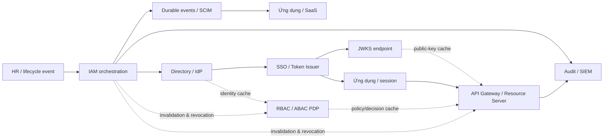
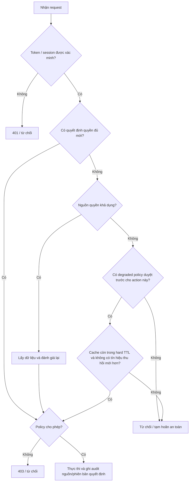
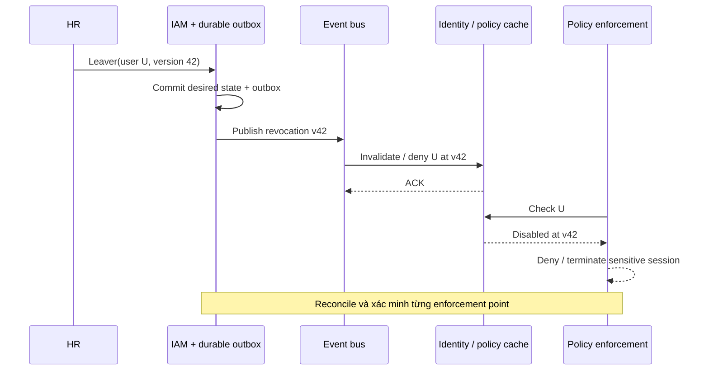

# Cache identity data: Lưu đệm dữ liệu danh tính an toàn trong IAM

## 1. Vì sao IAM cần cache dữ liệu danh tính?

Trong hệ thống **Identity and Access Management (IAM)**, nhiều request cần thông tin về chủ thể: tài khoản còn hoạt động hay không, thuộc nhóm nào, vai trò gì, thuộc tính nào quyết định quyền truy cập, hoặc khóa nào được dùng để xác minh access token. Nếu mỗi request đều gọi trực tiếp **Identity Provider (IdP)**, directory hoặc policy engine, hệ thống dễ bị tăng độ trễ và lỗi dây chuyền khi một phụ thuộc ngừng hoạt động.

**Identity data caching** là việc lưu tạm một phần dữ liệu danh tính hoặc kết quả xác thực/ủy quyền ở một lớp gần nơi sử dụng để giảm số lần truy vấn nguồn và cải thiện khả năng chịu lỗi. Cache không thay thế bản ghi có thẩm quyền (*source of truth*); mỗi bản sao có **độ mới**, **thời hạn**, **phạm vi tin cậy** và **nguy cơ dùng trạng thái đã lỗi thời**.

Ví dụ, một API có thể lưu bộ khóa công khai **JWKS** đã xác minh để kiểm chữ ký JWT khi IdP tạm thời mất kết nối. Nhưng nếu API cache `user.enabled=true` quá lâu, một nhân viên đã nghỉ việc (**Leaver**) có thể tiếp tục truy cập trong khi nguồn chuẩn đã disable tài khoản.

Trong module quản lý vòng đời danh tính theo **Joiner – Mover – Leaver (JML)**, thiết kế cache phải giữ cân bằng:

- **Availability**: luồng hợp lệ vẫn phục vụ được trong giới hạn khi directory, IdP, SCIM hoặc policy service chậm/lỗi.
- **Security correctness**: không chấp nhận danh tính không hợp lệ và không cấp quyền đã bị thu hồi.
- **Consistency**: trạng thái từ HR, IdP, directory, RBAC/ABAC và ứng dụng đích hội tụ đủ nhanh.
- **Privacy**: dữ liệu định danh cá nhân, nhóm nhạy cảm, token và thông tin phiên không bị lộ qua cache hoặc log.
- **Auditability**: có thể xác định quyết định truy cập đã dựa trên dữ liệu ở phiên bản nào và xử lý sai lệch sau sự cố.

### Sau bài học, bạn có thể

1. Phân loại dữ liệu IAM nào có thể cache, dữ liệu nào không nên cache hoặc chỉ được dùng trong điều kiện rất chặt.
2. Chọn **TTL, invalidation, versioning, stale policy** và ranh giới cho từng loại request.
3. Giải thích các rủi ro *stale authorization*, *negative cache*, *cache stampede*, *token revocation lag*.
4. Thiết kế cache cho IdP, LDAP/directory, JWT/JWKS, policy RBAC/ABAC và vòng đời JML.
5. Xây dựng monitoring, runbook và bài kiểm thử để chứng minh cache vừa cải thiện availability vừa không phá yêu cầu thu hồi quyền.

## 2. Cần phân biệt loại dữ liệu được cache

Không nên đặt mọi thông tin người dùng vào một Redis key với một TTL chung. Mỗi loại có tính chất khác nhau.

| Dữ liệu | Ví dụ | Nơi cache thường gặp | Lưu ý bảo mật |
|---|---|---|---|
| **Identity profile** | ID nội bộ, tên hiển thị, phòng ban, thuộc tính cơ bản | IdP, ứng dụng, directory proxy | Chứa dữ liệu cá nhân; thuộc tính phục vụ quyền cần độ mới cao |
| **Account lifecycle state** | ACTIVE, SUSPENDED, DISABLED, TERMINATED | IAM, IdP, PEP/PDP | Rất nhạy với Leaver; cache ACTIVE quá lâu gây quyền tồn dư |
| **Group/role membership** | `finance-approver`, `support-agent` | IdP, RBAC service, gateway | Mover có thể giữ vai trò cũ nếu invalidation chậm |
| **ABAC attributes** | `department`, `costCenter`, `clearance` | PDP/Policy Engine | Attribute stale có thể thay đổi kết quả policy |
| **Authorization decision** | `subject X` được `read:Y` | PEP, gateway, ứng dụng | Phải ràng buộc resource/action/context và policy version |
| **JWKS / public keys** | Khóa công khai theo `kid` của issuer | JWT verifier | Có thể cache; cần xoay khóa và xử lý khóa bị thu hồi |
| **Token introspection result** | `active=true`, scope, expiration | API gateway, resource server | TTL giới hạn; revoke có thể không có hiệu lực ngay |
| **Session metadata** | Session ID, trạng thái, thời điểm hết hạn | Ứng dụng, session store | Cần thu hồi, chống session fixation và bảo vệ cookie |
| **Device/risk posture** | Mức độ tin cậy thiết bị, tín hiệu rủi ro | PDP, continuous access service | Tín hiệu thay đổi nhanh; không cache quá lâu cho hành động nhạy cảm |
| **SCIM lookup / mapping** | External ID ↔ internal ID | Provisioning worker | ID ổn định; không dùng cache như bằng chứng target đã áp dụng thay đổi |
| **Credential hoặc secret** | Mật khẩu, private key, refresh token | Chỉ kho/bộ nhớ được thiết kế bảo vệ chuyên biệt | Không đưa vào cache dùng chung như dữ liệu profile |

**Điểm phân biệt quan trọng:** cache **public key** để kiểm JWT khác hẳn cache trạng thái **user active** hoặc một quyết định **allow**. Public key chủ yếu dùng xác minh chữ ký; dữ liệu active/role quyết định quyền có thể thay đổi bất cứ lúc nào.

### 2.1 Cache khác nguồn chuẩn, hàng đợi và nhật ký

- **Source of truth**: nơi quyết định/truy vết trạng thái có thẩm quyền, ví dụ HR cho quan hệ nhân sự hoặc IAM cho trạng thái lifecycle đã chuẩn hóa.
- **Cache**: bản sao có thể hết hạn hoặc bị loại bỏ; ứng dụng phải biết xử lý khi cache miss.
- **Durable queue / event log**: lưu yêu cầu cần xử lý và phát lại sau lỗi, ví dụ SCIM deactivate.
- **Audit log**: bằng chứng lịch sử về sự kiện và quyết định; không dùng một cache dễ bị evict làm audit duy nhất.

Nếu hệ thống chỉ nhận sự kiện Leaver rồi ghi vào cache, việc Redis restart có thể làm mất yêu cầu thu hồi. **Leaver event phải được lưu bền vững** theo hợp đồng của hệ thống; cache chỉ hỗ trợ phục vụ truy vấn hoặc lan truyền trạng thái.

## 3. Những vị trí cache trong kiến trúc IAM



Sơ đồ chỉ thể hiện một kiến trúc tham khảo. Có thể dùng hệ thống khác cho mỗi vai trò, hoặc cùng một sản phẩm IdP kiêm directory và policy. Điều cần xác định là **đường lấy dữ liệu lúc bình thường**, **đường xử lý khi nguồn lỗi** và **đường thu hồi/đồng bộ khi nguồn phục hồi**.

### 3.1 Cache trong Identity Provider

IdP có thể đồng bộ profile từ directory hoặc dùng cache kết quả lookup để giảm tải AD/LDAP. Điều này giúp đăng nhập nhanh hơn, nhưng cần biết chính xác lúc nào IdP làm mới account state và group. Một IdP đang giữ `enabled=true` từ trước có thể gây sai lệch nếu directory đã disable người dùng.

Không suy rằng mọi IdP đều xác thực offline được khi directory outage: một số triển khai gọi LDAP bind trực tiếp lúc đăng nhập; một số có identity store riêng; một số chỉ cache thuộc tính nhưng vẫn yêu cầu directory cho xác thực. Phải kiểm thử **implementation và cấu hình cụ thể**.

### 3.2 Cache tại API gateway hoặc resource server

Với **JWT access token**, API thường có thể lưu JWKS và kiểm chữ ký cục bộ, giảm round trip tới IdP. API vẫn phải xác minh `iss`, `aud`, `exp`, `nbf`, thuật toán, `scope` và các quy tắc truy cập cần thiết.

Với **opaque token**, resource server có thể gọi introspection. Cache kết quả introspection giúp giảm phụ thuộc mạng, nhưng token bị revoke ở authorization server có thể tiếp tục bị xem là `active=true` cho đến khi cache bị hủy hoặc hết TTL.

### 3.3 Cache tại Policy Decision Point/Enforcement Point

**PDP (Policy Decision Point)** có thể lưu thuộc tính người dùng và policy; **PEP (Policy Enforcement Point)** có thể cache quyết định cho request tương tự. Cache quyết định phải xét đủ subject, tenant, resource, action, policy version và thuộc tính ngữ cảnh. Nếu quyết định chỉ được key bằng `userId`, một kết quả `allow` cho `read:public` có thể bị dùng sai cho `write:admin`.

### 3.4 Cache tại provisioning pipeline

SCIM worker có thể cache mapping giữa user nội bộ và external target ID để giảm lookup. Nhưng kết quả `PATCH active=false` chưa được xác nhận phải còn trạng thái **pending**, không nên bị suy ra là thành công chỉ vì mapping trong cache đã đổi. Những event không hoàn thành phải được retry/reconcile dựa trên kho bền vững.

## 4. TTL, freshness và chiến lược làm mới

### 4.1 TTL là giới hạn tuổi, không phải cam kết dữ liệu đúng

**Time To Live (TTL)** là thời gian một entry được phép tồn tại theo chính sách cache. Nếu role bị thu hồi ngay sau khi entry được cache, dữ liệu có thể sai trong gần toàn bộ TTL.

Ví dụ: cache `finance-approver=true` ở 09:00 với TTL 15 phút. Lúc 09:01, người dùng Mover và bị thu hồi role. Nếu không có invalidation, cache có thể tiếp tục cấp quyền gần đến 09:15. Hệ thống cần so sánh cửa sổ đó với deadline thu hồi và mức rủi ro của hành động.

Các loại TTL cần phân biệt:

- **Absolute TTL**: hết hạn ở thời điểm cố định sau khi dữ liệu được lấy; truy cập không kéo dài thời hạn.
- **Sliding expiration**: mỗi lần dùng có thể gia hạn TTL. Nguy hiểm cho dữ liệu quyền nếu cứ được truy vấn liên tục và không bao giờ phải xác minh lại.
- **Soft TTL**: sau một thời gian thì ưu tiên làm mới, nhưng còn cho phép đọc bản cũ theo điều kiện.
- **Hard TTL**: qua giới hạn tuyệt đối thì entry không còn được dùng để đưa ra quyết định.
- **Negative-cache TTL**: thời gian nhớ kết quả “không tìm thấy/không có quyền”; cần ngắn và có cơ chế hủy khi Joiner hoặc grant mới xảy ra.

**Stale-while-revalidate** có thể phù hợp cho tên hiển thị hoặc thuộc tính không quyết định quyền. Với trạng thái account, role đặc quyền, revocation hoặc policy nhạy cảm, dùng bản stale sau hard TTL thường không phù hợp trừ khi đã có hợp đồng rủi ro đặc biệt và kiểm soát bổ sung.

### 4.2 Không có một TTL tốt cho mọi dữ liệu

| Loại dữ liệu | Độ nhạy với stale | Hướng thiết kế |
|---|---|---|
| Tên hiển thị/avatar | Thường thấp | Cache dài hơn, có điều kiện privacy và invalidation |
| Mapping subject ↔ external ID | Trung bình; sai mapping rất nguy hiểm | Key chặt theo tenant/issuer, version và invalidation khi thay đổi |
| Group thường | Trung bình đến cao | TTL giới hạn, cập nhật qua event, đo hội tụ |
| Role đặc quyền | Rất cao | Freshness chặt, kiểm tra độc lập hoặc fail closed |
| Account DISABLED / TERMINATED | Rất cao | Invalidation ưu tiên, bảo toàn bản ghi thu hồi |
| JWKS public key | Phụ thuộc rotation/compromise | Cache có refresh, biết cách xử lý `kid` chưa biết |
| Introspection `active=true` | Cao với revocation | TTL ngắn phù hợp risk và thời hạn token |
| ABAC risk signal | Thường thay đổi nhanh | Context-aware, TTL chặt theo loại hành động |

Các khoảng TTL cụ thể phải dựa trên SLO/RTO, deadline thu hồi, tốc độ đồng bộ và độ nhạy hệ thống. Không coi bảng này là chuẩn bắt buộc hay gán một giá trị phút cố định cho mọi tổ chức.

### 4.3 Soft TTL và hard TTL ví dụ

Một profile read-only có thể có `softTtl=2m`, `hardTtl=10m`. Khi quá soft TTL, request được phục vụ từ bản đã cache trong khi worker làm mới bất đồng bộ **nếu chính sách cho phép**; khi vượt hard TTL và nguồn lỗi, ứng dụng phải dùng hành vi dự phòng đã quy định hoặc báo không thể phục vụ.

Với quyền đặc quyền, có thể đặt `allowStale=false`, và kiểm tra policy/freshness ngay trước thao tác. Việc chọn soft/hard TTL không loại bỏ nhu cầu nhận **event thu hồi** từ nguồn có thẩm quyền.

## 5. Vòng đời Joiner – Mover – Leaver thay đổi cách thiết kế cache

### 5.1 Joiner: cache âm và tài khoản chưa đồng bộ

Khi người mới chưa tồn tại, hệ thống có thể lưu tạm kết quả `NOT_FOUND` để tránh query lặp. Nhưng ngay sau khi HR/IAM provision tài khoản, negative cache khiến người mới bị báo “không tồn tại” dù source-of-truth đã có user.

Giải pháp:

1. Key negative cache theo namespace và tenant rõ ràng.
2. Giữ thời gian sống hạn chế, không cache lỗi timeout/5xx như một kết quả “không tồn tại”.
3. Xóa negative cache khi nhận event tạo user hoặc khi workflow xác nhận thành công.
4. Với provisioning, dựa vào **readback hệ thống đích** thay vì coi cache miss là bằng chứng account chưa được tạo.
5. Dùng idempotency key để retry an toàn khi lệnh tạo account timeout chưa rõ kết quả.

Nếu cache lưu `subjectNotFound=true` mà không phân biệt **404 thực sự** và **directory unavailable**, một sự cố ngắn có thể biến thành thất bại Joiner kéo dài.

### 5.2 Mover: cache role/attribute cũ tạo quyền dư

Nhân viên rời bộ phận Finance lúc 10:00 nhưng API vẫn dùng group cache lấy lúc 09:59. Việc cấp role Support mới có thể thành công, trong khi thu hồi `finance-approver` chưa hội tụ. Đây là dạng **stale authorization**.

Để kiểm soát:

- Mỗi thay đổi entitlement có phiên bản/sequence rõ, hoặc ít nhất một cơ chế nhận diện trạng thái mới hơn.
- Publish invalidation theo **subject + tenant + policy/role scope**, tránh chỉ xóa cache ở một instance.
- Một hành động nhạy cảm có thể yêu cầu policy data đủ mới; nếu chưa xác minh, **fail closed**.
- Audit ghi policy version, attribute version và nguồn quyết định để truy vết.
- Dùng reconciliation phát hiện role dư ở IdP, PDP, ứng dụng và SCIM target.

### 5.3 Leaver: khả năng thu hồi phải cao hơn lợi ích cache

Leaver yêu cầu khóa đăng nhập mới, thu hồi phiên/token khi phù hợp, xóa role/group và xác minh không còn quyền truy cập tại enforcement points.

Giả sử `user.active=true` được cache 30 phút, access token có thể còn hợp lệ 10 phút và revocation event bị chậm 15 phút. Không thể khẳng định cửa sổ rủi ro chỉ bằng một con số TTL đơn lẻ: mỗi ứng dụng có cách kiểm khác nhau, có thể duy trì session cục bộ hoặc truy vấn nhiều nguồn. Phải đo **đường chấp nhận truy cập dài nhất** trên thực tế.

Một quy trình khả dụng:

1. Ghi bền vững sự kiện Leaver với `subjectId`, `tenantId`, thời điểm hiệu lực và phiên bản.
2. Chặn phát hành token/phiên mới ở những hệ thống khả dụng.
3. Phát lệnh revoke/invalidate tới cache, gateway, session store, PDP và SCIM target qua đường có thể kiểm tra.
4. Khi nhận event, đặt trạng thái **deny** hoặc tombstone với phiên bản đủ mới; không để refresh từ replica cũ ghi đè.
5. Theo dõi các node/target đã ACK, target bị lỗi và thời gian tồn dư.
6. Sau khi phục hồi, đối soát desired state với actual state tại từng điểm thực thi.

**Không báo “offboarding completed” chỉ vì đã xóa một key cache.** Phải kiểm tra trạng thái tại IdP/ứng dụng và các credential, token, session có thể còn hiệu lực.

### 5.4 Tài khoản dịch vụ và third-party identity

Service account, workload identity và tài khoản nhà thầu cũng cần owner, expiry, scope và revocation. Cache các thuộc tính `active`/`expiry` của nhà thầu quá lâu có thể cho truy cập sau khi hợp đồng hết hạn. Với máy, API key hoặc token do issuer phụ phát hành có thể còn hiệu lực độc lập với cache người dùng; thiết kế phải kiểm tất cả đường truy cập liên quan.

## 6. Chính sách cache theo nguyên tắc fail closed có điều kiện

### 6.1 Khi không lấy được dữ liệu mới

Phân loại quyết định theo hai câu hỏi: **dữ liệu cũ có còn nằm trong cửa sổ được phép?** và **hành động có cần thông tin quyền hiện tại không?**

| Tình huống | Hành vi khuyến nghị |
|---|---|
| Token sai signature, issuer, audience hoặc hết hạn | **Từ chối**; cache không sửa được chứng cứ xác thực không hợp lệ |
| Role admin không có dữ liệu đủ mới | Từ chối hoặc tạm hoãn thao tác; không tự cấp quyền |
| Đọc profile ít nhạy cảm, cache còn trong hard TTL | Có thể trả bản cache với chính sách về staleness và quyền truy cập |
| Directory timeout trong lúc kiểm user đang ACTIVE | Không biến timeout thành `ACTIVE`; dùng chính sách đã phê duyệt theo loại tài nguyên |
| Nhận event Leaver nhưng cache read replica còn `ACTIVE` | Ưu tiên trạng thái thu hồi mới hơn, chặn truy cập theo phạm vi enforcement |
| Dữ liệu quyền quá hard TTL, nguồn vẫn lỗi | Fail closed ở nơi không thể xác minh điều kiện bắt buộc |
| Introspection endpoint lỗi nhưng cache báo `active=true` | Chỉ dùng nếu TTL/risk policy cho phép; không tự gia hạn vô hạn |

Không phải mọi request đều phải dừng khi một nguồn dữ liệu identity lỗi. **Degraded mode được phê duyệt trước** có thể cho phép một tập thao tác giới hạn dựa trên bằng chứng đã xác minh và còn hạn, trong khi những thao tác nhạy cảm yêu cầu dữ liệu mới.

### 6.2 Một mô hình quyết định



Sơ đồ minh họa trình tự kiểm soát, không phải thuật toán triển khai sẵn. Nếu dữ liệu cache không thể chứng minh các điều kiện quyền bắt buộc, không được dùng đường degraded để bỏ qua kiểm tra token hoặc cho phép quyền mới.

## 7. Key design: tránh nhầm người, tenant và ngữ cảnh

Một cache key thiếu thành phần ngữ cảnh có thể gây **cross-tenant data leakage** hoặc dùng nhầm quyền.

### 7.1 Khóa theo identity namespace

ID `user-123` có thể tồn tại ở hai tenant hoặc hai IdP. Với OIDC, cặp `(issuer, sub)` xác định subject trong phạm vi issuer; ứng dụng cần ánh xạ cặp này vào **internal subject ID** đã xác minh.

Một cache key cho thuộc tính có thể bao gồm:

```text
identity:v2:<tenantId>:<internalSubjectId>:<attributeSetVersion>
groups:v3:<tenantId>:<internalSubjectId>:<entitlementVersion>
decision:v5:<tenantId>:<subjectId>:<resourceId>:<action>:<policyVersion>:<contextHash>
```

Đây là **mẫu logic**, không phải định dạng chuẩn. Các ID và phiên bản cần được canonicalize và bảo vệ chống nhầm namespace. Không đặt email, token nguyên vẹn hoặc thuộc tính nhạy cảm trực tiếp vào key được xuất hiện trong logs/metrics.

### 7.2 Cache key của quyết định authorization

Đối với ABAC, quyết định có thể phụ thuộc thời gian, vị trí, tình trạng thiết bị, ownership hoặc trạng thái giao dịch. Nếu key không bao gồm điều kiện cần thiết, kết quả `allow` ở request trước sẽ không còn đúng cho request sau.

Vì vậy, có các lựa chọn:

- Không cache quyết định của action nhạy cảm hoặc có ngữ cảnh thay đổi nhanh.
- Cache theo đầy đủ điều kiện và TTL ngắn, nhưng quản lý cardinality và footprint.
- Cache **policy hoặc attribute được phép cache** rồi đánh giá lại ở runtime thay vì cache kết quả `allow` chung.
- Vô hiệu hóa cache khi policy/attribute version thay đổi.

### 7.3 Cấm dùng shared cache như nơi cất bí mật

Không lưu mật khẩu dạng rõ, OTP, private signing key hoặc refresh token vào cache profile. Nếu hệ thống buộc lưu session hoặc token nhạy cảm, phải dùng store được thiết kế cho loại credential đó: mã hóa, phân quyền, TTL, rotation, giám sát truy cập và giới hạn lộ dữ liệu. Không đưa bearer token nguyên vẹn vào key, trace, metric label hoặc message lỗi.

## 8. Invalidation theo sự kiện và kiểm soát race condition

### 8.1 Cache-aside và event-driven invalidation

Mô hình phổ biến:

1. Ứng dụng tìm dữ liệu bằng cache key.
2. Cache hit còn hiệu lực: phục vụ theo chính sách.
3. Cache miss: truy vấn nguồn có thẩm quyền, xác minh response, lưu kèm TTL/version.
4. Khi có thay đổi JML/policy, nguồn phát event hoặc cơ chế CDC/outbox đáng tin cậy.
5. Consumer nhận event và xóa/nâng phiên bản cache trên các node liên quan.
6. Theo dõi ACK và reconcile nếu consumer offline hoặc bỏ lỡ event.



Lưu ý: cơ chế phát event không tự bảo đảm mọi consumer nhận và thực thi đúng. Cần durable delivery, retry, dead-letter queue, alert backlog, idempotent consumer và kiểm tra trạng thái đích.

### 8.2 Nguy cơ sự kiện đến sai thứ tự

Ví dụ:

- `v41: U.ACTIVE` được phát trước.
- `v42: U.DISABLED` được phát khi Leaver.
- Consumer nhận `v42` trước do retry/replay, rồi `v41` đến muộn.

Nếu áp dụng “last message received wins”, cache có thể **tái kích hoạt U**. Hãy so sánh monotonic version hoặc cơ chế sequencing do nguồn có thẩm quyền cung cấp; từ chối snapshot/event cũ hơn và ghi cảnh báo khi nguồn dữ liệu xung đột.

Ở nơi không thể cung cấp version toàn cục cho mọi object, cần thiết kế reconciliation và nguồn trạng thái ưu tiên. **Không dùng timestamp đồng hồ client làm chứng cứ thứ tự tuyệt đối** khi các máy có thể lệch giờ.

### 8.3 Race giữa read cũ và invalidate

Một tình huống khác:

1. Request A cache miss và bắt đầu đọc source phiên bản `v41`.
2. Event `v42 DISABLED` đến; consumer xóa cache và đặt deny/tombstone.
3. Request A nhận kết quả `v41 ACTIVE` muộn hơn và ghi lại vào cache.

Để tránh hồi sinh dữ liệu cũ, cập nhật phải có điều kiện theo version hoặc đối chiếu **revocation floor/tombstone** trước khi ghi. Đây là lý do chỉ `DEL key` không đủ cho mọi hệ thống JML phân tán.

Pseudocode khái niệm:

```java
// Pseudocode: không phải implementation production hay API Redis cụ thể.
void putIdentityIfNewer(String key, IdentitySnapshot incoming) {
    cache.atomicUpdate(key, current -> {
        long minVersion = revocationLedger.minAcceptedVersion(incoming.subjectId());
        if (incoming.version() < minVersion) {
            return current; // từ chối snapshot cũ hơn quyết định thu hồi
        }
        if (current != null && incoming.version() < current.version()) {
            return current; // từ chối ghi đè bằng dữ liệu cũ
        }
        return incoming.withBoundedTtl();
    });
}
```

Trong production, `atomicUpdate` phải thật sự atomic theo backend; `revocationLedger` cần đủ bền vững và được đồng bộ với các node. Mã chỉ minh họa điều kiện đúng, không đảm bảo tính nhất quán nếu triển khai bằng hai lệnh đọc/ghi rời rạc.

### 8.4 Xóa cache toàn hệ thống có thể gây quá tải

Khi revoke hàng loạt hoặc deploy policy mới, hàng nghìn cache miss cùng gọi directory/IdP có thể gây **cache stampede/thundering herd**.

Biện pháp:

- Giới hạn concurrency, single-flight per key hoặc request coalescing.
- Backoff có jitter và timeout hợp lý.
- Prefetch/warm cache cho dữ liệu ít nhạy cảm, theo phạm vi được phép.
- Phân loại event ưu tiên: revocation/disable phải được xử lý trước làm mới profile không cấp bách.
- Giới hạn stale read bằng hard TTL và policy; không kéo dài TTL tự động để che tải.
- Capacity headroom và quan sát tải lên source-of-truth khi cache hit rate giảm.

## 9. Khi directory hoặc IdP outage: cache giúp gì, không giúp gì?

### 9.1 Các trường hợp có thể tiếp tục

- API đã có JWT hợp lệ, khóa JWKS tin cậy được cache và mọi yêu cầu authorization vẫn được thỏa.
- Ứng dụng đang có phiên cục bộ hợp lệ, session store còn sống và không cần reauthentication ngay.
- Hiển thị thuộc tính profile ít nhạy cảm có thể dùng bản cache còn trong hard TTL được phê duyệt.
- Một số request đọc với policy/attribute đã xác minh có thể tiếp tục theo degraded policy hạn chế.

### 9.2 Các trường hợp không thể được “cứu” chỉ bằng cache

- Người dùng mới chưa có tài khoản/credential, cần IdP/directory cấp phiên.
- Access token mới phải được phát hành nhưng authorization server outage.
- `kid` của JWT chưa có khóa tin cậy; không thể kiểm chữ ký.
- Trạng thái Leaver hoặc role đặc quyền không đủ mới; tiếp tục cho quyền có thể vi phạm chính sách.
- Directory bị nghi compromise; dữ liệu cache cũng có thể bị đầu độc trước đó.
- SCIM target chưa nhận lệnh disable; cache ở IAM không làm cho target tự khóa tài khoản.

**Graceful degradation** có nghĩa là cung cấp một phần dịch vụ trong giới hạn an toàn, không phải trả HTTP 200 bất kể điều kiện xác thực.

### 9.3 Ví dụ bảng điều kiện

| Dữ liệu cache | Nguồn lỗi | Request | Hành vi khả thi |
|---|---|---|---|
| JWKS công khai còn phù hợp | IdP outage | API nhận JWT với `kid` đã biết | Kiểm chữ ký và toàn bộ claim; chỉ phục vụ nếu quyền hợp lệ |
| Profile name/photo trong TTL | Directory outage | Hiển thị hồ sơ đã có quyền xem | Có thể hiển thị dữ liệu cũ có kiểm soát |
| `role=admin` chưa xác minh freshness | PDP/directory outage | Thay đổi policy IAM | Từ chối/tạm hoãn an toàn |
| Introspection `active=true` cache còn TTL | Authorization server outage | API thông thường | Tùy chính sách rủi ro/revocation; không kéo dài TTL vô hạn |
| Negative cache `NOT_FOUND` | Provisioning vừa hoàn tất | Joiner login | Invalidate và tìm lại; không báo user không tồn tại vĩnh viễn |
| Cache `ACTIVE` cũ | Leaver event đã ghi | Bất kỳ thao tác nhạy cảm | Ưu tiên trạng thái disabled/revocation mới hơn |

## 10. Ví dụ thiết kế cache có metadata rõ ràng

Một entry identity có thể được mô hình hóa bằng dữ liệu và độ mới:

```json
{
  "tenantId": "tenant-example",
  "subjectId": "person-0127",
  "accountState": "ACTIVE",
  "groups": ["support-agent"],
  "source": "iam-identity-read-model",
  "sourceVersion": 128,
  "fetchedAt": "2026-11-23T08:00:00Z",
  "softExpiresAt": "2026-11-23T08:02:00Z",
  "hardExpiresAt": "2026-11-23T08:05:00Z"
}
```

Đây là schema **minh họa**, không phải chuẩn SCIM/OIDC hay yêu cầu bắt buộc của sản phẩm. Các trường quan trọng:

- `tenantId` và `subjectId`: định danh đúng phạm vi.
- `source` và `sourceVersion`: nguồn và phiên bản để phát hiện stale/conflict.
- `fetchedAt`: thời điểm đã quan sát, không nhất thiết là thời điểm nguồn thay đổi.
- `softExpiresAt` và `hardExpiresAt`: ranh giới làm mới và không dùng.
- `accountState`, `groups`: dữ liệu có ý nghĩa bảo mật cần invalidation.

Một phiên bản production cần quy định serialization, validation, schema migration, bảo vệ dữ liệu cá nhân và điều kiện ghi atomic.

### 10.1 Chính sách theo mức độ rủi ro (ví dụ khai báo)

```yaml
# Mẫu thảo luận chính sách, không phải cấu hình chuẩn của IdP hay Spring.
identityCache:
  profile:
    softTtlSeconds: 120
    hardTtlSeconds: 600
    allowStaleWhileRevalidate: true
  privilegedEntitlements:
    hardTtlSeconds: 30
    allowStaleOnSourceError: false
    requireRevocationVersionCheck: true
  lifecycleState:
    allowStaleActiveAfterKnownDisable: false
    invalidationPriority: critical
  negativeLookup:
    hardTtlSeconds: 15
    neverCacheTimeoutAsNotFound: true
  audit:
    recordSourceVersion: true
    recordDecisionFreshness: true
```

Các giá trị giây chỉ minh họa thiết kế; trong thực tế phải thử rủi ro, latency, tải hệ thống, quy mô và deadline thu hồi trước khi chọn TTL.

### 10.2 Ví dụ dùng Java: lớp quyết định cache không thay thế xác thực

Đoạn mã minh họa cách **từ chối dữ liệu hết hard TTL** và **không cho phép trạng thái disabled** trong một lớp kiểm tra đã chạy sau bước xác thực. Mã cố ý không gắn một thư viện cache cụ thể và không được dùng trực tiếp làm authorization engine:

```java
import java.time.Clock;
import java.time.Instant;
import java.util.Optional;

record IdentityView(
    String tenantId,
    String subjectId,
    String state,
    long version,
    Instant hardExpiresAt
) {}

final class CachedIdentityGate {
    private final Clock clock;

    CachedIdentityGate(Clock clock) {
        this.clock = clock;
    }

    boolean canUseForSensitiveDecision(Optional<IdentityView> cached,
                                       long minimumTrustedVersion) {
        if (cached.isEmpty()) return false;
        IdentityView identity = cached.get();
        if (!"ACTIVE".equals(identity.state())) return false;
        if (identity.version() < minimumTrustedVersion) return false;
        if (!Instant.now(clock).isBefore(identity.hardExpiresAt())) return false;
        return true;
    }
}
```

**Giới hạn của ví dụ:** `minimumTrustedVersion` phải đến từ nguồn đủ tin cậy; nếu chỉ đọc từ cùng cache stale thì điều kiện version không có giá trị. Hàm này chưa kiểm token, issuer, tenant binding, role, resource/action hay policy. Những phần đó phải được kiểm riêng trước khi quyết định allow.

## 11. Quyền riêng tư và kiểm soát dữ liệu cache

Cache dữ liệu identity là một **bản sao dữ liệu có thể nhạy cảm**, nên cần áp dụng yêu cầu bảo vệ tương đương với dữ liệu nguồn ở mức phù hợp:

1. **Data minimization**: chỉ cache thuộc tính cần để phục vụ luồng; không sao chép toàn bộ hồ sơ HR nếu không cần.
2. **Least privilege**: ứng dụng chỉ được đọc namespace/key tương ứng tenant và mục đích; tránh một shared cache không phân vùng quyền.
3. **Encryption**: TLS khi truyền; mã hóa lưu trữ khi phù hợp; quản lý khóa và backup theo chính sách.
4. **Retention**: TTL, deletion, backup expiration và yêu cầu xóa dữ liệu cá nhân cần nhất quán với mục đích.
5. **Logging**: không ghi token, password, OTP, recovery code, private key hoặc hồ sơ cá nhân thô vào trace.
6. **Tenant isolation**: kiểm tra key prefix, ACL, deserialization và authorization phía ứng dụng; chỉ dùng prefix chưa đủ nếu credential cache có quyền rộng.
7. **Cache poisoning**: dữ liệu mới phải đến từ source/issuer được tin cậy, được validate; không cho client tùy ý ghi claim hoặc account state.
8. **Incident response**: có phương án vô hiệu hóa cache nhiễm dữ liệu sai và xây lại từ nguồn tin cậy.

Cache eviction không đồng nghĩa xóa dữ liệu khỏi **backup, replica, snapshot, log**. Nếu có nghĩa vụ xóa hay giới hạn lưu trữ, phải kiểm soát toàn bộ vòng đời bản sao.

## 12. Metrics và SLO cho identity caching

Không chỉ theo dõi tỷ lệ cache hit. Hit rate cao có thể đi kèm quyền bị thu hồi chậm.

| Metric | Mục đích |
|---|---|
| `cache_hit_ratio`, miss rate | Đo hiệu quả giảm tải; theo dõi theo nhóm dữ liệu, không gắn PII trong label |
| Cache lookup/fetch latency p95/p99 | Đo chi phí tra cứu và tốc độ phục vụ request |
| `entry_age` và hard TTL violations | Biết dữ liệu có bị dùng quá tuổi cho phép không |
| Invalidation event lag / ACK lag | Đo tốc độ áp dụng đổi trạng thái/quyền |
| Out-of-order/rejected stale updates | Nhận diện replication/replay hoặc race condition |
| `revocation_propagation_latency` | Đo thời gian từ Leaver/Mover tới từng enforcement point |
| Residual access after disable | Phát hiện quyền còn dùng được quá deadline |
| Source read errors/timeouts | Phân biệt cache vấn đề hay directory/IdP outage |
| Retry/stampede rate và source QPS | Phát hiện cache miss gây quá tải nguồn |
| Negative-cache false miss | Đo Joiner không truy cập được sau khi đã provision |
| Cache error/eviction/restart rate | Phát hiện instance loss, capacity thiếu hoặc failover |
| Authorization decision with stale data | Theo dõi các quyết định dùng trạng thái gần hết hạn/không đủ mới |

### SLI/SLO và error budget

Có thể định nghĩa:

- **Cache availability SLI**: tỷ lệ request hợp lệ được tra cứu cache trong ngưỡng thời gian.
- **Freshness SLI**: tỷ lệ response/decision dùng version trong cửa sổ nhất quán đã cam kết.
- **Revocation SLI**: tỷ lệ yêu cầu Leaver/Mover được phản ánh tại các enforcement point trước deadline.
- **Source load protection SLI**: tỷ lệ thời gian nguồn không bị vượt ngưỡng tải do cache stampede.

Ví dụ mục tiêu `99,9% cache read under 20 ms` có thể hữu ích cho hiệu năng, nhưng nếu `Leaver residual access > 15 phút` thì thiết kế vẫn có lỗi bảo mật nghiêm trọng. Availability của cache và correctness của quyền cần hai nhóm SLO.

Theo dõi **actual enforcement** (request còn được phép hay không), không chỉ xem event đã vào bus hay cache key đã bị delete.

## 13. Runbook: cache bị lỗi hoặc dữ liệu không còn tin cậy

### A. Phát hiện và phân loại

1. Xác nhận phạm vi: cache backend down, network partition, key mismatch, data stale, invalidation backlog hay source-of-truth down?
2. Phân biệt cache miss hợp lệ với timeout, deserialize error và negative cache sai.
3. Kiểm tổng thể login, token validation, policy decision, JML queue và các hành động đặc quyền.
4. Xác định có Leaver, role admin hoặc dữ liệu tài khoản ngoài hợp đồng bị ảnh hưởng không; nếu có, ưu tiên Security.

### B. Giảm thiểu tác động

1. Thực thi fail-closed cho những quyết định yêu cầu dữ liệu quyền mới hoặc tín hiệu revoke bắt buộc.
2. Giữ chức năng ít nhạy cảm theo degraded policy đã chuẩn bị, trong hard TTL được phép.
3. Giảm cache stampede bằng rate limit, single-flight, retry/backoff; không xóa toàn bộ cache đồng loạt nếu không cần.
4. Giữ durable event journal và tiếp tục nhận JML requests; phân loại Leaver là priority.
5. Nếu nghi cache poisoning, ngừng sử dụng entry/namespace không tin cậy và cách ly nguồn ghi theo runbook an ninh.

### C. Khôi phục và đồng bộ

1. Khôi phục kết nối/cache service, kiểm ACL/TLS, capacity và tính toàn vẹn dữ liệu.
2. Xác minh source-of-truth và policy version; nạp lại cache theo thứ tự có kiểm soát, ưu tiên disabled/revoked state.
3. Replay invalidation từ durable bus/outbox theo version; tránh để sự kiện cũ ghi đè mới.
4. Kiểm tra các request token hợp lệ, sai chữ ký, sai tenant, role bị thu hồi, tài khoản Leaver.
5. Theo dõi tỉ lệ miss/hit, QPS nguồn, lag event và khoảng chênh quyết định trước/sau recovery.

### D. Đối soát và đóng incident

1. So sánh desired vs actual account/group/role tại IdP, directory, PDP và SCIM targets.
2. Xác nhận không còn active session/token/quyền truy cập trái phép theo phạm vi yêu cầu.
3. Đối chiếu audit và event gap; khôi phục bằng chứng từ nguồn khác nếu cần.
4. Ghi root cause, timeline, MTTD/MTTR, RTO/RPO, freshness violation và residual access window.
5. Điều chỉnh TTL/invalidation/rate limit dựa trên kết quả đo, rồi diễn tập lại tình huống.

**Một cache đã có hit rate bình thường sau restart chưa chắc là đã phục hồi an toàn**: trạng thái Leaver cũ, cache poisoning hoặc event chưa replay có thể vẫn tồn tại.

## 14. Kịch bản kiểm thử cache identity data

| Thử nghiệm | Kết quả mong đợi | Bằng chứng |
|---|---|---|
| IdP outage trong khi API có JWT hợp lệ và JWKS cache | API xử lý token hợp lệ theo quyền; không bỏ `iss`/`aud`/`exp` | Token validation logs, request success |
| `kid` mới chưa có trong cache, JWKS endpoint lỗi | Từ chối token chưa xác minh, không bypass signature | `unknown_kid`, 401 |
| Mover mất role admin trong lúc PDP cache còn bản cũ | Không thực thi hành động admin quá hạn freshness | Policy version, 403, event lag |
| Leaver disable khi invalidation consumer offline | Durable event được replay; không có quyền dư vượt deadline | Replay logs, target readback, residual window |
| Event `v42 DISABLED` đến trước `v41 ACTIVE` | Cache không quay về ACTIVE | Version comparison, state readback |
| Invalidation đến giữa cache miss và source response cũ | Snapshot cũ không ghi đè tombstone | Race test, cache content |
| Joiner vừa được tạo nhưng negative cache còn `NOT_FOUND` | Invalidate và cho tra cứu lại đúng thời điểm | Account readback, login attempt |
| Directory trả timeout khi lookup | Không cache timeout như user không tồn tại | Error classification và cache keys |
| Redis/cache cluster restart | Hệ thống giảm tải theo kế hoạch; quyền nhạy cảm xử lý an toàn | Error rate, source QPS, TTL |
| Đột ngột xóa 100% entry | Không gây retry storm/hủy availability của IdP | Request concurrency, backoff metrics |
| Nhầm tenant trong cache key | Không trả thông tin hoặc quyền từ tenant khác | Isolation tests, denied access |
| Cache key/token xuất hiện trong log | Không rò bearer token hoặc PII nhạy cảm | Log inspection |
| SCIM target chưa nhận disable nhưng IAM cache đã đổi | Vẫn báo target pending, không đánh dấu offboarding hoàn tất | Target confirmation, workflow status |
| Cache ABAC decision khi device posture thay đổi | Re-evaluate hoặc từ chối quyết định cũ nếu context không còn đúng | Decision trace, context hash |

### Tiêu chí thành công cho bài thử Leaver

1. Tạo danh tính thử nghiệm, cấp đúng role và xác nhận truy cập trước thời điểm nghỉ việc.
2. Tạo sự kiện Leaver ở nguồn chuẩn, có event ID và version.
3. Tạm chặn một consumer invalidation hoặc một đường SCIM, giữ các đường khác hoạt động.
4. Kiểm tra mọi enforcement point trong phạm vi đã đăng ký; xác minh quyền bị từ chối trước deadline đặt ra.
5. Khôi phục consumer/SCIM, replay event, reconcile và đo thời gian hội tụ.
6. Xác nhận bản cache `ACTIVE` cũ không xuất hiện trở lại do race hoặc replay.

Thử nghiệm được thực hiện bằng tài khoản và tài nguyên được phép. Các trường hợp **deny** là kết quả thành công về mặt bảo mật, không phải lỗi availability.

## 15. Các anti-pattern cần tránh

**“Đặt TTL 24 giờ cho mọi dữ liệu IAM để tăng uptime.”** Profile ít nhạy cảm và entitlement đặc quyền có yêu cầu khác nhau. TTL dài không được kiểm soát làm tăng cửa sổ quyền tồn dư.

**“JWT có chữ ký là bằng chứng user vẫn ACTIVE.”** JWT chứng minh token được issuer tin cậy ký và còn hợp lệ theo các điều kiện xác minh; trạng thái account/role có thể đã thay đổi sau lúc phát hành.

**“Xóa key cache khi Leaver là đã thu hồi.”** Ứng dụng khác, session cục bộ, token đã cấp hoặc SCIM target có thể còn hoạt động. Phải xác nhận ở enforcement point.

**“Khi directory timeout, coi là không tìm thấy user.”** Điều này tạo negative cache sai, làm Joiner/login thất bại ngay cả sau khi directory khôi phục.

**“Cache quyết định allow theo userId.”** Resource, action, tenant, policy version và context có thể khác; reuse sai dẫn đến privilege escalation hoặc rò dữ liệu.

**“Event đến cuối cùng là sự thật mới nhất.”** Out-of-order delivery có thể khiến ACTIVE cũ ghi đè DISABLED mới. Cần version và quy tắc hợp nhất.

**“Cache hit rate 99% chứng minh hệ thống an toàn.”** Cache hiệu quả về tốc độ có thể đồng thời chậm revocation. Cần đo freshness và residual access.

**“Fallback khi nguồn lỗi bằng cách cho mọi request qua.”** Không được bỏ qua chữ ký, issuer, audience, MFA hoặc bước authorization cần thiết. Degraded mode phải được duyệt trước.

**“Bỏ toàn bộ cache ngay sau khi phục hồi.”** Điều này có thể gây stampede làm nguồn sụp lần nữa. Cần rate limit, warm-up và ưu tiên trạng thái thu hồi.

**“Lưu token và PII trong Redis chung cho tiện.”** Cache cũng là một hệ thống dữ liệu nhạy cảm; cần cách ly tenant, ACL, mã hóa, retention và log an toàn.

## 16. Checklist thiết kế và vận hành

### Trước khi triển khai

- [ ] Mỗi thuộc tính cache có source of truth, owner, sensitivity và mục đích rõ?
- [ ] TTL, soft/hard expiration, negative cache và stale policy được phân theo rủi ro?
- [ ] Account state, role, ABAC attribute và revocation có cơ chế invalidation đáng tin cậy?
- [ ] Cache key có tenant, subject, resource/action/context và version khi cần?
- [ ] Cơ chế event có thể retry/replay idempotent và ngăn out-of-order overwrite?
- [ ] Có giải pháp cho race giữa read stale và invalidate?
- [ ] Không lưu password, OTP, private key, bearer token thô trong cache/log chung?
- [ ] Có dữ liệu kiểm toán về nguồn, tuổi, version của quyết định quyền?

### Khi xảy ra outage

- [ ] Xác định lỗi ở cache, IdP/directory, event bus hay policy engine?
- [ ] Không chấp nhận token sai hoặc quyết định đặc quyền thiếu bằng chứng?
- [ ] Giữ những chức năng được phép chạy ở degraded mode trong TTL đã phê duyệt?
- [ ] Ưu tiên event Leaver và thu hồi role đặc quyền; theo dõi target-level confirmation?
- [ ] Bảo vệ nguồn khỏi stampede và retry storm?

### Sau khi khôi phục

- [ ] Replay và đối soát invalidation cho tất cả consumer đã bị gián đoạn?
- [ ] Kiểm tra từng Leaver/Mover, session, JWT/opaque token và SCIM target?
- [ ] Đo thời gian quyền tồn dư và các quyết định dùng stale data?
- [ ] Rà soát log, cache isolation, negative cache và lỗi cập nhật sai version?
- [ ] Cập nhật TTL, load test, runbook và diễn tập sự cố tương tự?

## 17. Câu hỏi ôn tập và bài tập tình huống

### Tình huống A — Cache group quá lâu

API kiểm JWT cục bộ và đọc `finance-approver` từ cache có TTL 20 phút. Lúc 10:00, một nhân viên Mover sang bộ phận mới, IAM thu hồi role ở directory nhưng invalidation consumer bị gián đoạn.

**Yêu cầu:** phân tích cửa sổ quyền tồn dư, đề xuất cách đặt hard TTL, cơ chế version/revocation và hành vi của API phê duyệt giao dịch tài chính.

*Gợi ý:* JWT validity không đủ; PDP/PEP phải kiểm role còn hiệu lực, fail closed khi dữ liệu quyền không đủ mới.

### Tình huống B — Leaver và event đến sai thứ tự

Cache consumer nhận `v52 DISABLED`, sau đó nhận lại `v51 ACTIVE` vì retry. Một request đồng thời đang lấy bản identity cũ ở directory replica.

**Yêu cầu:** thiết kế cập nhật atomic với version/tombstone để cả event cũ lẫn response đọc muộn đều không mở lại quyền.

*Gợi ý:* Version floor, conditional write, durable event và reconciliation.

### Tình huống C — Cache âm chặn onboarding

IdP hỏi directory về một Joiner nhưng nhận timeout. Middleware ghi `NOT_FOUND` vào cache 30 phút. 5 phút sau directory hoạt động bình thường và account đã được tạo, nhưng người dùng vẫn không đăng nhập được.

**Yêu cầu:** xác định lỗi phân loại, cách sửa negative cache và cơ chế invalidation sau provisioning.

*Gợi ý:* Timeout khác not found, TTL ngắn, create-event invalidate, readback ở hệ thống đích.

### Tình huống D — Xóa cache diện rộng gây outage thứ hai

Sau 15 phút mất Redis, cluster được khởi động lại và mọi API cùng query directory, làm CPU và connection pool của directory vượt ngưỡng. Đội vận hành đề xuất tăng TTL vô hạn.

**Yêu cầu:** đưa ra giải pháp giảm tải và ranh giới khi nào được phục vụ dữ liệu cũ, khi nào phải từ chối.

*Gợi ý:* Backoff/jitter, single-flight, prewarm có kiểm soát, phân tầng độ nhạy và hard TTL.

### Tình huống E — Cross-tenant authorization cache

Hai tenant có cùng `userId=123`. Gateway cache quyết định `allow` bằng key chỉ chứa `userId`, rồi dùng lại khi request thuộc tenant khác.

**Yêu cầu:** chỉ ra rủi ro, sửa cache key và thiết kế test phát hiện lỗi.

*Gợi ý:* Trusted issuer/subject binding, tenant isolation, resource/action/context và policy version.

## 18. Điều cần ghi nhớ

**Cache identity data** giúp IAM giảm độ trễ và tiếp tục phục vụ một phần chức năng khi IdP, directory hoặc policy service gặp sự cố. Tuy nhiên, cache có thể khiến **quyền cũ tiếp tục tồn tại** nếu không kiểm soát TTL, invalidation, phiên bản và ranh giới quyết định. Trong vòng đời **Joiner–Mover–Leaver**, thiết kế đúng phải phát hiện cache âm của Joiner, xóa role cũ của Mover, ưu tiên thu hồi Leaver và xác minh hiệu lực tại từng điểm thực thi quyền. Giá trị của cache không chỉ nằm ở hit rate mà ở khả năng duy trì **dịch vụ hợp lệ và quyết định truy cập an toàn** ngay cả khi hệ thống phân tán gặp lỗi.
