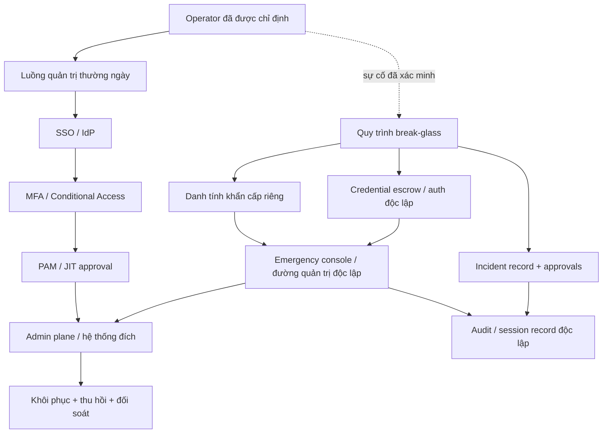
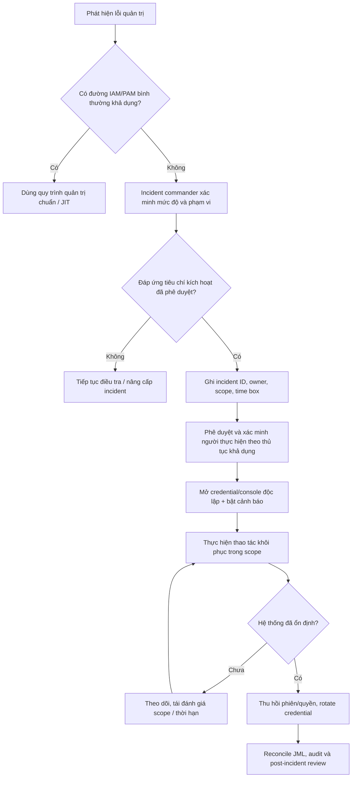

# Break-glass vận hành: Truy cập khẩn cấp có kiểm soát trong IAM

## 1. Break-glass là gì và dùng để giải quyết vấn đề nào?

Trong **Identity and Access Management (IAM)**, *break-glass access* là cơ chế truy cập khẩn cấp được chuẩn bị trước để người có trách nhiệm khôi phục hoặc bảo vệ hệ thống khi đường quản trị thường ngày không hoạt động. Tên gọi gợi hình ảnh đập kính lấy thiết bị cứu hỏa: đây là cơ chế ngoại lệ cho **tình huống được xác định rõ**, đi kèm ràng buộc và kiểm tra sau sử dụng.

Ví dụ, một tổ chức quản trị hạ tầng qua **Identity Provider (IdP)**, **Single Sign-On (SSO)**, **Multi-Factor Authentication (MFA)** và **Privileged Access Management (PAM)**. Khi SSO gặp sự cố, đội vận hành có thể không đăng nhập được để sửa chính IdP hoặc cấu hình federation. Nếu tài khoản khẩn cấp cũng phụ thuộc IdP lỗi, đường cứu hộ ấy không thực sự hoạt động. Ngược lại, nếu tạo sẵn một tài khoản quản trị toàn quyền với mật khẩu chung, không giới hạn thời hạn và không theo dõi, tổ chức sẽ có thêm một điểm tấn công nghiêm trọng.

Mục tiêu của **Break-glass vận hành** là duy trì khả năng khôi phục những chức năng thiết yếu **mà vẫn có cơ chế xác minh danh tính, giới hạn đặc quyền và để lại bằng chứng**. Mô hình này liên quan trực tiếp tới quản lý vòng đời danh tính **Joiner – Mover – Leaver (JML)**: phải chỉ định ai được giữ quyền khẩn cấp, kiểm tra lại sau thay đổi vai trò và loại bỏ ngay khả năng sử dụng của người đã rời tổ chức. Nó còn liên kết đến **IdP, SSO, SCIM, RBAC/ABAC, service account, session, audit** và yêu cầu giảm **quyền truy cập tồn dư**.

### Mục tiêu học tập

Sau bài học, bạn có thể:

1. Nhận diện khi nào break-glass hợp lệ và phân biệt với cơ chế fallback xác thực thông thường.
2. Thiết kế danh tính và kênh truy cập khẩn cấp không cùng hỏng với IdP/SSO/PAM đang được khôi phục.
3. Tổ chức quy trình kích hoạt, phê duyệt, sử dụng, giám sát, hoàn nguyên và thu hồi đặc quyền.
4. Xác định các kiểm soát cần giữ ngay cả khi phải xử lý sự cố nghiêm trọng.
5. Thiết kế diễn tập, chỉ số vận hành và kiểm tra tính đúng đắn của quyền sau incident.

## 2. Phân biệt break-glass với các luồng truy cập khác

| Luồng | Mục đích | Điều kiện dùng | Quyền / thời gian |
|---|---|---|---|
| **Truy cập quản trị thường ngày** | Vận hành, thay đổi cấu hình trong công việc định kỳ | SSO + MFA + PAM / approval bình thường | Least privilege, cấp theo vai trò/công việc |
| **Just-in-time (JIT) elevation** | Nâng quyền tạm thời khi đường IAM bình thường hoạt động | Danh tính người dùng đã xác thực, approval/policy | Scope cụ thể, TTL ngắn |
| **Fallback authentication** | Chứng minh danh tính qua phương thức hoặc IdP dự phòng | Phương thức/IdP chính lỗi, có đường thay thế hợp lệ | Theo assurance và policy đã công bố |
| **Break-glass** | Giành lại khả năng kiểm soát những hệ thống trọng yếu trong sự cố | Sự kiện khẩn cấp được xác nhận, quyền/quy trình riêng | Rất hạn chế về người, mục đích, thời hạn; theo dõi đặc biệt |
| **Disaster recovery / failover** | Khôi phục chức năng và dữ liệu sang hạ tầng dự phòng | RTO/RPO và runbook recovery | Có thể cần quyền break-glass để thực thi |

Break-glass là một **khả năng vận hành** bao gồm danh tính, phương thức xác thực, kênh truy cập, thủ tục con người, audit và kết thúc sự cố. Nó **không chỉ** là một tài khoản admin được lưu ở nơi khác.

### 2.1 Trường hợp hợp lệ và trường hợp không nên sử dụng

Ví dụ tình huống có thể cần break-glass:

- IdP/SSO hoặc dịch vụ MFA ngừng hoạt động, đội quản trị không dùng được đường đăng nhập chuẩn để khôi phục.
- PAM, directory/AD DS hoặc hệ thống phân phối chính sách gặp lỗi, ngăn các operator được ủy quyền tiếp cận tài nguyên để ứng cứu.
- Cấu hình federation, certificate hoặc chính sách conditional access lỗi diện rộng, khóa cả nhóm quản trị.
- Một sự kiện an ninh yêu cầu cô lập danh tính hoặc thu hồi access nhanh, nhưng đường thao tác bình thường đang bị vô hiệu hóa.
- Mất kết nối vùng hạ tầng khiến cần quản trị hệ thống bằng console dự phòng đã phê duyệt.

Các tình huống **không** đủ lý do:

- Người dùng muốn tránh bước MFA, approval hoặc chờ cấp quyền thông thường.
- Cần triển khai chức năng mới hoặc sửa một lỗi mức độ thấp trong giờ làm việc.
- Một tài khoản không đủ quyền vì policy từ chối hợp lệ.
- Muốn che danh tính người thực hiện hoặc tránh để lại log kiểm toán.

Nếu vẫn có thể dùng đường vận hành chuẩn, tổ chức thường nên dùng đường đó và JIT elevation đã được quản lý. Break-glass cần được coi là ngoại lệ có báo động.

## 3. Mục tiêu an toàn: sẵn sàng khi hệ thống chính hỏng

Một kế hoạch break-glass phải đáp ứng đồng thời các mục tiêu:

1. **Reachability**: người được chỉ định thực sự tiếp cận được đường khẩn cấp khi IdP, MFA, PAM hoặc mạng chính gặp lỗi.
2. **Authentication assurance**: vẫn xác minh được người kích hoạt, tránh trường hợp bất kỳ ai có mật khẩu chia sẻ đều được toàn quyền.
3. **Least privilege và scope**: chỉ cho phép đủ hành động để ổn định/khôi phục hệ thống cụ thể.
4. **Accountability**: gắn hoạt động với incident ID, operator, thời gian, tài nguyên, lệnh/thao tác và approver khi khả thi.
5. **Revocability**: có thể ngừng quyền ngay sau incident, thay credential đã phơi lộ và chặn session còn sót.
6. **Resilience**: kho credential, mạng console và hệ thống log không cùng nằm trong miền lỗi của dịch vụ cần khôi phục.
7. **Recoverability**: có runbook và thử nghiệm định kỳ chứng minh đường khẩn cấp dùng được trong thời gian mục tiêu.

Tính **độc lập về phụ thuộc** quan trọng hơn số lượng tài khoản. Hai tài khoản admin cùng đăng nhập qua IdP lỗi chỉ tăng số tài khoản, chưa tạo ra đường cứu hộ.

### 3.1 Minh họa kiến trúc



Đây là sơ đồ logic, không phải một chuẩn triển khai duy nhất. Cơ chế console có thể là cloud management plane, recovery interface, out-of-band management hoặc tài khoản local được bảo vệ. **Phải đánh giá từng dependency**: nếu kho credential và log đều yêu cầu đăng nhập qua cùng SSO đang lỗi, khả năng khôi phục hoặc kiểm toán có thể mất.

### 3.2 Phân tích failure domain

| Dependency | Câu hỏi cần trả lời khi thiết kế |
|---|---|
| IdP / directory | Danh tính khẩn cấp có cần gọi vào IdP/directory đang hỏng để xác thực? |
| MFA provider | Yếu tố khẩn cấp có dùng chung một dịch vụ push/SMS/phone với luồng lỗi? |
| PAM / vault | Muốn lấy credential khẩn cấp có phải đăng nhập qua PAM/SSO hiện bị outage? |
| Network / VPN | Operator có đường tiếp cận console nếu VPN, proxy hoặc DNS doanh nghiệp lỗi? |
| KMS / HSM / secret store | Khóa giải mã credential có phụ thuộc một dịch vụ không còn khả dụng? |
| Admin plane | Nhà cung cấp/cloud/cluster có management plane độc lập với workload cần cứu? |
| Audit / SIEM | Có thể ghi nhận thao tác ngay hoặc lưu bền vững và gửi lại khi SIEM phục hồi? |
| People / process | Người phê duyệt, operator và security contact có thể liên lạc ngoài SSO không? |

Một phương án đúng cần tài liệu **dependency map**, không chỉ một checklist tên tài khoản.

## 4. Lựa chọn mô hình danh tính break-glass

### 4.1 Tài khoản khẩn cấp được chỉ định riêng

Trong nhiều nền tảng, có thể chuẩn bị **emergency access account** thuộc tenant hoặc management plane, chỉ dùng cho khôi phục. Nguyên tắc:

- Số lượng tài khoản tối thiểu phù hợp với khả năng chịu lỗi và khả năng kiểm toán, tránh tạo quá nhiều đường admin.
- Không dùng tài khoản nhân viên thường ngày làm danh tính khẩn cấp duy nhất.
- Tách việc giữ credential, kích hoạt, phê duyệt và hậu kiểm ở nơi khả thi.
- Đảm bảo đủ quyền đối với **công việc khôi phục được định nghĩa**; không cấp toàn quyền toàn hệ thống theo mặc định.
- Phương thức xác thực mạnh, phù hợp với cách nền tảng cho phép emergency access.
- Theo dõi mọi lần đăng nhập và thao tác, kể cả lần thử thất bại.
- Đặt owner, người thay thế, chu kỳ test, vòng đời credential và kiểm tra quyền sau nhân sự thay đổi.

Không phải nền tảng nào cũng hỗ trợ quyền admin chỉ có hiệu lực khi incident xảy ra. Nếu bắt buộc tồn tại một quyền thường trực, cần **compensating controls**: khóa quyền truy xuất credential, bảo vệ thiết bị, giám sát báo động, giới hạn đường kết nối và rà soát định kỳ.

### 4.2 Tài khoản local/console độc lập

Một số môi trường có tài khoản local recovery trên thiết bị, hypervisor, database admin console hoặc cloud control plane. Đây có thể là lựa chọn khi directory/SSO không hoạt động. Nhưng local credentials phải được quản lý như một **separate identity lifecycle**:

- Có tên/ID rõ, thuộc phạm vi tài nguyên xác định; không dùng một mật khẩu chung cho nhiều máy.
- Bảo vệ credential trong vault/escrow hoặc cơ chế khẩn cấp đã được phê duyệt và có thể sử dụng offline khi cần.
- Giới hạn network path tới console, bảo vệ vật lý và MFA nếu được hỗ trợ.
- Có kiểm toán khả năng sử dụng và chính sách xoay credential.
- Nếu nền tảng không có session log, chuẩn bị cơ chế ghi nhận độc lập về người thực hiện và thay đổi.

**Không nên bật tài khoản local admin trên toàn bộ fleet chỉ để “phòng hờ”.** Khả năng khôi phục phải được cân bằng với blast radius nếu credential bị lộ.

### 4.3 Đường console ngoài băng (out-of-band)

Một hệ thống không thể cứu chỉ bằng tài khoản nếu đường mạng không đến được. Với hạ tầng trọng yếu, có thể cần một đường quản trị out-of-band được bảo vệ riêng, ví dụ console quản trị phần cứng hoặc management interface. Cần kiểm tra:

- Đường kết nối và chính sách truy cập có độc lập với network chính hay không.
- Console có authentication, authorization và audit riêng; không mở cổng quản trị công khai không cần thiết.
- Người vận hành đã có thiết bị, tài liệu, token/khóa và quyền truy cập vật lý cần thiết trước sự cố.
- Đường dự phòng không tự trở thành single point of compromise.

### 4.4 Quyền khẩn cấp khác quyền vận hành thường ngày

Một tài khoản break-glass để sửa IdP có thể cần quyền quản trị cấu hình federation hoặc khôi phục người quản trị; nó không mặc định cần đọc dữ liệu khách hàng, thay đổi billing hoặc tải bản sao dữ liệu sản xuất. Nên thiết kế **tập quyền tối thiểu theo mục tiêu khôi phục**:

| Mục tiêu khẩn cấp | Quyền có thể cần | Quyền cần xem xét loại bỏ |
|---|---|---|
| Sửa cấu hình SSO/IdP | Quản lý federation/config và khóa khẩn cấp được duyệt | Truy xuất dữ liệu nghiệp vụ không liên quan |
| Khôi phục PAM | Quản trị cấu hình và đường recovery của PAM | Xuất hàng loạt secret không cần thiết |
| Cứu hạ tầng mạng | Truy cập management plane của vùng bị ảnh hưởng | Quyền tenant-wide không phục vụ sự cố |
| Khóa danh tính bị xâm nhập | Disable session/account, revoke access | Quyền tạo danh tính mới hàng loạt ngoài incident |
| Khôi phục directory | Công cụ recovery tương ứng theo quy trình | Tùy tiện thay toàn bộ group/ACL |

RBAC có thể định nghĩa role cho emergency operator. ABAC có thể giới hạn thao tác theo tài nguyên, thiết bị, trạng thái khẩn cấp và thời gian, **nếu các điều kiện đó vẫn xác minh được khi control plane hỏng**.

## 5. Credential custody: ai giữ và ai được dùng?

### 5.1 Không lưu credential trong kênh chat hay tài liệu phổ thông

Credential break-glass là bí mật nhạy cảm. Không đưa mật khẩu, recovery code, private key, access token hoặc secret vào Markdown bài học, repository, ticket công khai, chat nhóm hay log ứng dụng. Tài liệu runbook chỉ nên chứa **định vị quy trình được phép**, người phụ trách và cách lấy credential qua hệ thống bảo vệ chuyên biệt.

Các cách bảo vệ có thể gồm kho bí mật có cơ chế emergency access, niêm phong offline theo quy trình, nhiều người cùng kiểm soát hoặc thiết bị bảo mật độc lập. Lựa chọn thực tế phụ thuộc mức nhạy cảm, khả năng offline, độ tin cậy của kho và năng lực quản trị.

### 5.2 Dual control và separation of duties

Ở hệ thống có rủi ro cao, nên cân nhắc:

1. Người xác nhận incident và cho phép kích hoạt.
2. Operator sử dụng quyền để khôi phục.
3. Security observer/approver giám sát và nhận cảnh báo.
4. Người hậu kiểm độc lập rà soát sau khi hoàn tất.

**Dual control/two-person rule** có thể giảm nguy cơ một người lạm dụng quyền. Tuy nhiên, quy trình phải có ngoại lệ đã phê duyệt cho trường hợp thực sự khẩn cấp hoặc không liên lạc được approver; ngoại lệ phải được đánh dấu, cảnh báo và hậu kiểm bắt buộc. Không thiết kế một yêu cầu đồng ý mà chỉ người dùng SSO đang outage mới có thể thực hiện.

### 5.3 Time box và session control

Khi break-glass được kích hoạt, cần xác định **cửa sổ sử dụng**, lý do, tài nguyên mục tiêu và các thao tác dự kiến. Có thể:

- Cấp quyền/credential chỉ trong thời gian ngắn nếu nền tảng hỗ trợ.
- Ràng buộc console với allowlist thiết bị hoặc network path tin cậy.
- Gắn session vào incident ID và identity của operator.
- Giám sát lệnh/config change ở mức phù hợp, cảnh báo khi truy cập dữ liệu hoặc tài nguyên ngoài phạm vi.
- Thu hồi session/token và vô hiệu hóa quyền tạm ngay khi kết thúc.

Không kéo dài vô hạn thời gian truy cập chỉ vì sự cố chưa được tuyên bố kết thúc. Thay vào đó, đánh giá lại nhu cầu và gia hạn bằng quyết định được ghi nhận.

## 6. Quy trình kích hoạt: từ phát hiện sự cố đến có quyền cứu hộ

Quy trình cần đủ **nhanh để đáp ứng RTO** nhưng vẫn xác minh được người được phép và mục tiêu sử dụng.



### 6.1 Cổng kích hoạt tối thiểu

Trước khi mở quyền, người trực sự cố cần xác nhận:

- **Incident ID** và thời gian bắt đầu; có bằng chứng đường quản trị bình thường thật sự không khả dụng.
- **Mục tiêu khôi phục**: cần sửa phần nào, action nào nằm trong scope?
- **Người thực hiện**: danh tính operator đã xác minh qua thủ tục độc lập; người này vẫn là nhân sự có thẩm quyền.
- **Người quyết định**: approver hoặc điều kiện ngoại lệ được phê duyệt từ trước.
- **Giới hạn**: thời hạn, tài nguyên, kênh liên lạc, yêu cầu log và điều kiện dừng.
- **Xác thực khẩn cấp**: credential/method hoạt động dù dependency chính lỗi.

Một yêu cầu “cần gấp” không đủ thay thế bằng chứng về đối tượng, mục đích và phạm vi.

### 6.2 Kịch bản runbook theo dòng thời gian

Giả sử 01:20, cấu hình SSO sai làm đội on-call mất quyền vào IdP console:

1. **01:20–01:25** – Synthetic login/telemetry xác nhận lỗi SSO hàng loạt; operator thử đường chuẩn theo retry limit và ghi bằng chứng.
2. **01:25–01:30** – Incident commander phân loại severity, chỉ định operator và security contact; mở incident record qua kênh độc lập.
3. **01:30** – Kích hoạt emergency console với credential đã escrow theo thủ tục; bắt đầu audit/cảnh báo.
4. **01:30 trở đi** – Chỉ kiểm/khôi phục cấu hình federation liên quan; ghi timestamp và kết quả từng thay đổi.
5. **Khi dịch vụ phục hồi** – Kiểm tra SSO thật, MFA, token issuance, quyền quản trị và tài khoản bị disable.
6. **Trước đóng incident** – Kết thúc session khẩn cấp, thu hồi quyền, rotate secret nếu chính sách quy định, rà soát audit và JML backlog.

Các mốc chỉ là **ví dụ quy trình**, không phải SLA bắt buộc. Đội vận hành phải thử nghiệm để biết có đáp ứng được RTO của nền tảng cụ thể không.

## 7. Những kiểm soát không được vô hiệu hóa vì khẩn cấp

### 7.1 Không mở quyền cho mọi người dùng

Break-glass không có nghĩa fail-open. Khi IdP hoặc PDP hỏng, ứng dụng không được tự động bỏ xác thực JWT, cho qua mọi role, chấp nhận token sai chữ ký hoặc bỏ kiểm soát tenant. Chỉ tài khoản và tài nguyên được xác định trong quy trình khẩn cấp mới thuộc phạm vi ngoại lệ.

### 7.2 Không đánh đồng xác thực với cấp quyền

Một emergency account có thể xác thực được qua console độc lập nhưng vẫn chỉ được cấp quyền cụ thể. Nếu không biết account đang có quyền nào, thao tác nên bị giới hạn đến các chức năng cứu hộ đã chuẩn bị.

### 7.3 Không hạ thấp tiêu chuẩn bằng một yếu tố yếu không kiểm soát

Fallback từ MFA mạnh sang mật khẩu dùng chung hoặc gửi OTP qua chat làm tăng nguy cơ social engineering. Nên lựa chọn phương thức mạnh và độc lập khi sản phẩm hỗ trợ; nếu có ngoại lệ assurance, cần giới hạn nghiêm ngặt phạm vi, thiết bị, thời hạn và giám sát.

### 7.4 Bảo vệ logging và bằng chứng

Nếu SIEM/log pipeline đang lỗi, không được âm thầm bỏ qua dấu vết. Tùy nền tảng có thể:

- Lưu log cục bộ vào bộ đệm bền vững, có quyền truy cập hạn chế và cơ chế chuyển tiếp khi hệ thống phục hồi.
- Dùng kênh audit độc lập đã chuẩn bị trước.
- Ghi biên bản incident theo thời gian thật, người thao tác, lệnh/thay đổi và bằng chứng kèm theo.
- Hạn chế thao tác có rủi ro không thể kiểm soát trong tình huống không bảo đảm audit.

Biên bản thủ công có giá trị hỗ trợ khi log kỹ thuật gián đoạn, nhưng không thay thế hoàn toàn bằng chứng hệ thống nếu platform vốn có khả năng ghi log.

### 7.5 Kiểm tra nguy cơ tài khoản break-glass bị lộ

Nếu credential khẩn cấp có dấu hiệu bị lộ, không nên sử dụng nó như thể vẫn an toàn. Phải áp dụng quy trình sự cố credential: giới hạn/thu hồi hoặc rotate, kiểm tra hoạt động bất thường, chuyển sang đường recovery khác đã chuẩn bị nếu có và điều tra đầy đủ.

## 8. Break-glass gắn với vòng đời Joiner – Mover – Leaver

### 8.1 Joiner: thêm người trực ứng cứu

Người mới chỉ được tham gia đội sử dụng break-glass sau khi hoàn tất quy trình nhân sự, xác minh danh tính, huấn luyện, phân công trách nhiệm và phê duyệt. Việc được nhận vào team vận hành **không tự động** đồng nghĩa với quyền giữ credential khẩn cấp.

Hồ sơ quyền cần có:

- Danh tính nhân viên ổn định từ HR/IAM, manager và owner chịu trách nhiệm.
- Lý do nghiệp vụ, phạm vi hệ thống và loại sự cố được phép xử lý.
- Yêu cầu đào tạo/phê duyệt, thiết bị/khóa xác thực và kênh liên lạc khẩn cấp.
- Thời hạn review, khả năng thu hồi và trạng thái enrollment vào vault/console.

### 8.2 Mover: đổi vai trò là lúc phải rà soát ngay quyền khẩn cấp

Một nhân viên được chuyển khỏi đội IAM sang team khác không nên tiếp tục giữ quyền retrieval hoặc approval của break-glass nếu vai trò mới không cần. Việc đổi nhóm trong directory/IdP chính chưa chắc xóa quyền ở vault độc lập, hệ thống out-of-band hoặc local console.

Vì vậy, IAM orchestrator cần ghi **desired entitlements** và phát yêu cầu thu hồi đến **từng đường khẩn cấp**. SCIM có thể đồng bộ một số target, nhưng những hệ thống offline hoặc vault đặc biệt có thể đòi thao tác riêng và đọc lại.

### 8.3 Leaver: đường khẩn cấp phải bị thu hồi song song

Khi một operator rời tổ chức, nguy cơ lớn nhất là họ không còn vào IdP chính nhưng vẫn biết mật khẩu hoặc sở hữu recovery key của console khẩn cấp.

Quy trình Leaver cần:

1. Xác định mọi credential, khóa bảo mật, secret escrow, approval membership, local/emergency account đã từng cấp cho operator.
2. Thu hồi quyền vault/console, thay đổi người giữ escrow, revoke session, xóa membership và thu hồi thiết bị khi phù hợp.
3. **Rotate** credential dùng chung hoặc bí mật người đó đã có khả năng biết, theo chính sách và mức độ bảo vệ.
4. Xác minh trạng thái ở từng target, kể cả nơi không có SCIM.
5. Ghi bằng chứng hoàn tất; nếu một target không xác minh được, giữ trạng thái pending/escalated và giới hạn đường truy cập khi có thể.

**Điểm mấu chốt:** emergency access cũng có vòng đời danh tính. Nếu danh sách người giữ quyền không được cập nhật khi Leaver, tính độc lập với SSO sẽ biến thành đường truy cập tồn dư lâu dài.

### 8.4 Service accounts và tài khoản máy

Một số thao tác phục hồi dùng service account hoặc token của automation để khôi phục hạ tầng. Những danh tính đó cần owner, scope, expiry/rotation và secret custody. Không nên coi tài khoản máy vô chủ là một phương án break-glass có thể sử dụng tùy ý.

Nếu automation thất bại do IdP/token endpoint down, cần một kịch bản phục hồi đã được kiểm soát cho workload identity; **không** chuyển sang một API key cố định toàn quyền không có giám sát. Sau incident, phải kiểm tra và thu hồi temporary credentials đã phát hành.

## 9. PAM, JIT và quản trị đặc quyền khi PAM mất kết nối

PAM thường điều phối request quyền, approval, session brokering và audit. Nếu PAM outage, operator có thể không mở được phiên đến hệ thống cần sửa. Break-glass có thể sử dụng một đường riêng:

- **Pre-provisioned emergency account** trên hệ thống đích, credential được bảo vệ độc lập.
- **Break-glass mode** do nền tảng/PAM hỗ trợ, có điều kiện và audit riêng.
- **Out-of-band console** có chứng thực độc lập với PAM.

Đường khẩn cấp phải có **mức kiểm soát bù** vì có thể thiếu các chức năng PAM thường ngày. Ví dụ: hai người giám sát, ghi lại session qua kênh khác, chi tiết incident ID, ít quyền hơn, cảnh báo thời gian thực và kiểm tra tất cả thay đổi sau khi PAM phục hồi.

### Tránh vòng phụ thuộc không thể khôi phục

Một vòng phụ thuộc nguy hiểm:

```text
Để sửa IdP cần đăng nhập PAM
Để đăng nhập PAM cần SSO qua IdP
Để lấy credential khẩn cấp cần đăng nhập vault qua SSO
```

Muốn break-glass thực sự, phải có ít nhất một đường đã được xác minh **cắt vòng phụ thuộc** mà vẫn bảo vệ credential.

## 10. Audit khi sử dụng break-glass

### 10.1 Những dữ liệu cần ghi

Một incident record và audit trail tốt nên trả lời được:

| Trường thông tin | Ý nghĩa |
|---|---|
| Incident ID, severity, trigger | Vì sao break-glass được kích hoạt |
| Người yêu cầu, operator, approver | Ai chịu trách nhiệm từng khâu |
| Emergency identity / account ID | Danh tính nào đã thực hiện thao tác |
| Thời điểm kích hoạt/kết thúc | Cửa sổ đặc quyền thực tế |
| Authentication method và nguồn | Đường đăng nhập độc lập nào đã dùng |
| Scope / target resources | Những tài nguyên và quyền nằm trong phạm vi |
| Session ID / correlation ID | Liên kết hoạt động console, hệ thống đích và audit |
| Những thay đổi đã thực hiện | Cấu hình, trạng thái account, quyền, mạng, secret bị thay |
| Lý do gia hạn/ngoại lệ | Vì sao vượt thời hạn hoặc thiếu approver |
| Cách kết thúc và xác minh | Revoke, rotate, logout, readback và hậu kiểm |

Audit trail cần bảo vệ tính toàn vẹn, timestamp, truy cập hạn chế và retention phù hợp. **Không ghi mật khẩu, token nguyên vẹn, private key hoặc recovery code** vào incident report.

### 10.2 Mẫu incident record minh họa

```yaml
# Mẫu mô tả nội bộ minh họa; không chứa credential và không phải schema chuẩn.
incidentId: INC-2026-0042
severity: SEV1
reason: "SSO quản trị không khả dụng"
activation:
  requestedBy: operator-id-17
  approvedBy: incident-commander-id-03
  emergencyIdentity: iam-recovery-admin-01
  startedAt: "2026-11-23T02:00:00Z"
  scope:
    - "Khôi phục cấu hình federation của IdP"
  sessionRecord: "audit-reference-only"
closure:
  endedAt: null
  accessRevoked: false
  credentialRotationChecked: false
  reconciliationCompleted: false
```

Các giá trị chỉ minh họa cách lưu trạng thái, không phải dữ liệu thật hoặc cấu hình có thể chạy trực tiếp. Khi kết thúc, các trường closure phải được điền từ bằng chứng kiểm tra thực tế. Không đánh dấu hoàn tất trước khi readback.

### 10.3 Kiểm toán cả những lần kích hoạt thất bại

Việc cố mở credential ngoài incident, nhiều lần login sai, access trái thời gian, thay đổi role bất thường hoặc dùng emergency account trên một hệ thống ngoài scope cần được cảnh báo. Nếu không có cách phát hiện những lần dùng ngoài quy trình, tài khoản break-glass là “cửa sau” khó kiểm soát.

## 11. Khôi phục IdP, directory và đường xác thực với break-glass

### 11.1 IdP/SSO outage

Ví dụ primary IdP không phát hành token mới. Đội quản trị cần kiểm:

1. Đường console khẩn cấp có thực sự độc lập với IdP lỗi không?
2. Có thể truy cập management plane và công cụ phục hồi qua authentication vẫn an toàn không?
3. Nguyên nhân nằm ở DNS, TLS certificate, DB, MFA, federation, signing key hay policy?
4. Nếu failover IdP, issuer, metadata, JWKS/signing key và trạng thái tài khoản có nhất quán?
5. Sau phục hồi, token mới, phiên SSO, refresh, MFA, admin login và enforcement policy đã đúng chưa?

Không sửa bằng cách bỏ kiểm chữ ký JWT, cho phép mọi issuer hoặc tắt MFA trên toàn tenant. Những hành vi đó có thể làm mất ranh giới an ninh của tất cả người dùng.

### 11.2 Directory/AD outage

Đường break-glass dùng local/console identity có thể hỗ trợ sửa directory khi không còn LDAP bind hoặc Kerberos login. Tuy nhiên phải xác định:

- Node/replica nào là nguồn dữ liệu đáng tin cậy.
- Trạng thái **disabled account** và quyền đặc quyền đã được nhân bản đến đâu.
- Quy trình restore/failover có nguy cơ làm sống lại user Leaver hoặc role cũ không.
- Sau khi khôi phục, identity state có cần reconcile từ HR/IAM journal không.

Một thay đổi sửa directory thành công chưa đủ để kết luận đã thu hồi mọi token/session ở ứng dụng.

### 11.3 PAM outage

Khi PAM không broker session hoặc không cấp JIT privilege, break-glass có thể dùng tài khoản đích được giữ riêng. Sau khi PAM hoạt động lại, phải kiểm tra:

- Phiên nào đã đi ngoài PAM và lệnh nào đã thực thi.
- Credential nào đã sử dụng và có cần rotate không.
- Role/ACL nào đã được chỉnh tạm và phải revert.
- Log còn thiếu và cách gắn vào incident.

### 11.4 Sự cố liên quan tài khoản bị xâm nhập

Nếu IdP hoặc tài khoản admin bị nghi compromise, người vận hành không nên sử dụng lại chính credential hoặc replica chưa xác minh độ tin cậy. Quy trình an ninh có thể yêu cầu cô lập, bảo toàn bằng chứng, dùng đường recovery riêng, xoay khóa và kiểm tra token/session đang lưu hành. Break-glass phải phối hợp incident response, không thay thế nó.

## 12. Break-glass không thay thế phương án thu hồi quyền

Đối với JWT tự kiểm chữ ký, token đã phát hành có thể tiếp tục được chấp nhận đến `exp` nếu resource server không có cơ chế revocation bổ sung. Với session ứng dụng và SaaS credential riêng, cửa sổ tồn dư còn phụ thuộc từng sản phẩm.

Vì vậy, khi break-glass được dùng để disable một tài khoản bị lộ hoặc một Leaver, cần kiểm tra:

- IdP đã chặn login/token issuance mới?
- Refresh token/session đã được revoke hoặc bị giới hạn?
- API nhạy cảm có nhận được revoke/deny event hoặc cập nhật account state?
- RBAC/ABAC, group và SCIM target đã hội tụ?
- Service credentials/API keys có liên quan đã được thu hồi?
- Có còn session admin hoặc emergency access sau khi khôi phục?

**Không coi thao tác disable tại một điểm là bằng chứng đã chặn ở tất cả điểm thực thi.**

### Bảng trạng thái sau thu hồi

| Hệ thống | Trạng thái cần xác minh | Cách ghi nhận |
|---|---|---|
| IdP chính | Account disabled, session/revoke phù hợp | Readback/audit |
| Directory | Trạng thái user và group mới nhất | Kiểm tra nguồn và replication |
| PAM | Role/JIT grant và session đã đóng | PAM audit/readback |
| API gateway | Policy/deny event, token validation | Request test phù hợp |
| SaaS qua SCIM | Account và group thực tế ở target | Target confirmation |
| Vault / recovery account | Access retrieval đã thu hồi, secret rotate | Vault audit/custody record |
| Service account | Temporary token/key và role đã thu hồi | Credential inventory/readback |

## 13. Runbook vận hành chi tiết

### Giai đoạn A — Phát hiện và quyết định kích hoạt

1. Xác minh tình trạng hệ thống và đường quản trị chuẩn; phân biệt lỗi người dùng với outage IdP/SSO/PAM.
2. Ghi incident ID, mức độ ưu tiên, tác động, thời điểm phát hiện và giả thuyết nguyên nhân.
3. Xác minh danh tính operator và ủy quyền hiện hành, bao gồm việc người đó chưa bị thu hồi quyền vì JML.
4. Đối chiếu tiêu chí kích hoạt và phạm vi công việc cần quyền khẩn cấp.
5. Ghi approval và điều kiện ngoại lệ nếu thiếu người phê duyệt; kích hoạt kênh cảnh báo độc lập.

### Giai đoạn B — Mở đường truy cập khẩn cấp

1. Lấy credential theo quy trình custody, không tiết lộ secret qua kênh thông thường.
2. Truy cập console/management plane đã được chỉ định qua phương thức xác thực hợp lệ.
3. Bắt đầu session recording hoặc kênh audit thay thế; liên kết với incident ID.
4. Kiểm role/scope đã cấp và điều kiện time box.
5. Nếu thử đăng nhập thất bại, xác định dependency bị lỗi; không tự nới chính sách hoặc mở truy cập công khai.

### Giai đoạn C — Sửa lỗi trong giới hạn

1. Thu thập cấu hình/trạng thái cần thiết và ghi snapshot/bằng chứng trước thay đổi, trong phạm vi an toàn.
2. Áp dụng thay đổi tối thiểu đủ phục hồi chức năng; ghi rõ ai thực hiện, thời điểm và lý do.
3. Kiểm thử chức năng E2E: login, token issuance, admin MFA, policy và các thao tác trọng yếu.
4. Theo dõi security events trong quá trình khôi phục, đặc biệt account/role changes và token revocation.
5. Nếu cần mở rộng scope hoặc thời gian, tái đánh giá và ghi quyết định phê duyệt.

### Giai đoạn D — Đóng quyền và hoàn nguyên

1. Đóng mọi session break-glass; revoke quyền JIT/tạm, session/token và đường kết nối mở thêm.
2. Rotate credential/recovery material đã được truy cập hoặc có nguy cơ lộ theo chính sách.
3. Khôi phục cấu hình/ACL/network rule tạm nếu không còn phục vụ mục đích được phê duyệt.
4. Xác nhận đường SSO/PAM thường ngày đã hoạt động, kiểm thử tài khoản và quyền đã định.
5. Đối soát danh tính JML, SCIM, các account bị disable và quyền còn tồn dư.
6. Tổng hợp audit/evidence; Security hoặc reviewer độc lập kiểm tra các thay đổi.
7. Chốt incident record với bằng chứng closure; lưu bài học và cập nhật runbook.

### Giai đoạn E — Hậu kiểm

Tổ chức post-incident review tập trung vào:

- Break-glass có bắt đầu đúng trigger không, có nhanh trong RTO không?
- Dependency nào làm chậm việc lấy credential, xác thực hoặc truy cập console?
- Quyền được sử dụng có vượt scope không?
- Có audit gap, approval exception hoặc session chưa đóng không?
- Có tài khoản Leaver/Mover, temporary user/service account nào còn quyền?
- Cần thay đổi diễn tập, nhân sự on-call, thiết kế kỹ thuật và telemetry như thế nào?

## 14. Metrics, SLO và cảnh báo

Không dùng riêng chỉ số “có tài khoản break-glass” để khẳng định khả năng phục hồi.

| Chỉ số | Ý nghĩa |
|---|---|
| **Emergency access success rate** | Tỷ lệ diễn tập/kích hoạt hợp lệ truy cập đúng management plane thành công |
| **Activation time** | Thời gian từ quyết định kích hoạt đến khi có phiên được xác minh |
| **Recovery contribution** | Thời gian từ lúc có quyền đến khi phục hồi chức năng đích |
| **Dependency independence pass rate** | Tỷ lệ kịch bản outage mà đường khẩn cấp vẫn hoạt động |
| **Unauthorized use attempts** | Số lần dùng emergency account trái phạm vi/thời gian hoặc sai danh tính |
| **Audit completeness** | Mức đầy đủ của login, session, thay đổi và chứng cứ closure |
| **Privilege exposure duration** | Tổng thời gian tài khoản/session khẩn cấp có quyền hoạt động |
| **Credential rotation completion** | Tỷ lệ phiên kích hoạt đã được đánh giá và xoay/revoke credential đúng hạn |
| **Leaver/Mover entitlement lag** | Thời gian từ thay đổi nhân sự đến khi quyền break-glass được thu hồi/điều chỉnh |
| **Post-incident reconciliation completeness** | Tỷ lệ hệ thống đích đã xác nhận trạng thái JML, role và session sau incident |
| **Drill coverage and failure rate** | Những tình huống đã diễn tập, lỗi còn tồn tại, ngày kiểm tra gần nhất |

Ví dụ, tổ chức có thể đặt **RTO khôi phục quyền quản trị đủ dùng là 30 phút**, tùy mức độ hệ thống. SLO này chỉ có ý nghĩa nếu diễn tập trong điều kiện IdP/PAM/MFA bị cô lập thật sự. Thời gian kích hoạt ngắn nhưng audit thiếu hoặc không thể thu hồi quyền thì vẫn là thiếu sót nghiêm trọng.

### Cảnh báo bắt buộc cân nhắc

- Bất kỳ **lần đăng nhập break-glass** nào, thành công hoặc đáng ngờ.
- Credential được đọc từ kho escrow ngoài incident hợp lệ.
- Tài khoản emergency thay đổi role, được thêm yếu tố xác thực mới hoặc thay mật khẩu ngoài quy trình.
- Phiên vượt time box, mở thêm kết nối quản trị không nằm trong scope.
- Leaver còn quyền lấy credential, có access tới console hoặc đang sở hữu security key emergency.
- Audit sink gián đoạn trong khi session break-glass đang hoạt động.
- Không hoàn tất credential rotation, session revocation hoặc post-incident review đúng hạn.

Chỉ số được phân loại theo severity và hệ thống; không đưa thông tin cá nhân/secret trực tiếp vào metric labels.

## 15. Diễn tập định kỳ chứng minh đường khẩn cấp hoạt động

Break-glass **không được chờ đến sự cố thật mới thử lần đầu**. Game day cần dùng môi trường thử nghiệm hoặc cơ chế diễn tập được phê duyệt, đủ mô phỏng dependency thật nhưng không tạo tác động nguy hiểm.

| Kịch bản | Điều kiện nghiệm thu | Bằng chứng |
|---|---|---|
| IdP/SSO mất kết nối | Operator vào emergency console không cần IdP lỗi | Authentication trace, thời gian kích hoạt |
| MFA provider chính outage | Đường khẩn cấp không phụ thuộc cùng kênh yếu tố lỗi | Dependency review, login result |
| PAM không hoạt động | Có thể tiếp cận tài nguyên cần khôi phục theo scope | Session ID, quyền thực tế |
| Directory/AD unavailable | Danh tính khẩn cấp không yêu cầu LDAP bind đang lỗi | Kết quả đăng nhập console, audit |
| VPN/DNS vùng chính mất | Đường quản trị dự phòng còn khả dụng và được bảo vệ | Network route, TLS/auth result |
| Vault/secret store lỗi | Kế hoạch custody độc lập có thể hoạt động trong điều kiện mô phỏng | Escrow procedure log |
| Operator được phép chuyển vị trí (Mover) | Không còn truy xuất credential sau thời điểm role thay đổi | Quyền vault/console readback |
| Operator nghỉ việc (Leaver) | Credential cũ không dùng được, membership được thu hồi | Denied access, rotation record |
| Session break-glass vượt thời hạn | Tự kết thúc hoặc cảnh báo/escalate theo policy | Session closure, alert |
| Dữ liệu account/role chưa đồng bộ | Không tự cho quyền nhạy cảm vì replica stale | Policy decision + state version |
| SIEM outage lúc emergency session | Log được bảo toàn qua đường phù hợp và gửi lại sau hồi phục | Audit buffer/replay evidence |
| Sự cố khôi phục hoàn tất | Credential/session/ACL tạm được thu hồi và hậu kiểm | Closure checklist/readback |

### Diễn tập theo phương pháp an toàn

1. Xác định phạm vi, account thử nghiệm, tài nguyên không ảnh hưởng production và điều kiện dừng.
2. Ghi baseline quyền và khả năng SSO/PAM bình thường.
3. Mô phỏng lỗi dependency một cách có kiểm soát; bảo đảm có đường hoàn nguyên.
4. Kích hoạt break-glass theo đúng thủ tục con người, không bypass bước ghi incident.
5. Thực hiện một thao tác khôi phục vô hại được phép, xác minh quyền và audit.
6. Chấm thời gian, số lần lỗi, dependency bất ngờ và mức đầy đủ của bằng chứng.
7. Đóng session, kiểm tra không còn quyền/credential tạm, cập nhật runbook.

### Ví dụ tiêu chí PASS/FAIL

- **PASS** nếu operator được chỉ định truy cập được console khi IdP và PAM bị cô lập, thực hiện thao tác trong scope, audit đầy đủ và đóng quyền đúng hạn.
- **FAIL** nếu chỉ một lần login thành công nhưng không thể ghi nhận người thực hiện, phải tắt xác thực, dùng secret chia sẻ trái quy định hoặc vẫn còn session admin sau incident.
- **FAIL** nếu một operator đã Leaver/Mover vẫn có thể mở secret hoặc đăng nhập khẩn cấp bằng credential cũ.

## 16. Những anti-pattern thường gặp

**“Lưu mật khẩu break-glass trong wiki để ai cũng tìm được.”** Điều này biến kênh cứu hộ thành một bí mật công khai. Cần custody riêng, phân quyền và audit.

**“Có hai admin SSO là đủ.”** Nếu cả hai phụ thuộc IdP, directory, MFA hoặc PAM cùng hỏng, không có đường khẩn cấp độc lập.

**“Break-glass có nghĩa là tắt MFA, token validation và policy.”** Một exception được cho phép không đồng nghĩa bỏ mọi kiểm soát. Giữ xác thực mạnh và ranh giới quyền phù hợp với nền tảng.

**“Không cần log vì đang cứu hệ thống.”** Thiếu audit làm khó điều tra và có thể che giấu lạm dụng. Chuẩn bị log độc lập/bền vững và evidence.

**“Chỉ quản trị viên lâu năm mới biết mật khẩu là được.”** Mật khẩu có thể lưu lại sau Mover/Leaver và không có dấu vết ai sử dụng. Cần quản lý danh tính, escrow và rotate.

**“Kích hoạt xong giữ quyền để lần sau dùng nhanh.”** Đặc quyền tồn dư sau incident mở rộng nguy cơ compromise. Phải thu hồi và kiểm chứng.

**“Chỉ cần sửa SSO và đăng nhập lại được.”** Còn phải đối soát token/session, JML backlog, quyền đích, credential khẩn cấp và audit gap.

**“Phê duyệt bắt buộc qua ứng dụng đăng nhập bằng SSO bị lỗi.”** Quy trình này tạo vòng phụ thuộc, có thể khiến cứu hộ không thực hiện được. Cần đường phê duyệt/ghi nhận độc lập.

**“Mỗi dịch vụ đều có tài khoản emergency global admin giống nhau.”** Mở rộng blast radius khi secret bị lộ, khó kiểm toán. Giới hạn scope và bảo vệ theo từng nhóm tài nguyên.

**“Không diễn tập vì sợ ảnh hưởng production.”** Có thể diễn tập trong môi trường được kiểm soát. Không kiểm thử làm cho đường khẩn cấp thiếu tin cậy.

## 17. Checklist để đưa vào vận hành

### Thiết kế và chuẩn bị

- [ ] Có danh sách **trường hợp kích hoạt hợp lệ**, người quyết định và mục tiêu khôi phục?
- [ ] Có đường auth/console thực sự độc lập với IdP, MFA, directory, PAM và mạng có nguy cơ cùng lỗi?
- [ ] Emergency identities có owner, scope và chính sách least privilege rõ?
- [ ] Credential được giữ an toàn, có cách lấy khi SSO/PAM/vault gặp lỗi theo mô hình đã duyệt?
- [ ] Có phương thức xác minh operator và approval dự phòng không cùng dependency?
- [ ] Có audit, alert, session tracking và kênh liên lạc sự cố độc lập?
- [ ] Có test định kỳ với thời gian kích hoạt và failover đo được?

### Trong sự cố

- [ ] Incident ID, severity, operator, approver, scope và time box được ghi nhận?
- [ ] Không vô hiệu hóa authentication/authorization toàn hệ thống?
- [ ] Mọi hành động khẩn cấp đều có lý do và bằng chứng?
- [ ] Có theo dõi JML, Leaver, role đặc quyền, credential và token/session đang còn hiệu lực?
- [ ] Những thay đổi ngoài scope phải được tái phê duyệt?

### Sau sự cố

- [ ] Đã đóng tất cả emergency sessions, thu hồi quyền và đường mạng tạm?
- [ ] Đã đánh giá và rotate/revoke secret, token, recovery material cần thiết?
- [ ] Đã đối soát người giữ quyền emergency với HR/IAM theo Joiner–Mover–Leaver?
- [ ] Đã kiểm tra các trạng thái SCIM/RBAC/ABAC, role admin và quyền truy cập tồn dư?
- [ ] Đã kiểm toán thay đổi, xử lý log gap, xác nhận closure và cập nhật runbook?

## 18. Bài tập tình huống và câu hỏi ôn tập

### Tình huống A — SSO lỗi và PAM bị khóa theo

Lúc 02:00, IdP không phát hành token quản trị. PAM sử dụng cùng IdP để đăng nhập nên operator không thể mở phiên sửa IdP. Vault lưu credential khẩn cấp cũng yêu cầu SSO.

**Yêu cầu:** xác định vòng phụ thuộc, đề xuất kiến trúc custody và đường console độc lập, chỉ ra bằng chứng cần có trước khi xác nhận hệ thống đã sẵn sàng cho sự cố tương tự.

*Gợi ý:* Dependency map, phương thức auth độc lập, escrow, security observer và diễn tập trong điều kiện IdP/PAM down.

### Tình huống B — Nhân viên nghỉ việc vẫn biết recovery credential

Một operator từng được phép lấy mật khẩu recovery của hệ thống quản trị mạng đã nghỉ việc tuần trước. IdP chính đã disable account, nhưng local console vẫn giữ credential cũ và không có nhật ký rotate.

**Yêu cầu:** chỉ ra lỗ hổng trong Leaver, liệt kê các bước xử lý ngay và thay đổi quy trình để không tái diễn.

*Gợi ý:* Ownership, secret exposure, rotation, console membership, quyền vault, session revocation và target readback.

### Tình huống C — Kích hoạt đúng nhưng log thiếu

Đội vận hành khôi phục database sau một sự cố nghiêm trọng bằng emergency admin account. Hệ thống phục vụ lại, nhưng SIEM ngừng nhận log trong 40 phút và operator chỉ nhớ khoảng thời gian thay đổi.

**Yêu cầu:** đánh giá vì sao chưa thể đóng incident, cách phục hồi/tái dựng bằng chứng và những biện pháp cần chuẩn bị trước.

*Gợi ý:* Log độc lập, local durable buffer, correlation ID, change record, session recording và kiểm tra hậu sự cố.

### Tình huống D — Break-glass biến thành đường bypass

Do MFA provider lỗi, một đội đề xuất cấp mật khẩu admin chung cho mọi kỹ sư qua kênh chat và tắt kiểm tra MFA toàn tenant đến khi provider hoạt động lại.

**Yêu cầu:** giải thích rủi ro, đề xuất đường thay thế phù hợp và thiết kế ràng buộc scope/thời hạn/audit.

*Gợi ý:* Emergency identity riêng, auth độc lập, least privilege, credential custody, approval và alert.

### Tình huống E — Thay đổi role khi replica directory chưa hội tụ

Một admin đã bị thu hồi quyền IAM theo sự kiện Mover nhưng directory dự phòng chưa nhận update. Trong lúc IdP outage, người này thử truy cập emergency console bằng membership cũ.

**Yêu cầu:** trình bày cơ chế ngăn truy cập bằng stale entitlement và điều kiện để cấp quyền khẩn cấp hợp lệ.

*Gợi ý:* Freshness, identity lifecycle record, authoritative list người được phép, fail closed cho quyền đặc biệt, kiểm tra sau replication.

## 19. Điều cần ghi nhớ

**Break-glass vận hành** là năng lực cứu hộ IAM được chuẩn bị **trước** khi IdP, SSO, MFA, directory, PAM hoặc đường quản trị gặp sự cố. Nó cần một đường truy cập độc lập, danh tính khẩn cấp có trách nhiệm rõ ràng, kiểm soát bí mật và đặc quyền, audit đầy đủ, thủ tục kích hoạt có phạm vi, cơ chế đóng quyền và diễn tập định kỳ. Trong vòng đời **Joiner–Mover–Leaver**, phải đặc biệt rà soát ai còn khả năng mở credential khẩn cấp sau khi đổi vai trò hoặc nghỉ việc. Kết quả tốt không chỉ là phục hồi đăng nhập quản trị, mà là **khôi phục hệ thống và chứng minh không còn quyền khẩn cấp hoặc quyền người dùng tồn dư ngoài chính sách**.
