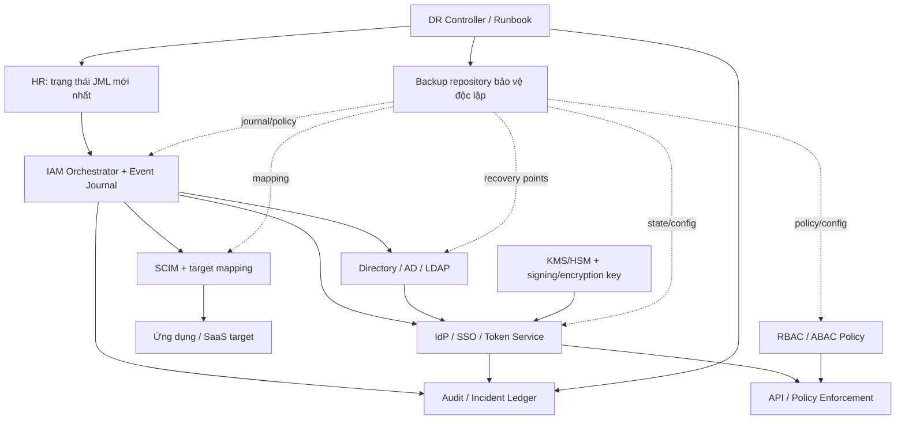
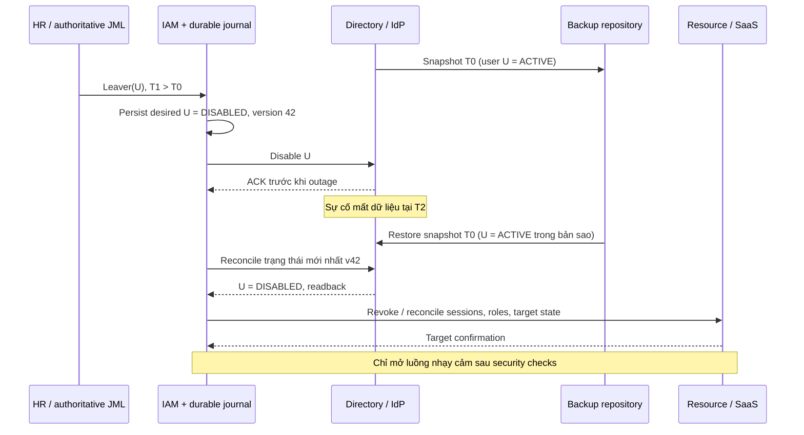

# Backup IAM: Sao lưu và khôi phục dữ liệu danh tính an toàn

## 1. Vì sao IAM cần một chiến lược backup riêng?

**Identity and Access Management (IAM)** lưu và điều phối những trạng thái quyết định **ai là ai**, **được xác thực bằng cách nào**, **có quyền gì** và **khi nào quyền phải bị thu hồi**. Trong quản lý vòng đời **Joiner – Mover – Leaver (JML)**, dữ liệu này trải qua xác minh danh tính, tạo tài khoản, cấp quyền, thay đổi vai trò, rà soát định kỳ và offboarding.

Khi mất dữ liệu IAM, hậu quả có thể đồng thời xảy ra ở hai chiều:

- **Gián đoạn dịch vụ:** nhân viên không đăng nhập qua IdP/SSO, API không nhận token, SCIM không tạo được tài khoản, tài khoản dịch vụ không lấy được credential.
- **Mất kiểm soát quyền:** một bản backup cũ có thể chứa user còn `ACTIVE` dù họ đã nghỉ việc, hoặc lưu nhóm đặc quyền đã bị thu hồi sau thời điểm backup.

Ví dụ, bản backup lúc 01:00 có tài khoản nhân viên A đang hoạt động. Đến 02:00, HR ghi nhận A nghỉ việc và IAM disable tài khoản, thu hồi role. Lúc 03:00, directory gặp lỗi nghiêm trọng. Nếu khôi phục nguyên trạng từ 01:00 rồi ngay lập tức mở truy cập, A có thể được **tái kích hoạt ngoài ý muốn**. Vì thế, hoàn tất restore về mặt kỹ thuật **không đồng nghĩa** khôi phục trạng thái truy cập đúng và an toàn.

**Backup IAM** là việc tạo, bảo vệ, kiểm tra và duy trì những bản sao có thể dùng để phục hồi trạng thái và cấu hình IAM theo một điểm khôi phục có thể giải thích được. Backup là một phần của **IAM resilience** bên cạnh high availability, failover, monitoring, runbook, break-glass và diễn tập thảm họa.

### Mục tiêu học tập

Sau bài này, bạn có thể:

1. Phân biệt backup, replication, snapshot, point-in-time recovery (PITR), high availability và disaster recovery (DR).
2. Lập danh mục dữ liệu cần bảo vệ ở HR/IAM, directory, IdP, SSO, SCIM, RBAC/ABAC, audit và tài khoản dịch vụ.
3. Thiết kế RTO, RPO, lịch backup, encryption, tính toàn vẹn và quyền truy cập bản sao.
4. Viết trình tự restore và **reconcile JML** để không làm sống lại tài khoản/đặc quyền đã thu hồi.
5. Xây dựng kiểm thử khôi phục, tiêu chí nghiệm thu và bằng chứng kiểm toán.

## 2. Backup khác replication, HA và DR như thế nào?

| Cơ chế | Mục đích | Giải quyết tốt | Không tự giải quyết |
|---|---|---|---|
| **High availability (HA)** | Giữ dịch vụ phục vụ khi một thành phần lỗi | Mất một node/zone khi có dự phòng phù hợp | Xóa nhầm lan sang mọi replica; logic cấu hình sai |
| **Replication** | Duy trì bản sao dữ liệu đang cập nhật | Đọc/ghi ở topology được hỗ trợ, failover | Lỗi/xóa dữ liệu có thể lan truyền; replica chưa chắc là backup |
| **Snapshot** | Ghi lại trạng thái tại một thời điểm | Khôi phục nhanh một tập dữ liệu nhất định | Chưa chắc nhất quán ứng dụng, chưa chắc nằm ngoài vùng lỗi |
| **Backup** | Lưu bản sao có khả năng khôi phục, với retention và kiểm tra | Mất dữ liệu, lỗi vận hành, một số kịch bản xâm nhập | Không bảo đảm phục vụ liên tục; có thể cần replay sự kiện |
| **PITR** | Khôi phục tới một thời điểm từ base backup + log | Giảm khoảng mất dữ liệu của database | Không tự đồng bộ các hệ thống khác tại cùng thời điểm |
| **Disaster recovery (DR)** | Khôi phục chức năng toàn hệ thống sau sự cố lớn | Mất vùng/hệ thống, phục hồi các phụ thuộc | Không hiệu quả nếu thiếu kế hoạch backup, failover, quyền và kiểm chứng |

**Replication không phải backup.** Một thao tác xóa hàng loạt hoặc một thay đổi quyền sai có thể nhanh chóng được nhân bản sang mọi node. Cần các recovery points được bảo vệ, đủ độc lập và có retention phù hợp.

**Backup thành công không phải restore thành công.** Tệp còn tồn tại, checksum khớp và job báo `SUCCESS` chỉ chứng minh một phần. Khả năng sử dụng thực tế phải được kiểm tra bằng restore vào môi trường được kiểm soát và thực hiện các hành vi xác thực/ủy quyền đại diện.

## 3. Lập bản đồ dữ liệu IAM cần phục hồi

Trước khi chọn công cụ backup, phải biết **dữ liệu nào là nguồn chuẩn**, dữ liệu nào là bản sao có thể tái tạo, và dữ liệu nào nằm ngoài quyền quản lý trực tiếp của tổ chức.

| Nhóm tài sản | Ví dụ dữ liệu | Lưu ý khi backup/restore |
|---|---|---|
| **Nguồn nhân sự và JML** | Employee ID, ngày gia nhập/chuyển vai trò/nghỉ việc, sự kiện có thời điểm hiệu lực | Nguồn HR có thể nằm bên ngoài IAM; phải giữ được cách đọc lại quyết định mới nhất |
| **Directory / AD / LDAP** | Account, trạng thái disable, group, DN, thuộc tính, trust/config | Backup và restore theo hướng dẫn sản phẩm; có nguy cơ replication dữ liệu cũ |
| **IdP / Authorization Server** | Tenant/realm, clients, redirect URI, role mapping, authentication flows, sessions | Database, cấu hình và secrets có thể ở nhiều nơi; export cấu hình chưa chắc đủ |
| **SSO / Federation** | OIDC client registration, issuer metadata, SAML SP/IdP trust, certificates | Phải khớp issuer/audience, redirect/ACS và nguồn khóa khi phục hồi |
| **Cryptographic material** | Signing keys, encryption keys, recovery metadata, certificate references | Private keys có thể không export được từ HSM; phải có thủ tục key recovery được hỗ trợ |
| **RBAC / ABAC** | Role definitions, policies, attribute mappings, policy version | Khôi phục policy cũ có thể cấp lại quyền không còn hợp lệ |
| **SCIM / Provisioning** | Target mapping, external IDs, connector state, retry/dead-letter, reconciliation cursor | Đối chiếu dữ liệu thực ở target; không coi bản sao local là trạng thái SaaS hiện tại |
| **Credential lifecycle** | Service account owner, secret references, rotation state, expiry | Tránh đưa secret thô vào bản backup thiếu bảo vệ; xác minh đường khôi phục |
| **Revocation / session** | Denylist, revoked refresh tokens, logout events, disabled state | Khôi phục session cũ có thể mở lại truy cập; thường cần invalidation hoặc nguồn trạng thái mới |
| **Audit / Evidence** | Admin actions, JML decisions, authentication/revocation logs | Cần toàn vẹn, retention và tính độc lập; audit không được chỉ nằm trong cache dễ mất |
| **Configuration as Code** | IaC, IdP config khai báo, SCIM mapping, policy code | Source control giúp tái tạo cấu hình, nhưng không thay thế backup state/keys |
| **Recovery operations** | Runbook, ownership, break-glass custody, dependency map | Phải sẵn có khi SSO/PAM hoặc hệ thống tài liệu chính ngừng hoạt động |

Một số dữ liệu, như session ngắn hạn hoặc cache JWKS, có thể **không cần restore từng entry** nếu có thể tái tạo an toàn. Tuy nhiên, quyết định bỏ qua phải dựa trên kiểm tra hậu quả đối với login, thu hồi và tính liên tục của dịch vụ.

### 3.1 Backup theo dependency, không chỉ theo tên sản phẩm

Một IdP có thể gồm database, object storage, secrets manager, KMS/HSM, directory, MFA provider và cấu hình SSO. Chỉ sao lưu database nhưng không khôi phục được khóa giải mã hoặc signing key thì dữ liệu có thể không sử dụng được. Ngược lại, có đủ cấu hình realm nhưng thiếu dữ liệu tài khoản/role cũng không tạo được một hệ thống IAM đúng.



Các mũi tên sao lưu trong sơ đồ là **logic**; phương thức thực tế có thể là backup database, system-state backup, snapshot được hỗ trợ, export cấu hình, lưu event log bền vững hoặc backup của nhà cung cấp. Không giả định backup repository có thể trực tiếp lấy private key ra khỏi HSM.

## 4. Định nghĩa mục tiêu phục hồi: RTO, RPO và security invariants

### 4.1 RTO và RPO

- **Recovery Time Objective (RTO):** thời gian mục tiêu để khôi phục một chức năng sau sự cố. Ví dụ: từ khi mất SSO tới khi thực hiện thành công giao dịch đăng nhập mới.
- **Recovery Point Objective (RPO):** lượng mất dữ liệu theo thời gian tối đa có thể chấp nhận trong phạm vi recovery. Ví dụ: backup database cuối cùng cách thời điểm lỗi 15 phút.
- **Recovery Time Actual / Recovery Point Actual:** giá trị đo từ diễn tập hoặc sự cố thực tế, cần so với mục tiêu.

Không nên đặt duy nhất một RTO/RPO cho toàn IAM. Đăng nhập mới, API validation, directory writes, Leaver revocation, SCIM provisioning và audit có mức độ ưu tiên khác nhau.

| Chức năng | Mục tiêu recovery cần xem xét | Rủi ro nếu phục hồi chậm/sai |
|---|---|---|
| IdP login | RTO theo ảnh hưởng người dùng và hệ thống quan trọng | Không có phiên mới, chặn truy cập nghiệp vụ |
| Token issuance cho dịch vụ | RTO và dự phòng issuer/credential | M2M không lấy token mới, lỗi lan qua API |
| Directory account updates | RTO write path và RPO trạng thái account | Không thể cấp/chuyển/thu hồi quyền |
| Leaver disable/revocation | Deadline **thực thi thu hồi** theo từng enforcement point | Quyền truy cập tồn dư |
| RBAC/ABAC policy | Tính mới của chính sách và thời gian khôi phục PDP | Cấp quyền sai hoặc gián đoạn truy cập |
| SCIM propagation | Độ tuổi backlog, deadline theo từng target | SaaS thiếu user hoặc giữ role cũ |
| Audit trail | Mức mất/gián đoạn bằng chứng chấp nhận được | Không thể chứng minh ai đã thao tác |

Các giá trị như “RTO 30 phút”, “RPO 5 phút” chỉ có ý nghĩa khi được phê duyệt, kiểm thử và có đủ phụ thuộc. Không được suy ra **RPO = 0** chỉ vì database có nhiều replica.

### 4.2 Backup consistency không tự bằng business consistency

Một backup database có thể **transaction-consistent** tại thời điểm T, nhưng các hệ thống bên ngoài như SCIM target, SaaS sessions hoặc HR source đã ở trạng thái T+1. Muốn restore an toàn, cần:

1. Chọn **điểm khôi phục nhất quán** theo khả năng của từng hệ thống.
2. Xác định các thay đổi đã xảy ra sau điểm khôi phục, đặc biệt **disable Leaver** và **remove privileged role**.
3. Áp dụng lại thay đổi có thẩm quyền bằng journal/event/desired-state reconciliation.
4. Chỉ đưa đường xác thực/quyền vào hoạt động khi các điều kiện bảo mật bắt buộc đã được xác minh.

### 4.3 Security invariants khi restore

Trước và sau mọi lần restore, phải giữ được những yêu cầu cốt lõi:

- Tài khoản đã **TERMINATED/DISABLED** theo quyết định mới nhất không được vô tình trở về ACTIVE.
- Quyền đặc quyền đã bị thu hồi không được phục hồi chỉ vì backup có role cũ.
- Issuer, audience, certificate và signing key được kiểm soát; không chấp nhận token sai chỉ để tăng availability.
- Phải biết phiên/token nào còn hợp lệ, phiên/token nào đã bị thu hồi; không phục hồi dữ liệu session một cách mù quáng.
- Dữ liệu tenant và ánh xạ subject không bị trộn giữa các tổ chức hoặc nguồn danh tính.
- Có audit về người thực hiện restore, nguồn backup, thời điểm, dữ liệu và những thay đổi sau khôi phục.

Nếu chưa thể chứng minh các điều kiện này, có thể giữ một phần chức năng ở **chế độ hạn chế** và từ chối thao tác nhạy cảm theo chính sách đã duyệt.

## 5. Thiết kế backup bảo vệ khỏi lỗi và xâm nhập

### 5.1 Các bản sao độc lập và khả năng chống sửa/xóa

Một chiến lược thực tế thường kết hợp:

- Bản sao gần nguồn để phục hồi nhanh khi mất một máy hoặc lỗi vận hành nhỏ.
- Bản sao ở failure domain khác (tài khoản bảo vệ khác, vùng khác hoặc phương tiện offline phù hợp) để ứng phó mất vùng và lỗi lan truyền.
- **Retention/immutability** được cấu hình và thử nghiệm cho những recovery points quan trọng.
- Giới hạn quyền **xóa hoặc thay đổi backup**, độc lập với quyền quản trị IdP/directory thường ngày khi có thể.
- Cảnh báo khi backup job thất bại, bị tắt, retention bị rút ngắn hoặc repository bị truy cập bất thường.

Các quy tắc phổ biến như “nhiều bản sao, nhiều loại phương tiện, một bản sao ngoài site/offline” có thể hữu ích làm điểm khởi đầu. Cần điều chỉnh theo kiến trúc, dữ liệu nhạy cảm và yêu cầu phục hồi thay vì chỉ đếm bản sao.

### 5.2 Encryption, key custody và khả năng giải mã

Backup IAM thường chứa **thông tin đặc biệt nhạy cảm**: hồ sơ tài khoản, liên kết danh tính, group admin, cấu hình recovery, secrets hoặc material liên quan xác thực. Yêu cầu tối thiểu:

1. Mã hóa khi truyền và khi lưu, theo cơ chế được tổ chức phê duyệt.
2. Phân quyền đọc, ghi, quản lý retention và restore riêng biệt; log mọi lần truy xuất.
3. Chìa khóa giải mã và recovery material phải **còn lấy được khi IdP/KMS chính gặp sự cố**.
4. Bảo vệ khóa khỏi bị export trái phép; backup private key chỉ khi sản phẩm và chính sách hỗ trợ.
5. Diễn tập khôi phục bằng quyền/phương thức của **đường khẩn cấp**, không chỉ tài khoản admin đang đăng nhập sẵn.

Nếu backup được mã hóa bằng khóa không thể khôi phục khi KMS mất kết nối, bản sao trên đĩa có thể hoàn toàn vô dụng. Không giải quyết vấn đề bằng cách lưu bản khóa giải mã dưới dạng rõ trong repository hoặc runbook.

### 5.3 Immutability và quyền xóa

Các dạng bảo vệ như object lock/WORM, retention lock, offline escrow hoặc backup copy độc lập giúp giảm nguy cơ một tài khoản bị xâm nhập xóa tất cả recovery points. Tuy nhiên, **immutable backup không mặc nhiên là backup sạch**: snapshot sau khi attacker sửa policy hoặc tạo admin trái phép vẫn giữ nguyên dữ liệu nguy hiểm. Phải có cách chọn điểm khôi phục đáng tin cậy và đối soát.

### 5.4 Data minimization và retention

Không backup nhiều hơn nhu cầu phục hồi. Các trường định danh nhạy cảm, bằng chứng xác minh danh tính, dữ liệu nhân sự và audit logs có chính sách retention khác nhau. Việc có backup không phải lý do để giữ thông tin cá nhân vô hạn.

Cần định nghĩa thời gian giữ bản sao, quyền truy xuất, cách xóa bản sao hết hạn, yêu cầu pháp lý, data residency và phương án xử lý xóa thông tin ở các bản backup trong phạm vi khả thi. Với backup immutable, chính sách retention phải được thiết kế trước để tránh mâu thuẫn với yêu cầu dữ liệu.

## 6. Backup từng thành phần IAM: chọn phương pháp đúng

### 6.1 Directory và Active Directory

Với **Active Directory Domain Services (AD DS)**, cần sử dụng phương thức backup và recovery được hỗ trợ cho domain controller/system state, cùng các quy trình chuyên biệt như khôi phục một DC, authoritative/non-authoritative restore hoặc forest recovery khi thích hợp. Không đơn giản sao chép file database đang mở và coi như bản backup transaction-consistent.

Cần quan tâm:

- AD DS replication, DNS và các vai trò phụ thuộc.
- Account disabled, group membership, service principals và trust.
- Lựa chọn recovery source đủ sạch, tránh rollback trạng thái quyền.
- Khả năng một DC cũ tái kết nối và phát lại dữ liệu không mong muốn.
- Runbook riêng cho hạ tầng directory và kiểm chứng sau restore.

Với **LDAP directory khác**, cơ chế export/snapshot/restore phụ thuộc backend, replication topology, schema và hỗ trợ của sản phẩm. Đọc được LDIF export chưa chứng minh khôi phục được toàn bộ ACL, internal metadata, credentials hoặc trạng thái replication.

### 6.2 IdP, Authorization Server và SSO

Cần xác định sản phẩm IdP cần những gì để khôi phục trọn vẹn:

- Tenant/realm, user federation, client IDs, redirect URI, allowed grants và claim mappings.
- Authentication flows, MFA configuration, policies và trusted federation metadata.
- Database/state storage, signing/encryption keys, certificates và secrets references.
- OAuth/OIDC issuer, JWKS publication, token endpoints, SAML trust và session behavior.
- Log/metadata của các quyết định revoke, user disable và role changes.

**Export realm/configuration không đồng nghĩa backup đầy đủ IdP**. Nếu dữ liệu user, credential, key hoặc session nằm ở kho khác, phải phục hồi theo hợp đồng của sản phẩm. Với managed IdP, nhiều phần không thể backup trực tiếp: cần phương án export được hỗ trợ, configuration as code, metadata inventory, nhà cung cấp và runbook khôi phục đúng khả năng dịch vụ.

### 6.3 RBAC, ABAC và policy engine

Lưu phiên bản rõ ràng cho role definitions, policy, attribute mappings, nhóm được phép cấp quyền và mapping từ HR/IdP. Có thể kết hợp source control, change approvals và state backup.

Sau restore, policy engine cần được kiểm bằng các trường hợp **allow và deny**, nhất là role vừa bị thu hồi. Đừng chỉ kiểm rằng policy file có cùng số dòng hoặc engine đã khởi động.

### 6.4 SCIM và ứng dụng đích

Backup IAM không khôi phục trực tiếp dữ liệu của mọi SaaS. Một ứng dụng bên ngoài có thể tiếp tục nhận thay đổi trong khi IdP/source bị lỗi. Cần giữ:

- Stable `externalId` / target mapping và connector configuration.
- Trạng thái xử lý event, idempotency keys, cursor/checkpoints và retry/dead-letter.
- Desired lifecycle state của từng subject/target.
- Quyền đọc lại target để xác minh account/groups sau khi phục hồi.

Nếu replay một sự kiện `Create User` mà không đối chiếu target ID, có thể sinh tài khoản trùng. Nếu restore mapping cũ rồi replay `activate` sau một sự kiện Leaver, có thể tái cấp quyền. Cần xử lý sự kiện theo trạng thái cuối có thẩm quyền và kiểm tra từng target.

### 6.5 Tài khoản dịch vụ, workload identity và secrets

Danh tính máy có owner, scope, rotation schedule, issuer trust, certificate references và secret versions. Phục hồi trạng thái **không có nghĩa được tái dùng credential đã bị thu hồi vì compromise**.

Nếu KMS/HSM quản lý key không xuất được, backup cần bao gồm metadata và **quy trình phục hồi theo sản phẩm** (ví dụ re-provision, key restore hoặc re-key), không giả định sao chép bytes private key là khả thi. Kiểm tra tác động của key rotation đến JWT, SAML, mTLS, encrypted config và các verifier đang tin cậy khóa cũ.

### 6.6 Audit và bằng chứng

Đảm bảo có cách truy xuất các sự kiện quan trọng như disable user, remove role, session revoke, thay đổi chính sách và admin access sau khi cơ sở dữ liệu gốc bị lỗi. Audit sink nên độc lập hợp lý với IAM control plane.

Không thay thế event journal bằng log không đầy đủ hoặc dùng audit làm bản ghi trạng thái duy nhất khi schema/retention không đáp ứng. Ngược lại, đừng bỏ qua audit chỉ vì database và directory đã phục hồi.

## 7. Tạo recovery point nhất quán

### 7.1 Quiesce, snapshot, transaction logs và application consistency

Tùy sản phẩm, backup có thể sử dụng:

1. **Application-aware backup** hoặc snapshot nhất quán giao dịch do database/storage hỗ trợ.
2. **Base backup + transaction logs/PITR**, nếu khả năng phục hồi tới thời điểm xác định được bảo đảm.
3. **Export cấu hình có kiểm soát**, kết hợp backup state/credential store riêng.
4. **Event journal/outbox** bền vững để replay những thay đổi JML đã phát sinh sau recovery point.

Mục tiêu là hiểu rõ **backup tạo lúc nào, chứa trạng thái đến đâu và có thể restore ở đâu**. Nếu snapshot lấy database lúc T1, export cấu hình lúc T2 và key metadata lúc T3, cần kiểm tra các thành phần có tương thích khi khôi phục cùng nhau hay không.

### 7.2 Manifest cho mỗi backup set

Một manifest giúp operator biết bản backup gồm gì. Ví dụ (schema minh họa, không phải cấu hình triển khai sẵn):

```yaml
backupSet:
  id: "iam-recovery-2026-11-23-0100"
  environment: "production"
  createdAt: "2026-11-23T01:00:00Z"
  consistency:
    strategy: "database-consistent-snapshot-and-event-journal"
    directoryCutoff: "2026-11-23T00:59:55Z"
    idpCutoff: "2026-11-23T01:00:00Z"
    eventJournalOffset: "iam-jml-841250"
  components:
    - name: "directory"
      restoreMethod: "product-supported-system-state"
      checksumVerified: true
    - name: "idp-config-and-state"
      restoreMethod: "documented-application-restore"
      checksumVerified: true
    - name: "rbac-abac-policy"
      restoreMethod: "versioned-configuration"
      checksumVerified: true
  encryption:
    keyRecoveryProcedure: "escrow-procedure-reference"
  audit:
    operatorRecord: "backup-job-reference"
    restoreTestReference: "test-run-reference"
```

Trong production, manifest phải tham chiếu bằng chứng thực tế, digest và định danh recovery point chính xác, tránh lộ endpoint nội bộ, mật khẩu hoặc khóa giải mã. Các timestamp trong ví dụ không đảm bảo snapshot đa hệ thống nhất quán tuyệt đối; cần bằng chứng từ cơ chế backup.

### 7.3 Kiểm tính toàn vẹn không đủ để chứng minh dữ liệu sạch

Checksum hoặc chữ ký manifest giúp phát hiện thay đổi nội dung ngoài ý muốn. Tuy nhiên, chúng không chứng minh snapshot không chứa policy bị xâm nhập hoặc user admin được tạo trái phép **trước lúc backup**. Khi nghi compromise, cần xác định thời điểm thay đổi độc hại, kiểm tra lịch sử quyền, sự kiện JML và chọn recovery point sạch hơn.

## 8. Restore và replay JML: điều kiện bắt buộc khi khôi phục

### 8.1 Dòng thời gian điển hình



Điểm quan trọng nhất: **backup T0 không phải nguồn quyết định cuối về quyền hiện tại** nếu HR/IAM đã có quyết định mới hơn. Việc cho traffic trở lại trước khi áp dụng lại các thay đổi thu hồi có thể tạo cửa sổ truy cập trái phép.

### 8.2 Phân biệt restore dữ liệu và xác nhận quyền

Một quy trình khôi phục nên chia thành các cổng:

1. **Technical restore pass:** dữ liệu, config, khóa và dịch vụ phục hồi được ở môi trường có kiểm soát.
2. **Identity consistency pass:** định danh, tenant, object ID, group và phiên bản trạng thái khớp nguồn có thẩm quyền.
3. **Security correctness pass:** Leaver không thể login, Mover không còn role cũ, policy và revocation đúng.
4. **Application integration pass:** OIDC/SAML, SCIM, API, service account và audit có thể hoạt động đúng.
5. **Traffic release pass:** chỉ mở traffic theo phạm vi đã xác nhận; theo dõi sai lệch liên tục.

Một cổng có thể hoàn thành trong khi cổng sau chưa đạt. Trong lúc chờ, hệ thống có thể áp dụng giới hạn truy cập hoặc fail-closed cho thao tác nhạy cảm.

### 8.3 Replay phải chống trùng và sai thứ tự

Khi replay JML events, cần:

- Event ID ổn định và **idempotent processing** để không tạo trùng account.
- Version/sequence đáng tin cậy theo subject hoặc quy tắc xác định trạng thái mới nhất.
- Bảo vệ chống một event `ACTIVE` cũ ghi đè `DISABLED` mới.
- Đối soát desired state và actual state cho từng hệ thống đích.
- Theo dõi event chưa thực hiện, lỗi retry, dead-letter, thời hạn xử lý và owner escalation.
- Kiểm tra các thao tác có hệ quả khác biệt (tạo account, cấp role, revoke, rotate secret) trước khi retry sau timeout.

Không mặc định dùng **last message received wins**: hàng đợi và SCIM có thể giao lại hoặc đảo thứ tự event. Cần đánh giá hợp đồng và khả năng của từng connector.

### 8.4 Pseudocode điều kiện ngăn tái kích hoạt

```text
for each subject in restored_identity_store:
    authoritative = read_latest_desired_state(subject)
    if authoritative is unavailable for a sensitive action:
        keep_restricted(subject)  # không tự cho phép đặc quyền
        escalate_for_reconciliation(subject)
        continue

    if authoritative.version > restored.version:
        apply_desired_state_idempotently(authoritative)
        verify_directory_and_idp(authoritative)

    for each target in required_scim_and_application_targets:
        reconcile_target_to_desired_state(target, authoritative)
        verify_target_or_mark_pending(target)

    release_subject_access_only_if_required_checks_pass(subject)
```

Đây là pseudocode để giải thích các cổng kiểm soát, không phải công cụ có thể chạy trực tiếp. Trong thực tế, quy tắc version, trạng thái phục hồi khi mất nguồn HR, tính atomic, concurrency và deadline phải được triển khai theo kiến trúc cụ thể.

## 9. Ảnh hưởng phục hồi theo từng giai đoạn JML

### 9.1 Joiner: tránh duplicate identity sau restore

Một user được tạo sau snapshot có thể **biến mất khỏi directory khôi phục**, trong khi ứng dụng đích vẫn giữ user SCIM đã tạo. Nếu worker replay sự kiện Joiner mà không kiểm `externalId`, target có thể xuất hiện hai tài khoản.

Giải pháp gồm định danh ổn định (ví dụ subject/employee ID đã xác minh), mapping target có thể tái dựng, create/upsert idempotent theo khả năng API, tìm kiếm trước khi create và readback. Không tuyên bố provisioning hoàn tất nếu chỉ có message trong queue.

### 9.2 Mover: tránh khôi phục role hoặc ABAC attribute cũ

Một nhân viên đã chuyển khỏi nhóm `finance-approver` sau T0. Restore snapshot T0 có thể đưa nhóm đó trở lại. Reconciliation cần cập nhật **group membership, role bindings, policy attribute và session/token** ở các điểm thực thi. Đối với role đặc quyền, có thể tạm chặn thao tác quan trọng cho đến khi thấy trạng thái đủ mới.

### 9.3 Leaver: không hồi sinh account đã nghỉ việc

Leaver là kiểm tra ưu tiên cao nhất:

1. Lấy danh sách subject đã có hiệu lực nghỉ việc/disable sau recovery point.
2. Chặn tạo token/phiên mới theo đường có thể kiểm soát.
3. Áp dụng disable ở directory/IdP và target liên quan; không tin trạng thái `ACTIVE` từ bản restore cũ.
4. Revoke refresh token, session, role và credential liên quan theo khả năng từng hệ thống.
5. Xác minh request login và request tài nguyên phù hợp bị từ chối.
6. Ghi residual access window; đích chưa xác nhận phải có trạng thái pending và escalation.

**Không có lệnh “restore database” nào tự thu hồi JWT đã phát hành**. JWT có chữ ký còn hợp lệ tới `exp` nếu API chỉ xác minh offline và không có cơ chế revocation bổ sung. Cửa sổ tồn dư phải được giới hạn bằng token lifetime, deny events, session revocation hoặc các biện pháp phù hợp với tài nguyên.

### 9.4 Tài khoản đối tác và máy

Đối tác có thời hạn hợp đồng/sponsor; restore backup cũ có thể bỏ mất sự kiện hết hạn. Service account có secret, owner và rotation state; khôi phục phiên bản secret đã revoke có thể tái tạo đường truy cập ngoài chính sách. Cần reconcile với inventory và nguồn quyết định có thẩm quyền, không dùng mỗi backup như trạng thái hiện hành.

## 10. Khóa ký, phiên SSO và rủi ro khi phục hồi

### 10.1 JWT/JWKS và vòng đời signing key

Khi restore IdP, phải kiểm tra:

- IdP có còn private signing key tương ứng với public key mà resource server tin cậy?
- `kid` mới/cũ được phân phối đúng qua JWKS không?
- `iss`, `aud`, OIDC discovery và client configuration có đổi không?
- Token đã revoke hoặc ký bằng khóa bị nghi compromise có còn bị chấp nhận sai không?
- Quy trình key recovery có được nhà cung cấp/HSM cho phép và kiểm toán không?

Nếu khôi phục khóa cũ không còn tin cậy, có thể phải **re-key, điều phối rotation hoặc thu hồi token** theo quy trình sự cố. Không tùy tiện mở chấp nhận mọi khóa hoặc bỏ signature verification để tránh lỗi.

### 10.2 SAML certificate và trust

Khôi phục SAML federation cần đồng bộ certificate/metadata, endpoint, audience/recipient, thời gian hiệu lực và Service Provider trust. Một SP vẫn lưu metadata mới trong khi IdP được phục hồi về cấu hình cũ có thể từ chối assertion. Phải kiểm tra end-to-end từ các SP đại diện; không chỉ mở được trang quản trị IdP.

### 10.3 Session và refresh token

Khôi phục toàn bộ session store từ thời điểm cũ có thể làm **sống lại các phiên đã logout/revoke**. Tùy sản phẩm, lựa chọn an toàn hơn có thể là **không phục hồi session ngắn hạn**, buộc xác thực lại sau khi IdP khỏe, hoặc nhập lại trạng thái revocation từ nguồn bền vững. Cần đánh giá tác động trải nghiệm và bảo mật trước khi quyết định.

### 10.4 MFA registration và recovery methods

MFA enrollment, passkey registration, recovery codes và thiết bị đã bị xóa/đăng ký sau recovery point có thể bị mất hoặc đảo lại. Khôi phục một yếu tố đã bị đánh dấu mất/lộ tạo rủi ro account takeover. Phải có quy trình **xác minh lại** người dùng theo mức bảo đảm cần thiết, không tự bật lại yếu tố khôi phục cũ chỉ vì snapshot chứa nó.

## 11. Runbook backup định kỳ

### Giai đoạn A — Chuẩn bị

1. Cập nhật inventory hệ thống IAM, owner, môi trường, data classification và dependency.
2. Xác định RTO/RPO, backup scope, lịch, retention, độ bảo vệ và quy trình phục hồi.
3. Kiểm tra credential thực hiện backup và quyền đọc tối thiểu; tách quyền xóa/restore khi có thể.
4. Xác minh repository và encryption keys có đường recovery độc lập với SSO đang cần cứu.
5. Chuẩn bị manifest, policy và người nhận cảnh báo khi backup thất bại.

### Giai đoạn B — Tạo backup

1. Thực hiện backup được sản phẩm hỗ trợ, với application/database consistency phù hợp.
2. Lưu snapshot/config/export và mốc event journal theo hợp đồng.
3. Ghi manifest: thành phần, recovery point, phiên bản schema, kết quả, digest, dependencies và thời gian.
4. Sao chép sang vùng/tài khoản backup dự phòng theo chính sách.
5. Xác minh tính toàn vẹn, khả năng truy xuất, retention/immutability và trạng thái mã hóa.

### Giai đoạn C — Đánh giá sau job

1. Kiểm tra trạng thái backup theo **từng thành phần**, không chỉ tổng job.
2. Cảnh báo nếu backup age vượt mục tiêu hoặc có component quan trọng chưa có điểm khôi phục.
3. Kiểm thử restore theo lịch; ghi bằng chứng từng cổng.
4. Rà soát quyền repository, thất bại job, thay đổi key/retention, chi phí và dữ liệu được giữ.

Một đợt backup thiếu dữ liệu revocation hoặc không có key recovery procedure phải được coi là **coverage gap**, dù backup file không lỗi checksum.

## 12. Runbook khôi phục sau sự cố lớn

### Bước 1 — Xác minh nguyên nhân và khoanh vùng

- Phân loại sự cố: mất node, hỏng database, xóa nhầm, ransomware/compromise, lỗi config hay failover thất bại.
- Xác định data path và trust boundary nào có thể không còn tin cậy.
- Bảo toàn bằng chứng theo quy trình an ninh nếu nghi xâm nhập.
- Chỉ định incident commander, IAM operator, security owner, database/directory owner và người phê duyệt restore.

### Bước 2 — Chọn recovery point

- Xác định **thời điểm dữ liệu còn tin cậy** và khả năng phục hồi cho từng thành phần.
- Kiểm tra backup manifest, checksum, công cụ và quyền giải mã.
- Xác định các JML/role/key changes phát sinh **sau** recovery point.
- Đánh giá RPO thực tế và những sự kiện phải replay/reconcile.

### Bước 3 — Chuẩn bị môi trường recovery

- Ưu tiên phục hồi trong môi trường cô lập hoặc recovery environment được kiểm soát.
- Chuẩn bị infrastructure, DNS, database, directory, key service, network path và break-glass.
- Giữ traffic và các thao tác admin không cần thiết ngoài môi trường chưa xác minh.
- Đảm bảo các bản ghi mới sau sự cố không bị ghi đè bởi job restore hoặc replica cũ.

### Bước 4 — Restore kỹ thuật

- Dùng **quy trình chính thức của từng sản phẩm** để khôi phục database, directory, IdP, policy và config.
- Khôi phục/thiết lập khóa, certificate, trust và secrets references đúng trạng thái cho phép.
- Kiểm schema compatibility, application health và đường truy xuất cơ bản.
- Xác nhận status theo component thay vì chỉ thấy process `RUNNING`.

### Bước 5 — Reconcile JML và quyền

- Lấy **trạng thái HR/IAM có thẩm quyền mới nhất**; replay các event thiếu theo thứ tự/version an toàn.
- Ưu tiên disable/revoke Leaver và remove privilege của Mover.
- Đọc lại account, group, policy, ID mappings và SCIM target.
- Đối chiếu session/token/credential và các thay đổi MFA/SSO sau snapshot.
- Giữ các account/tài nguyên nhạy cảm ở chế độ hạn chế nếu chưa chứng minh trạng thái quyền.

### Bước 6 — Xác minh trước mở traffic

Kiểm các hành vi **tích cực và tiêu cực**:

- Người dùng hợp lệ được đăng nhập qua OIDC/SAML và MFA đúng chính sách.
- Leaver/disabled user bị từ chối.
- User Mover không còn role cũ/đặc quyền đã thu hồi.
- API chấp nhận JWT hợp lệ nhưng từ chối sai `iss`, `aud`, chữ ký và hạn dùng.
- M2M/service account đúng scope; credential đã bị thu hồi không dùng được.
- SCIM updates được xử lý idempotent và audit đến được nơi lưu bền vững.

### Bước 7 — Chuyển traffic và theo dõi

- Cutover theo kế hoạch, có rollback/failback và điều kiện dừng.
- Theo dõi synthetic login, token issuance, directory read/write, SCIM backlog, policy decision, revocation latency và audit.
- Kiểm tra trạng thái sau khi chuyển, phòng tránh replica cũ ghi đè hoặc client giữ cache/metadata cũ.

### Bước 8 — Đóng incident

- Chỉ đóng khi **technical restore, identity consistency, security correctness và application integration** đạt cổng yêu cầu.
- Thu hồi break-glass và temporary privileges, xoay credential theo chính sách.
- Xử lý event còn tồn, audit gap, quyền tồn dư và target reconciliation.
- Lưu timeline, RTO/RPO thực tế, restore point, digests, test result và các quyết định exception.
- Cập nhật runbook, lịch backup hoặc kiến trúc từ bài học sự cố.

## 13. Kiểm thử restore theo nhiều cấp

| Cấp kiểm thử | Câu hỏi | Bằng chứng cần lưu |
|---|---|---|
| **Integrity test** | Backup object có thể đọc và digest đúng không? | Manifest, checksum, repository access |
| **Component restore** | Có phục hồi directory/IdP database/config theo sản phẩm không? | Job/result, schema, consistency checks |
| **Cryptographic recovery** | Có thể giải mã, dùng signing key/certificate đúng không? | Key recovery test, JWKS/SAML validation |
| **IAM functional test** | Login/refresh/policy/SCIM có hoạt động không? | Synthetic OIDC/SAML, API, provisioning result |
| **JML correctness test** | Joiner/Mover/Leaver mới hơn snapshot có được áp lại không? | Event/version reconciliation, target readback |
| **Security negative test** | Account disabled, revoked role/token/secret bị từ chối? | Deny outcomes và audit |
| **Disaster game day** | Có đạt RTO/RPO khi mất một site/tenant control plane? | End-to-end timeline, owner actions |
| **Compromise recovery test** | Có tìm điểm sạch, cô lập và thu hồi khóa/phiên nguy hiểm? | Incident security review, clean state evidence |

### 13.1 Một tình huống diễn tập JML bắt buộc

1. Tạo danh tính thử nghiệm `U`, cho quyền `finance-approver` và xác minh truy cập.
2. Tạo recovery point `T0`.
3. Ở `T1`, ghi event Mover bỏ `finance-approver`; ở `T2`, ghi event Leaver disable `U`.
4. Khôi phục snapshot `T0` trong môi trường thử nghiệm cô lập.
5. Replay/reconcile từ nguồn JML có thẩm quyền với event/version đã lưu.
6. Kiểm `U` vẫn bị disabled và không còn role Finance ở directory, IdP, PDP và các target liên quan.
7. Thử login và request quyền đặc biệt: hệ thống phải từ chối; audit phải ghi nhận.
8. Ghi thời gian recovery, các lệnh/đích lỗi và cửa sổ residual access đo được.

Nếu chỉ kiểm rằng `U` tồn tại trong directory sau restore, bài thử **chưa chứng minh được an toàn**.

### 13.2 Diễn tập mất key và hạ tầng quản trị

Một game day khác nên mô phỏng trường hợp backup repository còn nguyên nhưng **SSO/PAM/KMS chính không dùng được**. Đội vận hành phải chứng minh có thể:

- Xác minh người được phép và kích hoạt break-glass theo quy trình.
- Lấy quyền truy cập recovery repository, giải mã theo đường được hỗ trợ.
- Restore ở môi trường tách biệt và tạo lại trust được phê duyệt.
- Kiểm OIDC/SAML signing, JWKS và khả năng revoke token cũ.
- Thu hồi quyền khẩn cấp sau khi xong.

Điều này phát hiện vòng phụ thuộc điển hình: muốn khôi phục IdP phải vào vault, nhưng muốn vào vault lại cần login qua IdP bị lỗi.

## 14. Monitoring, SLI/SLO cho backup IAM

Các metric quan trọng:

| Metric | Ý nghĩa | Gợi ý cảnh báo |
|---|---|---|
| **Backup success by component** | Từng kho quan trọng có backup hợp lệ | Một thành phần bắt buộc chưa có recovery point |
| **Last successful backup age** | Recovery point gần nhất cũ bao nhiêu | Vượt RPO thiết kế |
| **Backup integrity / restore verification** | Bản sao đã kiểm tra đọc/restore được | Checksum hoặc restore drill FAIL |
| **Restore test coverage** | Thành phần và tình huống đã diễn tập | Có critical dependency chưa được thử |
| **Actual RTO/RPO** | Đo từ game day/incident | Vượt mục tiêu đã phê duyệt |
| **Key recovery availability** | Mở được khóa theo đường khẩn cấp? | Không thể giải mã hoặc issuer trust lỗi |
| **JML events after recovery point** | Lượng thay đổi phải replay | Backlog tăng, event thiếu version |
| **Leaver revocation reconciliation** | Leaver đã xác nhận disabled trên target nào | Một đích quá deadline hoặc trạng thái không rõ |
| **Privileged role drift** | Role/permission khác nguồn chuẩn sau restore | Quyền đã thu hồi bị hồi sinh |
| **SCIM replay duplicate/failure** | Replay có idempotent, target đã hội tụ chưa | Duplicate account, retries, DLQ |
| **Audit continuity** | Bằng chứng hoạt động trước/sau restore | Audit gap, sink không nhận log |
| **Backup access and deletion attempts** | An ninh repository | Xóa trái phép, truy cập bất thường |

Ví dụ, một job hằng ngày báo `SUCCESS` nhưng **restore test chưa thực hiện trong 12 tháng** là dấu hiệu rủi ro. Ngược lại, một bản backup được kiểm trong lab vẫn cần diễn tập khôi phục thật khi directory, IdP, KMS và SCIM cùng phụ thuộc nhau.

### SLO phục hồi phải gồm kết quả bảo mật

Ngoài “IdP hoạt động lại trong X phút”, cần mục tiêu như:

- Tỷ lệ sự kiện Leaver/Mover sau recovery point được replay và xác nhận.
- Thời gian tối đa privileged role có thể còn sai trước khi chặn/khắc phục.
- Không có trường hợp account đã disabled theo nguồn chuẩn lại được cấp quyền trái chính sách sau restore.
- Mọi session break-glass và temporary credential được đánh giá/thu hồi đúng hạn.

Đây là những mục tiêu cần được thương lượng với Security, IAM, HR và chủ ứng dụng; không nên gắn một SLA tùy ý không có khả năng đo.

## 15. Các anti-pattern thường gặp

**“Có hai replica thì đã có backup.”** Xóa nhầm và thay đổi policy sai có thể lan sang replica. Cần recovery point độc lập và retention.

**“Export cấu hình IdP là đủ để khôi phục.”** User/credentials, directory, secrets, signing keys, session/revocation và SCIM mapping có thể nằm ở các kho khác.

**“Khôi phục bản backup mới nhất ngay lập tức.”** Nếu snapshot đã bị ảnh hưởng bởi sự cố an ninh hoặc chứa quyền sai, bản mới nhất chưa chắc là bản đáng tin cậy.

**“Bật lại login ngay khi restore xong database.”** Leaver/role removal mới hơn recovery point có thể chưa được áp dụng, tạo quyền tồn dư.

**“Phục hồi session từ backup để người dùng không cần đăng nhập lại.”** Có thể làm sống lại các phiên đã revoke. Cần đánh giá theo cơ chế session thực tế.

**“Sao chép private key ra ổ chung để dễ cứu.”** Làm tăng nguy cơ lộ khóa ký hoặc khóa giải mã. Dùng key-management recovery được phê duyệt và kiểm toán.

**“Backup có mã hóa thì không cần thử giải mã.”** Nếu KMS/escrow không truy cập được khi disaster, bản backup không dùng được.

**“Replay mọi event bằng thứ tự nhận message.”** Duplicates và out-of-order có thể tái kích hoạt user hoặc tạo tài khoản trùng. Cần idempotency và version.

**“SCIM target sẽ tự theo trạng thái IAM sau restore.”** Hệ thống đích có thể giữ account/session độc lập. Phải đọc lại và reconcile từng target.

**“Restore tốt nghĩa là audit đầy đủ.”** Cần kiểm riêng log pipeline, retention và bằng chứng của thao tác admin/JML.

**“Chỉ quản trị viên IAM được xóa backup là đủ bảo vệ.”** Nếu cùng credential bị compromise, attacker có thể phá cả hệ thống sản xuất và recovery points. Cần phân quyền độc lập, cảnh báo và immutable retention khi phù hợp.

**“Đã có runbook thì không cần diễn tập.”** Quy trình có thể phụ thuộc quyền, mạng, khóa hoặc con người không còn sẵn. Phải thử end-to-end định kỳ.

## 16. Checklist thiết kế và vận hành Backup IAM

### Trước khi sự cố xảy ra

- [ ] Có inventory source-of-truth và dependency của HR, directory, IdP, SSO, SCIM, RBAC/ABAC, secrets, audit?
- [ ] Mỗi thành phần có RTO, RPO, owner, backup/restore method và retention được phê duyệt?
- [ ] Snapshot/export có application consistency và recovery manifest?
- [ ] Có bản sao bảo vệ độc lập, encryption, giới hạn quyền xóa và cảnh báo bất thường?
- [ ] Có phương án lấy khóa giải mã khi IdP/PAM/KMS chính không khả dụng?
- [ ] Có event journal/desired-state để replay Joiner, Mover, Leaver theo version/idempotency?
- [ ] Có runbook restore riêng cho AD DS/LDAP/IdP và tích hợp SaaS?
- [ ] Có test định kỳ, bao gồm security negative cases và break-glass?

### Khi thực hiện restore

- [ ] Đã xác định nguyên nhân, phạm vi và recovery point đủ tin cậy?
- [ ] Đã khoanh vùng đường xác thực/quyền chưa được xác minh?
- [ ] Đã khôi phục config, dữ liệu, certificate/key và dependencies theo sản phẩm?
- [ ] Đã áp lại Leaver/role revocation mới hơn backup trước khi mở traffic nhạy cảm?
- [ ] Đã kiểm SCIM target, session/token và account mapping thực tế?
- [ ] Đã kiểm chứng denied login của disabled user và denied access của revoked role?

### Sau khôi phục

- [ ] Có đủ bằng chứng technical restore, identity consistency, security correctness, integration?
- [ ] Đã xử lý backlog JML, audit gap, duplicate accounts và privileged role drift?
- [ ] Đã thu hồi break-glass, temporary permissions và credential theo chính sách?
- [ ] Đã ghi actual RTO/RPO, residual access và trạng thái owner escalation?
- [ ] Đã cập nhật kế hoạch backup/restore dựa trên những lỗi phát hiện trong game day/incident?

## 17. Bài tập tình huống

### Tình huống A — Backup cũ hồi sinh Leaver

01:00, directory backup chứa user `alex` còn `ACTIVE`. 02:00, HR quyết định nghỉ việc, IAM disable user và thu hồi nhóm admin. 03:00, lỗi storage làm mất directory; lúc 03:20 đội vận hành restore snapshot 01:00.

**Câu hỏi:** Những cổng kiểm tra nào phải đạt trước khi mở login? Làm sao chứng minh `alex` không được cấp lại quyền ở IdP và ứng dụng?

*Gợi ý:* HR/IAM journal, trạng thái mới nhất, replay version, target confirmation, session/token revocation và negative login test.

### Tình huống B — Key không khôi phục được

Database IdP backup hợp lệ và checksum đúng nhưng toàn bộ key decryption chỉ có trong một KMS của region đã mất. Đội vận hành không đăng nhập được vault vì vault dùng chính SSO đang outage.

**Câu hỏi:** Đây là lỗi kỹ thuật nào trong kế hoạch backup? Cần thiết kế custodian, key recovery và break-glass ra sao để phục hồi được mà không lộ secret?

*Gợi ý:* Failure domain, independence, mã hóa và thử giải mã trong game day.

### Tình huống C — SCIM duplicate sau replay

Một Joiner được tạo ở SaaS sau snapshot. IAM mất database và khôi phục mapping cũ; khi chạy lại event, connector thấy chưa có mapping nên gửi `POST Create` thêm lần nữa.

**Câu hỏi:** Làm sao ngăn duplicate user, tìm lại external ID và xác nhận trạng thái đúng mà không dựa vào trạng thái cache?

*Gợi ý:* Stable ID, idempotency, lookup/readback target, desired/actual state và reconciliation.

### Tình huống D — Restore policy cũ mở quyền Finance

Policy backup từ một tuần trước cho phép nhóm `finance-leads` phê duyệt giao dịch lớn. Hôm qua vai trò đó bị thu hồi theo quyết định bảo mật. Sau restore, API lại trả `allow`.

**Câu hỏi:** Cần bảo quản những version nào, dùng kiểm thử negative case ra sao và tại sao API trả 200 không chứng minh recovery thành công?

*Gợi ý:* Policy version, RBAC/ABAC source, audit approval, security correctness, deny test.

### Tình huống E — Backup bị xóa trong incident

Attacker có quyền admin IdP và phát hiện backup repository dùng cùng credential quản trị và cùng tenant. Họ xóa các bản backup gần nhất trước khi gây outage.

**Câu hỏi:** Những biện pháp kiến trúc và vận hành nào giúp bảo vệ recovery points? Trong quá trình khôi phục, làm sao chọn bản còn tin cậy?

*Gợi ý:* Independent access, immutable/offline copy, audit, clean recovery point và security incident response.

## 18. Điều cần ghi nhớ

**Backup IAM** là khả năng phục hồi **dữ liệu danh tính, cấu hình xác thực, chính sách quyền và bằng chứng vòng đời** sau khi nguồn bị lỗi hoặc không còn tin cậy. Một bản sao chỉ thực sự có giá trị khi **đọc được, giải mã được, khôi phục được và cho ra trạng thái truy cập đúng**. Trong mô hình **Joiner–Mover–Leaver**, khôi phục phải đi cùng **đối soát những quyết định mới hơn snapshot**, nhất là disable Leaver và thu hồi role đặc quyền. Hãy đánh giá thành công bằng cả **RTO/RPO, tính toàn vẹn backup, khả năng phục hồi login** và **bằng chứng không tái cấp những quyền đã bị thu hồi**.
