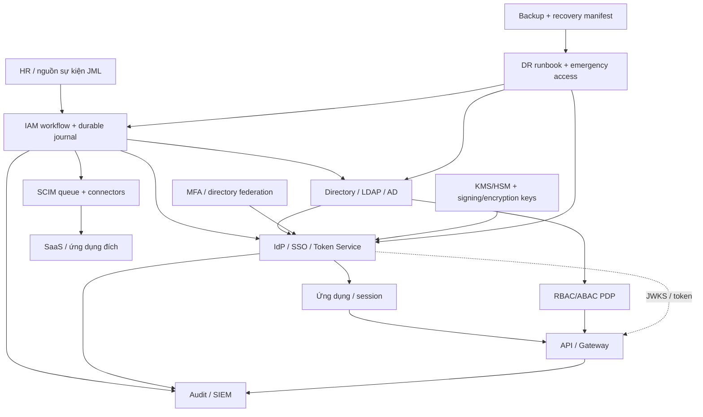
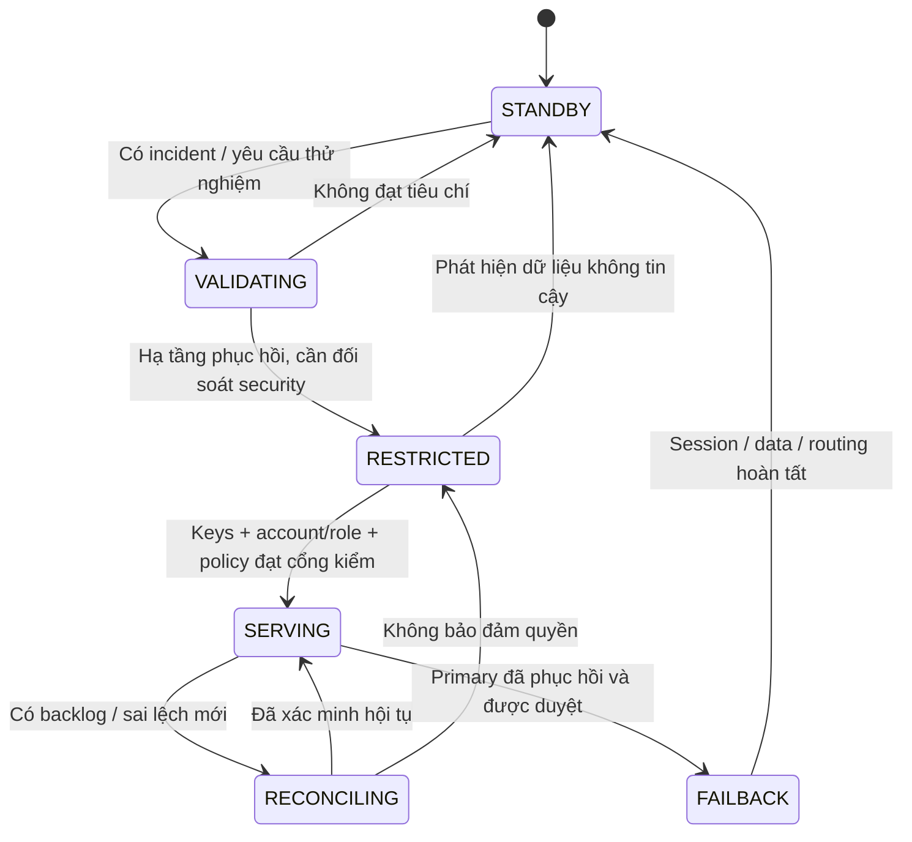

# Disaster recovery IAM: Phục hồi thảm họa mà không đánh đổi quyền truy cập

## 1. Disaster recovery IAM là gì?

**Disaster recovery (DR) cho Identity and Access Management (IAM)** là tập hợp kiến trúc, quy trình, dữ liệu, con người và kiểm thử nhằm khôi phục những chức năng quản lý danh tính và quyền truy cập sau một sự cố nghiêm trọng. Thảm họa có thể làm mất một vùng hạ tầng, phá hỏng dữ liệu, cô lập mạng, khiến Identity Provider (IdP) không còn khả dụng, làm mất quyền quản trị hoặc buộc hệ thống phải ngừng hoạt động để điều tra xâm nhập.

Một chiến lược DR thành công không chỉ đưa màn hình SSO trở lại. Nó còn phải giữ **tính đúng đắn của danh tính và quyền**:

- Người dùng hợp lệ được xác thực và truy cập trong phạm vi cho phép.
- Người đã nghỉ việc (**Leaver**) không bị tái kích hoạt khi dữ liệu cũ được phục hồi.
- Nhân viên thay đổi vai trò (**Mover**) không nhận lại nhóm/quyền đã thu hồi.
- Nhân viên mới (**Joiner**) được tạo tài khoản đúng định danh, tránh tạo trùng ở IdP hoặc ứng dụng đích.
- Ứng dụng, tài khoản dịch vụ và hệ thống quản trị không tự động bỏ kiểm tra xác thực/ủy quyền để đạt chỉ tiêu uptime.
- Các quyết định khẩn cấp và thao tác phục hồi vẫn có bằng chứng kiểm toán.

Trong module **SECURITY_IDENTITY_ACCESS_MANAGEMENT_IDENTITY_LIFECYCLE**, IAM gắn với vòng đời **Joiner–Mover–Leaver**, nguồn danh tính từ HR, directory, IdP, SSO, SCIM, chính sách **RBAC/ABAC**, tài khoản dịch vụ và cơ chế thu hồi quyền. DR phải bảo vệ được **toàn bộ chuỗi này**, không chỉ một database.

### Ví dụ mở đầu

08:00, vùng A chứa IdP và directory chính ngừng hoạt động. Vùng B có máy chủ dự phòng nhưng còn thiếu một số cập nhật nhóm và disable tài khoản từ 07:55 đến 08:00. Trong khoảng đó HR đã xác nhận hai trường hợp Leaver và một thay đổi quyền admin. Nếu chuyển tất cả traffic sang B ngay, đăng nhập có thể hoạt động trở lại nhưng các quyền đã thu hồi có nguy cơ xuất hiện lại.

Quyết định DR ở đây không phải “có region B hay không”, mà là **region B đã đủ điều kiện phục vụ những request nào, cần đối soát dữ liệu gì và khi nào được mở lại các thao tác nhạy cảm**.

### Mục tiêu học tập

Sau bài này, bạn có thể:

1. Phân biệt DR với backup, high availability, failover và business continuity.
2. Lập bản đồ phụ thuộc IAM, phân nhóm chức năng cần khôi phục theo mức ưu tiên.
3. Đặt RTO/RPO và các *security invariants* cho xác thực, cấp quyền, thu hồi và provisioning.
4. Thiết kế DR topology, cơ chế phục hồi khóa, dữ liệu và phiên đăng nhập.
5. Xây dựng runbook chuyển vùng, khôi phục, đối soát JML và failback.
6. Diễn tập mất vùng, mất IdP/directory, mất signing key, đứt replication và sự cố bảo mật.

## 2. DR khác backup và high availability ở điểm nào?

| Năng lực | Câu hỏi giải quyết | Ví dụ | Giới hạn |
|---|---|---|---|
| **High availability (HA)** | Một thành phần hỏng thì dịch vụ có tiếp tục không? | Hai IdP instance ở hai availability zone | Không tự khắc phục xóa dữ liệu hoặc cấu hình lỗi lan sang tất cả instance |
| **Failover** | Chuyển traffic/workload sang nơi còn khỏe như thế nào? | Chuyển từ region A sang B | Có thể chuyển sang dữ liệu stale, key/policy không tương thích |
| **Backup/restore** | Lấy lại trạng thái từ recovery point nào? | Restore directory snapshot và journal | Có thể mất thay đổi sau snapshot; thường không khôi phục dịch vụ tức thì |
| **Disaster recovery** | Khôi phục **chuỗi năng lực IAM** tới trạng thái vận hành đúng ra sao? | Khôi phục IdP, directory, khóa ký, SSO, SCIM, audit và quyền JML | Phải điều phối cả con người, dữ liệu, mạng, bảo mật và hệ thống đích |
| **Business continuity** | Hoạt động nghiệp vụ duy trì ở mức nào trong và sau thảm họa? | Một số nghiệp vụ chỉ đọc tiếp tục bằng token hợp lệ | Không tương đương phục hồi toàn bộ IAM |

**Replication không phải backup**: lỗi xóa tài khoản, thay đổi policy sai hay mã độc có thể lan tới các bản sao. **Backup không tự bảo đảm RTO**: dù còn snapshot, việc khôi phục IdP có thể cần database, secret store, khóa giải mã và kết nối mạng mà chính sự cố đã làm mất.

DR cần cả năng lực **vận hành giảm chức năng an toàn** (*degraded mode*) lẫn kế hoạch quay trở lại vận hành bình thường.

## 3. Xác định các luồng IAM trọng yếu trước khi thiết kế DR

Một hệ thống có thể có nhiều đường phụ thuộc khác nhau. Đừng gọi tất cả là “IAM down” mà không phân biệt tác động.

### 3.1 Ma trận chức năng và phụ thuộc

| Luồng nghiệp vụ | Thành phần thường phụ thuộc | Biểu hiện khi hỏng | Điều cần khôi phục |
|---|---|---|---|
| Đăng nhập OIDC mới | IdP, directory/identity store, MFA, DNS, TLS, `/authorize`, `/token` | Redirect, MFA hoặc code exchange lỗi | End-to-end login đúng issuer, client và policy |
| Đăng nhập SAML mới | IdP, metadata, signing certificate, mạng | Không tạo/xác minh được assertion | Trust, audience, recipient, signature và federation route |
| Refresh token | Authorization server, session/refresh state, key service | Access token hết hạn nhưng không refresh được | Token endpoint và revocation đúng |
| API dùng JWT cục bộ | JWT verifier, JWKS/public-key cache, RBAC/ABAC | Có thể tiếp tục dù IdP down, trừ khi cần policy trực tuyến | Chữ ký, claim, độ mới của quyền và revocation |
| API dùng opaque token | Introspection endpoint, cache theo chính sách | Request có thể lỗi khi introspection mất | Endpoint hoặc degraded policy có TTL được phê duyệt |
| Directory search/bind/write | AD/LDAP, DNS, Kerberos, replica, storage | Login, tra cứu hoặc cập nhật tài khoản lỗi | Read/write path và consistency của account state |
| Joiner | HR, IAM orchestrator, IdP/directory, SCIM | Không tạo được account/nhóm | Durable event, idempotency và target confirmation |
| Mover | Group/role/attribute, policy, SCIM | Quyền cũ và mới có thể cùng tồn tại | Desired state mới và thu hồi role cũ |
| Leaver | Disable, revoke, session, token, SaaS | Quyền truy cập tồn dư | Chặn đăng nhập và xác nhận từng enforcement point |
| Tài khoản dịch vụ | Token issuer, client credential, workload trust, KMS | Không xin token mới hoặc service auth thất bại | Issuer/key/credential được phục hồi an toàn |
| Quản trị IAM | SSO admin, PAM, console, MFA, break-glass | Operator bị khóa khỏi hệ thống cần sửa | Đường quản trị độc lập có kiểm toán |
| Audit và incident response | Event journal, SIEM, log pipeline, clock | Không quan sát được thay đổi quyền | Bằng chứng đầy đủ hoặc xác định được log gap |

Không phải sản phẩm nào cũng chạy đủ các thành phần. Ví dụ, một IdP có thể dùng identity store nội bộ và không gọi LDAP mỗi lần login; ứng dụng khác có thể tự giữ session sau SSO. Phải lập **sơ đồ phụ thuộc thực tế** từ trace, cấu hình và kiểm thử.

### 3.2 Control plane và data plane

Trong kiến trúc IAM có thể phân biệt về mặt logic:

- **Identity/control plane**: tạo user, chỉnh role, policy, issuing tokens, directory writes, JML orchestration, connector config.
- **Enforcement/data plane**: API, gateway, ứng dụng và dịch vụ thực thi quyết định truy cập dựa trên token/phiên/chính sách.
- **Management/recovery plane**: console, backup repository, KMS/HSM recovery, PAM hoặc break-glass, audit control.

Khi IdP outage, một API dùng JWT đã được xác minh và chính sách hợp lệ có thể tiếp tục phục vụ cho đến giới hạn token. Điều này không chứng minh control plane đã phục hồi: đăng nhập mới, refresh token, disable account hoặc cấp quyền có thể vẫn lỗi.

### 3.3 Sơ đồ các dependency trong DR



Sơ đồ cho thấy DR có thể thất bại dù bản sao IdP còn sống: directory, KMS, MFA, network, policy, queue và đường quản trị đều có thể là **điểm lỗi chung**.

## 4. Phân loại thảm họa theo phạm vi và mức tin cậy

### 4.1 Sự cố hạ tầng

- Mất node/cluster, một availability zone, một region hoặc connectivity giữa các region.
- DNS, load balancer, reverse proxy, certificate/TLS, storage, KMS/HSM hay MFA provider lỗi.
- Mất đường quản trị khiến operator không thể thực hiện failover mặc dù standby có sẵn.

### 4.2 Sự cố dữ liệu và cấu hình

- Directory database hỏng, IdP config bị thay nhầm, schema migration thất bại.
- Sự kiện JML bị mất hoặc thứ tự cập nhật nhóm/role bị đảo.
- Backup cũ không tương thích với policy hoặc signing key hiện hành.
- Replication lag hoặc split brain khiến hai region có trạng thái disable khác nhau.

### 4.3 Sự cố an ninh

- Nghi khóa ký bị lộ, tài khoản admin bị chiếm, policy bị thay trái phép, ransomware hoặc identity store bị đầu độc.
- Không thể tin tất cả replica hoặc recovery point chỉ vì chúng đang online.
- Quy trình ưu tiên **containment, bảo toàn bằng chứng, chọn điểm sạch và rotate/revoke** trước khi mở rộng traffic.

Không dùng quy trình “failover sang replica bất kỳ” cho tình huống nghi compromise. Bản sao có thể chứa cùng dữ liệu độc hại; phục hồi availability mà không kiểm trust có thể duy trì hoặc mở rộng xâm nhập.

## 5. Xác định RTO, RPO và mức phục vụ tối thiểu

### 5.1 Các khái niệm

- **RTO (Recovery Time Objective):** thời gian mục tiêu khôi phục chức năng sau sự cố.
- **RPO (Recovery Point Objective):** khoảng dữ liệu thay đổi tối đa chấp nhận mất khi quay về recovery point.
- **MTTD (Mean Time To Detect):** thời gian trung bình để phát hiện.
- **MTTR (Mean Time To Restore/Recover):** thời gian trung bình phục hồi, cần nói rõ định nghĩa khi báo cáo.
- **Mức phục vụ tối thiểu:** những chức năng còn phải cung cấp trong khi DR chưa hoàn tất, ví dụ API đọc với JWT hợp lệ, ghi nhận Leaver events, khóa khẩn cấp tài khoản bị compromise.

Giả sử RTO đăng nhập là 30 phút, nhưng thời gian cần để phát hiện outage, phê duyệt chuyển vùng, khởi động standby và kiểm thử đăng nhập đã cộng lại thành 50 phút. Kiến trúc sẽ không đạt RTO dù bản sao chạy ổn sau khi được bật. Cần đo **end-to-end timeline** bằng game day.

### 5.2 RTO/RPO phải theo chức năng

| Năng lực | Mục tiêu cần định nghĩa | Điều kiện an toàn đi kèm |
|---|---|---|
| Đăng nhập workforce | Thời gian khôi phục giao dịch SSO hợp lệ | MFA, issuer, session và account state đúng |
| Token issuance cho workload | Khả năng xin token mới theo SLA của dịch vụ | Trust/scope của workload vẫn bị giới hạn |
| Directory write | Thời gian mở lại create/modify/disable | Không đảo trạng thái disabled sau failover |
| Provisioning Joiner | Tuổi backlog tối đa | Không tạo duplicate ở SaaS |
| Thu hồi Mover/Leaver | Deadline thực thi theo từng target | Không cho quyền cũ vượt thời hạn quy định |
| Policy RBAC/ABAC | Thời gian sử dụng được chính sách đủ mới | Fail closed cho thao tác nhạy cảm khi stale |
| Audit | Giới hạn mất log và thời gian replay | Có thể truy xuất quyết định và hoạt động khẩn cấp |
| Management plane | Thời gian operator có quyền phục hồi | Break-glass có authentication và audit |

**RPO của database không đủ để mô tả rủi ro Leaver**. Một bản snapshot cách 10 phút có thể chứa một account vẫn active dù quyết định nghỉ việc đã có hiệu lực 2 phút trước. Security có thể yêu cầu không mất **bất kỳ sự kiện thu hồi quan trọng nào**, bằng journal/nguồn có thẩm quyền độc lập và xử lý pending.

### 5.3 Ví dụ ngân sách phục hồi

Một RTO giả định 30 phút có thể được phân bổ theo các khâu:

| Khâu | Ngân sách minh họa |
|---|---:|
| Phát hiện và phân loại | 5 phút |
| Quyết định, phê duyệt và mở đường admin | 5 phút |
| Khởi động/chuyển vùng kỹ thuật | 8 phút |
| Kiểm consistency, keys, identity và security | 7 phút |
| Mở traffic và xác minh | 5 phút |
| **Tổng** | **30 phút** |

Đây chỉ là ví dụ để lập kế hoạch, không phải tiêu chuẩn cho mọi hệ thống. Nếu bài kiểm tra an ninh chưa đạt, không được rút ngắn bằng cách bỏ bước xác minh quyền đã bị thu hồi.

## 6. Chọn kiến trúc DR: cold, warm, hot và active-active

| Topology | Đặc điểm | Ưu điểm | Thách thức IAM |
|---|---|---|---|
| **Cold standby** | Khôi phục hạ tầng/dữ liệu từ backup khi có sự cố | Chi phí vận hành thường thấp hơn | RTO dài; phụ thuộc restore keys, config, DNS, JML replay |
| **Warm standby** | Có môi trường dự phòng sẵn một phần, đồng bộ state/config | Phục hồi nhanh hơn cold | Cần chứng minh độ mới của dữ liệu, phiên và keys |
| **Hot standby / active-passive** | Region phụ có thể tiếp nhận traffic sau failover | RTO có thể ngắn | Split-brain, replica lag, credential/session continuity |
| **Active-active** | Nhiều vùng cùng phục vụ | Chịu lỗi một vùng, giảm thời gian cutover | Consistency, conflict, partition, trạng thái disable và role removal |

Các thuật ngữ và SLA cụ thể tùy nhà cung cấp. **Hai region không bảo đảm DR thành công** nếu cùng dựa vào một tenant quản trị, một KMS, một DNS hoặc một nguồn JML duy nhất.

### 6.1 Ranh giới vùng lỗi

Thử phân tích mất đồng thời:

1. Availability zone chứa IdP instance và database primary.
2. Cả region cùng KMS endpoint, object storage hoặc load balancer.
3. Toàn bộ tenant IdP hoặc managed directory service.
4. Mạng nội bộ/corporate VPN và DNS.
5. Tài khoản/cloud management plane hoặc PAM dùng chung.
6. Bên cung cấp MFA/federation và đường liên lạc ứng cứu.

Một “backup IdP” ở region B nhưng vẫn cần gọi directory của region A có thể không giúp khi A mất hoàn toàn. Cần kiểm tra **đường xác thực đầu cuối**, không chỉ tính sẵn sàng của node.

### 6.2 Dữ liệu nào cần đồng bộ liên vùng?

- Tài khoản, lifecycle state (ACTIVE/DISABLED), group/role, attributes và version.
- IdP realm/tenant config, clients, federation trust, SAML metadata, OIDC issuer.
- Signing key và encryption material theo cơ chế KMS/HSM được hỗ trợ.
- Session/refresh token state nếu kiến trúc thực sự cần continuity; không tự phục hồi session đã revoke.
- Policy RBAC/ABAC và cấu hình resource servers.
- Event journal, SCIM mapping, retry state, deduplication keys và audit.

Không phải mọi dữ liệu đều cần active-active. Với session ngắn hạn, tổ chức có thể chọn **buộc xác thực lại** sau failover thay vì đồng bộ session phức tạp, miễn RTO và trải nghiệm chấp nhận được.

### 6.3 Ràng buộc OIDC/SAML khi chuyển vùng

- OIDC `iss` phải được resource server tin cậy, `aud` đúng API; không tự sửa hoặc bỏ kiểm issuer.
- Public keys qua JWKS phải tương ứng với private signing key của issuer đang phát hành token.
- Nếu hostname/issuer thay đổi khi chuyển vùng, ứng dụng phải được cấu hình trust trước, hoặc dùng một issuer ổn định theo thiết kế được hỗ trợ.
- Với SAML, SP cần metadata/chứng thư và endpoints tương ứng; vẫn kiểm signature, audience, recipient, thời hạn và replay.
- Redirect URI, cookie domain, TLS và DNS cache có thể khiến login lỗi dù IdP vùng phụ đã khỏe.

DNS failover đơn thuần không giải quyết được key trust, client registration, account mapping hay trạng thái thu hồi.

## 7. Security invariants khi IAM chuyển vùng

**Security invariant** là điều kiện không được vi phạm ngay cả khi một số chức năng phải giảm hoặc dừng:

1. Không cho phép truy cập bằng token sai chữ ký, sai issuer/audience hoặc hết hạn.
2. Không phát hành phiên mới cho tài khoản đã bị disable theo trạng thái có thẩm quyền đủ mới.
3. Không tự cấp lại role/nhóm đã thu hồi do replay event hoặc đọc replica cũ.
4. Một request đặc quyền phải có bằng chứng quyền hiện hành theo deadline/cấp độ rủi ro; thiếu bằng chứng thì **fail closed**.
5. Không tự chuyển tenant/identity binding giữa hai issuer nếu chưa kiểm chứng.
6. Các credential khẩn cấp chỉ phục vụ mục đích recovery được phép và bị thu hồi sau incident.
7. Những quyết định quan trọng có audit hoặc cơ chế lưu bền vững/đối soát log khi audit sink lỗi.

### 7.1 Vấn đề stale identity state

Tại 10:00, directory A xác nhận disable user U. Replica B còn ghi nhận U đang ACTIVE. 10:01, A mất kết nối. Nếu traffic login chuyển thẳng sang B, U có thể tiếp tục đăng nhập. Đây là **lỗi tính đúng đắn của quyền**, dù availability được khôi phục nhanh.

Có thể dùng các kiểm soát phù hợp hệ thống:

- Xác định **điểm ghi có thẩm quyền** và version/watermark mới nhất trước cutover.
- Gửi revocation/disable với độ ưu tiên cao qua journal hoặc channel độc lập.
- Yêu cầu dữ liệu đủ mới với thao tác đặc quyền; tạm hạn chế khi replica chưa hội tụ.
- Fencing writer cũ để tránh hai nơi cùng nhận thay đổi mâu thuẫn.
- Sau cutover, đối soát trạng thái trên directory, IdP, PDP, ứng dụng và SCIM targets.

Không thể mặc định một sản phẩm directory hỗ trợ consistent reads xuyên region hoặc version toàn cục. Cách kiểm tra phải dựa trên semantics thực tế của storage và replication.

### 7.2 Mô hình state của một region DR



Sơ đồ chỉ minh họa state machine điều phối. Hệ thống cụ thể phải có **định nghĩa guard conditions** cho từng bước, owner phê duyệt và đường rollback khi health hoặc security regression.

## 8. DR cho JML: bảo toàn desired state và thu hồi

### 8.1 Joiner khi primary outage

Nếu HR đã xác nhận nhân viên mới nhưng directory hoặc IdP chính chưa tạo được account, IAM nên:

1. Ghi event trong durable store với event ID, subject ID ổn định và thời điểm hiệu lực.
2. Giữ desired state cho tài khoản/nhóm; đánh dấu `PENDING_IDP`, `PENDING_DIRECTORY` hoặc `PENDING_TARGET` rõ ràng.
3. Nếu region phụ là đường provisioning được phê duyệt, chỉ tạo account sau khi kiểm identity binding và authoritative state.
4. Dùng idempotency/lookup để tránh tạo tài khoản trùng khi replay sau timeout.
5. Đối soát thực tế ở IdP và mỗi SaaS target qua SCIM.

Không tạo account local/backup thiếu liên kết với danh tính chuẩn chỉ để vượt qua outage.

### 8.2 Mover trong giai đoạn replication lag

Khi chuyển từ Finance sang Support, IAM có thể phải **gỡ** `finance-approver` trước khi **thêm** `support-agent`, theo chính sách và rủi ro. Nếu failover sang region B chưa nhận role removal, user có thể giữ cả hai vai trò.

Cần:

- Desired entitlements với version/sequence hoặc cơ chế xác định trạng thái mới nhất.
- Invalidation của policy cache/JWT session theo khả năng từng enforcement point.
- Ưu tiên thu hồi quyền đặc quyền hơn bổ sung quyền không khẩn cấp khi quá tải.
- Kiểm tra trực tiếp ở application target, không suy từ trạng thái queue.
- Giới hạn giao dịch nhạy cảm khi độ mới của policy/group chưa chứng minh được.

### 8.3 Leaver là tiêu chí quyết định cutover

Trong DR, **disable thành công tại directory A** không bảo đảm session SaaS, refresh token hoặc JWT cũ đã bị thu hồi ở API. Phải có quy trình riêng:

1. Nhận Leaver event và persist ngoài các thành phần có thể mất trong thảm họa.
2. Gửi disable/revoke tới mọi target còn truy cập được, ưu tiên tài nguyên nhạy cảm.
3. Dùng channel độc lập hoặc policy hạn chế để chặn truy cập trong thời gian primary/backup chưa hội tụ.
4. Đánh dấu từng target `CONFIRMED_DISABLED`, `PENDING_CRITICAL`, `RETRYING` hoặc `ESCALATED`.
5. Sau cutover/restore, replay theo event ID và đối soát trạng thái hiện hành ở từng đích.
6. Đo **residual access window**, không chỉ thời gian directory ghi nhận lệnh disable.

Một region DR **không được coi là an toàn cho mọi luồng** chỉ vì nó có thể cấp access token. Khả năng kiểm tra Leaver và revoked privileged roles là điều kiện cổng cần thiết.

### 8.4 Pseudocode bảo vệ trạng thái JML sau phục hồi

```text
for subject in recovery_scope:
    desired = authoritative_jml_state(subject)
    restored = restored_region_state(subject)

    if desired is unknown:
        restrict_sensitive_access(subject)
        enqueue_manual_or_automated_reconciliation(subject)
        continue

    if restored.version < desired.version:
        apply_idempotently(desired, region="DR")

    for target in required_enforcement_targets(subject):
        reconcile_actual_with_desired(target, desired)
        record_confirmation_or_escalation(target)

    if subject.is_privileged and not security_checks_pass(subject):
        keep_privileged_actions_blocked(subject)
```

Đây là pseudocode kiến trúc, không phải implementation chạy trực tiếp. `authoritative_jml_state` phải có đường tin cậy độc lập hoặc một quy trình được phê duyệt khi nguồn chuẩn mất kết nối; version phải phù hợp semantics của hệ thống, không lấy ngẫu nhiên từ timestamp client.

## 9. Key management, token và session trong DR

### 9.1 Khóa ký JWT và JWKS

Resource server chỉ tin token có chữ ký từ issuer/khóa được phép. Trong DR cần chuẩn bị:

- Khả năng truy cập hoặc khôi phục private signing key theo KMS/HSM hỗ trợ, với quyền và audit phù hợp.
- Phân phối public keys/JWKS ổn định tới verifier, xử lý key rotation và cache.
- Quy tắc cho token đã phát hành trước thảm họa: còn hiệu lực đến `exp` hay cần thu hồi vì rủi ro?
- Cơ chế làm mới khi xuất hiện `kid` chưa biết; không bỏ signature verification.
- Khả năng thu hồi khóa bị nghi compromise theo quy trình an ninh riêng.

Không xuất private key ra kho không kiểm soát hoặc dùng cùng một secret chia sẻ cho toàn bộ ứng dụng để “cứu SSO”.

### 9.2 Opaque token và introspection

Với opaque token, API có thể phụ thuộc authorization server qua introspection. Nếu endpoint primary lỗi, cần failover endpoint đã được phê duyệt hoặc degraded policy có TTL giới hạn và điều kiện dùng. **Cache `active=true` tạo cửa sổ revocation lag**; không cho phép mọi request vô hạn khi introspection không có.

### 9.3 Phiên người dùng và refresh token

Có hai hướng:

- **Session continuity**: đồng bộ được trạng thái phiên/refresh token một cách nhất quán, giữ hoạt động của các phiên hợp lệ.
- **Reauthentication**: không restore session cũ, yêu cầu người dùng đăng nhập lại qua vùng DR.

Lựa chọn phụ thuộc sản phẩm, SLA và độ nhạy. Restore session snapshot cũ có thể **hồi sinh phiên đã bị logout/revoke**. Khi an ninh không được chứng minh, reauthentication hoặc thu hồi có kiểm soát có thể an toàn hơn.

### 9.4 MFA và certificate

DR phải tính đến MFA provider, thiết bị đăng ký, passkey/recovery methods và kênh challenge. Không tự tắt MFA toàn tenant khi provider outage. Nếu có phương thức dự phòng, phải có assurance thích hợp và độc lập với dependency lỗi.

SAML signing certificate, OIDC client secrets, TLS cert, federation metadata và redirect/ACS config cần có inventory và runbook khôi phục. Kiểm chứng bằng một **login end-to-end**, không chỉ HTTP 200 tại health endpoint.

## 10. DR cho service accounts và automation

Workload identity và service account thường nằm ngoài luồng SSO nhân viên, nhưng lại có thể phụ thuộc authorization server để lấy token mới.

Một số tình huống:

- Dịch vụ có access token JWT hợp lệ tiếp tục hoạt động đến `exp`; khi token endpoint mất thì refresh/client credentials mới thất bại.
- Workload identity federation có thể phụ thuộc một issuer hoặc trust chain riêng với workforce IdP.
- Service account trong AD/Kerberos có thể không lấy được service ticket mới nếu domain controller/KDC outage.
- Automation khôi phục cần secret, mTLS certificate hoặc quyền cloud management plane vốn được giữ trong chính hệ thống đang lỗi.

Chính sách DR nên ghi rõ owner, issuer, audience/scope, cách cấp credential dự phòng, thời hạn, rotation, revocation và audit. Đường dự phòng cho máy **không được** là một API key toàn quyền dùng chung không hết hạn.

## 11. Break-glass: khôi phục quyền quản trị trước khi cần nó

Nếu cần vào IdP console để sửa SSO nhưng console lại yêu cầu login qua cùng SSO đang lỗi, đội vận hành rơi vào vòng phụ thuộc. Cần chuẩn bị **emergency access**:

- Identity khẩn cấp và phương thức xác thực độc lập phù hợp khả năng nền tảng.
- Credential custody/escrow có thể sử dụng khi SSO/PAM chính down.
- Kênh liên lạc, incident record và cơ chế approval không chỉ sống trong cùng IdP.
- Phạm vi quyền tối thiểu để sửa hệ thống trọng yếu, time box, cảnh báo và session audit.
- Quy trình đóng session, revoke/quay vòng credential, kiểm tra quyền theo JML.

Break-glass phải có **diễn tập trong điều kiện mất IdP, PAM, DNS hoặc network**, vì một tài khoản admin dự phòng dùng chung MFA đang outage không tạo được khả năng khôi phục.

Đây không phải quyền bỏ qua token verification hay authorization trên các API nghiệp vụ. Nó chỉ dành cho người/tài nguyên đã định nghĩa trong quy trình cứu hộ.

## 12. Runbook disaster recovery IAM: từ sự cố đến cutover

### Giai đoạn A — Phát hiện và khai báo

1. Quan sát synthetic OIDC/SAML login, token endpoint, directory read/write, MFA, JWKS, policy engine, SCIM queue và health liên vùng.
2. Phân loại tác động: chỉ node, site, region, data corruption, network partition hay nghi compromise.
3. Xác định user cohorts/tenants/clients và workload bị ảnh hưởng, đồng thời phân biệt login mới với phiên hiện hữu.
4. Kích hoạt incident commander, IAM operator, infrastructure owner và Security contact theo severity.
5. Mở kênh liên lạc và quản trị **không phụ thuộc SSO lỗi**; bảo toàn bằng chứng nếu nghi tấn công.

### Giai đoạn B — Ổn định và giữ an toàn

1. Giảm retry storm/circuit breaker, giới hạn login retries và thay đổi cấu hình không khẩn cấp.
2. Cho các request có JWT/session hợp lệ tiếp tục **chỉ trong phạm vi policy cho phép**.
3. Ghi bền vững các sự kiện JML và đánh dấu Leaver/privileged role changes ưu tiên cao.
4. Nếu nguồn quyền chưa đủ mới, tạm hạn chế thao tác nhạy cảm; không tắt signature, issuer/audience hoặc MFA để tăng tỷ lệ 200.
5. Xác định những hệ thống đích có đường revoke độc lập và xử lý ngay khi có thể.

### Giai đoạn C — Chọn đường khôi phục

1. So sánh topology còn khỏe, recovery points và độ tin cậy của dữ liệu vùng DR.
2. Kiểm directory/IdP replication lag, trạng thái disabled, revoked sessions và policy versions.
3. Kiểm KMS/signing key, trust OIDC/SAML, DNS, TLS, MFA, directory/Kerberos và khả năng login E2E.
4. Kiểm quyền break-glass, sự sẵn sàng của operator và phê duyệt cutover.
5. Chọn full failover hoặc limited/degraded service theo guard conditions và risk acceptance đã định trước.

### Giai đoạn D — Chuyển vùng / phục hồi

1. Fencing nguồn ghi cũ nếu nguy cơ split brain, theo đúng khả năng của database/directory.
2. Khôi phục thứ tự phụ thuộc: mạng/DNS/TLS, key/data stores, directory, IdP/token service, policy, connectors và audit, tùy topology thực tế.
3. Áp dụng config/issuer/trust đã được phê duyệt, không tin nguồn lạ.
4. Replay/reconcile JML events mới hơn recovery point; ưu tiên disable và role removals.
5. Kiểm **positive và negative test** trước khi mở rộng traffic.
6. Tăng traffic từng bước, theo dõi login/token/API errors, QPS, replication, queue và security alerts.

### Giai đoạn E — Xác minh sau cutover

- OIDC authorization-code flow/refresh và SAML SSO thực sự hoàn tất đúng chính sách.
- Token phát hành từ region DR có `iss`, `aud`, signature, `exp`, scopes và keys đúng; token giả bị từ chối.
- User Leaver bị từ chối đăng nhập, Mover không còn quyền cũ, privileged user yêu cầu step-up theo policy.
- Directory search/write, replication và KDC/Kerberos hoạt động nếu thuộc phạm vi.
- SCIM retries idempotent, target status được readback, không có duplicate account.
- M2M có thể lấy token mới mà không vượt quyền.
- Audit và incident logs có đủ dấu vết hoặc có gap được ghi nhận và xử lý.

### Giai đoạn F — Duy trì chế độ DR

1. Theo dõi backlog, revocation lag, policy drift và tài khoản/session khẩn cấp.
2. Giới hạn thay đổi cấu hình tùy ý để dễ failback, nhưng không chặn thu hồi quyền bắt buộc.
3. Định kỳ kiểm tình trạng primary, bảo đảm không tự tiếp nhận ghi mâu thuẫn.
4. Ghi timeline, actual RTO/RPO, trạng thái security correctness và những exception được phê duyệt.

## 13. Failback: trở lại primary là một lần chuyển dữ liệu nữa

Khi vùng A phục hồi, không nên chỉ đổi DNS về A. Trong thời gian vùng B phục vụ, có thể đã phát sinh Joiner mới, Mover/Leaver, group changes, sessions, admin changes và SCIM updates.

### Quy trình failback an toàn

1. **Tuyên bố primary đã được sửa và đáng tin cậy**, không còn lỗi gốc hoặc dấu hiệu compromise.
2. **Chọn nguồn trạng thái hiện hành**: region B đang phục vụ có thể chứa những thay đổi mới hơn region A.
3. **Khôi phục và hội tụ** dữ liệu IAM, directory, IdP, keys, policies, JML journal và connector mapping theo semantics được hỗ trợ.
4. **Fencing/điều phối writes** để tránh hai vùng cùng nhận thay đổi không nhất quán.
5. **Đối soát Leaver, Mover, credential và revocation**; không cho ACTIVE cũ từ A ghi đè DISABLED mới của B.
6. **Kiểm end-to-end** OIDC/SAML, token, session, API, SCIM, service accounts và audit trên đường về A.
7. **Chuyển traffic có kiểm soát**, quan sát lỗi và rollback nếu xuất hiện sai lệch.
8. **Đóng quyền khẩn cấp**, rà soát log gap và kết thúc incident sau khi trạng thái các target đã được xác nhận.

### Rủi ro split brain và thứ tự sự kiện

Ví dụ, trong partition:

- Vùng A ghi nhận `U.DISABLED` theo Leaver.
- Vùng B nhận lại một event `U.ACTIVE` cũ hoặc thao tác enable trái quy trình.
- Khi ghép lại, nếu xử lý theo “message đến sau thắng”, user U có thể active trở lại.

Biện pháp là xác định nguồn quyền có thẩm quyền, versioning/fencing và quy tắc đối soát cho mỗi loại state. Không dùng timestamp từ client không đồng bộ như chứng cứ tuyệt đối rằng một event mới hơn.

## 14. Quản trị khôi phục sau sự cố bảo mật

Khi có dấu hiệu xâm nhập IdP hoặc directory, quy trình DR cần thêm **trust verification**:

1. Khoanh vùng tài khoản/quyền bị lộ, bảo vệ bằng chứng trước khi reset hoặc restore.
2. Xác định recovery point sạch; snapshot mới nhất có thể chứa user admin, role hoặc signing key do attacker chiếm quyền.
3. Dùng một đường quản trị và credential được kiểm chứng, không dựa vào secret nghi lộ.
4. Restore cấu hình/dữ liệu vào môi trường kiểm soát, kiểm tra policy, account/linking, MFA enrollment và revoked credential.
5. Rotate/re-key phù hợp với sự cố, vô hiệu hóa token/session bị ảnh hưởng; thông báo tới resource servers/clients nếu trust/key thay đổi.
6. Chạy test bảo mật và đối soát toàn bộ JML/SCIM trước khi mở lại traffic.
7. Ghi nhật ký forensic, thời điểm compromise, bằng chứng và quyết định chấp nhận rủi ro.

Với ransomware hoặc identity data tampering, **availability xanh** không có nghĩa hệ thống an toàn. Một restore nhanh dùng dữ liệu chưa tin cậy có thể giúp attacker duy trì quyền.

## 15. Monitoring và readiness của DR IAM

### 15.1 Những chỉ số cần theo dõi

| SLI/metric | Vì sao quan trọng | Ví dụ tín hiệu cảnh báo |
|---|---|---|
| Synthetic OIDC/SAML login success | Đo trực tiếp trải nghiệm SSO | Login thất bại ở nhiều vùng/clients |
| Token issuance/refresh success | Phát hiện control plane lỗi | `/token` 5xx/timeout tăng |
| JWKS fetch và unknown `kid` | Khóa không sẵn hoặc key rotation lỗi | Token mới bị từ chối |
| Directory read/write và replication lag | Dữ liệu identity có đủ mới? | Disable user chưa hội tụ |
| JML backlog / oldest event age | Provisioning/revocation đang bị kẹt | Leaver pending quá deadline |
| Target-level revocation confirmation | Đo thu hồi quyền thực tế | SaaS vẫn active dù IAM đã disable |
| Policy version/freshness drift | Tránh stale authorization | Role admin khác nguồn chuẩn |
| RTO/RPO actual | Đánh giá khả năng khôi phục | Game day vượt mục tiêu |
| Backup age / restore test result | Chứng minh có recovery point usable | Backup thành công nhưng không restore được |
| Break-glass activation | Phát hiện sử dụng quyền khẩn cấp | Đăng nhập ngoài incident hoặc không có audit |
| Audit delivery lag/gaps | Phục hồi khả năng truy vết | Log sink ngừng nhận sự kiện |
| Split-brain/replication conflict | Tránh trạng thái IAM mâu thuẫn | Hai nguồn nhận writes cùng đối tượng |

### 15.2 Readiness score không chỉ là số replica

Một DR readiness review có thể yêu cầu bằng chứng cho:

- Dependency map và owners hiện hành.
- Cấu hình các region/issuer/clients/keys tương thích, có version kiểm soát.
- Backup có integrity và test restore thành công.
- Event JML bền vững, có khả năng replay idempotent.
- Runbook được thực hành với mất hẳn primary, không chỉ restart instance.
- Đường break-glass, MFA, KMS, DNS và network hoạt động độc lập trong tình huống cần cứu.
- Negative tests chứng minh user bị disable và role bị revoke không được cấp lại.

Một hệ thống có hai vùng nhưng chưa từng thử logout, Leaver và key rotation trong failover vẫn có **rủi ro DR chưa được kiểm chứng**.

## 16. Game day: kiểm thử DR IAM

Diễn tập phải có phạm vi được ủy quyền, môi trường thử hoặc cơ chế giảm thiểu rủi ro khi chạy gần production, người chịu trách nhiệm, điều kiện dừng và cách rollback.

| Kịch bản | Mục tiêu kiểm thử | Điều kiện PASS |
|---|---|---|
| Mất một IdP instance | HA và client retry không tạo lỗi dây chuyền | Login mới hoàn tất trong mục tiêu, policy giữ nguyên |
| Mất toàn region IdP | DR cutover theo RTO | E2E SSO qua vùng phụ, issuer/key đúng |
| Mất directory write path | Phân biệt read availability với JML update | Leaver pending được cảnh báo; đường revoke độc lập được dùng |
| Partition giữa hai region | Tránh split brain và stale entitlement | Không tái kích hoạt account disabled hoặc role đã thu hồi |
| Mất JWKS endpoint khi verifier có cache | Khả năng kiểm token offline có giới hạn | Token đúng còn hợp lệ; `kid` lạ/sai chữ ký bị từ chối |
| Key rotation trong failover | Public/private keys tương thích | Verifier không chấp nhận token không tin cậy |
| Mất MFA provider | Không tự bỏ MFA toàn tenant | Chỉ fallback đã được phê duyệt hoạt động |
| SCIM target offline lúc Leaver | Replay và target confirmation | Không gắn COMPLETED nếu chưa disable thực tế |
| Restore từ snapshot trước Leaver | Bảo vệ security invariants | Leaver bị disable sau reconcile, không có quyền admin cũ |
| Primary quay lại sau hoạt động vùng DR | Failback nhất quán | JML và group/policy hội tụ, không split brain |
| PAM/SSO outage cùng lúc | Break-glass độc lập | Operator được phép vào console, có audit và time box |
| Audit pipeline down | Khôi phục bằng chứng | Có log buffer/replay hoặc gap được xác định rõ |
| Nghi signing key compromise | Security DR | Key/token không còn tin cậy bị xử lý, không mở trust bừa bãi |

### 16.1 Một bài thực hành end-to-end

Giả sử môi trường thử có IdP A, IdP B, directory hai vùng, gateway xác minh JWT và hai SaaS target:

1. Đưa một nhóm test user vào trạng thái bình thường, gồm Joiner, Mover và Leaver giả lập.
2. Tạo một sự kiện `Mover` thu hồi role `payment-approver`; tạo một sự kiện `Leaver` với thời điểm hiệu lực rõ.
3. Chủ động gây replication lag từ A sang B trong phạm vi thử nghiệm.
4. Mô phỏng region A unavailable, kích hoạt quy trình DR có incident ID.
5. Xác minh B không cấp lại quyền `payment-approver` và không cho Leaver đăng nhập.
6. Kiểm API JWT hợp lệ được phục vụ theo policy, token sai chữ ký hoặc sai issuer bị từ chối.
7. Kiểm SCIM target status; event pending phải được retry/reconcile theo version.
8. Khôi phục A, diễn tập failback với fencing và kiểm snapshot/desired state mới nhất.
9. Đóng break-glass, thu hồi session/credential tạm và rà soát audit.
10. Ghi RTO/RPO actual, thời gian residual access, các điểm thiếu trong runbook và hành động cải tiến.

### 16.2 Tiêu chí nghiệm thu

Một diễn tập **PASS** khi:

- Các chức năng được ưu tiên đáp ứng RTO/RPO đã xác định **hoặc** sai lệch được báo cáo đúng như chưa đạt mục tiêu.
- Các negative test bảo mật thành công: user disabled, revoked role, invalid token và tenant mismatch bị từ chối.
- Không có event JML quan trọng bị mất hoặc bị coi hoàn tất khi chưa có bằng chứng đích.
- Không có writes mâu thuẫn ngoài kiểm soát; failback đã hội tụ và audit truy vết được.

**Không coi diễn tập PASS chỉ vì login thành công.** Khả năng cấp nhầm quyền trong lúc failover là một lỗi có thể nghiêm trọng hơn downtime.

## 17. Những sai lầm thường gặp

**“Có backup là đã có DR.”** Thiếu key recovery, network, console, runbook và người vận hành thì bản sao chưa giúp khôi phục chức năng.

**“DNS failover đủ để đổi vùng IdP.”** Issuer, JWKS, cert, client registration, session và directory data vẫn có thể không tương thích.

**“Active-active luôn tốt hơn active-passive.”** Độ phức tạp consistency và split brain có thể khiến dữ liệu disable/role sai. Chọn topology theo khả năng kiểm soát và kiểm thử.

**“Region B healthy nên mọi user đều an toàn.”** Replica khỏe nhưng stale vẫn có thể cho Leaver đăng nhập.

**“JWT cache cho phép phục vụ mãi đến khi IdP lên.”** Token hết hạn hoặc sai signature vẫn phải bị từ chối; quyền động có thể yêu cầu dữ liệu mới.

**“Phục hồi snapshot là xong offboarding.”** Snapshot trước sự kiện Leaver có thể tạo lại account active; cần replay và target readback.

**“Khi DR, tạm tắt MFA và kiểm token.”** Đây là bypass authentication, không phải giải pháp khôi phục hợp lệ.

**“Bật primary lại ngay khi vùng A có ping.”** Cần data synchronization, fencing, key trust, audit và đối soát JML trước failback.

**“Audit có thể bổ sung bằng trí nhớ sau incident.”** Nên có kênh log bền vững/độc lập, correlation ID và đánh dấu rõ mọi khoảng mất bằng chứng.

**“Bản backup mới nhất luôn sạch.”** Nếu bị compromise, recovery point gần nhất có thể chứa backdoor/privileged account trái phép.

**“Không cần diễn tập vì vendor có SLA cao.”** SLA của một thành phần không chứng minh đường SSO, provisioning và authorization toàn hệ thống đáp ứng RTO.

## 18. Checklist chuẩn bị và ứng cứu

### Trước thảm họa

- [ ] Lập bản đồ phụ thuộc IdP, directory, MFA, DNS, KMS, SSO, SCIM, RBAC/ABAC và audit.
- [ ] Có RTO/RPO riêng cho login, token, provisioning, revocation, policy và management plane.
- [ ] Xác định failure domains, topology và đường bảo vệ replication/split brain.
- [ ] Backup có integrity, encryption, retention và restore/key-recovery test.
- [ ] Có durable JML journal, idempotency và target-level reconciliation.
- [ ] Có issuer/key/federation configuration tương thích khi failover.
- [ ] Có break-glass độc lập và kênh incident communication ngoài SSO.
- [ ] Game day đã thử cả positive và negative security cases.

### Trong thảm họa

- [ ] Xác định phạm vi và phân loại outage, corruption hay compromise.
- [ ] Giữ authentication/authorization invariants; không mở đặc quyền do thiếu dữ kiện.
- [ ] Ưu tiên Leaver và privileged role revocation; ghi trạng thái pending rõ ràng.
- [ ] Chọn DR recovery point/region đủ tin cậy, kiểm keys và dữ liệu mới nhất.
- [ ] Fencing nguồn ghi cũ khi cần; kiểm split brain trước cutover.
- [ ] Kiểm end-to-end login, token, policy, SCIM, service accounts và audit.
- [ ] Mở traffic theo từng nhóm đã xác minh, theo dõi RTO và security correctness.

### Sau khi phục hồi

- [ ] Reconcile Joiner/Mover/Leaver, group/roles, MFA, session và SCIM target.
- [ ] Failback có kế hoạch, version/freshness checks và xác minh trust.
- [ ] Thu hồi emergency access, rotate credential nếu cần, đóng các phiên tạm.
- [ ] Xác định residual access window và mọi audit gap.
- [ ] Ghi actual RTO/RPO, root cause, bài học và cập nhật game day/runbook.

## 19. Câu hỏi và bài tập thực hành

### Tình huống A — Failover nhanh nhưng mở lại quyền Leaver

IdP A hỏng lúc 10:00. Replica B chỉ mới nhận cập nhật đến 09:55. HR đã ghi nhận nhân viên nghỉ việc lúc 09:58 và IDM A đã disable người này. Sau failover, user vẫn có thể đăng nhập tại B.

**Yêu cầu:** nêu security invariant bị vi phạm, các dữ liệu cần đối soát trước cutover và biện pháp hạn chế nếu replica chưa đủ mới.

*Gợi ý:* Durable Leaver journal, revocation priority, watermark/version, fail closed cho hành động nhạy cảm và target confirmation.

### Tình huống B — Đủ máy chủ nhưng không có khóa ký

Region dự phòng có database và cấu hình IdP nhưng không truy xuất được signing key ở KMS của region chính. Resource servers từ chối tất cả token mới bằng `unknown_kid`.

**Yêu cầu:** giải thích vì sao đây là lỗi DR dependency, đề xuất quy trình key recovery/rotation và các negative test không được bỏ qua.

*Gợi ý:* KMS/HSM independence, private/public key trust, `iss`/`aud`, JWKS distribution và incident audit.

### Tình huống C — M2M gián đoạn sau 15 phút

Một nhóm service sử dụng client credentials, access token có thời hạn ngắn. Trong 15 phút đầu IdP outage, request API vẫn thành công, rồi bắt đầu trả 401.

**Yêu cầu:** phân tích đường phụ thuộc và chọn phương án DR/fallback thích hợp mà không tạo một shared secret toàn quyền.

*Gợi ý:* Token issuer, endpoint phát hành, workload identity, certificate/secret recovery, scopes và failover tests.

### Tình huống D — Primary phục hồi với dữ liệu cũ

Region B đã xử lý 12 Joiner, 5 Mover và 3 Leaver trong thời gian DR. Region A vừa hoạt động lại, nhưng dữ liệu vẫn ở thời điểm trước thảm họa. Một operator muốn đổi DNS về A ngay.

**Yêu cầu:** viết các bước failback, xác định điều kiện không được mở traffic và cách chứng minh tất cả trạng thái đã hội tụ.

*Gợi ý:* Source-of-truth, fencing, replay/idempotency, version, session/keys và SCIM target readback.

### Tình huống E — Replica khỏe nhưng nghi bị xâm nhập

Một admin account bất thường xuất hiện ở cả A và B trước khi outage. Backup gần nhất cũng chứa account đó. Đội vận hành đề nghị restore ngay vì user đang không đăng nhập được.

**Yêu cầu:** nêu sự khác biệt giữa DR do lỗi hạ tầng và DR sau compromise; xác định recovery point, credential và bằng chứng cần kiểm tra.

*Gợi ý:* Containment, clean recovery, forensic evidence, rotate/revoke và test quyền âm.

## 20. Điều cần ghi nhớ

**Disaster recovery IAM** là khả năng đưa **cả chuỗi xác thực, cấp quyền, quản lý vòng đời danh tính và kiểm toán** trở lại hoạt động đúng sau thảm họa. Backup và HA là thành phần của giải pháp, không phải toàn bộ giải pháp. Muốn DR hiệu quả, tổ chức phải hiểu dependency, chọn topology phù hợp, có quyền quản trị độc lập, bảo vệ signing keys và kiểm thử RTO/RPO thực tế. Quan trọng nhất, mọi lần restore, failover và failback phải đối soát **Joiner–Mover–Leaver**, đặc biệt **disable Leaver và thu hồi quyền đặc quyền**, trước khi coi hệ thống đã phục hồi an toàn.
