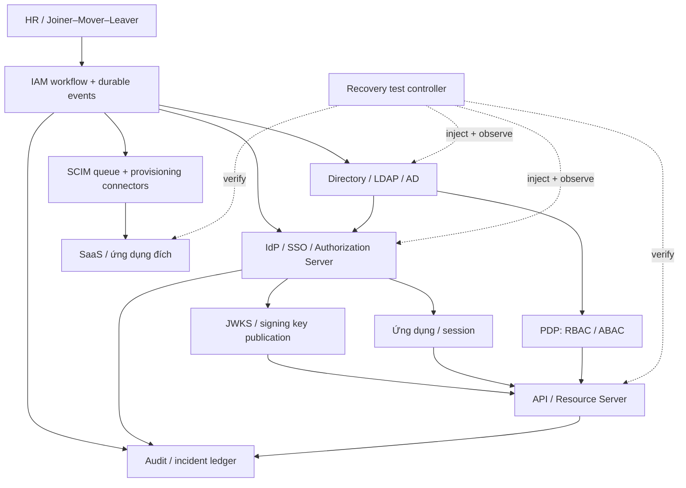
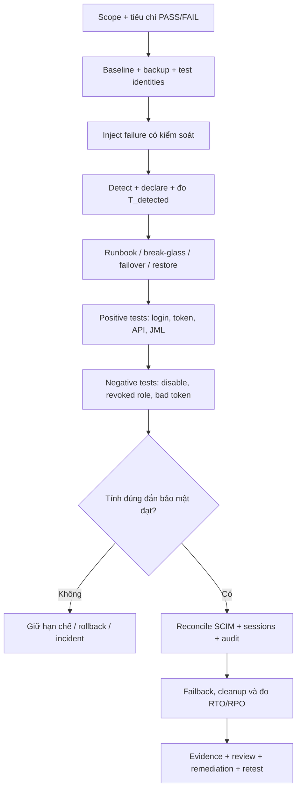
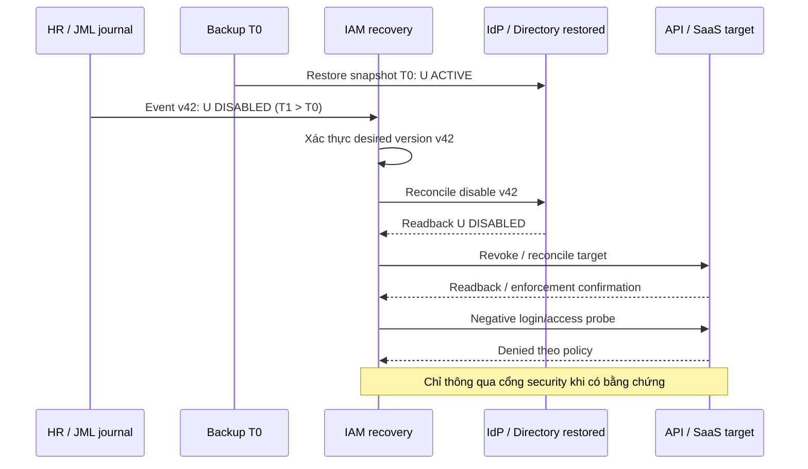

# Recovery test trong IAM: Kiểm thử phục hồi và chứng minh quyền truy cập vẫn đúng

## 1. Recovery test là gì?

Trong **Identity and Access Management (IAM)**, **recovery test** là hoạt động kiểm tra có kế hoạch nhằm chứng minh hệ thống có thể phục hồi sau sự cố **và** tiếp tục thực thi đúng các quy tắc danh tính, xác thực, phân quyền, thu hồi quyền. Bài kiểm thử có thể mô phỏng lỗi một nút directory, mất IdP, hỏng database, chậm replication, mất cả region, sai signing key hoặc khôi phục từ bản backup cũ.

Recovery test là một phần thiết yếu của **IAM resilience**. Việc có hai máy chủ, backup mỗi ngày, cấu hình failover hoặc một tài khoản break-glass **chưa phải bằng chứng** có thể phục hồi. Bằng chứng chỉ xuất hiện khi chạy thử các luồng thật, đo thời gian, đối soát trạng thái và ghi nhận kết quả đạt/không đạt theo tiêu chí đã xác định trước.

Trong mô hình **Joiner–Mover–Leaver (JML)**, recovery test phải trả lời những câu hỏi khó hơn “đăng nhập được chưa?”:

- **Joiner:** một người mới được tạo trước/trong sự cố có đúng một account và các quyền khởi tạo được phép hay không?
- **Mover:** những nhóm và quyền đã bị thu hồi khi chuyển vai trò có tái xuất hiện sau failover hoặc restore không?
- **Leaver:** tài khoản đã nghỉ việc có bị chặn trên IdP, directory, ứng dụng, session, SCIM target và các điểm thực thi quyền trong hạn cam kết không?
- **Service account:** workload có lấy được token hợp lệ sau khôi phục mà không phải dùng shared secret quyền rộng không?
- **Kiểm toán:** có thể chứng minh ai kích hoạt recovery, tác động nào đã xảy ra và thời điểm hệ thống đủ an toàn để mở traffic không?

### Mục tiêu học tập

Hoàn thành bài này, bạn có thể:

1. Phân biệt recovery test, backup verification, HA test, DR game day, chaos experiment và security validation.
2. Xây dựng kế hoạch kiểm thử có phạm vi, điều kiện tiên quyết, **RTO/RPO**, tiêu chí an toàn và phương án dừng.
3. Thiết kế bộ kiểm thử cả **positive** và **negative** cho IdP/SSO, LDAP/AD, OIDC/SAML, SCIM, RBAC/ABAC, tài khoản dịch vụ và break-glass.
4. Đo khả năng phục hồi thực tế, độ trễ JML, quyền truy cập tồn dư và trạng thái hội tụ sau restore/failback.
5. Đưa kết quả kiểm thử vào runbook, quyết định triển khai và kế hoạch khắc phục.

## 2. Recovery test khác các loại kiểm thử liên quan thế nào?

| Hoạt động | Phạm vi kiểm chứng | Ví dụ | Giới hạn nếu chỉ thực hiện riêng |
|---|---|---|---|
| **Backup integrity check** | Bản sao đọc được, checksum/manifest hợp lệ | Xác minh checksum của backup IdP | Không biết dữ liệu có restore thành công không |
| **Component restore test** | Phục hồi một thành phần trong môi trường thử | Restore directory vào lab | Chưa kiểm luồng SSO và provisioning cuối cùng |
| **HA / failover test** | Chuyển sang replica/node còn khỏe | Tắt một IdP node | Không kiểm được mất toàn vùng hoặc lỗi dữ liệu chung |
| **DR recovery test** | Phục hồi chuỗi phụ thuộc end-to-end | Mất region chứa IdP, directory và KMS | Tốn công thiết lập; cần xác định rõ tiêu chí bảo mật |
| **Failback test** | Trở lại primary sau khi DR phục vụ | Tái đồng bộ vùng A sau 1 giờ chạy vùng B | Chuyển về dễ gây split brain hoặc ghi đè trạng thái mới |
| **Security recovery test** | Phục hồi từ trạng thái nghi bị xâm nhập | Chọn snapshot sạch, rotate khóa bị lộ | Không thể chỉ dựa trên health/status của dịch vụ |
| **Chaos / fault-injection experiment** | Kiểm các giả thuyết về lỗi chưa được bảo đảm | Cắt kết nối LDAP hoặc tăng latency có kiểm soát | Không nhất thiết bao quát toàn bộ quy trình DR |
| **Game day / tabletop exercise** | Kiểm quy trình và phối hợp con người | Diễn tập ai phê duyệt break-glass | Diễn tập bằng lời không chứng minh technical recovery |

**Recovery test đầy đủ phải bao gồm cả tính khả dụng lẫn tính đúng đắn của quyền.** Một kết quả `HTTP 200` từ IdP health endpoint chưa cho biết user đã bị disable có còn được login không.

### 2.1 Mối liên hệ với vận hành hằng ngày

- Monitoring phát hiện triệu chứng và kích hoạt incident.
- Backup/replication cung cấp phương tiện phục hồi.
- Runbook mô tả trình tự và quyền thao tác.
- Break-glass cung cấp đường quản trị khẩn cấp khi SSO/PAM không khả dụng.
- Recovery test chứng minh **các thành phần này phối hợp được** trong điều kiện thực tế.
- Post-test review đưa điểm yếu vào backlog và tổ chức kiểm thử lại sau sửa chữa.

## 3. Ba nhóm mục tiêu phải đạt đồng thời

### 3.1 Khả năng phục vụ (availability)

Kiểm tra đăng nhập mới, refresh token, API access, directory read/write, cấp tài khoản, thay đổi nhóm, thu hồi quyền, các dịch vụ máy và khả năng quản trị. Mỗi luồng có thể phục hồi ở thời điểm khác nhau.

### 3.2 Tính đúng đắn về bảo mật (security correctness)

Kiểm tra các tình huống bắt buộc bị từ chối:

- Token sai chữ ký, sai `iss`, sai `aud`, hết hạn hoặc chưa đến `nbf`.
- User `DISABLED` hoặc `TERMINATED` không được tạo **phiên mới**.
- Role đã bị thu hồi không được phép thực hiện action tương ứng.
- Cross-tenant subject/role không được dùng để truy cập tenant khác.
- Phiên hoặc credential đã được **thu hồi theo hợp đồng của hệ thống** không được dùng sau deadline đã cam kết.
- Admin break-glass ngoài phạm vi hoặc ngoài thời hạn không được truy cập.

**Lưu ý quan trọng:** Một access token JWT đã phát hành có thể còn được chấp nhận đến `exp` nếu API chỉ kiểm chữ ký offline và không có cơ chế revocation tức thời. Khi kiểm thử, phải dùng **deadline thu hồi thực tế** của hệ thống, không tự giả định disable trong directory ngay lập tức làm vô hiệu mọi token.

### 3.3 Tính toàn vẹn và hội tụ dữ liệu (data correctness)

Các kho HR, IAM, directory, IdP, policy engine, cache và SaaS có thể đồng bộ bất đồng bộ. Recovery test cần kiểm tra **desired state** đối chiếu **actual state**:

1. Nguồn có thẩm quyền đã quyết định trạng thái nào?
2. Bản restore/failover chứa đến version nào?
3. Sự kiện nào xuất hiện sau recovery point?
4. Những target nào đã ACK thao tác? ACK có chứng minh trạng thái đích đã đúng hay chỉ xác nhận nhận message?
5. Sau replay, có duplicate account hoặc role cũ nào xuất hiện lại không?

Không thể coi recovery thành công nếu người dùng đăng nhập được nhưng trạng thái Leaver/role vẫn sai.

## 4. Xác định phạm vi kiểm thử từ dependency map

Một kế hoạch recovery test phải bắt đầu từ **đường đi thực tế của giao dịch**, không bắt đầu từ danh sách máy chủ.



Đây là sơ đồ tham khảo: IdP có thể dùng identity store nội bộ, API có thể truy vấn PDP trực tiếp, SaaS có session riêng và một số hệ thống không dùng LDAP. Vì vậy, cần xác nhận mỗi dependency bằng cấu hình và telemetry của môi trường đang kiểm thử.

### Ma trận coverage theo thành phần

| Thành phần | Lỗi giả lập | Positive test | Negative/security test |
|---|---|---|---|
| IdP / OIDC | Token endpoint hoặc region outage | User hợp lệ đăng nhập lại sau cutover | Disabled user, issuer giả, token sai signature bị từ chối |
| SAML federation | Metadata/certificate lỗi | SP chấp nhận assertion hợp lệ sau recovery | Assertion sai signature/audience/replay bị từ chối |
| Directory / AD | LDAP node, KDC hoặc write path down | Search/bind/modify hoạt động trên nguồn đủ mới | Group cũ/disabled state không mở lại quyền |
| MFA | Một provider/phương thức outage | Method dự phòng đã đăng ký hoạt động theo policy | Không bypass MFA hoặc dùng recovery không xác minh |
| JWT/JWKS | JWKS endpoint down, key rotation | Token ký bằng khóa tin cậy còn hợp lệ | Unknown `kid` không được tự cho qua |
| RBAC/ABAC | PDP/cache stale | Role/attribute hợp lệ được áp dụng | Role revoked hoặc context sai bị từ chối |
| SCIM | Target lỗi hoặc retry backlog | Provisioning hội tụ về trạng thái đích | Không duplicate user, không “hoàn tất” Leaver giả |
| Session / token | Store lỗi, restore snapshot cũ | Session mới đúng TTL và policy | Phiên đã revoke không sống lại ngoài hợp đồng |
| Service account | Issuer/KMS down | Workload lấy credential/token hợp lệ | Credential bị revoke hoặc scope sai không dùng được |
| Management plane | SSO/PAM down | Break-glass hoạt động trong phạm vi | Tài khoản cũ hoặc người Leaver không mở được đường khẩn cấp |
| Audit | SIEM/network outage | Log được lưu bền vững và replay | Không có khoảng thiếu log bị che giấu |

## 5. Định nghĩa RTO, RPO và các cửa sổ rủi ro

### 5.1 Cách đo RTO có thể kiểm chứng

**RTO (Recovery Time Objective)** là thời gian mục tiêu để khôi phục một chức năng được định nghĩa. Nên lưu những mốc độc lập:

- `T_failure`: thời điểm bắt đầu lỗi theo bài thử.
- `T_detected`: thời điểm hệ thống hoặc đội vận hành phát hiện.
- `T_declared`: thời điểm incident được công bố.
- `T_cutover`: thời điểm traffic chuyển tới môi trường phục hồi.
- `T_functional`: thời điểm giao dịch thiết yếu thành công end-to-end.
- `T_secure`: thời điểm các điều kiện security correctness cần thiết đã đạt.
- `T_closed`: thời điểm đối soát, audit và kết thúc chế độ khẩn cấp hoàn tất.

Ví dụ, nếu lỗi bắt đầu 10:00 và login qua DR thành công lúc 10:18 thì recovery login thực tế là **18 phút**. Nếu phải đến 10:27 mới chứng minh được Leaver không đăng nhập qua DR, không nên báo “IAM đã phục hồi hoàn toàn trong 18 phút”. Có thể báo riêng `functional recovery=18m`, `security-validated recovery=27m`.

### 5.2 Đo RPO

**RPO (Recovery Point Objective)** mô tả lượng dữ liệu thay đổi có thể mất theo thời gian. Khi restore snapshot T0 tại sự cố T1:

\[
\text{Recovery point age}=T_1-T_0
\]

Nhưng **tuổi snapshot không đồng nghĩa mất dữ liệu thực tế**: nếu có transaction log hoặc durable JML journal còn nguyên, các sự kiện sau T0 vẫn có thể replay. Ngược lại, nếu event tồn tại ở primary nhưng chưa đồng bộ, có thể cần đối soát từ HR hoặc nguồn khác.

Một phép đo đúng phải xác định:

- Mốc commit/recovery point đã được xác minh của từng kho.
- Những transaction/event đã commit trước sự cố nhưng thiếu trong bản phục hồi.
- Sự kiện nào có thể replay đáng tin cậy và đã xác nhận ở target.
- Những dữ liệu nào không thể khôi phục, owner xử lý và ảnh hưởng.

### 5.3 Deadline thu hồi quyền

Với Leaver, một chỉ số riêng cần đo là:

\[
\text{Residual access window}
=T_{\text{last unauthorized-eligible access}}-T_{\text{effective revocation}}
\]

Trong thực tế không nên khẳng định có thể quan sát chính xác “lần cuối” ở mọi dịch vụ. Cần dùng **negative probes**, log và deadline của từng enforcement point để biết quyền đã được chặn muộn nhất khi nào, cùng khoảng bất định còn lại.

Đừng đánh đồng `T_event_published`, `T_queue_ack`, `T_directory_disabled` với `T_enforced`. Một ứng dụng có thể vẫn chấp nhận session riêng sau khi directory disable.

## 6. Thiết lập acceptance criteria trước khi chạy

Recovery test phải có **điều kiện PASS/FAIL rõ ràng**. Nếu đặt tiêu chí sau khi xem kết quả, tổ chức dễ gọi một cuộc thử nghiệm không an toàn là thành công.

### Ví dụ bảng nghiệm thu

| Nhóm | Tiêu chí minh họa | Khi nào FAIL |
|---|---|---|
| SSO availability | Synthetic login hợp lệ hoàn tất trước RTO đã phê duyệt | Không hoàn tất hoặc vượt RTO |
| Token correctness | Mọi JWT được kiểm signature/`iss`/`aud`/`exp` | Token sai vẫn được chấp nhận |
| Directory | Search và write được xác minh ở path DR | Chỉ đọc được nhưng disable vẫn lỗi mà không được phát hiện |
| Leaver | Không truy cập được sau deadline của từng target | Có đường còn cho Leaver vào sau deadline |
| Mover | Role đã revoke không còn dùng cho action nhạy cảm | Role cũ tái xuất sau restore/failover |
| Joiner | Không tạo tài khoản trùng, mapping stable | SCIM replay tạo duplicate hoặc orphan account |
| SCIM | Backlog được xử lý, trạng thái target có readback | Chỉ queue ACK mà vẫn báo completed |
| Break-glass | Có auth độc lập, time box và audit | Dùng credential chung, không truy vết, không thu hồi |
| Audit | Event test có thể truy hồi với correlation ID | Bằng chứng thiếu nhưng không được khai báo |
| Failback | Trạng thái JML hội tụ, không split brain | Bản primary cũ ghi đè trạng thái DR mới |

Các số phút cụ thể chỉ nên đặt sau khi phân tích nghiệp vụ, kiến trúc và tiêu chuẩn bảo mật của tổ chức. Đối với security negative test cốt lõi, có thể đặt **zero tolerance** cho trường hợp token giả hoặc user đã bị disable vượt deadline vẫn truy cập được.

## 7. An toàn khi chạy recovery test

### 7.1 Chọn môi trường theo mức tác động

Có ba cấp điển hình:

1. **Sandbox/lab:** phục hồi bản sao đã làm sạch dữ liệu, kiểm tool, schema, key recovery và runbook.
2. **Pre-production gần thực tế:** mô phỏng topology, federation, replication và các tích hợp với test identities/targets.
3. **Controlled production exercise:** chỉ khi được phép, có blast radius được phê duyệt, đường rollback, giám sát, thông báo và cơ chế dừng khẩn cấp.

Test lab cho kết quả tốt không chứng minh mọi cấu hình production giống hệt. Ngược lại, không nên gây outage production chỉ để đạt độ chân thực khi chưa bảo vệ được dữ liệu và người dùng.

### 7.2 Giới hạn phạm vi và điều kiện dừng

Trước khi thử cần ghi:

- Người phê duyệt, test owner, incident commander, Security reviewer và operator.
- Hệ thống/tenant, vùng, nhóm identity, API và SaaS targets được phép tác động.
- Thời điểm chạy, quy trình thông báo, thời gian tối đa và điều kiện kết thúc.
- Baseline load/latency, dữ liệu sao lưu, health checks và nơi lưu bằng chứng.
- Lối thoát khi lỗi lan rộng: stop injection, rollback route, phục hồi cấu hình và liên lạc độc lập.
- Điều kiện **dừng ngay** nếu có quyền trái phép, rò dữ liệu, failover đến hệ thống không được phép hoặc mất audit bắt buộc.

### 7.3 Dùng danh tính và dữ liệu thử có kiểm soát

Không nên thực hiện Leaver test bằng tài khoản của nhân viên thật hoặc dùng tài khoản admin production ngoài quy trình. Có thể tạo fixtures:

| Fixture | Trạng thái trước lỗi | Thao tác trong bài thử | Kỳ vọng sau recovery |
|---|---|---|---|
| `test-joiner` | Chưa có account | Gửi event Joiner | Được tạo đúng một account, quyền tối thiểu |
| `test-mover` | Có role `expense-approver` | Chuyển sang Support, remove role | Không thể approve sau deadline |
| `test-leaver` | Có account và session | Gửi Leaver disable | Login mới bị chặn; phiên/target bị xử lý theo contract |
| `test-active` | ACTIVE, role thông thường | Không đổi | Login và action được phép vẫn thành công |
| `test-privileged` | Có role admin thử nghiệm | Thu hồi admin hoặc thay context | Action đặc quyền bị từ chối |
| `test-m2m` | Có credential/token hợp lệ | Rotate/revoke một credential | Chỉ token/credential còn tin cậy hoạt động |

Fixture cần có **tenant ID, stable subject ID, event version, expected state** và cleanup plan. Test accounts phải có nhãn, owner, expiry và chính sách xóa để không trở thành tài khoản tồn dư.

## 8. Các bước của một Recovery test end-to-end



### Giai đoạn A — Chuẩn bị baseline

1. Ghi topology và dependency version: IdP, directory, MFA, DNS, KMS, SAML trust, SCIM connectors và PDP.
2. Chụp baseline user/group/state từ nguồn có thẩm quyền và test target.
3. Đảm bảo recovery point có thể truy xuất; lưu manifest/checksum và cách giải mã được phép.
4. Lấy trạng thái hiện hành của test fixtures, token expiry, phiên và quyền.
5. Chuẩn bị dashboard synthetic login, token issuance, directory read/write, JML backlog và audit.
6. Kiểm đường break-glass trước khi cắt dependency chính.

### Giai đoạn B — Inject lỗi

Chỉ dùng phương thức đã được phê duyệt, ví dụ cô lập một LDAP replica thử nghiệm, chặn network path của một IdP node, làm gián đoạn SCIM target giả lập, khiến JWKS endpoint test trả timeout hoặc mô phỏng một recovery point cũ.

Ghi **thời điểm bắt đầu lỗi**, điều kiện thực hiện, mức tác động và người thao tác. Không trộn nhiều lỗi không có kế hoạch trong một bài thử đầu tiên vì sẽ khó biết nguyên nhân và đo tác động.

### Giai đoạn C — Phát hiện và ra quyết định

Kiểm xem telemetry có phân biệt:

- Lỗi đăng nhập thật với tài khoản sai mật khẩu.
- Lỗi directory search với lỗi directory write.
- IdP unavailable với MFA provider unavailable.
- JWT signature failure với token endpoint downtime.
- SCIM target failed với queue chỉ đang chậm.

Đội trực sự cố phải đưa ra quyết định failover, restore hay degraded mode dựa trên runbook và tình trạng bảo mật, không chỉ dựa trên một ping/health endpoint.

### Giai đoạn D — Phục hồi

Thực hiện theo kiến trúc hỗ trợ:

1. Mở quyền quản trị khẩn cấp nếu đường chuẩn mất.
2. Khôi phục dependency cần trước: network/DNS/TLS, key service, storage, directory, IdP và policy theo hệ thống thực.
3. Kiểm trust của issuer/signing keys, SAML metadata và MFA flows.
4. Reconcile **desired JML state** từ journal/HR với trạng thái restore.
5. Xử lý backlog bằng retry idempotent có rate limit; không gây thundering herd.
6. Xác nhận từng cổng trước khi mở traffic rộng.

### Giai đoạn E — Verify và failback

Chạy bộ giao dịch xác thực/ủy quyền, đọc lại trạng thái từng target; nếu primary đã phục hồi, thử failback có fencing và đồng bộ sự kiện phát sinh khi DR đang phục vụ. Thu hồi quyền break-glass, secret tạm, session thử nghiệm; giữ bản ghi kết quả và sai lệch.

## 9. Kiểm thử SSO/OIDC trong sự cố và sau recovery

### 9.1 Các luồng tích cực

- Một người ACTIVE dùng đúng MFA đăng nhập bằng **Authorization Code + PKCE** nếu ứng dụng được cấu hình sử dụng luồng đó.
- IdP trả token có `iss`, `aud`, `exp`, `scope` và chữ ký đúng; resource server xác minh được bằng JWKS đáng tin cậy.
- Token mới được phát hành qua region/issuer dự phòng **chỉ khi** ứng dụng đã tin cậy và liên kết đúng subject.
- Refresh token hoạt động theo policy nếu phục hồi cần tiếp tục phiên; các phiên không được phép thì buộc đăng nhập lại.
- Logout và session invalidation hoạt động theo phạm vi sản phẩm đã cam kết.

### 9.2 Các luồng tiêu cực

- Token ký bằng khóa không tin cậy, `kid` chưa biết, sai `iss`/`aud`, sai chữ ký, hết hạn hoặc bị sửa payload phải bị từ chối.
- OIDC callback sai `state`, `nonce` trong luồng áp dụng, redirect URI không đăng ký hoặc PKCE verifier không phù hợp phải bị từ chối.
- Account Leaver không được tạo phiên mới tại primary lẫn DR issuer.
- Liên kết chủ thể giữa hai issuer không được dựa duy nhất trên email do client khai; phải dùng identity binding được xác minh.

### 9.3 JWKS endpoint outage và key rotation

Một resource server cache JWKS có thể kiểm những JWT đã ký bằng khóa còn được tin cậy trong cache. Nhưng khi token mới mang `kid` chưa có, verifier phải xử lý theo chính sách **không chấp nhận token chưa xác minh**, không tắt kiểm chữ ký để đạt availability.

Thử riêng hai tình huống:

1. **JWKS endpoint unavailable, key cũ còn dùng được:** request hợp lệ có thể thành công trong giới hạn TTL/trust.
2. **Key rotation trong khi verifier chưa refresh:** token mới cần key mới; phải quan sát xử lý đúng và khả năng phục hồi key publication.

Không coi việc mọi API trả 401 vì thiếu key là một thành công về availability. Nhưng cũng không coi việc chấp nhận token không xác minh là recovery thành công.

## 10. Kiểm thử SAML và session continuity

### 10.1 SAML federation

Sau restore/failover, Service Provider cần kiểm:

- Assertion được ký bởi IdP/certificate được tin cậy và phù hợp metadata.
- Audience/recipient/destination, validity window, điều kiện chống replay được thực thi.
- NameID/subject linking ánh xạ đúng tài khoản nội bộ và tenant.
- User disabled hoặc role revoked không được cấp quyền do assertion/group claim cũ ngoài policy.

Nên thử assertion giả với **chữ ký sai** và replay trong môi trường được phép. Một SP vô tình tắt kiểm signature sau DR là lỗi nghiêm trọng.

### 10.2 Session và cache

Recovery test phải phân biệt:

1. **Login mới:** cần tương tác IdP/SSO?
2. **Session đang tồn tại:** ứng dụng có tiếp tục phục vụ theo TTL chính sách không?
3. **Token refresh:** có cần authorization server đang lỗi không?
4. **Authorization mỗi request:** cần gọi PDP/introspection/directory hay kiểm JWT cục bộ?
5. **Revocation:** khi Leaver/Mover, mất bao lâu để session và quyền cũ bị chặn?

Nếu kiến trúc chủ động chọn **không restore session**, phải kiểm người dùng được yêu cầu đăng nhập lại một cách an toàn sau recovery. Nếu restore session snapshot, phải chứng minh phiên đã logout/revoked không tự sống lại.

## 11. Kiểm thử directory, LDAP và Kerberos

### 11.1 Tách read, bind, write và replication

Một directory trả kết quả search thành công vẫn có thể không cho ghi disable tài khoản. Vì thế, cần các probe riêng:

| Probe | Ví dụ kiểm tra | Ý nghĩa |
|---|---|---|
| DNS/discovery | Domain controller/LDAP SRV được phân giải đúng | Client tìm được endpoint |
| TLS connection | LDAPS/StartTLS và certificate hợp lệ | Không bỏ xác minh TLS khi failover |
| Search/read | Query test identity theo stable ID | Lookup hoạt động và đúng scope |
| Bind/auth | Xác thực test identity có cấu hình hợp lệ | Authentication path hoạt động |
| Write/modify | Cập nhật thuộc tính test hoặc disable fixture | JML có thể thay đổi account state |
| Replication | So sánh trạng thái giữa các replica | Phát hiện dữ liệu stale và convergence |
| Kerberos/KDC (nếu dùng) | Xin ticket mới trong môi trường test | Không nhầm cached logon với KDC healthy |
| Group membership | Đọc role sau Mover/Leaver | Tránh stale authorization |

### 11.2 Bài thử mất một DC

Giả lập một domain controller không đáp ứng. Kiểm client discovery/load balancing chuyển sang DC còn khỏe, xác minh certificate và service bind account. Sau failover, không chỉ thử tìm user; hãy thử **cập nhật quyền hoặc disable test user** trên đường write được phép.

### 11.3 Bài thử replication lag

1. Ghi `U.DISABLED` vào nguồn ghi hợp lệ và nhận bằng chứng commit/version theo sản phẩm.
2. Cố tình giữ một replica trong trạng thái chưa hội tụ.
3. Chuyển đường đọc của IdP/policy sang replica stale trong môi trường thử.
4. Gửi login và request action nhạy cảm; kiểm hành vi phù hợp chính sách freshness/fail-closed.
5. Khôi phục replication và kiểm mọi replica hội tụ.

Lưu ý: AD DS và LDAP directory khác nhau về topology, semantics và công cụ restore. Không mặc định một cách kiểm version hay single-writer áp dụng được cho mọi sản phẩm.

## 12. Kiểm thử Joiner – Mover – Leaver

### 12.1 Joiner: không tạo trùng sau timeout và replay

Fixture Joiner có `internalSubjectId` ổn định. Khi primary không khả dụng:

1. Gửi event Joiner, ghi `eventId`, desired state và thời điểm hiệu lực.
2. Quan sát trạng thái `PENDING` nếu chưa thể provision.
3. Khôi phục hoặc failover rồi replay event **idempotent**.
4. Tìm và kiểm account bằng external ID/subject mapping tại directory, IdP và SCIM target.
5. Chứng minh mỗi hệ thống có đúng đối tượng dự kiến, role tối thiểu, không tạo duplicate account.

Nếu thao tác `POST Create` timeout nhưng target thực tế đã tạo user, connector cần **readback trước khi retry** theo khả năng API, không mù quáng tạo lại.

### 12.2 Mover: role cũ không sống lại

Giả sử test user chuyển từ Finance sang Support:

- Trước lỗi: có `finance-approver`.
- Trong lỗi: HR/IAM ghi `remove finance-approver`, `add support-agent`.
- Sau restore: directory/IdP/PDP/SCIM target phải hội tụ theo trạng thái mới.
- Negative test: user không thể approve giao dịch Finance sau deadline thu hồi.
- Positive test: user có thể thực hiện quyền Support hợp lệ sau khi provisioning hoàn tất.

Chú ý thứ tự cấp/thu hồi tùy policy. Với role đặc quyền, tổ chức có thể ưu tiên **remove trước add** để giảm cửa sổ quyền dư.

### 12.3 Leaver: xác minh tại mọi enforcement point

Một test Leaver cần kiểm nhiều lớp:

| Lớp | Điều phải quan sát | Điều không đủ để kết luận |
|---|---|---|
| HR/IAM | Desired state = DISABLED/TERMINATED, event persisted | Event chỉ xuất hiện trong UI |
| Directory | Disable/group removal được xác nhận | Một replica trả ACTIVE/disabled mà không kiểm replication |
| IdP | Chặn login mới và issuance/refresh theo policy | Health endpoint trả 200 |
| App session | Phiên bị kết thúc theo hợp đồng hoặc hết hạn đúng giới hạn | Account ở IdP đã disabled |
| API token | Token sau revoke/deadline không còn dùng trái policy | Chỉ có JWT `exp` nhưng không kiểm quyền |
| SaaS / SCIM | Target đọc lại cho trạng thái `active=false`/role removal | Queue báo đã gửi PATCH |
| Break-glass | Operator Leaver không còn quyền lấy emergency credential | SSO chính bị disable |
| Audit | Có bằng chứng theo correlation/event ID | Chỉ có câu “đã xử lý” trong ticket |

Không gắn trạng thái `COMPLETED` nếu một target quan trọng vẫn `PENDING`, đặc biệt khi deadline thu hồi đã vượt. Có thể báo kết quả `PARTIAL RECOVERY` với rủi ro và owner rõ ràng.

### 12.4 Sự kiện sai thứ tự

Test sự kiện:

```text
v71: U.ACTIVE
v72: U.ROLE_REMOVED(finance-approver)
v73: U.DISABLED
```

Sau khi nhận `v73`, giả lập một consumer nhận lại `v71` do retry. Nếu hệ thống áp dụng “message nhận sau cùng thắng”, có nguy cơ hồi sinh user. Recovery test cần kiểm có **version/fencing/tombstone hoặc cơ chế reconciler đáng tin cậy** ngăn bản cũ ghi đè state mới.

## 13. Kiểm thử SCIM, connector backlog và authorization policy

### 13.1 SCIM

Khi SaaS target không khả dụng trong bài thử:

1. IAM ghi desired state và event ID bền vững.
2. Connector retry có backoff/jitter, không retry vô hạn gây overload.
3. Dead-letter/failed state được cảnh báo và có owner.
4. Sau target recovery, worker xử lý idempotent và kiểm **actual target account/group**.
5. Update `active=false` hoặc group removal không bị bỏ qua chỉ vì một bước tạo user trước đó lỗi.
6. Audit lưu confirmation, retry history và độ trễ propagation.

SCIM có thể không điều khiển trực tiếp mọi session trong SaaS; kiểm thử phải đánh giá khả năng logout/revocation riêng theo hệ thống đích.

### 13.2 RBAC/ABAC và stale policy

Sau failover, policy engine có thể khôi phục một policy cũ, trong khi attribute/role mới chưa được nhân bản. Test cần:

- Positive: nhóm đúng được cấp đúng action trên tài nguyên hợp lệ.
- Negative: group role bị thu hồi, khác tenant, khác resource/action hoặc sai device posture bị từ chối.
- Version: kiểm đúng policy version và attribute freshness.
- Cache: invalidation đã tới các PEP và không còn stale `allow` ngoài giới hạn.
- High risk: nếu không có nguồn đủ mới, action nhạy cảm **fail closed** theo runbook.

Nếu có cache quyết định `allow`, cache key phải chứa đủ tenant, subject, resource, action, policy version và context cần thiết. Một quyết định cho `read:profile` không thể tự được dùng cho `manage:users`.

## 14. Kiểm thử tài khoản dịch vụ, khóa và break-glass

### 14.1 Workload identity và client credentials

Thử tối thiểu:

- Service còn access token hợp lệ có thể tiếp tục trong TTL theo policy khi issuer lỗi.
- Token endpoint DR có thể cấp **token mới** với đúng issuer/audience/scope.
- Khóa ký hoặc client certificate đã xoay được phân phối tới resource server.
- Credential đã revoke hoặc không đủ scope bị từ chối.
- Không có secret tạm/shared admin key bị giữ lại sau bài thử.

Một lỗi thường chỉ xuất hiện **sau khi token cũ hết hạn**. Nếu diễn tập dừng sau 2 phút trong khi access token sống 15 phút, có thể bỏ lỡ outage của đường phát hành token mới.

### 14.2 KMS/HSM và signing keys

Với IdP dùng KMS/HSM, test rằng đường recovery có thể sử dụng khóa theo phương thức sản phẩm hỗ trợ; nếu khóa không export được, phải có quy trình re-key/rotation được phê duyệt. Không cố sao chép private key ra tệp không được bảo vệ.

Negative cases bắt buộc: token ký bằng key không được phép, `kid` lạ hoặc issuer không tin cậy không được xác thực thành công sau failover.

### 14.3 Break-glass end-to-end

Một bài thử break-glass có giá trị khi:

1. Đường SSO/PAM chính được giả lập không khả dụng.
2. Người được chỉ định có thể xác minh danh tính và mở emergency console qua đường độc lập.
3. Việc kích hoạt gắn incident/test ID, owner, approver, scope và time box.
4. Operator thực hiện một thao tác khôi phục **vô hại, được phép**.
5. Có session log/audit hoặc phương án lưu bằng chứng độc lập.
6. Sau diễn tập, toàn bộ session, credential tạm và quyền khẩn cấp được thu hồi/đánh giá.
7. Negative test chứng minh người không còn được chỉ định hoặc operator Leaver không truy cập được.

Một tài khoản emergency vẫn cần cùng IdP lỗi **không đạt bài thử** dù mật khẩu và recovery code còn được lưu trong vault.

## 15. Kiểm thử backup/restore và tính nhất quán đa hệ thống

### 15.1 Các mức kiểm thử

| Mức | Nội dung | Bằng chứng |
|---|---|---|
| Kiểm backup | Backup set còn truy cập, checksum và manifest đúng | Digest, timestamp, retention, access test |
| Restore component | Khôi phục database, IdP hoặc directory vào môi trường cô lập | Restore logs, schema/version, service health |
| Restore cryptographic dependencies | Khôi phục/re-key theo KMS/HSM, certificate/trust | Key validation, JWKS/SAML test |
| JML replay | Áp lại các quyết định sau snapshot | Event IDs, versions, target readback |
| Integration | Login, token, policy, SCIM, service account, audit | Synthetic transactions |
| Security | Không khôi phục quyền, session hoặc key đã revoke | Negative test outcomes |
| Failback | Trở lại primary không ghi đè trạng thái DR mới | Version/consistency proof, rollback test |

### 15.2 Bài thử restore snapshot trước Leaver



**Quan trọng:** không mở traffic nhạy cảm từ bản restore T0 trước khi áp dụng lại revocation mới hơn. Nếu nguồn HR/IAM journal không truy cập được, cần chiến lược hạn chế chức năng hoặc xác minh theo đường khác; không suy đoán mọi account trong snapshot vẫn được phép.

### 15.3 Kiểm restore an toàn khi nghi compromise

Recovery point gần nhất có thể đã chứa tài khoản admin giả, role quá rộng hoặc signing key bị lộ. Test cần chứng minh có thể:

- Xác định thời điểm dữ liệu bắt đầu không tin cậy qua audit/incident evidence.
- Chọn recovery point sạch, cách ly môi trường phục hồi và kiểm tính toàn vẹn.
- Kiểm nguồn danh tính, group, policy, enrollment MFA và admin accounts.
- Revoke/rotate credentials hoặc key nghi compromise.
- Đối soát các sự kiện JML hợp lệ phát sinh sau recovery point sạch.

Việc restore thành công và API trả 200 là **không đủ** nếu vẫn giữ một backdoor hoặc quyền admin trái phép.

## 16. Bộ kịch bản fault injection có kiểm soát

Các kịch bản dưới đây nên chạy trong môi trường được phép, có owner, stop conditions và rollback. “Inject” là mô phỏng lỗi trên một **test scope**, không phải chỉ dẫn tự ý phá hạ tầng production.

| Kịch bản | Giả thuyết cần kiểm chứng | Điều kiện FAIL điển hình |
|---|---|---|
| Tắt một node IdP test | Load balancer chuyển sang node khỏe | Login mới lỗi kéo dài, client pin node cũ |
| Cô lập region IdP test | DR cutover đủ nhanh, issuer/trust đúng | Chuyển DNS xong nhưng OIDC/SAML không xác minh |
| Chặn LDAP read | IdP/app phân loại đúng unavailable | Timeout bị ghi thành NOT_FOUND và cache âm dài |
| Chặn directory write | Leaver event không bị mất | Health search xanh nhưng không phát hiện disable thất bại |
| Giữ replication lag | Policy chặn dùng stale role quá giới hạn | Leaver/privileged user được allow |
| Làm JWKS endpoint unavailable | Cache public keys hợp lệ hoạt động theo TTL | Bỏ signature verification để duy trì traffic |
| Xoay signing key test | Verifier refresh key/trust đúng | Accept unknown `kid` hoặc không phục hồi được |
| Chặn SCIM target | Backlog bền vững, idempotent, target readback | Queue ACK bị gắn completed |
| Restart cache PDP | Hạn chế stampede và stale `allow` | Directory bị quá tải; role revoked sống lại |
| Phục hồi session snapshot | Không hồi sinh session đã revoke | Leaver vẫn dùng được session ngoài deadline |
| Mất KMS/secret store | Đường recovery keys hoạt động như thiết kế | Có backup nhưng không giải mã được |
| Mất PAM/SSO admin | Break-glass độc lập, audit được | Cần login vào hệ thống đang hỏng để cứu nó |
| Failback về primary cũ | Fencing và reconciliation tránh split brain | Account ACTIVE cũ ghi đè DISABLED mới |
| Audit sink down | Có lưu bền vững/replay hoặc khai báo gap | Không ghi lại hoạt động khẩn cấp |

Mỗi kịch bản cần **giá trị baseline, bước tái hiện, expected results, evidence và cleanup**. Tập hợp nhiều lỗi sẽ được nâng dần độ khó khi các bài thử đơn lẻ đã ổn định.

## 17. Mẫu kế hoạch kiểm thử dưới dạng YAML

Tệp sau là **ví dụ tài liệu thiết kế**, không phải cấu hình của một sản phẩm test runner cụ thể; không chứa mật khẩu hoặc token:

```yaml
recoveryTest:
  id: "IAM-RECOVERY-DR-009"
  title: "Region failover with JML reconciliation"
  environment: "pre-production"
  scope:
    systems: ["idp", "directory", "iam-events", "policy", "scim-test-target"]
    tenants: ["tenant-test"]
    subjects: ["test-active", "test-mover", "test-leaver", "test-joiner"]
  owners:
    testLead: "iam-reliability-team"
    securityReviewer: "security-team"
    incidentCommander: "oncall-lead"
  prerequisites:
    backupVerified: true
    rollbackDocumented: true
    emergencyAccessTested: true
    expectedStateCaptured: true
  injection:
    type: "isolate-primary-idp-region"
    maxDurationMinutes: 30
    stopConditions:
      - "cross-tenant access observed"
      - "unauthorized privileged action observed"
      - "impact outside approved scope"
  objectives:
    loginRtoMinutes: 20
    preventLeaverAccessAfterDeadline: true
    noRevokedPrivilegedRole: true
    noDuplicateJoiner: true
    auditMustBeTraceable: true
  evidence:
    correlationId: "recovery-dr-009"
    artifacts: ["timeline", "synthetic-results", "jml-readback", "audit"]
  closure:
    failbackVerified: false
    temporaryAccessRevoked: false
    signedReview: false
```

Trong thực tế, các field như `backupVerified` phải trỏ đến bằng chứng chứ không dựa trên một boolean do người chạy tự nhập. Giá trị `loginRtoMinutes: 20` chỉ minh họa; mỗi đội cần RTO được phê duyệt riêng.

## 18. Tự động hóa kiểm thử bằng API và Java

Trong một nền tảng Java, có thể tách **recovery orchestration** khỏi **assertions về tính đúng đắn**. Test automation dùng tài khoản/tenant thử nghiệm, thực hiện request hợp lệ và không hợp lệ theo lịch hoặc sau khi hoàn tất failover.

### 18.1 Bộ assertion tối thiểu

Đừng chỉ kiểm `status == 200`. Hãy kiểm:

- Subject nội bộ và tenant sau login chính xác.
- Token issuer, audience, signature, expiration và scope được xác minh.
- API `read` hợp lệ thành công.
- API action vừa bị revoke trả quyết định từ chối.
- Leaver không tạo session mới.
- SCIM target phản ánh trạng thái cuối chính xác.
- Correlation ID xuất hiện trong audit.

### 18.2 Ví dụ JUnit 5 ở mức hợp đồng

Đoạn mã dưới đây minh họa **structure** của test. `RecoveryProbe` là interface tự định nghĩa; triển khai thật cần client test được phê duyệt và không gửi credential ra log. Không chạy fault injection bên trong unit test:

```java
import static org.junit.jupiter.api.Assertions.*;
import org.junit.jupiter.api.Test;

interface RecoveryProbe {
    boolean activeUserCanLogin();
    boolean disabledUserCanStartNewSession();
    boolean revokedApproverCanApprove();
    boolean invalidSignatureTokenIsAccepted();
    boolean joinerHasSingleTargetAccount();
    boolean revocationIsConfirmedAtTargets();
}

final class IamRecoveryContractTest {
    private final RecoveryProbe probe = TestRecoveryEnvironment.probe();

    @Test
    void activeIdentityCanAuthenticate() {
        assertTrue(probe.activeUserCanLogin());
    }

    @Test
    void disabledIdentityCannotOpenNewSession() {
        assertFalse(probe.disabledUserCanStartNewSession());
    }

    @Test
    void revokedPrivilegeStaysRevoked() {
        assertFalse(probe.revokedApproverCanApprove());
    }

    @Test
    void untrustedTokenIsRejected() {
        assertFalse(probe.invalidSignatureTokenIsAccepted());
    }

    @Test
    void provisioningDoesNotDuplicateIdentity() {
        assertTrue(probe.joinerHasSingleTargetAccount());
    }

    @Test
    void revocationReachesEnforcementPoints() {
        assertTrue(probe.revocationIsConfirmedAtTargets());
    }
}
```

`TestRecoveryEnvironment` là placeholder, không phải thư viện có sẵn. Trong triển khai thực tế, tách config test khỏi production, chạy probes theo deadline và kiểm `revocationIsConfirmedAtTargets()` bằng **readback từng target**, không chỉ kiểm event queue rỗng.

### 18.3 Tránh các test không ổn định

Hệ thống IAM có eventual consistency. Thay vì `sleep(10000)` rồi hy vọng account đã đồng bộ, test có thể **poll có giới hạn thời gian**, điều kiện dừng và correlation ID. Kết quả phải phân biệt:

- `PASS`: trạng thái đạt trước deadline.
- `FAIL`: trạng thái sai hoặc quá deadline.
- `BLOCKED`: không thể chạy vì thiếu quyền hoặc dependency của bài thử không sẵn.
- `INCONCLUSIVE`: thiếu bằng chứng để xác nhận, không được tự nâng thành PASS.

Poll có backoff, hạn chế tải; tránh query directory/SCIM quá dày sau recovery.

## 19. Thu thập bằng chứng và báo cáo sau bài thử

### 19.1 Tối thiểu cần có

1. Kế hoạch và phạm vi đã duyệt: môi trường, thời gian, người chạy, giả thuyết.
2. Baseline và expected state của fixtures, policy/version và recovery point.
3. Thời điểm injection, detection, activation, cutover, security validation, failback và closure.
4. Kết quả positive/negative assertions, bao gồm trường hợp phải từ chối.
5. Directory/IdP/SCIM target readbacks và JML event IDs/versions.
6. RTO/RPO actual, replication lag, backlog, residual access và khoảng chưa quan sát được.
7. Audit/correlation IDs, log gap nếu có, chứng cứ break-glass cleanup.
8. Những điểm FAIL/BLOCKED/INCONCLUSIVE, owner và deadline sửa.
9. Kết quả chạy lại sau remediation và quyết định đóng rủi ro.

Không đưa password, refresh token, recovery code, private key hay bản ghi nhân sự không cần thiết vào report. Chỉ giữ reference/ID và dữ liệu đã giảm thiểu phù hợp chính sách.

### 19.2 Mẫu tóm tắt kết quả

| Hạng mục | Kết quả minh họa | Đánh giá |
|---|---|---|
| Login DR | Thành công sau 17 phút, mục tiêu 20 phút | PASS |
| Directory write | Phục hồi sau 23 phút, mục tiêu 20 phút | FAIL |
| Leaver | Một SaaS target còn ACTIVE sau deadline | FAIL nghiêm trọng |
| Mover role removal | API từ chối role đã revoke | PASS |
| Token validation | Unknown `kid` bị từ chối; issuer đúng hoạt động | PASS |
| SCIM Joiner | Không có duplicate account | PASS |
| Audit | Thiếu 4 phút log, có gap xác định nhưng chưa replay | INCONCLUSIVE/PENDING |
| Break-glass cleanup | Session đóng, credential được đánh giá/rotate | PASS |

Tất cả giá trị trong bảng chỉ minh họa cách báo cáo. Một bài test với lỗi Leaver quá hạn **không thể được tuyên bố toàn bộ PASS** vì đa số bước khác đã thành công.

### 19.3 Biến phát hiện thành thay đổi thực tế

Khi fail một criterion:

1. Tạo issue với mô tả tái hiện và tác động rõ ràng.
2. Gắn owner đúng nhóm: IAM, directory, IdP, SRE, Security, SaaS integration.
3. Xác định biện pháp giảm thiểu tạm thời nếu chưa sửa được.
4. Sửa kiến trúc/runbook/alert hoặc policy.
5. Chạy lại **đúng negative case đã fail** và kiểm không gây hồi quy.
6. Lưu evidence mới, cập nhật risk acceptance và ngày diễn tập tiếp theo.

## 20. Cadence và chương trình kiểm thử phục hồi

Không cần mỗi lần thử đều mất cả region. Chương trình trưởng thành thường dùng nhiều tầng:

| Nhịp kiểm thử | Nội dung | Lợi ích |
|---|---|---|
| Liên tục / theo deployment | Synthetic login, token verification, revoked-role tests, SCIM canary | Phát hiện regression sớm |
| Theo chu kỳ ngắn | Component failover và write/read/replication probes | Kiểm reliability của từng thành phần |
| Theo lịch game day | Full DR cutover trong lab/pre-prod, JML reconciliation | Đánh giá phối hợp end-to-end |
| Theo thay đổi quan trọng | Signing key rotation, IdP upgrade, directory topology, MFA provider migration | Kiểm dependency mới |
| Sau sự cố nghiêm trọng | Reproduce root cause và chạy regression drills | Chứng minh hành động khắc phục |
| Theo yêu cầu quản trị rủi ro | DR với backup sạch, break-glass, failback, audit continuity | Kiểm tình huống ít gặp nhưng tác động lớn |

Tần suất thực tế dựa trên mức quan trọng, change rate, khả năng mô phỏng an toàn và yêu cầu tuân thủ. Một lịch “hằng quý” không có bằng chứng kỹ thuật không thay thế được các assertions.

### Cấp độ trưởng thành

- **Cơ bản:** có backup, kiểm checksum và restore một thành phần theo hướng dẫn.
- **Trung gian:** có runbook, synthetic flows, test JML/negative access và báo RTO/RPO.
- **Nâng cao:** diễn tập failover/failback đa vùng, bảo vệ split brain, kiểm key recovery, audit và đo residual access.
- **Liên tục:** recovery assertions tích hợp vào thay đổi quan trọng, theo dõi SLO/consistency tự động và security regression.

## 21. Các anti-pattern cần tránh

**“Đăng nhập được là PASS.”** Login thành công không bảo đảm Leaver bị khóa hoặc policy cũ không được áp dụng. Phải có negative tests.

**“Backup job báo SUCCESS nên không cần restore thử.”** Checksum và job status không chứng minh database, signing key, federation và JML replay chạy được.

**“Chỉ tắt một node là đã thử DR.”** Mất cả region/tenant, DNS và KMS có failure modes khác nhau. Cần coverage theo dependency.

**“Chỉ test lúc phiên hiện hữu còn sống.”** Có thể bỏ lỡ token endpoint outage khi access token sắp hết hạn. Test cả login và issuance mới.

**“Đổi vùng rồi mở toàn bộ traffic ngay.”** Dữ liệu Leaver/role ở vùng phụ có thể stale. Security correctness là cổng mở traffic.

**“Khôi phục bản snapshot cũ và coi quyền trong đó là đúng.”** Phải đối soát với JML journal/nguồn có thẩm quyền và target.

**“Gửi SCIM PATCH thành công là đã offboard.”** Kết quả nhận request không nhất thiết chứng minh session/account/role trên SaaS đã được chặn. Cần readback và enforcement probes.

**“Các event replay theo thứ tự đến.”** Out-of-order/retry có thể hồi sinh trạng thái ACTIVE cũ. Dùng version/idempotency theo thiết kế.

**“Khi IdP down, cho phép token sai để tăng uptime.”** Đây là lỗ hổng xác thực, không phải recovery.

**“Break-glass không cần audit vì đang cứu dịch vụ.”** Đường khẩn cấp phải có owner, scope, time box và evidence.

**“Dùng nhân viên thật để thử Leaver cho sát thực tế.”** Gây rủi ro mất truy cập và dữ liệu cá nhân. Dùng fixtures được phê duyệt.

**“Một lần thử thành công là đủ mãi mãi.”** Thay đổi key, IdP, directory, policy, tenant hoặc ứng dụng có thể phá lại đường recovery. Cần kiểm thử khi thay đổi và theo lịch.

## 22. Checklist thực hiện Recovery test

### Trước khi chạy

- [ ] Đã xác định chức năng và failure domains thật của IAM?
- [ ] Có owner, approval, phạm vi, điều kiện dừng và rollback được phê duyệt?
- [ ] Có test identities cho ACTIVE, Joiner, Mover, Leaver, privileged và workload?
- [ ] Đã ghi expected state, source version, event IDs và baseline quyền?
- [ ] Đã xác minh backup/recovery point, KMS/keys và break-glass có đường truy cập?
- [ ] Đã đặt RTO/RPO và deadline thu hồi cụ thể theo luồng?
- [ ] Có synthetic positive + security negative tests và audit correlation IDs?

### Trong khi chạy

- [ ] Ghi đúng các mốc inject/detect/declare/cutover/functional/security/failback?
- [ ] Theo dõi directory read/write/replication tách biệt?
- [ ] Không bỏ chữ ký, MFA, issuer/audience và tenant isolation khi degraded?
- [ ] Có bảo toàn Leaver events, privileged role removal và target confirmations?
- [ ] Có giới hạn retry/stampede và đóng cơ chế inject khi xuất hiện rủi ro?
- [ ] Mọi exception/timebox/break-glass được ghi rõ?

### Sau khi chạy

- [ ] Trạng thái JML đã hội tụ trên IdP/directory/PDP/SCIM targets?
- [ ] User Leaver, role đã revoke, token giả và account khác tenant đều bị từ chối?
- [ ] Không có duplicate Joiner, orphan account hoặc quyền admin tạm tồn dư?
- [ ] Failback có fencing và không ghi đè bằng state cũ?
- [ ] Các temporary sessions/credentials được đóng hoặc thu hồi?
- [ ] RTO/RPO actual, residual access, audit gap và kết quả PASS/FAIL có bằng chứng?
- [ ] Các lỗi đã có owner, remediation, deadline và lịch retest?

## 23. Bài tập tình huống

### Tình huống A — DR login thành công nhưng Leaver vẫn active

Region A outage lúc 09:00. Region B được mở traffic lúc 09:12 và mọi synthetic login ACTIVE đều thành công. Tuy nhiên, B chưa nhận sự kiện Leaver từ 08:58; tài khoản đã nghỉ việc tiếp tục tạo session tại B đến 09:20.

**Yêu cầu:** đánh giá kết quả recovery test, xác định tiêu chí security fail, thiết kế cách ngăn mở traffic quá sớm và cách đo residual access.

*Gợi ý:* Functional recovery khác security-validated recovery, JML journal, replication freshness, negative probe và target readback.

### Tình huống B — Restore tốt nhưng không phát hành JWT được

Database IdP được khôi phục, health endpoint trả 200, nhưng KMS không cấp được signing key và resource servers từ chối token mới vì không xác minh được chữ ký.

**Yêu cầu:** bổ sung dependency và kiểm thử gì trước khi tuyên bố DR PASS?

*Gợi ý:* Key recovery, JWKS rotation, end-to-end OIDC token issuance, JWT signature/`iss`/`aud`, IAM operator access.

### Tình huống C — SCIM replay tạo hai tài khoản

Trong outage, một Joiner đã được tạo thành công ở SaaS nhưng ACK tới IAM bị mất. Khi target phục hồi, connector replay `POST Create` và tạo user thứ hai.

**Yêu cầu:** thiết kế idempotent retry, cách tìm lại target ID và assertion để không bỏ sót duplicate identity.

*Gợi ý:* Stable internal ID, externalId, lookup/readback, target consistency và event ID.

### Tình huống D — Role admin cũ tái xuất hiện sau failback

Trong DR, một Mover bị thu hồi quyền quản trị tại B. Khi A phục hồi, replication theo thứ tự sai khiến membership admin cũ ở A ghi lại vào B. API bắt đầu cho phép action đặc quyền.

**Yêu cầu:** nêu guard conditions cho failback, negative test, cách áp version/fencing và điều kiện dừng diễn tập.

*Gợi ý:* Desired state theo nguồn có thẩm quyền, policy freshness, split brain, revoked role test và audit.

### Tình huống E — Diễn tập break-glass không vào được console

Đội on-call có tài khoản emergency, nhưng vault lưu secret và MFA recovery đều phụ thuộc IdP đang outage trong bài thử. Bài test buộc phải dừng.

**Yêu cầu:** giải thích vì sao kết quả là FAIL, đề xuất đường quản trị và secret custody độc lập nhưng vẫn kiểm soát được ai dùng quyền.

*Gợi ý:* Failure domain, escrow, MFA phù hợp, dual control, session logging và cleanup.

### Tình huống F — Tranh luận về thời gian recovery

Sự cố bắt đầu 10:00. IdP phục hồi 10:15, API sử dụng được lúc 10:18, Leaver revocation được xác minh lúc 10:28 và SCIM SaaS target cuối cùng hội tụ lúc 10:42. Đội vận hành muốn báo “RTO IAM = 15 phút”.

**Yêu cầu:** tách các mốc functional recovery, security validation và target reconciliation. Đề xuất bộ SLO/RTO khác nhau cho login, revocation và provisioning.

*Gợi ý:* Không có một con số duy nhất đại diện toàn bộ IAM; report phải nêu rõ phạm vi và các điểm chưa hoàn tất.

## 24. Điều cần ghi nhớ

**Recovery test** không phải một thao tác khởi động lại server hay kiểm backup tồn tại. Đây là cách **chứng minh bằng giao dịch, bằng chứng và mốc thời gian** rằng IAM có thể phục hồi sau lỗi và tiếp tục xác thực, cấp quyền, thu hồi quyền theo chính sách. Một chương trình recovery test tốt đo **RTO/RPO thực tế**, bao gồm negative security tests, xác minh trạng thái ở **IdP, directory, API/PDP và SCIM target**, bảo vệ các sự kiện **Joiner–Mover–Leaver**, kiểm đường break-glass và diễn tập cả failback. Chỉ coi phục hồi thành công khi **dịch vụ cần thiết hoạt động và không có quyền truy cập tồn dư vượt phạm vi cam kết**.
