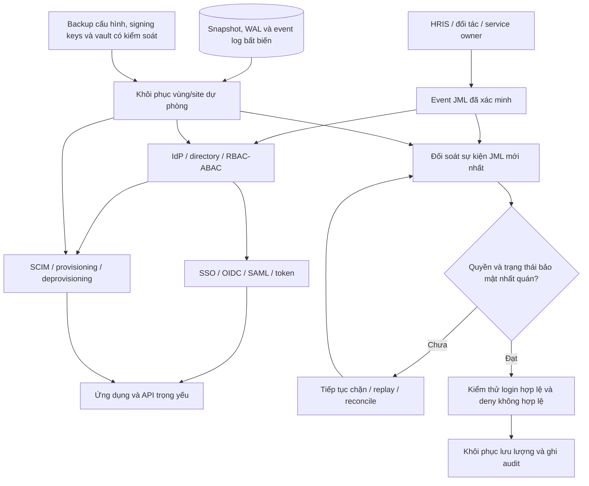

# RTO và RPO IAM: khôi phục khả năng truy cập mà không khôi phục quyền đã bị thu hồi

## 1. Mục tiêu và bối cảnh

Một sự cố với hệ thống **Identity and Access Management (IAM)** có thể khiến nhân viên không đăng nhập được vào ứng dụng, workload không lấy được token, yêu cầu cấp quyền bị kẹt hoặc các thay đổi thu hồi quyền không được áp dụng. Nhưng việc đăng nhập hoạt động trở lại **chưa đủ** để kết luận IAM đã khôi phục an toàn: hệ thống còn phải bảo đảm các danh tính, nhóm, quyền và trạng thái thu hồi được phục hồi đúng.

Trong chương **IAM resilience** của mô-đun `SECURITY_IDENTITY_ACCESS_MANAGEMENT_IDENTITY_LIFECYCLE`, hai mục tiêu cốt lõi của khả năng phục hồi sau thảm họa (*disaster recovery — DR*) là:

- **RTO — Recovery Time Objective:** thời gian gián đoạn tối đa được chấp nhận theo mục tiêu phục hồi đã thống nhất.
- **RPO — Recovery Point Objective:** mức mất dữ liệu tối đa có thể chấp nhận khi phục hồi, thường biểu diễn bằng khoảng thời gian giữa trạng thái dữ liệu phục hồi và điểm sự cố.

Bài học liên hệ **Joiner–Mover–Leaver (JML)** với nguồn danh tính, **Identity Provider (IdP)**, **Single Sign-On (SSO)**, **SCIM**, **RBAC/ABAC**, tài khoản dịch vụ, quyền truy cập đặc quyền và kiểm toán. Mục tiêu là biết **đặt RTO/RPO phù hợp từng năng lực IAM, đo giá trị thực tế, lựa chọn kiến trúc, kiểm thử và phát hiện trường hợp phục hồi kỹ thuật nhưng còn quyền truy cập tồn dư**.

> **Nguyên tắc trung tâm:** IAM chỉ được xem là phục hồi an toàn khi vừa đáp ứng khả năng phục vụ cần thiết, vừa giữ tính toàn vẹn của các quyết định truy cập và nghĩa vụ thu hồi. Không khôi phục một bản sao cũ rồi mặc nhiên cho tất cả tài khoản hoạt động như trước.

## 2. RTO là gì?

**Recovery Time Objective (RTO)** là mục tiêu về **thời gian tối đa từ mốc gián đoạn được xác định đến khi năng lực dịch vụ cần thiết được phục hồi theo tiêu chí nghiệm thu**. Nó là **mục tiêu**, không phải thời gian khôi phục đã đo.

Ví dụ, tổ chức quy định dịch vụ đăng nhập tập trung phải phục hồi trong **60 phút** kể từ thời điểm gián đoạn bắt đầu. Khi xảy ra sự cố:

- Mất khả năng đăng nhập được xác nhận lúc **10:00**.
- Đội vận hành phát hiện sự cố lúc **10:07**.
- Hạ tầng IdP chạy lại lúc **10:38**.
- Các luồng SSO/OIDC/SAML quan trọng và kiểm tra quyền tại ứng dụng hoàn tất lúc **10:52**.

Nếu tiêu chí nghiệm thu là đăng nhập đúng và chặn quyền không hợp lệ tại các ứng dụng trọng yếu, **thời gian phục hồi thực tế là 52 phút**, không phải 38 phút. Khi đó:

\[
\mathrm{Actual\ Recovery\ Time}=10{:}52-10{:}00=52\text{ phút}
\]

Với mục tiêu 60 phút, **RTO được đáp ứng** trong ví dụ này.

**Không lấy thời điểm phát hiện làm mốc bắt đầu** nếu cam kết tính từ lúc dịch vụ thực sự gián đoạn. Độ trễ phát hiện là một thành phần của thời gian phục hồi, và phải được đo riêng để cải thiện giám sát.

### 2.1. RTO khác MTTR và SLO như thế nào?

| Khái niệm | Câu hỏi | Lưu ý |
|---|---|---|
| **RTO** | Cho phép tối đa bao lâu để khôi phục một năng lực? | Mục tiêu kinh doanh/kỹ thuật theo loại sự cố và dịch vụ |
| **Actual Recovery Time / RTA** | Sự cố thực tế mất bao lâu để phục hồi? | Đo từ mốc gián đoạn đến khi đạt tiêu chí nghiệm thu |
| **MTTR** | Trung bình một nhóm sự cố cần bao lâu để khôi phục/sửa chữa? | Định nghĩa MTTR phải công bố; có nơi đo sửa lỗi, có nơi đo khôi phục |
| **SLO khả dụng** | Trong một cửa sổ dài, tỷ lệ thời gian phục vụ thành công là bao nhiêu? | Không thay thế được RTO của một lần thảm họa cụ thể |
| **MTPD/MAO** | Thời gian gián đoạn tối đa nghiệp vụ có thể chịu trước khi tác động không chấp nhận được | Tham số phân tích tác động nghiệp vụ; thường dùng để định hướng RTO |

Một IdP có thể đạt SLO khả dụng theo tháng nhưng vẫn vi phạm RTO trong một sự cố lớn. Ngược lại, một lần khôi phục đạt RTO không chứng minh khả dụng dài hạn đạt yêu cầu.

### 2.2. Tiêu chí “phục hồi” phải được mô tả thành hành vi

Đối với IAM, tiêu chí không nên chỉ là “process đã chạy” hoặc “HTTP 200”. Tùy phạm vi RTO, tiêu chí có thể bao gồm:

1. Người dùng **còn hợp lệ** xác thực và nhận phiên/token theo chính sách.
2. Các ứng dụng trọng yếu xác minh chữ ký, metadata, audience và điều kiện truy cập của IdP mới.
3. Người đã **Leaver**, quyền đã bị thu hồi và tài khoản bị vô hiệu hóa **không thể** dùng lại quyền cũ.
4. Người **Mover** không bị tái cấp nhầm quyền của vai trò trước đó.
5. Workload được phép truy cập API qua danh tính máy và credential hợp lệ; workload đã bị loại bỏ không được khôi phục credential.
6. Hệ thống ghi nhận được audit log, có khả năng truy vết và phát hiện trạng thái lệch; nếu chưa khôi phục đủ logging, phải có hạn chế vận hành được chấp nhận theo chính sách.
7. Các luồng bị gián đoạn có kế hoạch xử lý hàng đợi sự kiện, phê duyệt và cấp/thu hồi quyền.

Nếu chỉ phục hồi **đăng nhập tối thiểu** trong chế độ suy giảm có kiểm soát, phải đặt tên năng lực và RTO đó rõ ràng; không báo mọi thành phần IAM đã trở lại bình thường.

## 3. RPO là gì?

**Recovery Point Objective (RPO)** là **mức mất dữ liệu tối đa có thể chấp nhận khi cần khôi phục sau sự cố**, thường thể hiện bằng số phút hoặc giờ của dữ liệu có nguy cơ không được phục hồi. Với cơ sở dữ liệu IAM, RPO liên quan đến danh tính, liên kết account, nhóm, role, policy, trạng thái vô hiệu hóa, ngoại lệ, sự kiện Joiner–Mover–Leaver và cấu hình cần để tái lập quyết định truy cập.

Ví dụ, RPO đặt **5 phút**. Nếu sự cố xảy ra lúc **10:00**, một phương án chỉ khôi phục được trạng thái nhất quán tới **09:54** có cửa sổ không được bảo vệ là **6 phút** tính tới thời điểm sự cố, nên **không đạt mục tiêu RPO theo cách đo tuổi điểm phục hồi**. Phương án có trạng thái khôi phục tới **09:58** có khoảng cách **2 phút** và có thể đạt mục tiêu **về thời gian**, nhưng vẫn phải kiểm tra những sự kiện quan trọng trong khoảng 09:58–10:00 có bị mất hoặc được tái áp dụng hay không.

Ký hiệu:

- \(t_0\): thời điểm gián đoạn/sự cố cần khôi phục.
- \(t_r\): mốc **cuối cùng của trạng thái có thể phục hồi nhất quán**.
- \(RPA\): khoảng cách tới điểm phục hồi thực tế (*Recovery Point Actual*, theo quy ước tuổi điểm phục hồi).

\[
\mathrm{RPA}=t_0-t_r
\]

Đánh giá theo quy tắc này: \(RPA \le RPO\).

**Cần phân biệt khoảng cách thời gian với số bản ghi thực sự mất.** Nếu bản ghi mới nhất được commit lúc 09:55 và toàn bộ log đến đó được phục hồi, có thể không mất bản ghi nào mặc dù \(t_0-t_r\) là 5 phút. Ngược lại, một sự kiện thu hồi quan trọng bị mất trong khoảng rất ngắn vẫn có thể làm khôi phục **không an toàn**. Do đó, nên đối chiếu thêm **watermark/sequence của sự kiện đã commit và sự kiện đã replay**, không chỉ dựa vào đồng hồ backup.

### 3.1. RPO không phải tần suất backup

Sao lưu mỗi 5 phút **không tự bảo đảm RPO 5 phút**. Bản backup có thể thất bại, không nhất quán, thiếu khóa giải mã, không kèm cấu hình federation hoặc không chứa các sự kiện phát sinh sau snapshot. RPO chỉ có ý nghĩa khi **có thể phục hồi thực sự** một tập dữ liệu nhất quán tới mốc cần thiết.

- **Snapshot/backup:** lưu trạng thái tại một thời điểm; thường dễ phục hồi nhưng tạo khoảng cách giữa hai bản.
- **Point-in-time recovery (PITR):** kết hợp snapshot với nhật ký thay đổi/WAL để khôi phục tới mốc nhất quán.
- **Synchronous replication:** có thể giảm cửa sổ mất dữ liệu đối với các ghi đã được xác nhận durably ở các miền lỗi liên quan, nhưng có chi phí độ trễ và vấn đề khi mất kết nối.
- **Asynchronous replication:** tăng khả năng sẵn sàng nhưng có thể còn bản ghi đã commit ở site chính chưa tới site phụ.
- **Event sourcing/event log bền vững:** hỗ trợ replay trạng thái JML và entitlement, song phải kiểm tra thứ tự, idempotency, tính đầy đủ và bảo mật nhật ký.

**RPO bằng 0** là một cam kết mạnh: không được mất bất cứ thay đổi đã được xác nhận là commit trong phạm vi đó. Không nên tuyên bố đạt RPO 0 chỉ nhờ có đa vùng hoặc một hàng đợi thông điệp; cần chứng minh mô hình commit, durable acknowledgement, quorum/consensus và kịch bản mất site phù hợp.

### 3.2. Dữ liệu IAM nhạy cảm không được phép “mất tạm” một cách tùy tiện

Giả sử sự kiện **Leaver lúc 09:59** yêu cầu khóa tài khoản, nhưng điểm khôi phục của IdP chỉ có dữ liệu tới **09:58**. Sau sự cố 10:00, bản sao cũ có thể tái hiển thị người này là **active**.

Dù RPO chung cho cấu hình được đặt 5 phút, việc để người đã nghỉ việc đăng nhập lại là một vi phạm kiểm soát nghiêm trọng. Những sự kiện như **khóa tài khoản, thu hồi đặc quyền, token/secret bị lộ, thay đổi policy bắt buộc** cần biện pháp mạnh hơn, ví dụ:

- Nhật ký sự kiện JML/thu hồi **độc lập và bền vững**.
- Đối soát với nguồn có thẩm quyền **HRIS**, registry dịch vụ hoặc hệ thống xử lý quyền.
- Chặn tạm các chủ thể không xác minh được trạng thái mới nhất theo nguyên tắc **fail-closed** khi rủi ro yêu cầu.
- Replay sự kiện theo thứ tự, khử trùng lặp, kiểm tra trạng thái ở IdP **và ứng dụng đích** trước khi cho phép truy cập.
- Cơ chế khẩn cấp có thẩm quyền để chặn phiên, token và credential nếu nhận thấy trạng thái bị tái sinh.

Không nên diễn giải “RPO 5 phút” thành quyền chấp nhận tái kích hoạt các account đã bị cấm trong 5 phút. **Mức mất dữ liệu kỹ thuật được phép** và **bất biến bảo mật phải giữ** là hai ràng buộc liên quan nhưng không đồng nhất.

## 4. RTO và RPO khác nhau thế nào?

| Thuộc tính | RTO | RPO |
|---|---|---|
| Điều giới hạn | **Thời gian gián đoạn dịch vụ** | **Khoảng dữ liệu có nguy cơ mất hoặc phải dựng lại** |
| Đơn vị thường gặp | Phút/giờ đến khi khôi phục năng lực | Phút/giờ của điểm phục hồi |
| Câu hỏi | “Khi nào xác thực/cấp thu hồi trở lại?” | “Khôi phục được trạng thái mới đến đâu?” |
| Phụ thuộc chính | Failover, DNS, routing, IdP, ứng dụng, vận hành, kiểm thử | Backup, replication, WAL/event log, consistency, replay |
| Điều kiện nghiệm thu IAM | Luồng truy cập đúng chính sách vận hành trở lại | Danh tính, quyền và sự kiện thay đổi không bị khôi phục sai |
| Cách đo thực tế | Thời điểm phục hồi được xác minh trừ mốc gián đoạn | Mốc sự cố trừ mốc khôi phục nhất quán, kèm đối soát commit/event |
| Rủi ro nếu chỉ tối ưu một phía | Phục hồi nhanh nhưng quyền cũ sống lại | Có dữ liệu mới nhưng dịch vụ xác thực chưa thể sử dụng |

Một phương án có **RPO rất tốt** nhờ replication nhưng **RTO xấu** vì cần tái cấu hình SAML, DNS hoặc khóa ký token thủ công. Ngược lại, bật IdP tại vùng dự phòng trong vài phút nhưng dùng snapshot cũ có thể có **RTO tốt, RPO xấu**, kèm nguy cơ tái cấp quyền không hợp lệ.

## 5. Phân loại năng lực IAM để thiết lập RTO/RPO

IAM là **một chuỗi năng lực** chứ không phải một máy chủ. Cần xác định RTO/RPO cho từng thành phần và **hành trình đầu cuối**.

| Năng lực | Hậu quả khi lỗi | Dữ liệu cần khôi phục đúng |
|---|---|---|
| **IdP / xác thực và phát token** | Người dùng/workload không xác thực mới được | Tư cách identity, MFA, chính sách, trạng thái disable, khóa và metadata |
| **SSO / federation OIDC, OAuth 2.0, SAML** | Ứng dụng không nhận định danh hoặc token hợp lệ | Client config, redirect URI, SAML metadata, signing keys, trust và session policy |
| **Directory / group / role** | Mapping quyền sai, không xét được chính sách | Group membership, RBAC role, ABAC attributes, policy version |
| **Provisioning / SCIM / connector** | Joiner/Mover không nhận account hoặc quyền mới | Yêu cầu, phê duyệt, trạng thái workflow, mapping, event queue |
| **Deprovisioning / revocation** | Leaver/Mover còn quyền truy cập không hợp lệ | Sự kiện thu hồi, deadline, account/credential, token/session state |
| **PAM / break-glass** | Mất khả năng xử lý sự cố hoặc quyền admin bị lạm dụng | Danh tính đặc quyền, vault, cơ chế cấp quyền tạm, audit |
| **Service/workload identity** | API và pipeline không hoạt động hoặc dùng credential cũ | Service owner, policy, key/cert lifecycle, workload federation |
| **Access review / governance** | Không rà soát hoặc chứng nhận quyền đúng kỳ | Quyết định review, phạm vi chiến dịch, trạng thái remediation |
| **Audit / security telemetry** | Khó chứng minh hành động và phát hiện lạm dụng | Log bất biến, sự kiện bảo mật, correlation và độ toàn vẹn thời gian |

RTO của một hệ thống không nhất thiết bằng RTO của **hành trình nghiệp vụ**. Ví dụ IdP đã hoạt động nhưng ứng dụng quan trọng vẫn không xác minh được token vì metadata hoặc khóa ký không khớp: hành trình “người dùng hợp lệ đăng nhập ứng dụng” chưa phục hồi.

### Ví dụ bảng mục tiêu theo tầng — chỉ minh họa, không phải tiêu chuẩn chung

| Năng lực | RTO minh họa | RPO minh họa | Điều kiện bổ sung |
|---|---:|---:|---|
| Đăng nhập SSO cho ứng dụng thiết yếu | 60 phút | 5 phút đối với cấu hình/identity thông thường | Không tái kích hoạt identity đã bị disable; xác minh sign-in và deny |
| Thu hồi quyền người nghỉ việc/đặc quyền nhạy cảm | 15 phút cho cơ chế chặn khẩn cấp | Không chấp nhận mất quyết định thu hồi đã commit | Fail-closed, nhật ký bền vững và đối soát target |
| Provisioning chuẩn qua SCIM | 4 giờ | 15 phút, có replay các yêu cầu đã duyệt | Xử lý hàng đợi và idempotency; không tự cấp thừa quyền |
| Chiến dịch access review | 24 giờ | 1 giờ | Giữ phê duyệt, quyết định revoke và bằng chứng lịch sử |
| Registry tài khoản dịch vụ | 2 giờ | 15 phút | Không hồi sinh secret/role đã thu hồi; owner cần được xác minh |

Các số trên chỉ giúp luyện tư duy **phân tầng ưu tiên**. Khi triển khai thật, phải phân tích tác động nghiệp vụ (*Business Impact Analysis — BIA*), rủi ro pháp lý, yêu cầu về bảo mật, phụ thuộc ứng dụng, năng lực hạ tầng, điều khoản nhà cung cấp và chi phí để chọn mục tiêu.

**Một chỉ số RTO/RPO duy nhất cho “toàn bộ IAM” thường không đủ chi tiết**: đăng nhập tập trung có thể là năng lực trọng yếu phải hoạt động nhanh, trong khi báo cáo review được phép chậm hơn. Tuy vậy, năng lực thu hồi quyền khẩn cấp có thể quan trọng về bảo mật hơn khả năng tạo tài khoản mới.

## 6. Mối liên hệ với Joiner–Mover–Leaver

### 6.1. Joiner: không mất yêu cầu cấp phát đã duyệt

Khi nhân viên mới đến, HRIS hoặc nguồn nhân sự có thẩm quyền xác minh thông tin, IdP tạo danh tính, SSO hỗ trợ xác thực, SCIM/API cấp tài khoản và **RBAC/ABAC** gán quyền theo vai trò hoặc thuộc tính. Nếu hệ thống provisioning gặp sự cố:

- **RTO:** sau bao lâu luồng tạo/cấp quyền được khôi phục tới mức hoạt động đáp ứng tiêu chí?
- **RPO:** có mất yêu cầu đã phê duyệt, mapping identity–account, trạng thái workflow hoặc sự kiện cấp phát nào không?
- **An toàn:** có cấp trùng tài khoản, cấp quyền hai lần, bỏ qua approval hoặc dùng role mặc định quá rộng sau replay không?

Ví dụ, workflow nhận phê duyệt Joiner lúc 09:55, hệ thống lỗi lúc 10:00, được phục hồi từ snapshot 09:50. Nếu không có event log/reconciliation, yêu cầu đã duyệt biến mất. Nếu cho nhân viên gửi lại yêu cầu mà thiếu khóa idempotency, có thể tạo hai account hoặc hai đường cấp quyền. Một cơ chế tốt cần **replay các yêu cầu hợp lệ với ID bất biến**, đối soát account đích trước khi tạo mới.

### 6.2. Mover: phục hồi không được đưa quyền cũ trở lại

Một sự kiện Mover có thể đồng thời **cấp quyền mới và gỡ quyền cũ**. RPO không chỉ bảo vệ các bản ghi cấp mới, mà còn phải bảo vệ **quyết định thu hồi** và cập nhật thuộc tính RBAC/ABAC.

Ví dụ, nhân viên chuyển bộ phận lúc 09:58, hệ thống đã gỡ quyền xuất dữ liệu nhạy cảm. Nếu restore bản directory 09:50 và phát lại role cũ tới ứng dụng, quyền không hợp lệ có thể tái xuất hiện. Khi khôi phục cần áp dụng trạng thái mới nhất từ nguồn có thẩm quyền, đối chiếu các grant path và **không replay lệnh cũ không còn hợp lệ**.

### 6.3. Leaver: trạng thái thu hồi là dữ liệu bảo mật trọng yếu

Với Leaver, việc bỏ lỡ sự kiện nghỉ việc có thể cho phép người không còn hợp lệ đăng nhập hoặc giữ token đang dùng. Cần ưu tiên:

1. Nhận diện sự kiện Leaver theo **thời điểm hiệu lực**, không chỉ thời điểm IAM nhận thông báo.
2. Lưu quyết định disable/revoke trong kênh bền vững; nếu có nhiều nguồn cần quy tắc ưu tiên rõ.
3. Kiểm soát sign-in và session/token ngay cả khi site chính mất.
4. Đối soát trạng thái **IdP, SSO và ứng dụng đích** sau restore.
5. Theo dõi các nghĩa vụ thu hồi vẫn chưa được chứng minh; giữ điều kiện chặn hoặc hạn chế truy cập theo chính sách.

**RTO đăng nhập tốt mà Leaver vẫn đăng nhập lại được là thất bại về tính toàn vẹn bảo mật.** Một đường fallback cho phép mọi tài khoản từng hoạt động truy cập mà không kiểm tra trạng thái hiện tại không phải một chiến lược phục hồi IAM an toàn.

### 6.4. Non-human identity (NHI): bảo vệ credential và owner

Service account, bot, workload identity, service principal và API client cũng cần owner, mục đích, quyền tối thiểu, thời hạn credential và chính sách thu hồi. Sự cố có thể làm gián đoạn workload federation, ký token, hệ thống quản lý secret hoặc xác minh chứng chỉ.

Khi phục hồi, không được tải lại khóa API hoặc secret **đã bị thu hồi do rò rỉ**, dù chúng vẫn nằm trong bản backup cũ. Quy trình cần phân biệt **khôi phục metadata cấu hình** với **tái kích hoạt credential**, kiểm tra lịch sử rotation/revocation và rà soát phụ thuộc dịch vụ.

## 7. Kiến trúc phục hồi và những phụ thuộc dễ bị bỏ sót

Các thành phần IAM có thể phục hồi theo những tầng khác nhau:



Sơ đồ mô tả luồng logic, không có nghĩa phục hồi mọi thành phần phải theo đúng thứ tự tuyến tính. Những phụ thuộc phải được ghi trong **runbook DR**:

| Phụ thuộc | Điều cần bảo vệ/kiểm thử |
|---|---|
| **DNS, load balancer, network, firewall** | Endpoint đăng nhập mới phải tới đúng site; không tạo vòng lặp hoặc mất đường quay lại |
| **KMS/HSM và signing keys** | IdP/token signer sử dụng khóa hợp lệ, có quyền truy cập và cơ chế bảo vệ, rotate/rollback an toàn |
| **OIDC clients và SAML trust** | Redirect URIs, issuer, audience, metadata, chứng thư ký và thời hạn |
| **MFA/conditional access** | Không bị bypass vô ý khi failover; đăng nhập hợp lệ vẫn đáp ứng yêu cầu |
| **Database và directory** | Tính nhất quán danh tính, group, trạng thái disable, version chính sách |
| **SCIM connectors** | Credentials, endpoint, queue, retry, giới hạn API và chống trùng sự kiện |
| **Time synchronization** | Đồng hồ ảnh hưởng thời hạn token, chứng chỉ, timestamp audit và quyết định truy cập |
| **Secrets/vault** | Khóa/secret được phục hồi có kiểm soát, không tự khôi phục giá trị đã revoke |
| **Audit pipeline** | Dấu vết có thể ghi, truy xuất, bảo vệ toàn vẹn và nối được trước–sau sự cố |
| **Quy trình khẩn cấp** | Ai có thể kích hoạt DR, break-glass, duyệt chuyển lưu lượng, thực hiện failback |

Đối với **IAM do nhà cung cấp SaaS vận hành**, người dùng không phải lúc nào cũng kiểm soát site dự phòng, tần suất backup hay RPO nội bộ. Khi đó cần khảo sát cam kết nhà cung cấp, khả năng xuất/khôi phục cấu hình, kế hoạch thay thế/quản trị khẩn cấp và nghĩa vụ của bên sử dụng. Không tự giả định “IdP SaaS có nhiều vùng” là RPO bằng 0.

## 8. Chiến lược giảm RTO và RPO

### 8.1. Phân biệt high availability với disaster recovery

**High availability (HA)** cố gắng duy trì dịch vụ khi một thành phần lỗi, thường qua nhiều instance, zone hoặc cơ chế failover tự động. **Disaster recovery (DR)** tập trung phục hồi khi xảy ra sự cố vượt khỏi phạm vi chịu lỗi thông thường, như mất vùng, dữ liệu hỏng, credential bị tấn công hoặc cấu hình bị ghi sai trên toàn bộ cluster.

Replication có thể **nhân bản cả lỗi logic**: một lệnh vô hiệu hóa nhầm, xóa nhóm hàng loạt hoặc cấu hình sai có thể lan nhanh tới tất cả replica. Vì vậy, phải có backup điểm-thời-gian/immutable backup và phương án **phục hồi có kiểm soát**, không chỉ replica nóng.

### 8.2. Các lựa chọn kiến trúc

| Phương án | Lợi ích | Đánh đổi/rủi ro |
|---|---|---|
| **Warm standby** | Site phụ đã chuẩn bị, giảm thời gian dựng hạ tầng | Có độ trễ đồng bộ; cần kiểm tra config/keys và định tuyến |
| **Active-active** | Có thể giữ dịch vụ khi mất một site | Khó đồng bộ policy, user state, revocation, conflict và split-brain |
| **Synchronous commit cho trạng thái quan trọng** | Giảm cửa sổ mất dữ liệu đã commit | Tăng độ trễ ghi; phân vùng mạng có thể làm giảm khả dụng |
| **Asynchronous replication + WAL/event replay** | Linh hoạt chi phí/hiệu suất, khôi phục theo điểm thời gian | Cần kiểm soát lag, event gap, thứ tự và idempotency |
| **Immutable backup/PITR** | Khôi phục trước lỗi logic hoặc tấn công xóa dữ liệu | Restore có thể chậm; cần kiểm tra toàn vẹn và khóa giải mã |
| **Degraded mode có kiểm soát** | Giữ một số năng lực nghiệp vụ thiết yếu | Phải giới hạn phạm vi và tránh bypass auth/policy |
| **Break-glass** | Cho phép xử lý khẩn khi IdP thường không hoạt động | Cần bảo vệ MFA/credential, giới hạn quyền, dual control và audit |

**Không dùng “fail-open” toàn hệ thống** để đáp ứng RTO. Chẳng hạn, cho phép truy cập bằng dữ liệu cache bất kể account đã disabled có thể rút ngắn thời gian ngừng hoạt động nhưng tạo rủi ro truy cập trái phép.

### 8.3. Fail-closed nhưng không tự gây tê liệt vô hạn

**Fail-closed** nghĩa là khi không thể xác minh trạng thái quyền cần thiết, hệ thống từ chối truy cập tương ứng. Đây là hướng an toàn cho quyền nhạy cảm và danh tính không thể xác nhận trạng thái hiện hành. Tuy nhiên, chỉ dùng fail-closed mà không có giải pháp dự phòng có thể gây gián đoạn nghiệp vụ nghiêm trọng.

Thiết kế cần **phân tầng truy cập**:

- Quyền quản trị, dữ liệu nhạy cảm, tài khoản Leaver hoặc credential bị revoke: kiểm tra trạng thái chắc chắn; không cấp quyền khi không đủ bằng chứng theo chính sách.
- Các hoạt động ít rủi ro: có thể cho phép chế độ cache/session đã xác thực trong khoảng thời gian giới hạn **chỉ nếu được thiết kế, đánh giá rủi ro và phê duyệt trước**.
- Break-glass: có người chịu trách nhiệm, phê duyệt/kiểm soát bù trừ, thời gian hết hạn, log và quy trình thu hồi khi khôi phục bình thường.

Không phải mọi ứng dụng có thể thu hồi ngay **access token tự chứa**. Nếu bên nhận chỉ kiểm tra chữ ký/hạn dùng, token đã phát có thể còn hiệu lực đến khi hết hạn trừ khi có cơ chế introspection/denylist/chặn quyền ở target. Vì vậy, RTO/RPO IAM phải gắn với **hành vi authorization ở ứng dụng**, không chỉ trạng thái IdP.

## 9. Ví dụ DR toàn diện: kiểm tra RTO và RPO

Giả sử một hệ thống IdP/SCIM tự vận hành có mục tiêu minh họa:

- **RTO cho đăng nhập quan trọng:** không quá **60 phút**.
- **RPO trạng thái identity/role thông thường:** không quá **5 phút** theo tuổi điểm phục hồi.
- **Bất biến bảo mật:** mọi quyết định **khóa Leaver/thu hồi quyền đặc quyền đã commit** phải được đối soát trước khi mở lại đường truy cập nhạy cảm.
- **Giới hạn:** chỉ được tính phục hồi khi authentication **và** quyết định truy cập cơ bản được xác minh tại ứng dụng trọng yếu.

Sự cố diễn ra như sau:

| Mốc | Sự kiện |
|---|---|
| **09:50** | Snapshot database gần nhất |
| **09:58** | Event log tại site phụ chắc chắn nhất quán tới mốc này |
| **09:59** | HRIS phát sự kiện Leaver, IdP chính đã xử lý nhưng event chưa tới site phụ |
| **10:00** | Site chính mất dịch vụ — mốc bắt đầu RTO/RPO |
| **10:40** | Site phụ khôi phục được cấu hình và trạng thái đến 09:58 |
| **10:46** | Đối soát HRIS phát hiện Leaver 09:59 chưa có ở site phụ; account được giữ chặn |
| **10:50** | Sự kiện Leaver được xác minh và áp dụng bền vững, đối chiếu với target |
| **10:55** | Kiểm thử đăng nhập hợp lệ và từ chối Leaver đạt; lưu lượng quan trọng được mở lại có kiểm soát |

Kết luận:

1. **Thời gian phục hồi thực tế = 55 phút** từ 10:00 đến 10:55; đạt RTO 60 phút.
2. Tại 10:40, điểm phục hồi nhất quán 09:58 tạo **RPA sơ bộ = 2 phút** so với mốc 10:00; về khoảng thời gian có vẻ đạt RPO 5 phút.
3. **Chưa được kết luận an toàn lúc 10:40**, vì sự kiện Leaver 09:59 có thể bị mất. Nó phải được xử lý theo ràng buộc bảo mật trước khi mở lại quyền.
4. Sau khi đối soát/replay ở 10:50, sự kiện Leaver đã được phục hồi và xác minh. Cần lưu riêng **kết quả RPO theo dữ liệu thực sự phục hồi** và **bằng chứng chặn truy cập**; không tuyên bố “không mất dữ liệu” cho mọi loại bản ghi nếu còn nguồn chưa đối soát.

Nếu việc khôi phục trạng thái thu hồi tới 10:55 không xong và hệ thống mở lại quyền cho Leaver ở 10:41, **RTO kỹ thuật có thể vẫn đạt trên giấy nhưng mục tiêu phục hồi bảo mật đã thất bại**.

### 9.1. Trường hợp RTO đạt nhưng RPO không đạt

Giả sử site phụ mở đăng nhập trong 20 phút nhưng chỉ có backup từ **09:40** khi sự cố xảy ra 10:00; tuổi điểm khôi phục là **20 phút**, vượt RPO 5 phút. Nếu các thay đổi role/thu hồi gần đây không tái dựng được, phải tiếp tục hạn chế truy cập hoặc áp dụng dữ liệu từ nguồn đáng tin trước khi kết luận đã khôi phục đúng.

### 9.2. Trường hợp RPO đạt nhưng RTO không đạt

Giả sử dữ liệu được replicate đồng bộ đến đúng mốc commit trước sự cố, nhưng cần **90 phút** để phục hồi signing key, DNS và SAML trust ở site phụ. Không mất thay đổi được xác nhận, song **RTO 60 phút vẫn bị vi phạm**.

## 10. Quy trình khôi phục IAM mẫu

Một runbook DR nên có ít nhất các bước sau:

### Bước 1 — Công bố sự cố và xác định phạm vi

Xác định năng lực bị ảnh hưởng: đăng nhập mới, token refresh, MFA, SCIM, deprovisioning, nhóm quyền, PAM, vault hay logging. Ghi **incident_started_at**, nguồn phát hiện, mức độ ảnh hưởng và owner xử lý. Không tự dùng `detected_at` thay cho thời điểm mất dịch vụ nếu hai mốc khác nhau.

### Bước 2 — Bảo vệ an toàn trước khi chuyển site

Hạn chế sự cố lan truyền: tránh split-brain, giữ chứng cứ, khóa đường cấp quyền nguy hiểm theo cơ chế khẩn đã phê duyệt, bảo vệ backup và khóa giải mã. Nếu có nghi vấn compromise của signing key/secret, phải áp dụng quy trình thay khóa; không khôi phục và tái sử dụng các bí mật bị xem là không còn tin cậy.

### Bước 3 — Chọn điểm phục hồi nhất quán

Kiểm tra backup/snapshot/WAL và event watermark, tính **tuổi điểm phục hồi**, xác minh integrity và khả năng truy cập KMS. Xác định rõ các sự kiện có thể thiếu: Leaver, Mover, thu hồi admin, policy, phê duyệt cấp quyền, NHI rotation. Không dùng một snapshot không kiểm thử chỉ vì nó có timestamp mới.

### Bước 4 — Khôi phục hạ tầng và quan hệ tin cậy

Khởi động các thành phần cần thiết; kiểm tra directory/database, issuer, ký token, OIDC client, SAML metadata, DNS, các ứng dụng trọng yếu, MFA và audit pipeline. Nếu có thể, chạy các bài thử trong môi trường cách ly trước khi nhận lưu lượng thực.

### Bước 5 — Replay và reconciliation trạng thái JML

Đối soát event từ HRIS, registry đối tác và service owner. Replay sự kiện theo thứ tự và idempotency; xử lý conflict giữa sự kiện cũ và policy mới. Xác minh **Joiner không bị cấp trùng**, **Mover không tái hiện quyền cũ**, **Leaver không hoạt động trở lại**, **credential NHI đã thu hồi không được hồi sinh**.

### Bước 6 — Kiểm thử chức năng và bảo mật

Chạy cả kiểm thử **cho phép** và **từ chối** (positive/negative tests): người dùng hợp lệ đăng nhập; người đã nghỉ không đăng nhập; tài khoản disabled không lấy token mới; quyền cũ Mover không truy cập; ứng dụng đích phản ánh trạng thái; workload được phép chạy, credential hết hạn không được chấp nhận.

### Bước 7 — Mở lưu lượng có kiểm soát, theo dõi và ghi mốc RTA

Chỉ chuyển lưu lượng khi tiêu chí đã đạt. Ghi `recovered_at`, các năng lực còn degraded, trạng thái event queue, số connector lỗi và quyết định của người có thẩm quyền. Nếu phục hồi một phần, phải ghi rõ tầng dịch vụ đã đạt RTO và tầng chưa đạt.

### Bước 8 — Failback, postmortem và chứng minh RPO

Khi site chính an toàn, cần quy trình failback tránh tạo xung đột trạng thái. So sánh event sequences, số lượng account/entitlement, thay đổi policy, audit và các nghĩa vụ thu hồi. Đánh giá RTO/RPO đo được, rủi ro tồn dư và các hành động cải tiến trước kỳ diễn tập tiếp theo.

## 11. Đo lường RTO/RPO thực tế từ diễn tập và sự cố

Một bảng theo dõi DR có thể chứa:

| Trường | Diễn giải |
|---|---|
| `exercise_id` / `incident_id` | Mã diễn tập hoặc sự cố, phục vụ kiểm toán |
| `service_tier`, `capability` | Năng lực IAM đang đo, ví dụ auth hoặc SCIM |
| `incident_started_at`, `detected_at` | Mốc mất năng lực và mốc nhận biết |
| `recovered_verified_at` | Mốc đạt tiêu chí phục hồi chức năng và kiểm soát |
| `rto_target_minutes`, `rto_actual_minutes` | Mục tiêu và số đo RTO |
| `recovery_point_at`, `rpo_target_minutes` | Mốc dữ liệu có thể phục hồi nhất quán và mục tiêu RPO |
| `last_committed_event_id`, `last_replayed_event_id` | Kiểm tra chuỗi sự kiện, phát hiện gap |
| `security_checks_passed` | Kết quả kiểm thử identity hợp lệ, Leaver/Mover/credential bị chặn |
| `log_integrity_checked`, `source_coverage` | Độ tin cậy audit và phạm vi đối soát |
| `exceptions`, `owner`, `approved_degraded_mode` | Ngoại lệ, người quyết định và điều kiện phục vụ suy giảm |

Tính toán minh họa bằng PostgreSQL, với `iam_dr_exercise_result` là bảng **giả định** lưu một dòng cho mỗi `exercise_id`/năng lực:

```sql
WITH measured AS (
    SELECT
        exercise_id,
        capability,
        incident_started_at,
        recovery_point_at,
        recovered_verified_at,
        rto_target_minutes,
        rpo_target_minutes,
        security_checks_passed,
        ROUND(
            (EXTRACT(EPOCH FROM (
                recovered_verified_at - incident_started_at
            )) / 60.0)::numeric, 2
        ) AS rto_actual_minutes,
        ROUND(
            (EXTRACT(EPOCH FROM (
                incident_started_at - recovery_point_at
            )) / 60.0)::numeric, 2
        ) AS rpa_minutes
    FROM iam_dr_exercise_result
    WHERE incident_started_at IS NOT NULL
      AND recovered_verified_at IS NOT NULL
      AND recovery_point_at IS NOT NULL
)
SELECT
    exercise_id,
    capability,
    rto_target_minutes,
    rto_actual_minutes,
    rto_actual_minutes <= rto_target_minutes
        AS rto_time_target_met,
    rpo_target_minutes,
    rpa_minutes,
    rpa_minutes <= rpo_target_minutes
        AS rpo_time_target_met,
    security_checks_passed,
    (
        rto_actual_minutes <= rto_target_minutes
        AND rpa_minutes <= rpo_target_minutes
        AND security_checks_passed = TRUE
    ) AS basic_recovery_acceptance_met
FROM measured
ORDER BY exercise_id, capability;
```

**Giới hạn cố ý của ví dụ:** cột `basic_recovery_acceptance_met` chỉ tổng hợp **ba điều kiện giả định**; nó chưa chứng minh hoàn toàn không mất bản ghi commit, không có gap event log, không thiếu target trong inventory hoặc không có token cũ tồn tại. Trước khi dùng cho kiểm toán, bổ sung kiểm tra **watermark sự kiện, khôi phục các quyết định thu hồi, đầy đủ nguồn, integrity log và tiêu chí nghiệm thu theo dịch vụ**.

Nếu `recovery_point_at` nằm sau `incident_started_at` do replay sự kiện phát sinh trong khi khôi phục, công thức tuổi điểm phục hồi có thể âm; cần xác định **mốc RPO tại thời điểm sự cố** riêng, làm sạch dữ liệu và không coi giá trị âm là RPO “tốt hơn 0”. Một chỉ số RPO chung cho các nguồn có snapshot không cùng thời điểm cũng có thể gây hiểu lầm: phải tính theo **mỗi tập dữ liệu quan trọng**.

### 11.1. Các chỉ số phụ cần theo dõi

- **Detection latency:** mốc phát hiện trừ mốc gián đoạn.
- **Failover start latency:** thời gian quyết định và khởi động failover.
- **Recovery verification time:** thời gian giữa hạ tầng lên và hành trình/trạng thái bảo mật được xác minh.
- **Replication lag:** độ trễ của replica, cần ghi cả lag khi gần sự cố.
- **Backlog age:** số lượng và tuổi của sự kiện SCIM/JML chưa replay.
- **Rejected/duplicate event count:** dấu hiệu mất hoặc replay sai.
- **Unreconciled critical revocations:** số nghĩa vụ thu hồi trọng yếu chưa xác minh sau DR.
- **Drill coverage:** tỷ lệ thành phần, luồng và các trường hợp lỗi đã được diễn tập.

Công bố **RTO/RPO mục tiêu** và **giá trị đo được** tách biệt. Không nên ghi “RPO = 5 phút” như một thành tích nếu đó chỉ là giá trị quy định trong tài liệu.

## 12. Thiết kế bài kiểm thử resilience thực tế

Diễn tập nên kiểm tra **mất năng lực**, **mất dữ liệu**, **mất tính toàn vẹn** và **phụ thuộc ngoài IdP**. Bảng ca kiểm thử gợi ý:

| Kịch bản | Điều cần chứng minh | Điều kiện không được bỏ sót |
|---|---|---|
| Mất một instance/zone IdP | Xác thực hợp lệ tiếp tục hoặc phục hồi theo mục tiêu | MFA và deny policy vẫn có hiệu lực |
| Mất vùng/site | Failover DNS/network/token issuance thành công | SAML/OIDC issuer, key và các ứng dụng đích khớp |
| Database hỏng hoặc xóa nhầm nhóm | PITR/backup phục hồi nhất quán | Không hồi sinh role/entitlement đã thu hồi sau điểm backup |
| Event SCIM bị gián đoạn | Queue/retry hoạt động và replay an toàn | Không cấp trùng account, không đảo thứ tự Mover–Leaver |
| Leaver phát sinh gần lúc mất site | Quyết định disable/revoke được bảo toàn hoặc đối soát | Identity Leaver vẫn bị chặn sau restore |
| Mover đổi vai trò trong khi DR | Thu hồi quyền cũ và cấp quyền mới được đối soát | Tránh privilege creep, SoD conflict |
| Token/secret đã bị revoke trước sự cố | Quyền truy cập không được tái kích hoạt | Kiểm tra token đã phát, secret/cert rotation |
| NHI owner đổi hoặc workload ngừng hoạt động | Credential và role cũ không còn hiệu lực | Không kéo khóa bí mật đã mất tin cậy từ backup |
| Mất hệ thống audit | Tái dựng và bảo vệ bằng chứng quan trọng | Không vận hành nhạy cảm lâu dài ngoài phạm vi logging cho phép |
| Failback về site chính | Không mất trạng thái mới phát sinh ở site phụ | Kiểm tra split-brain, sequence và conflict |

Với diễn tập, sử dụng **tài khoản kiểm thử, dữ liệu không nhạy cảm hoặc môi trường được phê duyệt** khi có thể. Nếu kiểm tra production, phải có kế hoạch giảm ảnh hưởng, rollback, chủ sở hữu kỹ thuật và phương án chặn rủi ro. Không thực hiện thử nghiệm ngắt IdP thực tế một cách ngẫu nhiên ngoài quy trình kiểm soát thay đổi.

### Tiêu chí nghiệm thu nên bao gồm kiểm thử âm tính

Một câu trả lời “login hoạt động” là chưa đủ. Tối thiểu nên có:

1. **Positive authentication:** identity hợp lệ đăng nhập và nhận token đúng issuer/audience/claims.
2. **Negative authentication:** identity disabled/Leaver bị từ chối.
3. **Authorization:** quyền mới hợp lệ được áp dụng; quyền Mover cũ đã gỡ không còn dùng được.
4. **Sessions/credentials:** session hoặc token cần revoke không còn được chấp nhận theo khả năng hệ thống và yêu cầu chính sách.
5. **Provisioning/revocation correctness:** mọi sự kiện JML quan trọng được replay một lần về mặt hiệu lực.
6. **Auditability:** các bước failover, đăng nhập, từ chối, sửa role và revoke có trace/evidence phù hợp.
7. **Service restoration:** ứng dụng tiêu biểu hoạt động qua SSO thực, không chỉ health check của IdP.

Nếu một kiểm tra an toàn quan trọng không đạt, kết quả diễn tập phải ghi **khôi phục chưa được nghiệm thu**, dù thời gian dựng hạ tầng dưới RTO.

## 13. Các lỗi thiết kế thường gặp

1. **Đặt RTO theo thời gian khởi động container:** không đo khả năng người dùng hợp lệ thực sự đăng nhập ứng dụng.
2. **Gọi RPO là “backup mỗi 5 phút”:** không kiểm tra bản backup có thể restore và các event thiếu.
3. **Không phân tầng dịch vụ IAM:** dùng cùng mục tiêu cho auth, SCIM, audit, review và thu hồi đặc quyền.
4. **Chỉ kiểm tra đăng nhập thành công:** không kiểm tra Leaver/disabled account bị từ chối.
5. **Khôi phục snapshot cũ và phát lại quyền cũ không kiểm soát:** tái cấp quyền Mover, hồi sinh credential đã revoke.
6. **Replication logic như backup độc lập:** lỗi cấu hình/xóa nhầm có thể nhân bản sang mọi site.
7. **Bỏ qua OIDC/SAML signing key và metadata:** hạ tầng IdP lên nhưng các ứng dụng từ chối token/assertion.
8. **Không dự phòng KMS/vault/DNS/time sync:** site phụ thiếu phụ thuộc quan trọng nên RTO thực tế dài.
9. **Fail-open để kịp RTO:** cho truy cập không kiểm tra quyền hoặc dùng cache hết hiệu lực.
10. **Không bảo vệ đường break-glass:** credential khẩn cấp quá rộng, không có audit hoặc không được thu hồi.
11. **Giả định IdP disabled là mọi phiên bị vô hiệu:** token độc lập và account local vẫn có thể hoạt động.
12. **Không quản lý sự kiện SCIM trùng và sai thứ tự:** replay tạo trùng account hoặc áp dụng lại quyền đã gỡ.
13. **Không đối soát HRIS/registry NHI sau restore:** mất sự kiện Leaver, Mover hoặc service owner đổi.
14. **Tuyên bố RPO 0 mà không kiểm tra durable write/quorum:** số liệu replication lag đẹp không chứng minh không mất commit.
15. **Không lưu audit evidence của diễn tập:** không chứng minh được thời điểm phục hồi, độ lệch và quyết định an toàn.
16. **Quên failback:** site chính quay lại với dữ liệu cũ có thể ghi đè trạng thái mới.
17. **Không tính khả năng ứng dụng đích:** IAM phục hồi nhưng quyền tại ứng dụng SaaS vẫn chưa đồng bộ.
18. **Giữ RTO/RPO trong tài liệu nhưng không kiểm thử định kỳ:** cam kết chưa được chứng minh bằng vận hành.

## 14. Câu hỏi tự kiểm tra

**Câu 1.** SSO mất dịch vụ lúc 10:00, IdP server chạy lại lúc 10:30 nhưng các ứng dụng cần tới 10:48 mới chấp nhận token và chính sách deny được xác minh. RTO mục tiêu 45 phút. Kết quả?

**Đáp án:** Thời gian phục hồi thực tế **48 phút**, không phải 30. **Không đạt RTO 45 phút** nếu tiêu chí là đăng nhập đúng và kiểm soát quyền tại ứng dụng.

**Câu 2.** Sự cố xảy ra 12:00, điểm backup có thể phục hồi nhất quán mới nhất lúc 11:56, mục tiêu RPO 5 phút. Tuổi điểm phục hồi là bao nhiêu? Có đủ kết luận an toàn?

**Đáp án:** **4 phút**, đạt điều kiện RPO theo tuổi điểm phục hồi. Tuy nhiên cần đối soát các thay đổi đã commit trong 11:56–12:00, đặc biệt quyết định thu hồi, trước khi kết luận phục hồi **an toàn**.

**Câu 3.** Backup của directory lúc 09:50, hệ thống lỗi 10:00. Một Leaver bị disable lúc 09:58. Site phụ dùng snapshot 09:50 có nên mở đăng nhập cho identity đó?

**Đáp án:** **Không.** Phải đối soát sự kiện Leaver từ nguồn có thẩm quyền, bảo vệ trạng thái disable và kiểm chứng không còn truy cập. Khôi phục nhanh không được phép hồi sinh quyền đã thu hồi.

**Câu 4.** Một site phụ đồng bộ database gần thời gian thực nhưng SAML metadata và signing key không phù hợp nên đăng nhập ứng dụng thất bại 90 phút. Đây là vấn đề RTO hay RPO?

**Đáp án:** Chủ yếu là **RTO/hành trình dịch vụ** và phụ thuộc trust configuration. RPO dữ liệu có thể tốt, nhưng năng lực SSO chưa khôi phục đúng.

**Câu 5.** Sau DR, một lệnh SCIM cũ được replay tạo thêm account thay vì cập nhật account đã tồn tại. Điều gì cần cải thiện?

**Đáp án:** Khóa liên kết identity–account, idempotency, thứ tự sự kiện, đối soát trạng thái đích và tiêu chí nghiệm thu workflow. Không chỉ chỉnh thời gian RTO/RPO.

**Câu 6.** Hai quyền admin đã bị revoke trước sự cố, nhưng restore backup cũ khiến group membership admin quay lại. Nếu hệ thống login hoạt động và RTO đạt, có thể đóng diễn tập thành công không?

**Đáp án:** **Không.** Tính toàn vẹn authorization bị vi phạm. Cần gỡ quyền cũ, kiểm tra toàn bộ đường cấp quyền và chứng minh trạng thái revoke được duy trì.

**Câu 7.** Một tổ chức đặt RTO authentication là 30 phút và RPO cấu hình chung là 10 phút. Có thể áp dụng mặc định RPO 10 phút cho khóa API vừa bị thu hồi do lộ bí mật không?

**Đáp án:** **Không nên.** Sự kiện thu hồi credential bị compromise là kiểm soát bảo mật quan trọng; cần bảo vệ nó khỏi mất dữ liệu, chặn quyền tại hệ thống đích và dùng quy trình khôi phục/cấp lại credential an toàn.

**Câu 8.** Khi mất IdP, ứng dụng tự động cho phép mọi người dùng đã từng đăng nhập truy cập dữ liệu nhạy cảm để “đạt RTO”. Biện pháp này có phù hợp không?

**Đáp án:** **Không.** Đây là fail-open quá rộng, có thể cho phép Leaver hoặc identity đã bị revoke truy cập. Cần chế độ suy giảm được đánh giá rủi ro, giới hạn phạm vi, fail-closed cho quyền nhạy cảm và break-glass có kiểm soát.

## 15. Checklist áp dụng tại tổ chức

- [ ] Xác định các hành trình IAM trọng yếu: xác thực, SSO, quyền đích, provisioning, deprovisioning, PAM/NHI.
- [ ] Phân tích BIA và chọn **RTO/RPO cho từng năng lực**; ghi tiêu chí nghiệm thu cụ thể.
- [ ] Ghi rõ điểm bắt đầu RTO, trạng thái phục hồi cần đạt và owner xác nhận.
- [ ] Xác định nguồn dữ liệu nào cần **RPO chặt hơn** và các sự kiện thu hồi nào không được phép đánh mất.
- [ ] Kiểm chứng backup, WAL/PITR, replication, event log và khả năng truy cập KMS/vault khi xảy ra DR.
- [ ] Đối soát HRIS/IdP/SCIM/ứng dụng đích để tránh tái kích hoạt account Leaver hoặc role Mover cũ.
- [ ] Chuẩn bị break-glass, MFA, logging và cơ chế xử lý suy giảm được phê duyệt.
- [ ] Kiểm thử cả luồng **allow** và **deny**, token/session, app federation và tài khoản dịch vụ.
- [ ] Đo **RTA, RPA, event gaps, backlog và security checks**, không chỉ thời gian server chạy lại.
- [ ] Diễn tập failover/failback định kỳ, giữ evidence, cập nhật runbook và chủ sở hữu hành động.

## Ghi nhớ

**RTO giới hạn thời gian gián đoạn**, còn **RPO giới hạn mức mất dữ liệu có thể chấp nhận khi khôi phục**. Với IAM, đạt hai con số đó chỉ có ý nghĩa khi **identity, RBAC/ABAC, trạng thái cấp/thu hồi, SSO trust, session/token và credential tại ứng dụng đích** không bị phục hồi sai. Hãy chia nhỏ RTO/RPO theo năng lực, bảo vệ sự kiện Joiner–Mover–Leaver, kiểm thử cả đăng nhập hợp lệ và trường hợp phải bị từ chối, ghi audit và xác minh quyền đã thu hồi **không sống lại** sau sự cố. Mục tiêu cuối cùng là khôi phục nhanh **đúng khả năng truy cập được phép**, chứ không khôi phục mọi quyền cũ bằng bất cứ giá nào.
