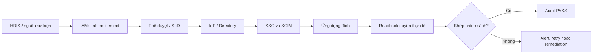

# Kiểm thử identity lifecycle trong IAM

## 1. Mục tiêu và phạm vi

**Identity lifecycle testing** là hoạt động xác minh một danh tính được tạo, thay đổi quyền và vô hiệu hóa đúng theo trạng thái thực tế của người hoặc hệ thống mà danh tính đại diện. Phạm vi không chỉ gồm thao tác CRUD tài khoản: một thay đổi từ nguồn nhân sự (HRIS) có thể đi qua hệ thống IAM, nhà cung cấp danh tính (IdP), SSO, SCIM, ứng dụng SaaS, hệ thống nội bộ và nhật ký kiểm toán. Mỗi điểm giao tiếp đều có thể làm phát sinh quyền truy cập tồn dư.

Kết quả mong đợi của kiểm thử là chứng minh được rằng:

- **Joiner:** người mới chỉ nhận tài khoản và quyền phù hợp sau khi được xác minh, đúng thời điểm hiệu lực và đúng quy trình phê duyệt.
- **Mover:** khi đổi vị trí, đơn vị hoặc nhiệm vụ, quyền mới được cấp theo chính sách và quyền cũ không còn cần thiết được thu hồi; không tích lũy đặc quyền qua các lần chuyển vai trò.
- **Leaver:** khi nghỉ việc hoặc chấm dứt hợp đồng, khả năng xác thực và các phiên đang tồn tại bị xử lý theo mức rủi ro, quyền ứng dụng và tài khoản liên quan được thu hồi trong thời hạn quy định.
- **Kiểm toán:** có thể truy vết yêu cầu, quyết định, người phê duyệt, hành động thực thi, kết quả và sai lệch giữa trạng thái kỳ vọng với trạng thái thực tế.

Một bài kiểm thử **không đạt** nếu IdP hiển thị tài khoản `disabled` nhưng ứng dụng đích vẫn chấp nhận phiên cũ hoặc một tài khoản cục bộ còn quyền đăng nhập. Vì vậy phải đo *effective access* (khả năng truy cập thực tế), không chỉ giá trị trong một cơ sở dữ liệu.

## 2. Xây dựng mô hình trạng thái và oracle kiểm thử

Trước khi tạo test case, xác định nguồn dữ liệu chuẩn và ma trận chuyển trạng thái. HRIS thường là nguồn chuẩn cho trạng thái lao động; IAM là nơi tính quyền; IdP và các ứng dụng là nơi thực thi. Không nên giả định mọi hệ thống đều cập nhật tức thì.

| Trạng thái nguồn | Sự kiện | Kỳ vọng tại IAM / IdP / ứng dụng | Kiểm tra bắt buộc |
|---|---|---|---|
| `PRE_HIRE` | Đã xác minh danh tính và đến ngày bắt đầu | Tài khoản theo chính sách, quyền tối thiểu | Không cấp sớm; nguồn phê duyệt hợp lệ |
| `ACTIVE` | Joiner hoàn tất | Tài khoản hoạt động, quyền theo vai trò/thuộc tính | Đăng nhập hợp lệ và truy cập đúng tài nguyên |
| `ACTIVE` | Chuyển phòng ban | Tính lại tập quyền | Quyền mới có; quyền cũ hết hiệu lực |
| `SUSPENDED` | Tạm đình chỉ | Chặn đăng nhập hoặc hạn chế theo chính sách | Phiên, token, API key được xử lý đúng |
| `TERMINATED` | Leaver có hiệu lực | Vô hiệu hóa và thu hồi quyền, tắt cấp phát lại | Không đăng nhập được, không còn đường truy cập độc lập |
| `ARCHIVED` | Hết thời hạn lưu trữ | Xóa/ẩn danh dữ liệu phù hợp chính sách | Giữ lại bản ghi kiểm toán cần thiết, không có tài khoản hoạt động |

Các tên trạng thái là **ví dụ**; mỗi hệ thống có thể dùng tên khác. Test oracle cần chuyển chính sách của tổ chức thành quy tắc có thể kiểm chứng, chẳng hạn `effectivePermissions(user) = approvedPermissions(user, time)` với mọi quyền ngoài ngoại lệ được phê duyệt phải bằng rỗng. Kiểm tra cả quyền trực tiếp, quyền kế thừa qua nhóm, nhóm lồng nhau, RBAC, điều kiện ABAC và quyền cục bộ trong ứng dụng.

Sơ đồ luồng kiểm thử điển hình:



## 3. Thiết kế dữ liệu thử và môi trường

Sử dụng dữ liệu giả, tách biệt môi trường sản xuất. Tối thiểu cần các danh tính thuộc nhiều loại: nhân viên chính thức, cộng tác viên có ngày hết hạn, quản trị viên đặc quyền, nhân viên chuyển bộ phận, nhân viên quay lại, tài khoản dịch vụ và danh tính liên kết (federated). Tạo các tài nguyên có mức nhạy cảm khác nhau và các vai trò có quyền chồng lấn để kiểm thử cấp quyền cũng như thu hồi.

Ví dụ chính sách giả định:

| Vai trò / thuộc tính | Được phép | Không được phép |
|---|---|---|
| `sales`, khu vực `VN` | CRM khách hàng thuộc VN | Dữ liệu lương và CRM khu vực khác |
| `finance` | Báo cáo tài chính theo phạm vi duyệt | Chỉnh sửa quyền IAM |
| `support`, hợp đồng còn hạn | Ticket theo nhóm phân công | Xuất toàn bộ dữ liệu khách hàng |
| `platform-admin`, phê duyệt đặc quyền còn hiệu lực | Tác vụ quản trị được ghi log | Truy cập đặc quyền khi phê duyệt hết hạn |

Khi dùng ABAC, tạo trường hợp với thuộc tính thiếu, null, sai định dạng hoặc dữ liệu cũ; **deny by default** là kỳ vọng thường dùng khi không thể xác định chính sách, trừ khi chính sách đã quy định ngoại lệ. Thiết lập đồng hồ kiểm thử có thể điều khiển để xác minh ngày bắt đầu, ngày kết thúc hợp đồng, múi giờ và thay đổi sát ranh giới thời gian.

Mọi testcase nên ghi rõ `eventId`, danh tính giả, trạng thái trước, sự kiện đầu vào, trạng thái dự kiến, danh sách hệ thống cần readback, thời hạn hội tụ và bằng chứng kết quả. Các mốc thời gian/SLA dưới đây chỉ là **ví dụ thử nghiệm**; phải thay bằng yêu cầu thực tế của tổ chức.

## 4. Kiểm thử Joiner

1. **Xác minh trước cấp phát:** gửi yêu cầu tạo người dùng chưa đủ thông tin, chưa được HR xác nhận hoặc chưa có phê duyệt. Xác nhận tài khoản không tự động có quyền nhạy cảm.
2. **Cấp phát đúng hạn:** tạo sự kiện Joiner có `effectiveAt` trong tương lai. Trước thời điểm đó, kiểm tra không thể truy cập; sau thời điểm hiệu lực và hết cửa sổ đồng bộ, tài khoản được cấp phát đúng.
3. **Gán quyền tối thiểu:** xác minh nhóm, vai trò và thuộc tính khớp chính sách. Thử gọi API tài nguyên được phép và bị cấm, không chỉ đọc danh sách nhóm.
4. **Idempotency:** phát lại cùng `eventId` hoặc nhận webhook trùng lặp; chỉ có một danh tính logic, không sinh tài khoản, nhóm hoặc lời mời dư.
5. **Lỗi từng phần:** giả lập IdP tạo tài khoản thành công nhưng SCIM ứng dụng trả lỗi. Hệ thống phải ghi nhận trạng thái chưa hoàn tất, retry có kiểm soát và không báo thành công sai.
6. **Liên kết danh tính:** kiểm tra email trùng, thay đổi tên, đổi email, định danh nhân sự được tái sử dụng. Liên kết cần dựa vào immutable ID phù hợp thay vì dựa duy nhất vào email có thể đổi.

Ví dụ: nhân viên `u-101` bắt đầu ngày 1/12 và thuộc nhóm `sales-VN`. Kiểm thử xác nhận trước ngày bắt đầu họ không đọc được CRM; sau sự kiện hợp lệ, chỉ truy cập bộ dữ liệu VN và không có quyền `finance`.

## 5. Kiểm thử Mover

Mover thường là nhóm có rủi ro **tích lũy quyền** cao nhất. Lưu cả tập quyền trước/sau và kiểm tra hiệu quyền:

```text
before = {crm.read, crm.export, sales.dashboard}
approved_after = {finance.report.read}
actual_after = {finance.report.read}
unexpected = actual_after - approved_after  # phải là tập rỗng
```

Các trường hợp quan trọng:

- **Chuyển vai trò ngang:** `sales` sang `finance`; xác minh quyền CRM bị gỡ, quyền finance cấp sau phê duyệt. Nếu cần giai đoạn chuyển tiếp, quyền chồng lấn phải có ngoại lệ, người duyệt và thời hạn rõ ràng.
- **Thăng quyền và hạ quyền:** một quyền quản trị được cấp có thời hạn; khi hết nhiệm vụ, thu hồi quyền và chặn đường truy cập qua nhóm lồng nhau.
- **Đổi thuộc tính ABAC:** cập nhật `department`, `region`, `employmentType`; xác minh token/session chứa claim cũ không còn cho phép truy cập vượt phạm vi sau thời hạn quy định.
- **Sự kiện ngoài thứ tự:** gửi `version=12` rồi `version=11`; đảm bảo thông tin cũ không phục hồi vai trò hoặc quyền đã thu hồi. Cần quy tắc phiên bản hoặc dấu thời gian có nguồn tin cậy.
- **Sự kiện gần đồng thời:** đổi phòng ban và đình chỉ trong cùng khoảng thời gian; chính sách ưu tiên trạng thái đình chỉ phải được áp dụng nhất quán.
- **Tách nhiệm vụ (SoD):** chuyển vai trò tạo tổ hợp quyền xung đột như `payment.create` cùng `payment.approve`; xác minh chính sách từ chối hoặc yêu cầu phê duyệt ngoại lệ và ghi log.

Kiểm tra cả thay đổi theo chiều ngược: chuyển từ finance về sales không được giữ quyền finance. Readback phải thực hiện tại ứng dụng đích và qua yêu cầu truy cập thực tế.

## 6. Kiểm thử Leaver và thu hồi triệt để

Leaver cần kiểm thử nhiều lớp vì tắt tài khoản directory không bảo đảm kết thúc mọi phiên hoặc khóa truy cập.

| Lớp | Phép thử | Điều kiện đạt |
|---|---|---|
| Đăng nhập mới | Đăng nhập SSO sau thời điểm nghỉ việc | Bị từ chối |
| Phiên đã tồn tại | Dùng cookie/session mở trước khi nghỉ | Bị hủy hoặc hết hiệu lực trong SLA đã định |
| Token | Dùng access/refresh token đã cấp | Không thể tiếp tục lấy token mới; access token hiện hữu được xử lý theo thiết kế và SLA |
| Ứng dụng SCIM | Truy vấn `active`, nhóm, vai trò sau deprovision | Trạng thái bị khóa và quyền thực tế không còn |
| Tài khoản cục bộ | Thử đăng nhập bằng mật khẩu ứng dụng ngoài SSO | Bị chặn theo chính sách |
| API key / PAT / SSH key | Gọi API hoặc kết nối bằng credential đã sở hữu | Khóa bị thu hồi/luân chuyển theo quyền sở hữu và quy trình |
| Nhóm, chia sẻ tài nguyên | Xem quyền trực tiếp, nhóm lồng nhau, workspace | Không còn quyền tồn dư |
| Quyền sở hữu công việc | Kiểm tra job, repository, tài sản và account owner | Được bàn giao có kiểm soát, không làm gián đoạn ngoài dự kiến |

Thử cả **nghỉ việc khẩn cấp** (ưu tiên chặn truy cập sớm nhất theo chính sách), nghỉ việc có kế hoạch, hết hạn hợp đồng và trường hợp quay lại. Với người quay lại, xác minh định danh cũ được liên kết an toàn, không tự khôi phục quyền lịch sử chưa được phê duyệt. Nếu tài khoản ứng dụng không hỗ trợ SCIM, cần kiểm chứng luồng bù trừ qua API, ticket hoặc thao tác vận hành và bằng chứng hoàn tất.

Tài khoản dịch vụ không có sự kiện HRIS trực tiếp. Kiểm thử vòng đời của chúng bằng **owner, mục đích, ngày rà soát, secret rotation, expiry và cơ chế chuyển giao sở hữu**. Khi owner rời tổ chức, phải tìm và xử lý tài khoản dịch vụ phụ thuộc mà không tự ý xóa tài khoản đang phục vụ hệ thống quan trọng.

## 7. Kiểm thử tích hợp IdP, SSO và SCIM

**IdP và SSO:** kiểm tra tạo/vô hiệu hóa tài khoản, mapping claim, membership, quy tắc MFA và chính sách conditional access. Xác minh trường hợp token được phát hành trước khi thay đổi trạng thái; thiết kế test theo vòng đời token và cơ chế revoke thực tế của IdP. Không mặc định mọi JWT tự vô hiệu ngay khi tài khoản bị khóa vì access token có thể hợp lệ đến khi hết hạn nếu ứng dụng chỉ kiểm chữ ký offline.

**SCIM:** kiểm tra create, update, deactivate (`active=false` khi hệ thống dùng trường này), group membership, pagination/filter và phản hồi lỗi. Trường hợp có giá trị bao gồm:

- Timeout sau khi ứng dụng đã xử lý thành công, rồi client retry: trạng thái cuối phải đúng và không trùng bản ghi.
- HTTP `429` hoặc `5xx`: retry theo backoff, tránh vòng lặp vô hạn; ghi nhận lỗi nếu hết ngân sách retry.
- `404` cho tài khoản đã bị xóa hoặc mapping sai: không lặng lẽ báo deprovision thành công nếu quyền tồn dư chưa được xác nhận.
- Cập nhật nhiều đối tượng trong chuỗi: tài khoản vô hiệu nhưng nhóm không được gỡ; đánh dấu trạng thái thiếu đồng bộ và điều phối khắc phục.
- Thay đổi email hoặc external ID: không tạo danh tính thứ hai hay gắn nhầm người.

**RBAC/ABAC:** đối chiếu quyết định PDP (policy decision point) với enforcement tại PEP (policy enforcement point). Kiểm thử quyền phát sinh qua vai trò kế thừa, nhóm lồng nhau, ngoại lệ tạm thời, cùng điều kiện theo thời gian, mạng, vùng dữ liệu hoặc loại thiết bị. Nếu chính sách thay đổi, hệ thống phải cập nhật quyết định truy cập trong thời hạn đã định.

## 8. Kiểm thử bất đồng bộ và khả năng phục hồi

Identity lifecycle thường chạy theo event và eventual consistency. Với mỗi sự kiện, phân biệt **thành công nhận sự kiện** và **thành công áp dụng ở tất cả hệ thống**. Test nên đo `observedAt - effectiveAt` cho từng đích; quy tắc timeout phải dựa trên SLA được phê duyệt.

Thử mất kết nối IdP, hàng đợi bị nghẽn, webhook giao lặp, thứ tự đảo, consumer khởi động lại và lỗi giữa chừng. Kiểm tra retry idempotent, dead-letter queue, cảnh báo lỗi, khả năng replay và reconciliation. Đặc biệt, một sự kiện Joiner cũ không được cấp quyền lại sau khi Leaver đã hoàn tất.

Ví dụ mã giả kiểm thử tích hợp:

```python
def test_leaver_revokes_access(iam, app, audit, user_id):
    event = {"eventId": "leave-101", "userId": user_id,
             "type": "LEAVER", "version": 17}
    iam.submit(event)

    # Chờ theo deadline cấu hình, không sleep cố định rồi kết luận.
    eventually(lambda: app.get_user(user_id)["active"] is False,
               timeout_seconds=policy.deprovision_sla_seconds)
    eventually(lambda: app.effective_permissions(user_id) == set(),
               timeout_seconds=policy.deprovision_sla_seconds)
    assert app.try_access(user_id, "sensitive-report").status == 403
    assert audit.contains(event_id="leave-101", outcome="SUCCESS")
```

`eventually`, `policy` và các client trong ví dụ là abstraction của test harness, không phải API chuẩn có sẵn. Với phiên đăng nhập đã tồn tại, bổ sung test dùng session/token thật để xác minh khả năng truy cập sau thu hồi.

## 9. Kiểm toán, phát hiện quyền tồn dư và đối soát

Một test case hoàn chỉnh cần bằng chứng từ ba nguồn: **intent** (đề nghị/chính sách), **execution** (sự kiện và phản hồi provisioning) và **observed state** (quyền thực tế tại đích). Mỗi hành động nên có `correlationId`, actor, subject ID, event ID, timestamp, quyết định phê duyệt, kết quả và hệ thống đích. Tránh ghi secret, access token hoặc dữ liệu cá nhân không cần thiết vào log.

Đối soát định kỳ giúp tìm sai lệch không xuất hiện trong kiểm thử luồng chính:

```text
expected = policy.evaluate(active_hr_records, approved_exceptions)
actual   = discover_effective_access(idp, directories, applications)

orphan_accounts = actual.accounts - expected.accounts
excess_grants   = actual.grants - expected.grants
missing_grants  = expected.grants - actual.grants
```

Kiểm tra cả tài khoản **mồ côi** không có owner, tài khoản dormant, quyền trực tiếp không nằm trong RBAC, quyền đặc quyền hết hạn nhưng chưa gỡ và người đã nghỉ còn session hợp lệ. Đối với sai lệch, kiểm thử rằng hệ thống có mức độ ưu tiên, chủ sở hữu xử lý, ticket/alert và vòng xác minh sau remediation. Không tự động xóa tất cả đối tượng sai lệch nếu có rủi ro gián đoạn; chính sách cần quy định hành động phù hợp.

## 10. Ma trận test case tối thiểu

| ID | Tình huống | Kỳ vọng quan sát | Mức ưu tiên |
|---|---|---|---|
| J01 | Joiner đúng ngày hiệu lực | Tạo một tài khoản, quyền đúng phạm vi | Cao |
| J02 | Joiner bị replay | Không nhân đôi tài khoản hoặc entitlement | Cao |
| J03 | SCIM lỗi giữa luồng | Trạng thái pending/failed, retry và cảnh báo | Cao |
| M01 | Sales → Finance | Thêm quyền finance, xóa quyền sales | Rất cao |
| M02 | Event cũ đến sau event mới | Không phục hồi quyền lỗi thời | Rất cao |
| M03 | Vi phạm SoD | Từ chối hoặc lưu ngoại lệ đúng duyệt | Cao |
| L01 | Leaver thường | Tắt tài khoản, thu hồi quyền đúng SLA | Rất cao |
| L02 | Leaver với session còn mở | Không truy cập được sau thời hạn cho phép | Rất cao |
| L03 | Leaver có local account/API key | Không còn đường truy cập thay thế | Rất cao |
| L04 | Leaver rồi rehire | Chỉ khôi phục quyền được phê duyệt mới | Cao |
| S01 | Owner tài khoản dịch vụ rời đi | Có xử lý ownership và credential | Cao |
| R01 | Đối soát phát hiện quyền tồn dư | Có alert/ticket và readback sau xử lý | Cao |

Đối với mỗi ca, nên có ít nhất một **negative assertion**: kiểm tra quyền *không được có*. Ví dụ việc người mới đăng nhập được chỉ chứng minh một phần Joiner; vẫn phải khẳng định họ không thể mở tài nguyên vượt quyền.

## 11. Tiêu chí hoàn thành và lỗi thường gặp

Một bộ kiểm thử được xem là đủ cơ sở triển khai khi đã bao phủ các trạng thái và chuyển trạng thái quan trọng, đường cấp/thu hồi quyền ở từng ứng dụng trọng yếu, trường hợp lỗi tích hợp, sự kiện trùng/đảo thứ tự, phiên còn hiệu lực và đối soát. Kết quả phải gắn với phiên bản chính sách và ngưỡng SLA đo được; không coi `HTTP 200`, sự kiện đã đưa vào queue hoặc giá trị `disabled` tại IdP là bằng chứng duy nhất.

Những lỗi thường bị bỏ sót gồm: kiểm thử chỉ happy path, chỉ xem group tại IdP, bỏ qua local account; không thử refresh token và phiên đã mở; quên vai trò kế thừa/ABAC cache; dùng email làm khóa định danh bất biến; không kiểm tra chuyển vai trò liên tiếp; bỏ qua tài khoản dịch vụ và không có reconciliation. Cách khắc phục là kết hợp test theo sự kiện với **readback quyền thực tế**, thử truy cập được phép và bị từ chối, đồng thời giám sát sai lệch liên tục trong vận hành.

## 12. Bài thực hành đề xuất

Giả sử tổ chức có HRIS, IdP, một CRM hỗ trợ SCIM và một ứng dụng báo cáo chỉ hỗ trợ API riêng. Nhân viên `u-202` chuyển từ Sales sang Finance ngày 10/12, sau đó nghỉ việc ngày 20/12. Hãy lập ma trận `expected/actual` cho cả hai ứng dụng, chạy sự kiện Mover hai lần, gửi sự kiện Mover cũ sau sự kiện Leaver và thử lại bằng một session CRM đã tạo trước khi nghỉ. Ghi nhận riêng thời điểm policy áp dụng, thời điểm mỗi ứng dụng hội tụ và thời điểm quyền truy cập thực tế bị từ chối. Nếu phát hiện quyền CRM còn tồn tại, tạo reconciliation finding và chứng minh remediation bằng readback.

Điểm cần đạt không phải số lượng lệnh gọi provisioning đã thành công, mà là khả năng **chứng minh đúng người, đúng quyền, đúng thời điểm và không còn quyền sau khi điều kiện cấp quyền kết thúc**.
