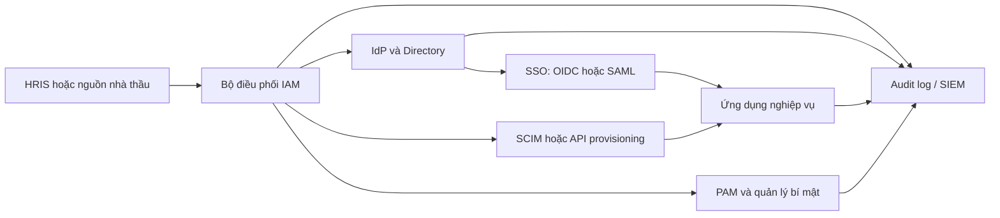
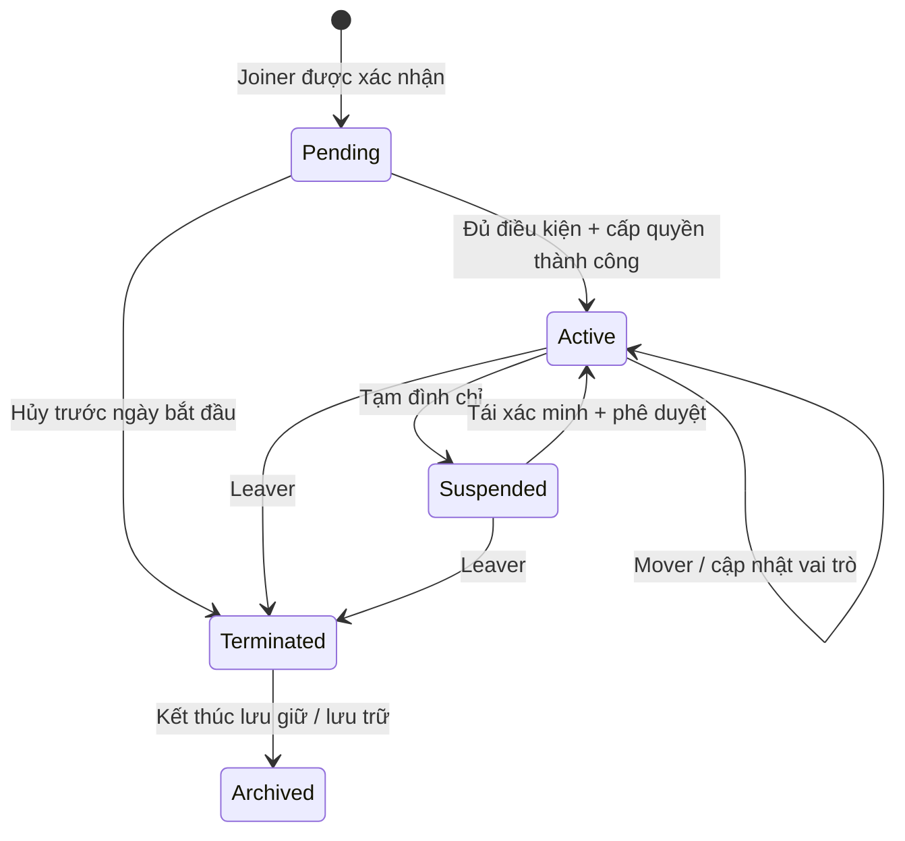

# IAM Runbook: Quy trình vận hành vòng đời danh tính và quyền truy cập

## 1. Mục tiêu và phạm vi

**IAM runbook** là bộ hướng dẫn thao tác có thể thực thi, kiểm chứng và truy vết khi đội vận hành quản lý **vòng đời danh tính** (*identity lifecycle*) trong hệ thống Identity and Access Management (IAM). Một runbook hữu ích phải trả lời được: sự kiện nào kích hoạt quy trình, ai có quyền phê duyệt, thay đổi quyền ở đâu, cách xác nhận trạng thái thực tế và phải làm gì nếu một bước thất bại.

Trong phạm vi **IAM operations**, bài này tập trung vào mô hình **Joiner–Mover–Leaver (JML)**:

- **Joiner:** xác minh người mới, tạo danh tính/tài khoản, cấp quyền tối thiểu phù hợp công việc và kiểm tra đăng nhập.
- **Mover:** cập nhật danh tính và quyền khi chuyển nhóm, đổi chức vụ, nhận nhiệm vụ tạm thời hoặc thay đổi điều kiện truy cập.
- **Leaver:** chặn truy cập đúng thời điểm, thu hồi quyền/phiên/khóa, xử lý tài khoản còn tồn tại và lưu bằng chứng kiểm toán.

Runbook liên kết **nguồn nhân sự hoặc hệ thống quản lý nhà thầu**, **Identity Provider (IdP)**, **Single Sign-On (SSO)**, **SCIM**, **RBAC/ABAC**, tài khoản dịch vụ, hệ thống ứng dụng đích và hệ thống kiểm toán. Các mốc thời gian, vai trò phê duyệt và ngưỡng cảnh báo bên dưới là **mẫu tham khảo**; khi vận hành thực tế phải thay bằng chính sách của tổ chức, yêu cầu pháp lý và khả năng tích hợp của từng ứng dụng.

Sau bài học, người đọc cần có khả năng xây dựng luồng xử lý JML, xác định điều kiện hoàn tất theo **quyền truy cập hiệu lực** (*effective access*), xử lý lỗi cấp/thu hồi quyền và thu thập bằng chứng để phát hiện **quyền truy cập tồn dư** (*residual access*).

## 2. Phân biệt đối tượng và các thành phần của runbook

Một người có thể có một danh tính doanh nghiệp, nhiều tài khoản ứng dụng, nhiều quyền được gán và nhiều phiên đăng nhập đang hoạt động. Vì vậy, không thể xem việc tắt một tài khoản IdP là bằng chứng rằng mọi truy cập đã bị thu hồi.

| Khái niệm | Ý nghĩa vận hành | Ví dụ |
|---|---|---|
| **Identity (danh tính)** | Hồ sơ đại diện cho một chủ thể; liên kết với mã định danh bền vững | `person-1042`, `contractor-803` |
| **Account (tài khoản)** | Bản ghi đăng nhập hoặc tài khoản cục bộ tại một hệ thống | IdP account, tài khoản CRM, tài khoản Git |
| **Entitlement (quyền)** | Quyền truy cập tài nguyên hay thực hiện thao tác | Nhóm `finance-read`, vai trò `invoice-approver` |
| **Session/token** | Bằng chứng xác thực hoặc ủy quyền đã phát hành, có thể còn hiệu lực sau khi đổi nhóm | Phiên trình duyệt, refresh token, API token |
| **Authoritative source** | Nguồn dữ liệu được tin cậy để phát sự kiện về người/vai trò | HRIS, hệ thống quản lý nhà thầu có người bảo trợ |
| **IdP / SSO** | Hệ thống xác thực và cung cấp phiên đăng nhập liên ứng dụng | OIDC hoặc SAML SSO |
| **SCIM** | Giao thức cấp phát và đồng bộ người dùng/nhóm tới ứng dụng hỗ trợ | Tạo user, cập nhật nhóm, đặt `active: false` |
| **RBAC / ABAC** | Chính sách quyền theo vai trò / theo thuộc tính và ngữ cảnh | Vai trò phòng ban / giới hạn theo khu vực, mức dữ liệu |
| **PAM** | Quản lý truy cập đặc quyền, thường có phê duyệt và giới hạn thời gian | Nâng quyền admin có thời hạn |

### 2.1. Luồng dữ liệu tham chiếu



**Điểm cần kiểm tra:**

1. **HRIS** thường là nguồn chuẩn cho trạng thái lao động và ngày hiệu lực, nhưng **không** phải nguồn chuẩn của mọi quyền ứng dụng; quyền còn phụ thuộc chủ sở hữu tài nguyên và chính sách.
2. **IdP/SSO** quản lý xác thực tập trung, nhưng có ứng dụng giữ tài khoản cục bộ, token riêng hoặc quyền được cấp thủ công.
3. **SCIM** hỗ trợ cấp phát và đồng bộ, song hành vi xóa/vô hiệu hóa tùy ứng dụng. Việc cập nhật thành công qua API cần được đối chiếu với trạng thái phía ứng dụng.
4. **RBAC** tạo bộ quyền cơ sở theo vai trò; **ABAC** bổ sung điều kiện như đơn vị, khu vực, loại dữ liệu, thiết bị hoặc thời điểm. Quyền hiệu lực có thể phụ thuộc phiên/token đã phát hành.
5. **Audit log/SIEM** ghi nhận bằng chứng yêu cầu, phê duyệt, hành động, phản hồi và kết quả kiểm chứng; không lưu mật khẩu, token hay bí mật thô trong ticket/log.

## 3. Hợp đồng vận hành: đầu vào, trách nhiệm, đầu ra

### 3.1. Sự kiện kích hoạt

Các thao tác IAM phải bắt đầu từ một sự kiện/ticket có nguồn gốc và danh tính xác định rõ. Không dùng mỗi địa chỉ email làm khóa đối chiếu vì email có thể đổi, tái sử dụng hoặc trùng ở nhiều hệ thống.

| Loại sự kiện | Trường tối thiểu cần xác thực | Kết quả mong muốn |
|---|---|---|
| `JOINER` | `subject_id`, người bảo trợ/quản lý, trạng thái xác minh, ngày bắt đầu, đơn vị, nhóm/vai trò, hợp đồng hoặc phạm vi | Tài khoản hợp lệ, chỉ có quyền được phê duyệt |
| `MOVER` | `subject_id`, vai trò cũ/mới, thời điểm hiệu lực, người phê duyệt, quyền đặc biệt đang có | Thu hồi quyền cũ không còn hợp lệ; cấp quyền mới hợp lệ |
| `LEAVER` | `subject_id`, thời điểm chấm dứt, mức khẩn cấp, đơn vị yêu cầu có thẩm quyền | Chặn đăng nhập, thu hồi phiên/khóa/quyền trên tất cả đích liên quan |
| `SUSPEND` / `REACTIVATE` | Lý do, phạm vi, người phê duyệt, thời hạn, điều kiện khôi phục | Đình chỉ hoặc khôi phục có kiểm soát, không tự phục hồi quyền cũ trái chính sách |
| `ACCESS_REVIEW` | Phạm vi rà soát, chủ sở hữu, ngày chốt, danh sách quyền hiện tại | Quyết định giữ/thu hồi, hành động đã thực thi, bằng chứng |

Một bản ghi sự kiện nên có `event_id` duy nhất, `source_system`, `subject_id` bất biến, `event_type`, `effective_at` kèm múi giờ, phiên bản thay đổi, correlation ID, người phê duyệt và căn cứ chính sách. Cần giới hạn truy cập tới các trường nhạy cảm theo nguyên tắc tối thiểu.

### 3.2. Phân công trách nhiệm

| Vai trò | Trách nhiệm |
|---|---|
| **HR/nguồn chủ quản danh tính** | Xác nhận quan hệ lao động và thời điểm Joiner/Mover/Leaver; sửa dữ liệu đầu vào sai |
| **Quản lý trực tiếp / sponsor** | Xác nhận nhu cầu công việc và thời hạn quyền; chịu trách nhiệm nhà thầu/người được bảo trợ |
| **Chủ sở hữu ứng dụng hoặc dữ liệu** | Phê duyệt quyền nhạy cảm, phân tách nhiệm vụ (SoD), ngoại lệ theo phạm vi dữ liệu |
| **IAM Operations** | Thực thi workflow, đồng bộ IdP/SCIM, xử lý lỗi và lưu bằng chứng kỹ thuật |
| **Security / PAM / SOC** | Đặt kiểm soát truy cập đặc quyền, ứng phó sự cố và giám sát bất thường |
| **Auditor / Compliance** | Kiểm tra độc lập log, thời hạn xử lý, ngoại lệ và khả năng truy vết |

Nguyên tắc kiểm soát: người yêu cầu không tự phê duyệt quyền đặc quyền của chính mình; ngoại lệ phải có chủ sở hữu rủi ro, căn cứ, ngày hết hạn và cơ chế rà soát.

### 3.3. Điều kiện chung trước khi bấm Run

- Xác thực nguồn phát sự kiện, tính toàn vẹn, tính mới và thời điểm hiệu lực; xử lý sự kiện trùng hoặc đến sai thứ tự.
- Đối chiếu `subject_id` với tài khoản đích bằng định danh bền vững như `externalId`/object ID; nếu mơ hồ, **dừng cấp quyền** và chuyển xác minh thủ công.
- Tính **desired state** (quyền đúng phải có) từ vai trò, thuộc tính, phê duyệt và chính sách; so với **actual state** (quyền đang có).
- Kiểm tra least privilege, SoD, điều kiện MFA/thiết bị, thời hạn quyền tạm thời và tác động tới ứng dụng không hỗ trợ SCIM.
- Khởi tạo ticket/trace có ID duy nhất; ghi log hành động với người hoặc tác nhân thực hiện nhưng không đưa bí mật vào log.

## 4. Trạng thái vòng đời và quy tắc an toàn

Một mô hình trạng thái tham khảo:



`Mover` là sự kiện thay đổi thuộc tính/quyền, không bắt buộc là một trạng thái. `Terminated` thể hiện quyền truy cập đã bị đóng, **không** có nghĩa dữ liệu của người dùng đã bị xóa; dữ liệu có thể phải giữ theo chính sách lưu trữ/điều tra. Việc kích hoạt lại phải theo một yêu cầu hợp lệ mới, không tự động phục hồi toàn bộ nhóm và đặc quyền lịch sử.

Áp dụng các bất biến sau cho mọi quy trình:

1. **Default deny:** chưa xác minh hoặc chưa phê duyệt thì không cấp quyền mới.
2. **Least privilege:** chỉ cấp quyền đáp ứng công việc và có thời hạn phù hợp.
3. **Idempotency:** chạy lại cùng một sự kiện không tạo user/nhóm hoặc cấp quyền trùng.
4. **Thứ tự sự kiện:** sự kiện cũ không được ghi đè trạng thái mới hơn; `LEAVER` khẩn cấp phải được ưu tiên chặn truy cập.
5. **Xác nhận hiệu lực:** kết quả `200 OK` của hệ thống điều phối hoặc API chưa chứng minh rằng người dùng thực sự mất quyền.
6. **Fail closed cho cấp quyền nhạy cảm:** khi không chắc định danh hoặc thiếu phê duyệt, tạm dừng cấp quyền và mở ngoại lệ có kiểm soát.
7. **Bằng chứng có thể đối chiếu:** mọi thay đổi cần truy về yêu cầu, phê duyệt, thao tác và trạng thái đích tại thời điểm kiểm tra.

## 5. SOP-J01 — Tiếp nhận và xác minh một Joiner

**Trigger:** HR hoặc sponsor tạo sự kiện người mới với ngày bắt đầu. **Người chịu trách nhiệm:** nguồn chủ quản danh tính xác minh thông tin; IAM Operations thực thi; quản lý và chủ sở hữu ứng dụng phê duyệt quyền ngoài bộ mặc định.

**Thao tác:**

1. Nhận `JOINER`, xác thực chữ ký/quyền của kênh gửi, kiểm tra `event_id`, định danh bất biến, trạng thái hợp đồng và `effective_at`.
2. Phát hiện trùng danh tính trước khi tạo mới. Trường hợp cùng tên/email, đổi email hoặc tái tuyển dụng cần quy trình đối chiếu riêng; không tự gộp hai người chỉ theo email.
3. Xác minh người cần dùng tài khoản theo quy định của tổ chức (ví dụ HR xác nhận hồ sơ, sponsor xác nhận nhà thầu). Chỉ thu thập dữ liệu cần thiết; không đưa giấy tờ định danh vào ticket công khai.
4. Tính vai trò nền và điều kiện truy cập từ `department`, `job_code`, `location`, `employment_type` hoặc thuộc tính liên quan đã được kiểm chứng.
5. Lập danh sách quyền cần phê duyệt bởi chủ sở hữu dữ liệu nếu ngoài role cơ sở; kiểm tra xung đột SoD trước khi chuyển bước cấp quyền.

**Điều kiện hoàn tất:** danh tính có đúng một bản ghi chủ quản, mapping tới tài khoản đích không nhập nhằng, nguồn và người phê duyệt có thể truy vết. Nếu chưa đủ điều kiện, giữ trạng thái `Pending` và mở ticket bổ sung thông tin.

## 6. SOP-J02 — Tạo tài khoản, cấp quyền và xác nhận Joiner

**Trigger:** SOP-J01 đạt yêu cầu và tới thời điểm được phép kích hoạt.

1. Tạo hoặc liên kết tài khoản IdP bằng định danh duy nhất. Đặt trạng thái kích hoạt theo ngày hiệu lực và chính sách truy cập trước ngày bắt đầu.
2. Gán nhóm/role mặc định qua **RBAC**, sau đó áp chính sách **ABAC** cho dữ liệu/tài nguyên có điều kiện. Không suy quyền admin từ tên chức danh chung chung.
3. Đặt yêu cầu xác thực phù hợp: MFA, quy trình đăng ký phương thức xác thực, chính sách thiết bị/đăng nhập, cơ chế khôi phục tài khoản. Không gửi mật khẩu tạm qua kênh không an toàn.
4. Đồng bộ user và group tới ứng dụng qua SCIM hoặc connector tương đương. Với ứng dụng không hỗ trợ provisioning, tạo task cho chủ ứng dụng thực hiện và ghi dấu vết.
5. Kiểm tra quyền thực tế tại IdP **và từng ứng dụng đích**: tài khoản có đúng trạng thái, nhóm/role được phê duyệt, không có quyền rộng hơn; kiểm tra luồng SSO theo quy trình kiểm thử được phép.
6. Ghi thời điểm hoàn tất, trạng thái đối chiếu, các ứng dụng thành công/thất bại. Chỉ đóng ticket khi mọi kiểm tra bắt buộc hoàn tất hoặc ngoại lệ còn mở đã có người chịu trách nhiệm và thời hạn.

**Ví dụ:** Một nhân viên mới thuộc nhóm hỗ trợ khách hàng cần SSO vào hệ thống ticket và quyền `ticket-reader`. Workflow có thể gán nhóm `support-base`, tạo tài khoản ở ứng dụng qua SCIM, sau đó xác minh họ chỉ xem ticket trong phạm vi được phép. Việc đăng nhập được bằng SSO **không đủ** để kết luận đã cấp đúng quyền dữ liệu.

**Lỗi cần tránh:** coi provisioning thành công tại IdP là thành công tại mọi ứng dụng; bật JIT provisioning mà không kiểm tra chính sách role mặc định; cấp nhóm rộng để “nhanh cho xong” rồi quên thu hồi.

## 7. SOP-M01 — Chuyển vai trò, đơn vị hoặc nhiệm vụ (Mover)

**Trigger:** có `MOVER` hợp lệ với vai trò/thuộc tính mới và thời điểm hiệu lực. **Mục tiêu:** trạng thái quyền cuối cùng phản ánh công việc mới; quyền cũ không còn cần thiết bị thu hồi.

1. **Chụp hiện trạng:** liệt kê ứng dụng, nhóm, role, quyền trực tiếp, quyền kế thừa, quyền đặc biệt, session/token và ngoại lệ đang có. Đối chiếu với inventory để tìm quyền được cấp ngoài IdP.
2. **Tính chênh lệch:** xác định tập quyền phải **giữ**, **thu hồi**, **cấp mới**. Phân biệt quyền nền chung với quyền theo vị trí cũ; xác minh yêu cầu SoD.
3. **Lấy phê duyệt:** chủ dữ liệu xác nhận quyền mới có rủi ro cao; quy trình phải xử lý trường hợp hai role cũ và mới xung đột trong giai đoạn chuyển tiếp.
4. **Thực thi theo trình tự kiểm soát:** thu hồi quyền cũ có rủi ro trước hoặc đồng thời với cấp quyền mới theo chính sách chuyển giao. Nếu cần giai đoạn song song, yêu cầu phê duyệt riêng, thời hạn và giám sát thay vì giữ quyền vô thời hạn.
5. **Làm mới hiệu lực:** đồng bộ group/claim với IdP và ứng dụng; với hệ thống dùng token hoặc cache quyền, thực hiện revoke/refresh session khi cần để tránh role cũ vẫn có hiệu lực.
6. **Đối chiếu:** kiểm tra tài khoản đích, quyền trực tiếp, nhóm lồng nhau, quyền gán cục bộ và kết quả truy cập với tài nguyên bị giới hạn. Ghi lại quyền không tự động thu hồi được.

**Ví dụ chuyển từ Support sang Finance:**

| Trước chuyển | Sau chuyển mong muốn | Thao tác xác nhận |
|---|---|---|
| `support-base`, quyền xem ticket | Không còn quyền xem ticket của Support | Gỡ nhóm, thu hồi role cục bộ, kiểm tra token/phiên |
| Không có quyền hóa đơn | `finance-reader` theo đơn vị được phê duyệt | Phê duyệt, gán role, kiểm tra giới hạn dữ liệu |
| Quyền SSO cơ sở | Vẫn duy trì nếu hợp lệ | Giữ quyền nền, kiểm tra chính sách đăng nhập |

Một lỗi phổ biến là chỉ thêm `finance-reader` mà không gỡ `support-base`: thao tác cấp mới thành công nhưng quyền tồn dư vẫn cho phép xem dữ liệu Support. Runbook phải xác minh cả **delta cần xóa** và **delta cần thêm**.

### 7.1. Quyền tạm thời và chuyển giao

Với làm thay, biệt phái hoặc trực ca, gắn `valid_from`, `expires_at`, người phê duyệt và phạm vi quyền. Đặt lịch hết hạn trong hệ thống có khả năng cưỡng chế, sau đó đối chiếu việc thu hồi. Không xem một lời nhắc hết hạn trong ticket là bằng chứng quyền đã được gỡ.

## 8. SOP-L01 — Leaver thông thường và chấm dứt khẩn cấp

**Trigger:** nguồn có thẩm quyền phát `LEAVER`. Có thể là nghỉ việc theo lịch, kết thúc hợp đồng nhà thầu hoặc chấm dứt cần chặn ngay. Thời điểm thực thi phải dựa trên `effective_at` được chuẩn hóa múi giờ; tình huống khẩn cấp có thể dùng quy trình bảo mật ưu tiên.

### 8.1. Chuẩn bị với Leaver theo lịch

1. Xác thực nguồn HR/sponsor và thời điểm hiệu lực. Không thu hồi sớm trái chính sách làm gián đoạn công việc trước thời điểm nghỉ.
2. Lấy inventory đầy đủ: IdP, SaaS, VPN, máy chủ, mã nguồn, cloud IAM, thiết bị, API token, SSH key, vai trò admin, quyền được ủy quyền, tài khoản cục bộ, nhóm thư và tài khoản mà người nghỉ là owner.
3. Xác định dữ liệu, hộp thư, kho lưu trữ, lịch, workflow và tài khoản dịch vụ cần bàn giao; chỉ định người nhận theo phê duyệt. Bàn giao dữ liệu **khác** với giữ cho người nghỉ quyền truy cập.
4. Lập quy trình đóng tài khoản đích không tích hợp, xác định chủ xử lý và bằng chứng cần thu thập.

### 8.2. Thực thi khi tới thời điểm chấm dứt

Thứ tự chi tiết tùy hệ thống, nhưng cần ưu tiên **chặn khả năng truy cập nhanh** rồi mới hoàn tất vệ sinh và lưu trữ:

1. Đánh dấu danh tính không còn hợp lệ trong hệ thống điều phối, chặn đăng nhập IdP/SSO, vô hiệu hóa chính sách truy cập, VPN và các điểm vào tập trung.
2. Thu hồi các phiên đang hoạt động/refresh token ở nơi hỗ trợ; hủy hoặc vô hiệu hóa token cá nhân, khóa API, khóa SSH, chứng chỉ và quyền nâng cấp đặc quyền gắn với chủ thể.
3. Gửi deprovision qua SCIM hoặc API đích, ví dụ chuyển user sang `active: false` khi ứng dụng hỗ trợ. Đối với ứng dụng chỉ hỗ trợ disable thủ công, tạo tác vụ bắt buộc với owner và thời hạn.
4. Gỡ nhóm, role, quyền trực tiếp, quyền trên hệ thống dùng tài khoản local và các grant ngoài SSO. Với cloud/service principal, xác minh owner và bí mật phụ thuộc để không bỏ sót lối truy cập thay thế.
5. Thu hồi quyền phê duyệt, quyền ủy quyền, phiên truy cập admin và quyền truy cập vật lý liên quan nếu nằm trong quy trình liên phòng ban.
6. Xác minh **tại từng hệ thống đích** rằng tài khoản bị vô hiệu hóa hoặc không còn quyền; kiểm tra cả phiên/token còn sống theo cơ chế của hệ thống. Mọi đích lỗi phải chuyển thành việc khắc phục có chủ sở hữu.
7. Lưu kết quả kiểm chứng; bàn giao dữ liệu theo chính sách lưu trữ, pháp lý và quyền riêng tư. Xóa danh tính/dữ liệu chỉ sau khi đạt điều kiện giữ lại/xóa của tổ chức.

**Leaver khẩn cấp:** đơn vị có thẩm quyền khởi động lệnh khóa ngay, ưu tiên IdP, VPN, PAM và các ứng dụng trọng yếu; bảo vệ log và bằng chứng; sau đó rà soát tất cả hệ thống kết nối và quyền ngoài luồng. Nếu đường đồng bộ SCIM đang lỗi, không chờ connector hoạt động lại mới chặn lối vào có thể khóa trực tiếp. Cần phối hợp SOC, HR và chủ ứng dụng theo phân quyền ứng phó sự cố.

**Lưu ý về token:** SSO bị chặn không mặc nhiên chấm dứt phiên đã đăng nhập tại ứng dụng; access token có thể còn hiệu lực đến lúc hết hạn, hoặc ứng dụng không thực hiện thu hồi. Với hệ thống trọng yếu, phải dùng cơ chế revoke session/token riêng và xác minh kiểm soát phía ứng dụng.

### 8.3. Tiêu chí đóng ticket Leaver

Ticket chỉ đạt trạng thái **verified** khi: sự kiện đúng người/đúng giờ; các lối đăng nhập bị chặn; danh sách ứng dụng đích được đối chiếu; các grant, phiên và token có liên quan đã xử lý; chứng cứ được lưu; quyền không tự thu hồi có ticket ngoại lệ được giám sát. Nếu còn ứng dụng chưa xử lý, không ghi “đã thu hồi toàn bộ”.

## 9. SOP-S01 — Suspend, reactivation và sửa danh tính

**Suspend** tạm chặn quyền trong thời gian có lý do hợp lệ (ví dụ nghỉ dài ngày, tài khoản nghi bị chiếm quyền, hợp đồng đang xác minh). Runbook phải ghi lý do, người phê duyệt, thời điểm bắt đầu, phạm vi tác động và điều kiện kết thúc. Với nghi ngờ xâm nhập, phối hợp ứng phó sự cố để thu hồi token, xoay bí mật và giữ log.

**Reactivate** yêu cầu xác thực lại tình trạng chủ thể, quản lý hiện tại và danh sách quyền hiện được phép. Không khôi phục mù quáng toàn bộ grant trước khi suspend, nhất là quyền đặc quyền và quyền tạm thời đã hết hạn.

**Sửa dữ liệu danh tính** (đổi họ tên, email, đơn vị) phải giữ khóa định danh ổn định. Cập nhật mapping với SCIM/IdP và tài khoản đích theo khóa đúng; không tạo người dùng mới chỉ vì email hoặc tên hiển thị thay đổi. Nếu phát hiện trùng/mapping sai, tạm dừng automation trên các account liên quan, điều tra và sửa có bằng chứng.

## 10. SOP-R01 — Rà soát định kỳ và phát hiện quyền tồn dư

Rà soát quyền là bước kiểm soát liên tục trong IAM operations; nguồn sự thật của role có thể thay đổi ngay cả khi không có sự kiện JML được phát thành công.

1. **Xác định phạm vi và kỳ:** ví dụ quyền chuẩn theo chu kỳ quý, quyền đặc quyền hoặc hệ thống trọng yếu theo chu kỳ ngắn hơn **nếu chính sách yêu cầu**.
2. **Thu thập actual state:** liệt kê user, group, role, grant trực tiếp, quyền kế thừa, khóa/token, tài khoản local, tài khoản dịch vụ và trạng thái hoạt động ở ứng dụng.
3. **Tính desired state:** đối chiếu HR/sponsor, team, vai trò, chính sách RBAC/ABAC, phê duyệt và thời hạn quyền.
4. **Giao người quyết định phù hợp:** quản lý xác nhận nhu cầu công việc, chủ tài nguyên xác nhận quyền dữ liệu, Security xác nhận đặc quyền và SoD.
5. **Thực thi thu hồi:** không dừng ở đánh dấu `reject` trên bảng review; xác nhận connector hoặc người vận hành đã gỡ grant tại ứng dụng.
6. **Đối chiếu và chứng minh:** lưu dữ liệu snapshot, kết quả, ngày thực thi, lỗi, ngoại lệ, người chấp nhận rủi ro và thời hạn khắc phục.

Những dấu hiệu đáng ưu tiên: tài khoản **orphan** (không còn người bảo trợ hợp lệ), nhân sự nghỉ việc vẫn có account enabled, vai trò từ đơn vị cũ, quyền admin không có approval, tài khoản lâu không dùng nhưng còn quyền cao, service account không có owner, nhóm lồng nhau tạo quyền vượt chính sách, quyền trực tiếp không đồng bộ từ IdP và grant đã quá hạn.

**Phân biệt ba kết quả:** “đã yêu cầu thu hồi” → “API/đội vận hành báo thực thi” → “đã kiểm chứng quyền thực tế”. Một chương trình access review trưởng thành cần đo đến bước thứ ba.

## 11. SOP-P01 — Đặc quyền, break-glass và tài khoản dịch vụ

### 11.1. Truy cập đặc quyền của con người

- Dùng tài khoản có thể quy trách nhiệm cá nhân; tách nhiệm vụ quản trị khỏi phiên công việc hằng ngày khi phù hợp.
- Ưu tiên quyền **just-in-time (JIT)**, phê duyệt đúng cấp, MFA mạnh, thời hạn tự hết và ghi log hoạt động theo chính sách PAM.
- Thực thi kiểm tra SoD để tránh cùng một người vừa tạo vừa tự duyệt giao dịch nhạy cảm.
- Khi Mover/Leaver, rà soát cả quyền PAM, nhóm admin, quyền owner, khóa SSH, cloud role assumption và phiên đặc quyền đang tồn tại.

### 11.2. Break-glass (truy cập khẩn cấp)

Chỉ dùng khi quy trình thông thường không khả dụng hoặc sự cố đòi hỏi khôi phục dịch vụ. Runbook cần mô tả điều kiện kích hoạt, người được phép, xác thực an toàn, nơi giữ bí mật, thời hạn, ghi log và người kiểm tra hậu sự kiện. Sau mỗi lần dùng, phải thu hồi phiên, xoay bí mật/khóa nếu có nguy cơ lộ, kiểm tra thay đổi đã thực hiện và đóng biên bản. Tài khoản break-glass không là “ngoại lệ vĩnh viễn” khỏi kiểm toán.

### 11.3. Danh tính phi con người (service account / workload identity)

Service account có vòng đời riêng: **tạo → cấp phạm vi → xoay thông tin xác thực → thay đổi owner → thu hồi**. Không ép giả định mỗi service account thuộc về một nhân viên đang làm việc; phải có **owner nghiệp vụ và owner kỹ thuật** chịu trách nhiệm liên tục.

1. Đăng ký mục đích, hệ thống/ứng dụng, owner, phạm vi tài nguyên, ngày rà soát và phụ thuộc vận hành.
2. Ưu tiên workload identity liên kết ngắn hạn (ví dụ OIDC federation hoặc managed identity) thay cho khóa tĩnh lâu dài khi hạ tầng hỗ trợ.
3. Nếu cần secret, lưu trong secret manager/vault, giới hạn đọc, đặt lịch rotation và giám sát truy cập; không hardcode trong repository hay ticket.
4. Khi đổi team hoặc owner rời tổ chức, chuyển trách nhiệm sở hữu và đánh giá lại grant, không mặc định tắt tài khoản đang chạy production; với tài khoản gắn trực tiếp người nghỉ, thu hồi thông tin xác thực cá nhân và chuyển sang cơ chế đúng.
5. Khi ứng dụng ngừng hoạt động, xác minh không còn dependency rồi vô hiệu hóa identity, secret, role, trust policy và kết nối; lưu bằng chứng trạng thái cuối.

## 12. Điều phối workflow đáng tin cậy

Sự kiện từ webhook, queue hoặc HR batch có thể trùng, trễ hoặc đến sai thứ tự. Đồng bộ tới nhiều đích cũng có thể thành công một phần. Vì vậy, workflow phải lưu tiến độ theo từng đích và có cơ chế chạy lại an toàn.

```json
{
  "event_id": "evt-2026-0042",
  "event_type": "MOVER",
  "subject_id": "person-1042",
  "source_system": "HRIS",
  "source_version": 18,
  "effective_at": "2026-11-24T09:00:00+07:00",
  "new_attributes": {
    "department": "Finance",
    "job_code": "FIN_READER"
  },
  "approval_ref": "access-request-321"
}
```

Đây là dữ liệu **giả lập**; không đặt ngày giờ, vai trò và mã định danh mẫu thành quy tắc hardcode cho production.

```text
on_event(event):
    verify_source_and_schema(event)
    if already_processed(event.event_id):
        return previous_result(event.event_id)

    lock_subject(event.subject_id)
    current = load_subject_lifecycle_state(event.subject_id)
    if event_is_stale(event, current):
        record_audit("SKIPPED_STALE", event)
        return

    if not identity_mapping_is_unambiguous(event.subject_id):
        record_exception("IDENTITY_MISMATCH", event)
        stop_without_granting_access()

    desired = evaluate_policy_and_approvals(event)
    plan = diff(read_actual_access(), desired)
    assert_no_unapproved_or_conflicting_grants(plan)

    for target in plan.targets:
        apply_idempotent_change(target, plan[target])
        verify_actual_state(target, plan[target].expected_state)
        record_target_result(target)

    if all_required_targets_verified():
        mark_event_completed()
    else:
        queue_reconciliation_and_escalation()
```

Đây là **pseudocode định hướng**: hệ thống thực tế phải định nghĩa khóa/transaction, timeout, retry, giới hạn lỗi, trạng thái từng target và cách bảo vệ sự kiện `LEAVER` khẩn cấp. Không được để `MOVER` đến muộn vô tình kích hoạt lại danh tính đã nghỉ việc; quy tắc phiên bản và trạng thái phải chặn điều đó.

**Các điểm thiết kế bắt buộc:**

- **Idempotent operation:** dùng `event_id` cùng khóa bất biến của user và `externalId` phía SCIM; kiểm tra trước khi tạo lại hoặc cấp lặp.
- **Partial failure:** mỗi đích có trạng thái `PENDING/APPLIED/VERIFIED/FAILED`; một target thành công không khiến cả workflow được đóng.
- **Retry có giới hạn:** tôn trọng `Retry-After`, backoff theo cấp số nhân kèm jitter cho lỗi tạm thời; tránh retry khi dữ liệu/approval sai.
- **Reconciliation:** định kỳ lấy actual state từ đích và so với desired state; sinh drift ticket có owner thay vì chỉ dựa event log.
- **Token/cache awareness:** khi đổi quyền hoặc offboarding, thực hiện invalidate phù hợp và đợi/kiểm tra propagation thực tế theo mô hình của ứng dụng.

## 13. SOP-E01 — Xử lý lỗi và ngoại lệ trong IAM operations

| Dấu hiệu | Chẩn đoán ban đầu | Hành động an toàn và điều kiện đóng |
|---|---|---|
| SCIM `401`/`403` | Connector hết hạn chứng thực, thiếu quyền hoặc chính sách chặn | Kiểm tra cấu hình và quyền connector trong kênh quản trị; cấp lại bí mật qua vault; chạy lại tác vụ và verify target |
| SCIM `409 Conflict` | Khả năng tồn tại tài khoản trùng hoặc xung đột khóa | Đối chiếu `externalId`/ID bất biến; không tự merge theo email; giải quyết mapping rồi chạy lại |
| SCIM `429` | Bị rate limit | Tôn trọng `Retry-After`, backoff có jitter, ưu tiên deprovision quan trọng, kiểm chứng sau retry |
| API `5xx`, timeout | Đích lỗi hoặc **không rõ** thao tác đã được áp dụng | Tra cứu trạng thái đích trước khi gửi lại; retry idempotent, đặt cảnh báo và deadline |
| User/role lệch giữa IdP và app | Provisioning lỗi, nhóm lồng nhau, role gán cục bộ, cache/claim cũ | So sánh actual–desired, xử lý root cause và xác minh bằng quyền hiệu lực |
| Leaver vẫn có session truy cập | Token/phiên sống độc lập với IdP | Revoke session/token ở app, chặn đường truy cập còn lại, chuyển Security nếu có dấu hiệu lạm dụng |
| Sai liên kết định danh | Email tái sử dụng, trùng user hoặc đổi thuộc tính | Dừng automation cho bản ghi liên quan, đối chiếu ID gốc, cô lập grant sai và giữ bằng chứng |
| Ứng dụng không hỗ trợ offboarding tự động | Thiếu API/SCIM hoặc giới hạn quyền connector | Mở việc thủ công cho chủ ứng dụng, áp biện pháp chặn tạm thời được phê duyệt, theo dõi đến khi xác minh xong |

**Quy trình xử lý sự cố chung:** ghi nhận mức ảnh hưởng → ưu tiên chặn lối truy cập rủi ro → xác định target bị lệch → khắc phục có kiểm soát → kiểm chứng actual state → đóng bằng chứng. Không tự “rollback” mọi thao tác bằng cách cấp lại toàn bộ quyền cũ: quyền cũ có thể đã vi phạm chính sách, đặc biệt trong `LEAVER` hoặc khi phát hiện chiếm quyền tài khoản.

### 13.1. Sự cố mất đồng bộ SCIM khi có nhiều Leaver

Giả sử connector SCIM của một SaaS liên tục trả `429` trong giờ offboarding:

1. Đánh dấu các target chưa được xác minh là `PENDING_REVOKE`, không báo hoàn thành.
2. Chặn IdP/SSO, phiên và token thuộc khả năng kiểm soát ngay; xác định SaaS nào vẫn có login cục bộ hoặc API key độc lập.
3. Thực hiện disable trực tiếp tại SaaS qua đường quản trị được ủy quyền nếu mức rủi ro yêu cầu; ghi lại người thao tác và bằng chứng.
4. Xử lý hàng đợi theo mức ưu tiên, tôn trọng rate limit; sau khi hồi phục, đối chiếu toàn bộ tài khoản có `desired = disabled`.
5. Khép ngoại lệ chỉ khi target đã được xác nhận disable và quyền tồn dư đã xử lý.

Ví dụ cho thấy runbook phải xử lý được **rủi ro trong thời gian chờ đồng bộ**, thay vì chỉ ghi “retry later”.

## 14. Giám sát, SLA nội bộ và bằng chứng kiểm toán

### 14.1. Chỉ số cần quan sát

| Chỉ số | Ý nghĩa và cách dùng |
|---|---|
| **Provisioning latency** | Từ thời điểm được phép tạo/cấp đến lúc các ứng dụng bắt buộc đạt `VERIFIED` |
| **Deprovisioning latency** | Từ thời điểm leaver có hiệu lực đến lúc các lối truy cập trọng yếu đã bị chặn và kiểm chứng |
| **Reconciliation drift** | Số lượng danh tính/quyền actual khác desired, phân loại theo độ nhạy và tuổi tồn dư |
| **Orphan account count** | Tài khoản không khớp chủ thể/sponsor hợp lệ, cần điều tra |
| **Failed target / retry backlog** | Ứng dụng chưa đồng bộ, lỗi connector, thời gian chờ, các job bị kẹt |
| **Access review closure** | Tỷ lệ quyết định review đã thực thi và được xác nhận tại ứng dụng đích |
| **Privileged exceptions** | Quyền đặc quyền, break-glass và ngoại lệ quá hạn hoặc thiếu hậu kiểm |

**Ví dụ về phân mức ưu tiên để tổ chức tự điều chỉnh:**

| Mức | Tình huống | Hướng xử lý |
|---|---|---|
| P0 | Người nghỉ việc khẩn cấp còn đăng nhập được vào hệ thống nhạy cảm | Chặn truy cập ngay qua điểm điều khiển sẵn có; SOC/IAM xử lý đồng thời; xác minh độc lập |
| P1 | Leaver theo lịch bị kẹt tại một ứng dụng trọng yếu | Chỉ định owner, dùng đường thu hồi thay thế và theo dõi đến khi verified |
| P2 | Joiner chưa đủ quyền mặc định ở ứng dụng không trọng yếu | Sửa mapping/connector, cập nhật ticket và kiểm chứng |
| P3 | Review phát hiện quyền cũ ít nhạy cảm nhưng chưa dùng | Lập kế hoạch thu hồi có hạn chót, theo dõi drift |

Đơn vị vận hành cần công bố **SLO/SLA của riêng mình** (ví dụ thời gian khóa lối vào chính, thời gian hoàn tất deprovision mọi đích, thời gian xử lý ngoại lệ), có owner và cách đo rõ ràng. Không có một ngưỡng phút cố định phù hợp mọi hệ thống hoặc mọi loại hợp đồng.

### 14.2. Mẫu hồ sơ thực thi có thể kiểm toán

```yaml
ticket_id: IAM-EXAMPLE-321
event_id: evt-2026-0042
subject_id: person-1042
event_type: MOVER
source_system: HRIS
effective_at: "2026-11-24T09:00:00+07:00"
requester_ref: source-record-321
approval_refs:
  - approver-record-17
policy_version: iam-policy-v12
desired_state_ref: desired-snapshot-321
actual_state_before_ref: actual-before-321
targets:
  - system: ticketing
    action: revoke-role
    verification: VERIFIED
    evidence_ref: audit-event-771
  - system: finance-app
    action: grant-role
    verification: VERIFIED
    evidence_ref: audit-event-772
exceptions: []
actual_state_after_ref: actual-after-321
completed_at: "2026-11-24T09:07:00+07:00"
```

Mẫu chỉ chứa ID tham chiếu; nhật ký chi tiết phải tuân thủ phân quyền, thời hạn lưu giữ, bảo vệ dữ liệu cá nhân và tính toàn vẹn kiểm toán. Trong production, không ghi token, mật khẩu, mã MFA, khóa bí mật hay hồ sơ nhân sự nhạy cảm vào artifact này.

**Để chứng minh một yêu cầu đã hoàn thành**, bộ bằng chứng tối thiểu cần nối được: sự kiện gốc → nguồn và thời điểm → phê duyệt/chính sách áp dụng → thay đổi từng đích → phản hồi → xác minh quyền hiệu lực → ngoại lệ và người chịu trách nhiệm (nếu còn).

## 15. Bài tập tình huống và tiêu chí nghiệm thu runbook

### Tình huống A — Mover không thu hồi quyền cũ

Một nhân viên chuyển từ Support sang Finance. IdP đã thêm nhóm `finance-reader`, nhưng ứng dụng ticket vẫn cho phép xem dữ liệu Support qua role được gán trực tiếp trước đó. Cách xử lý đúng là truy dấu grant trực tiếp trong actual state, kiểm tra phê duyệt chuyển tiếp (nếu có), thu hồi role Support, xử lý session/token còn hiệu lực và ghi bằng chứng ở cả IdP lẫn ứng dụng ticket. Chỉ nhìn thấy nhóm mới trong IdP không đủ để đóng `MOVER`.

### Tình huống B — Leaver đã disable SSO nhưng API token còn dùng được

Một nhà thầu kết thúc hợp đồng. IdP đã khóa account, song API token tạo trước đó vẫn gọi được API ứng dụng. Người vận hành phải tìm chủ sở hữu token, thu hồi token tại ứng dụng, xác minh endpoint từ chối yêu cầu sau thu hồi, rà lại khóa/token khác và bổ sung bước này vào danh mục deprovision. Bằng chứng khóa IdP đơn lẻ không đáp ứng điều kiện hoàn tất.

### Tình huống C — Service account mất owner

Nhân viên sở hữu workflow tự động nghỉ việc. Runbook cần nhận diện service account và các bí mật phụ thuộc, chuyển owner theo phê duyệt, đánh giá lại quyền và xoay credential nếu có rủi ro; đồng thời thu hồi mọi grant mang tính cá nhân của nhân viên đã nghỉ. Việc xóa ngay mọi service account do nhân viên từng tạo có thể làm gián đoạn hệ thống; việc giữ mãi credential cá nhân của họ cũng không an toàn.

### Checklist nghiệm thu theo sự kiện

| Kiểm soát | Joiner | Mover | Leaver |
|---|:---:|:---:|:---:|
| Sự kiện từ nguồn có thẩm quyền, định danh duy nhất, thời điểm rõ ràng | ✓ | ✓ | ✓ |
| Phê duyệt và chính sách RBAC/ABAC/SoD đầy đủ | ✓ | ✓ | Khi cần |
| Desired state được tính và so với actual state | ✓ | ✓ | ✓ |
| Tất cả đích bắt buộc có kết quả kiểm chứng | ✓ | ✓ | ✓ |
| Đặc quyền, quyền trực tiếp, tài khoản cục bộ được đối chiếu | ✓ | ✓ | ✓ |
| Phiên/token/khóa được xử lý theo sự kiện và rủi ro | Theo chính sách | Theo chính sách | ✓ |
| Ngoại lệ có owner, thời hạn, mức rủi ro và bằng chứng | ✓ | ✓ | ✓ |
| Bản ghi audit nối được sự kiện–hành động–kết quả | ✓ | ✓ | ✓ |

Một **IAM runbook hoàn chỉnh** không kết thúc ở nút “Create user”, “Add group” hay “Disable account”. Nó kết thúc khi người vận hành có thể chứng minh quyền truy cập đúng với trạng thái vòng đời hiện tại, những quyền không còn hợp lệ đã bị thu hồi và mọi sai lệch còn lại được theo dõi đến khi xử lý xong.
