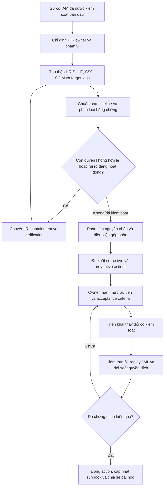

# Rà soát sau sự cố IAM: từ khôi phục truy cập đến ngăn tái diễn

## 1. Mục tiêu của rà soát sau sự cố

**Rà soát sau sự cố** (*Post-Incident Review — PIR*, còn gọi *postmortem*) là hoạt động có cấu trúc nhằm tái dựng điều gì đã xảy ra, xác định tác động thực tế, phân tích các điều kiện gây ra sự cố và thống nhất biện pháp để **giảm khả năng tái diễn hoặc giảm hậu quả khi sự cố lặp lại**. Trong vận hành **Identity and Access Management (IAM)**, một sự cố không chỉ là tình trạng “người dùng không đăng nhập được”: nó còn có thể là **người không còn được phép vẫn truy cập được**, cấp nhầm quyền, thu hồi quyền chậm, dùng tài khoản đặc quyền ngoài quy trình hoặc lỗi dữ liệu danh tính.

Bài học thuộc chương **IAM operations** của mô-đun `SECURITY_IDENTITY_ACCESS_MANAGEMENT_IDENTITY_LIFECYCLE`, với phạm vi quản lý vòng đời danh tính theo **Joiner–Mover–Leaver (JML)**. Quy trình rà soát phải xem xét nguồn nhân sự và danh tính, **Identity Provider (IdP)**, **Single Sign-On (SSO)**, **SCIM**, cơ chế phân quyền **RBAC/ABAC**, tài khoản dịch vụ (*non-human identity — NHI*), nhật ký kiểm toán và đặc biệt là những **quyền truy cập tồn dư** (*residual access*) sau khi vai trò hoặc tư cách thay đổi.

Một bản PIR tốt phải trả lời được:

1. **Sự cố là gì?** Năng lực IAM nào vi phạm kỳ vọng hoặc chính sách?
2. **Ai, hệ thống nào và quyền nào bị ảnh hưởng?** Tác động đến tính bí mật, toàn vẹn, khả dụng và nghiệp vụ ra sao?
3. **Sự cố kéo dài bao lâu?** Mốc bắt đầu, phát hiện, khoanh vùng, chặn nguy cơ, phục hồi và xác minh là những mốc nào?
4. **Những điều kiện nào đã cùng tạo ra sự cố?** Không dừng ở một câu trả lời “do con người”.
5. **Điều gì đã hoạt động tốt, điều gì không?** Phát hiện, cảnh báo, escalation, rollback, failover và bằng chứng thực tế.
6. **Sửa điều gì, ai chịu trách nhiệm, khi nào hoàn tất?** Hành động có tiêu chí kiểm chứng, thời hạn và cơ chế theo dõi.
7. **Làm sao chứng minh rủi ro không còn?** Kiểm tra quyền ở hệ thống đích, không chỉ đóng ticket hoặc hoàn tất họp.

**PIR không thay thế ứng phó sự cố đang diễn ra**. Thứ tự ưu tiên là bảo vệ hệ thống, ngăn truy cập không hợp lệ, khôi phục dịch vụ và bảo toàn bằng chứng; sau đó mới hoàn thiện phân tích và cải tiến lâu dài. Với các phát hiện cho thấy rủi ro vẫn đang tồn tại, nhóm phải kích hoạt xử lý tiếp chứ không chờ buổi họp PIR.

## 2. Phân biệt incident response, PIR và các hoạt động liên quan

| Hoạt động | Mục tiêu | Kết quả chính |
|---|---|---|
| **Incident response (IR)** | Phát hiện, phân loại, khoanh vùng, xử lý và phục hồi trong lúc sự cố xảy ra | Trạng thái truy cập an toàn trở lại; sự cố được kiểm soát |
| **PIR/postmortem** | Hiểu chuỗi sự kiện, nguyên nhân hệ thống và cơ hội cải tiến | Timeline có bằng chứng, phát hiện, action items và lessons learned |
| **Root Cause Analysis (RCA)** | Điều tra cơ chế nguyên nhân và điều kiện góp phần | Mô hình nguyên nhân, giả thuyết được kiểm chứng |
| **Problem management** | Xử lý vấn đề nền tảng lặp lại qua nhiều incident | Thay đổi dài hạn có chủ sở hữu và kiểm chứng |
| **Access review** | Xác nhận quyền hiện tại còn hợp lệ không | Quyết định giữ/sửa/thu hồi quyền |
| **Security audit/compliance review** | Kiểm tra bằng chứng tuân thủ chính sách/điều khoản kiểm soát | Kết luận, ngoại lệ và yêu cầu khắc phục |
| **Change review** | Đánh giá thay đổi triển khai và các biện pháp phòng lỗi | Cải tiến quy trình phê duyệt, phát hành, rollback |

Ví dụ, một quy trình SCIM ngừng thu hồi quyền ở ứng dụng đích. **IR** khoanh vùng và chặn những tài khoản có nguy cơ còn truy cập; **PIR** tái dựng tại sao connector lỗi, vì sao không được phát hiện và vì sao không có kiểm tra trạng thái đích; **problem management** theo đuổi việc bổ sung retry, reconciliation và cảnh báo cho toàn bộ connector cùng loại.

Một incident có thể sinh nhiều kết quả: hành động ngắn hạn (*corrective*), biện pháp phòng ngừa (*preventive*), thay đổi kiến trúc và các bài kiểm thử. Không nên coi việc viết tài liệu hoặc tổ chức cuộc họp là bằng chứng vấn đề đã được giải quyết.

## 3. Khi nào cần mở PIR?

Không phải mọi yêu cầu cấp quyền chậm vài phút đều cần một cuộc họp lớn. Tổ chức nên xác định **điều kiện kích hoạt dựa trên tác động và rủi ro**, ví dụ:

- Người đã nghỉ việc hoặc bên thứ ba hết hạn vẫn có thể truy cập sau thời điểm phải thu hồi.
- Quyền quản trị, dữ liệu nhạy cảm hoặc quyền vi phạm *Segregation of Duties (SoD)* được cấp sai.
- Mất khả năng xác thực SSO/IdP diện rộng, gây gián đoạn ứng dụng trọng yếu.
- SCIM/provisioning/deprovisioning lỗi khiến một nhóm lớn Joiner, Mover hoặc Leaver bị ảnh hưởng.
- Account local hoặc service account không owner được phát hiện còn khả năng truy cập với quyền cao.
- Credential/token bị lộ, bị sử dụng sai mục đích, hoặc đã bị thu hồi nhưng vẫn được ứng dụng chấp nhận.
- Sự cố thay đổi policy RBAC/ABAC làm quyền cũ xuất hiện lại sau rollback hoặc khôi phục DR.
- Hành động break-glass vượt quá phạm vi, không hết hạn hoặc không có bằng chứng kiểm toán đầy đủ.
- Sự cố lặp lại nhiều lần dù từng được đánh dấu “đã khắc phục”.

Các nhóm có thể quy định **PIR đầy đủ**, **rà soát rút gọn** hoặc **theo dõi xu hướng** tùy severity. Với nghi vấn xâm nhập hoặc mất dữ liệu, phải tuân thủ quy trình điều tra bảo mật và nghĩa vụ thông báo phù hợp; PIR vận hành không được làm mất bằng chứng, phá vỡ chuỗi quản lý chứng cứ hoặc công khai thông tin nhạy cảm.

### Những yếu tố đánh giá severity

Đừng phân loại chỉ bằng số lượng account. Cần xem:

| Yếu tố | Ví dụ rủi ro cao |
|---|---|
| **Tư cách chủ thể** | Leaver, contractor hết hạn, NHI không owner |
| **Loại quyền** | IAM admin, cloud root-equivalent, quyền cấp thêm quyền cho người khác |
| **Dữ liệu/tài nguyên** | Production, hồ sơ cá nhân, dữ liệu tài chính, credential vault |
| **Đường truy cập** | Account local ngoài SSO, token dài hạn, thiếu MFA, Internet exposure |
| **Độ rộng** | Một ứng dụng trọng yếu hoặc hàng trăm tài khoản bị ảnh hưởng |
| **Thời gian tồn tại** | Quyền thừa còn hiệu lực trong nhiều giờ/ngày |
| **Khả năng phát hiện và khoanh vùng** | Thiếu log, không có owner, không xác minh được quyền đã hết |
| **Tác động nghiệp vụ** | Nhân viên không làm việc, workload dừng, quy trình thanh toán gián đoạn |

**Không đồng nhất rủi ro với bằng chứng bị khai thác.** Một tài khoản Leaver còn active là trạng thái cần xử lý; việc tài khoản đó đã thực sự được sử dụng để truy xuất dữ liệu là kết luận khác và cần chứng cứ tương ứng.

## 4. Nguyên tắc thực hiện PIR hiệu quả

### 4.1. Không đổ lỗi cá nhân nhưng vẫn rõ trách nhiệm

Một PIR mang tinh thần **blameless** tập trung vào hệ thống, thiết kế, quy trình, điều kiện ra quyết định và khả năng quan sát. Ví dụ, thay vì viết “kỹ sư quên kiểm tra SCIM”, hãy hỏi:

- Vì sao phải kiểm tra bằng tay mới biết connector đã ngừng đồng bộ?
- Có cảnh báo khi số nghĩa vụ thu hồi quá hạn tăng không?
- Người vận hành có quyền truy cập dashboard và playbook cần thiết không?
- Hệ thống có xác minh readback tại ứng dụng đích trước khi đóng ticket không?
- Quy trình thay đổi có thể tự động ngăn một cấu hình sai không?

Blameless không có nghĩa bỏ qua trách nhiệm: mỗi hành động cải tiến vẫn phải có **owner, hạn, điều kiện nghiệm thu và bằng chứng**. Nếu có hành vi cố ý vi phạm chính sách, nó phải được xử lý theo kênh thích hợp; không trộn với nhận định không có bằng chứng trong PIR.

### 4.2. Tách dữ kiện, suy luận và điều chưa biết

| Loại phát biểu | Ví dụ | Cách trình bày |
|---|---|---|
| **Dữ kiện đã xác minh** | “Log ứng dụng ghi `active=true` lúc 11:05” | Nêu nguồn log, timestamp, hệ thống và evidence ID |
| **Suy luận có cơ sở** | “Connector có thể đã bỏ qua sự kiện disable do retry lỗi” | Nêu dấu hiệu hỗ trợ và cách sẽ kiểm chứng |
| **Điều chưa biết** | “Chưa xác định token cũ có dùng được trong 09:00–11:17” | Công bố giới hạn, gắn owner điều tra |
| **Kết luận được nghiệm chứng** | “Thử nghiệm tái hiện cho thấy cấu hình mới bỏ qua nhóm `leaver`” | Dẫn chứng bản cấu hình/test và phạm vi kết luận |

Không diễn giải **thiếu log đăng nhập** là **chứng minh không có truy cập**. Log có thể không đầy đủ, chưa bật, bị trễ hoặc không bao phủ token, API hay đường đăng nhập cục bộ.

### 4.3. Không để PIR gây thêm rủi ro

Bản PIR nên hạn chế thông tin định danh không cần thiết, che secret/token, phân quyền truy cập evidence và xác định chính sách lưu giữ. Các kiểm thử tái hiện dùng tài khoản/dữ liệu thử hoặc môi trường được phê duyệt; không thử vô hiệu hóa hàng loạt account production để “chứng minh” giả thuyết mà chưa có quy trình kiểm soát.

## 5. Chuẩn bị dữ liệu và bằng chứng trước cuộc rà soát

Với IAM Lifecycle, cần tổng hợp **đường đi của sự kiện** từ nguồn chủ thể đến quyền hiệu lực ở đích.

| Nguồn | Bằng chứng cần thu | Câu hỏi trả lời |
|---|---|---|
| **HRIS/nguồn nhân sự** | Joiner–Mover–Leaver event, `effective_at`, `source_event_id` | Tư cách/quyền bắt đầu không hợp lệ khi nào? |
| **IdP/directory** | Identity state, group/role membership, disable timestamp, policy version | IdP đã biết và áp dụng thay đổi gì? |
| **SSO/OIDC/SAML** | Authentication attempts, token/claims, session policy, federation changes | Luồng xác thực còn được chấp nhận không? |
| **SCIM/API** | Request/response, correlation ID, retry, queue, mapping, lỗi connector | Nghĩa vụ tới ứng dụng đích chưa? |
| **Ứng dụng đích** | Account state, entitlement effective, local login, audit actions | Quyền thực tế đã hết hiệu lực chưa? |
| **RBAC/ABAC** | Role assignments, policy versions, thuộc tính chủ thể, SoD checks | Có đường cấp quyền khác hoặc điều kiện cho phép nào còn tồn tại? |
| **Access review/governance** | Quyết định Revoke/Modify, exception, reviewer và deadline | Quyền đã từng được yêu cầu thu hồi chưa? |
| **NHI/service registry** | Owner, workload state, keys/certs, usage và rotation | Ai chịu trách nhiệm, credential còn dùng được không? |
| **Giám sát/incident tooling** | Alert, page, ticket, chat log, quyết định containment | Nhóm phát hiện và phản ứng lúc nào? |
| **Thay đổi/triển khai** | Deploy/change ID, config diff, approvals, rollback | Có thay đổi nào liên quan trước sự cố? |

Nên lưu các trường **`event_id`**, **`incident_id`**, **`correlation_id`**, **`identity_id`**, **`target_account_id`**, **`event_at`**, **`ingested_at`**, **`source_system`** và **`evidence_ref`**. Timestamp nên biểu diễn theo UTC hoặc offset rõ ràng; khi hiển thị thời gian Việt Nam có thể dùng `Asia/Ho_Chi_Minh`. Nếu nguồn có clock lệch, phải ghi mức sai số và không tùy tiện xếp thứ tự sự kiện dựa trên hai đồng hồ chưa đồng bộ.

### Bảo toàn và đối soát bằng chứng

1. Bảo vệ bản gốc log, snapshot và cấu hình liên quan theo chính sách lưu giữ.
2. Ghi nguồn, thời gian thu thập, người thực hiện và hạn chế truy cập.
3. Có thể dùng checksum/hash để phát hiện bản sao bị chỉnh sửa; checksum không tự chứng minh sự kiện là đúng hoặc nguồn không bị compromise.
4. Liên kết sự kiện giữa HRIS–IdP–SCIM–ứng dụng bằng ID ổn định thay vì chỉ dựa trên email.
5. Giữ cả **sự kiện thành công, thất bại, retry, timeout** và trạng thái đích sau xử lý.
6. Đánh dấu khoảng log thiếu, độ trễ ingestion và hệ thống không có khả năng kiểm chứng.
7. Với nghi vấn tấn công, tuân thủ quy định xử lý chứng cứ của nhóm an ninh/điều tra.

**Thứ tự theo `ingested_at` không nhất thiết là thứ tự xảy ra sự kiện.** Một log ứng dụng có thể gửi muộn, SCIM retry có thể tạo hai bản ghi của cùng thao tác và một event HRIS có thể chứa thời điểm hiệu lực trong tương lai. Trong PIR cần phân biệt **event time**, **processing time**, **effective time** và **verification time**.

## 6. Tái dựng timeline: minh họa sự cố Leaver

Giả sử một nhân viên nghỉ việc có mốc hiệu lực **09:00**. Chính sách yêu cầu vô hiệu hóa các đường truy cập bắt buộc trước hoặc đúng **09:15**. IdP áp dụng disable sớm nhưng ứng dụng CRM vẫn có account local đang hoạt động vì connector SCIM bị lỗi. Nhóm phát hiện muộn và phải thu hồi thủ công.

| Thời gian (UTC+7) | Dữ kiện trong ví dụ | Bằng chứng kỳ vọng |
|---|---|---|
| **08:50** | HRIS gửi sự kiện Leaver với `effective_at=09:00` | HRIS event và correlation ID |
| **09:00** | Tư cách nhân viên kết thúc; nghĩa vụ chặn quyền có hiệu lực | HRIS state, policy SLA |
| **09:02** | IdP xác nhận identity đã `disabled` | IdP audit event |
| **09:03** | SCIM gửi lệnh disable tới CRM; connector gặp lỗi retry | SCIM job/error log |
| **09:15** | Deadline thu hồi CRM, vẫn chưa có bằng chứng chặn | SLA obligation state |
| **11:05** | Đối soát phát hiện account CRM vẫn `active` | Readback account CRM |
| **11:08** | Điều phối sự cố, xác minh phạm vi và chỉ định owner | Incident record |
| **11:17** | CRM xác nhận tài khoản/đường truy cập liên quan đã bị chặn | Target state/audit |
| **11:26** | IAM đối soát lại, xác nhận không còn quyền thuộc phạm vi | Verification result |
| **11:40** | Hoàn tất containment ban đầu và lập danh sách account cùng nhóm có nguy cơ | Incident checkpoint |

**Cách tính theo ví dụ:**

- Từ **thời điểm hiệu lực 09:00 đến lúc ứng dụng chặn quyền 11:17** là **137 phút**, nếu log CRM đủ tin cậy để xác định đúng mốc chặn.
- Từ **deadline 09:15 đến lúc chặn 11:17** là **122 phút** trễ mục tiêu chặn quyền.
- Từ **09:00 đến lúc được xác minh 11:26** là **146 phút**; đây là thời gian tới khi có bằng chứng IAM đã đối soát đầy đủ.
- Từ **phát hiện 11:05 đến lúc chặn 11:17** là **12 phút**.
- Từ **phát hiện 11:05 đến lúc xác minh 11:26** là **21 phút**.

Điều quan trọng là **định nghĩa mốc kết thúc trước khi đánh giá SLA**. Nếu chính sách yêu cầu quyền thực tế bị chặn trước deadline và có log chứng minh 11:17, dùng 11:17 cho chỉ số chặn truy cập; nếu SLA yêu cầu cả xác minh, mốc 11:26 mới đạt. Không chọn mốc thuận lợi hơn sau khi đã thấy kết quả.

**Giới hạn kết luận:** “Account CRM còn `active` lúc 11:05” không tự chứng minh có hành vi truy cập dữ liệu, và cũng chưa chắc cho biết khả năng sử dụng access token trong suốt 137 phút. PIR phải điều tra phương thức xác thực, session, local credential và log ứng dụng; khi không có dữ liệu, nêu **khoảng truy cập có thể đã tồn tại** thay vì khẳng định chắc chắn đã bị khai thác.

### Timeline phải có ít nhất bốn lớp

- **Business/source timeline:** thay đổi tư cách, deadline và phạm vi nghĩa vụ.
- **Technical timeline:** IdP, SCIM, app, token, network, config và các bản deploy.
- **Detection/response timeline:** giám sát, cảnh báo, page, quyết định, containment, recovery.
- **Verification timeline:** ai xác nhận truy cập không còn, kiểm tra gì, lúc nào, còn giới hạn nào.

Một timeline chỉ gồm tin nhắn “đã khắc phục lúc 11:40” không đủ để tính thời gian phơi bày hay chứng minh deadline deprovisioning.

## 7. Sơ đồ luồng rà soát và quyết định



Sơ đồ có vòng quay về **incident response** vì PIR không được che giấu rủi ro chưa xử lý. Một hành động cải tiến dài hạn cũng không tự động làm incident đã containment trở lại “đang mở”; cần quản lý **trạng thái sự cố** và **trạng thái action item** riêng, với quy tắc chấp nhận rủi ro và escalation phù hợp.

## 8. Phân tích nguyên nhân: từ triệu chứng tới cơ chế hệ thống

Với ví dụ CRM ở trên, câu “SCIM bị lỗi” chỉ mô tả **triệu chứng kỹ thuật gần nhất**, chưa đủ giải thích vì sao lỗi tạo ra khoảng truy cập tồn dư dài.

Có thể phân tích theo các lớp:

| Lớp | Giả thuyết minh họa | Bằng chứng cần kiểm chứng |
|---|---|---|
| **Sự kiện kích hoạt** | Bản cấu hình connector thay đổi trước 09:00 | Change/deploy timeline, diff đã phê duyệt |
| **Cơ chế hỏng trực tiếp** | Connector lỗi khi xử lý lệnh disable | Request/response, retry, error code, test tái hiện |
| **Điều kiện góp phần** | Workflow không có dead-letter queue hoặc escalation đủ nhanh | Queue config, scheduler, incident routing |
| **Lỗ hổng phát hiện** | Dashboard chỉ xem IdP disabled, không đối soát CRM | Monitoring rules và sample log |
| **Lỗ hổng kiểm soát** | Ticket đóng sau khi phát lệnh SCIM thay vì kiểm tra state ở đích | Acceptance criteria, workflow history |
| **Độ rộng tác động** | Các ứng dụng khác dùng chung connector có thể gặp lỗi tương tự | Connector inventory, reconciliation theo target |
| **Tính toàn vẹn quyền** | CRM vẫn có account local/đường đăng nhập riêng ngoài SSO | App auth config, account state, session/token behavior |

Sau đó đặt câu hỏi **“Vì sao?”** nhiều lớp, ví dụ:

1. **Vì sao account CRM chưa bị disable?** Vì lệnh SCIM không được thực thi hoàn tất.
2. **Vì sao lệnh không được hoàn tất?** Vì connector bị lỗi ở một nhánh xử lý và retry không thành công.
3. **Vì sao lỗi không được phát hiện trước SLA?** Vì cảnh báo chỉ dựa vào kết quả tác vụ gửi đi, không dựa vào readback trạng thái account.
4. **Vì sao chưa có readback?** Vì quy trình trước đây định nghĩa “đã xử lý” là “đã enqueue”.
5. **Vì sao định nghĩa đó tồn tại?** Vì thiết kế ban đầu tập trung vào cấp phát thành công và chưa đưa **khả năng truy cập còn hiệu lực sau Leaver** thành tiêu chí nghiệm thu.

Đây là **chuỗi giả thuyết minh họa**, không phải kết luận đã điều tra thực tế. PIR phải liên kết từng mắt xích với bằng chứng, chỉ rõ mức tự tin và sẵn sàng sửa giả thuyết khi thấy dữ liệu mới.

### Mô hình nhiều nguyên nhân

Không phải sự cố nào cũng có một nguyên nhân gốc duy nhất. Có thể đồng thời tồn tại **bug connector**, **thiếu kiểm tra sau revoke**, **độ trễ giám sát**, **owner không rõ** và **cơ chế đăng nhập cục bộ**. Các điều kiện đó kết hợp làm sự cố nghiêm trọng hơn.

Nên tách:

- **Trigger:** sự kiện/điều kiện kích hoạt lỗi.
- **Root/contributing causes:** cơ chế làm lỗi xảy ra hoặc lan rộng.
- **Detection gaps:** vì sao không thấy sớm.
- **Containment/recovery gaps:** vì sao chặn và khôi phục lâu.
- **Process/control gaps:** vì sao thiết kế hoặc quy trình cho phép trạng thái không an toàn tồn tại.
- **Unknowns:** những điểm thiếu dữ liệu, cần bổ sung trong kế hoạch điều tra.

Điều này giúp tránh chỉ sửa một dòng mã và bỏ qua việc phát hiện lặp lại sau deploy.

## 9. Đánh giá riêng theo từng giai đoạn JML

### Joiner — người mới chưa được cấp quyền hoặc được cấp quá mức

**Triệu chứng có thể gặp:** account được tạo trùng, không có MFA, nhận quyền admin mặc định, role bị sai do dữ liệu HRIS chưa đồng bộ, hoặc SCIM không cấp ứng dụng nên người dùng không làm việc được.

**Câu hỏi PIR:**

- Source identity có được xác minh và có khóa định danh bất biến không?
- Khi retry, workflow có tạo account/grant trùng không?
- RBAC/ABAC có dùng đúng role, department, project và thời điểm hiệu lực không?
- Người dùng đã có **đúng quyền ở hệ thống đích**, không chỉ đăng nhập được qua SSO, chưa?
- Approval có bị bỏ qua để đạt thời gian cấp quyền nhanh hơn không?

**Biện pháp:** idempotency theo request/identity, kiểm tra entitlement được phê duyệt, test deny/allow ở ứng dụng, cảnh báo yêu cầu đến hạn nhưng chưa verified.

### Mover — quyền vai trò cũ tồn dư hoặc quyền mới chồng chéo

**Triệu chứng:** vai trò mới đã cấp nhưng vai trò cũ vẫn còn, policy ABAC dùng thuộc tính cũ, SoD conflict xuất hiện sau chuyển nhóm.

**Câu hỏi PIR:**

- Mốc hiệu lực Mover và thời hạn thu hồi quyền cũ được xác định như thế nào?
- Có quyền tạm chuyển tiếp được **phê duyệt, có hạn** không?
- Quyền cũ còn qua direct grant, nhóm lồng nhau hoặc cached policy không?
- Có đối soát quyền hiệu lực ở target sau khi thay role?
- Các ca Mover có được kiểm tra cùng mức chú ý với Leaver không?

**Biện pháp:** workflow Mover hai chiều cấp mới–gỡ cũ, SoD gate, đối chiếu account–entitlement, cảnh báo quyền cũ quá hạn.

### Leaver — vô hiệu hóa không đầy đủ

**Triệu chứng:** IdP disabled nhưng ứng dụng local còn active; refresh token đã revoke nhưng access token cũ vẫn được chấp nhận; nhà thầu hết hợp đồng vẫn có quyền.

**Câu hỏi PIR:**

- HRIS/nguồn đối tác ghi `effective_at` và phát sự kiện khi nào?
- IdP, SSO, SCIM và app nhận được tín hiệu lúc nào?
- Những ứng dụng/token nào không hỗ trợ thu hồi tức thời?
- Có nhiệm vụ xác minh đủ toàn bộ target bắt buộc không?
- Hệ thống xử lý được ca khẩn ngoài giờ hay chỉ theo lịch làm việc?

**Biện pháp:** sự kiện Leaver đáng tin, inventory đủ hệ thống đích, deadline rủi ro cao, readback, cơ chế containment ngay và kiểm soát token/session thích hợp.

### NHI — service account, bot và workload identity

**Triệu chứng:** khóa API của dịch vụ đã ngừng vẫn còn hiệu lực, service owner nghỉ việc không có người thay, credential rotation làm gián đoạn workload, role cloud quá rộng hoặc secret bị khôi phục từ backup cũ.

**Câu hỏi PIR:**

- Ai là **technical/business owner** hiện hành?
- Có inventory API key, cert, secret, service principal và dependency không?
- Có phạm vi quyền tối thiểu, expiry và quy trình revoke khi workload ngừng không?
- Token được phát hành, chặn hoặc rotate bởi hệ thống nào?
- Có quan sát được hành vi sử dụng không tương tác hay chỉ kiểm tra `last_login` của người dùng?

**Biện pháp:** định nghĩa NHI lifecycle, owner attestation, credential expiry/rotation, giảm quyền cloud, kiểm thử rollback tránh phục hồi secret đã bị thu hồi.

## 10. Đo tác động và hiệu quả ứng phó

Một PIR nên ghi ít nhất các mốc:

| Mốc | Ý nghĩa |
|---|---|
| `risk_effective_at` | Thời điểm quyền bắt đầu không còn hợp lệ |
| `incident_started_at` | Thời điểm năng lực IAM bắt đầu vi phạm tiêu chí hoạt động |
| `detected_at` | Thời điểm hệ thống/đội vận hành nhận biết |
| `declared_at` | Thời điểm incident được phân loại và điều phối |
| `contained_at` | Thời điểm biện pháp chặn tạm đủ để giới hạn rủi ro trước mắt |
| `access_terminated_at` | Thời điểm quyền không hợp lệ thực sự hết hiệu lực ở target, nếu có bằng chứng |
| `verified_at` | Thời điểm kiểm tra và xác nhận quyền đã hết theo tiêu chí |
| `service_recovered_at` | Thời điểm năng lực phục vụ đã được khôi phục đúng chính sách |
| `incident_resolved_at` | Thời điểm incident được đóng về mặt ứng phó, theo quy tắc nội bộ |
| `pir_completed_at` | Thời điểm bản rà soát được phê duyệt; không phải mốc kết thúc rủi ro |

**Không mặc định các mốc trùng nhau.** Một sự cố đăng nhập có thể phục hồi SSO trước khi hoàn tất đối soát log và quyền đích; một sự cố quyền còn active có thể chặn account trước nhưng cần thêm thời gian để xác minh token hoặc các grant path khác.

Các phép đo minh họa:

\[
T_{\mathrm{detect}}=t_{\mathrm{detected}}-t_{\mathrm{incident\_started}}
\]

\[
T_{\mathrm{contain}}=t_{\mathrm{contained}}-t_{\mathrm{detected}}
\]

\[
T_{\mathrm{verify}}=t_{\mathrm{verified}}-t_{\mathrm{risk\_effective}}
\]

\[
T_{\mathrm{late}}=\max(0,\ t_{\mathrm{access\_terminated}}-t_{\mathrm{due}})
\]

Nếu trạng thái quyền thực sự bị chặn trước khi log xác minh được tạo, **`access_terminated_at`** và **`verified_at`** cần được lưu riêng. Không backdate thời gian thu hồi chỉ từ thời điểm gửi lệnh SCIM. Nếu không biết thời điểm quyền bị chặn chính xác, báo **“thời gian đến khi xác minh”** và giới hạn dữ liệu thay vì khẳng định thời gian phơi bày chắc chắn.

### Các KPI hữu ích sau PIR

- **MTTD/Detection latency:** thời gian từ sự cố bắt đầu tới lúc phát hiện, với định nghĩa rõ.
- **MTTC/Containment time:** thời gian phát hiện tới lúc hạn chế rủi ro; cần nêu scope containment.
- **Recovery time/RTO result:** thời gian tới khi năng lực IAM có thể phục vụ đúng kỳ vọng.
- **On-time deprovisioning rate:** nghĩa vụ thu hồi đã đến hạn, gồm ca còn mở quá hạn trong mẫu số.
- **Residual access after Leaver:** số account/quyền vẫn truy cập được sau deadline.
- **Excessive permission count:** quyền thừa đã xác nhận, đặc biệt ở Mover và admin.
- **Unowned NHI/Orphan account count:** các danh tính/account không có owner hợp lệ.
- **Open remediation backlog:** số hành động chưa hoàn tất, quá hạn và tái mở.
- **Repeat incident rate:** tỷ lệ/nhóm sự cố lặp lại cùng cơ chế, cùng connector hoặc lỗi kiểm soát.
- **Action effectiveness:** số action có bằng chứng ngăn tái diễn, không chỉ đã merge code.

Để so sánh qua kỳ, ghi rõ **mẫu số, scope, risk tier, chất lượng nguồn và định nghĩa**. Một KPI tốt hơn vì connector ngừng gửi dữ liệu là dấu hiệu cần điều tra, không phải cải thiện.

## 11. SQL minh họa: dựng timeline và đối soát thu hồi

Giả sử các bảng sau được tổ chức thiết kế và có chính sách truy cập phù hợp:

- `iam_incident_event`: sự kiện điều tra, chứa `incident_id`, `event_id`, `event_at`, `ingested_at`, `source_system`, `event_kind`, `correlation_id`, `evidence_ref`.
- `iam_revocation_obligation_snapshot`: ảnh chụp nghĩa vụ với một bản ghi cho mỗi `(snapshot_at, obligation_id)`; chứa `incident_id`, `due_at`, `access_terminated_at`, `verified_at`, `in_scope`, `target_system`.
- Tất cả timestamp dùng kiểu có múi giờ; sự kiện thực tế phải được xác minh có đúng thứ tự và đồng hồ hay không.

### 11.1. Dựng timeline khử sự kiện trùng

```sql
WITH deduplicated AS (
    SELECT DISTINCT ON (incident_id, event_id)
        incident_id,
        event_id,
        event_at,
        ingested_at,
        source_system,
        event_kind,
        correlation_id,
        evidence_ref
    FROM iam_incident_event
    WHERE incident_id = 'IAM-INC-2026-071'
    ORDER BY incident_id, event_id, ingested_at DESC
)
SELECT
    event_id,
    event_at AT TIME ZONE 'Asia/Ho_Chi_Minh' AS event_at_vn,
    ingested_at AT TIME ZONE 'Asia/Ho_Chi_Minh' AS ingested_at_vn,
    source_system,
    event_kind,
    correlation_id,
    evidence_ref
FROM deduplicated
ORDER BY event_at, event_id;
```

**Giải thích:** `DISTINCT ON` loại những bản ghi được nhập nhiều lần **có cùng event ID** khi đây là định nghĩa idempotency của hệ thống; nó không tự hợp nhất hai thao tác nghiệp vụ khác nhau được gán ID khác nhau. `ingested_at` giúp nhận diện log đến muộn; sắp xếp theo `event_at` vẫn cần xét lệch đồng hồ và sự kiện có `effective_at` riêng.

### 11.2. Tìm các nghĩa vụ thu hồi còn mở hoặc hoàn tất trễ

Chốt dữ liệu tại 14:00 ngày 23/11/2026 (UTC+7), chỉ xét nghĩa vụ **đã đến hạn** và thuộc incident:

```sql
WITH obligations AS (
    SELECT
        obligation_id,
        target_system,
        due_at,
        access_terminated_at,
        verified_at,
        snapshot_at
    FROM iam_revocation_obligation_snapshot
    WHERE incident_id = 'IAM-INC-2026-071'
      AND snapshot_at = TIMESTAMPTZ '2026-11-23 14:00:00+07'
      AND in_scope = TRUE
      AND due_at <= snapshot_at
)
SELECT
    obligation_id,
    target_system,
    due_at,
    verified_at,
    CASE
        WHEN verified_at IS NULL OR verified_at > snapshot_at
            THEN 'OVERDUE_OPEN'
        WHEN verified_at <= due_at
            THEN 'ON_TIME_VERIFIED'
        ELSE 'LATE_VERIFIED'
    END AS sla_outcome,
    CASE
        WHEN verified_at IS NULL OR verified_at > snapshot_at
            THEN ROUND(
                (EXTRACT(EPOCH FROM (snapshot_at - due_at)) / 60.0)::numeric,
                2
            )
        ELSE ROUND(
            GREATEST(
                0.0,
                EXTRACT(EPOCH FROM (verified_at - due_at)) / 60.0
            )::numeric, 2
        )
    END AS minutes_after_deadline,
    access_terminated_at
FROM obligations
ORDER BY due_at, obligation_id;
```

Truy vấn dùng tiêu chí **hoàn tất khi đã xác minh** (`verified_at`). Nếu chính sách SLA đo thời điểm quyền thực sự chấm dứt, phải thay cột và chỉ dùng `access_terminated_at` khi có bằng chứng đáng tin. Không dùng ticket `Closed` hoặc `SCIM success` thay cho timestamp hiệu lực tại target.

Một lưu ý quan trọng: snapshot **as-of** phải là trạng thái tại thời điểm chốt, không phải dữ liệu hiện hành đã bị chỉnh sau incident. Nếu `due_at` bị thay đổi, có ngoại lệ hợp lệ hoặc nguồn gửi sự kiện muộn, giữ lịch sử policy và sự kiện để tái lập. Các nghĩa vụ không có `due_at` cần được đưa vào kiểm soát chất lượng dữ liệu thay vì âm thầm loại khỏi báo cáo.

## 12. Viết PIR theo cấu trúc có thể dùng trong thực tế

Một tài liệu PIR có thể sử dụng các mục sau, với nội dung ngắn gọn nhưng kiểm chứng được.

### 12.1. Thông tin mở đầu

| Trường | Nội dung cần điền |
|---|---|
| **Incident ID, severity** | Mã duy nhất, mức độ và quy tắc phân loại |
| **Title** | Mô tả rõ triệu chứng và đối tượng, không nêu kết luận lỗi cá nhân |
| **Incident owner / PIR facilitator** | Người điều phối sự cố và người chịu trách nhiệm tổng hợp |
| **Start / detect / contain / verified / resolved** | Timestamp và múi giờ; ghi mốc chưa xác định là unknown |
| **Affected systems** | IdP, SSO, SCIM, ứng dụng đích, policy, NHI/guest… |
| **Affected identities/permissions** | Số lượng, phạm vi, mức rủi ro; hạn chế PII |
| **Business/security impact** | Truy cập bị mất, quyền dư, khả năng bị khai thác, số liệu đã xác minh |
| **Evidence references** | Link hoặc mã bằng chứng được phân quyền |
| **Current residual risk** | Quyền/token/case nào còn mở, owner, deadline |
| **Review status** | Draft, reviewed, accepted, action tracking |

### 12.2. Phần nội dung cốt lõi

1. **Executive summary:** sự cố, ảnh hưởng, cách khoanh vùng và tình trạng hiện nay trong vài đoạn ngắn.
2. **Expected behavior:** hệ thống **đáng lẽ phải làm gì** theo JML và policy, gồm deadline và tiêu chí xác minh.
3. **Actual behavior:** đã xảy ra điều gì, có bằng chứng và giới hạn quan sát.
4. **Timeline:** mốc theo nguồn và UTC/offset; liên kết log/incident record.
5. **Impact and exposure:** số account/quyền, thời gian, dữ liệu nhạy cảm, khả năng truy cập thực tế; tách giả thuyết khỏi xác nhận.
6. **Causal analysis:** trigger, cơ chế hỏng, lỗ hổng phát hiện, điều kiện góp phần.
7. **What worked/what did not:** containment, giám sát, owner, giao tiếp, diễn tập.
8. **Corrective/preventive actions:** owner, mức ưu tiên, deadline, phép kiểm chứng.
9. **Open questions and risk acceptance:** phần chưa rõ, rủi ro còn tồn tại, người chấp nhận theo thẩm quyền.
10. **Follow-up:** kết quả kiểm thử sau triển khai, metric theo dõi và buổi kiểm chứng hiệu quả.

**Không để mục “root cause” trống rồi thay bằng “do sơ suất”.** Nếu chưa đủ bằng chứng, ghi “đang điều tra”, chủ sở hữu và mốc rà soát lại.

## 13. Chuyển phát hiện thành hành động khắc phục có thể nghiệm thu

Một action item tốt không chỉ nói “cải thiện monitoring” mà phải chỉ ra **kiểm soát nào thay đổi** và **kiểm tra nào chứng minh thay đổi có tác dụng**.

| Phát hiện | Hành động cải tiến | Điều kiện nghiệm thu |
|---|---|---|
| Connector SCIM disable thất bại không cảnh báo | Tạo alert khi job lỗi/quá hạn và không có readback đích | Test lỗi connector tạo cảnh báo đúng owner trước SLA theo chính sách |
| Ticket Leaver đóng ngay khi enqueue | Bắt buộc chứng cứ `target_verified_at` trước khi đóng nghĩa vụ | Ca có target còn active không thể tự chuyển “completed” |
| Ứng dụng có local login ngoài IdP | Bổ sung inventory và kiểm tra trạng thái local account | Phát hiện account Leaver local và tạo obligation thu hồi |
| Role Mover cũ được giữ lại qua nhóm lồng nhau | Tính effective permission, kiểm tra đủ grant path | Test Mover không còn quyền cũ dù còn đường cấp phát khác |
| Service account không owner | Bổ sung service registry, ràng buộc owner và recertification | Mọi NHI trong scope có owner hợp lệ hoặc case escalation |
| Token cũ vẫn hoạt động sau disable | Đánh giá thời hạn, introspection/denylist hoặc chặn tại target | Thử nghiệm token đã revoke bị từ chối trong thời hạn chính sách |
| Không có log khi thao tác break-glass | Bổ sung audit độc lập và review sau sử dụng | Mọi lần dùng tài khoản khẩn có event, owner và review record |
| Policy/SCIM rollback gây tái cấp quyền | Thêm test hồi quy và so sánh trạng thái trước/sau rollback | Replay/rollback không phục hồi entitlement đã revoke |
| Dashboard bỏ qua nghĩa vụ quá hạn còn mở | Tính cohort theo deadline và age backlog | Ca mở đã quá hạn xuất hiện trong báo cáo và cảnh báo |

Mỗi action nên có các trường:

```text
action_id
incident_id
finding_id
action_type            # contain | corrective | preventive | detective
risk_priority          # theo chính sách
owner_team / owner
due_at
implementation_ref     # change / PR / runbook / config
acceptance_criteria
verification_method
verification_evidence
status                 # proposed | approved | in_progress | verifying | done
verified_at
```

**Không dùng chỉ số “100% action đã đóng” làm bằng chứng hiệu quả** nếu hành động chỉ là “đã viết runbook”. Nên kiểm tra rằng hệ thống **phát hiện sớm hơn**, **đóng quyền thực tế nhanh hơn**, **không tạo quyền thừa khi replay** hoặc **không lặp lại triệu chứng trong bài diễn tập phù hợp**.

### Phân nhóm thời hạn

- **Ngay lập tức:** quyền không hợp lệ còn hoạt động, tài khoản đặc quyền bị ảnh hưởng, token bị lộ hoặc sự cố tiếp diễn — đưa vào IR/containment.
- **Ngắn hạn:** cảnh báo, readback, bổ sung owner, manual reconciliation có kiểm soát.
- **Dài hạn:** thay kiến trúc event, hỗ trợ failover, chuẩn hóa danh tính, thay đổi connector, cập nhật mô hình RBAC/ABAC.

Đây là phân nhóm khái niệm. **Deadline thực tế** phải theo mức rủi ro và chính sách được phê duyệt; không áp dụng mặc nhiên “7 ngày” hay “30 ngày” cho mọi trường hợp.

## 14. Nghiệm thu thay đổi và ngăn tái diễn

Sau khi triển khai corrective action, nên kiểm thử ít nhất các trường hợp:

| Kiểm thử | Kỳ vọng |
|---|---|
| **Leaver bình thường** | HRIS phát sự kiện, IdP và app đích thu hồi đủ, có `verified_at` |
| **SCIM bị timeout/retry** | Workflow idempotent, retry có giới hạn, alert trước khi nghĩa vụ quá hạn |
| **Sự kiện đến sai thứ tự** | Leaver mới không bị Joiner/Mover cũ replay kích hoạt lại account |
| **Mất connector** | Monitoring heartbeat phát hiện im lặng, dashboard không báo “0 rủi ro” giả |
| **Token/access session cũ** | Quyền bị chặn theo chính sách dù IdP đã disable từ trước |
| **Mover nhiều grant path** | Gỡ role cũ dẫn tới quyền hiệu lực đúng, không chỉ gỡ một group |
| **NHI owner rời tổ chức** | Cảnh báo thiếu owner và workflow chuyển giao/revoke hoạt động |
| **Rollback/failover** | Không phục hồi quyền, secret hoặc account đã bị thu hồi |
| **Kiểm toán** | Timeline, correlation ID và bằng chứng quyết định được truy xuất lại |
| **Tái diễn quy mô nhỏ** | Test canary phát hiện cơ chế lỗi đã từng gây incident |

Các bài thử cần được phê duyệt và tránh gây gián đoạn hệ thống production ngoài phạm vi kiểm soát. Khi môi trường thử không phản ánh đầy đủ hành vi token hoặc SCIM của nhà cung cấp, ghi **giới hạn kiểm thử** và lập bài xác minh có kiểm soát trên hệ thống tương ứng.

Sau mỗi PIR, có thể duy trì **hồ sơ vấn đề đã biết** (*known error*) cho đến khi biện pháp lâu dài được xác minh. Khi nhận thấy cùng cơ chế xuất hiện ở các connector hoặc ứng dụng khác, nên mở rộng **phạm vi phòng ngừa** thay vì sửa riêng incident ban đầu.

## 15. Cách họp và quản trị bản PIR

Một quy trình thực hành có thể chia thành các bước:

1. **Chỉ định facilitator:** người điều phối chịu trách nhiệm tài liệu và tính khách quan; ưu tiên có người hiểu IAM nhưng không để một cá nhân tự kiểm chứng toàn bộ kết luận của mình.
2. **Mời các bên liên quan:** IAM, Security/IR, SRE/Platform, HRIS/nguồn JML, application/data owner và service owner nếu có NHI.
3. **Chuẩn bị evidence pack:** timeline, log, thay đổi, tài nguyên ảnh hưởng, các câu hỏi chưa rõ và rủi ro còn hoạt động.
4. **Thống nhất sự kiện:** đối chiếu timestamp, phân biệt dữ kiện với giả thuyết.
5. **Phân tích cơ chế:** tập trung “điều gì trong thiết kế/quy trình cho phép lỗi xảy ra” thay vì đổ lỗi.
6. **Chốt hành động:** chọn những biện pháp có tác động lớn, tránh danh sách quá dài không owner.
7. **Rà soát/phê duyệt:** người có thẩm quyền xác nhận diễn giải impact, risk acceptance và action priority.
8. **Theo dõi và nghiệm thu:** báo tiến độ trong backlog vận hành, kiểm chứng lại sau triển khai.
9. **Chia sẻ bài học phù hợp:** tới chủ ứng dụng và các đội có connector/luồng JML tương tự, với dữ liệu nhạy cảm được giới hạn.

**Phân biệt ba trạng thái:** incident được containment, PIR được chấp nhận, và corrective action đã được xác minh **là ba mốc khác nhau**. Một incident có thể kết thúc ứng phó trong ngày nhưng các hành động phòng ngừa kéo dài lâu hơn; cần nhìn rõ rủi ro tồn dư trong giai đoạn đó.

### Tiêu chí hoàn tất PIR

Bản PIR có thể được xem là hoàn chỉnh về **phân tích** khi có timeline kiểm chứng được, mô tả impact và giới hạn dữ liệu, nguyên nhân/giả thuyết có owner, hành động được phê duyệt và kế hoạch kiểm chứng. **Chưa đồng nghĩa tất cả action đã hoàn thành.** Tổ chức cần giữ danh sách action mở và phân công chủ sở hữu sau cuộc họp.

Nếu incident có nhiều hệ thống và nguồn log bất đồng, có thể công bố bản PIR sơ bộ với những điều chưa biết, rồi cập nhật có version sau khi xác minh; không nên ép kết luận dứt khoát khi chưa đủ dữ liệu.

## 16. Sai lầm phổ biến khi rà soát sự cố IAM

1. **Chỉ ghi “IdP đã khởi động lại” là phục hồi:** ứng dụng đích, SSO federation hoặc policy deny có thể chưa đúng.
2. **Đổ lỗi người thao tác:** không phân tích vì sao cấu hình sai qua được kiểm tra, cảnh báo và quy trình rollback.
3. **Đồng nhất `SCIM success` với đã thu hồi quyền:** chưa kiểm tra trạng thái đích.
4. **Không có mốc hiệu lực JML:** tính sai độ trễ truy cập không hợp lệ của Mover/Leaver.
5. **Dùng thời gian đóng ticket làm thời gian chặn quyền:** che giấu thời gian phơi bày.
6. **Bỏ qua account local, token, refresh/session và grant path khác:** IdP disabled không đồng nghĩa không còn truy cập.
7. **Không phân biệt nghi vấn lạm dụng với bằng chứng lạm dụng:** báo cáo có thể thổi phồng hoặc giảm nhẹ tác động.
8. **Chỉ xem human identity:** bỏ quên NHI, workload, API key, service principal và credential dùng chung.
9. **Tính retry thành nhiều nghĩa vụ:** sai số lượng affected và KPI.
10. **Không xem hệ thống cùng connector/config:** chỉ chữa triệu chứng của một app.
11. **Làm PIR trong khi incident chưa containment:** mất ưu tiên xử lý rủi ro đang hoạt động.
12. **Không lưu chứng cứ và mốc timestamp chuẩn:** không tái lập được timeline.
13. **Coi `0 alerts` là không có lỗi:** nguồn giám sát có thể im lặng hoặc không có log.
14. **Ghi hành động mơ hồ:** “nâng cao nhận thức” không thay được kiểm tra tự động.
15. **Action không có owner, deadline hoặc acceptance criteria:** không thể kết luận giảm rủi ro.
16. **Đóng action khi merge PR:** chưa chứng minh thay đổi vận hành và ngăn tái diễn.
17. **Khôi phục backup/rollback làm sống lại quyền đã revoke:** tạo incident mới trong quá trình xử lý incident cũ.
18. **Đưa dữ liệu nhạy cảm vào bản PIR chia sẻ rộng:** vi phạm nguyên tắc quyền tối thiểu và có thể lộ credential.
19. **Dùng một KPI tổng hợp để che ca nghiêm trọng:** một quyền admin Leaver tồn dư cần hành động dù tỷ lệ đúng hạn chung cao.
20. **Không đo hiệu quả sau PIR:** sự cố tương tự tái diễn nhưng vẫn được coi là “đã rút kinh nghiệm”.

## 17. Bài tập thực hành và câu hỏi tự kiểm tra

**Bài 1 — Phân biệt sự kiện và giả thuyết.** Một account CRM của Leaver có `active=true` lúc 11:05; báo cáo SSO không có lượt login sau 09:00. Có thể kết luận không có rủi ro không?

**Đáp án:** **Không.** Đã xác minh account CRM còn active; chưa biết local login/token/session có được chấp nhận hay đã bị sử dụng. Log SSO không bao quát mọi cơ chế xác thực. Cần điều tra đường truy cập CRM, bổ sung evidence và chặn quyền theo chính sách.

**Bài 2 — Tính thời gian.** Nghĩa vụ thu hồi có `effective_at=09:00`, deadline 09:15, app xác nhận quyền chấm dứt 11:17 và IAM xác minh 11:26. Tính thời gian từ hiệu lực tới lúc chặn, thời gian trễ deadline tới chặn và thời gian tới lúc xác minh.

**Đáp án:** **137 phút** tới lúc chặn; **122 phút** trễ deadline tới lúc chặn; **146 phút** tới khi IAM xác minh. Cần công bố rõ SLA dùng mốc chặn có bằng chứng hay mốc xác minh.

**Bài 3 — Chọn nguyên nhân hệ thống.** PIR dự thảo ghi: “Do kỹ sư quên kiểm tra job”. Hãy viết lại thành giả thuyết kiểm chứng được.

**Đáp án gợi ý:** “Workflow đóng nghĩa vụ khi enqueue SCIM, chưa đòi readback từ ứng dụng; cảnh báo chỉ theo response connector nên không phát hiện job disable lỗi sau khi được chấp nhận”. Kiểm chứng bằng cấu hình workflow, log lỗi, lịch sử ticket và bài tái hiện lỗi connector.

**Bài 4 — Mover và quyền thừa.** Nhân viên đổi vai trò, role mới đã cấp đúng hạn nhưng role cũ vẫn cấp quyền `approve_payment` qua nhóm lồng nhau. PIR phải phân tích gì?

**Đáp án:** Đối soát HRIS effective time, RBAC/ABAC, mapping nhóm và quyền hiệu lực ở target; đánh giá SoD, timeline thu hồi và lỗ hổng readback. Action cần kiểm thử cả quyền qua nhóm trực tiếp và lồng nhau, không chỉ loại một membership.

**Bài 5 — Service account.** API key của workload đã ngừng tồn tại từ tháng trước vẫn truy cập được. Người tạo key đã nghỉ việc. Đâu là hai vấn đề độc lập cần ghi?

**Đáp án:** **Quyền/credential tồn dư** sau vòng đời workload và **thiếu chủ sở hữu hợp lệ**. Cần xác minh dependency, xử lý khóa ở hệ thống đích, xác lập owner chịu trách nhiệm và bổ sung quy trình NHI lifecycle.

**Bài 6 — Chốt action.** Action PIR ghi “cải thiện monitoring SCIM” và được đánh dấu Done khi có dashboard mới. Điều gì còn thiếu?

**Đáp án:** Thiếu mục tiêu rõ ràng, owner/deadline, tiêu chí phát hiện lỗi trước SLA, cơ chế cảnh báo có người nhận và kiểm thử failure injection/đối soát app. Dashboard tồn tại không chứng minh cảnh báo hoạt động.

**Bài 7 — Phạm vi tác động.** IdP disable 10 Leaver, nhưng connector CRM đã im lặng hai ngày. Có nên coi chỉ 1 account trong incident được báo cáo là toàn bộ phạm vi?

**Đáp án:** **Không.** Phải mở rộng kiểm kê tất cả nghĩa vụ deprovisioning có cùng connector/cửa sổ lỗi, phân loại những account còn truy cập, tránh suy đoán rằng chỉ có một trường hợp và giữ trạng thái điều tra các target chưa đủ bằng chứng.

**Bài 8 — RTO đạt nhưng kiểm soát sai.** SSO hoạt động trở lại sau 15 phút, nhưng do restore cấu hình cũ, quyền admin đã revoke xuất hiện lại. Có thể đóng PIR là thành công chỉ vì availability phục hồi nhanh?

**Đáp án:** **Không.** Phải xử lý việc phục hồi quyền không hợp lệ, đối chiếu lịch sử revoke, xác minh deny tại target và sửa quy trình DR/rollback. **Khả dụng** phục hồi không thay thế **tính toàn vẹn quyền truy cập**.

## 18. Checklist ngắn dành cho người chủ trì PIR

- [ ] Sự cố đã được containment; mọi rủi ro còn active được giao cho incident response.
- [ ] Phạm vi ảnh hưởng bao gồm human, guest, NHI và hệ thống đích liên quan.
- [ ] Timeline có HRIS/JML effective time, IdP/SSO/SCIM/app event, detection và verified time.
- [ ] Mỗi kết luận có bằng chứng hoặc được gắn nhãn giả thuyết/điều chưa biết.
- [ ] Quyền hiệu lực được xác minh tại đích, kể cả token, local login và grant path cần thiết.
- [ ] Đánh giá cả tính bí mật, toàn vẹn, khả dụng và tác động nghiệp vụ.
- [ ] Nguyên nhân/điều kiện góp phần tập trung vào kiểm soát hệ thống, không đổ lỗi thiếu chứng cứ.
- [ ] Các action có owner, mức ưu tiên, deadline, acceptance criteria và cách kiểm thử.
- [ ] Có cơ chế theo dõi backlog action và rủi ro được chấp nhận tạm thời.
- [ ] Đã lên kế hoạch kiểm tra lại sau deploy, failover/replay và cảnh báo.
- [ ] Bằng chứng được lưu an toàn, không lộ secret và có thể phục vụ kiểm toán.
- [ ] Bài học được chia sẻ đến những hệ thống/connector cùng loại.

## Ghi nhớ

**Rà soát sau sự cố IAM** không phải việc tìm một người chịu lỗi hoặc ghi lại ngày giờ để lưu hồ sơ. Đây là cách **tái dựng sự kiện có bằng chứng, phân tích nguyên nhân hệ thống và xác minh biện pháp phòng tái diễn**. Trong vòng đời **Joiner–Mover–Leaver**, mọi PIR phải xem xét không chỉ khả năng đăng nhập và provisioning mà còn **thu hồi quyền, các đường xác thực khác SSO, trạng thái SCIM tại ứng dụng đích, RBAC/ABAC, tài khoản dịch vụ, token/session và quyền truy cập tồn dư**. Một bản PIR chỉ có giá trị khi phát hiện được điểm yếu của kiểm soát, giao hành động rõ ràng, kiểm thử hiệu quả và chứng minh người không còn quyền **thực sự không truy cập được nữa**.
