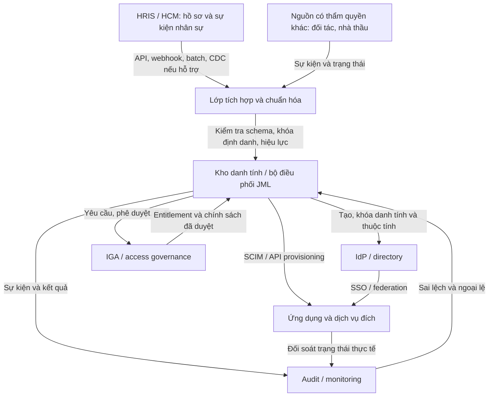
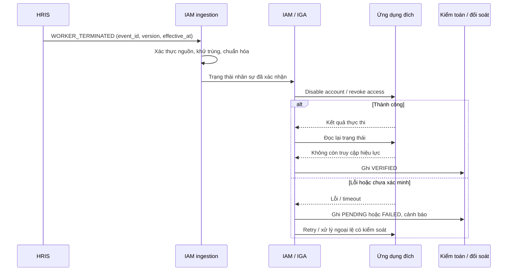

# HR system trong nguồn dữ liệu nhân sự của IAM

## 1. HR system là gì và vì sao IAM cần đến nó?

**HR system (hệ thống nhân sự)** là hệ thống phục vụ quản lý dữ liệu và quy trình liên quan đến người lao động: tuyển dụng, hồ sơ nhân sự, quan hệ lao động, cơ cấu tổ chức, thay đổi vị trí, tạm nghỉ, nghỉ việc hoặc kết thúc hợp đồng. Trong nhiều tổ chức, **Human Resources Information System (HRIS)** hoặc **Human Capital Management (HCM)** là một nguồn dữ liệu có thẩm quyền (*authoritative source*) đối với những sự kiện nhân sự này.

Trong **Identity and Access Management (IAM)**, hệ thống nhân sự giúp xác định **ai có quan hệ hợp lệ với tổ chức, quan hệ đó bắt đầu hoặc thay đổi khi nào, và khi nào kết thúc**. Đây là đầu vào quan trọng của vòng đời danh tính **Joiner–Mover–Leaver (JML)**:

- **Joiner:** nhân sự được tuyển dụng hoặc hợp đồng bắt đầu hiệu lực, kích hoạt tạo danh tính, chuẩn bị tài khoản và cấp quyền ban đầu phù hợp.
- **Mover:** nhân sự thay đổi phòng ban, vai trò, người quản lý, địa điểm, loại hợp đồng hoặc phạm vi công việc, kích hoạt đánh giá và cập nhật quyền.
- **Leaver:** quan hệ làm việc kết thúc, kích hoạt vô hiệu hóa truy cập và thu hồi những quyền không còn hợp lệ.

**HR system không phải IdP.** HRIS chủ yếu cung cấp dữ kiện về quan hệ nhân sự; **Identity Provider (IdP)** quản lý xác thực, trạng thái đăng nhập và các chính sách truy cập liên quan. **SSO** cho phép người dùng truy cập nhiều ứng dụng thông qua cơ chế đăng nhập liên kết; **SCIM** hoặc API provisioning có thể đồng bộ tài khoản và nhóm tới hệ thống đích. Các cơ chế này phối hợp với nhau nhưng giải quyết các trách nhiệm khác nhau.

Ví dụ: phòng nhân sự ghi nhận ngày nghỉ chính thức của một nhân viên. Bản ghi này **chưa tự động khiến** phiên đăng nhập của người ấy bị thu hồi. IAM phải tiếp nhận sự kiện, áp dụng chính sách theo thời điểm hiệu lực, khóa danh tính ở IdP, xử lý các phiên/token và thu hồi quyền tại các hệ thống đích, rồi đối soát kết quả.

## 2. Phân biệt HRIS, IdP, danh bạ và IGA

| Hệ thống | Dữ liệu hoặc chức năng chủ yếu | Vai trò đối với vòng đời danh tính |
|---|---|---|
| **HRIS/HCM** | Hồ sơ nhân sự, mã lao động, trạng thái làm việc, tổ chức, người quản lý, thời điểm hiệu lực | Nguồn kích hoạt nhiều sự kiện Joiner–Mover–Leaver |
| **ATS — Applicant Tracking System** | Ứng viên, tuyển dụng và quy trình nhận việc | Có thể tạo tín hiệu chuẩn bị tài khoản trước khi HRIS xác nhận nhân viên chính thức |
| **Danh bạ / identity directory** | Định danh kỹ thuật, tên đăng nhập, nhóm, thuộc tính của tài khoản | Lưu và cung cấp thông tin danh tính để các hệ thống sử dụng |
| **IdP** | Xác thực, MFA, đăng nhập liên kết, chính sách phiên | Kiểm soát khả năng đăng nhập của danh tính |
| **IGA — Identity Governance and Administration** | Quy trình cấp quyền, phê duyệt, vai trò, access review, chứng cứ | Điều phối quyền truy cập và quản trị vòng đời |
| **SCIM / provisioning connector** | Tạo, cập nhật, vô hiệu hóa tài khoản và nhóm theo khả năng hệ thống đích | Thi hành một phần thay đổi vòng đời ở ứng dụng |
| **Ứng dụng nghiệp vụ** | Tài nguyên, dữ liệu, phiên cục bộ, vai trò hoặc quyền nội bộ | Thực thi quyền truy cập thực tế |

Cần phân biệt **nguồn dữ liệu có thẩm quyền theo thuộc tính** với khái niệm “một cơ sở dữ liệu duy nhất đúng cho tất cả”. HRIS có thể là nguồn chuẩn về **trạng thái làm việc** nhưng không phải nơi quyết định liệu một người có được xem tài liệu mật, phê duyệt giao dịch hay sử dụng API sản xuất.

Quyền nhạy cảm thường còn phụ thuộc vào chủ sở hữu dữ liệu, chính sách bảo mật, yêu cầu phê duyệt và quy tắc **RBAC/ABAC**. Dữ liệu HR là đầu vào cho quyết định, **không thay thế** toàn bộ quyết định phân quyền.

## 3. Kiến trúc tích hợp HR system với IAM

Một thiết kế điển hình tách hệ thống nhân sự, lớp đồng bộ dữ liệu, bộ điều phối vòng đời và hệ thống thực thi quyền.



Các bước xử lý có thể gồm:

1. **Tiếp nhận:** đọc bản ghi HRIS hoặc nhận sự kiện thay đổi. Nguồn phải được xác thực và đường truyền được bảo vệ.
2. **Chuẩn hóa:** ánh xạ các trường nghiệp vụ của HRIS sang mô hình danh tính dùng chung; xác định nguồn, loại quan hệ, phiên bản và thời điểm hiệu lực.
3. **Nhận diện:** ánh xạ sự kiện với đúng danh tính IAM bằng khóa bền vững; phát hiện trùng lặp, dữ liệu thiếu hoặc mâu thuẫn.
4. **Đánh giá chính sách:** xác định tạo, cập nhật, tạm khóa hay chấm dứt danh tính; tính các quyền cần cấp và cần thu hồi.
5. **Thi hành:** cập nhật IdP, nhóm và ứng dụng đích; yêu cầu phê duyệt trước khi cấp quyền nhạy cảm.
6. **Đối soát:** kiểm tra trạng thái thực tế, ghi nhận lỗi, retry theo chính sách và tạo yêu cầu xử lý ngoại lệ nếu cần.

**Một sự kiện “đã xử lý” không đồng nghĩa một thay đổi quyền “đã hoàn tất”.** Chỉ khi hệ thống đích xác nhận hoặc quy trình đối soát kiểm chứng được trạng thái mong muốn thì IAM mới có đủ căn cứ đánh dấu kết quả hoàn tất.

## 4. Dữ liệu nhân sự nào cần cho IAM?

IAM chỉ nên lấy **những trường cần thiết** cho xác định danh tính, áp dụng chính sách và quản lý quyền. Không nên đồng bộ mọi dữ liệu HR chỉ vì hệ thống có thể truy cập.

| Trường logic | Ví dụ minh họa | Tác dụng trong IAM | Lưu ý |
|---|---|---|---|
| `person_id` hoặc `worker_id` | `W-10284` | Khóa định danh bền vững xuyên suốt vòng đời | Không dùng tên hoặc email làm khóa duy nhất |
| `employment_id` / `assignment_id` | `A-891` | Phân biệt nhiều hợp đồng hoặc vị trí của cùng một người | Một cá nhân có thể có nhiều quan hệ làm việc |
| `worker_type` | `EMPLOYEE`, `CONTRACTOR` | Chọn chính sách dành cho nhân viên hoặc đối tác | Có thể cần nguồn ngoài HRIS cho nhà thầu |
| `employment_status` | `PRE_HIRE`, `ACTIVE`, `TERMINATED` | Phát hiện các trạng thái quan hệ làm việc | Phải hiểu đúng ý nghĩa mã trạng thái của hệ nguồn |
| `effective_from`, `effective_to` | Thời điểm UTC hoặc ngày theo múi giờ chính sách | Xác định khi nào cần thay đổi quyền | Phân biệt thời điểm ghi nhận và thời điểm hiệu lực |
| `department_id`, `org_unit_id` | `FIN-02` | Ánh xạ nhóm và quyền nền | Mã ổn định tốt hơn tên phòng ban hiển thị |
| `job_code` / `position_id` | `FIN-ANALYST` | Đầu vào xác định vai trò nghiệp vụ | Chức danh không tự động đủ để cấp đặc quyền |
| `manager_worker_id` | `W-10007` | Tìm người quản lý để xác nhận, phê duyệt | Kiểm tra quản lý còn hiệu lực và tránh vòng quan hệ |
| `cost_center` / `location_id` | `CC-42`, `HCM-01` | Thuộc tính phục vụ ABAC khi có chính sách | Không suy diễn quyền nhạy cảm chỉ từ một trường |
| `source_system`, `record_version` | `HRIS-A`, `126` | Truy vết nguồn và chống xử lý sự kiện cũ | Cần quy tắc phiên bản theo từng định danh |
| `event_type`, `event_id` | `WORKER_TRANSFERRED` | Xác định loại thay đổi và chống xử lý lặp | Event ID không thay thế kiểm tra trạng thái cuối |

Dữ liệu như lương, bệnh án, số giấy tờ cá nhân, thông tin gia đình hoặc địa chỉ nhà thường **không cần** cho workflow cấp tài khoản thông thường. Nếu phải sử dụng cho trường hợp đặc biệt, cần mục đích rõ ràng, căn cứ xử lý, giới hạn truy cập và thời hạn lưu giữ phù hợp.

### 4.1. Khóa danh tính và hợp đồng có thể thay đổi

Một người có thể thay đổi họ tên, email, phòng ban hoặc được tuyển dụng lại. Vì vậy, **ID nhân sự bền vững** phải được phân biệt với **username** và **email hiển thị**. Tuy nhiên, không phải HRIS nào cũng bảo đảm `worker_id` được giữ nguyên khi tuyển lại hoặc khi hợp nhất pháp nhân. IAM cần xác minh điều này qua hợp đồng dữ liệu và có quy trình xử lý định danh trùng hoặc tái sử dụng.

Với tổ chức hỗ trợ đồng thời nhiều hợp đồng, mô hình dữ liệu nên tách:

- **Person:** chủ thể con người có định danh chung khi có bằng chứng hợp lệ.
- **Employment/engagement:** từng quan hệ làm việc hoặc hợp tác, kèm ngày bắt đầu và kết thúc.
- **Assignment:** vị trí, dự án, tổ chức hoặc phạm vi trách nhiệm theo từng giai đoạn.
- **Digital identity/account:** tài khoản kỹ thuật được IAM quản lý trong IdP và ứng dụng.

Ví dụ người lao động có hai assignment đang hiệu lực: nếu một assignment kết thúc nhưng assignment còn lại vẫn hợp lệ, quy trình có thể chỉ thu hồi quyền của assignment đã kết thúc; không tự động xóa toàn bộ danh tính. Quyết định phải theo chính sách tổ chức và dữ liệu quan hệ làm việc thực tế.

### 4.2. Data contract giữa HR và IAM

Hai nhóm vận hành cần thống nhất một **hợp đồng dữ liệu** quy định rõ:

- Trường nào bắt buộc, kiểu dữ liệu, giá trị cho phép và hệ thống có thẩm quyền.
- Khóa đối soát và quy tắc nhận diện một người có nhiều hợp đồng hoặc được tuyển lại.
- Sự kiện nào có nghĩa là **gia nhập**, **đổi vai trò**, **đình chỉ**, **tạm nghỉ**, **kết thúc**.
- **Thời điểm hiệu lực** của sự kiện, múi giờ, chính sách cập nhật sớm và thay đổi hồi tố.
- Tần suất truyền, thời gian trễ cho phép, khả năng khôi phục sự kiện mất và SLA xử lý lỗi.
- Cách gửi cập nhật sửa sai, hủy quyết định nghỉ việc hoặc thay đổi lịch nghỉ.
- Quyền truy cập vào dữ liệu HR và các bằng chứng lưu lại trong IAM.

Nếu cùng trường `status=INACTIVE` có thể mang nghĩa “tạm nghỉ” hoặc “đã chấm dứt hợp đồng” tùy HRIS, IAM **không được suy đoán**. Phải chuẩn hóa ý nghĩa trước khi kích hoạt hành động thu hồi phù hợp.

## 5. Các cách nhận dữ liệu từ HR system

Tùy sản phẩm và yêu cầu vận hành, HRIS có thể cung cấp các cơ chế tích hợp khác nhau:

| Cơ chế | Đặc điểm | Điều cần thiết kế |
|---|---|---|
| **API polling** | IAM định kỳ gọi API HRIS lấy thay đổi | Giới hạn tần suất, phân trang, checkpoint, phân quyền API |
| **Webhook / event** | HRIS gửi thông báo khi dữ liệu thay đổi | Xác thực nguồn, chống phát lại, retry, giao hàng lặp |
| **Batch / file export** | HRIS xuất danh sách theo lịch để IAM nhập | Bảo vệ tệp, mã hóa, kiểm tra tính đầy đủ và chậm trễ |
| **Change Data Capture (CDC)** | Nhận thay đổi từ luồng dữ liệu nếu nền tảng cho phép | Tính nhất quán, quyền truy cập và hợp đồng schema |
| **Kết hợp event + reconciliation** | Sự kiện xử lý nhanh, quét trạng thái định kỳ để phát hiện lệch | Cân bằng tốc độ và khả năng phục hồi khi sự kiện thất lạc |

Không có cơ chế nào bảo đảm tuyệt đối “exactly once” trong mọi tầng mạng và hệ thống đích. Thực tế thường cần **xử lý lặp an toàn (idempotency)**, có thể retry, phát hiện sự kiện cũ, đối soát trạng thái và cơ chế phục hồi lỗi.

Ví dụ sự kiện HR **minh họa**, chỉ chứa các trường IAM cần dùng:

```json
{
  "event_id": "hr-event-000245",
  "event_type": "WORKER_TRANSFERRED",
  "source_system": "hris-primary",
  "record_version": 127,
  "occurred_at": "2026-11-20T08:30:00Z",
  "effective_at": "2026-12-01T00:00:00+07:00",
  "subject": {
    "worker_id": "W-10284",
    "employment_id": "EMP-8841",
    "worker_type": "EMPLOYEE",
    "employment_status": "ACTIVE",
    "department_id": "FIN-02",
    "job_code": "FIN-ANALYST",
    "manager_worker_id": "W-10007"
  }
}
```

Trong ví dụ, **`occurred_at`** là lúc hệ thống ghi nhận sự kiện; **`effective_at`** là lúc thay đổi vai trò có hiệu lực. IAM phải dùng mốc hiệu lực theo chính sách để tránh cấp quyền mới quá sớm hoặc thu hồi quyền cũ sai thời điểm.

Nếu webhook chỉ thông báo “đối tượng đã thay đổi” mà không có đủ dữ liệu, IAM có thể dùng khóa do webhook cung cấp để gọi **API HRIS có thẩm quyền**, lấy snapshot mới rồi tính lại trạng thái mong muốn.

## 6. Joiner: từ hồ sơ nhân sự đến tài khoản hợp lệ

Khi nhân viên sắp bắt đầu làm việc, HRIS có thể phát hành bản ghi tuyển dụng hoặc sự kiện `HIRED` / `ONBOARDING_APPROVED`. Một quy trình Joiner nên:

1. **Xác minh điều kiện:** hợp đồng đã được chấp thuận, ngày bắt đầu và loại quan hệ rõ ràng; đảm bảo bản ghi chưa bị hủy hoặc chưa có danh tính trùng.
2. **Tạo hoặc liên kết danh tính:** ánh xạ person/worker ID sang identity ID ổn định trong IAM. Nếu tồn tại hồ sơ cũ, xử lý theo quy tắc tái tuyển hoặc thay đổi hợp đồng.
3. **Chuẩn bị tài khoản:** tạo tài khoản IdP, áp dụng MFA, chính sách thiết bị và thông tin người quản lý; có thể đặt trạng thái chưa được đăng nhập trong giai đoạn chuẩn bị.
4. **Tính quyền nền:** dùng vai trò, phòng ban, địa điểm và hợp đồng để tính tập quyền ban đầu theo RBAC hoặc thuộc tính ABAC.
5. **Phê duyệt quyền đặc biệt:** quyền truy cập tài chính nhạy cảm, quản trị hệ thống hoặc dữ liệu bí mật phải có quy trình chủ sở hữu tài nguyên.
6. **Kích hoạt đúng thời điểm:** cấp quyền khi quan hệ và các điều kiện bắt đầu có hiệu lực; không mặc nhiên cấp mọi quyền ngay khi HR mở hồ sơ.
7. **Đối soát:** xác nhận trạng thái tài khoản, nhóm và quyền tại ứng dụng, ghi lỗi và ngoại lệ còn tồn tại.

Một quyết định quan trọng là **pre-provisioning**: tạo sẵn tài khoản trước ngày nhận việc để chuẩn bị thiết bị và ứng dụng, nhưng vẫn chặn truy cập cho đến thời điểm hợp lệ. Thời điểm cấp quyền phải phụ thuộc chính sách, không tự giả định ngày nhập bản ghi HR là ngày làm việc.

**Ví dụ:** HRIS ghi nhận nhân viên B bắt đầu ngày 01/12. IAM có thể tạo tài khoản ngày 28/11 ở trạng thái chưa kích hoạt, gán các cấu hình ban đầu, và chỉ cho đăng nhập đúng lịch. Nếu HR hủy tuyển trước ngày bắt đầu, workflow phải hủy hoặc khóa tài khoản đã chuẩn bị và dọn các quyền đã gán.

## 7. Mover: cập nhật tổ chức, quản lý và quyền đang có

Mover không chỉ là “đổi chức danh”. Các sự kiện HR có thể làm thay đổi nhu cầu quyền:

- Chuyển phòng ban, thay đổi đơn vị quản lý hoặc chuyển dự án.
- Nhận vai trò mới, thay đổi trách nhiệm hoặc thăng chức.
- Chuyển địa điểm, loại hợp đồng hoặc pháp nhân.
- Đổi người quản lý, kéo theo luồng phê duyệt và chủ sở hữu quyền.
- Tạm biệt phái sang một đơn vị khác rồi quay về.

IAM phải tính **tập quyền mong muốn** từ trạng thái mới và so sánh với quyền hiệu lực hiện tại:

```text
desired = base_access(new_role, new_org, current_policy)
          + valid_approved_exceptions

grant   = desired - actual_effective_access
revoke  = actual_effective_access - desired

for entitlement in grant:
    require_approval_if_sensitive(entitlement)
    provision(entitlement)

for entitlement in revoke:
    deprovision(entitlement)

reconcile_with_target_systems()
```

Đây là **mã giả**. Quyền hiệu lực có thể đến từ nhóm IdP, role nội bộ, quyền gán trực tiếp, ABAC, tài khoản đặc quyền hoặc credential độc lập. Muốn phát hiện quyền tồn dư phải đối chiếu đủ các nguồn quyền liên quan.

**Ví dụ chuyển vai trò:** nhân viên từ nhóm Kinh doanh chuyển sang Tài chính. HRIS cập nhật `department_id` và `job_code` có thời điểm hiệu lực. IAM thu hồi nhóm bán hàng, đánh giá quyền báo cáo tài chính mới và kiểm tra việc phân tách nhiệm vụ (*Separation of Duties — SoD*). Nếu nhân viên cần truy cập cả hai nhóm để bàn giao, quyền chồng lấn phải được phê duyệt có hạn và tự động hết hiệu lực.

**Chỉ thêm nhóm mới mà không thu hồi nhóm cũ** là lỗi thường gặp dẫn đến tích lũy quyền qua nhiều lần luân chuyển.

## 8. Leaver: nguồn chấm dứt quan hệ và thu hồi truy cập

Sự kiện nghỉ việc có tác động bảo mật lớn, nên cần nguồn được phép phát hành sự kiện, thời điểm hiệu lực, phân loại nghỉ việc và SLA xử lý rõ ràng.

Quy trình điển hình:

1. **Xác nhận sự kiện Leaver:** nhận `termination_date` / `effective_at` và tình trạng chính thức; xử lý trường hợp hủy hoặc điều chỉnh quyết định.
2. **Áp dụng đúng thời điểm:** với các trường hợp cần chấm dứt truy cập khẩn cấp, chính sách an ninh có thể yêu cầu khóa ngay khi nhận sự kiện có thẩm quyền; không đợi batch kế tiếp.
3. **Khóa đường đăng nhập:** disable tài khoản tại IdP, xử lý SSO, VPN và các phương thức đăng nhập liên quan.
4. **Thu hồi các phiên và credential:** hủy phiên khi hệ thống hỗ trợ, xử lý refresh/access token còn sống, API key, SSH key, chứng thư và tài khoản local.
5. **Thu hồi entitlement:** xóa nhóm, role và quyền trực tiếp; deprovision ở SaaS qua SCIM/API khi hỗ trợ.
6. **Chuyển giao tài nguyên:** xử lý dữ liệu, tác vụ, quyền sở hữu dự án, lịch và mailbox theo chính sách công ty.
7. **Xác minh:** đối soát tài khoản và quyền tại từng đích; ghi nhận tác vụ lỗi để xử lý thủ công.
8. **Lưu giữ và xóa theo chính sách:** không đồng nhất việc khóa ngay với xóa hoàn toàn bản ghi, vì có thể còn yêu cầu lưu giữ hồ sơ và dấu vết kiểm toán.

| Tầng | Tình huống quyền tồn dư | Kiểm soát |
|---|---|---|
| IdP | Tài khoản chưa được disable do thiếu sự kiện | Đồng bộ JML nhanh, retry và cảnh báo lỗi |
| SSO / ứng dụng | Phiên cookie vẫn còn sau khi IdP khóa đăng nhập | Thu hồi phiên, timeout và kiểm tra ứng dụng đích |
| SCIM / provisioning | Connector báo lỗi hoặc ứng dụng không hỗ trợ | Đối soát và quy trình manual deprovision |
| API / công cụ kỹ thuật | Personal access token, SSH key hoặc credential riêng còn hoạt động | Kiểm kê, thu hồi/luân chuyển credential |
| Quyền nội bộ | Nhóm đã gỡ nhưng role gán trực tiếp chưa thu hồi | So sánh quyền hiệu lực tại từng ứng dụng |

**HRIS xác nhận kết thúc quan hệ lao động là điều kiện kích hoạt, chưa phải bằng chứng truy cập đã bị chấm dứt.** Bằng chứng cuối cùng phải đến từ quy trình thực thi và kiểm tra thực tế.

## 9. Những sự kiện ngoài ba nhóm JML cơ bản

Không phải thay đổi nào của HRIS cũng quy về “thêm, chuyển, nghỉ” đơn giản.

### 9.1. Nghỉ phép dài hạn hoặc tạm đình chỉ

Một người có thể còn quan hệ làm việc nhưng phải hạn chế truy cập trong thời gian nghỉ dài hạn hoặc đình chỉ. Phải phân biệt **`SUSPENDED`**, **`ON_LEAVE`** với **`TERMINATED`** bằng ngữ nghĩa được HR và an ninh thống nhất. Tái kích hoạt phải kiểm tra trạng thái mới, các chính sách và phê duyệt cần thiết.

### 9.2. Tái tuyển dụng (rehire)

Người cũ có thể quay lại với một hợp đồng mới. IAM cần xác minh có đúng là cùng con người, có được tái sử dụng identity ID hay không và **không tự khôi phục các quyền cũ** vốn đã hết nhu cầu. Mặc định tính quyền cho vai trò hiện tại; chỉ giữ thông tin liên kết/kiểm toán theo chính sách.

### 9.3. Thay đổi hiệu lực hồi tố

HR có thể sửa một sự kiện sau ngày hiệu lực (ví dụ chuyển phòng ban từ đầu tháng trước). IAM cần tính trạng thái hiện hành từ snapshot hoặc các sự kiện hợp lệ, tránh diễn giải sai theo thứ tự nhận thông điệp. Những ảnh hưởng đến quyền đã tồn tại trong khoảng thời gian trước đó cần được ghi nhận để rà soát.

### 9.4. Nhân sự nhiều hợp đồng hoặc nhiều đơn vị

Một cá nhân có thể giữ nhiều vị trí, hợp đồng hoặc vai trò đồng thời. Việc đóng một bản ghi hợp đồng không nhất thiết đồng nghĩa danh tính không còn hợp lệ. IAM cần chính sách xác định **khi nào tất cả quan hệ có thẩm quyền đã chấm dứt** và quyền nào gắn với từng quan hệ.

### 9.5. Nhà thầu không do HRIS quản lý

Một số tổ chức quản lý contractor qua **Vendor Management System (VMS)** hoặc hệ thống quản lý đối tác. Nếu HRIS không bao phủ nhóm này, IAM cần thêm nguồn có thẩm quyền, người bảo trợ nội bộ và ngày hết hạn. Không được coi “không có trong HRIS” là bằng chứng duy nhất để xóa một tài khoản khi nguồn sở hữu thuộc hệ thống khác.

## 10. Độ tin cậy của dữ liệu: thứ tự, trùng lặp và thời điểm

Hệ thống tích hợp thường gặp dữ liệu thiếu, trễ, lặp hoặc đến sai thứ tự. Vì thế IAM cần thiết kế quy trình an toàn trước các tình huống này.

### 10.1. Xử lý idempotent và sự kiện cũ

Ví dụ HRIS gửi hai lần `event_id=hr-event-000245`. Xử lý lần hai không được tạo thêm tài khoản mới hoặc cấp trùng entitlement. Nên lưu khóa sự kiện đã xử lý và theo dõi phiên bản dữ liệu nhân sự theo từng đối tượng.

Nếu phiên bản 127 đã áp dụng, nhưng thông điệp phiên bản 126 đến muộn, IAM không nên ghi đè trạng thái hiện hành bằng thông tin cũ. **Không chỉ so sánh timestamp một cách mù quáng** vì nhiều nguồn hoặc nhiều đối tượng có thể có cách phát hành thời gian khác nhau.

### 10.2. Thời gian và hiệu lực

Phân biệt rõ:

- **Event occurred at:** lúc hành động thay đổi được ghi nhận ở nguồn.
- **Event received at:** lúc IAM nhận được thông điệp.
- **Effective at:** lúc quan hệ hoặc vị trí thực sự có hiệu lực theo chính sách.
- **Provisioned at / revoked at:** lúc hệ thống đích thực thi.
- **Verified at:** lúc kết quả được kiểm tra thành công.

Mỗi loại mốc thời gian có mục đích khác nhau. Ghi nhận bằng UTC hoặc mốc thời gian có offset và áp dụng quy tắc lịch địa phương nhất quán khi cần.

### 10.3. Retry, queue lỗi và reconciliation

Khi API đích không khả dụng, workflow cần retry với backoff, quản lý giới hạn gọi và tránh tạo trạng thái không nhất quán. Sau số lần lỗi được quy định, gửi vào hàng đợi lỗi hoặc tác vụ xử lý thủ công có người chịu trách nhiệm. Riêng **Leaver và quyền nhạy cảm** cần ưu tiên xử lý theo mức độ rủi ro.

**Reconciliation** kiểm tra trạng thái đang có ở HRIS, IAM, IdP và ứng dụng, không chỉ tin kết quả của từng webhook. Ví dụ, bản ghi HR đã `TERMINATED` mà ứng dụng vẫn `ACTIVE` phải trở thành sai lệch cần xử lý.



## 11. Chất lượng dữ liệu và kiểm soát vận hành

Một HRIS đúng vai trò nghiệp vụ nhưng dữ liệu không chính xác hoặc cập nhật quá muộn vẫn có thể khiến IAM cấp sai quyền. Nên theo dõi những chỉ số sau:

| Chỉ số | Câu hỏi kiểm soát | Hành động khi bất thường |
|---|---|---|
| **Độ đầy đủ trường bắt buộc** | Có thiếu worker ID, status, effective date, người quản lý? | Chặn hoặc chuyển xét duyệt sự kiện không đủ điều kiện |
| **Tỷ lệ trùng danh tính** | Một người có nhiều bản ghi không liên kết hoặc nhiều người dùng chung ID? | Điều tra đối soát và sửa nguồn dữ liệu |
| **Độ trễ sự kiện JML** | Mất bao lâu từ hiệu lực tại HR đến khi IAM nhận? | Xác định nghẽn tích hợp, tăng cảnh báo sự kiện rủi ro |
| **Độ trễ thu hồi** | Mất bao lâu từ Leaver đến khi mọi đích được xác minh? | Ưu tiên quyền đặc biệt nhạy cảm, xử lý mục tiêu chậm |
| **Tỷ lệ provisioning xác minh thành công** | Bao nhiêu thay đổi đã được chứng thực tại đích? | Sửa connector, retry hoặc kiểm tra thủ công |
| **Tài khoản mồ côi** | Có local account không gắn danh tính hoặc hợp đồng hợp lệ? | Xác minh owner và thu hồi nếu không còn căn cứ |
| **Quyền tồn dư** | Actual entitlement có vượt quá tập quyền mong muốn? | Thu hồi, yêu cầu phê duyệt ngoại lệ hoặc sửa policy |
| **Số hồ sơ HR/IAM không khớp** | Có worker terminated mà IdP còn active? | Điều tra ngay theo mức độ rủi ro |

Tần suất review, SLA hoặc ngưỡng cảnh báo cần phù hợp quy mô, mức nhạy cảm và chính sách của tổ chức. Không có một SLA cố định phù hợp tất cả hệ thống và loại quan hệ.

## 12. Quyền riêng tư và an toàn dữ liệu nhân sự

Dữ liệu HR thường nhạy cảm và có thể được bảo vệ bởi các yêu cầu pháp lý hoặc nội bộ. Hệ thống tích hợp IAM cần tuân thủ **nguyên tắc tối thiểu dữ liệu (data minimization)**:

1. **Chỉ lấy thuộc tính IAM thực sự cần:** sử dụng ID bền vững, trạng thái, vị trí, vai trò và mốc hiệu lực thay vì sao chép toàn bộ hồ sơ nhân sự.
2. **Giới hạn tài khoản tích hợp:** tài khoản đọc HRIS chỉ được đọc tập dữ liệu được duyệt; credential được bảo vệ và luân chuyển.
3. **Bảo vệ đường truyền và lưu trữ:** dùng TLS và các biện pháp mã hóa/kiểm soát truy cập phù hợp.
4. **Không đưa dữ liệu nhạy cảm vào log:** nhật ký nên ghi event ID, mã định danh kỹ thuật, trạng thái xử lý và lỗi cần thiết; tránh ghi hồ sơ hoàn chỉnh hay bí mật xác thực.
5. **Phân quyền truy cập audit:** không phải mọi nhân viên hỗ trợ kỹ thuật đều cần đọc thông tin HR hoặc lịch sử thay đổi của người lao động.
6. **Lưu giữ và xóa phù hợp:** xây dựng lịch lưu giữ dữ liệu và bằng chứng kiểm toán theo quy định áp dụng và nhu cầu nghiệp vụ.
7. **Giám sát nguồn và phiên bản:** phát hiện thay đổi mapping, quyền API tích hợp và schema HRIS bất thường.

Nếu nhóm vận hành IAM cần kiểm tra một sự kiện thất bại, nên ưu tiên **ID sự kiện, mã lỗi, trạng thái trước/sau và trace ID** thay vì sao chép PII từ payload HRIS.

## 13. Liên hệ giữa HR system và tài khoản dịch vụ

**Tài khoản dịch vụ, workload identity, bot, CI/CD runner** không có quan hệ lao động theo nghĩa HR, nên không được quản lý bằng cách cố gán `employment_status` cho từng máy.

Tuy vậy HRIS có thể liên quan **gián tiếp**: một service account có chủ sở hữu là nhân viên. Khi người sở hữu chuyển vai trò hoặc nghỉ việc, IAM cần xác định các service account và credential mà người ấy chịu trách nhiệm rồi thực hiện quy trình **đổi chủ sở hữu, rà soát quyền, luân chuyển bí mật** khi cần.

Ví dụ service account `finance-report-exporter` có owner là nhân viên đội Tài chính. Khi người đó rời công ty, workload vẫn có thể cần hoạt động. Do vậy giải pháp đúng thường là **chuyển ownership được duyệt và rà soát quyền**, không mặc nhiên xóa workload đang phục vụ nghiệp vụ quan trọng.

Đối với danh tính máy, nguồn có thẩm quyền có thể là **service catalog, CMDB, nền tảng workload hoặc hệ thống cấp danh tính máy**. Mỗi loại danh tính nên có nguồn sự thật và quy trình vòng đời riêng, liên kết với HRIS khi có trách nhiệm người sở hữu.

## 14. Tình huống thực tế: một nhân viên chuyển phòng ban rồi nghỉ việc

Giả sử nhân viên **Minh** đang làm việc tại bộ phận Kinh doanh. Dữ liệu HRIS ghi:

- `worker_id = W-4102`, trạng thái `ACTIVE`.
- `department_id = SALES`, `job_code = SALES-ANALYST`.
- `manager_worker_id = W-3001`.

IAM dùng dữ liệu này để tạo danh tính tại IdP, gán nhóm truy cập cổng nhân viên và quyền đọc báo cáo kinh doanh. Quyền xem danh sách khách hàng nhạy cảm phải có phê duyệt chủ sở hữu dữ liệu.

### Giai đoạn 1: Mover

HRIS ghi nhận Minh chuyển sang Tài chính từ ngày 01/12. IAM nhận sự kiện trước ngày hiệu lực, lập kế hoạch:

| Quyền | Khi còn ở Kinh doanh | Sau khi chuyển sang Tài chính | Tác vụ |
|---|---|---|---|
| Đăng nhập cổng nội bộ | Có | Có | Giữ quyền nền |
| Đọc báo cáo bán hàng | Có | Không còn nhu cầu | Thu hồi khi đổi vai trò có hiệu lực |
| Đọc báo cáo tài chính | Chưa có | Được phép khi duyệt | Cấp sau phê duyệt |
| Xuất dữ liệu khách hàng | Ngoại lệ có hạn | Không | Thu hồi quyền và credential liên quan |

IAM đồng thời kiểm tra **SoD** để tránh tổ hợp quyền xung đột trong giai đoạn chuyển tiếp. Sau thao tác, IAM đối soát quyền thực tế ở các ứng dụng, đặc biệt các quyền gán trực tiếp ngoài nhóm IdP.

### Giai đoạn 2: Leaver

Đầu tháng sau, HRIS nhận quyết định nghỉ việc có hiệu lực từ ngày nhất định. IAM tính toán thời điểm khóa theo chính sách, sau đó:

- Vô hiệu hóa danh tính và đường đăng nhập tại IdP.
- Thu hồi nhóm/role và các quyền truy cập nội bộ.
- Thu hồi phiên, token, API key hoặc credential khác theo khả năng kiểm soát.
- Kiểm tra ứng dụng dùng SCIM và cả ứng dụng có tài khoản local.
- Chuyển giao chủ sở hữu service account nếu Minh đang là owner.
- Lưu bằng chứng và cảnh báo nếu có đích vẫn báo tài khoản đang active.

Trường hợp này cho thấy **HRIS chịu trách nhiệm cung cấp dữ kiện về quan hệ lao động**, còn **IAM chịu trách nhiệm biến dữ kiện đó thành trạng thái truy cập hợp lệ**. Quyền tồn dư chỉ được phát hiện khi có đối soát trạng thái thực tế.

## 15. Những lỗi triển khai thường gặp

| Lỗi | Tác động | Cách khắc phục |
|---|---|---|
| Dùng email làm khóa đồng bộ chính | Thay email hoặc tái sử dụng email gây ghép nhầm tài khoản | Dùng khóa bền vững, quy tắc linking và kiểm tra trùng |
| Đồng nhất `created_at` với `effective_at` | Cấp quyền sớm hoặc thu hồi sai thời điểm | Thiết kế mốc thời gian rõ ràng |
| Chỉ xử lý Joiner và Leaver, bỏ Mover | Quyền cũ tích lũy khi đổi vai trò | Tính quyền mong muốn và thu hồi chênh lệch |
| Coi mọi trạng thái `INACTIVE` là nghỉ việc | Tạm nghỉ hoặc đình chỉ bị xử lý sai | Chuẩn hóa từ điển trạng thái giữa HR và IAM |
| Cấp role nhạy cảm trực tiếp từ `job_title` | Lạm quyền hoặc xung đột nhiệm vụ | RBAC/ABAC, phê duyệt và SoD |
| Chỉ dựa trên webhook | Mất sự kiện làm trạng thái lệch lâu dài | Đối soát định kỳ với nguồn và đích |
| Xử lý sự kiện lặp mà không idempotent | Tạo trùng tài khoản, cấp trùng tác vụ | Event ID, version, retry an toàn |
| Xem IdP disable là toàn bộ offboarding | Còn phiên, token và tài khoản ứng dụng | Thu hồi ở từng lớp và xác minh thực tế |
| Không quản lý contractor ngoài HRIS | Tài khoản không có owner hoặc hạn kết thúc | Bổ sung VMS/sponsor làm nguồn có thẩm quyền |
| Đồng bộ toàn bộ hồ sơ nhân sự | Tăng rủi ro riêng tư và bề mặt tấn công | Data minimization và phân quyền dữ liệu |

## 16. Nguyên tắc thiết kế cần ghi nhớ

Một tích hợp HR system–IAM hiệu quả cần trả lời được các câu hỏi: **Nguồn nào xác nhận người này đang có quan hệ hợp lệ? Thay đổi nào có hiệu lực khi nào? Danh tính kỹ thuật nào tương ứng? Quyền nào cần cấp hoặc thu hồi? Cách nào xác minh ứng dụng đã thực hiện?**

Các nguyên tắc chính:

1. **HRIS là nguồn sự kiện nhân sự có thẩm quyền theo phạm vi**, không phải nguồn quyết định mọi quyền truy cập.
2. **Tách danh tính con người, quan hệ lao động, assignment và tài khoản kỹ thuật** để xử lý chuyển vai trò, nhiều hợp đồng, tạm nghỉ và tái tuyển dụng.
3. **Sử dụng khóa ổn định và hợp đồng dữ liệu rõ ràng**, phân biệt thời điểm ghi nhận, tiếp nhận và hiệu lực.
4. **Gắn JML với cả cấp và thu hồi quyền:** Joiner thiết lập quyền đúng thời điểm; Mover giảm quyền cũ; Leaver chấm dứt mọi đường truy cập không còn hợp lệ.
5. **Điều phối qua IAM/IGA, IdP, SSO, SCIM và ứng dụng đích**, xác minh quyền hiệu lực thay vì chỉ xác nhận lệnh đã gửi.
6. **Bảo đảm vận hành chịu lỗi:** idempotency, retry, xử lý thứ tự, đối soát và cảnh báo theo mức độ rủi ro.
7. **Giảm lộ dữ liệu nhân sự:** thu thập tối thiểu, bảo vệ tích hợp, kiểm soát audit và lưu giữ có mục đích.
8. **Bao quát các nguồn ngoài HRIS:** contractor và service account cần nguồn sự thật, sponsor/owner và vòng đời tương ứng.

**Kết luận:** HR system là một điểm khởi phát quan trọng của quản lý vòng đời danh tính, nhưng **IAM chỉ thực sự giảm được quyền truy cập tồn dư khi sự kiện nhân sự được chuyển thành hành động cấp/đổi/thu hồi và được xác minh tại các hệ thống đích**.
