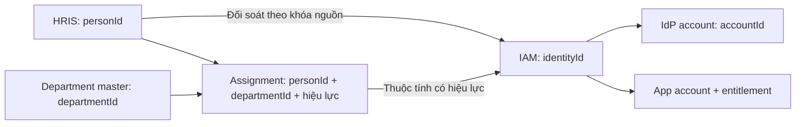
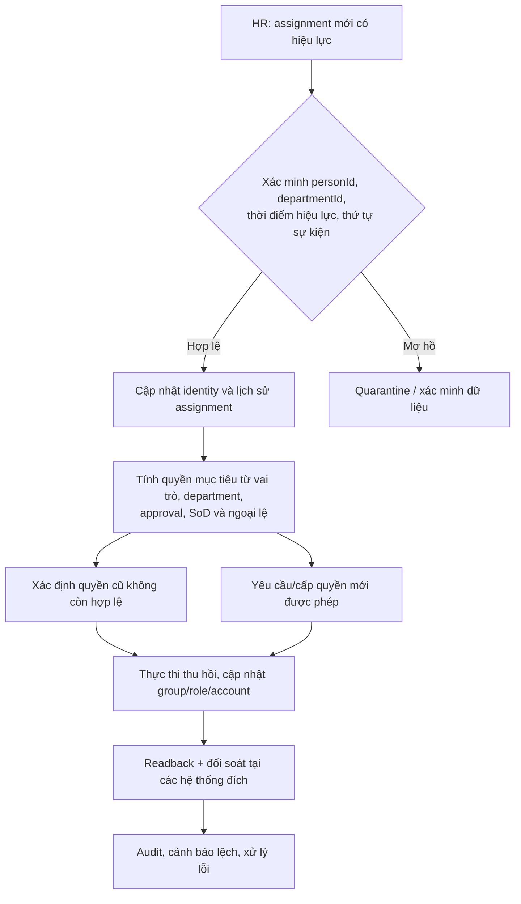
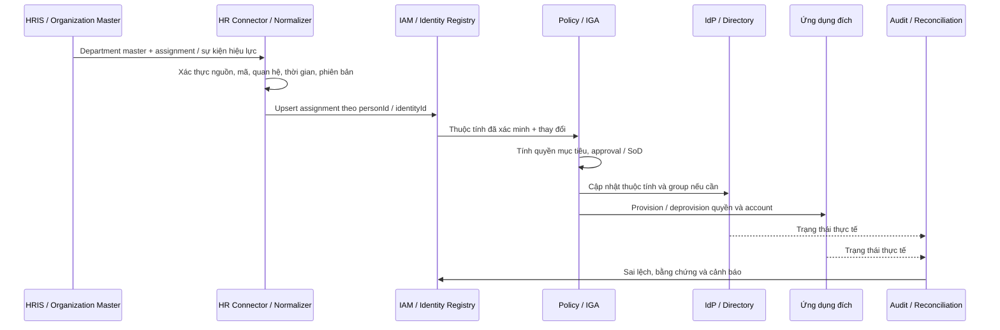

# Department – dữ liệu phòng ban trong vòng đời danh tính IAM

## Mục tiêu học tập

Sau bài này, người học có thể:

1. Giải thích **Department (phòng ban/đơn vị tổ chức)** là dữ liệu gì trong nguồn nhân sự và vì sao IAM cần dùng nó.
2. Phân biệt **mã phòng ban ổn định**, tên hiển thị, cấp cha trong cơ cấu tổ chức, cost center, team, legal entity và location.
3. Thiết kế ánh xạ dữ liệu Department từ **HRIS/nguồn tổ chức có thẩm quyền** vào identity, IdP, ứng dụng và chính sách quyền.
4. Mô tả tác động của Department ở từng giai đoạn **Joiner–Mover–Leaver (JML)**, đặc biệt khi nhân viên chuyển đơn vị.
5. Áp dụng Department vào **RBAC/ABAC** một cách có kiểm soát, tránh suy luận quyền chỉ từ tên phòng ban.
6. Nhận diện các vấn đề dữ liệu như đổi tên, sáp nhập, nhiều phòng ban đồng thời, sự kiện đến muộn, sai lệch giữa HR và IdP.
7. Thiết kế đối soát, kiểm toán và thu hồi quyền tồn dư sau khi Department thay đổi.

## 1. Department là gì và nằm ở đâu trong IAM?

Trong quản trị nguồn dữ liệu nhân sự, **Department** là thuộc tính hoặc một thực thể tham chiếu thể hiện đơn vị mà một người được phân công làm việc theo cơ cấu tổ chức. Ví dụ: Khối Công nghệ, Phòng Tài chính, Bộ phận Kế toán nội bộ hoặc Nhóm Vận hành.

Đối với **Identity and Access Management (IAM)**, Department là một **nguồn ngữ cảnh cho chính sách danh tính và truy cập**. Nó giúp xác định đơn vị chịu trách nhiệm, quy trình phê duyệt, các nhóm quyền thông thường và phạm vi được phép xử lý thông tin. Tuy nhiên, Department **không phải identity**, **không phải credential**, và **không tự cấp quyền** nếu chính sách truy cập chưa cho phép.

Ví dụ:

- HRIS ghi nhân viên Minh thuộc Department có mã `D-240`, tên hiển thị “Tài chính”.
- Hệ thống identity liên kết `personId` của Minh với `departmentId = D-240`.
- Chính sách IAM xác định Minh *có thể đủ điều kiện* được yêu cầu role `expense-reviewer` trong ứng dụng chi phí.
- Quyền thực tế chỉ xuất hiện sau khi đáp ứng các điều kiện bổ sung: trạng thái nhân sự đang hoạt động, nhiệm vụ công việc phù hợp, phê duyệt và kiểm tra xung đột nhiệm vụ.

Một giá trị `department = Finance` xuất hiện trên token hoặc trong IdP chưa chứng minh người dùng có quyền phê duyệt mọi hóa đơn.

### 1.1. Department khác những khái niệm tổ chức nào?

| Thuộc tính | Ý nghĩa chính | Ví dụ | Rủi ro nếu dùng thay Department |
|---|---|---|---|
| **Department** | Đơn vị tổ chức chịu trách nhiệm trực tiếp hoặc nơi nhân sự được phân công | `D-240`: Tài chính | Cần biết quy tắc xác định khi có nhiều phân công |
| **Business unit / Division** | Khối kinh doanh hoặc cấp tổ chức rộng hơn | Khối Dịch vụ doanh nghiệp | Có thể gom nhiều department với quyền khác nhau |
| **Team / Squad** | Nhóm thực thi công việc, có thể hoạt động theo dự án | Team Thu hồi công nợ | Thường thay đổi nhanh; không luôn trùng sơ đồ HR |
| **Cost center** | Mã trung tâm chi phí phục vụ hạch toán | `CC-7105` | Một cost center có thể bao phủ nhiều đơn vị |
| **Legal entity** | Pháp nhân/công ty sử dụng lao động | Công ty A Việt Nam | Không đủ xác định bộ phận và nhiệm vụ |
| **Location** | Vị trí, nơi làm việc hoặc đơn vị địa lý | TP.HCM | Người cùng địa điểm có quyền khác nhau |
| **Job title / Job code** | Chức danh/vai trò công việc | Chuyên viên kế toán | Cùng chức danh có thể ở các department khác nhau |
| **Manager / Reporting line** | Quan hệ quản lý nhân sự | `managerPersonId` | Không nhất thiết tương ứng department hoặc quyền truy cập |

Các thuật ngữ này có thể có quan hệ, nhưng **không nên gộp làm một trường dữ liệu**. Tổ chức có thể sử dụng tên “Department” cho đơn vị hành chính hoặc đơn vị chức năng tùy nghiệp vụ; IAM cần tiếp nhận định nghĩa được hệ thống nguồn công nhận.

### 1.2. Department là dữ liệu tham chiếu và là quan hệ nhân sự

Có hai loại dữ liệu cần phân biệt:

**Bản ghi danh mục phòng ban (department master):**

- Department có mã riêng, tên và trạng thái hoạt động.
- Có thể có `parentDepartmentId`, đơn vị cấp trên, hiệu lực, chủ sở hữu và lịch sử thay đổi.
- Có thể được HRIS hoặc hệ thống quản trị cơ cấu tổ chức duy trì.

**Quan hệ phân công một người vào phòng ban (person–department assignment):**

- Một `personId` được phân công vào một `departmentId`.
- Quan hệ có `effectiveFrom`, có thể có `effectiveTo`, loại phân công chính/phụ và nguồn xác nhận.
- Người đó có thể được chuyển qua department khác mà **identityId vẫn giữ nguyên**.

Việc tách hai loại dữ liệu giúp xử lý chính xác khi chỉ **đổi tên phòng ban** nhưng không có nhân viên nào thực sự chuyển đơn vị.

## 2. Ai là nguồn dữ liệu có thẩm quyền?

Trong doanh nghiệp, **HRIS (Human Resource Information System)** thường là nguồn có thẩm quyền cho việc một nhân viên đang được phân công vào department nào. Tuy nhiên, danh mục department có thể được quản lý bởi một hệ thống cấu trúc tổ chức khác như HR organization master hoặc ERP. Quyền sở hữu nguồn chuẩn phải xác định **theo từng thuộc tính**.

Ví dụ về phân công trách nhiệm:

| Dữ liệu | Nguồn có thẩm quyền thường gặp | Hệ thống sử dụng |
|---|---|---|
| `personId`, trạng thái hợp đồng, ngày hiệu lực | HRIS hoặc hệ thống quản lý nhà thầu | IAM/IGA, IdP |
| Department ID, tên và cấu trúc tổ chức | HR organization master / HRIS | IAM, ứng dụng báo cáo |
| Phân công person–department | HRIS / nguồn quản lý phân công được phê duyệt | IAM, IGA, IdP |
| Identity ID nội bộ | Identity registry/IAM | Các hệ thống kết nối |
| Account ID tại ứng dụng | Chính ứng dụng đích hoặc IdP | IAM correlation |
| Role/entitlement được phê duyệt | IGA/IAM, chủ tài nguyên, policy owner | IdP và ứng dụng đích |
| Trạng thái cấp/thu hồi quyền thực tế | IdP và ứng dụng đích | Đối soát, kiểm toán |

Một thuộc tính Department trong IdP thường là **bản sao đồng bộ** từ nguồn HR. Nếu người dùng tự sửa Department trong hồ sơ ứng dụng, thao tác đó không nên trở thành bằng chứng HR có thẩm quyền cho việc cấp quyền nhạy cảm.

**Câu hỏi quan trọng:** Khi HR và IdP khác nhau, hệ thống nào được phép quyết định? Thiết kế thông thường là HRIS/organization master quyết định cấu trúc và phân công, còn IAM tổ chức đồng bộ và theo dõi sai lệch; nhưng chính sách doanh nghiệp có thể chỉ định nguồn riêng cho nhà thầu hoặc nhân sự của đối tác.

## 3. Biểu diễn Department sao cho ổn định

### 3.1. Không dùng tên hiển thị làm khóa

Tên department dễ thay đổi:

- “Accounting” đổi thành “Finance Operations”.
- “Kinh doanh miền Nam” đổi thành “Sales South”.
- Hai công ty con đều có “IT” nhưng là hai department độc lập.
- Công ty sáp nhập có nhiều tên giống nhau ở các pháp nhân khác nhau.

Nếu dùng chuỗi tên làm khóa cấp quyền, đổi tên có thể gây mất quyền ngoài ý muốn hoặc cấp quyền nhầm. Nên ưu tiên một mã **department ID ổn định**, được hệ thống có thẩm quyền quản lý và không tái sử dụng tùy tiện.

Ví dụ:

| Trường | Giá trị minh họa | Mục đích |
|---|---|---|
| `departmentId` | `D-240` | Khóa tham chiếu ổn định trong phạm vi tổ chức đã định |
| `departmentName` | `Tài chính` | Tên hiển thị cho người dùng |
| `departmentCode` | `FIN-HCM` | Mã nghiệp vụ nếu nguồn có cung cấp |
| `parentDepartmentId` | `D-200` | Đơn vị cấp trên |
| `legalEntityId` | `LE-VN-01` | Phân biệt đơn vị thuộc các pháp nhân |
| `active` | `true` | Department còn hiệu lực |
| `validFrom` / `validTo` | Ngày hiệu lực | Truy vết thay đổi cơ cấu |

**Lưu ý:** Mã Department cũng có thể bị thay đổi khi hệ thống HR được thay thế hoặc có hoạt động tái tổ chức lớn. IAM cần cơ chế mapping/migration có kiểm chứng, không giả định mọi mã bên ngoài bất biến vĩnh viễn.

### 3.2. Khóa person, identity và department phải được phân biệt

Một mô hình liên kết thông thường là:



Không nên dùng `departmentId` làm identity ID: nhiều người cùng một department. Không nên dùng email làm khóa để liên kết với Department: email có thể thay đổi hoặc được tái sử dụng.

### 3.3. Ví dụ schema dữ liệu

Đây là cấu trúc JSON **minh họa cho lớp chuẩn hóa nội bộ**, không phải schema chuẩn của SCIM hay một HRIS cụ thể:

```json
{
  "department": {
    "departmentId": "D-240",
    "departmentCode": "FIN-HCM",
    "departmentName": "Tài chính",
    "parentDepartmentId": "D-200",
    "legalEntityId": "LE-VN-01",
    "active": true
  },
  "assignment": {
    "sourceSystem": "HRIS",
    "personId": "P-1042",
    "identityId": "IDN-9F72",
    "departmentId": "D-240",
    "assignmentType": "PRIMARY",
    "effectiveFrom": "2026-01-01",
    "effectiveTo": null,
    "sourceVersion": 17
  }
}
```

Trong hệ thống có nhiều phân công, một person có thể có **mảng các assignment**, với một assignment chính cho nghiệp vụ HR và những assignment khác cho nhiệm vụ thứ cấp. Đừng gán tất cả quyền từ mọi assignment nếu chính sách chưa nêu rõ điều kiện.

## 4. Department trong mô hình Joiner–Mover–Leaver

Cùng một Department có thể được dùng trong cả ba giai đoạn vòng đời của danh tính, nhưng mục đích và rủi ro khác nhau.

| Giai đoạn | Đầu vào liên quan Department | Xử lý identity/IAM | Kết quả truy cập cần kiểm tra |
|---|---|---|---|
| **Joiner** | Người mới thuộc department nào, ngày hiệu lực | Xác minh phân công HR, tạo/liên kết identity, tính quyền khởi tạo | Account và quyền tối thiểu theo vai trò được phê duyệt |
| **Mover** | `departmentId` thay đổi, đổi nhiệm vụ hoặc thay đơn vị cấp trên | Cập nhật thuộc tính có thẩm quyền, tính lại tập quyền mong muốn | Quyền cũ bị thu hồi; quyền mới chỉ được cấp khi đủ điều kiện |
| **Leaver** | Người rời tổ chức hoặc kết thúc quyền làm việc | Xác định trạng thái leaver từ nguồn nhân sự, **không suy ra chỉ từ Department** | Vô hiệu hóa account, token, session, entitlement và đường truy cập liên quan |

Một nhân viên có `departmentId` rỗng không tự động đồng nghĩa đã nghỉ việc. Đó có thể là dữ liệu chưa hoàn tất, hồ sơ đang chờ phân công hoặc lỗi đồng bộ. Quyết định Leaver phải dựa trên **trạng thái và mốc kết thúc có thẩm quyền**, không chỉ từ thuộc tính Department.

### 4.1. Joiner: dữ liệu phòng ban phải sẵn sàng trước khi tính quyền

Ví dụ nhân viên mới có ngày bắt đầu làm việc 01/08 và Department Tài chính:

1. HR xác nhận hồ sơ nhân viên và `departmentId` hợp lệ.
2. IAM tạo hoặc liên kết identity với khóa nhân sự ổn định.
3. Workflow xác định các quyền cơ sở và quyền gắn với nhiệm vụ đã được phê duyệt; Department chỉ là **một điều kiện**.
4. Hệ thống cấp phát IdP account, account ứng dụng và entitlement qua connector/SCIM/API.
5. IAM đọc lại trạng thái thực tế ở đích để xác nhận các quyền hợp lệ đã được áp dụng.
6. Quyền nhạy cảm có thể yêu cầu người quản lý, chủ hệ thống hoặc bộ phận kiểm soát phê duyệt riêng.

Không nên tự gán `Finance-Admin` cho bất kỳ người mới nào thuộc Department Tài chính chỉ vì tên bộ phận trùng nhau.

### 4.2. Mover: Department là tín hiệu thay đổi quyền quan trọng

Khi `departmentId` đổi từ `D-110` (Kinh doanh) sang `D-240` (Tài chính), IAM cần đánh giá **quyền được giữ, quyền phải bỏ và quyền được phép bổ sung**. Trình tự tổng quát:



Thứ tự triển khai thực tế phụ thuộc chính sách nghiệp vụ, thời gian hiệu lực và mức rủi ro. Với quyền nhạy cảm, có thể ưu tiên cắt quyền cũ trước khi kích hoạt quyền mới để tránh xung đột hoặc **quyền cộng dồn**. Các yêu cầu duy trì truy cập tạm thời phải có người phê duyệt và thời hạn rõ.

### 4.3. Leaver: không dùng Department làm dấu hiệu duy nhất

Leaver có thể bị bỏ sót nếu workflow chỉ quan sát `departmentId`. HR có thể giữ phòng ban của người đã nghỉ để phục vụ báo cáo lịch sử. Hệ thống nên kết hợp event kết thúc quan hệ làm việc, mốc hiệu lực và các quan hệ truy cập:

- Khóa hoặc vô hiệu hóa đăng nhập theo chính sách.
- Thu hồi quyền ở từng ứng dụng dù trường Department trong HR không đổi.
- Kiểm tra account local, account đặc quyền, nhóm ứng dụng và các credential khác ngoài IdP.
- Kiểm tra token/session còn sống, personal access token và quyền chia sẻ do người đó nắm giữ.
- Ghi bằng chứng đã thực thi và đã đối soát, không chỉ ghi rằng sự kiện được gửi.

Department vẫn hữu ích để xác định người quản lý hoặc đầu mối tiếp nhận tài nguyên khi nhân viên rời tổ chức, nhưng **không thay thế điều kiện chấm dứt tài khoản**.

## 5. Chuẩn hóa và đồng bộ Department từ HRIS

Luồng chuẩn hóa có thể có nhiều nguồn:



### 5.1. Các bước kiểm soát khi ingest

1. **Kiểm tra nguồn:** kết nối có đáng tin, event có thể truy vết đến HRIS/organization master không?
2. **Kiểm tra định danh:** `personId` tồn tại; `departmentId` nằm trong danh mục được phép và đúng scope pháp nhân khi áp dụng.
3. **Kiểm tra hiệu lực:** xử lý `effectiveFrom` và `effectiveTo` theo múi giờ/quy ước của HR; không tự coi ngày nhận event là ngày hiệu lực.
4. **Kiểm tra phiên bản:** bỏ qua bản ghi cũ nếu đã có sự kiện mới hơn; xử lý được trường hợp event gửi lặp.
5. **Chuẩn hóa:** map mã department nguồn về ID nội bộ/canonical, bảo toàn raw source ID để đối soát.
6. **Xuất thay đổi có kiểm soát:** chỉ phát các thuộc tính cần thiết cho IdP/app, quyết định quyền theo policy được phê duyệt.
7. **Readback:** đọc thực tế từ IdP/app và ghi nhận trạng thái trễ, lỗi hoặc ngoại lệ.

### 5.2. Ví dụ sự kiện HR

Payload sau là **ví dụ nghiệp vụ**, không phải một giao thức HR tiêu chuẩn:

```json
{
  "eventId": "hr-evt-9812",
  "eventType": "EMPLOYEE_DEPARTMENT_CHANGED",
  "sourceSystem": "HRIS",
  "personId": "P-1042",
  "previousDepartmentId": "D-110",
  "newDepartmentId": "D-240",
  "effectiveAt": "2026-06-01T00:00:00+07:00",
  "sourceVersion": 18,
  "recordedAt": "2026-05-27T10:30:00+07:00"
}
```

Sự kiện được ghi nhận **trước** ngày có hiệu lực; IAM cần hiểu sự khác biệt giữa `recordedAt` và `effectiveAt`. Có tổ chức cho phép chuẩn bị account/quyền trước ngày chuyển đơn vị nhưng chỉ kích hoạt khi đến thời điểm được phép. Cần quy định rõ quyền cũ hết hạn khi nào, quyền mới bắt đầu khi nào, và xử lý thế nào nếu chuyển đổi xảy ra ngoài giờ làm việc.

### 5.3. Idempotency và thứ tự sự kiện

Giả sử hệ thống nhận:

- Event phiên bản 17: chuyển sang Department Kinh doanh.
- Event phiên bản 18: chuyển sang Department Tài chính.
- Sau đó event 17 bị gửi lại vì retry.

Nếu không kiểm tra `sourceVersion` hoặc hiệu lực, event cũ có thể ghi đè dữ liệu mới và cấp lại quyền Kinh doanh. Hệ thống nên đặt quy tắc **idempotent upsert**, phát hiện event lỗi thứ tự, ghi log và đưa trường hợp mơ hồ vào đối soát thủ công.

Chỉ dựa vào đồng hồ nhận event cũng có thể sai khi các nguồn có độ trễ khác nhau. Cần một quy tắc thứ tự và mức tin cậy nhất quán theo hợp đồng dữ liệu với HR.

## 6. Department đi qua IdP, SSO và SCIM ra sao?

Department thường được đồng bộ từ HR vào IdP/directory như một thuộc tính người dùng. Sau đó nó có thể được truyền đến ứng dụng qua **provisioning** hoặc thông tin token/claim. Hai đường này có ý nghĩa khác nhau.

| Cơ chế | Department xuất hiện thế nào? | Giới hạn cần nhớ |
|---|---|---|
| **Directory / IdP profile** | Thuộc tính hồ sơ người dùng do HR đồng bộ | Có thể bị stale; phải biết nguồn và thời điểm cập nhật |
| **SSO (SAML/OIDC)** | Attribute/claim trong assertion hoặc ID token nếu được cấu hình | Claim có thể được cache trong phiên/token; không tự thay đổi entitlement tại đích |
| **SCIM provisioning** | Trường thuộc tính user hoặc extension; cập nhật qua connector | Sync thuộc tính không đồng nghĩa role/group tại đích đã thay đổi |
| **Dynamic groups** | Rule tính membership từ thuộc tính department | Rule sai hoặc mapping trễ làm membership sai |
| **App-local roles/ACL** | Application lấy Department làm điều kiện hoặc mapping | Cần xác định quyền nào là do app quản trị và cách thu hồi |

### 6.1. Department trong SCIM Enterprise User extension

**SCIM 2.0** có resource `User` trong core schema; trường `department` thường nằm ở **Enterprise User extension** với URN:

`urn:ietf:params:scim:schemas:extension:enterprise:2.0:User`

Ví dụ gửi thông tin người dùng tới hệ thống hỗ trợ extension:

```http
POST /scim/v2/Users
Content-Type: application/scim+json

{
  "schemas": [
    "urn:ietf:params:scim:schemas:core:2.0:User",
    "urn:ietf:params:scim:schemas:extension:enterprise:2.0:User"
  ],
  "externalId": "IDN-9F72",
  "userName": "minh@example.org",
  "active": true,
  "urn:ietf:params:scim:schemas:extension:enterprise:2.0:User": {
    "department": "Tài chính"
  }
}
```

Các điểm cần chú ý:

- `department` trong extension này là **chuỗi biểu diễn phòng ban**, không mặc định chứa ID ổn định và lịch sử phân công như mô hình nội bộ ở trên.
- Muốn đồng bộ `departmentId` riêng có thể cần **custom schema, mapping connector hoặc API riêng**, tùy khả năng sản phẩm đích.
- Ứng dụng có thể không hỗ trợ Enterprise extension; không tự giả định mọi SCIM server đều chấp nhận payload.
- Trường `externalId` ở đây minh họa khóa mapping do phía client quản lý cho user, **không phải department ID**.
- Khi Department thay đổi, cần cập nhật thuộc tính và đồng thời xử lý **Group membership/entitlement** nếu đó là cách hệ thống phân quyền.

Đối với SCIM, thao tác cập nhật thuộc tính ở đích chỉ thành công về mặt IAM khi **readback đã phản ánh giá trị mong muốn**. Nếu department mới đã hiện nhưng role cũ vẫn tồn tại, workflow Mover chưa hoàn tất.

### 6.2. Department trong SSO claim

Ví dụ token ứng dụng có thể chứa claim tùy biến `department` hoặc `department_id`. Nhưng một số chính sách triển khai chỉ gửi tên phòng ban; IdP có thể chưa nhận thông tin mới và token đã phát hành vẫn còn hiệu lực một khoảng thời gian.

Đối với quyền có rủi ro cao, cần cân nhắc:

- Token được ký bởi issuer tin cậy và có audience hợp lệ hay không?
- Department claim đến từ nguồn HR đã xác minh hay cho phép người dùng tự sửa?
- Token/phiên có thể cũ so với một quyết định thu hồi quyền mới?
- Ứng dụng có kiểm tra authorization ở mỗi request hay giữ quyền tĩnh từ lần đăng nhập đầu?
- Có cần cơ chế revocation, session invalidation, đánh giá chính sách trực tiếp hoặc token ngắn hạn không?

Không nên đưa Department nhạy cảm vào mọi token nếu ứng dụng không có nhu cầu sử dụng; **data minimization** làm giảm việc phát tán thông tin cơ cấu nội bộ.

## 7. Sử dụng Department trong RBAC và ABAC

Department chỉ nên là **một input được quản trị cho chính sách**. Quyền thực tế cần xét nhiều yếu tố: trạng thái identity, job function, role được phê duyệt, scope tài nguyên, SoD, thời gian hiệu lực và bối cảnh truy cập.

### 7.1. RBAC: Department tham gia gán role

**Role-Based Access Control (RBAC)** có thể dùng Department để xác định vai trò cơ sở:

| Điều kiện đã xác minh | Role mục tiêu minh họa | Quyền thực tế |
|---|---|---|
| Nhân viên đang hoạt động, `departmentId = D-240`, công việc tài chính | `finance-staff` | Truy cập cổng nghiệp vụ tài chính ở mức cơ bản |
| `departmentId = D-240` và có approval cụ thể | `expense-reviewer` | Xem/xử lý chứng từ được phân công |
| `departmentId = D-110`, chức năng bán hàng | `crm-sales-user` | CRM theo khu vực và trách nhiệm |
| Department chưa rõ hoặc đang chuyển tiếp | Không tự động cấp role nhạy cảm | Yêu cầu xác minh dữ liệu và người phê duyệt |

Đây là **quy tắc minh họa**, không phải role chuẩn của một hệ thống. Phòng Tài chính không mặc nhiên đồng nghĩa có quyền điều chỉnh sổ cái hoặc chuyển tiền.

### 7.2. ABAC: Department giới hạn phạm vi hành động

**Attribute-Based Access Control (ABAC)** sử dụng thuộc tính principal, tài nguyên, hành động và ngữ cảnh. Ví dụ một nhân viên chỉ được đọc báo cáo dành cho department của mình nếu cũng có role phù hợp.

```text
ALLOW(user, action, report) WHEN
    user.identityStatus == ACTIVE
    AND user.departmentAssignment.isVerified
    AND user.departmentAssignment.isEffectiveNow
    AND user.hasRole("department-report-reader")
    AND action == "report.read"
    AND report.ownerDepartmentId == user.departmentId
    AND NOT user.hasAccessRestriction(report)
```

Đây là pseudocode minh họa, không phải cú pháp của một policy engine cụ thể. Trường `isVerified` phải được IAM tính từ **bằng chứng nguồn có thẩm quyền**, không lấy trực tiếp từ dữ liệu do người dùng tự khai.

Trong mô hình này, Department ID của **tài nguyên** cũng cần được xác lập đúng. Nếu tài liệu được gán nhầm ownerDepartmentId, policy dù viết đúng vẫn có thể cho kết quả sai.

### 7.3. Department không thay thế phân tách nhiệm vụ

Một người thuộc Tài chính có thể đồng thời yêu cầu tạo nhà cung cấp và phê duyệt thanh toán. Quy tắc **Segregation of Duties (SoD)** có thể cấm một người giữ cả hai quyền trong cùng phạm vi dù Department phù hợp.

Quyết định cấp quyền nên xét:

1. Điều kiện tổ chức: Department có hiệu lực.
2. Điều kiện vai trò: Job function hoặc nhiệm vụ đã phê duyệt.
3. Điều kiện phạm vi: Legal entity, khu vực, resource owner.
4. Điều kiện bảo mật: SoD, MFA/độ mạnh xác thực, trạng thái rủi ro.
5. Điều kiện thời gian: ngày bắt đầu/kết thúc, quyền tạm thời và thời hạn exception.

### 7.4. Không cho mặc định kế thừa mọi quyền từ department cha

Cơ cấu tổ chức có thể là cây:

```text
Khối Dịch vụ doanh nghiệp (D-200)
├── Phòng Tài chính (D-240)
│   ├── Kế toán phải trả (D-241)
│   └── Kế toán phải thu (D-242)
└── Phòng Nhân sự (D-250)
```

Một nhân viên thuộc `D-241` không nên tự động có **mọi quyền** của `D-240`, và càng không có quyền của đơn vị khác dưới `D-200`. Việc kế thừa quyền theo cây phòng ban phải là **quy tắc policy được phê duyệt rõ**, có trường hợp loại trừ và kiểm thử.

## 8. Tình huống Mover chi tiết: chuyển từ Kinh doanh sang Tài chính

Giả sử nhân viên Lan có:

- `identityId = IDN-LAN-01` và `personId = P-5310`.
- Department trước chuyển: `D-110` – Kinh doanh.
- Department mới: `D-240` – Tài chính, hiệu lực ngày 01/07.
- Account: IdP, CRM, cổng nhân sự và ứng dụng chi phí.
- Quyền hiện hữu: `crm-sales-editor`, `employee-self-service`.

**Bước 1 – HR phát sự kiện:** HR xác nhận phân công mới kèm Department ID, mốc hiệu lực và người phê duyệt thay đổi nhân sự.

**Bước 2 – IAM xác định identity:** Hệ thống dùng `personId` hoặc mapping đã xác minh để cập nhật **identity đang tồn tại**. Không tạo identity mới vì tên phòng ban đã thay đổi.

**Bước 3 – Tính quyền mục tiêu:** `employee-self-service` vẫn cần; `crm-sales-editor` cần thu hồi; role `finance-expense-entry` có thể cấp sau khi xác nhận nhiệm vụ và approval.

**Bước 4 – Kiểm tra an toàn:** Nếu có quyền tài chính đòi hỏi tách nhiệm vụ, hệ thống kiểm tra xung đột. Nếu ngày hiệu lực trong tương lai, workflow lưu yêu cầu chờ thực thi đúng mốc.

**Bước 5 – Provision/deprovision:** IAM cập nhật Department trong IdP/app, thu hồi group CRM không còn hợp lệ và cấp role tài chính đã được duyệt. Cần xem xét session/token nếu quyền cũ nhạy cảm hoặc app sử dụng claim được cache.

**Bước 6 – Đối soát:** IAM đọc trực tiếp danh sách group và entitlement thực tế. Nếu CRM vẫn cho Lan sửa khách hàng, đây là **quyền tồn dư**, dù IdP đã hiển thị Department mới.

**Bước 7 – Audit:** Lưu dữ liệu nguồn, quyền trước/sau, lý do, approval, kết quả connector và thông tin lỗi nếu có.

| Đối tượng | Trước chuyển | Trạng thái mong muốn sau chuyển |
|---|---|---|
| Identity | `IDN-LAN-01`, đang hoạt động | Giữ nguyên identity ID và trạng thái hoạt động |
| Department assignment | `D-110` | `D-240` tại mốc hiệu lực |
| IdP department | Kinh doanh | Tài chính |
| CRM entitlement | `crm-sales-editor` | Thu hồi nếu không còn nhiệm vụ hợp lệ |
| Cổng nhân sự | `employee-self-service` | Giữ quyền cơ sở |
| Ứng dụng chi phí | Không có role tài chính | Thêm role tối thiểu khi đủ điều kiện và approval |
| Phiên/token | Có thể mang claim cũ | Xử lý theo rủi ro và khả năng thu hồi của hệ thống |

**Điểm quan trọng:** Không được áp dụng cách “gắn thêm nhóm mới và giữ nguyên nhóm cũ” vô thời hạn. Mover cần so sánh **desired entitlements** với **actual entitlements** và xử lý chênh lệch.

## 9. Trường hợp phức tạp trong dữ liệu Department

### 9.1. Đổi tên department

Nếu `D-240` đổi tên “Tài chính” thành “Tài chính và Kế hoạch” nhưng cùng department ID và phạm vi trách nhiệm, đây thường là **đổi nhãn hiển thị**. IAM cần cập nhật dữ liệu trình bày nhưng không tự động gỡ/cấp lại quyền theo tên.

Nếu policy dùng tên chuỗi `Finance`, chính sách có thể hỏng khi đổi nhãn hoặc đổi ngôn ngữ. Hãy dùng ID được quản trị và có cơ chế mapping rõ.

### 9.2. Sáp nhập, chia tách, giải thể department

Khi `D-240` được chia thành `D-241` và `D-242`, không thể coi đây chỉ là rename. Cần:

- Có quyết định hiệu lực và mapping source–target được HR phê duyệt.
- Xác định nhân sự nào chuyển về từng department mới.
- Xem xét chính sách truy cập trên ứng dụng, dữ liệu và tài nguyên của department cũ.
- Rà soát quyền kế thừa, tài khoản dịch vụ và shared mailbox nếu được gắn với đơn vị cũ.
- Giữ lịch sử tham chiếu để phục vụ audit và báo cáo trong quá khứ.

Trường hợp sáp nhập cũng có rủi ro tương tự: hai nhóm có quyền khác nhau không mặc nhiên được gộp mọi entitlement.

### 9.3. Một người làm việc cho nhiều department

Có nhân sự được biệt phái, làm việc theo ma trận hoặc nhận vai trò kiêm nhiệm:

```json
{
  "personId": "P-7411",
  "assignments": [
    {
      "departmentId": "D-240",
      "type": "PRIMARY",
      "allocationPercent": 70
    },
    {
      "departmentId": "D-310",
      "type": "SECONDARY",
      "allocationPercent": 30
    }
  ]
}
```

`allocationPercent` là thông tin phân công nghiệp vụ, **không đồng nghĩa tỷ lệ quyền truy cập**. Không dùng cách nối chuỗi tên phòng ban thành “Finance,IT” rồi so khớp thô trong policy. Cần định nghĩa quyền nào dựa vào primary assignment, quyền nào từ nhiệm vụ được phê duyệt và thời điểm assignment hết hiệu lực.

### 9.4. Nhà thầu và đối tác không có Department giống nhân viên

Một nhà thầu có thể không thuộc department theo HRIS như nhân viên chính thức. Thay thế bằng department tự khai của nhà thầu có thể sai. Nên xác định **sponsor department** hoặc **business owner** như quan hệ riêng, kèm loại danh tính, hợp đồng và ngày hết hạn.

Quyền truy cập của nhà thầu cần chính sách riêng, không gắn ngang với mọi quyền của nhân viên trong department bảo trợ.

### 9.5. Dữ liệu Department rỗng, sai hoặc chưa đến ngày hiệu lực

Có thể xảy ra:

- Nhân viên mới chưa được HR phân công.
- Department ID được gửi nhưng chưa xuất hiện trong danh mục cơ cấu tổ chức.
- Department ngừng hiệu lực nhưng assignment vẫn trỏ vào đó.
- Hai nguồn cùng nhận là authoritative nhưng gửi giá trị khác nhau.
- Sự kiện Mover có hiệu lực ngày mai nhưng đồng bộ hôm nay.

Không nên tự gán Department mặc định có quyền cao hoặc suy từ email, tên manager, địa điểm. Khi dữ liệu chưa đáng tin, **tạm chặn các quyền phụ thuộc vào Department và tạo luồng xác minh**, trong khi những quyền cơ sở không phụ thuộc Department vẫn có thể hoạt động theo chính sách riêng.

## 10. Chính sách dữ liệu và kiểm toán

Department không phải lúc nào cũng là dữ liệu nhạy cảm, nhưng có thể tiết lộ cơ cấu tổ chức, vai trò công tác hoặc nhóm nghiệp vụ đặc biệt. IAM cần quy định **ai được đọc, ai được sửa, ai được đồng bộ và ai được xem lịch sử**.

### 10.1. Phân loại dữ liệu theo mục đích

| Nhóm thông tin | Cần cho IAM | Lưu ý |
|---|---|---|
| Department ID hiện hành | Thường cần | Dùng ID canonical và nguồn có thẩm quyền |
| Department name | Hỗ trợ giao diện và tìm kiếm | Không nên làm khóa policy duy nhất |
| Quan hệ person–department | Cần để đánh giá quyền | Chỉ chia sẻ với hệ thống có mục đích |
| Lịch sử chuyển department | Cần cho audit và điều tra quyền | Giới hạn thời hạn lưu theo quy định |
| Cơ cấu chi tiết và cost allocation | Có thể chỉ cần cho HR/ERP | Không phát toàn bộ cho ứng dụng không dùng |
| Người quản lý/phê duyệt | Phục vụ workflow quyền | Kiểm tra quan hệ hiện hành và quyền phê duyệt |

### 10.2. Bằng chứng audit cho một thay đổi Department

Một bản ghi audit nên giúp trả lời:

1. **Ai** là identity bị tác động? Khóa `personId` và `identityId` là gì?
2. **Điều gì thay đổi?** Department cũ, mới, nguồn, ngày hiệu lực và version?
3. **Ai xác nhận?** Nguồn HR, người phê duyệt nghiệp vụ, owner policy và các ngoại lệ?
4. **Quyền nào thay đổi?** Group, role, entitlement, tài nguyên hoặc phạm vi?
5. **Thực thi khi nào và ở đâu?** IdP/ứng dụng/connector, thời điểm gửi và phản hồi?
6. **Đã hoàn tất chưa?** Kết quả readback, sai lệch và ticket xử lý?

Ví dụ log **minh họa**, không chứa credential:

```json
{
  "changeId": "iam-chg-4528",
  "identityId": "IDN-LAN-01",
  "personId": "P-5310",
  "sourceSystem": "HRIS",
  "sourceVersion": 18,
  "oldDepartmentId": "D-110",
  "newDepartmentId": "D-240",
  "effectiveAt": "2026-07-01T00:00:00+07:00",
  "policyVersion": "dept-access-v7",
  "accessChanges": [
    {
      "system": "CRM",
      "entitlement": "crm-sales-editor",
      "action": "REVOKE",
      "execution": "APPLIED",
      "readback": "VERIFIED"
    },
    {
      "system": "EXPENSE_APP",
      "entitlement": "finance-expense-entry",
      "action": "GRANT",
      "execution": "APPLIED",
      "readback": "VERIFIED"
    }
  ]
}
```

Ví dụ này thể hiện hai trạng thái **thực thi** và **xác minh**. Trong thực tế, cần lưu thêm lỗi, phê duyệt và correlation ID để nối log giữa các hệ thống; tránh lưu token, mật khẩu hoặc dữ liệu HR ngoài nhu cầu audit.

## 11. Đối soát và đo lường chất lượng

Department dễ bị lệch giữa HRIS, identity registry, IdP và ứng dụng vì đồng bộ có độ trễ, mapping lỗi hoặc thay đổi thủ công. **Reconciliation** giúp kiểm tra cả thuộc tính lẫn quyền phát sinh từ thuộc tính.

### 11.1. Quy tắc đối soát mẫu

| Phát hiện | Rủi ro | Xử lý gợi ý |
|---|---|---|
| HR `D-240`, IdP `D-110` sau mốc hiệu lực | Claim/policy có thể dùng phòng ban cũ | Kiểm tra connector, đồng bộ lại và đọc lại |
| HR ghi chuyển sang `D-240`, app vẫn có role CRM của `D-110` | Quyền tồn dư sau Mover | Thu hồi nếu không có ngoại lệ đã phê duyệt |
| Department ID không có trong catalog | Mapping sai hoặc master chưa cập nhật | Xác minh nguồn, chặn cấp quyền phụ thuộc |
| Department đã inactive nhưng còn nhiều assignment active | Dữ liệu cơ cấu và phân công không nhất quán | Làm rõ kế hoạch chuyển đổi với HR |
| App tự sửa `department` khác HR | Source-of-truth bị vượt qua | Khôi phục dữ liệu đúng và điều tra quyền sai |
| Một người có hai primary department xung đột | Không rõ điều kiện phân quyền | Xử lý theo quy tắc HR, không chọn ngẫu nhiên |
| Role đã REVOKE nhưng còn token/phiên sử dụng được | Chưa thu hồi hết đường truy cập | Kiểm tra session/token, policy runtime và log |

### 11.2. Chỉ số vận hành

Một nhóm IAM có thể theo dõi:

- **Department assignment coverage:** tỷ lệ identity trong phạm vi cần quản trị có assignment hợp lệ từ nguồn được tin cậy.
- **Department mapping accuracy:** tỷ lệ `departmentId` tại IAM/IdP khớp dữ liệu nguồn sau khi tới mốc hiệu lực và hết cửa sổ đồng bộ.
- **Mover completion latency:** thời gian từ hiệu lực chuyển department đến lúc các thay đổi quyền được xác minh.
- **Residual access count:** số quyền còn tồn tại dù không còn trong tập quyền mục tiêu do Mover.
- **Reconciliation exception age:** thời gian sai lệch chưa được xử lý.
- **Orphaned department references:** số assignment hoặc policy tham chiếu department không còn hợp lệ.
- **Approval exception rate:** tỷ lệ quyền phải xử lý ngoại lệ vì Department chưa đủ làm căn cứ.

Các chỉ số cần công bố rõ **phạm vi hệ thống, mẫu số, cửa sổ đồng bộ cho phép và tiêu chí “đã xác minh”**. Nếu chỉ tính IdP mà bỏ qua tài khoản ứng dụng, rủi ro quyền tồn dư có thể bị đánh giá thấp.

## 12. Thiết kế quy trình quyền dựa trên Department an toàn

Một quy trình tốt không bắt đầu bằng việc ánh xạ `departmentName → admin role`, mà bằng **mô hình trạng thái mong muốn**.

### 12.1. Dữ liệu đầu vào

- Identity và person ID được liên kết đúng.
- Trạng thái nhân sự, loại quan hệ làm việc và mốc hiệu lực.
- Department ID hợp lệ và assignment có nguồn xác minh.
- Job function, legal entity, phạm vi dữ liệu và manager/sponsor nếu chính sách cần.
- Chính sách RBAC/ABAC, SoD, approval và exception có thời hạn.

### 12.2. Tính desired access

Hệ thống tính các quyền hợp lệ từ dữ liệu đã xác minh; các quyền cấp thủ công hợp lệ và exception được mô hình hóa riêng để không vô tình xóa nhưng cũng không bị quên.

Ví dụ pseudocode:

```text
function desiredAccess(identity, assignment, approvals, policies):
    if identity.status != ACTIVE:
        return NO_ACTIVE_ACCESS

    if assignment.sourceNotVerified
       or assignment.departmentIdNotRecognized
       or assignment.notEffectiveNow:
        return BASELINE_ONLY_AND_REQUIRE_REVIEW

    base = policies.baselineFor(identity.workerType)
    candidate = policies.rolesFor(
        assignment.departmentId,
        identity.jobFunction,
        identity.legalEntityId
    )

    approved = policies.applyApprovalsAndSoD(candidate, approvals)
    scoped = policies.applyResourceAndTimeScope(approved)

    return base UNION scoped
```

Đây chỉ là mô tả logic. Trong sản phẩm thật cần định nghĩa rõ chính sách cho trạng thái lỗi, thời điểm chuyển tiếp và quyền ngoại lệ. Không nên để chính sách “không đọc được Department” mặc định trả về quyền cao nhất.

### 12.3. So sánh desired và actual access

```text
desired = quyền được chính sách/phê duyệt cho phép
actual  = quyền đã đọc từ hệ thống đích

toGrant  = desired - actual
toRevoke = actual - desired - approvedExceptions

Thực thi các thay đổi đã phê duyệt
→ đọc lại quyền tại đích
→ ghi kết quả VERIFIED hoặc EXCEPTION/FAILED
```

Công thức chỉ là mô hình khái niệm; quyền trực tiếp, quyền kế thừa qua nhóm và quyền đặc quyền có thể cần xử lý theo cơ chế riêng. Một access review chỉ có giá trị khi các quyết định “thu hồi” được áp dụng thật sự.

## 13. Các lỗi thiết kế phổ biến

### 13.1. Dùng tên Department làm policy key

Rule như `if department == "IT" then Admin` vừa mơ hồ vừa nguy hiểm. “IT” có thể là nhiều đơn vị khác nhau và không phải mọi nhân viên IT đều cần quyền quản trị. Dùng department ID, job function, approval và scope cụ thể; tối thiểu hóa quyền.

### 13.2. Chỉ đồng bộ Department ở IdP

IdP đã hiển thị Department mới nhưng ứng dụng SaaS vẫn giữ group cũ; API token phát trước khi chuyển vẫn có claim cũ. IAM phải biết ứng dụng nào dùng **provisioning attribute**, ứng dụng nào dùng **token claims**, và ứng dụng nào lưu **app-local permissions**.

### 13.3. Bỏ qua ngày hiệu lực

Đổi department có hiệu lực trong tương lai nhưng cấp quyền mới ngay lập tức có thể tạo truy cập trước thời hạn. Ngược lại, chờ xử lý trễ sau ngày có hiệu lực làm người dùng giữ quyền không còn hợp lệ.

### 13.4. Đồng nhất thay department với leaver

Người chuyển phòng ban vẫn là cùng identity. Xóa account rồi tạo lại không cần thiết có thể làm mất lịch sử, dữ liệu thuộc sở hữu và liên kết. Chỉ các quyết định leaver hợp lệ mới kích hoạt thu hồi toàn bộ danh tính theo policy.

### 13.5. Xem HR Department là điều kiện duy nhất

Với tài khoản dịch vụ, department có thể phản ánh **owner team hoặc sponsoring unit** nhưng không có `personId` giống nhân viên. Không nên đưa service account vào workflow theo Department người dùng mà không có mô hình sở hữu riêng. Cần owner, purpose, quyền tối thiểu, credential lifecycle và lịch rà soát.

### 13.6. Tin dữ liệu không có nguồn gốc rõ ràng

Một HTTP request có header `X-Department: Finance` do client tự đặt **không phải bằng chứng** nhân viên thuộc Tài chính. Authorization phải dựa trên thuộc tính nhận từ IAM/IdP nguồn tin cậy đã xác thực hoặc dữ liệu nội bộ được quản trị.

## 14. Bài tập tình huống

**Tình huống:** Sau một đợt tái tổ chức, công ty sáp nhập Phòng Kế toán (mã `D-310`) và Phòng Ngân sách (mã `D-320`) thành Phòng Tài chính mới (mã `D-400`). HR cập nhật catalog, chuyển các assignment có hiệu lực đầu tháng sau. Một ứng dụng kế toán vẫn có rule cấp `ledger-admin` cho mọi người có `departmentName = Finance`. Nhân viên Hà thuộc `D-310`, đồng thời còn có quyền điều chỉnh dữ liệu từ hệ thống cũ.

Hãy phân tích:

1. Sự khác nhau giữa **đổi tên department** và **sáp nhập tạo department mới** là gì?
2. Vì sao tự cấp `ledger-admin` cho toàn bộ `D-400` có thể gây rủi ro?
3. Những dữ liệu nguồn nào phải được kiểm tra trước khi đổi quyền của Hà?
4. Quyền nào cần đối soát sau mốc sáp nhập?
5. Nếu IdP hiển thị `D-400` nhưng ứng dụng vẫn có role cũ, workflow đã hoàn tất chưa?

**Gợi ý xử lý:**

- Việc tạo `D-400` cần mapping được HR phê duyệt cho từng assignment; không coi đơn thuần là đổi chuỗi `departmentName`.
- `ledger-admin` là quyền đặc quyền, phải căn cứ job function, nhiệm vụ, phạm vi ledger, approval và SoD; Department một mình không đủ.
- Cần xem `personId`, identity mapping, mốc hiệu lực, assignment mới, nguồn HR, catalog department và các exception còn hạn.
- So sánh toàn bộ role kế toán/Ngân sách, app-local entitlement, quyền trực tiếp, nhóm IdP và đường truy cập còn tồn tại; xác định những quyền đã hết nhu cầu để thu hồi.
- Nếu ứng dụng chưa thay đổi quyền đúng policy thì **chưa hoàn tất**. Phải tiếp tục xử lý connector, quyền cũ và đọc lại trạng thái tại đích.

### 14.1. Câu hỏi tự kiểm tra

1. Tại sao nên sử dụng `departmentId` thay vì `departmentName` làm tham chiếu policy?
2. Department có thể thay đổi mà identity ID không đổi không? Vì sao?
3. Một Department trong SCIM Enterprise extension có tự mang toàn bộ lịch sử assignment không?
4. Tại sao điều kiện `department = Finance` không đủ cho quyền `approve-payment`?
5. Khi nhân viên Leaver, Department trong HR vẫn có giá trị thì có tiếp tục cho phép đăng nhập không?
6. Nếu quyền đã bị xóa khỏi IdP group nhưng token và app-local role còn hiệu lực, có thể xác nhận thu hồi thành công chưa?

**Gợi ý đáp án:** (1) Tên dễ đổi/trùng; ID có ánh xạ và kiểm soát. (2) Có, Mover thay thuộc tính/assignment của cùng identity. (3) Không, `department` là một thuộc tính chuỗi, dữ liệu lịch sử/ID có thể cần nguồn riêng. (4) Còn cần chức năng, approval, SoD và scope. (5) Không; leaver dựa trạng thái nhân sự và chính sách thu hồi. (6) Chưa; phải đối soát mọi đường truy cập liên quan.

## 15. Nguyên tắc cần ghi nhớ

1. **Department là dữ liệu nguồn nhân sự phục vụ quản trị IAM**, không phải identity hoặc quyền truy cập.
2. **Phân biệt Department master và assignment của một người vào Department**; hai loại có vòng đời và nguồn thẩm quyền khác nhau.
3. **Dùng khóa Department có kiểm soát và lưu lịch sử**, tránh phụ thuộc chuỗi tên dễ đổi hoặc trùng.
4. **Nguồn có thẩm quyền phải rõ theo từng thuộc tính**; IdP và ứng dụng thường là nơi nhận bản sao để sử dụng.
5. **Joiner** dùng Department để hỗ trợ tính quyền ban đầu; **Mover** tính lại và thu hồi quyền cũ; **Leaver** phải dựa vào trạng thái kết thúc hợp lệ và thu hồi toàn bộ truy cập.
6. **SSO/SCIM đồng bộ thuộc tính không tự bảo đảm authorization đúng**. Cần rà soát group, role, app-local account, token và session ở các đích có liên quan.
7. **RBAC/ABAC phải kết hợp Department với nhiệm vụ, phê duyệt, SoD và phạm vi tài nguyên**; không tự gán quyền nhạy cảm từ tên phòng ban.
8. **Đối soát và kiểm toán hoàn tất vòng đời**: đo kết quả đã thực thi và xác minh tại hệ thống đích, đặc biệt sau những đợt tái tổ chức hoặc Mover hàng loạt.

Khi Department được chuẩn hóa từ HRIS, liên kết ổn định với identity và dùng đúng trong chính sách quyền, doanh nghiệp có thể tự động hóa JML đáng tin cậy hơn, giảm sai lệch IdP/ứng dụng và hạn chế **quyền truy cập tồn dư** sau thay đổi tổ chức.
