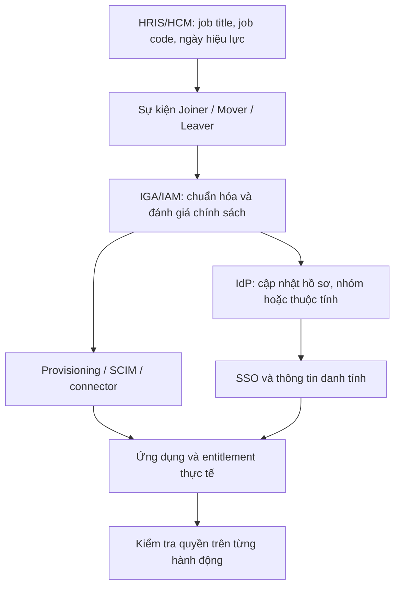

# Job title trong nguồn dữ liệu nhân sự và vòng đời danh tính IAM

**Job title** là tên chức danh công việc gắn với một cá nhân trong tổ chức, ví dụ “Chuyên viên hỗ trợ khách hàng”, “Kế toán tổng hợp”, “Kỹ sư nền tảng” hoặc “Trưởng nhóm vận hành”. Trong hệ thống **Identity and Access Management (IAM)**, job title là một thuộc tính nhân sự có ích để hiểu công việc và hỗ trợ quyết định cấp quyền. Tuy nhiên, **chức danh không tự nó là quyền truy cập**: quyền phải được xác định từ nhiệm vụ thực tế, phạm vi trách nhiệm, chính sách phê duyệt và các điều kiện hiện hành.

Trong quản lý vòng đời danh tính **Joiner–Mover–Leaver (JML)**, thông tin job title có thể thay đổi khi nhân viên được tuyển dụng, thăng chức, luân chuyển hoặc chấm dứt quan hệ làm việc. Nếu dữ liệu chức danh từ hệ thống nhân sự được đồng bộ sang IdP, ứng dụng và nền tảng phân quyền mà không có quy tắc rõ ràng, người dùng có thể bị cấp nhầm quyền hoặc giữ quyền của vị trí cũ.

## 1. Job title là dữ liệu gì và khác những khái niệm nào?

| Khái niệm | Ý nghĩa | Ví dụ | Vai trò trong IAM |
| --- | --- | --- | --- |
| **Job title** | Tên chức danh công việc của cá nhân | Chuyên viên chăm sóc khách hàng | Bối cảnh nghiệp vụ, thuộc tính dùng trong quy tắc được kiểm soát |
| **Position** | Vị trí công việc hoặc suất biên chế cụ thể trong cơ cấu tổ chức | Vị trí CS-042 thuộc Chi nhánh Hà Nội | Liên kết với bộ phận, đơn vị, người quản lý và phạm vi công việc |
| **Job code / job profile** | Mã hoặc nhóm công việc được chuẩn hóa | `CS_AGENT_L2` | Đầu vào ổn định hơn cho quy tắc gán quyền khi được quản trị tốt |
| **Department** | Bộ phận người đó trực thuộc | Customer Support | Xác định phạm vi tổ chức, không đủ để kết luận quyền riêng lẻ |
| **IAM role** | Vai trò chứa tập quyền theo chính sách | `ticket-reader` | Đầu vào trực tiếp của RBAC |
| **Entitlement** | Quyền cụ thể trên ứng dụng hoặc tài nguyên | Đọc ticket của nhóm Hà Nội | Quyền cần cấp, giám sát và thu hồi |

Ví dụ hai nhân viên đều có job title “Chuyên viên hỗ trợ khách hàng”, nhưng một người xử lý khách hàng miền Bắc và người còn lại xử lý miền Nam. Họ có thể cùng vai trò `support-agent` nhưng phải có **phạm vi dữ liệu khác nhau**. Một chức danh bằng nhau không đồng nghĩa được xem cùng một hồ sơ khách hàng.

Ngược lại, tên chức danh có thể được thay đổi vì chuẩn hóa ngôn ngữ hay thương hiệu nội bộ, trong khi nhiệm vụ và quyền truy cập không đổi. Vì vậy, **không nên xây chính sách quan trọng bằng so khớp chuỗi job title tự do** mà thiếu mã chuẩn, nguồn có thẩm quyền và quy trình quản lý thay đổi.

## 2. Job title xuất phát từ đâu?

Trong hệ sinh thái IAM, **HRIS/HCM** (hệ thống thông tin hoặc quản lý nhân sự) thường là nguồn có thẩm quyền cho chức danh của nhân viên. Đối với nhà thầu hoặc đối tác, nguồn thông tin có thể là hệ thống quản lý nhà thầu hoặc nhà cung cấp; không nên giả định HRIS nội bộ bao phủ tất cả chủ thể.

Một luồng dữ liệu điển hình:



Luồng trên là mô hình minh họa, không bắt buộc mọi triển khai phải đi qua đúng các thành phần. **SCIM** hỗ trợ đồng bộ tài khoản, nhóm và những thuộc tính mà hai phía hỗ trợ; không nên mặc định một trường `jobTitle` tùy ý luôn tồn tại trong schema hay mọi ứng dụng đều dùng nó để phân quyền. Chẳng hạn SCIM User có thuộc tính chuẩn `title` để biểu diễn chức danh; việc ánh xạ từ HRIS sang thuộc tính này và cách ứng dụng sử dụng vẫn phụ thuộc hợp đồng tích hợp.

**IdP** có thể dùng job title làm claim hoặc thuộc tính hồ sơ; **SSO** giúp đăng nhập liên kết. Dù vậy, xác thực thành công và nhận được claim chức danh chưa chứng minh người dùng được phép thực hiện mọi hành động thuộc chức danh đó.

## 3. Thiết kế dữ liệu job title đáng tin cậy

Một bản ghi nhân sự hữu ích cho IAM nên phân biệt **mã vị trí**, **mã nhóm công việc**, **tên hiển thị** và **thời điểm có hiệu lực**. Ví dụ:

```json
{
  "personId": "E02491",
  "employmentStatus": "active",
  "jobTitle": "Chuyên viên hỗ trợ khách hàng",
  "jobCode": "CS_AGENT_L2",
  "positionId": "POS-HN-042",
  "departmentId": "CUSTOMER_SUPPORT",
  "locationCode": "HN",
  "managerPersonId": "E00120",
  "effectiveFrom": "2026-12-01"
}
```

Đây là **schema minh họa**, không phải schema chính thức của một sản phẩm IAM. Mỗi thuộc tính cần có chủ sở hữu dữ liệu, định nghĩa nghiệp vụ, cách kiểm tra tính hợp lệ và phương thức xử lý khi thiếu hoặc mâu thuẫn.

Các nguyên tắc quan trọng:

1. **Định danh ổn định:** dùng `personId`, `positionId` hoặc `jobCode` khi thích hợp; không dùng tên chức danh làm khóa định danh cá nhân.
2. **Danh mục chức danh được quản lý:** tránh hàng loạt cách viết khác nhau cho cùng nhóm công việc, như “CS Agent”, “NV CSKH” hay “Customer Support Executive”.
3. **Ngày hiệu lực rõ ràng:** phân biệt ngày nhập liệu với ngày chính thức chuyển vị trí; không tự kích hoạt quyền của chức danh mới quá sớm.
4. **Nguồn có thẩm quyền cho từng trường:** HR quản lý chức danh nhân viên; IAM quản lý ánh xạ role/entitlement; ứng dụng đích xác nhận hiệu lực quyền.
5. **Lịch sử thay đổi:** ghi lại chức danh trước/sau, thời điểm thay đổi, căn cứ và kết quả cập nhật để phục vụ kiểm toán.
6. **Bảo vệ dữ liệu:** chỉ phân phối thuộc tính job title tới hệ thống thực sự cần; áp dụng giới hạn quyền xem và thời hạn lưu theo chính sách.

## 4. Từ job title đến quyền truy cập: không đồng nhất chức danh với role

Một số tổ chức dùng job code làm một **đầu vào** của mô hình cấp quyền theo vai trò (**Role-Based Access Control — RBAC**). Tuy nhiên, phép ánh xạ cần qua chính sách rõ ràng, kết hợp các yếu tố như đơn vị, phạm vi công việc, tình trạng hợp đồng và mức nhạy cảm tài nguyên.

Ví dụ bảng ánh xạ được quản trị:

| Job code | Role cơ bản đề xuất | Phạm vi bổ sung | Điều kiện |
| --- | --- | --- | --- |
| `CS_AGENT_L2` | `ticket-reader`, `ticket-editor` | Chỉ ticket của nhóm được phân công | Nhân sự đang hoạt động |
| `FIN_ACCOUNTANT` | `invoice-preparer` | Pháp nhân được giao | Không tự phê duyệt chứng từ do mình lập |
| `OPS_ENGINEER` | `monitoring-reader` | Môi trường được giao | Quyền quản trị production yêu cầu phê duyệt riêng |
| `DATA_ANALYST` | `analytics-reader` | Bộ dữ liệu được duyệt | Giới hạn dữ liệu nhạy cảm theo chính sách |

Các role và job code trong bảng chỉ để minh họa. Không nên cho rằng mọi người có job code `OPS_ENGINEER` đều cần quyền `production-admin`. Quyền đặc biệt nên dựa vào yêu cầu công việc cụ thể, phê duyệt, thời hạn và kiểm toán.

**Attribute-Based Access Control (ABAC)** giúp bổ sung điều kiện động. Ví dụ:

```text
ALLOW read_ticket IF
    subject.employment_status == "active"
    AND subject.job_code == "CS_AGENT_L2"
    AND "ticket-reader" IN subject.roles
    AND resource.assigned_team_id IN subject.team_ids
    AND action == "read"
ELSE DENY
```

Đây là giả mã chính sách. Trong thực tế, role được cấp và các thuộc tính cần đến từ nguồn đủ tin cậy, cập nhật đúng hạn và được ứng dụng kiểm tra tại điểm thực thi. Nếu `job_code` thay đổi nhưng quyền cũ vẫn còn ở ứng dụng, việc đánh giá theo vai trò hoặc thuộc tính cũ có thể gây **quyền truy cập tồn dư**.

## 5. Job title trong Joiner–Mover–Leaver

### Joiner: chức danh đầu vào khi cấp quyền

Khi tuyển một nhân viên mới, HRIS ghi nhận chức danh, mã công việc, bộ phận, ngày bắt đầu và người quản lý. IAM xác minh dữ liệu, xác định bộ quyền khởi tạo và provisioning tài khoản đến các hệ thống cần thiết.

Ví dụ một người bắt đầu công việc “Chuyên viên kế toán” từ ngày 1/12. IAM có thể chuẩn bị tài khoản trước ngày bắt đầu nhưng chỉ kích hoạt quyền nghiệp vụ theo thời điểm được phê duyệt. Chức danh hỗ trợ lựa chọn role cơ bản, còn quyền phê duyệt thanh toán phải dựa vào trách nhiệm thực tế và kiểm soát phân tách nhiệm vụ (**Segregation of Duties — SoD**).

### Mover: đổi chức danh và thay đổi quyền

Giả sử Minh chuyển từ `FIN_ACCOUNTANT` sang `DATA_ANALYST`:

1. HRIS phát hành sự kiện thay đổi có **ngày hiệu lực** và job code mới.
2. IAM đánh giá quyền hiện tại so với quyền cần cho vị trí mới.
3. Quyền kế toán không còn cần thiết được thu hồi; quyền phân tích được cấp theo chính sách và phê duyệt.
4. IdP và ứng dụng đích được cập nhật qua provisioning/SCIM hoặc connector thích hợp.
5. IAM đối soát kết quả, kiểm tra phiên/token cũ và các quyền ứng dụng không quản lý tập trung.
6. Sự kiện thay đổi, người phê duyệt và bằng chứng thu hồi được ghi để kiểm toán.

Không nên chỉ **cộng thêm** quyền của chức danh mới mà giữ nguyên mọi quyền cũ. Đây là nguồn gốc phổ biến của hiện tượng *privilege accumulation* (tích lũy đặc quyền).

Một thay đổi job title mang tính hình thức, ví dụ đổi “Kỹ sư hệ thống” thành “Kỹ sư nền tảng” nhưng phạm vi nhiệm vụ không đổi, cần được phân loại phù hợp để tránh thu hồi/cấp lại quyền không cần thiết. Căn cứ quyết định nên là **thay đổi trách nhiệm và thuộc tính công việc**, thay vì phản ứng máy móc với mọi thay đổi chuỗi tên.

### Leaver: trạng thái nghỉ việc quan trọng hơn chức danh cuối cùng

Khi nhân viên nghỉ việc, job title cuối cùng chỉ hữu ích để truy vết lịch sử và các hệ thống từng được cấp quyền. Tín hiệu chấm dứt phải dựa trên **employment status/relationship end date** hoặc sự kiện có thẩm quyền, không suy đoán từ việc trường job title bị xóa.

IAM cần vô hiệu hóa tài khoản, thu hồi role và entitlement, xử lý session/token/credential, đối soát quyền tại ứng dụng đích và lưu bằng chứng thực thi. Một số token có thể tiếp tục hợp lệ cho đến khi hết hạn nếu dịch vụ không hỗ trợ thu hồi tức thì; vì vậy phải kiểm chứng thời điểm quyền thực sự mất hiệu lực.

## 6. Những lỗi thường gặp khi dùng job title

| Lỗi | Hậu quả | Hướng xử lý |
| --- | --- | --- |
| So khớp tên chức danh tự do | Đổi cách viết làm hỏng mapping hoặc cấp sai quyền | Dùng danh mục và job code có quản trị |
| Coi chức danh là quyền | Người cùng title xem dữ liệu vượt phạm vi | Kết hợp role, tổ chức, thuộc tính tài nguyên và phê duyệt |
| Đồng bộ chức danh chậm | Hệ thống đích ra quyết định theo thông tin cũ | Theo dõi độ trễ, tái đối soát và giới hạn token/phiên |
| Mover chỉ cấp quyền mới | Tích lũy quyền từ chức danh cũ | Tính chênh lệch quyền, thu hồi và xác minh |
| Chỉ cập nhật IdP | Ứng dụng cũ vẫn giữ role cục bộ | Đối soát entitlement thực tế ở ứng dụng đích |
| Thiếu ngày hiệu lực | Quyền thay đổi quá sớm hoặc quá muộn | Xử lý sự kiện theo thời điểm nghiệp vụ |
| Nhầm job title với trạng thái làm việc | Không khóa quyền khi Leaver | Dùng trường trạng thái và ngày kết thúc có thẩm quyền |

Một hệ thống nên phát hiện khi job code không có trong danh mục, khi mapping quyền xung đột hoặc khi dữ liệu HRIS thiếu trường quan trọng. Với quyền nhạy cảm, tình trạng thiếu thông tin cần dẫn đến xử lý an toàn theo chính sách và yêu cầu rà soát, không mặc định mở rộng quyền.

## 7. Rà soát, kiểm toán và đo lường

Job title giúp tạo **ngữ cảnh** cho kiểm toán quyền, nhưng kết quả cuối cùng phải phản ánh entitlement thực tế. Các hoạt động hữu ích gồm:

- **Đối soát:** so sánh chức danh/job code ở HRIS với bản sao thuộc tính tại IdP, nhóm và quyền tại ứng dụng.
- **Rà soát theo sự kiện:** đánh giá quyền khi thay chức danh, bộ phận, vị trí, nhiệm vụ hoặc trạng thái làm việc.
- **Kiểm soát quyền ngoại lệ:** yêu cầu lý do, người phê duyệt và thời hạn cho quyền vượt bộ quyền cơ bản của job code.
- **SoD:** phát hiện vai trò xung đột, như vừa lập vừa tự phê duyệt cùng loại chứng từ.
- **Audit trail:** lưu `personId`, job code cũ/mới, ngày hiệu lực, chính sách, yêu cầu/phê duyệt, thay đổi quyền và kết quả trên hệ thống đích; không ghi token hoặc bí mật.
- **Chỉ số:** theo dõi tỷ lệ mapping không hợp lệ, độ trễ cập nhật, số quyền cũ tồn dư sau Mover, tỷ lệ thu hồi thành công và thời gian khắc phục lỗi provisioning.

## 8. Tình huống thực hành

**Tình huống A — Đổi tên chức danh:** HR đổi “Nhân viên hỗ trợ” thành “Chuyên viên hỗ trợ” nhưng mã công việc và trách nhiệm giữ nguyên. Có cần cấp lại tất cả quyền? **Không mặc nhiên.** Cần xem quyền được gắn với mã công việc và phạm vi trách nhiệm nào; thay đổi tên hiển thị không nhất thiết làm thay đổi entitlement.

**Tình huống B — Thăng chức:** Một nhân viên trở thành trưởng nhóm nhưng chưa được duyệt quyền duyệt chi phí. Có được tự động cấp quyền phê duyệt chỉ dựa trên title “Trưởng nhóm” không? **Không.** Phải đánh giá nhiệm vụ, hạn mức, phê duyệt và phân tách nhiệm vụ.

**Tình huống C — Luân chuyển:** Nhân viên chuyển từ kế toán sang phân tích dữ liệu; role mới đã cấp thành công nhưng role kế toán ở ứng dụng cũ vẫn còn. Mover đã hoàn tất chưa? **Chưa.** Phải kiểm chứng thu hồi tại hệ thống đích và xử lý phiên hoặc token liên quan.

**Tình huống D — Nghỉ việc:** HR đã xóa job title nhưng employment status vẫn là `active`. Có thể lấy trường title rỗng làm tín hiệu Leaver không? **Không.** Cần sự kiện hoặc trạng thái kết thúc quan hệ từ nguồn có thẩm quyền; đồng thời làm rõ dữ liệu HR đang bất nhất.

## Ghi nhớ

**Job title** là một thuộc tính nghiệp vụ của nhân sự, hữu ích để hiểu nhiệm vụ và định hướng cấp quyền, nhưng **không phải IAM role hay entitlement**. Trong quản lý vòng đời danh tính, hãy dùng dữ liệu HR có thẩm quyền, job code và ngày hiệu lực rõ ràng; chuyển đổi thành quyền qua chính sách **RBAC/ABAC**, đồng bộ bằng **IdP/SSO/SCIM** khi phù hợp, và kiểm chứng quyền thực tế khi **Joiner–Mover–Leaver**. Như vậy, tổ chức vừa cấp đúng quyền theo công việc vừa hạn chế quyền truy cập tồn dư sau thay đổi vị trí hoặc nghỉ việc.
