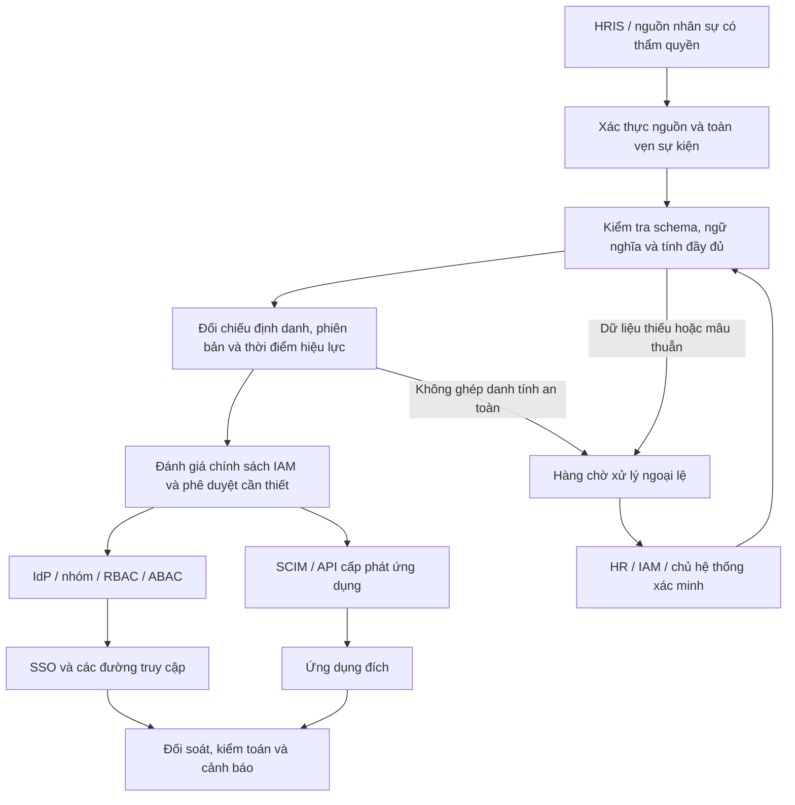

# Độ tin cậy dữ liệu HR trong quản lý vòng đời danh tính IAM

Trong quản lý danh tính và truy cập (*Identity and Access Management* — **IAM**), hệ thống nhân sự (*Human Resources* — **HR**) thường là nơi ghi nhận việc một người được tuyển dụng, chuyển bộ phận, nghỉ phép hoặc rời tổ chức. Từ các thông tin đó, IAM có thể chuẩn bị tài khoản, cấp quyền theo vai trò, thay đổi quyền và thu hồi truy cập. Nhưng **có dữ liệu HR không có nghĩa là dữ liệu đó đã đáng tin cậy để tự động cấp hoặc thu hồi quyền**.

Một bản ghi sai ngày bắt đầu làm việc có thể khiến người mới không truy cập được ứng dụng trong ngày đầu hoặc có quyền trước khi hợp đồng có hiệu lực. Một thay đổi bộ phận đến chậm có thể để lại quyền cũ sau khi người dùng đã chuyển công việc. Một thông báo nghỉ việc bị mất có thể khiến tài khoản SaaS hoặc VPN còn hoạt động dù nhân sự đã rời công ty. Vì vậy, độ tin cậy dữ liệu HR là một điều kiện nền tảng để vận hành mô hình **Joiner–Mover–Leaver (JML)** an toàn.

Bài học thuộc chương **Nguồn dữ liệu nhân sự** của module `SECURITY_IDENTITY_ACCESS_MANAGEMENT_IDENTITY_LIFECYCLE`. Trọng tâm là nhận biết dữ liệu HR nào có thẩm quyền, kiểm tra chất lượng và nguồn gốc, xử lý sự kiện đến muộn hoặc mâu thuẫn, và chứng minh rằng trạng thái quyền tại Identity Provider (IdP), SSO, SCIM, ứng dụng và tài khoản dịch vụ thực sự phản ánh trạng thái nghiệp vụ hợp lệ.

Sau bài học, bạn có thể thiết lập tiêu chí tin cậy cho dữ liệu HR, mô tả quy trình kiểm tra trước khi tự động hóa IAM, phân biệt lỗi chất lượng với lỗi đồng bộ và đề xuất cơ chế đối soát, kiểm toán, xử lý ngoại lệ.

## 1. Độ tin cậy dữ liệu HR là gì?

**Độ tin cậy dữ liệu HR** là mức độ mà một hệ thống IAM có thể dựa vào bản ghi hoặc sự kiện nhân sự để đưa ra quyết định truy cập **đúng người, đúng thuộc tính, đúng thời điểm và có thể kiểm chứng**. Độ tin cậy không chỉ là trường dữ liệu “có giá trị” hay một API trả HTTP `200 OK`.

Một nguồn HRIS (*Human Resources Information System*) có thể là **nguồn có thẩm quyền** đối với tình trạng quan hệ lao động, ngày bắt đầu và đơn vị công tác. Tuy nhiên, nguồn ấy có thể không có thẩm quyền quyết định người đó được quyền quản trị hệ thống sản xuất, được truy cập hồ sơ khách hàng nào hoặc có được duy trì khóa API của một dịch vụ hay không. Các quyết định sau còn phụ thuộc vào chính sách IAM, chủ ứng dụng, RBAC/ABAC, phê duyệt đặc quyền và trạng thái thực tế tại hệ thống đích.

> **Nguyên tắc:** Một thông tin chỉ nên được tự động sử dụng để cấp hoặc thu hồi quyền khi biết rõ **ai chịu trách nhiệm về dữ liệu, bản ghi biểu diễn điều gì, thời điểm nào có hiệu lực, mức độ chính xác ra sao và cách xử lý khi nó không đáng tin**.

### Các chiều chất lượng cần xem xét

| Chiều chất lượng | Câu hỏi kiểm tra | Ví dụ ảnh hưởng đến IAM |
| --- | --- | --- |
| **Chính xác (accuracy)** | Giá trị có phản ánh thực tế đã được xác minh không? | Nhân viên thực tế thuộc khối vận hành nhưng HRIS ghi khối tài chính, dẫn đến sai vai trò. |
| **Đầy đủ (completeness)** | Các trường cần thiết cho chính sách có đủ không? | Không có đơn vị công tác, nên IAM không xác định được bộ quyền cơ sở. |
| **Kịp thời (timeliness)** | Sự kiện được phát, nhận và áp dụng đủ nhanh so với thời điểm hiệu lực không? | HR đã chấm dứt hợp đồng nhưng đồng bộ theo lô chạy sau nhiều giờ. |
| **Nhất quán (consistency)** | Cùng một thuộc tính có mâu thuẫn giữa nguồn hay phiên bản không? | HRIS chính ghi `INACTIVE`, bảng dữ liệu tích hợp cũ vẫn ghi `ACTIVE`. |
| **Duy nhất và khớp danh tính (uniqueness / identity matching)** | Bản ghi có liên kết đúng một danh tính IAM cần xử lý không? | Hai người trùng tên; hệ thống ghép tài khoản bằng email cũ và vô hiệu hóa nhầm người. |
| **Toàn vẹn và xác thực nguồn (integrity / authenticity)** | Sự kiện đến từ nguồn được tin cậy, không bị sửa trái phép? | Webhook giả mạo yêu cầu đổi bộ phận để cấp thêm quyền. |
| **Nguồn gốc và truy vết (provenance / traceability)** | Có biết nguồn, người hoặc hệ thống phê duyệt, phiên bản và hành trình dữ liệu không? | Kiểm toán không xác định được ai đã thay đổi ngày nghỉ việc. |
| **Phù hợp về ngữ nghĩa (semantic validity)** | Giá trị có đúng quy ước nghiệp vụ hay không? | `employmentStatus=ON_LEAVE` bị hiểu nhầm thành đã chấm dứt hợp đồng. |

Các chiều này liên quan nhưng không thay thế nhau. Một sự kiện có chữ ký hợp lệ vẫn có thể chứa thông tin nhân sự sai; bản ghi đủ trường vẫn có thể đến quá muộn; dữ liệu được cập nhật đúng giờ vẫn có thể bị ghép với tài khoản của người khác.

## 2. Xác định nguồn có thẩm quyền theo từng thuộc tính

Trong môi trường thực tế, dữ liệu nhân sự có thể đi từ HRIS, hệ thống tuyển dụng, quản lý hợp đồng lao động, nhà thầu, bộ phận quản lý nhân sự, hệ thống danh bạ và nhiều ứng dụng khác. **Không nên mặc định một nguồn duy nhất là nguồn chuẩn cho mọi trường và mọi loại danh tính.**

| Thuộc tính hoặc quyết định | Nguồn có thể có thẩm quyền | Cách IAM sử dụng |
| --- | --- | --- |
| Trạng thái và ngày hiệu lực quan hệ lao động | HRIS/hợp đồng đã được phê duyệt | Xác định điều kiện tồn tại và thời điểm kích hoạt, thay đổi hoặc vô hiệu hóa danh tính. |
| Đơn vị, chức danh, người quản lý | Hệ thống HR hoặc quy trình quản lý nhân sự | Làm đầu vào cho tính toán nhóm, vai trò cơ sở và luồng phê duyệt. |
| Tư cách và thời hạn của cộng tác viên/nhà thầu | Hệ thống quản lý đối tác/nhà thầu có thẩm quyền | Thiết lập thời hạn tài khoản và người bảo trợ (*sponsor*) cần chịu trách nhiệm. |
| Quyền nghiệp vụ trên một ứng dụng | Chủ ứng dụng và chính sách IAM được phê duyệt | Ánh xạ điều kiện HR thành role/entitlement cụ thể; kiểm tra phê duyệt bổ sung. |
| Quyền đặc quyền hoặc quyền khẩn cấp | Hệ thống PAM, chủ tài nguyên và quy trình phê duyệt | Cấp quyền có thời hạn, theo mức rủi ro, không suy ra chỉ từ chức danh HR. |
| Trạng thái rủi ro tài khoản, khóa khẩn cấp | Nhóm bảo mật, công cụ phát hiện sự cố và chính sách tương ứng | Có thể chặn truy cập ngay cả khi hồ sơ HR vẫn là `ACTIVE`. |

**Nguồn có thẩm quyền cho một trường không tự động là nguồn có thẩm quyền cho hành động khác.** Chẳng hạn, HRIS ghi “Trưởng nhóm” có thể hỗ trợ xác định ai phê duyệt, nhưng không tự cho phép cấp `production.admin`. Nếu nhiều nguồn cùng cung cấp một thuộc tính, phải có quy tắc ưu tiên, xử lý xung đột và người chịu trách nhiệm quyết định cuối cùng.

### Không dùng email hoặc họ tên làm khóa danh tính duy nhất

Email, họ tên hoặc số điện thoại có thể trùng, thay đổi hoặc được tái sử dụng. Với tự động hóa JML, nên có **định danh ổn định, duy nhất trong phạm vi nguồn** và ánh xạ quản lý rõ ràng sang định danh IAM/IdP. Khi nhiều tổ chức hoặc nhà cung cấp cùng cấp ID, cần lưu thêm **namespace của nguồn** để tránh va chạm.

Một mô hình ánh xạ minh họa:

```text
(sourceSystem = "HRIS_MAIN", sourcePersonId = "EMP-008742")
    -> identityId = "id-6a91"
    -> idpUserId = "user-93bc"
    -> applicationAccounts = {crm: "acc-151", ticketing: "u-704"}
```

Đây là dữ liệu giả định. Trong thực tế, ánh xạ phải được bảo vệ khỏi thay đổi trái phép, có lịch sử và có cơ chế giải quyết trùng lặp hoặc tuyển dụng lại. **Không tự ghép tài khoản chỉ vì tên hiển thị giống nhau.**

## 3. Từ dữ liệu HR đến quyết định IAM có thể kiểm chứng

Dữ liệu nhân sự là **đầu vào** cho quyết định chính sách, còn quyền truy cập thực tế nằm ở IdP, ứng dụng, SaaS, VPN, hệ thống nội bộ và có thể cả danh tính máy. Một pipeline tin cậy cần nhiều điểm kiểm soát hơn thao tác “đọc bản ghi rồi tạo tài khoản”.



Các bước này phải được triển khai bằng chính sách phù hợp với rủi ro. Ví dụ, **thiếu đơn vị công tác khi Joiner** có thể khiến hệ thống giữ tài khoản ở trạng thái hạn chế và chuyển kiểm tra thủ công. **Leaver khẩn cấp đã xác thực được danh tính và chỉ thị chặn truy cập** cần được xử lý ưu tiên; không nên chờ các thuộc tính ít liên quan như địa chỉ văn phòng được bổ sung mới bắt đầu vô hiệu hóa tài khoản.

### Vì sao “HRIS là source of truth” vẫn chưa đủ?

Khái niệm *source of truth* chỉ giải quyết câu hỏi **nguồn nào có thẩm quyền công bố trạng thái**. Nó không bảo đảm dữ liệu không sai, không đến trễ, không bị trùng, không bị giả mạo hoặc đã được ứng dụng đích áp dụng. Cần thêm quy tắc kiểm tra đầu vào, đồng bộ có kiểm soát, đo độ trễ, đối soát đầu ra và cơ chế can thiệp khi phát hiện bất thường.

## 4. Ngữ nghĩa dữ liệu HR: cùng một trạng thái có thể có nhiều ý nghĩa

Một trường `employmentStatus` thường không đủ để giải thích mọi trường hợp. Hệ thống có thể ghi nhận nhân viên chính thức, nhân sự thử việc, cộng tác viên, nhân viên tạm nghỉ, người chuyển công ty con, người đã thông báo nghỉ nhưng vẫn làm việc hoặc người nghỉ việc đã hoàn tất.

| Tình huống HR | Diễn giải IAM cần kiểm tra | Rủi ro nếu suy diễn đơn giản |
| --- | --- | --- |
| `HIRED` nhưng ngày bắt đầu ở tương lai | Có thể chuẩn bị danh tính; thời điểm kích hoạt phải theo chính sách và ngày hiệu lực | Cấp quyền sớm trước ngày nhận việc. |
| `ACTIVE` với đơn vị/role mới | Tính lại tập quyền; kiểm tra ngoại lệ bàn giao và SoD | Cộng dồn quyền của bộ phận cũ. |
| `ON_LEAVE` hoặc tạm ngưng công việc | Áp chính sách riêng cho loại nghỉ, thời hạn và tài nguyên | Vô hiệu hóa quá mức hoặc giữ quyền không phù hợp. |
| `TERMINATION_SCHEDULED` | Lập lịch chặn truy cập theo ngày/giờ được phê duyệt; cập nhật nếu quyết định thay đổi | Thu hồi quá sớm hoặc quên thu hồi đúng hạn. |
| `TERMINATED` | Xác minh sự kiện và danh tính; thực thi/đối soát các bước Leaver | Tài khoản và phiên tồn dư trên ứng dụng. |
| `REHIRED` | Đánh giá vòng đời mới, chính sách tái tuyển và các liên kết danh tính | Khôi phục quyền cũ, kể cả đặc quyền không còn hợp lệ. |

Các tên trạng thái trên **chỉ minh họa**. Từng tổ chức phải định nghĩa bản đồ trạng thái, chuyển trạng thái hợp lệ, thời điểm hiệu lực và hành động IAM tương ứng dựa trên schema HR thực tế. Không nên gắn cứng “mọi trạng thái khác ACTIVE đều khóa ngay” khi chưa xem xét chính sách đối với nhân sự tạm nghỉ, thực tập sinh hay đối tác.

### Dữ liệu thiếu không có nghĩa là trạng thái đã thay đổi

Nếu bản ghi nhân viên đột ngột biến mất khỏi một tệp CSV, chưa thể kết luận người đó đã nghỉ việc. Có thể bộ lọc xuất dữ liệu sai, kết nối chỉ trả một phần, lô dữ liệu chưa hoàn tất hoặc quyền đọc của connector bị giới hạn. Quy trình phải phân biệt:

- **Sự kiện chấm dứt hợp lệ:** có định danh, nguồn và trạng thái được xác thực, đúng schema và quy trình đã định.
- **Thiếu bản ghi do lỗi dữ liệu:** không đủ bằng chứng để tự biến thành Leaver.
- **Mất liên lạc với nguồn HR:** nguồn trạng thái tạm thời không cập nhật; cần áp chính sách với dữ liệu cũ, cảnh báo và theo dõi thời gian mất liên lạc.

Trong các trường hợp rủi ro cao, chính sách có thể hạn chế truy cập khi dữ liệu không đáng tin. Nhưng việc **khóa hàng loạt tất cả tài khoản** chỉ vì một lần đồng bộ lỗi có thể gây gián đoạn lớn. Phải có tiêu chí rõ ràng về dữ liệu nào không thể thiếu, thời gian dữ liệu được coi là còn hiệu lực và phương án ứng phó theo mức rủi ro.

## 5. Độ tin cậy theo thời gian: sự kiện, hiệu lực và áp dụng

Có ít nhất bốn mốc thời gian cần phân biệt khi đánh giá một thay đổi nhân sự:

| Trường minh họa | Ý nghĩa | Câu hỏi phát hiện lỗi |
| --- | --- | --- |
| `occurredAt` | Thời điểm thay đổi được ghi nhận ở nguồn có thẩm quyền | Nguồn đã ghi nhận quyết định khi nào? |
| `receivedAt` | Thời điểm IAM nhận sự kiện | Kết nối HR → IAM có chậm hoặc gián đoạn không? |
| `effectiveAt` | Thời điểm thay đổi có hiệu lực về nghiệp vụ | Quyền nên được bật, sửa hoặc chặn từ khi nào? |
| `enforcedAt` và `verifiedAt` | Thời điểm hệ thống đích thực thi và được kiểm chứng | Chênh lệch cuối cùng so với mốc nghiệp vụ là bao nhiêu? |

Giả sử HR chốt thay đổi vai trò lúc 08:00, `effectiveAt=09:00`. IAM nhận lúc 08:03, gửi yêu cầu đến ứng dụng lúc 09:00 nhưng ứng dụng chỉ gỡ quyền cũ lúc 09:14. **Nguồn HR có thể chính xác và kịp thời, nhưng toàn bộ quy trình JML vẫn chưa đáp ứng yêu cầu đúng thời điểm**. Cần đo độ trễ ở từng chặng và kiểm tra trạng thái thực tế.

Ngược lại, nếu HR nhập quyết định nghỉ việc lúc 16:20 nhưng ghi `effectiveAt=15:00`, hệ thống phải xem đây là **sự kiện có hiệu lực trong quá khứ**: thực thi ngay theo chính sách, ghi nhận độ trễ và rà soát thời gian quyền đã tồn dư. Không coi “đã trễ mốc” là lý do bỏ qua sự kiện.

**Múi giờ** cũng là một phần của chất lượng: lưu timestamp có offset hoặc UTC, xác định cách hiểu ngày làm việc theo khu vực, và không âm thầm diễn giải ngày `2026-12-01` là nửa đêm UTC khi chính sách thực tế dựa vào giờ địa phương. Với dữ liệu chỉ có ngày, phải định nghĩa rõ thời điểm trong ngày được dùng để thực thi.

## 6. Sự kiện trùng, đến muộn và sai thứ tự

Đường truyền không phải lúc nào cũng giao sự kiện đúng một lần hoặc theo đúng thứ tự. Một hệ thống đáng tin phải chống được các trường hợp **retry, lặp, trì hoãn, mất mạng, nhận lại sự kiện cũ** và **hai thay đổi gần nhau**.

Ví dụ thông điệp minh họa cho việc chuyển vai trò:

```yaml
eventId: hr-event-9105
sourceSystem: HRIS_MAIN
sourcePersonId: EMP-008742
eventType: MOVER
sourceVersion: 57
occurredAt: "2026-11-23T01:20:00Z"
effectiveAt: "2026-11-23T02:00:00Z"
employmentStatus: ACTIVE
organizationUnit: operations
managerId: EMP-000321
correlationId: jml-8742-57
```

Đây là schema ví dụ, không phải chuẩn chung của mọi HRIS. Khi thiết kế, cần xác định ý nghĩa và miền giá trị của từng trường, đặc biệt là `sourceVersion` có tăng một cách đáng tin cậy theo **đúng danh tính và nguồn** hay không.

Quy trình xử lý ở mức khái niệm:

```text
nhanSuKien(event):
    kiemTraNguonVaTinhToanVen(event)
    kiemTraSchemaVaYNgiaTrangThai(event)
    identity = doiChieuDinhDanhOnDinh(event.sourceSystem, event.sourcePersonId)
    neu identity khong duy nhat: chuyenXuLyNgoaiLe(event); dung

    neu event.eventId da xuLy: traLaiKetQuaHienTai()
    neu event.sourceVersion cu hon trangThaiDaChapNhan:
        ghiNhanSuKienCu(); dung

    trangThaiMoi = xacNhanTrangThaiHienHanhTuNguonCoThamQuyen(event)
    tapQuyenMongDoi = danhGiaChinhSach(trangThaiMoi, thoiDiemHieuLuc)
    lapLichHoacThucThi(tapQuyenMongDoi)
    doiSoatQuyenTaiUngDungDich()
    ghiAuditVaCanhBaoSaiLech()
```

Các điểm thực thi phải có tính **idempotent**: xử lý lại một thông điệp không tạo tài khoản hoặc quyền trùng, cũng không mở lại quyền đã bị thu hồi bởi sự kiện mới hơn. Nếu nguồn không có số phiên bản, cần cơ chế so sánh trạng thái được xác minh hoặc quy tắc thứ tự phù hợp; **không mặc định** timestamp của mạng là thứ tự nghiệp vụ chuẩn.

### Trường hợp nguy hiểm: Mover cũ đến sau Leaver mới

Giả sử HR phát Mover lúc 09:00 nhưng sự kiện bị kẹt. Lúc 11:00 người đó được chấm dứt hợp đồng khẩn cấp; IAM xử lý Leaver và khóa quyền. Đến 11:05, sự kiện Mover lúc 09:00 mới đến. Nếu worker áp dụng mọi sự kiện theo thứ tự nhận mà không xét phiên bản hoặc trạng thái hiện hành, tài khoản có thể được kích hoạt trở lại.

**Biện pháp:** kiểm tra phiên bản/trạng thái nguồn, bất biến của quy trình khóa và chính sách ưu tiên cho chỉ thị an ninh hợp lệ. Một thay đổi role cũ không thể tự phủ nhận quyết định Leaver mới. Khi dữ liệu mâu thuẫn chưa giải quyết được, hệ thống phải chuyển xử lý ngoại lệ và bảo toàn trạng thái truy cập theo chính sách rủi ro.

## 7. Vai trò của dữ liệu HR trong từng giai đoạn JML

### 7.1. Joiner: xác minh danh tính trước khi cấp quyền

Đối với Joiner, tối thiểu cần kiểm tra định danh ổn định, tư cách nhân sự, thời điểm bắt đầu, đơn vị hoặc vai trò cơ sở và trạng thái phê duyệt. Có thể chuẩn bị trước account nhưng **không được đồng nhất `recordCreated` với `accessEffective`**.

Tình huống: người được tuyển có tên gần giống một nhân viên cũ. Nếu connector ghép theo họ tên hoặc email được tái sử dụng, ứng dụng có thể gán lịch sử và quyền cũ sai người. Luồng an toàn cần đối chiếu ID nguồn và quy trình xác minh người thực. Nếu chưa đủ bằng chứng, không cho tự động ghép hoặc khôi phục đặc quyền.

Nếu một trường không cần cho quyền cơ sở bị thiếu, IAM có thể tiếp tục những bước được chính sách cho phép và đánh dấu phần chưa đủ điều kiện. Nếu trường quyết định loại quyền hoặc danh tính bị thiếu, phải chặn **bước cấp quyền liên quan** và yêu cầu xác minh, thay vì tự điền một vai trò mặc định có quyền rộng.

### 7.2. Mover: độ tin cậy của thuộc tính quyết định quyền mới và quyền cũ

Thay đổi chức vụ, phòng ban, địa bàn, người quản lý hoặc loại hợp đồng có thể ảnh hưởng các nhóm RBAC, điều kiện ABAC và các phê duyệt SoD. Nếu HR gửi bộ phận mới nhưng giữ người quản lý cũ, hoặc hai nguồn cập nhật trái ngược, IAM phải xác định **thuộc tính nào quyết định quyền nào**.

Tình huống: nhân viên chuyển từ hỗ trợ khách hàng sang vận hành. Trạng thái đúng đòi hỏi **gỡ quyền sửa hồ sơ khách hàng** và **cấp các quyền vận hành được duyệt**. Nếu bản ghi nguồn chậm cập nhật, IAM có thể tiếp tục duy trì quyền không hợp lệ. Nếu cấp nhóm mới mà không đối soát quyền cũ, rủi ro tích lũy đặc quyền (*privilege creep*) xuất hiện. Ngoại lệ bàn giao phải có người duyệt và thời điểm hết hạn riêng, thay vì dựa vào dữ liệu HR mơ hồ.

### 7.3. Leaver: ưu tiên chỉ thị hợp lệ và xác minh thu hồi thực tế

Đối với Leaver, những trường đặc biệt quan trọng là định danh mục tiêu, trạng thái nghỉ việc, thời điểm có hiệu lực, nguồn quyết định và mức độ khẩn cấp (nếu được định nghĩa). Một chỉ thị chấm dứt khẩn cấp được xác thực phải có đường xử lý nhanh phù hợp, không phụ thuộc hoàn toàn vào đồng bộ lô.

Các hành động thường bao gồm vô hiệu hóa đăng nhập tại IdP; thu hồi phiên, refresh token hoặc thông tin xác thực khi được hỗ trợ; vô hiệu hóa tài khoản hoặc quyền tại ứng dụng qua SCIM/API; thu hồi truy cập VPN và quyền quản trị; rồi kiểm tra các tài khoản cục bộ ngoài SSO. Dữ liệu HR đúng chỉ là điểm khởi đầu: **Leaver hoàn tất khi các đường truy cập thuộc phạm vi đã đạt trạng thái mong đợi và có bằng chứng**, hoặc các ngoại lệ còn lại được ghi nhận để xử lý.

Nếu bản ghi nghỉ việc chỉ thiếu trường không liên quan đến xác định danh tính hoặc quyết định khóa, việc chặn truy cập có thể vẫn thực hiện ngay theo chính sách. Ngược lại, khi định danh không khớp duy nhất, không được tùy tiện khóa tài khoản của người có tên giống nhau; phải chuyển xử lý khẩn và bổ sung bằng chứng.

### 7.4. Tài khoản dịch vụ: HR không phải nguồn duy nhất của vòng đời

Danh tính máy, service account, workload identity hoặc API key thường không có bản ghi HR riêng. Tuy vậy, chúng có **người hoặc nhóm sở hữu**. Khi nhân viên sở hữu nghỉ việc hoặc chuyển bộ phận, cần xem xét lại ai quản lý tài khoản, quyền được cấp và cách luân chuyển secret, chứng chỉ hoặc khóa.

Không nên tự động xóa mọi tài khoản dịch vụ của một nhân viên ngay khi Leaver nếu điều đó làm ngừng dịch vụ sản xuất chưa được bàn giao. Thay vào đó, phải có quy trình chủ sở hữu thay thế, phân loại tài khoản cần thu hồi ngay, danh mục tài nguyên liên quan, xoay vòng thông tin xác thực và kiểm toán thời hạn hoàn thành. Một tài khoản máy không rõ chủ sở hữu là rủi ro cần được xử lý, dù trạng thái HR của người tạo ban đầu vẫn đang hoạt động.

## 8. Kiểm tra chất lượng trước và sau khi đồng bộ

Một pipeline HR → IAM nên có hai loại kiểm tra bổ sung cho nhau:

**Kiểm tra đầu vào (pre-ingestion / pre-provisioning):**

1. Xác thực nguồn gửi và quyền sử dụng luồng tích hợp; bảo vệ webhook, chứng thực API và dữ liệu trong quá trình truyền.
2. Kiểm tra schema, kiểu dữ liệu, trường bắt buộc, mã danh mục và các quy tắc chuyển trạng thái.
3. Đối chiếu định danh ổn định, xử lý trùng lặp và liên kết với tài khoản có sẵn theo quy trình được phê duyệt.
4. Kiểm tra phiên bản, thời điểm hiệu lực, tính mới của dữ liệu và xung đột với sự kiện đã được chấp nhận.
5. Ánh xạ thuộc tính sang chính sách RBAC/ABAC; kiểm tra phê duyệt và SoD khi cần.

**Kiểm tra đầu ra (reconciliation / verification):**

1. So sánh danh tính và quyền **kỳ vọng theo trạng thái HR mới nhất** với trạng thái tại IdP, nhóm và ứng dụng đích.
2. Kiểm tra phản hồi SCIM/API, lỗi retry, tài khoản bị thiếu, tài khoản trùng và quyền được cấp thủ công ngoài quy trình.
3. Với quyền nhạy cảm, xác minh hiệu lực của session, token, khóa và cơ chế thực thi chính sách; không chỉ dựa vào trạng thái “job thành công”.
4. Lập danh sách sai lệch có mức độ ưu tiên, chủ sở hữu xử lý, thời hạn và kết quả khắc phục.
5. Ghi bằng chứng để kiểm toán: phiên bản sự kiện, quyết định chính sách, trạng thái trước/sau, kết quả connector và xác nhận cuối.

### Phân biệt lỗi nguồn, lỗi xử lý và lỗi ứng dụng đích

| Triệu chứng | Lớp lỗi có thể nằm ở đâu? | Hướng điều tra |
| --- | --- | --- |
| HRIS có hai hồ sơ cùng tham chiếu một người | Chất lượng dữ liệu/đối chiếu định danh | Xác minh nguồn, lịch sử thay đổi và quy tắc hợp nhất. |
| HRIS đã cập nhật nhưng IAM nhận muộn | Tích hợp, hàng đợi hoặc lịch chạy | Kiểm tra thời điểm phát/nhận, retry và lỗi connector. |
| IAM nhận đúng nhưng cấp role sai | Chính sách hoặc ánh xạ RBAC/ABAC | So sánh tập thuộc tính đầu vào với phiên bản chính sách và quyết định quyền. |
| SCIM báo thành công nhưng ứng dụng còn quyền cũ | Cách ứng dụng áp dụng hoặc cache quyền | Đọc trạng thái tại đích, kiểm tra phiên/token và cơ chế làm mới quyền. |
| Người nghỉ việc vẫn còn API key của dự án | Danh mục quyền/tài khoản dịch vụ chưa đủ | Kiểm tra người sở hữu, quản lý secret và luồng thu hồi ngoài tài khoản người dùng. |

Trình tự này tránh việc “sửa tay trên ứng dụng” để xử lý triệu chứng trong khi nguồn HR hoặc ánh xạ danh tính vẫn sai, khiến lần đồng bộ sau lại tái tạo lỗi.

## 9. Đo lường độ tin cậy dữ liệu HR và hiệu quả IAM

Các chỉ số phải phản ánh cả **chất lượng đầu vào** và **kết quả quyền thực tế**:

| Chỉ số | Cách đo minh họa | Ý nghĩa |
| --- | --- | --- |
| Tỷ lệ bản ghi hợp lệ | Số bản ghi đạt kiểm tra schema/ngữ nghĩa ÷ tổng bản ghi thuộc phạm vi | Theo dõi dữ liệu không thể sử dụng trực tiếp. |
| Tỷ lệ thiếu thuộc tính trọng yếu | Số danh tính thiếu thuộc tính bắt buộc ÷ tổng danh tính cần xử lý | Phát hiện nguy cơ cấp sai hoặc chậm. |
| Tỷ lệ xung đột/trùng định danh | Số bản ghi cần giải quyết ghép danh tính ÷ tổng bản ghi | Đánh giá rủi ro khóa nhầm hoặc cấp nhầm. |
| Độ trễ từ HR đến IAM | `receivedAt - occurredAt` | Phân biệt kết nối chậm với quyết định IAM chậm. |
| Độ trễ thực thi JML | `enforcedAt - effectiveAt` và `verifiedAt - effectiveAt` | Đánh giá cấp/thu hồi đúng thời điểm. |
| Tỷ lệ JML đúng SLA | Số tác vụ được xác minh trong thời hạn ÷ tổng tác vụ áp dụng SLA | Theo dõi năng lực toàn chuỗi. |
| Sai lệch quyền và quyền tồn dư | Số quyền thực tế khác quyền kỳ vọng theo thời điểm | Đo rủi ro ở ứng dụng đích. |
| Tỷ lệ ngoại lệ tồn đọng | Số ngoại lệ chưa giải quyết theo mức ưu tiên và tuổi ngoại lệ | Đánh giá hiệu quả xử lý dữ liệu đáng ngờ. |

Ví dụ, tỷ lệ bản ghi HR hợp lệ đạt 99,9% có thể vẫn che giấu một thông báo Leaver của tài khoản đặc quyền bị thất lạc. Do đó nên theo dõi thêm **mức độ nghiêm trọng**, độ trễ ở các phân vị cao (p95/p99), những sự kiện khẩn cấp quá hạn và từng trường hợp không thu hồi được quyền.

Các mục tiêu SLA phải được tổ chức xác định theo rủi ro, mức quan trọng của hệ thống và giới hạn kỹ thuật. Không có một con số chung bảo đảm phù hợp cho mọi loại Joiner, Mover và Leaver.

### Kiểm toán mà vẫn bảo vệ thông tin nhân sự

Thông tin nhân sự có thể chứa dữ liệu cá nhân nhạy cảm. Nhật ký IAM nên lưu **đủ để giải thích quyết định truy cập**: mã sự kiện, ID đã được quản lý, nguồn, thời điểm, trường ảnh hưởng chính sách, phiên bản, quyết định, kết quả và correlation ID. Hạn chế sao chép dữ liệu HR không cần thiết; áp dụng phân quyền xem log, bảo vệ tính toàn vẹn, chính sách lưu giữ và cơ chế xóa theo yêu cầu áp dụng. Không ghi mật khẩu, token hoặc khóa API vào log kiểm toán.

## 10. Tình huống tổng hợp: cùng một nhân viên, ba nguồn dữ liệu

Một nhân viên có bản ghi trong HRIS chính, danh bạ nội bộ và một công cụ quản lý dự án. HRIS ghi `sourcePersonId=EMP-008742`, trạng thái `ACTIVE` và đơn vị `support`. Danh bạ giữ bản sao cập nhật từ hôm trước. Công cụ dự án có quyền `project.admin` được cấp thủ công từ một dự án cũ.

**Ngày thứ nhất — Joiner:** IAM tạo tài khoản theo `sourcePersonId` và chỉ cấp quyền cơ sở khi ngày bắt đầu đến. Nếu email trùng với người cũ, quy trình đối chiếu yêu cầu xác minh trước khi liên kết tài khoản.

**Ngày thứ hai — Mover:** HRIS chuyển nhân viên sang `operations` từ 09:00. Danh bạ vẫn hiển thị `support` trong một khoảng thời gian. IAM lấy dữ liệu chính từ nguồn có thẩm quyền, xác định phiên bản mới nhất, gỡ quyền hỗ trợ cũ và cấp quyền vận hành tương ứng. Đồng thời phải phát hiện `project.admin` cấp tay ở ứng dụng đích; nếu không có ngoại lệ hợp lệ, cần thu hồi.

**Ngày thứ ba — Leaver:** HRIS phát thông báo nghỉ việc có hiệu lực 17:00, nhưng webhook nhận lúc 17:08 do sự cố mạng. IAM phải thực thi thu hồi khi sự kiện hợp lệ được nhận, ghi nhận độ trễ và đối soát IdP, ứng dụng và phiên. Nếu công cụ dự án còn quyền quản trị sau khi tài khoản IdP bị khóa, quy trình Leaver vẫn đang có sai lệch cần xử lý.

**Phân tích:** Có ba vấn đề độc lập: nguồn chính xác theo từng thuộc tính, bản sao dữ liệu chậm cập nhật và quyền cấp ngoài pipeline HR. Chỉ cải thiện tốc độ webhook không xử lý được quyền `project.admin`; chỉ đối soát ứng dụng cũng không sửa được lỗi ghép nhầm định danh. Một thiết kế đáng tin phải có **nguồn có thẩm quyền, khóa danh tính ổn định, kiểm tra sự kiện, ánh xạ chính sách, xử lý độ trễ và kiểm chứng trạng thái đích**.

## 11. Checklist triển khai và câu hỏi tự kiểm tra

Trước khi kết nối một nguồn HR với IAM để cấp phát tự động, cần trả lời:

1. Nguồn nào có thẩm quyền đối với từng thuộc tính và loại nhân sự? Ai phê duyệt trường hợp ngoại lệ hoặc xung đột?
2. Có ID ổn định, duy nhất theo namespace để ghép HR → IdP → ứng dụng không? Quy trình tái tuyển dụng và thay đổi email được xử lý ra sao?
3. Trạng thái nhân sự và các chuyển trạng thái có được định nghĩa rõ, bao gồm tạm nghỉ, thử việc, nhà thầu, chấm dứt theo lịch và chấm dứt khẩn cấp không?
4. Có phân biệt thời điểm phát sinh, nhận, có hiệu lực và đã được kiểm chứng quyền không?
5. Sự kiện lặp, cũ, đến muộn hoặc sai thứ tự có thể vô tình kích hoạt lại quyền đã thu hồi không?
6. Thiếu một trường không liên quan có làm trì hoãn thu hồi Leaver quan trọng không? Thiếu trường định danh có thể khiến hệ thống khóa nhầm người không?
7. Dữ liệu HR đi qua API, webhook, batch hay nhiều nguồn? Có kiểm tra xác thực nguồn và toàn vẹn dữ liệu không?
8. Có đối soát quyền trực tiếp, nhóm lồng nhau, ứng dụng không SSO, phiên/token và các tài khoản dịch vụ liên quan không?
9. Có chủ sở hữu ngoại lệ, cảnh báo quá SLA, nhật ký kiểm toán và giới hạn truy cập dữ liệu HR không?

**Câu hỏi 1:** HRIS trả về danh sách nhân viên ít hơn một nửa so với hôm trước. Có nên tự động chấm dứt mọi tài khoản không còn trong danh sách?

**Trả lời:** Không thể kết luận chỉ từ danh sách thiếu. Cần kiểm tra liệu nguồn trả dữ liệu đầy đủ hay lỗi phân trang, bộ lọc, quyền API hoặc đồng bộ; xác minh tín hiệu nghỉ việc có thẩm quyền và áp dụng chính sách xử lý khi mất dữ liệu.

**Câu hỏi 2:** IAM nhận được Mover hợp lệ sau khi đã xử lý Leaver phiên bản mới hơn. Có nên áp dụng Mover để cập nhật bộ phận không?

**Trả lời:** Không được để sự kiện cũ tái kích hoạt quyền. Phải kiểm tra phiên bản hoặc trạng thái hiện hành ở nguồn có thẩm quyền, duy trì quyết định Leaver mới nhất và ghi nhận sự kiện trễ.

**Câu hỏi 3:** HRIS chính xác 100% về ngày nghỉ việc. Điều đó đã bảo đảm tài khoản SaaS không còn quyền sau ngày nghỉ chưa?

**Trả lời:** Chưa. Độ tin cậy HR chỉ đảm bảo chất lượng đầu vào. Cần kiểm chứng đồng bộ IdP/SCIM/API, quyền được cấp thủ công, phiên, token và các đường truy cập cục bộ ở ứng dụng đích.

## Kết luận

**Độ tin cậy dữ liệu HR là khả năng biến sự kiện nhân sự thành quyết định IAM có căn cứ và kết quả truy cập có thể kiểm chứng.** Chất lượng dữ liệu phải được xem trên nhiều chiều: chính xác, đầy đủ, kịp thời, nhất quán, khớp danh tính, toàn vẹn và truy vết. Khi kết hợp nguồn HR có thẩm quyền với chính sách RBAC/ABAC, IdP, SSO, SCIM, đối soát quyền và kiểm toán, tổ chức có thể cấp quyền cho Joiner đúng lúc, điều chỉnh quyền Mover đúng phạm vi và thu hồi Leaver đáng tin cậy, đồng thời giảm quyền truy cập tồn dư ở cả tài khoản người dùng lẫn danh tính dịch vụ.
