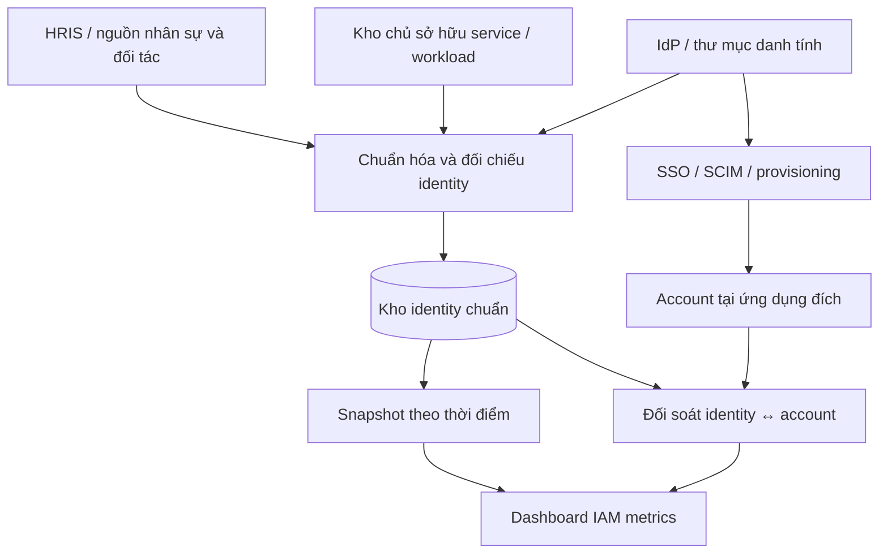

# Số lượng identity trong IAM: đếm đúng đối tượng, hiểu đúng rủi ro

**Số lượng identity** (*identity count*) là một chỉ số nền tảng trong Identity and Access Management (IAM). Chỉ số này trả lời: tại một thời điểm, tổ chức đang quản lý bao nhiêu danh tính số, thuộc những loại nào và đang ở trạng thái vòng đời nào? Con số tưởng như đơn giản nhưng rất dễ sai nếu cộng số tài khoản ứng dụng, bỏ sót tài khoản dịch vụ hoặc không phân biệt người đã nghỉ việc với danh tính đã bị xóa.

Trong quản lý vòng đời danh tính theo mô hình **Joiner–Mover–Leaver (JML)**, số lượng identity giúp đối soát việc tiếp nhận nhân sự, chuyển vai trò, ngừng quyền truy cập và phát hiện danh tính tồn dư. Chỉ số cần kết hợp thông tin từ hệ thống nguồn có thẩm quyền, nhà cung cấp danh tính (*Identity Provider — IdP*), hệ thống đăng nhập một lần (*Single Sign-On — SSO*), các kết nối cấp phát như *System for Cross-domain Identity Management — SCIM*, và kho tài khoản tại ứng dụng đích.

## 1. Đếm identity, không nhầm với số tài khoản

**Identity** là bản ghi định danh một chủ thể cần được nhận diện, quản lý vòng đời và gắn trách nhiệm trong hệ thống IAM. Chủ thể có thể là con người hoặc một thực thể phi con người (*non-human identity — NHI*) như dịch vụ, workload, bot hoặc tiến trình tự động.

Một identity có thể sở hữu nhiều **account** tại IdP, hệ điều hành, cơ sở dữ liệu và các ứng dụng. Một account cũng có thể gắn nhiều quyền (*entitlements*) và vai trò (*roles*). Vì vậy, ba phép đếm này phải tách biệt:

| Đối tượng | Câu hỏi đang đo | Ví dụ |
|---|---|---|
| **Identity** | Có bao nhiêu chủ thể số duy nhất đang được quản lý? | Một nhân viên mang mã danh tính `H-1042` |
| **Account** | Có bao nhiêu tài khoản đã được tạo ở các hệ thống? | `H-1042` có account tại IdP, Git và CRM |
| **Role/entitlement** | Các chủ thể được cấp bao nhiêu vai trò hoặc quyền cụ thể? | Identity trên có vai trò `developer` và quyền đọc báo cáo |

Ví dụ, nhân viên An có một identity nhân sự nhưng có ba account ứng dụng; dashboard **human identity count** ghi nhận **1**, còn dashboard **account count** ghi nhận **3**. Nếu An có thêm tài khoản quản trị đặc quyền, chính sách định danh của tổ chức phải quy định rõ đây là account phụ thuộc identity của An hay một danh tính đặc quyền độc lập. Không tự ý đổi quy tắc đếm giữa các kỳ báo cáo.

Những nhóm cần xem xét khi xây dựng phạm vi:

- **Human identities:** nhân viên, nhà thầu, đối tác, người dùng bên ngoài được tổ chức quản lý. Cần có khóa định danh bền vững và nguồn xác nhận tư cách hợp lệ.
- **Non-human identities:** tài khoản dịch vụ, workload identity, automation/bot, danh tính được dùng bởi luồng tích hợp. Mỗi identity cần chủ sở hữu nghiệp vụ hoặc kỹ thuật chịu trách nhiệm.
- **Danh tính đặc quyền và khẩn cấp:** identity/account quản trị, break-glass; cần xác định quan hệ với chủ thể sở hữu, tránh bỏ sót hoặc đếm đôi.
- **Danh tính khách/được liên kết liên miền:** có thể tồn tại tại nhiều tenant hoặc IdP; cần quy tắc phân biệt một người với các bản ghi liên kết của họ.

> **Quy tắc cốt lõi:** Một identity được đếm đúng một lần trong một phạm vi và một thời điểm xác định, dựa trên **khóa định danh chuẩn** (*canonical identity ID*). Tổng account, phiên SSO, số token hay số quyền không được dùng làm phép thay thế trực tiếp.

## 2. Chốt định nghĩa trước khi công bố chỉ số

Cùng tên “số lượng identity” có thể tạo ra các kết quả rất khác nhau. Mỗi báo cáo phải công bố đủ bốn điều kiện: **phạm vi**, **đơn vị đếm**, **trạng thái được tính**, **thời điểm chốt dữ liệu**.

Ví dụ về quy ước cho một doanh nghiệp:

| Chỉ số | Định nghĩa vận hành đề xuất | Ý nghĩa |
|---|---|---|
| **Registered identity count** | Số `canonical_identity_id` duy nhất có trạng thái `pending`, `active` hoặc `disabled`, chưa bị xóa vĩnh viễn | Tổng danh tính còn trong phạm vi quản lý vòng đời |
| **Active identity count** | Số identity có trạng thái vòng đời `active` tại thời điểm chốt | Quy mô chủ thể được đánh dấu đang hoạt động |
| **Pending identity count** | Số identity đã đăng ký nhưng chưa hoàn tất xác minh/kích hoạt | Tải công việc của quy trình Joiner |
| **Disabled identity count** | Số identity đang bị vô hiệu hóa, tạm khóa hoặc đã hoàn tất bước vô hiệu hóa khi Leaver | Các bản ghi còn lưu để kiểm soát, đối soát hoặc chờ xóa |
| **Human identity count** | Số identity thuộc nhóm con người, theo quy tắc định danh chuẩn | Quy mô người dùng quản lý |
| **Non-human identity count** | Số identity dịch vụ/workload/bot theo quy tắc định danh chuẩn | Quy mô danh tính máy cần chủ sở hữu, vòng đời và kiểm toán |

Các tên trạng thái trên là **ví dụ về mô hình chuẩn hóa**, không phải tên trạng thái bắt buộc của mọi IdP. Tổ chức cần ánh xạ trạng thái từ HRIS, IdP, thư mục và ứng dụng về cùng một từ điển trước khi tổng hợp. Trạng thái `disabled` ở IdP không bảo đảm mọi account đích đều đã bị khóa; việc thu hồi thực tế phải được xác minh riêng.

Đặt (I(t)) là tập các identity duy nhất còn được quản lý tại thời điểm (t), sau chuẩn hóa và loại bỏ bản ghi đã xóa vĩnh viễn. Khi đó:

\[
N_{\mathrm{registered}}(t)=|I(t)|
\]

Nếu (S(i,t)) là trạng thái vòng đời đã chuẩn hóa của identity (i), thì:

\[
N_{\mathrm{active}}(t)=\left|\{i\in I(t):S(i,t)=\mathrm{active}\}\right|
\]

Khi các trạng thái `pending`, `active`, `disabled` **loại trừ lẫn nhau và bao phủ toàn bộ** tập đang quản lý:

\[
N_{\mathrm{registered}}=N_{\mathrm{pending}}+N_{\mathrm{active}}+N_{\mathrm{disabled}}
\]

Nếu có thêm trạng thái như `suspended`, `expired` hay `quarantined`, phải mở rộng phương trình và không gộp ngầm. Danh tính đã **xóa** có thể giữ bản ghi kiểm toán dạng tombstone nhưng không được âm thầm tính vào tổng đang quản lý. Cần định nghĩa rõ “active” phản ánh **trạng thái vòng đời**; nó không đồng nghĩa “đã đăng nhập trong 30 ngày” hoặc “còn truy cập được tới mọi ứng dụng”.

## 3. Ví dụ tính số lượng identity

Giả sử tại cuối ngày 22/11/2026, tập identity chuẩn của một doanh nghiệp như sau:

| Loại identity | Active | Disabled | Pending | Tổng |
|---|---:|---:|---:|---:|
| Con người | 1.000 | 75 | 25 | 1.100 |
| Phi con người | 120 | 5 | 5 | 130 |
| **Tổng** | **1.120** | **80** | **30** | **1.230** |

Khi đó:

- **Registered identity count = 1.230**.
- **Active identity count = 1.120**.
- **Human identity count = 1.100** (tính cả active, disabled và pending theo quy ước này).
- **Non-human identity count = 130**.

Hệ thống cũng có thể tìm thấy **1.470 account** trên các ứng dụng được quản lý. Không cộng 1.470 vào 1.230: nhiều account có thể thuộc cùng identity. Nếu trong số account đó có **6 account còn đăng nhập được nhưng chưa ánh xạ tới identity chuẩn**, đây là một nhóm **account không liên kết rõ nguồn gốc cần điều tra**, không tự động coi là 6 identity mới. Kết luận chúng là *orphan accounts* chỉ nên đưa ra sau đối soát chủ thể, nguồn dữ liệu và ngoại lệ hợp lệ.

Một dashboard tốt hiển thị tổng cùng **phân tách loại identity và trạng thái**, không chỉ một số lớn duy nhất. Ví dụ, 1.230 identity không cho biết 130 identity phi con người có được gán chủ sở hữu hay 80 identity disabled đã bị thu hồi account đích hay chưa.

## 4. Số lượng identity thay đổi ra sao qua Joiner–Mover–Leaver?

### Joiner: xác minh, tạo identity, cấp phát account

Khi có nhân viên hoặc nhà thầu mới, nguồn có thẩm quyền (ví dụ HRIS hoặc hệ thống quản lý đối tác) xác nhận thông tin, tạo hoặc khớp `canonical_identity_id`; IdP tạo bản ghi tương ứng; SSO và SCIM hỗ trợ kết nối, cấp phát account tới ứng dụng.

- Nếu identity mới đi vào trạng thái `pending`, **registered count tăng**, còn **active count chưa tăng**.
- Khi xác minh và kích hoạt thành công, `pending` giảm một và `active` tăng một; **registered count không đổi**.
- Nếu hệ thống đích tạo ba account cho cùng một người, **identity count vẫn chỉ tăng một**.

Một sự kiện provision lại account lỗi hoặc đồng bộ IdP/SCIM lặp lại không được biến thành identity mới. Khóa định danh chuẩn và cơ chế đồng bộ idempotent giúp giữ số liệu đúng.

### Mover: thay đổi vai trò, đơn vị, chính sách truy cập

Khi một nhân viên chuyển phòng ban hoặc từ nhà thầu thành nhân viên, thông thường đây vẫn là **một identity**. Dữ liệu thuộc tính đổi, chính sách **RBAC** (theo vai trò) hoặc **ABAC** (theo thuộc tính) được tính lại; quyền cũ cần được rà soát và thu hồi.

Nếu dashboard cho thấy tổng identity tăng sau một đợt Mover lớn, cần kiểm tra xem ứng dụng/IdP có vô tình tạo identity mới vì thay đổi email, tên đăng nhập, đơn vị hoặc tenant hay không. Trường hợp di chuyển phạm vi giữa các tenant có thể làm thay đổi **count của từng tenant**, nhưng tổng hợp liên tenant phải dựa trên quy tắc chống đếm đôi.

### Leaver: khóa truy cập, thu hồi, lưu vết, xóa theo chính sách

Khi nhân viên rời tổ chức, quy trình thường vô hiệu hóa identity, chấm dứt phiên/token hợp lệ, thu hồi quyền và account liên quan, rồi xóa hoặc lưu trữ theo thời hạn đã được phê duyệt.

- Chuyển `active` sang `disabled`: **active count giảm**, nhưng **registered count thường chưa giảm**.
- Xóa hẳn identity ra khỏi tập đang quản lý: **registered count giảm**; bằng chứng kiểm toán có thể được lưu riêng.
- Nếu identity đã `disabled` ở IdP nhưng account tại ứng dụng đích vẫn dùng được do lỗi hoặc chậm SCIM, **identity count có thể hoàn toàn đúng trong khi rủi ro truy cập tồn dư vẫn còn**.

Ví dụ tính biến động: từ ảnh chụp ở mục 3, ngày tiếp theo có **20 Joiner mới được kích hoạt**, **15 Mover** thay vai trò, **8 Leaver** chuyển từ active sang disabled, và **1 identity đã disabled từ trước** được xóa vĩnh viễn. Giả định không có biến động khác:

| Chỉ số | Đầu kỳ | Biến động | Cuối kỳ |
|---|---:|---|---:|
| Active | 1.120 | +20 Joiner − 8 Leaver | **1.132** |
| Disabled | 80 | +8 Leaver − 1 xóa | **87** |
| Pending | 30 | Không đổi | **30** |
| Registered | 1.230 | +20 Joiner − 1 xóa | **1.249** |

Không trừ 15 Mover khỏi identity count: thay đổi quyền và vai trò không phải xóa danh tính. Đồng thời không trừ 8 Leaver khỏi registered count ngay khi mới chuyển `disabled`.

## 5. Tổ chức nguồn dữ liệu và quy trình đối soát

Số lượng identity đáng tin cậy phải được dựng từ một **tập định danh chuẩn**, không cộng thẳng bảng xuất của từng hệ thống. Luồng dữ liệu có thể triển khai như sau:



Luồng triển khai nên làm rõ vai trò của từng nguồn:

1. **Nguồn có thẩm quyền:** HRIS xác nhận quan hệ lao động; registry đối tác xác nhận người ngoài; service inventory/CMDB xác nhận danh tính dịch vụ và người chịu trách nhiệm. Một nguồn có thể chỉ có thẩm quyền đối với một nhóm identity hoặc một số thuộc tính.
2. **IdP và SSO:** cung cấp bản ghi danh tính, trạng thái xác thực, liên kết tenant và khả năng đăng nhập; SSO thường là luồng xác thực, không tự nó xác lập số người duy nhất.
3. **SCIM và hệ thống đích:** cung cấp trạng thái cấp phát/thu hồi account; dữ liệu này được dùng để đối soát và phát hiện quyền tồn dư.
4. **Kho chuẩn và snapshot:** ghép dữ liệu theo ID bền vững, khử trùng lặp, chuẩn hóa trạng thái, giữ dấu thời gian, xuất một bản ghi cho mỗi identity trong mỗi kỳ chốt.

Các trường dữ liệu tối thiểu nên có:

| Trường | Vai trò |
|---|---|
| `canonical_identity_id` | Khóa ổn định, duy nhất trong phạm vi báo cáo |
| `identity_type` | Human, service/workload/bot hoặc nhóm được định nghĩa rõ |
| `authoritative_source`, `source_record_id` | Truy vết nguồn xác nhận danh tính và chống tạo trùng |
| `lifecycle_state` | Trạng thái đã chuẩn hóa, có quy tắc ánh xạ và ưu tiên nguồn |
| `created_at`, `activated_at`, `disabled_at`, `deleted_at` | Xây dựng lịch sử Joiner–Mover–Leaver và số lượng theo thời điểm |
| `owner_identity_id` hoặc `responsible_team` | Người/nhóm chịu trách nhiệm, đặc biệt với NHI |
| `tenant_id`, `environment`, `org_unit` | Phân tách phạm vi, tránh cộng trùng giữa các miền |
| `snapshot_at` | Thời điểm tính toán, múi giờ và độ trễ cập nhật |

**Cảnh báo về khóa định danh:** email, tên người dùng, display name và tên service dễ thay đổi hoặc tái sử dụng. Chúng phù hợp làm thuộc tính tra cứu, nhưng không nên mặc nhiên dùng làm khóa đếm duy nhất. Khi một người có nhiều bản ghi từ nhiều nguồn, cần bảng liên kết hoặc quy tắc hợp nhất được kiểm chứng, có lưu dấu vết thay đổi.

## 6. Ví dụ truy vấn dashboard và kiểm soát chất lượng

Giả sử nhóm IAM đã có bảng `iam_identity_daily` chứa **mỗi `canonical_identity_id` đúng một hàng cho mỗi `snapshot_date`**, với `identity_type` nhận `human`/`non_human` và `lifecycle_state` nhận `pending`/`active`/`disabled`. Truy vấn PostgreSQL sau tính số lượng ở một ngày chốt:

```sql
SELECT
    snapshot_date,
    COUNT(*) AS registered_identities,
    COUNT(*) FILTER (
        WHERE lifecycle_state = 'active'
    ) AS active_identities,
    COUNT(*) FILTER (
        WHERE lifecycle_state = 'pending'
    ) AS pending_identities,
    COUNT(*) FILTER (
        WHERE lifecycle_state = 'disabled'
    ) AS disabled_identities,
    COUNT(*) FILTER (
        WHERE identity_type = 'human'
    ) AS human_identities,
    COUNT(*) FILTER (
        WHERE identity_type = 'non_human'
    ) AS non_human_identities
FROM iam_identity_daily
WHERE snapshot_date = DATE '2026-11-22'
  AND lifecycle_state IN ('pending', 'active', 'disabled')
GROUP BY snapshot_date;
```

**Tiền điều kiện quan trọng:** đã xác minh tính duy nhất của `(snapshot_date, canonical_identity_id)`, đã loại bản ghi bị xóa khỏi tập snapshot hiện hành và đã chuẩn hóa danh mục trạng thái. Nếu bảng chỉ chứa log sự kiện hoặc nhiều phiên bản cùng ID, `COUNT(*)` sẽ đếm sai; phải chọn bản ghi có hiệu lực tại thời điểm chốt trước khi tính.

Để phát hiện dữ liệu thiếu ánh xạ, đối soát song song các account đang tồn tại với bảng liên kết `account_identity_link`. Ví dụ, account chưa tìm thấy `canonical_identity_id` cần được xếp vào hàng đợi điều tra, đồng thời kiểm tra account có thuộc phạm vi quản lý và có trường hợp ngoại lệ được phê duyệt hay không. Không tự cộng các account đó vào số identity; cũng không mặc định mọi account không ánh xạ đều đang truy cập được.

Các phép kiểm soát tối thiểu:

| Kiểm tra | Ý nghĩa của kết quả bất thường | Hành động |
|---|---|---|
| Trùng `canonical_identity_id` trong cùng snapshot | Đếm đôi hoặc lỗi hợp nhất nguồn | Xác minh quy tắc deduplicate, ràng buộc duy nhất |
| Identity không có nguồn có thẩm quyền | Không xác nhận được chủ thể/vòng đời | Đối chiếu HRIS, registry hoặc service inventory |
| NHI thiếu owner | Dịch vụ không có người chịu trách nhiệm khi cần thu hồi/luân chuyển | Gán owner và chính sách vòng đời |
| Account đích không liên kết identity | Có thể là tài khoản mồ côi, account chia sẻ hoặc thiếu mapping | Phân loại và điều tra nguyên nhân |
| Identity disabled nhưng account đích vẫn active | Dấu hiệu thu hồi chưa hoàn tất hoặc trạng thái đồng bộ chậm | Kiểm tra SCIM, API provisioning và nhật ký thu hồi |
| Tổng theo trạng thái không khớp registered | Bỏ sót trạng thái hoặc trùng bản ghi | Rà soát từ điển trạng thái và phép lọc |
| Tăng/giảm đột ngột sau đồng bộ IdP | Có thể là import hàng loạt, thiếu nguồn hoặc đổi ID | So sánh sự kiện JML, danh sách thay đổi và lỗi đồng bộ |

Độ trễ SCIM, cơ chế JIT provisioning, đồng bộ theo lô hoặc kết nối nhiều IdP có thể làm hai nguồn chênh nhau trong thời gian ngắn. Hãy hiển thị **thời điểm chốt**, **nguồn dữ liệu**, **độ trễ cập nhật** và **trạng thái đối soát** để người xem phân biệt biến động thực với chênh lệch kỹ thuật.

## 7. Kết hợp identity count với những chỉ số rủi ro nào?

Identity count là mẫu số hữu ích cho phân tích IAM, nhưng tự nó không nói hệ thống an toàn đến đâu. Để phát hiện rủi ro quyền truy cập tồn dư, hãy kết hợp với một số tỷ lệ có định nghĩa rõ:

**Tỷ lệ identity không có chủ sở hữu:**

\[
R_{\mathrm{unowned\ NHI}}=\frac{N_{\mathrm{NHI\ thiếu\ owner}}}{N_{\mathrm{NHI\ thuộc\ phạm\ vi}}}\times100\%
\]

**Tỷ lệ account đã ánh xạ với identity:**

\[
R_{\mathrm{mapped\ accounts}}=\frac{N_{\mathrm{account\ có\ liên\ kết\ identity\ hợp\ lệ}}}{N_{\mathrm{account\ thuộc\ phạm\ vi\ đối\ soát}}}\times100\%
\]

Ngoài ra có thể theo dõi **số identity active không có hoạt động xác thực trong thời gian quy định**, **số account còn active sau sự kiện Leaver**, **số identity đặc quyền chưa được tái chứng nhận quyền**, và **thời gian từ khi sự kiện nghỉ việc có hiệu lực tới khi vô hiệu hóa tại tất cả hệ thống cần thiết**. Định nghĩa “ít hoạt động” cần tính đến service hoạt động qua API hoặc token; không thể lấy `last_login` của nhân viên áp nguyên cho mọi loại NHI.

Theo dõi xu hướng theo ngày/tuần/tháng sẽ giúp so sánh với số Joiner, Mover và Leaver thực tế. Có thể cảnh báo khi identity tăng mạnh ngoài kế hoạch nhân sự hoặc khi có account chưa liên kết; ngưỡng cảnh báo và SLA cần lấy từ chính sách vận hành của tổ chức, **không có một ngưỡng phần trăm chung phù hợp cho mọi doanh nghiệp**.

**RBAC/ABAC và rà soát quyền** bổ sung phần còn thiếu của phép đếm: một identity có tồn tại hợp lệ vẫn có thể nắm quyền vượt mức cần thiết. Cần kết hợp bản ghi identity với quyết định cấp quyền, nhật ký truy cập, kết quả recertification và trạng thái thu hồi tại ứng dụng để đánh giá rủi ro thực tế.

## 8. Những sai lầm thường gặp

1. **Cộng số user từ từng ứng dụng rồi gọi là identity count:** một người có nhiều account bị đếm nhiều lần. Cần chuẩn hóa theo ID chủ thể.
2. **Chỉ đếm IdP chính:** dễ bỏ sót danh tính dịch vụ, workload, ứng dụng legacy, tenant phụ và người dùng bên ngoài.
3. **Coi `disabled` tương đương `deleted`:** làm sai tổng registered, làm mất khả năng giải thích số tồn kho và có thể che khuất việc còn account đích.
4. **Coi hoạt động đăng nhập là trạng thái identity:** một identity active có thể không đăng nhập lâu ngày; một dịch vụ có thể chỉ sử dụng token/API.
5. **Đếm bằng email hoặc username:** đổi họ tên, địa chỉ email hoặc tên đăng nhập có thể tạo số liệu tăng giả.
6. **Dùng số identity thay cho đo mức đặc quyền:** số lượng ít vẫn có thể có quyền quá rộng; cần thêm inventory quyền và định kỳ recertification.
7. **Không cố định phạm vi và thời điểm:** số liệu từ tenant A hôm nay cộng với tenant B hôm qua gây chênh lệch; bản ghi chưa kịp SCIM sync làm snapshot không đồng nhất.

## 9. Cách tự kiểm tra hiểu biết

**Tình huống 1.** Một nhà thầu có một identity chuẩn, hai account ứng dụng và một account SSO. Hỏi có bao nhiêu identity? **Đáp án:** một, nếu cả ba account liên kết cùng chủ thể chuẩn theo chính sách đếm; số account là ba.

**Tình huống 2.** Một identity từ `active` chuyển sang `disabled` khi nhân viên nghỉ việc. Hỏi chỉ số nào thay đổi? **Đáp án:** active giảm một, disabled tăng một; registered giữ nguyên cho đến khi identity bị xóa khỏi tập quản lý.

**Tình huống 3.** Một đợt Mover làm 40 tài khoản được cấp vai trò mới và thu hồi vai trò cũ. Hỏi số identity có cần tăng 40 không? **Đáp án:** không, nếu không phát sinh chủ thể mới; nên đo thêm biến động quyền và tỷ lệ thu hồi quyền cũ.

**Tình huống 4.** IdP ghi nhận 900 active identities nhưng 12 account ứng dụng vẫn active sau khi các chủ thể tương ứng nghỉ việc. Hỏi có thể kết luận mọi truy cập đã được thu hồi chỉ từ con số 900 không? **Đáp án:** không. Phải đối soát account đích, trạng thái SCIM/provisioning và bằng chứng thu hồi.

## Ghi nhớ

Một phép đo **số lượng identity** có giá trị khi người đọc trả lời được bốn câu hỏi: **đang đếm chủ thể nào, bằng khóa nào, ở trạng thái nào, tại thời điểm nào?** Dùng ID chuẩn để tránh đếm đôi; tách danh tính con người khỏi danh tính dịch vụ; báo cáo cả trạng thái `pending`/`active`/`disabled`; và kiểm tra quan hệ identity–account để phát hiện truy cập tồn dư. Đây là nền tảng để đánh giá hiệu quả Joiner–Mover–Leaver, IdP/SSO/SCIM, chính sách RBAC/ABAC và quy trình kiểm toán trong IAM.
